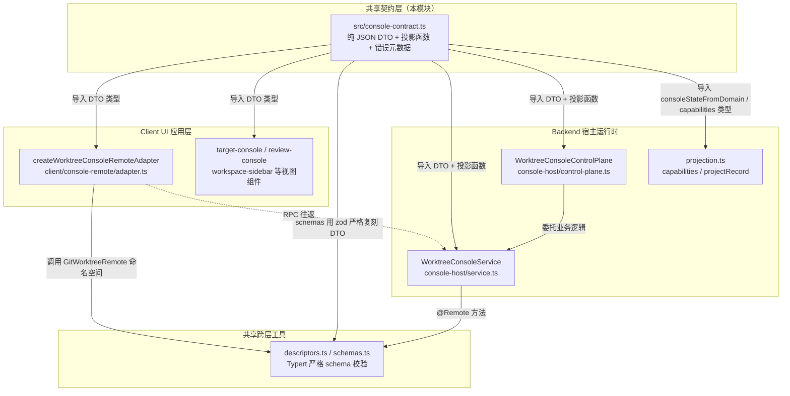
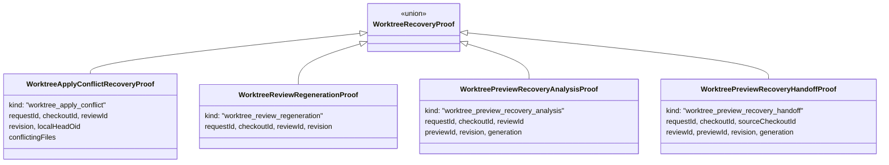
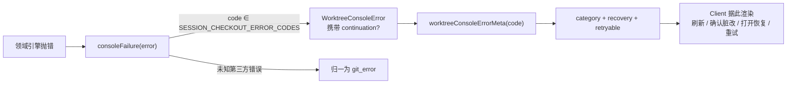
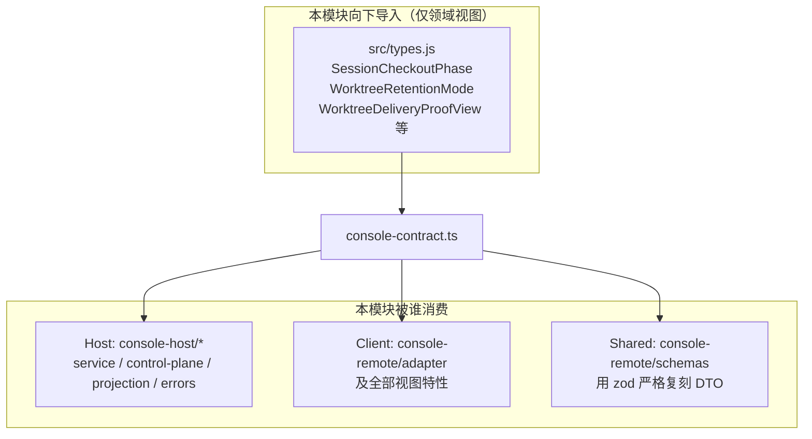

# Shared_Worktree_Console_API_Contract —— 共享 Worktree 控制台 API 契约

!!! info "Generated documentation"
    This page was written by CodeWiki from the source code at commit [`b0979671`](https://github.com/wloops/dsh-git-worktree/commit/b0979671ecdb749b8ca1bf1b3c9f06182f618b95) on 2026-11-07 with `doubao-seed-2.1-lite`. Check the code before relying on details.

## 简介

`Shared_Worktree_Console_API_Contract` 是整个 Worktree 控制台系统的**跨层共享契约层**，全部内容集中在单一文件 `src/console-contract.ts` 中。该模块刻意只包含 **JSON 可序列化的 DTO（数据传输对象）类型定义**、一组纯投影函数与错误元数据表——它**不包含任何 Cordis、React、Remote 传输或文件系统实现**。

它的核心使命是：让「宿主侧（Host）」与「客户端侧（Client）」两条轨道共享同一份请求/响应结构，同时强制遵守一条**单一权威规则**：每一次 Host 操作都必须解析出确切的调用方 Session，并在执行时重新校验项目、归属者、工作目录、修订号与评审身份。

> 模块自述（见文件头注释）：`@module dsh-git-worktree/console-contract`，定位为「未来 Harness 原生 Worktree 控制台的纯 JSON 共享契约」。

### 这个模块解决什么问题

在它之上，Host 端要把 Git Worktree 的领域状态（阶段、交付状态、评审、预览、恢复）投影成 UI 可消费的稳定视图；Client 端要向用户呈现这些视图并发起写操作。如果没有一份共享契约，两端会各自猜测字段形状，导致：

- 状态投影出现歧义（例如「已交付但已清理」到底算完成还是被放弃？）；
- 写操作的并发安全（CAS，比较并交换）约束无法在两侧对齐；
- 错误码与恢复建议不一致，UI 无法给出正确的引导动作。

本模块通过**单一文件权威定义**消除上述漂移。

---

## 架构定位

下图展示契约层在整体系统中的位置，以及它被三层消费的关系：



**关键设计约束**：契约层是「叶子」——它只向下导入 `src/types.js` 的领域视图类型（如 `SessionCheckoutPhase`、`WorktreeRetentionMode`、`WorktreeDeliveryProofView`），自身不被任何领域引擎反向依赖。这保证它可以独立演进为稳定的跨层 API 面。

相关模块入口：

- Host 侧业务实现细节见 [Worktree 控制台宿主服务（Worktree_Console_Host_Service）](Backend_Host_Core_Runtime/Worktree_Console_Host_Service.md)。
- 底层领域视图与阶段/交付类型的来源见 [核心工作区与 Worktree 领域层](Backend_Host_Core_Runtime/Core_Workspace___Worktree_Domain_Layer.md)。
- Client 侧适配与 UI 消费见 [Client_UI_Application_Layer（客户端 UI 应用层）](Client_UI_Application_Layer.md)。
- 传输 schema 与命名空间映射见 [Console Remote 传输层（Console_Remote_Transport_Layer）](Shared_Cross-Tier_Contracts___Utilities/Console_Remote_Transport_Layer.md)。

---

## 核心组成

契约文件导出的全部实体可分为六大类。下面逐一说明其职责。

### 1. 目标状态投影（UI 稳定状态机）

```typescript
WORKTREE_CONSOLE_TARGET_STATES = [
  'local', 'creating', 'working', 'ready_for_review',
  'preview_active', 'preview_detached', 'retained',
  'cleanup_pending', 'recovery_required', 'delivered', 'discarded',
]
```

| 符号 | 含义 |
|------|------|
| `WorktreeConsoleTargetState` | 面向 UI 的 11 态稳定状态，由领域 `phase` + `deliveryState` 投影得出 |
| `WorktreeConsoleDeliveryState` | 交付维度状态子集（working / ready / preview / finalized / retained / delivered） |
| `WorktreeConsoleProjectionSource` | 投影输入：`kind: local|isolated` + `phase` + 可选 `deliveryState` |

**两个纯函数是契约层的「权威判定」**：

- `worktreeReachedDelivery(phase, deliveryState)` —— 判定任务是否真正「已送达」。只要交付态为 `delivered`/`finalized`/`retained`，或阶段本身已结束（finalized/retained），即返回真。这一谓词被 Host 的归属校验门直接复用（见 `control-plane.ts` 的 `verifyCallerRoot`），**保证「已交付终端态」的判定不会在 UI 投影与 Host 授权之间漂移**。
- `consoleStateFromDomain(source)` —— 把领域事实翻译成 UI 状态，优先级规则为：隔离中 → `recovery_required` 与 `preparing` 优先；已交付 → `delivered`；已丢弃 → `discarded`（丢弃优先于 retained/finalized，因为清理发生在交付之后）；其余按 deliveryState 逐级回落，最终默认 `working`。

> 设计要点：**交付优先于阶段**。一个已交付的 Worktree 随后被清理，其 `phase` 会推进到 `discarded`，但任务实际已完成——绝不能被投影成「被放弃」。

### 2. 目标摘要与详情（核心视图 DTO）

| DTO | 用途 |
|-----|------|
| `WorktreeConsoleProject` | 项目标识（`id` + `name`），全路径无关 |
| `WorktreeConsoleTargetSummary` | **列表行 / 顶部状态胶囊**用的「无路径」摘要：含 checkoutId、源/归属/目标会话、迭代、修订、状态、dirty、OID、分支、保留期、常驻标记、清理原因、交付证明、评审摘要、检查点、评审位、预览恢复、能力集 |
| `WorktreeConsoleTargetDetails` | 在 Summary 之上叠加「身份校验通过后」的详情：`managedRoot`、`sourceRoot`、`sourceOid`、`currentBranch`、归属者专属的 `recoveryContinuation` 证明 |
| `WorktreeConsoleCapabilities` | 15 个布尔能力位，精确描述「当前调用方在当前状态下**能**执行哪些操作」（见下文能力矩阵） |
| `WorktreeConsoleReviewSummary` | 评审摘要（reviewId、revision、iteration、校验状态、测试、改动文件、建议提交信息） |
| `WorktreeConsolePreviewRecovery` | 预览脱离现场（previewId、脱离时间、原因、被中断的动作） |

`WorktreeConsoleTargetSummary` 是整个系统**被消费最广的单一结构**——`list`、`inspect`、`current` 以及所有 mutation 响应（`WorktreeConsoleMutationResponse.target`）都回传它。

### 3. 请求 / 响应对（操作族）

契约按「读、写、Git 辅助、侧边栏、恢复」分为五组。所有写操作请求都遵循同一套 **CAS 身份三元/四元组**：

```typescript
{ sessionId, checkoutId, expectedRevision, expectedReviewId? , expectedGeneration? }
```

- `expectedRevision`：乐观锁修订号，Host 执行时比对，不符即 `stale_target`；
- `expectedReviewId`：把写操作**绑定到某个不可变评审身份**，避免对过期评审落盘；
- `expectedGeneration`：仅 `checkpoint` 使用，绑定检查点快照代。

| 操作族 | 代表请求 / 响应 |
|--------|----------------|
| **读取与投影** | `CurrentRequest/Response`、`ListRequest/Response`、`InspectRequest/Response`、`ReviewDiffRequest/Response`（含 `DiffFile` 行） |
| **接受 / 交付写操作** | `Preflight`、`Preview`、`Checkpoint`、`ResumeRevision`、`RollbackPreview`、`Discard`、`Finalize`、`FinalizePreview` |
| **保留 / 清理 / 迭代** | `SetRetention`、`SetPermanent`、`RetryCleanup`、`BeginNextIteration`、`ReturnToLocal`、`ClearSidebarBadge` |
| **Git 辅助** | `GitOverview`、`GitGraph`、`GitPrune`、`GitCreate/Delete/PushTag`、`GitListTags` |
| **侧边栏拓扑** | `SidebarTopologyResponse`、`SidebarProject`、`SidebarTask`（只读、无路径、无写权限） |
| **放弃快照** | `AbandonedList`、`RestoreAbandoned`（discarded 记录无活 target 时的恢复通道） |

### 4. 恢复证明（Recovery Proof）族

这是契约层对「失败现场」的标准化封装——Host 在一次写尝试失败后产出一份**可回传的不可变证据**，Client 据此发起安全的二次操作：



与之配对的 `WorktreeApplyConflictContinuation`（作为 `WorktreeConsoleError.continuation` 回传）让 Client 能在冲突恢复动作中携带现场，使 Host 在 CAS 下重跑冲突预检。所有 proof 的 `kind` 字段做可辨识联合判别，Host 还对 `conflictingFiles` 做越界/路径穿越校验（见 `control-plane.ts::safeConflictFile`）。

### 5. 错误模型与恢复元数据

```typescript
type WorktreeConsoleOutcome<T> =
  | { ok: true; value: T }
  | { ok: false; error: WorktreeConsoleError }
```

- `WorktreeConsoleErrorCode`：复用底层 `SESSION_CHECKOUT_ERROR_CODES`，并新增三个传输层码：`transport_unavailable`、`malformed_response`、`timeout`。
- `WorktreeConsoleErrorMeta`：每个错误码映射到 `category`（permission/stale/confirmation/recovery/conflict/unavailable/invalid/internal）、`recovery`（none/refresh/confirm_dirty/open_recovery/retry）、`retryable`。
- `worktreeConsoleErrorMeta(code)`：查表函数，Client 用它把错误转成「可点哪个按钮」的 UI 引导。

契约内置一张完整的 `ERROR_META` 表（约 33 个码），例如：`apply_conflict → {conflict, open_recovery, 不可重试}`、`stale_target → {stale, refresh, 可重试}`、`dirty_confirmation_required → {confirmation, confirm_dirty, 可重试}`。

### 6. 标准化适配端口（Client 唯一接缝）

`WorktreeConsoleAdapter` 是 **Client 侧唯一依赖的接口**。它把所有 35+ 个方法收拢为一个对象，返回类型统一为 `WorktreeConsoleOutcome<T>`——**Remote 传输细节被完全挡在适配器之后**。Client 的视图组件从不直接触碰 `GitWorktreeRemote`，只依赖这个 Adapter 接口。

---

## 能力矩阵（WorktreeConsoleCapabilities）

`capabilities` 由 Host 的 `projection.ts` 根据「调用方身份 × 记录状态」实时计算后塞进每个目标视图。它是 UI 决定「按钮置灰还是可点」的唯一权威来源。

| 能力位 | 语义 | Host 置位条件（摘要） |
|--------|------|----------------------|
| `create` | 从 Local 发起新隔离 | 仅 Local 投影可置位（且已版本化） |
| `open` / `inspect` | 打开 / 只读详情 | 调用方为 owner/source/linkedRead 且读授权通过 |
| `discard` | 放弃改动 | owner（或 source 预留）且记录活跃、非清理/脱离 |
| `preflight` / `preview` | 接受预检 / 落地本地预览 | owner 且记录处于 `ready + ready_for_review` |
| `checkpoint` | 把已审快照存为隔离检查点 | owner 且 ready 或 preview_active |
| `resumeRevision` | 使过期评审失效并同迭代重做 | owner 且 ready |
| `rollbackPreview` | 回滚本地预览 | owner 且 preview 活跃/脱离/恢复中 |
| `finalize` | Ready → 直接提交（跳过 Local 预览） | owner 且 ready |
| `finalizePreview` | 预览态 → 提交交付 | owner 且 preview 活跃/脱离 |
| `setRetention` / `setPermanent` | 设置保留期 / 常驻豁免 | owner 且对应交付态 |
| `retryCleanup` | 重试清理冻结目录 | owner 且 finalized/retained |
| `beginNextIteration` | 为已交付 owner 重建冻结 cwd 续迭代 | owner 且已交付（discarded+delivered） |
| `returnToLocal` | 把已交付隔离会话解绑回 Local | owner 且已通过 `worktreeReachedDelivery` |

> 注意：`setRetention`/`setPermanent`/`retryCleanup` 作用于**冻结目录本身**，Host 严格只对 owner 开放——绝不授权给 Local 侧的 source 会话。

---

## 请求生命周期与数据流

下图追踪一次「接受交付」写操作从 Client 按钮到 Host 落盘的完整往返，以及契约在各环节的形态：

```mermaid
sequenceDiagram
    participant UI as Client 视图组件
    participant AD as WorktreeConsoleAdapter
    participant CAR as GitWorktreeRemote 传输
    participant SVC as WorktreeConsoleService (@Remote)
    participant CP as WorktreeConsoleControlPlane
    participant ENG as SessionCheckoutModule 领域引擎

    UI->>AD: finalize(request: WorktreeConsoleFinalizeRequest)
    Note over AD: 携带 sessionId / checkoutId<br/>expectedRevision / expectedReviewId<br/>commitMessage / retention
    AD->>AD: invoke() 加 30s/180s 超时<br/>严格 schema parse 响应
    AD->>CAR: remote.finalize(agentId, ...)
    CAR->>SVC: RPC (Gateway 解析 agentId)
    SVC->>SVC: withHostLanguage(locale)
    SVC->>CP: controlPlane.finalize(request)
    CP->>CP: verifyCallerRoot 身份校验<br/>CAS 比对 expectedRevision
    CP->>ENG: module.operate(...)
    ENG-->>CP: 成功 / conflict / stale
    CP->>CP: projectRecord() 重投影新状态<br/>capabilities() 重算能力
    CP-->>SVC: WorktreeConsoleOutcome&lt;MutationResponse&gt;
    SVC-->>CAR: 同型 Outcome
    CAR-->>AD: 同型 Outcome
    AD-->>UI: WorktreeConsoleOutcome&lt;WorktreeConsoleMutationResponse&gt;
    Note over UI: target 携带新 state + capabilities<br/>据此刷新按钮与状态胶囊
```

**两侧如何保证同一形状**：

- Host 端 `service.ts` 的每个 `@Remote` 方法签名，与 `descriptors.ts` 里的 `InvocationDescriptor`、`remote.ts` 里的 `TypertRemoteMap` 声明**逐参数对齐**；
- Client 端 `adapter.ts` 把扁平化参数（agentId 由 Gateway 注入）重新组装回契约的 Request DTO；
- 每个响应都先经 `descriptor.result.create().parse()` 严格校验——任何字段漂移立刻被降级为 `malformed_response`，而不是悄悄渲染错误 UI。

### 错误与恢复的数据流



---

## 与相邻模块的依赖关系



- **向下唯一依赖** `src/types.js`（[核心工作区与 Worktree 领域层](Backend_Host_Core_Runtime/Core_Workspace___Worktree_Domain_Layer.md)）：导入阶段枚举、保留模式、交付证明视图、校验项等领域原语。契约不导入任何引擎实现，因此不会与 [会话检出应用执行引擎（Session_Checkout_Apply_Execution_Engine）](Backend_Host_Core_Runtime/Core_Session_Checkout_Engine/Session_Checkout_Apply_Execution_Engine.md) 形成循环依赖。
- **被 Host 消费**：`service.ts` 用 DTO 标注每个 `@Remote` 方法返回；`control-plane.ts` 用 Request DTO 收参并调用 `worktreeReachedDelivery`；`projection.ts` 用 `consoleStateFromDomain` 与 `capabilities` 类型产出视图；`errors.ts` 用 `WorktreeConsoleOutcome/Error` 构造失败。
- **被 Client 消费**：`adapter.ts` 实现 `WorktreeConsoleAdapter`；各视图特性（Target Console、Review Console、Workspace Sidebar）直接消费 `TargetSummary`/`SidebarTask` 等 DTO。
- **被传输层复刻**：`schemas.ts` 用 zod 以 `strict()` 对象逐一复刻每个 DTO，并在 `descriptors.ts` 中包装成 `strictCodec`，作为 RPC 进出双向的运行时校验网。

---

## 设计约束与不变量（维护须知）

1. **纯 JSON 约束**：本文件不得引入 Cordis / React / Remote / 文件系统类型。所有 DTO 必须可经 `JSON.stringify` 无损往返。引入函数或类实例会破坏跨进程边界。
2. **单一权威判定**：终端态判定（`worktreeReachedDelivery`）与状态投影（`consoleStateFromDomain`）是 UI 与 Host 共享的唯一事实源。修改优先级规则时，必须同时检查 `control-plane.ts::verifyCallerRoot` 与 `projection.ts` 的复用点。
3. **CAS 身份绑定**：凡是落盘写操作，请求必须带 `expectedRevision`（+ 通常 `expectedReviewId`）。不得新增「无 revision 校验」的写方法，否则破坏乐观锁语义。
4. **能力位由 Host 计算**：Client 永远信任视图里的 `capabilities`，不得自行推断某按钮可点。新增能力位时，必须同步在 `projection.ts::capabilities` 给出置位条件。
5. **错误码表完备**：`ERROR_META` 用 `satisfies Record<WorktreeConsoleErrorCode, ...>` 强约束——新增错误码必须补一行元数据，否则类型检查失败。
6. **路径不泄漏**：`TargetSummary`/`SidebarTask` 等列表行刻意「无路径」；只有身份校验通过的 `TargetDetails` 才携带 `managedRoot`/`sourceRoot`。不要把绝对路径下沉到列表行。

---

## 关键文件索引

| 文件 | 角色 |
|------|------|
| `src/console-contract.ts` | **本模块唯一文件**：全部 DTO、投影函数、错误元数据、Adapter 接口 |
| `src/console-host/errors.ts` | 把领域异常转成 `WorktreeConsoleOutcome`（`consoleFailure`/`failure`/`outcome`） |
| `src/console-host/projection.ts` | `capabilities()` 与 `projectRecord()`/`projectDetails()`/`projectLocal()` 产出契约视图 |
| `src/console-host/control-plane.ts` | 用 Request DTO 收参、做 `verifyCallerRoot` 授权与 CAS |
| `src/console-host/service.ts` | `@Remote` 方法逐一对齐契约返回类型 |
| `src/client/console-remote/adapter.ts` | `WorktreeConsoleAdapter` 的唯一实现，含超时与严格校验 |
| `src/console-remote/schemas.ts` / `descriptors.ts` | zod 严格 schema 与 RPC 描述符（见传输层文档） |

??? abstract "Documented components (70)"
    - [`WorktreeApplyConflictContinuation`](https://github.com/wloops/dsh-git-worktree/blob/b0979671ecdb749b8ca1bf1b3c9f06182f618b95/src%5Cconsole-contract.ts) — `src\console-contract.ts`
    - [`WorktreeApplyConflictRecoveryProof`](https://github.com/wloops/dsh-git-worktree/blob/b0979671ecdb749b8ca1bf1b3c9f06182f618b95/src%5Cconsole-contract.ts) — `src\console-contract.ts`
    - [`WorktreeClientBootReport`](https://github.com/wloops/dsh-git-worktree/blob/b0979671ecdb749b8ca1bf1b3c9f06182f618b95/src%5Cconsole-contract.ts) — `src\console-contract.ts`
    - [`WorktreeConsoleAbandonedListRequest`](https://github.com/wloops/dsh-git-worktree/blob/b0979671ecdb749b8ca1bf1b3c9f06182f618b95/src%5Cconsole-contract.ts) — `src\console-contract.ts`
    - [`WorktreeConsoleAbandonedListResponse`](https://github.com/wloops/dsh-git-worktree/blob/b0979671ecdb749b8ca1bf1b3c9f06182f618b95/src%5Cconsole-contract.ts) — `src\console-contract.ts`
    - [`WorktreeConsoleAbandonedSnapshot`](https://github.com/wloops/dsh-git-worktree/blob/b0979671ecdb749b8ca1bf1b3c9f06182f618b95/src%5Cconsole-contract.ts) — `src\console-contract.ts`
    - [`WorktreeConsoleAdapter`](https://github.com/wloops/dsh-git-worktree/blob/b0979671ecdb749b8ca1bf1b3c9f06182f618b95/src%5Cconsole-contract.ts) — `src\console-contract.ts`
    - [`WorktreeConsoleBeginNextIterationRequest`](https://github.com/wloops/dsh-git-worktree/blob/b0979671ecdb749b8ca1bf1b3c9f06182f618b95/src%5Cconsole-contract.ts) — `src\console-contract.ts`
    - [`WorktreeConsoleCapabilities`](https://github.com/wloops/dsh-git-worktree/blob/b0979671ecdb749b8ca1bf1b3c9f06182f618b95/src%5Cconsole-contract.ts) — `src\console-contract.ts`
    - [`WorktreeConsoleCheckpointRequest`](https://github.com/wloops/dsh-git-worktree/blob/b0979671ecdb749b8ca1bf1b3c9f06182f618b95/src%5Cconsole-contract.ts) — `src\console-contract.ts`
    - [`WorktreeConsoleClearSidebarBadgeRequest`](https://github.com/wloops/dsh-git-worktree/blob/b0979671ecdb749b8ca1bf1b3c9f06182f618b95/src%5Cconsole-contract.ts) — `src\console-contract.ts`
    - [`WorktreeConsoleCreatePreviewRecoveryHandoffRequest`](https://github.com/wloops/dsh-git-worktree/blob/b0979671ecdb749b8ca1bf1b3c9f06182f618b95/src%5Cconsole-contract.ts) — `src\console-contract.ts`
    - [`WorktreeConsoleCreatePreviewRecoveryHandoffResponse`](https://github.com/wloops/dsh-git-worktree/blob/b0979671ecdb749b8ca1bf1b3c9f06182f618b95/src%5Cconsole-contract.ts) — `src\console-contract.ts`
    - [`WorktreeConsoleCreateResponse`](https://github.com/wloops/dsh-git-worktree/blob/b0979671ecdb749b8ca1bf1b3c9f06182f618b95/src%5Cconsole-contract.ts) — `src\console-contract.ts`
    - [`WorktreeConsoleCurrentRequest`](https://github.com/wloops/dsh-git-worktree/blob/b0979671ecdb749b8ca1bf1b3c9f06182f618b95/src%5Cconsole-contract.ts) — `src\console-contract.ts`
    - [`WorktreeConsoleCurrentResponse`](https://github.com/wloops/dsh-git-worktree/blob/b0979671ecdb749b8ca1bf1b3c9f06182f618b95/src%5Cconsole-contract.ts) — `src\console-contract.ts`
    - [`WorktreeConsoleDiffFile`](https://github.com/wloops/dsh-git-worktree/blob/b0979671ecdb749b8ca1bf1b3c9f06182f618b95/src%5Cconsole-contract.ts) — `src\console-contract.ts`
    - [`WorktreeConsoleDiscardRequest`](https://github.com/wloops/dsh-git-worktree/blob/b0979671ecdb749b8ca1bf1b3c9f06182f618b95/src%5Cconsole-contract.ts) — `src\console-contract.ts`
    - [`WorktreeConsoleError`](https://github.com/wloops/dsh-git-worktree/blob/b0979671ecdb749b8ca1bf1b3c9f06182f618b95/src%5Cconsole-contract.ts) — `src\console-contract.ts`
    - [`WorktreeConsoleErrorMeta`](https://github.com/wloops/dsh-git-worktree/blob/b0979671ecdb749b8ca1bf1b3c9f06182f618b95/src%5Cconsole-contract.ts) — `src\console-contract.ts`
    - [`WorktreeConsoleFinalizePreviewRequest`](https://github.com/wloops/dsh-git-worktree/blob/b0979671ecdb749b8ca1bf1b3c9f06182f618b95/src%5Cconsole-contract.ts) — `src\console-contract.ts`
    - [`WorktreeConsoleFinalizeRequest`](https://github.com/wloops/dsh-git-worktree/blob/b0979671ecdb749b8ca1bf1b3c9f06182f618b95/src%5Cconsole-contract.ts) — `src\console-contract.ts`
    - [`WorktreeConsoleGitBranch`](https://github.com/wloops/dsh-git-worktree/blob/b0979671ecdb749b8ca1bf1b3c9f06182f618b95/src%5Cconsole-contract.ts) — `src\console-contract.ts`
    - [`WorktreeConsoleGitCreateTagRequest`](https://github.com/wloops/dsh-git-worktree/blob/b0979671ecdb749b8ca1bf1b3c9f06182f618b95/src%5Cconsole-contract.ts) — `src\console-contract.ts`
    - [`WorktreeConsoleGitDeleteTagRequest`](https://github.com/wloops/dsh-git-worktree/blob/b0979671ecdb749b8ca1bf1b3c9f06182f618b95/src%5Cconsole-contract.ts) — `src\console-contract.ts`
    - [`WorktreeConsoleGitGraphCommit`](https://github.com/wloops/dsh-git-worktree/blob/b0979671ecdb749b8ca1bf1b3c9f06182f618b95/src%5Cconsole-contract.ts) — `src\console-contract.ts`
    - [`WorktreeConsoleGitGraphResponse`](https://github.com/wloops/dsh-git-worktree/blob/b0979671ecdb749b8ca1bf1b3c9f06182f618b95/src%5Cconsole-contract.ts) — `src\console-contract.ts`
    - [`WorktreeConsoleGitMutationResponse`](https://github.com/wloops/dsh-git-worktree/blob/b0979671ecdb749b8ca1bf1b3c9f06182f618b95/src%5Cconsole-contract.ts) — `src\console-contract.ts`
    - [`WorktreeConsoleGitOverviewResponse`](https://github.com/wloops/dsh-git-worktree/blob/b0979671ecdb749b8ca1bf1b3c9f06182f618b95/src%5Cconsole-contract.ts) — `src\console-contract.ts`
    - [`WorktreeConsoleGitPruneEntry`](https://github.com/wloops/dsh-git-worktree/blob/b0979671ecdb749b8ca1bf1b3c9f06182f618b95/src%5Cconsole-contract.ts) — `src\console-contract.ts`
    - [`WorktreeConsoleGitPruneResponse`](https://github.com/wloops/dsh-git-worktree/blob/b0979671ecdb749b8ca1bf1b3c9f06182f618b95/src%5Cconsole-contract.ts) — `src\console-contract.ts`
    - [`WorktreeConsoleGitPushTagRequest`](https://github.com/wloops/dsh-git-worktree/blob/b0979671ecdb749b8ca1bf1b3c9f06182f618b95/src%5Cconsole-contract.ts) — `src\console-contract.ts`
    - [`WorktreeConsoleGitTag`](https://github.com/wloops/dsh-git-worktree/blob/b0979671ecdb749b8ca1bf1b3c9f06182f618b95/src%5Cconsole-contract.ts) — `src\console-contract.ts`
    - [`WorktreeConsoleGitTagListResponse`](https://github.com/wloops/dsh-git-worktree/blob/b0979671ecdb749b8ca1bf1b3c9f06182f618b95/src%5Cconsole-contract.ts) — `src\console-contract.ts`
    - [`WorktreeConsoleGitTagMutationResponse`](https://github.com/wloops/dsh-git-worktree/blob/b0979671ecdb749b8ca1bf1b3c9f06182f618b95/src%5Cconsole-contract.ts) — `src\console-contract.ts`
    - [`WorktreeConsoleInspectRequest`](https://github.com/wloops/dsh-git-worktree/blob/b0979671ecdb749b8ca1bf1b3c9f06182f618b95/src%5Cconsole-contract.ts) — `src\console-contract.ts`
    - [`WorktreeConsoleInspectResponse`](https://github.com/wloops/dsh-git-worktree/blob/b0979671ecdb749b8ca1bf1b3c9f06182f618b95/src%5Cconsole-contract.ts) — `src\console-contract.ts`
    - [`WorktreeConsoleListRequest`](https://github.com/wloops/dsh-git-worktree/blob/b0979671ecdb749b8ca1bf1b3c9f06182f618b95/src%5Cconsole-contract.ts) — `src\console-contract.ts`
    - [`WorktreeConsoleListResponse`](https://github.com/wloops/dsh-git-worktree/blob/b0979671ecdb749b8ca1bf1b3c9f06182f618b95/src%5Cconsole-contract.ts) — `src\console-contract.ts`
    - [`WorktreeConsoleMutationResponse`](https://github.com/wloops/dsh-git-worktree/blob/b0979671ecdb749b8ca1bf1b3c9f06182f618b95/src%5Cconsole-contract.ts) — `src\console-contract.ts`
    - [`WorktreeConsolePreflightRequest`](https://github.com/wloops/dsh-git-worktree/blob/b0979671ecdb749b8ca1bf1b3c9f06182f618b95/src%5Cconsole-contract.ts) — `src\console-contract.ts`
    - [`WorktreeConsolePreflightResponse`](https://github.com/wloops/dsh-git-worktree/blob/b0979671ecdb749b8ca1bf1b3c9f06182f618b95/src%5Cconsole-contract.ts) — `src\console-contract.ts`
    - [`WorktreeConsolePreparePreviewRecoveryAnalysisRequest`](https://github.com/wloops/dsh-git-worktree/blob/b0979671ecdb749b8ca1bf1b3c9f06182f618b95/src%5Cconsole-contract.ts) — `src\console-contract.ts`
    - [`WorktreeConsolePrepareRegenerationRequest`](https://github.com/wloops/dsh-git-worktree/blob/b0979671ecdb749b8ca1bf1b3c9f06182f618b95/src%5Cconsole-contract.ts) — `src\console-contract.ts`
    - [`WorktreeConsolePreviewRecovery`](https://github.com/wloops/dsh-git-worktree/blob/b0979671ecdb749b8ca1bf1b3c9f06182f618b95/src%5Cconsole-contract.ts) — `src\console-contract.ts`
    - [`WorktreeConsolePreviewRecoveryPreflightRequest`](https://github.com/wloops/dsh-git-worktree/blob/b0979671ecdb749b8ca1bf1b3c9f06182f618b95/src%5Cconsole-contract.ts) — `src\console-contract.ts`
    - [`WorktreeConsolePreviewRecoveryPreflightResponse`](https://github.com/wloops/dsh-git-worktree/blob/b0979671ecdb749b8ca1bf1b3c9f06182f618b95/src%5Cconsole-contract.ts) — `src\console-contract.ts`
    - [`WorktreeConsolePreviewRequest`](https://github.com/wloops/dsh-git-worktree/blob/b0979671ecdb749b8ca1bf1b3c9f06182f618b95/src%5Cconsole-contract.ts) — `src\console-contract.ts`
    - [`WorktreeConsoleProject`](https://github.com/wloops/dsh-git-worktree/blob/b0979671ecdb749b8ca1bf1b3c9f06182f618b95/src%5Cconsole-contract.ts) — `src\console-contract.ts`
    - [`WorktreeConsoleProjectionSource`](https://github.com/wloops/dsh-git-worktree/blob/b0979671ecdb749b8ca1bf1b3c9f06182f618b95/src%5Cconsole-contract.ts) — `src\console-contract.ts`
    - … and 20 more

