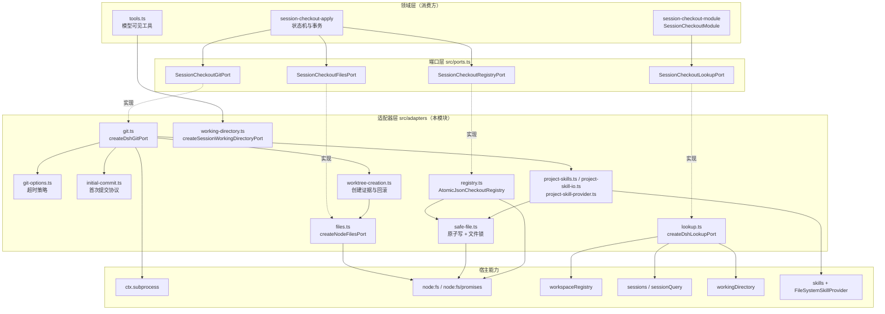
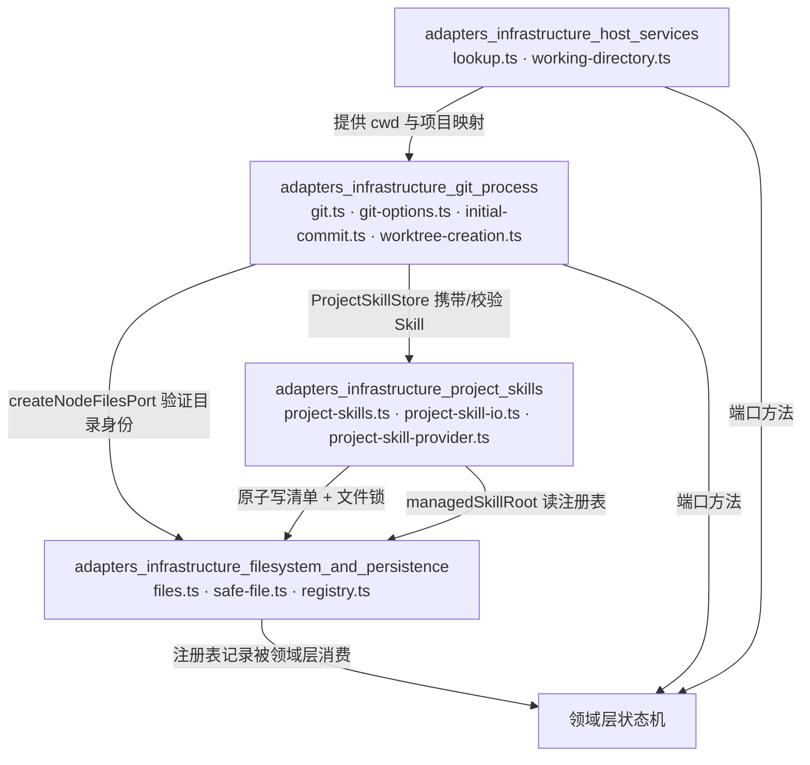
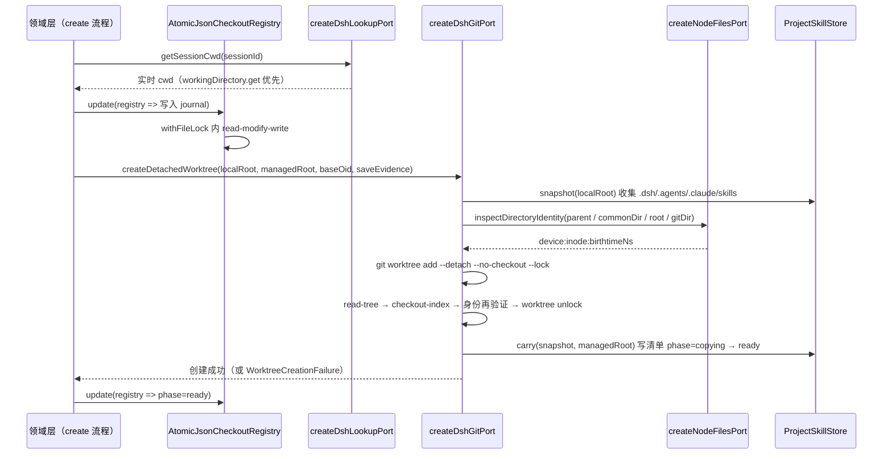
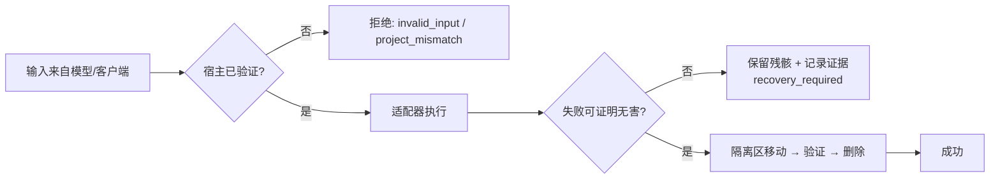

# 适配器与基础设施（adapters_infrastructure）

!!! info "Generated documentation"
    This page was written by CodeWiki from the source code at commit [`e1bb46dc`](https://github.com/wloops/dsh-git-worktree/commit/e1bb46dcb7e626e7a0bc8875b5980a70ba0eb79a) on 2026-11-12 with `mimo-v2.6-flash`. Check the code before relying on details.

## 模块目的

`src/adapters/` 是 `dsh-git-worktree` 插件的**基础设施层（infrastructure ring）**。它把 [核心端口与类型](core_ports_and_types.md) 中声明的抽象端口（`SessionCheckoutGitPort`、`SessionCheckoutFilesPort`、`SessionCheckoutLookupPort`、`SessionCheckoutRegistryPort`）落地为运行在 DeepSeek Harness 宿主上的具体实现：

- **Git 端口** → 通过 `ctx.subprocess` 执行加固过的 `git` 子进程（`adapters/git.ts`）；
- **文件端口** → 通过 `node:fs` 提供目录身份（device/inode/birthtime）、隔离区（quarantine）移动与链接安全的递归删除（`adapters/files.ts`）；
- **注册表端口** → 单文件原子 JSON + 跨进程文件锁（`adapters/registry.ts` + `adapters/safe-file.ts`）；
- **查找端口** → 映射到宿主的 `workspaceRegistry` / `sessions` / `workingDirectory` 服务（`adapters/lookup.ts`、`adapters/working-directory.ts`）。

除此之外，本模块还承载三块「只在适配器层成立」的能力：**受管 Worktree 创建协议**（带证据链与可回滚的失败清理）、**首次提交协议**（把非 Git 或 unborn 项目在用户确认后初始化），以及 **Project Skills 携带机制**（把 Local 检出的 `.dsh/.agents/.claude/skills` 复制进受管 Worktree 并保留可证明的来源记录）。

本模块**不做业务决策**：状态机、交付/评审/清理语义位于 [工作树与会话检出领域](Worktree_and_Session_Checkout_Domain.md)，由适配器把宿主能力暴露给它们。

## 架构总览

### 端口与实现的对应关系

| 端口（`src/ports.ts`） | 适配器实现 | 关键宿主依赖 |
| --- | --- | --- |
| `SessionCheckoutGitPort` | `createDshGitPort(ctx, options)` | `ctx.subprocess` |
| `SessionCheckoutFilesPort` | `createNodeFilesPort()` | `node:fs`、`node:fs/promises` |
| `SessionCheckoutRegistryPort` | `AtomicJsonCheckoutRegistry` | `safe-file.ts` 原子写 + 锁 |
| `SessionCheckoutLookupPort` | `createDshLookupPort(ctx)` | `workspaceRegistry`、`sessions`、`sessionQuery`、`workingDirectory` |
| `SessionWorkingDirectoryPort`（工具层端口） | `createSessionWorkingDirectoryPort(ctx)` | `workingDirectory` |

所有宿主服务都通过 `ctx.get('serviceName')` **动态**解析，并配合结构化类型守卫（`isWorkspaceRegistryLike`、`isSessionStoreLike`、`isWorkingDirectoryLike`）。缺少服务时适配器降级为 `undefined` / 空列表，而不是抛错——宿主没有对应服务时，上层把缺失当成「恢复/孤儿事实」而不是失败。

## 子模块

本模块按职责拆分为四个子模块，各自有独立文档：

| 子模块文档 | 覆盖文件 | 核心组件 |
| --- | --- | --- |
| [Git 进程适配器与工作树创建编排](adapters_infrastructure_git_process.md) | `adapters/git.ts`、`adapters/git-options.ts`、`adapters/initial-commit.ts`、`adapters/worktree-creation.ts` | `createDshGitPort`、`GitCommandResult`、`GitPortOptions`、`GitTimeoutOptions`、`GitCommitProtocol`、`createWorktree` |
| [文件系统与持久化适配器（adapters_infrastructure_filesystem_and_persistence）](adapters_infrastructure_filesystem_and_persistence.md) | `adapters/files.ts`、`adapters/safe-file.ts`、`adapters/registry.ts` | `createNodeFilesPort`、`withFileLock`、`FileLockOptions`、`FileLockPayload`、`AtomicJsonCheckoutRegistry` |
| [Project Skills 适配器：跨 Worktree 携带与 Claude Skill 提供者](adapters_infrastructure_project_skills.md) | `adapters/project-skills.ts`、`adapters/project-skill-io.ts`、`adapters/project-skill-provider.ts` | `ProjectSkillStore`、`SkillSnapshot`、`CarriedSkillState`、`Manifest`、`Entry`、`SkillBytes`、`SkillRead`、`ClaudeProjectSkillProvider`、`Locator` |
| [主机服务适配器（Host Services Adapters）](adapters_infrastructure_host_services.md) | `adapters/lookup.ts`、`adapters/working-directory.ts` | `createDshLookupPort`、`createSessionWorkingDirectoryPort`、`WorkspaceRegistryLike`、`SessionStoreLike`、`WorkingDirectoryServiceLike`、`SessionWorkingDirectoryPort` |

以下逐节概述各子模块职责；实现细节请查阅对应子模块页面。

### 1. Git 执行与创建协议（`adapters_infrastructure_git_process`）

详见 [Git 进程适配器与工作树创建编排](adapters_infrastructure_git_process.md)。

覆盖 `adapters/git.ts`、`adapters/git-options.ts`、`adapters/initial-commit.ts`、`adapters/worktree-creation.ts`：

- **命令执行**：`runGit` 以 argv 数组直接 spawn（永不经 shell），统一注入 `--no-pager`、`--no-optional-locks`、`core.hooksPath=<空目录>`、`core.fsmonitor=false`、`LC_ALL=C`、`GIT_TERMINAL_PROMPT=0`，并清洗 `GIT_DIR`/`GIT_WORK_TREE`/`GIT_CONFIG_*` 等环境变量，保证「仓库路由只能来自被授权的 cwd」。
- **超时策略**：`git-options.ts` 定义 `DEFAULT_GIT_TIMEOUT_MS = 120s`、`DEFAULT_WORKTREE_ADD_TIMEOUT_MS = 5min`、`MAX_GIT_TIMEOUT_MS = 1h`，`worktree add` / `worktree remove` 走独立更宽的上限；`LiveValue<T>` 支持设置页热更新（每次调用重新读取）。
- **输出上限**：常规 1 MiB、WIP 二进制补丁 16 MiB、`status` 16 MiB；`status` 先尝试 `--untracked-files=all`，溢出后降级为 `normal`，仍溢出才报 `truncated`。
- **内部引用命名空间**：`refs/dsh-worktree/session-checkouts/<sha256(checkoutId)[:24]>/<artifact>` 与 `refs/dsh-worktree/abandoned/<checkoutId>`，插件产物绝不与用户 ref 冲突。
- **创建协议**：`createWorktree` 先独占 `mkdir` 占位、记录 `WorktreeCreationEvidence`（root/parent/common/git 目录身份、metadata 指纹、index 指纹、lockReason），再 `worktree add --detach --no-checkout --lock` → `read-tree` → `checkout-index`；失败时**只有在 quiescence 被证实**才回收，且回收前逐字节验证目录未被他人修改，否则保留残骸交人工处理。
- **首次提交协议**：`preflightInitialCommit` / `initializeEmptyRepository` / `initializeProject`，用 index lock + `update-ref --stdin` 事务做 CAS，保证并发下不会覆盖竞态提交。

### 2. 文件系统与持久化（`adapters_infrastructure_filesystem_and_persistence`）

详见 [文件系统与持久化适配器（adapters_infrastructure_filesystem_and_persistence）](adapters_infrastructure_filesystem_and_persistence.md)。

覆盖 `adapters/files.ts`、`adapters/safe-file.ts`、`adapters/registry.ts`：

- **目录身份 CAS**：`inspectDirectoryIdentity` 返回 `{ device, inode, birthtimeNs }`（bigint 精度），`quarantineDirectoryTree` 用 `rename` 把残骸原子移入隔离区，身份不符则回滚并抛 `checkout_mismatch`。
- **链接安全删除**：`removeEmptyDirectoryTree` 遇符号链接/junction 只 `unlink` 链接本身、绝不跟随；`removeDirectoryTree` 拒绝删除非目录或符号链接根。
- **崩溃安全 JSON**：`safe-file.ts` 使用唯一命名 tmp（`<file>.<pid>.<uuid>.tmp`）→ `rename`，Windows 上对 `EBUSY/EPERM/EACCES/ENOTEMPTY` 指数退避重试；读取按「主文件 → 最新可解析 tmp → `.bak`」三级回退。
- **跨进程互斥**：`withFileLock` 用 `<target>.lock` 文件携带 `{ pid, createdAt, token }`，支持陈旧锁回收（进程已退出或超过 `staleAfterMs`），且**只删自己 token 的锁**；同进程重入直接复用。
- **注册表校验与迁移**：`AtomicJsonCheckoutRegistry` 对每条记录做深度结构校验，坏记录**逐条降级丢弃**（保留其余、不回写磁盘），v1 注册表保守迁移为 `recovery_required`；`update(mutate)` 在锁内完成「读-改-写」以避免跨进程丢写。

### 3. Project Skills 携带（`adapters_infrastructure_project_skills`）

详见 [Project Skills 适配器：跨 Worktree 携带与 Claude Skill 提供者](adapters_infrastructure_project_skills.md)。

覆盖 `adapters/project-skills.ts`、`adapters/project-skill-io.ts`、`adapters/project-skill-provider.ts`：

- **范围**：只处理 `.dsh/skills`、`.agents/skills`、`.claude/skills` 三个根，上限 5000 文件 / 64 MiB / 深度 64。
- **来源记录（provenance）**：`ProjectSkillStore` 在宿主私有目录写入 `<sha256(root)>.json` 清单（`phase: 'copying' → 'ready'`），只信任宿主侧记录，绝不接受受管 Worktree 自报的排除清单。
- **删除保护**：`assertRemovable` 在删除受管 Worktree 前验证携带内容未被修改，避免静默丢弃用户 Skill 编辑。
- **宿主集成**：`ClaudeProjectSkillProvider` 注册为额外 `SkillProvider`（`provider: 'worktree-project-claude'`、`source: 'project-claude'`、`rank: 250`），只读取经 `managedSkillRoot` 验证（`.git` 指针 + `gitdir` 反向指针 + `commondir` 三重校验）的受管根。

### 4. 宿主服务映射（`adapters_infrastructure_host_services`）

详见 [主机服务适配器（Host Services Adapters）](adapters_infrastructure_host_services.md)。

覆盖 `adapters/lookup.ts`、`adapters/working-directory.ts`：

- **会话→项目**：先扫 `workspaceRegistry.list()` 的 `sessionIds`；当 Harness 因 cwd 已被清理而过滤掉仍存活的 Session 时，用不可变 header `cwd` 恢复**唯一**匹配，绝不猜测。
- **实时 cwd**：`getSessionCwd` 优先读 `workingDirectory.get(session)`，因为 `header.cwd` 在会话创建时冻结，Session 被移入受管 Worktree 后不会更新——用 header 授权会让每次 owner 调用都以 `project_mismatch` 失败。
- **移动会话**：`createSessionWorkingDirectoryPort` 提供 `current/enter/leave`；`enter` 在无服务或无 live Agent 时返回 `undefined`（调用方不得据此声称已切换 cwd）；`leave` 只在 Session 确实位于目标路径内时才回退到 Local 边界。

## 典型数据流：创建并记录一个受管 Worktree

下图串起本模块四个子模块在一次创建中的协作顺序（省略领域层的评审/交付步骤）：

关键点：证据（`WorktreeCreationEvidence`）在每一步之后都通过 `saveEvidence` 落盘，因此进程崩溃后恢复流程能判断「这棵目录是不是我们创建的、能否安全回收」。

## 横切设计约束

1. **不信任自报路径**：任何删除/写入权限都来自「目录身份 + 指纹 + 宿主记录」，而不是调用方传入的字符串。
2. **永不 shell 解释**：所有 Git 调用走 argv 数组；patch 通过 stdin 传入（`git apply -`）。
3. **失败分级**：可证明无害的失败才自动回收；无法证明时保留现场并抛 `WorktreeCreationFailure(message, false)`，由上层进入恢复流程（见 [session_checkout_apply_engine](session_checkout_apply_engine.md)）。
4. **错误类型统一**：适配器抛 `SessionCheckoutError(code, message)`，`code` 取自稳定错误码集合，`message` 经 `hostMessage()` 本地化后原样透出给工具调用方。
5. **降级而非崩溃**：可选宿主服务缺失时返回 `undefined`/空数组/`null`，由领域层解释为「未知」，不用猜测填充。

## 运行时与构建约束

- 包为纯 ESM（`"type": "module"`），需要 Node `>=24.9.0`（`package.json` 的 `engines` 字段），适配器依赖 `node:fs/promises` 的 `bigint` stat 与 `lstatSync` 等能力。
- 构建链为 `node scripts/clean-lib.mjs && tsc && tsdown`（`package.json` → `scripts.build`）；适配器层不使用 `tsdown` 特有语法，类型由 `tsc` 生成 `lib/*.d.ts`。
- 测试通过 `vitest run`（`vitest.config.ts`），适配器层因直接触碰文件系统与子进程，测试中通常以 `createNodeFilesPort()` 真实实现 + 假 `ctx.subprocess` 组合验证。
- 插件以 Cordis patch 方式装载（`cordis.patch.yml` 插入 `dsh-git-worktree` 条目），因此适配器初始化必须容忍宿主服务晚于插件挂载——这正是所有 `ctx.get(...)` 动态解析的原因。

## 相关页面

**本模块子页面**

- Git 子进程与创建编排：[Git 进程适配器与工作树创建编排](adapters_infrastructure_git_process.md)
- 文件系统与持久化：[文件系统与持久化适配器（adapters_infrastructure_filesystem_and_persistence）](adapters_infrastructure_filesystem_and_persistence.md)
- Project Skills 携带与提供者：[Project Skills 适配器：跨 Worktree 携带与 Claude Skill 提供者](adapters_infrastructure_project_skills.md)
- 宿主服务映射（会话/项目/工作目录）：[主机服务适配器（Host Services Adapters）](adapters_infrastructure_host_services.md)

**上游与下游**

- 端口与共享类型定义：[核心端口与类型](core_ports_and_types.md)
- 消费 Git/文件端口的检出事务引擎：[session_checkout_apply_engine](session_checkout_apply_engine.md)
- 创建协议被调用的上层：[核心 Worktree 领域](core_worktree_domain.md)
- 对外公开的模块入口：[public_api 模块：插件公共入口与契约面](public_api.md)
- 宿主侧服务与控制面：[console_host：Worktree 控制平面与 Host RPC 服务](console_host.md)
- 本地化消息来源（`hostMessage`）：[i18n：中英双语文案与语言解析基础设施](i18n.md)

??? abstract "Documented components (25)"
    - [`createNodeFilesPort`](https://github.com/wloops/dsh-git-worktree/blob/e1bb46dcb7e626e7a0bc8875b5980a70ba0eb79a/src%5Cadapters%5Cfiles.ts) — `src\adapters\files.ts`
    - [`GitTimeoutOptions`](https://github.com/wloops/dsh-git-worktree/blob/e1bb46dcb7e626e7a0bc8875b5980a70ba0eb79a/src%5Cadapters%5Cgit-options.ts) — `src\adapters\git-options.ts`
    - [`GitCommandResult`](https://github.com/wloops/dsh-git-worktree/blob/e1bb46dcb7e626e7a0bc8875b5980a70ba0eb79a/src%5Cadapters%5Cgit.ts) — `src\adapters\git.ts`
    - [`GitPortOptions`](https://github.com/wloops/dsh-git-worktree/blob/e1bb46dcb7e626e7a0bc8875b5980a70ba0eb79a/src%5Cadapters%5Cgit.ts) — `src\adapters\git.ts`
    - [`GitCommitProtocol`](https://github.com/wloops/dsh-git-worktree/blob/e1bb46dcb7e626e7a0bc8875b5980a70ba0eb79a/src%5Cadapters%5Cinitial-commit.ts) — `src\adapters\initial-commit.ts`
    - [`LiveSessionLike`](https://github.com/wloops/dsh-git-worktree/blob/e1bb46dcb7e626e7a0bc8875b5980a70ba0eb79a/src%5Cadapters%5Clookup.ts) — `src\adapters\lookup.ts`
    - [`SessionStoreLike`](https://github.com/wloops/dsh-git-worktree/blob/e1bb46dcb7e626e7a0bc8875b5980a70ba0eb79a/src%5Cadapters%5Clookup.ts) — `src\adapters\lookup.ts`
    - [`WorkingDirectoryLike`](https://github.com/wloops/dsh-git-worktree/blob/e1bb46dcb7e626e7a0bc8875b5980a70ba0eb79a/src%5Cadapters%5Clookup.ts) — `src\adapters\lookup.ts`
    - [`WorkspaceLike`](https://github.com/wloops/dsh-git-worktree/blob/e1bb46dcb7e626e7a0bc8875b5980a70ba0eb79a/src%5Cadapters%5Clookup.ts) — `src\adapters\lookup.ts`
    - [`WorkspaceRegistryLike`](https://github.com/wloops/dsh-git-worktree/blob/e1bb46dcb7e626e7a0bc8875b5980a70ba0eb79a/src%5Cadapters%5Clookup.ts) — `src\adapters\lookup.ts`
    - [`SkillBytes`](https://github.com/wloops/dsh-git-worktree/blob/e1bb46dcb7e626e7a0bc8875b5980a70ba0eb79a/src%5Cadapters%5Cproject-skill-io.ts) — `src\adapters\project-skill-io.ts`
    - [`SkillRead`](https://github.com/wloops/dsh-git-worktree/blob/e1bb46dcb7e626e7a0bc8875b5980a70ba0eb79a/src%5Cadapters%5Cproject-skill-io.ts) — `src\adapters\project-skill-io.ts`
    - [`ClaudeProjectSkillProvider`](https://github.com/wloops/dsh-git-worktree/blob/e1bb46dcb7e626e7a0bc8875b5980a70ba0eb79a/src%5Cadapters%5Cproject-skill-provider.ts) — `src\adapters\project-skill-provider.ts`
    - [`Locator`](https://github.com/wloops/dsh-git-worktree/blob/e1bb46dcb7e626e7a0bc8875b5980a70ba0eb79a/src%5Cadapters%5Cproject-skill-provider.ts) — `src\adapters\project-skill-provider.ts`
    - [`CarriedSkillState`](https://github.com/wloops/dsh-git-worktree/blob/e1bb46dcb7e626e7a0bc8875b5980a70ba0eb79a/src%5Cadapters%5Cproject-skills.ts) — `src\adapters\project-skills.ts`
    - [`Entry`](https://github.com/wloops/dsh-git-worktree/blob/e1bb46dcb7e626e7a0bc8875b5980a70ba0eb79a/src%5Cadapters%5Cproject-skills.ts) — `src\adapters\project-skills.ts`
    - [`Manifest`](https://github.com/wloops/dsh-git-worktree/blob/e1bb46dcb7e626e7a0bc8875b5980a70ba0eb79a/src%5Cadapters%5Cproject-skills.ts) — `src\adapters\project-skills.ts`
    - [`ProjectSkillStore`](https://github.com/wloops/dsh-git-worktree/blob/e1bb46dcb7e626e7a0bc8875b5980a70ba0eb79a/src%5Cadapters%5Cproject-skills.ts) — `src\adapters\project-skills.ts`
    - [`SkillSnapshot`](https://github.com/wloops/dsh-git-worktree/blob/e1bb46dcb7e626e7a0bc8875b5980a70ba0eb79a/src%5Cadapters%5Cproject-skills.ts) — `src\adapters\project-skills.ts`
    - [`AtomicJsonCheckoutRegistry`](https://github.com/wloops/dsh-git-worktree/blob/e1bb46dcb7e626e7a0bc8875b5980a70ba0eb79a/src%5Cadapters%5Cregistry.ts) — `src\adapters\registry.ts`
    - [`FileLockOptions`](https://github.com/wloops/dsh-git-worktree/blob/e1bb46dcb7e626e7a0bc8875b5980a70ba0eb79a/src%5Cadapters%5Csafe-file.ts) — `src\adapters\safe-file.ts`
    - [`FileLockPayload`](https://github.com/wloops/dsh-git-worktree/blob/e1bb46dcb7e626e7a0bc8875b5980a70ba0eb79a/src%5Cadapters%5Csafe-file.ts) — `src\adapters\safe-file.ts`
    - [`SessionWorkingDirectoryPort`](https://github.com/wloops/dsh-git-worktree/blob/e1bb46dcb7e626e7a0bc8875b5980a70ba0eb79a/src%5Cadapters%5Cworking-directory.ts) — `src\adapters\working-directory.ts`
    - [`WorkingDirectoryServiceLike`](https://github.com/wloops/dsh-git-worktree/blob/e1bb46dcb7e626e7a0bc8875b5980a70ba0eb79a/src%5Cadapters%5Cworking-directory.ts) — `src\adapters\working-directory.ts`
    - [`Result`](https://github.com/wloops/dsh-git-worktree/blob/e1bb46dcb7e626e7a0bc8875b5980a70ba0eb79a/src%5Cadapters%5Cworktree-creation.ts) — `src\adapters\worktree-creation.ts`

