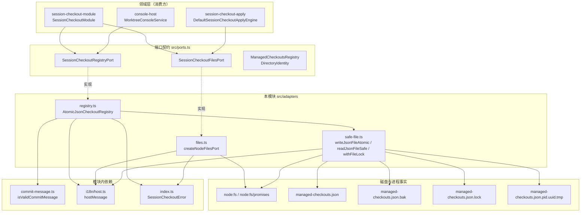
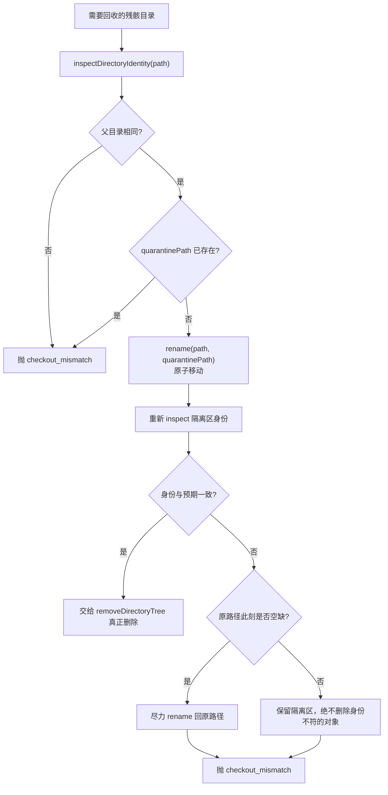
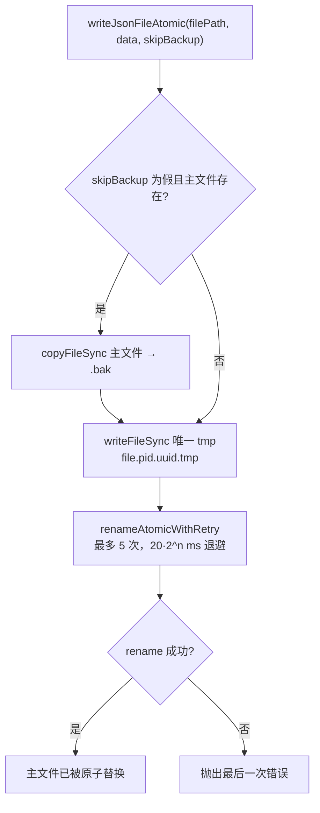
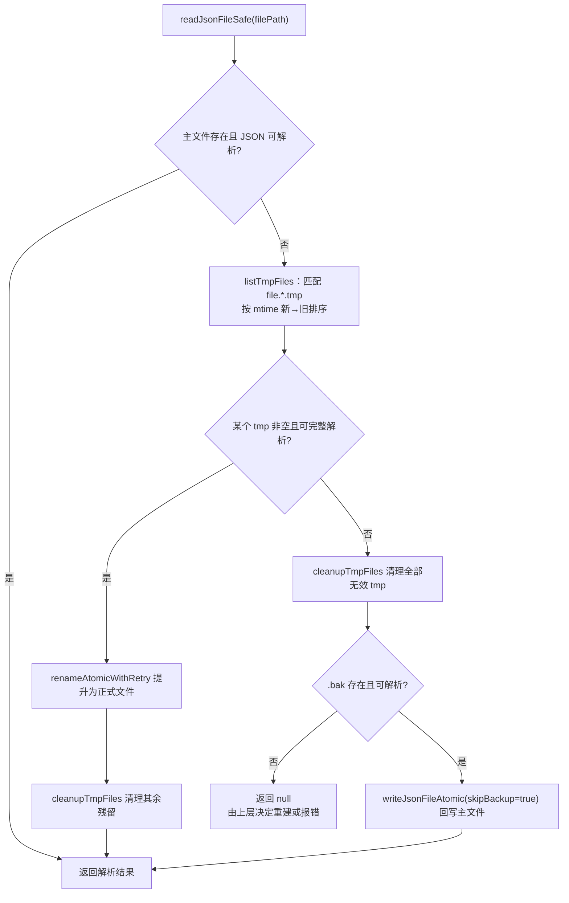
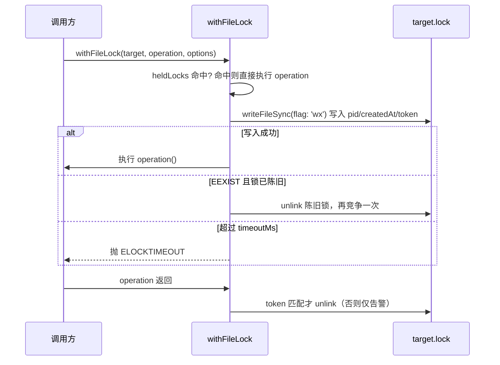
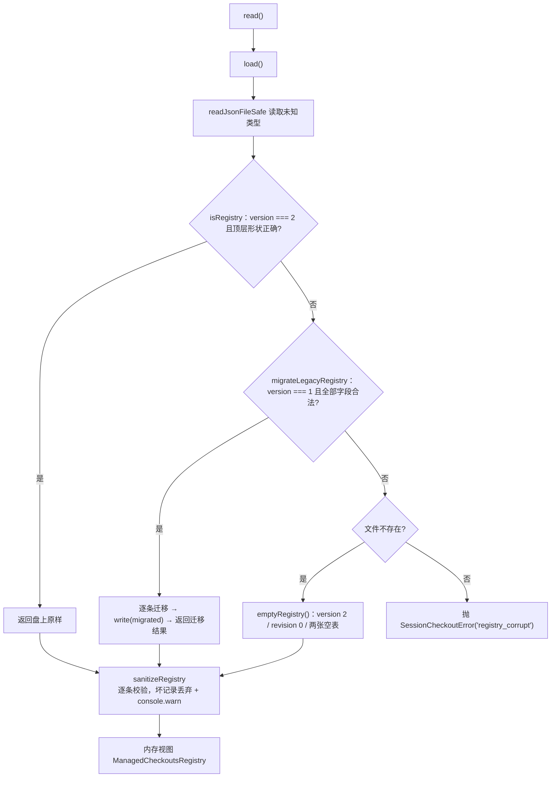
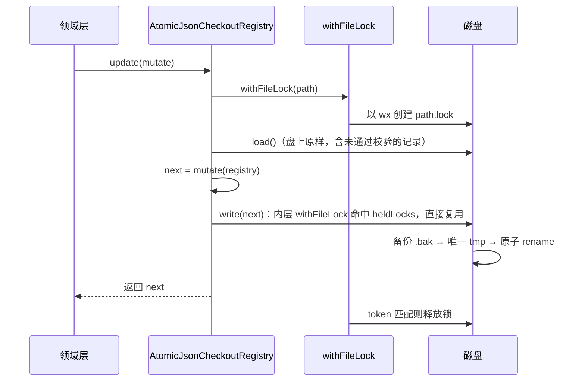

# 文件系统与持久化适配器（adapters_infrastructure_filesystem_and_persistence）

!!! info "Generated documentation"
    This page was written by CodeWiki from the source code at commit [`d1be8933`](https://github.com/wloops/dsh-git-worktree/commit/d1be8933c507c03e2741dc5a222fc4d6813a49d8) on 2026-11-09 with `deepseek-v4.1-flash`. Check the code before relying on details.

本页覆盖 `src/adapters/files.ts`、`src/adapters/safe-file.ts`、`src/adapters/registry.ts` 三个文件：它们是 `dsh-git-worktree` 插件里**唯一被允许直接触碰磁盘的部分**。文件端口把「删除一个目录」变成「先证明这个目录确实是我创建的那个对象」，持久化工具把「写一个 JSON 台账」变成「崩溃后可自愈的原子替换」，注册表适配器则把这两者组合成一份带跨进程互斥与逐条校验的会话检出台账。

领域层（[session_checkout_apply_engine](session_checkout_apply_engine.md) 与 [核心 Worktree 领域](core_worktree_domain.md)）只通过 [核心端口与类型](core_ports_and_types.md) 中的 `SessionCheckoutFilesPort` / `SessionCheckoutRegistryPort` 使用它们，从不直接 `import 'node:fs'`。

## 模块目的

| 组件 | 文件 | 解决的问题 |
| --- | --- | --- |
| `createNodeFilesPort` | `src/adapters/files.ts` | 提供**可证明身份**的目录操作：device/inode/birthtimeNs 三元组 CAS、隔离区（quarantine）原子移动、符号链接安全的递归删除、字节量估算 |
| `writeJsonFileAtomic` / `writeTextFileAtomic` / `readJsonFileSafe` / `withFileLock` | `src/adapters/safe-file.ts` | 系统强杀、断电、Windows 文件句柄竞争下**不丢数据**的 JSON 读写，以及跨进程「读-改-写」互斥 |
| `AtomicJsonCheckoutRegistry` | `src/adapters/registry.ts` | 把整份 `ManagedCheckoutsRegistry`（version 2）落成单文件，读时逐条校验降级、v1 保守迁移、写时锁内 CAS |

三者的关系是层层收窄：`registry.ts` 只关心「这份台账的结构是否可信」，`safe-file.ts` 只关心「字节是否完整落盘、写者之间是否互斥」，`files.ts` 只关心「这个路径上的目录对象是否还是我记录的那一个」。

## 架构与依赖



> 注：`registry.ts` 与 `files.ts` 都从 `../index.js` 引入 `SessionCheckoutError`，从 `../i18n/host.js` 引入 `hostMessage`。错误码与本地化消息由 [public_api 模块：插件公共入口与契约面](public_api.md) 与 [i18n：中英双语文案与语言解析基础设施](i18n.md) 统一维护，本模块只负责抛出与占位符填充。

## 一、文件端口：`createNodeFilesPort()`

`createNodeFilesPort()` 是一个无状态工厂，返回对象即 `SessionCheckoutFilesPort` 实现。它不持有任何缓存：**每次调用都重新向操作系统求证**，因为「目录身份」在这里是安全边界而不是性能优化目标。

### 方法语义

| 方法 | 同步性 | 行为 | 安全约束 |
| --- | --- | --- | --- |
| `exists(path)` | 同步 | `existsSync` 直通 | 仅作快速判空，不能作为删除授权 |
| `canonicalize(path)` | 异步 | `realpath(resolve(path))` | 解引用符号链接后的绝对路径，用于比较两处是否为同一对象 |
| `inspectDirectoryIdentity(path)` | 异步 | `lstat(path, { bigint: true })` → `{ device, inode, birthtimeNs }` | 非目录或符号链接一律返回 `null`；bigint 精度避免 inode 溢出 |
| `ensureDirectory(path)` | 同步 | `mkdirSync(recursive: true)` | 只创建容器，不承诺内容归属 |
| `removeEmptyDirectoryTree(path)` | 同步 | 递归删除**全空**目录树，返回 `boolean` | 遇到符号链接/junction 只 `unlink` 链接本身；任何文件或非空子树导致整体返回 `false` |
| `quarantineDirectoryTree(path, expectedIdentity, quarantinePath)` | 异步 | `rename` 到隔离区 + 身份复核 | 父目录必须相同（Windows 大小写不敏感）、隔离路径必须未被占用、身份不符则回滚并抛错 |
| `removeDirectoryTree(path)` | 异步 | `rm(recursive, force)` | 根路径必须是非符号链接目录，否则抛 `checkout_mismatch` |
| `measureDirectoryBytes(path)` | 异步 | 递归累加 | 不跟随符号链接（链接计 0）；路径不存在计 0 |
| `readTextFile(path)` | 同步 | 存在则 `utf8` 读取，否则 `null` | 供 `.worktreeinclude` 清单解析 |
| `copyFile(from, to)` | 同步 | 先建父目录、先删旧目标再复制 | 覆盖语义显式化，避免部分写入 |
| `isSymbolicLink(path)` | 异步 | `lstatSync().isSymbolicLink()`，异常视为 `false` | 复制来源是链接时跳过（防止把 checkout 外的内容带进 Worktree） |

### 为什么需要目录身份 CAS

创建 Worktree 失败后留下的空目录，与「用户自己新建的同名目录」在路径上无法区分。`files.ts` 的答案是把**操作系统级身份**（device + inode + birthtimeNs）当作删除授权：



要点：

1. **先移后删**：`rename` 在同分区上是原子操作，残骸在「已验证身份」与「被删除」之间没有可被第三方插入的时间窗。
2. **失败不吞**：身份不符时 `quarantineDirectoryTree` 抛 `SessionCheckoutError('checkout_mismatch', …)`，上层据此把记录标为 `recovery_required`，而不是继续删除。
3. **Windows 语义**：父目录比较在 `win32` 上做小写化，`removeDirectoryTree` 的 `maxRetries` 从 2 提到 6、`retryDelay` 150 ms，以吸收杀毒软件/索引器造成的瞬时占用。

## 二、崩溃安全文件工具：`safe-file.ts`

### 原子写入



关键设计：

- **唯一命名 tmp**：`tmpPathFor()` 生成 `<file>.<pid>.<uuid>.tmp`。旧实现用固定 `<file>.tmp` 会让并发写者互相截断，并让「半写状态的 tmp」被读取端误当成完整文件提升为主文件。
- **原子 rename**：`renameAtomicWithRetry()` 只在可重试错误码上退避重试——Windows 为 `EBUSY/EPERM/EACCES/ENOTEMPTY`，其他平台为 `EBUSY/ENOTEMPTY`；重试耗尽后原样抛出，绝不降级为非原子写。
- **备份不阻塞**：`.bak` 复制失败被静默忽略（备份是容错手段，不是前置条件）。
- **不持锁**：本函数只保证「单次写入原子」，跨进程的「读-改-写」由 `withFileLock` 提供，调用方按需组合。这一分工让 `readJsonFileSafe` 内部回写 `.bak` 时无需再加锁。

`writeTextFileAtomic()` 是同一机制的文本版本（用于 JSONL 会话等非单文档文件）。

### 读取三级回退



顺序即语义优先级：**主文件 > 最新可解析的 tmp > .bak**。`.bak` 回写时传 `skipBackup = true`，避免用已损坏的主文件覆盖掉唯一可用的备份。返回 `null` 表示「三层全部失败」，注册表适配器据此区分「文件不存在（空台账）」与「文件存在但损坏（`registry_corrupt`）」。

### 跨进程文件锁 `withFileLock`

锁文件为 `<target>.lock`，内容是 `FileLockPayload`：`{ pid, createdAt, token }`。



常量与判定：

| 常量 | 值 | 含义 |
| --- | --- | --- |
| `LOCK_DEFAULT_TIMEOUT_MS` | `10_000` | 获取锁的总等待上限，超时抛 `ELOCKTIMEOUT` |
| `LOCK_RETRY_DELAY_MS` | `25` | 轮询间隔 |
| `LOCK_STALE_MS` | `30_000` | 持有超过该时长即视为陈旧 |

陈旧判定 `lockIsStale()` 的两条路径：

1. **可解析**：持有者进程已退出（`process.kill(pid, 0)` 抛 `ESRCH`；`EPERM` 视为存活），或 `createdAt` 超过阈值。
2. **不可解析**：持有者刚用 `wx` 占位、内容还没落盘时读不出 JSON，此时退化为按锁文件 `mtime` 判龄，超龄才回收并 `console.warn(hostMessage('lockFileUnreadableReclaimed'))`。

两个易被忽略的正确性细节：

- **同进程重入**：`heldLocks` 记录本进程已持有的 `lockPath`。`AtomicJsonCheckoutRegistry.update()` 在锁内调用 `write()`，内层 `withFileLock` 必须复用外层锁而不是再抢一次（否则自锁死）。
- **只删自己的锁**：`releaseFileLock()` 先读 payload 比对 `token`；不符说明锁已过期回收并被他人重建，此时只告警不删除。Windows 上 `unlink` 失败时改名到 `<lock>.<uuid>.stale` 兜底。

## 三、注册表适配器：`AtomicJsonCheckoutRegistry`

注册表文件路径由插件入口 `apply()`（`src/index.ts`）构造：`join(stateDir, 'managed-checkouts.json')`，其中 `stateDir` 来自配置或 `DSH_HOME/plugins/dsh-git-worktree`。落盘形态是 `ManagedCheckoutsRegistry`：

```ts
{ version: 2, revision: number, sessionBindings: Record<string, SessionBindingRecord>, managedCheckouts: Record<string, ManagedCheckoutRecord> }
```

### 读取路径：校验、降级、迁移



三个刻意的非对称设计：

1. **顶层失败要吵，单条失败要静**。`isRegistry()` 只校验顶层形状；任何单条记录损坏由 `sanitizeRegistry()` 逐条丢弃并 `console.warn(hostMessage('registryRecordDropped', …))`。一条坏记录不该让全部受管 Worktree 失去访问权，但整份文件结构错乱必须立刻停下（`registry_corrupt`），避免「读成空表 → 后续写入把用户现场抹掉」。
2. **降级只作用于内存视图**。`read()` 返回的是降级后的副本，**不回写磁盘**；`load()` 返回的是盘上原样（含未通过校验的记录）。因此 `update()` 里的 `mutate` 拿到的是磁盘事实，被丢弃的记录会原样写回，不会因为一次更新而被悄悄删除。
3. **v1 迁移保守**。`migrateLegacyRegistry()` 只保留 `ready` / `discarded` 两种 phase，其余（`preparing` / `mutating` / `finalized` / `retained` …）一律降为 `recovery_required` 并 `revision + 1`；`delivery` 补成 `{ state: 'working', iteration: 1 }`、`journal` 补 `null`。任一字段不合法则整份迁移放弃，走 `registry_corrupt` 分支。

### 校验覆盖面

`registry.ts` 内的类型守卫构成一条相当严格的「磁盘输入不可信」防线，主要规则：

| 守卫 | 覆盖内容 |
| --- | --- |
| `isOid` | 40 位或 64 位十六进制（SHA-1 / SHA-256 仓库都接受） |
| `isBoundedText` / `safeRecoveryString` | 非空、有长度上限、不含 NUL（恢复用字符串另禁 `\r\n`） |
| `isSafeRelativePath` / `safeConflictFile` | 拒绝绝对路径、盘符前缀、空段、`.`、`..`、控制字符 |
| `isSessionBinding` | `sessionId/projectId/projectName/ownerSessionId/sourceRef/sourceOid/revision` 齐备，`target` 为 `unselected` / `local` / `isolated(checkoutId)` |
| `isManagedCheckout` | 全部路径字段、`phase` 枚举、`delivery`、`journal`、`revision` |
| `isDelivery` | 按 `state` 分派：`working` / `ready_for_review` / `preview_active` / `preview_detached` / `finalized` / `retained` / `delivered` 各自要求对应证据（`review`、`preview` 收据、`proof`、`retention`、`expiresAt`、`cleanup`） |
| `isJournal` | `operation` × `step` 的合法组合；`create` 日志额外要求 `WorktreeCreationEvidence`（root/commonDir/lockReason + 三个目录身份） |
| `isCheckpoint` + 序列断言 | `checkpoints` ≤ 100 条、`sequence` 严格 1..n、`checkpointId` / `reviewId` / `requestId` 全局唯一 |
| `isRecoveryContinuation` | 四种续跑种类（`worktree_review_regeneration`、`worktree_preview_recovery_analysis`、`worktree_preview_recovery_handoff`、`worktree_apply_conflict`）各自的必填字段 |
| `isPreviousReview` | 失效评审的保留上下文：`changedFiles` ≤ 50 且逐条为安全相对路径、`suggestedCommitMessage` 经 `isValidCommitMessage` 校验 |

`delivery.proof`（`isDeliveryProof`）与 `preview` 收据（`isPreviewReceipt`）同样逐字段校验，包括 `baseStrategy` 三态枚举与全部 tree/fingerprint OID。这让「交付证据」本身也成为可验证的磁盘事实，而不是自由文本。

### 写入路径：锁内「读-改-写」



端口契约（`SessionCheckoutRegistryPort.update`）在 [核心端口与类型](core_ports_and_types.md) 里写明了这条规则：`read()` 与 `write()` 之间隔着两次调用，任何在这条缝里发生的另一进程写入都会被后写者抹掉，因此**单条记录更新必须走 `update()`**。`registry.ts` 的注释与实现一一对应：`mutate` 的输入必须是锁内那次 `load()` 的结果，`write()` 也必须在同一把锁内完成。

`write()` 与 `update()` 都调用 `mkdirSync(dirname(path), { recursive: true })`，因此状态目录被外部清空后第一次写入可以自愈。

## 数据流：一次「标记恢复」写入

以领域层把一条受管检出标记为 `recovery_required` 为例，三个组件的协作顺序：


## 失败模式与错误码

| 触发点 | 抛出 | 上层处置 |
| --- | --- | --- |
| 主文件存在但结构无法识别且无法迁移 | `SessionCheckoutError('registry_corrupt')` | 停止检出访问，保留用户现场（**绝不**用空表覆盖） |
| 隔离路径非法、父目录不同、或身份复核失败 | `SessionCheckoutError('checkout_mismatch')` | 记录进入 `recovery_required`，残骸保留待人工确认 |
| 待删根路径是文件或符号链接 | `SessionCheckoutError('checkout_mismatch')` | 拒绝删除，避免误删 checkout 外内容 |
| 获取锁超过 `timeoutMs` | `Error` 且 `code = 'ELOCKTIMEOUT'` | 上层按并发冲突重试或报错 |
| 单条记录校验失败 | `console.warn` + 从内存视图丢弃 | 其余记录照常可用，磁盘原样保留 |
| 锁文件不可解析且超龄 | `console.warn` + 回收 | 继续竞争锁 |
| 释放锁时 token 不符 | `console.warn` | 不删除他人锁 |

## 与其他模块的关系

- **端口契约来源**：[核心端口与类型](core_ports_and_types.md) 定义 `SessionCheckoutFilesPort`、`SessionCheckoutRegistryPort`、`DirectoryIdentity`、`ManagedCheckoutsRegistry`，以及本页反复引用的 `ManagedCheckoutRecord` / `ManagedCheckoutMutationJournal`。
- **父模块总览**：[适配器与基础设施](adapters_infrastructure.md) 说明了整个基础设施环的分层与横切约束（不信任自报路径、永不 shell 解释、失败分级、降级而非崩溃）。
- **同层兄弟**：Git 执行与创建协议见 [Git 进程适配器与工作树创建编排](adapters_infrastructure_git_process.md)；宿主服务映射见 [主机服务适配器（Host Services Adapters）](adapters_infrastructure_host_services.md)；Project Skills 携带见 [Project Skills 适配器：跨 Worktree 携带与 Claude Skill 提供者](adapters_infrastructure_project_skills.md)。创建协议依赖本模块的 `removeEmptyDirectoryTree` / `quarantineDirectoryTree` 做失败回收。
- **主要消费方**：检出事务引擎 [session_checkout_apply_engine](session_checkout_apply_engine.md) 通过 `files` 端口做指纹取证与清理；[核心 Worktree 领域](core_worktree_domain.md) 通过 `registry` 端口维护台账与 `reconcile`；[console_host：Worktree 控制平面与 Host RPC 服务](console_host.md) 读取同一份注册表做投影。
- **错误与消息**：`SessionCheckoutError` 与稳定错误码见 [public_api 模块：插件公共入口与契约面](public_api.md)；`hostMessage()` 的 `zh`/`en` 双语文案见 [i18n：中英双语文案与语言解析基础设施](i18n.md)。

## 运行时与构建约束

- **纯 ESM + Node ≥ 24.9.0**：`package.json` 声明 `"type": "module"` 与 `engines.node >= 24.9.0`；`inspectDirectoryIdentity` 依赖 `lstat` 的 `{ bigint: true }` 与 `birthtimeNs`。
- **类型编译**：`tsconfig.json` 开启 `strict`、`noUncheckedIndexedAccess`、`declaration`；`registry.ts` 里大量 `Record<string, unknown>` → 类型守卫的收窄写法正是为了在严格索引访问下仍然可读。
- **构建**：`pnpm run build` = `node scripts/clean-lib.mjs && tsc && tsdown`（`package.json` → `scripts.build`），本模块无 tsdown 专有语法，产物为 `lib/adapters/*.js` + `.d.ts`。
- **测试**：`vitest run`（`vitest.config.ts`）。该配置在 Windows 上设 `fileParallelism: false`，注释明确指出原因——重型 Git 夹具并发会争抢进程与文件句柄，可能超过超时并锁住临时目录；`testTimeout` / `hookTimeout` 均为 60 s。本模块（真实 `node:fs` + 锁文件）属于这类夹具的直接受害者，因此相关用例在 Windows 上是串行执行的。
- **装载方式**：插件通过 `cordis.patch.yml` 插入 `dsh-git-worktree` 条目装载，`apply()` 在挂载时才创建状态目录并实例化 `AtomicJsonCheckoutRegistry`。因此本模块不假设「初始化时目录已存在」，所有写路径都自带 `mkdirSync(recursive: true)`。

??? abstract "Documented components (4)"
    - [`createNodeFilesPort`](https://github.com/wloops/dsh-git-worktree/blob/d1be8933c507c03e2741dc5a222fc4d6813a49d8/src%5Cadapters%5Cfiles.ts) — `src\adapters\files.ts`
    - [`AtomicJsonCheckoutRegistry`](https://github.com/wloops/dsh-git-worktree/blob/d1be8933c507c03e2741dc5a222fc4d6813a49d8/src%5Cadapters%5Cregistry.ts) — `src\adapters\registry.ts`
    - [`FileLockOptions`](https://github.com/wloops/dsh-git-worktree/blob/d1be8933c507c03e2741dc5a222fc4d6813a49d8/src%5Cadapters%5Csafe-file.ts) — `src\adapters\safe-file.ts`
    - [`FileLockPayload`](https://github.com/wloops/dsh-git-worktree/blob/d1be8933c507c03e2741dc5a222fc4d6813a49d8/src%5Cadapters%5Csafe-file.ts) — `src\adapters\safe-file.ts`

