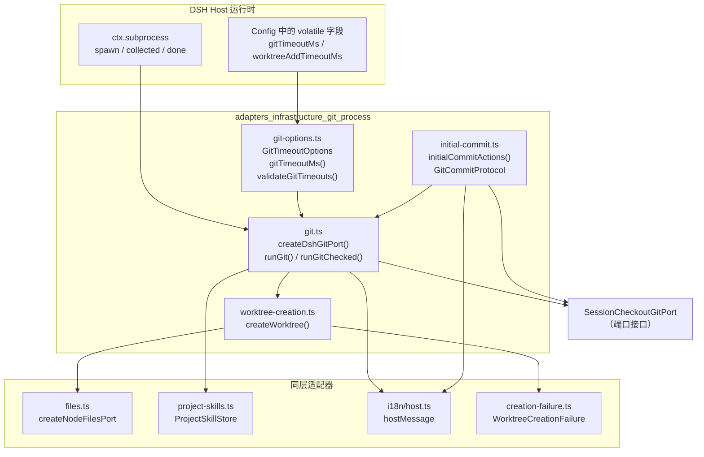
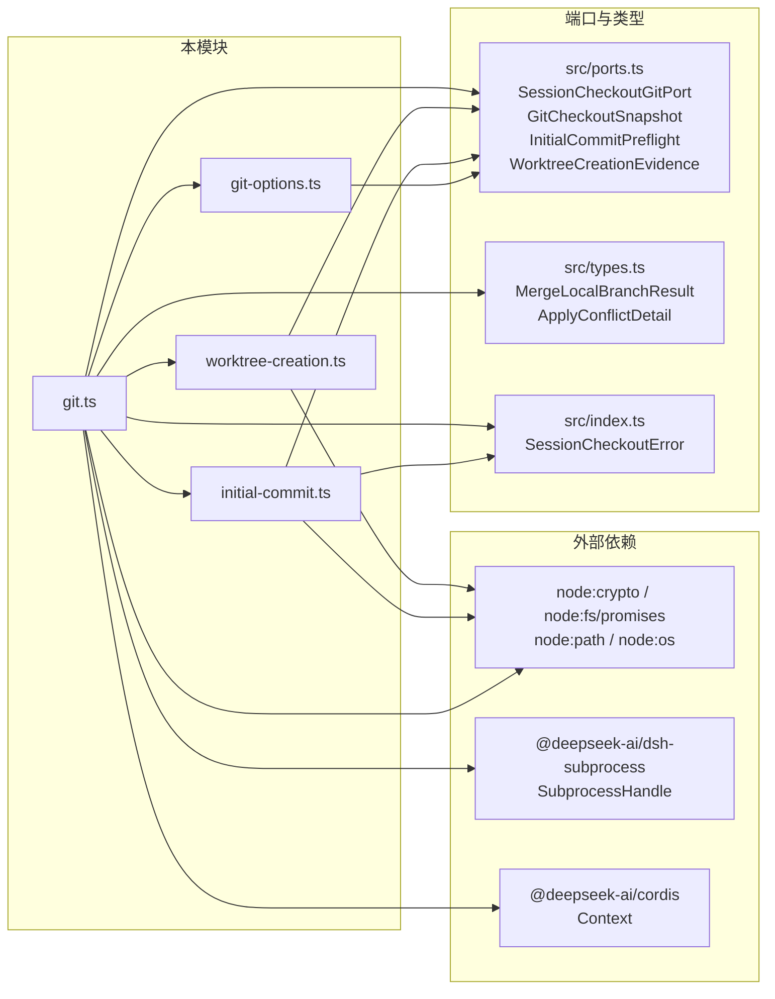
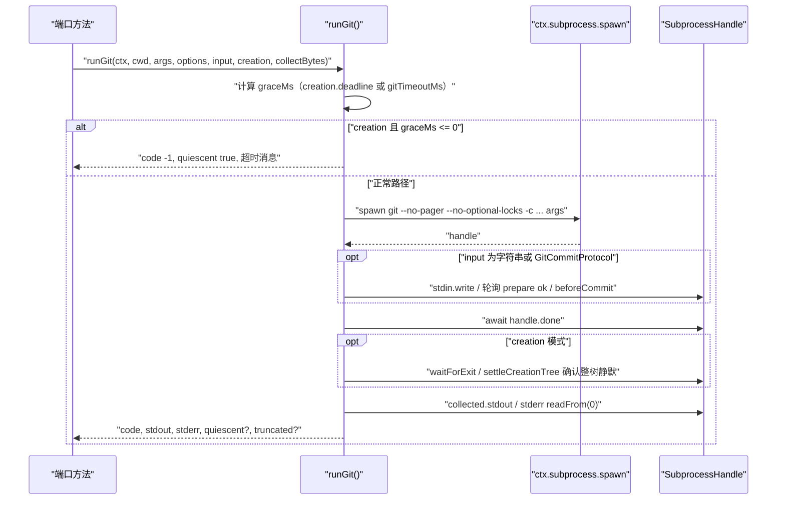
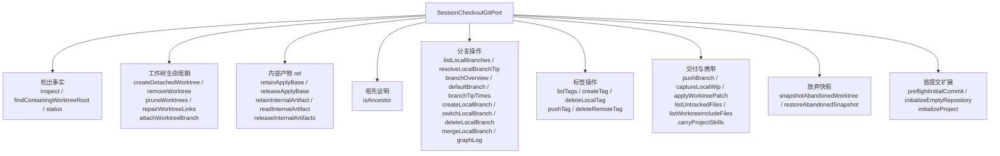
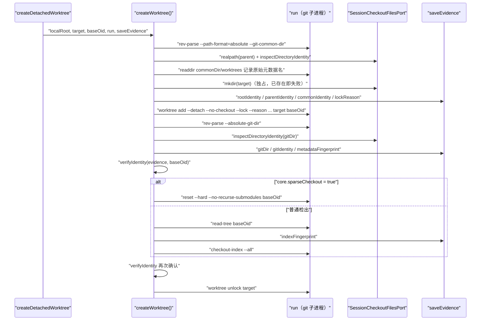
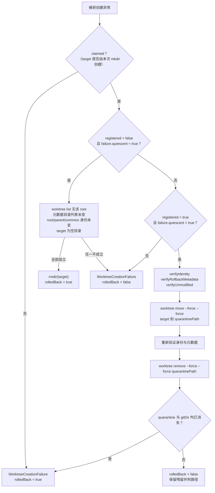
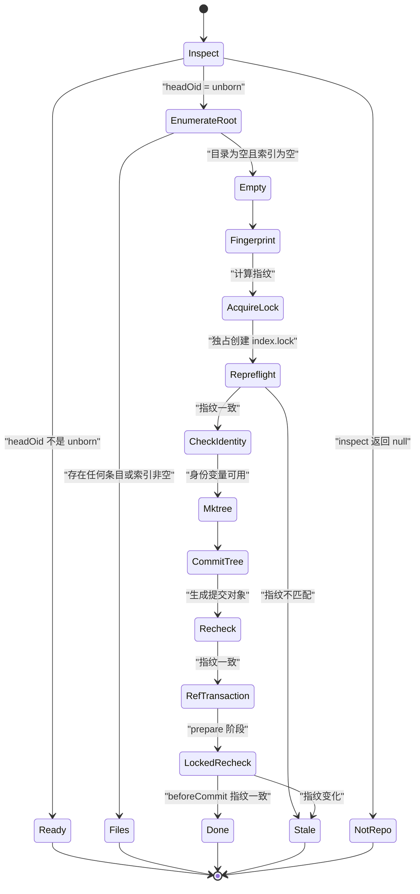

# Git 进程适配器与工作树创建编排

!!! info "Generated documentation"
    This page was written by CodeWiki from the source code at commit [`322c4523`](https://github.com/wloops/dsh-git-worktree/commit/322c4523d8dd1006cabf3ff3f10e3ae7e7daf77d) on 2026-11-08 with `deepseek-v4.1-flash`. Check the code before relying on details.

本页描述 `src/adapters` 中负责**真实 Git 进程执行**的那一组适配器：把 `SessionCheckoutGitPort` 端口落到 `ctx.subprocess` 上、把每次 `git` 调用包成受控子进程、把 `git worktree add` 拆解为可回滚的多步编排，以及为空仓库提供首提交协议。目录树中的兄弟页面分别覆盖文件与持久化、宿主服务、Project Skills，本页只讨论 Git 子进程这一条链路。

## 模块定位

| 关注点 | 由谁负责 | 关键导出 |
| --- | --- | --- |
| 子进程调用、超时、输出上限、环境净化 | `src/adapters/git.ts` | `GitPortOptions`、`GitCommandResult`、`createDshGitPort` |
| 超时策略与配置校验 | `src/adapters/git-options.ts` | `GitTimeoutOptions`、`gitTimeoutMs`、`validateGitTimeouts` |
| 首提交协议（stdin 交互式 ref 事务） | `src/adapters/initial-commit.ts` | `GitCommitProtocol`、`initialCommitActions` |
| 工作树创建与失败回滚 | `src/adapters/worktree-creation.ts` | `Result`、`createWorktree` |

该模块位于端口与实现的边界上：向上实现 [核心端口与类型契约（core_ports_and_types）](core_ports_and_types.md) 中定义的 `SessionCheckoutGitPort`，向下依赖 `@deepseek-ai/dsh-subprocess` 提供的 `ctx.subprocess` 服务。领域状态机（[session_checkout_apply_engine](session_checkout_apply_engine.md)）只看到端口方法，从不直接拼装 `git` 命令。

## 架构总览



`createDshGitPort()` 返回的对象是端口实现的主体，并在最后用 `Object.assign` 把 `initialCommitActions()` 的三个方法（`preflightInitialCommit`、`initializeEmptyRepository`、`initializeProject`）合并进来——首提交能力因此是端口的**可选扩展**，第三方端口可以完全不实现它们。

## 组件依赖关系



## 超时策略（git-options.ts）

`GitTimeoutOptions` 的两个字段都接受 `number | LiveValue<number | undefined>`。`LiveValue` 让设置页的编辑在**不重挂插件**的情况下对下一条命令生效：`gitTimeoutMs()` 每次调用都重新读取当前值，而不是在 `createDshGitPort()` 时冻结。

| 常量 / 规则 | 值 | 说明 |
| --- | --- | --- |
| `DEFAULT_GIT_TIMEOUT_MS` | `120_000` | 普通读命令（`status`、`rev-parse`、`for-each-ref` 等）的默认上限 |
| `DEFAULT_WORKTREE_ADD_TIMEOUT_MS` | `5 * 60_000` | 创建检出是唯一的重命令，默认 5 分钟 |
| `MAX_GIT_TIMEOUT_MS` | `60 * 60_000` | 配置上限，`validateGitTimeouts` 越界即抛 `RangeError` |
| `worktree remove` | 固定 `5 * 60_000` | 不开放配置：Windows 上删除大目录常年接近硬上限 |

`gitTimeoutMs(args, options)` 的判定顺序即上表顺序：先匹配 `worktree add`，再匹配 `worktree remove`，其余回落到通用值。`validateGitTimeouts()` 在 `createDshGitPort()` 入口和插件 `apply()` 入口各调用一次，要求取值为 `1000..MAX_GIT_TIMEOUT_MS` 之间的安全整数。

## 子进程执行核心（git.ts / runGit）

`runGit()` 是本模块唯一创建 Git 进程的地方。它的输出是一个**结果对象**而不是异常：`code !== 0` 是否算错误由调用方决定，只有 `runGitChecked()` 才把非零退出翻译成 `SessionCheckoutError('git_operation_failed')`。



### 命令行的固定前缀

每次 spawn 都以同一组参数开始，避免用户环境改变插件行为：

- `--no-pager`：不进入分页器。
- `--no-optional-locks`：不因读操作写 `index.lock`。
- `-c core.longpaths=true`：仅在 `win32` 下注入，工作树前缀可能超过 `MAX_PATH`。
- `-c core.quotePath=false`：路径按原样输出，便于后续 `-z` 解析。
- `-c core.fsmonitor=false`：不触发 fsmonitor 钩子。
- `-c core.hooksPath=<options.hooksPath>`：指向状态目录下的空目录，**禁用全部 Git 钩子**。

### 环境净化

| 变量 | 处理 | 理由 |
| --- | --- | --- |
| `GIT_DIR`、`GIT_WORK_TREE`、`GIT_INDEX_FILE`、`GIT_OBJECT_DIRECTORY`、`GIT_NAMESPACE`、`GIT_CONFIG_*` 等 | 显式置 `undefined` | 仓库路由必须来自已授权的 `cwd`，不能被环境变量劫持 |
| `GIT_OPTIONAL_LOCKS` | `0` | 与 `--no-optional-locks` 双重保证 |
| `GIT_TERMINAL_PROMPT` | `0` | 绝不阻塞等待凭据输入 |
| `LC_ALL` / `LANG` | `C` | 稳定 `stderr` 文本以便匹配 `fatal: not a git repository` 等前缀 |

身份类变量（`GIT_AUTHOR_*`、`GIT_COMMITTER_*`）与普通用户配置**保留**，因此提交仍使用用户身份。

### 输出上限与 `truncated`

| 常量 | 值 | 适用命令 |
| --- | --- | --- |
| `GIT_COLLECT_BYTES` | `1 << 20` | 默认每流上限 |
| `WIP_PATCH_COLLECT_BYTES` | `16 << 20` | `diff --binary`（base85 膨胀） |
| `STATUS_COLLECT_BYTES` | `16 << 20` | `status`（未忽略的依赖树可能产生数 MB 记录） |

当 `readFrom(0)` 报告 `lossy` 时，结果被标记为 `truncated: true` 且 `code` 归一为 `-1`，而不是直接抛出“仓库不可读”。`status()` 利用这一点做**收窄重试**：先 `--untracked-files=all`，溢出则退到 `normal`（未跟踪目录折叠为一条记录），两种模式都溢出才返回 `null`，由调用方报错。

### creation 模式与“静默”证明

创建路径传入 `creation: { deadline }`，进入不同的收尾逻辑：命令退出后还必须由子进程服务确认**整棵进程树**已静默（`waitForExit`）。未确认时调用 `settleCreationTree()`：`terminate()` 后最多等 10 秒，仍未静默则返回失败并把 `quiescent` 置为 `false`。只有 `quiescent === true` 的失败才被 `worktree-creation.ts` 视为“可以安全清理”的授权——进程树观测失败或超时永不构成删除依据。

### 内部 ref 命名空间

| 用途 | ref 形态 | 备注 |
| --- | --- | --- |
| 检出根 | `refs/dsh-worktree/session-checkouts/<sha256(checkoutId)[0..24]>` | `checkoutId` 经哈希，避免非法 ref 字符 |
| 应用基点 | 上述根 + `/apply-base` | `retainApplyBase` / `releaseApplyBase` |
| 任意内部产物 | 上述根 + `/<artifactName>` | `assertArtifactName()` 逐段校验 `^[A-Za-z0-9][A-Za-z0-9._-]*$` |
| 放弃快照 | `refs/dsh-worktree/abandoned/<checkoutId>` | **故意在检出命名空间之外**，丢弃流程释放整段命名空间时不会带走刚写的安全快照 |

`releaseInternalArtifacts()` 先 `for-each-ref` 列出前缀下所有 ref，再用**单次** `update-ref --stdin` 事务删除，替代逐个 `update-ref -d` 的 N 次串行调用。

## 端口方法分组

`createDshGitPort()` 实现的 `SessionCheckoutGitPort` 方法按职责可分为：



### 检出事实读取

`inspect()` 先并行发起 `symbolic-ref --quiet HEAD`，再执行一次多值 `rev-parse --show-toplevel --path-format=absolute --git-common-dir --absolute-git-dir HEAD^{commit}`，四行输出齐全时即可一次 spawn 得到全部位置事实。解析失败时回退到逐项读取（处理 unborn/broken HEAD 与路径含换行的情况），并在最终结果中对三个目录做 `realpath` 规范化。

“未出生仓库”的判定非常严格：`HEAD^{commit}` 退出码必须为 `1`、`symbolic-ref` 成功且指向 `refs/heads/*`、`show-ref` 也以 `1` 退出且无任何输出。其余组合（断链 ref、元数据不可读、对象缺失）一律抛 `git_operation_failed`，绝不误判为“空仓库”。

### `status` 与 Project Skills 辅助文件

`status()` 返回 `{ dirty }`，判定交给 `project-skills.ts` 的 `hasDeliverableStatus()`：任何非 `??` 记录立即视为脏；`??` 记录若属于已携带的 Skill 路径或其目录前缀，则**不算交付内容**。这样把辅助 Skill 文件带进工作树不会永久污染“有未提交改动”的判断。

### 工作树创建入口 `createDetachedWorktree`

1. 先对本地根做 `projectSkills.snapshot()`；再用 `diff --name-only` 与 `diff --cached --name-only`（限定 `PROJECT_SKILL_ROOTS`）检查本地是否存在未提交的 tracked Skill 改动，有则直接拒绝创建。
2. 计算 `deadline = now + gitTimeoutMs(['worktree','add'])`，把整个 `createWorktree()` 编排当作一次有预算的创建。
3. 完成后 `projectSkills.carry()` 把 Skill 文件复制进新工作树。

### Skill 携带入口 `carryProjectSkills`

`carryProjectSkills(localRoot, managedRoot)` 只做「快照 + 携带」两步：先 `projectSkills.snapshot(localRoot)`，再 `projectSkills.carry(skills, managedRoot)`；它不建树，也不做上面的 tracked 改动门禁。

它存在的原因是建树路径已经分叉：建树改由官方 `worktrees` 服务负责后，`createDetachedWorktree` 不再参与官方路径，而 Skill 只存在于项目工作区、不在 Git 里——不单独携过去，新树里就看不见它们。因此它是可选端口方法（`?`），由官方建树路径在建完之后调用；端口未实现时不携带，其余流程不受影响。


### 删除入口 `removeWorktree`

在 `worktree remove --force` 之前，先通过 `ProjectSkillStore.assertRemovable()` 确认携带的 Skill 未被修改且没有新增资源；通过后才删除并 `forget()` 清理 provenance 记录。

### 合并 `mergeLocalBranch`

`dryRun` 在 `mkdtemp` 出来的临时目录里 `worktree add --detach` 再 `merge --no-commit --no-ff`，全程不触碰真实检出，`finally` 中 `worktree remove --force` 回收。真实合并**不在冲突时 abort**：冲突场景留在本地检出，由调用方拿到 `conflictingFiles` 与受限长度的 `conflictDetails`（`CONFLICT_DETAIL_FILE_LIMIT` / `CONFLICT_DETAIL_DIFF_LIMIT`）后自行解决。

### 图形日志与标签

`graphLog()` 以 `--topo-order --parents --max-count=N`（`N` 夹在 `1..1000`）加 `%H%x00%P%x00%an%x00%at%x00%D%x00%s%x1e` 记录分隔符输出，`parseDecoration()` 把 `%D` 转成 ref 名数组，标签保留 `tag:` 前缀以便客户端区分样式。`listTags()` 用一次 `for-each-ref` 取名字/对象/peel/主题，再用一次**尽力而为**的 `ls-remote --tags origin` 标注 `pushed`；远端不可达时该字段保持 `null`，绝不臆测为“未推送”。

## 工作树创建编排（worktree-creation.ts）

`createWorktree(localRoot, target, baseOid, run, saveEvidence)` 把一次 `git worktree add` 拆成“先证明所有权，再做昂贵检出”的多阶段流程，每个阶段都持久化证据（`WorktreeCreationEvidence`）。



关键设计点：

- **独占占位**：`mkdir(target)` 无 `recursive`，已存在的目录（哪怕为空）都不属于本次尝试，直接判为未认领。
- **锁理由即证明**：`lockReason` 形如 `dsh-create-<uuid>`，会写进 `worktrees/<id>/locked`，`verifyIdentity()` 逐字比对，从而确认这棵子树仍是本进程创建的那一棵。
- **索引先于文件**：普通路径先 `read-tree` 发布完整索引并记录 `indexFingerprint`，再 `checkout-index --all`（不带 `-f`，不会覆盖其他写入者提供的文件）。
- **元数据白名单**：`metadataFingerprint()` 只允许 `HEAD`、`commondir`、`locked`、`config.worktree`、`logs/HEAD`、`info/sparse-checkout` 以及 `refs/`、`logs/`、`info/` 目录，遇到任何未知对象、符号链接或超大文件立即失败。

### 失败分类与回滚授权



`verifyUnmodified()` 是删除授权的最后一道闸门，它要求：索引完整等于已授权基点、无 gitlink（子模块残留必须保留）、目录树只包含索引内路径、`check-attr` 的 `filter` 与 `working-tree-encoding` 均为 `unspecified`/`unset`（有转换就无法用字节比较授权删除）、每个 blob 的哈希与索引 OID 一致、`diff-index --cached` 为空、`ls-files -v` 全为 `H `、`ls-files --others`（含 ignored）为空、`diff --name-status` 全部为 `D`。任何一条不满足都以 `rolledBack: false` 保留残留——宁可留下垃圾目录，也不删可能属于用户的数据。

`WorktreeCreationFailure` 的 `rolledBack` 字段由上层用来决定记录是否落地，其类型定义见 [核心工作树领域（core_worktree_domain）](core_worktree_domain.md)。

## 首提交协议（initial-commit.ts）

`initialCommitActions(inspect, run)` 复用同一套 `run` 通道，返回三个方法；`GitCommitProtocol` 是它与 `runGit()` 之间的契约：`prepare` 是写进 stdin 的脚本前缀，`beforeCommit()` 在 `git` 打印 `prepare: ok` 之后、真正提交之前被回调。



- **`preflightInitialCommit()`** 返回 `kind: 'ready' | 'empty' | 'files'`。只有 `empty` 带指纹；`files` 表示根目录存在任何条目（含被忽略文件、符号链接、嵌套仓库、空目录——枚举刻意不套用任何忽略规则），必须由用户显式决定。
- **指纹内容**：快照本身、`root`/`canonical` 目录身份（含 mtime/ctime）、`gitDir` 与 `commonDir` 身份、`HEAD` 文件字节及其身份、`index` 文件字节、排序后的文件列表。任何一项变化都会让后续 `initializeEmptyRepository()` 抛 `SessionCheckoutError('stale_local')`。
- **锁策略**：只创建自己独占的 `index.lock`（`open(path, 'wx')`），`EEXIST` 映射为 `operation_not_allowed`（“初始仓库忙”），`finally` 中按逆序关闭并删除**自己创建的**锁，清理失败不得掩盖主错误。
- **CAS 提交**：`update-ref --stdin` 使用 `update HEAD <oid> <全零>` 的旧值，绝不覆盖并发产生的提交；`prepare` 阶段已锁住 HEAD 与解析出的分支，`beforeCommit()` 在这两个锁之下第三次校验指纹并再跑一次 `assertAuthorized`。
- **身份前置校验**：`git -c user.useConfigOnly=true var GIT_AUTHOR_IDENT` 失败即报 `initialIdentityMissing`，避免在缺少身份时产生半成品仓库。
- **`initializeProject()`**：仅用于“非 Git 或未出生”项目；`git init -b main` 只新增 `.git`，`add -A` 遵循 `.gitignore`，提交失败原样报错且不回滚任何字节。已有提交的仓库直接 `operation_not_allowed`。

## 配置与装配

插件入口 `src/index.ts` 在 `apply()` 中装配本模块：

```ts
const git = createDshGitPort(ctx, {
  hooksPath,
  projectSkills,
  gitTimeoutMs: config.gitTimeoutMs,
  worktreeAddTimeoutMs: config.worktreeAddTimeoutMs,
})
```

- `hooksPath` 指向 `<stateDir>/disabled-git-hooks`，由 `apply()` 预先 `mkdirSync`。
- `projectSkills` 是 `<stateDir>/project-skills` 下的 `ProjectSkillStore`；未传入时 `createDshGitPort()` 会以 `dirname(hooksPath)/project-skills` 兜底构造。
- `gitTimeoutMs` / `worktreeAddTimeoutMs` 在 `Config`（schemastery）中标记为 `volatile`，因此从设置页编辑后作为 live 引用送达，并在每条命令上重新读取。
- `validateGitTimeouts(config)` 在 `apply()` 与 `createDshGitPort()` 两处各校验一次，形成双重保险。

构建与测试约定参见 [build_deployment_configuration：构建、打包与发布部署配置](build_deployment_configuration.md)：`tsconfig.json` 开启 `strict` 与 `noUncheckedIndexedAccess`，因此本模块对 `split()` 结果的每段都显式断言或提供回退；`vitest.config.ts` 在 `win32` 上关闭 `fileParallelism`，因为重量级 Git 夹具会争抢进程与文件句柄。

## 错误模型

| 错误码 | 触发场景 |
| --- | --- |
| `git_operation_failed` | `runGitChecked` 非零退出；`inspect` 无法证明仓库身份；`for-each-ref`/`log`/`tag`/`switch` 失败；内部产物读取失败 |
| `invalid_input` | `assertArtifactName()` 拒绝的产物名 |
| `not_git_repository` | `preflightInitialCommit()` 在非仓库上被调用 |
| `stale_local` | 首提交指纹在任一次复查中变化 |
| `operation_not_allowed` | 已有提交的仓库调用 `initializeProject()`；`index.lock` 已被占用 |

所有用户可见文案都经 `hostMessage()`（见 [i18n：中英双语文案与语言解析基础设施](i18n.md)）按调用方语言解析，`runGit` 不直接拼接中英文字符串。

## 与官方实验性工作树服务的差异

官方 `experimental/worktree` 服务会按调用解析 `sandboxPolicy` 并用 `sandbox.confine` 包裹 `git`。本适配器**刻意不复刻**该行为：受管检出位于会话工作区**之外**（`worktreesRoot` 是兄弟目录），把 `git worktree add` 关进 workspace-write 沙箱会直接拒绝插件被要求创建的那个目录。会话文件策略的执行仍留在宿主自带的文件/Shell 工具中。相关取舍记录于 `CHANGELOG.md`，创建路径的另一半（宿主 `worktrees` 服务、`createOfficialTarget`）见 [console_host：Worktree 控制平面与 Host RPC 服务](console_host.md) 与 [public_api 模块：插件公共入口与契约面](public_api.md)。

## 相关页面

- 上层模块总览：[端口、适配器与基础设施（Ports, Adapters, and Infrastructure）](Ports,_Adapters,_and_Infrastructure.md) · 适配器层总览：[适配器与基础设施（adapters_infrastructure）](adapters_infrastructure.md)
- 端口定义与类型：[核心端口与类型契约（core_ports_and_types）](core_ports_and_types.md)
- 同层适配器：[文件系统与持久化适配器（adapters_infrastructure_filesystem_and_persistence）](adapters_infrastructure_filesystem_and_persistence.md) · [主机服务适配器（Host Services Adapters）](adapters_infrastructure_host_services.md) · [Project Skills 适配器：跨 Worktree 携带与 Claude Skill 提供者](adapters_infrastructure_project_skills.md)
- 消费这些端口的状态机：[session_checkout_apply_engine](session_checkout_apply_engine.md) · [核心工作树领域（core_worktree_domain）](core_worktree_domain.md)

??? abstract "Documented components (5)"
    - [`GitTimeoutOptions`](https://github.com/wloops/dsh-git-worktree/blob/322c4523d8dd1006cabf3ff3f10e3ae7e7daf77d/src%5Cadapters%5Cgit-options.ts) — `src\adapters\git-options.ts`
    - [`GitCommandResult`](https://github.com/wloops/dsh-git-worktree/blob/322c4523d8dd1006cabf3ff3f10e3ae7e7daf77d/src%5Cadapters%5Cgit.ts) — `src\adapters\git.ts`
    - [`GitPortOptions`](https://github.com/wloops/dsh-git-worktree/blob/322c4523d8dd1006cabf3ff3f10e3ae7e7daf77d/src%5Cadapters%5Cgit.ts) — `src\adapters\git.ts`
    - [`GitCommitProtocol`](https://github.com/wloops/dsh-git-worktree/blob/322c4523d8dd1006cabf3ff3f10e3ae7e7daf77d/src%5Cadapters%5Cinitial-commit.ts) — `src\adapters\initial-commit.ts`
    - [`Result`](https://github.com/wloops/dsh-git-worktree/blob/322c4523d8dd1006cabf3ff3f10e3ae7e7daf77d/src%5Cadapters%5Cworktree-creation.ts) — `src\adapters\worktree-creation.ts`

