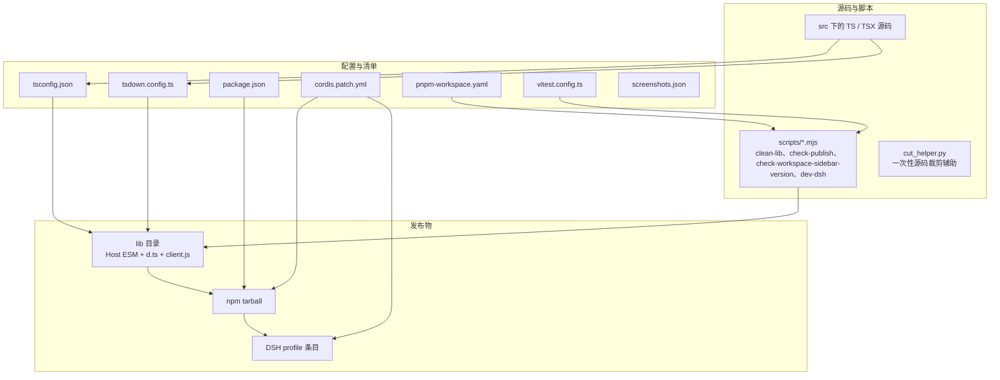
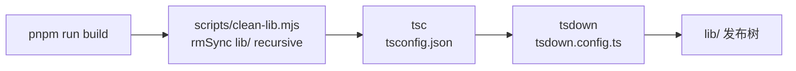
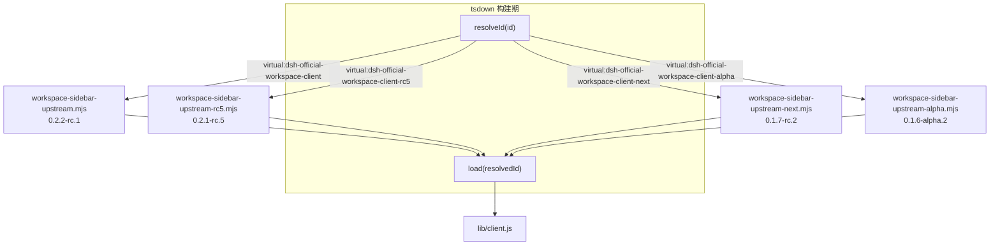
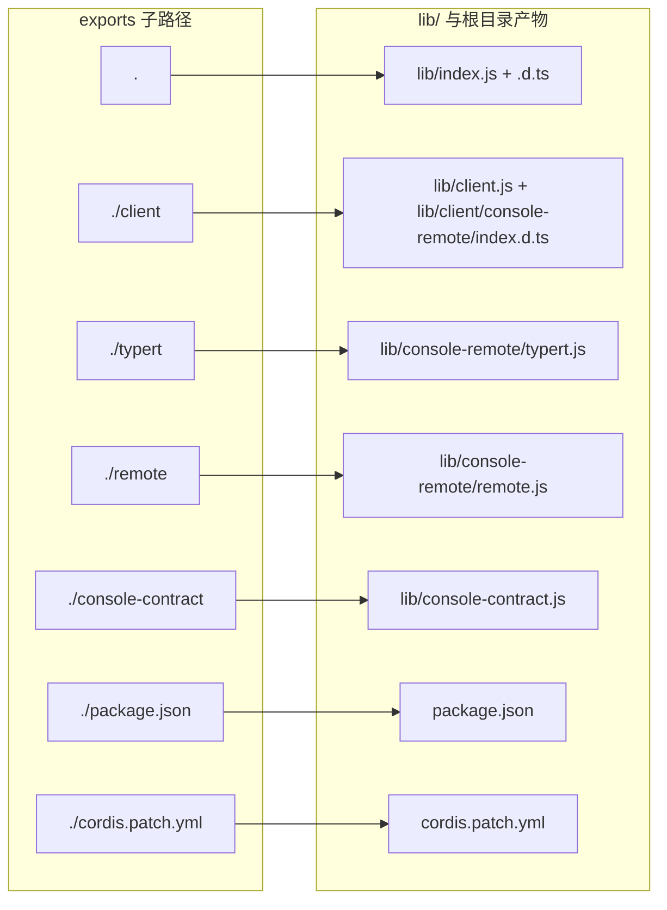
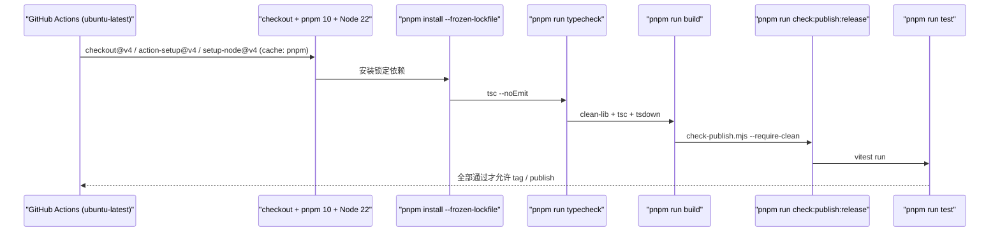
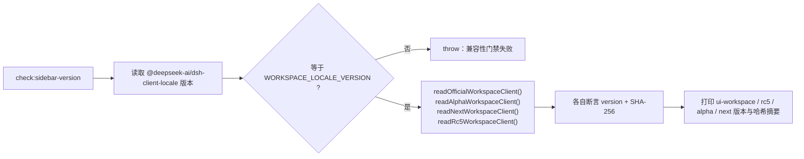
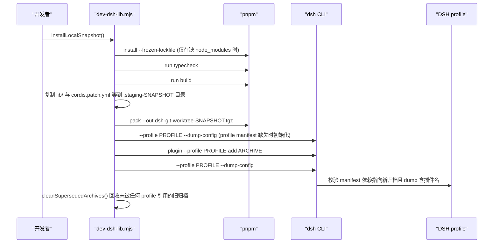
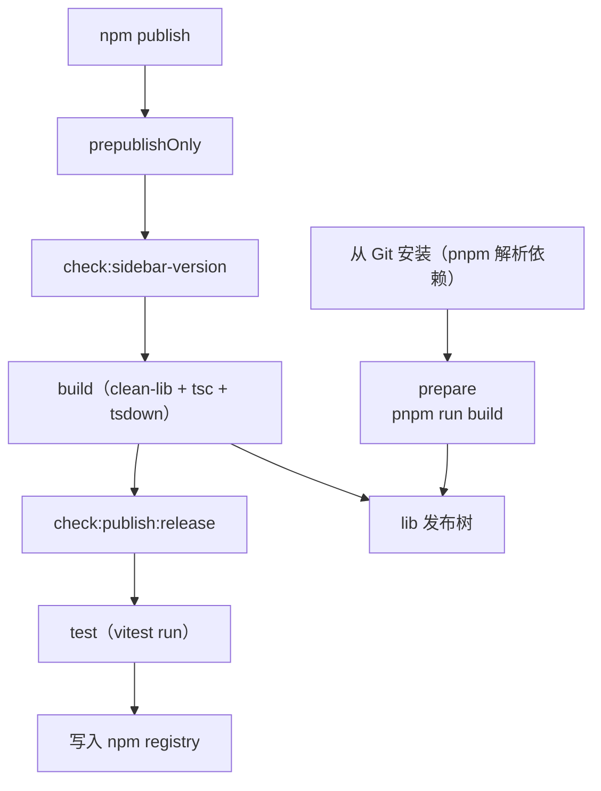

# build_deployment_configuration：构建、打包与发布部署配置

!!! info "Generated documentation"
    This page was written by CodeWiki from the source code at commit [`d4be4817`](https://github.com/wloops/dsh-git-worktree/commit/d4be481772d07eb031209411011ac79e64f06138) on 2026-11-10 with `mimo-v2.6-flash`. Check the code before relying on details.

`build_deployment_configuration` 不是运行时模块，而是 `dsh-git-worktree` 的**交付面（delivery surface）**：它由仓库根目录的清单文件、TypeScript/打包配置、CI 工作流、Host 挂载补丁和若干构建期脚本组成，决定了「源码如何变成 npm 包、包如何被 DSH Host 挂载、什么条件下才允许发布」这三件事。

本页只描述构建与发布链路本身。包对外导出的语义面见 [public_api 模块：插件公共入口与契约面](public_api.md)，Host/Client 共享 JSON 契约见 [console_contract 模块（Worktree Console 共享契约）](console_contract.md)，客户端 bundle 的内部结构见 [Client_Presentation_and_Interaction 模块概览](Client_Presentation_and_Interaction.md)。

---

## 1. 模块定位

该模块承担四个互相约束的职责：

| 职责 | 主要载体 | 失效后果 |
| --- | --- | --- |
| **编译与打包** | `tsconfig.json`、`tsdown.config.ts`、`scripts/clean-lib.mjs` | `lib/` 缺文件、残留已删除模块、Client bundle 未注册 ModuleLoader |
| **包形态声明** | `package.json` 的 `exports` / `files` / `dependencies` / `peerDependencies` / `dsh` 段 | 包能装但 Host 不挂载、子路径导出指向不存在的文件、Host 单例服务身份被破坏 |
| **Host 挂载** | `cordis.patch.yml` | 插件只是被写进 profile 依赖，但没有被插入 Loader 条目 |
| **质量与发布门禁** | `.github/workflows/ci.yml`、`scripts/check-publish.mjs`、`scripts/check-workspace-sidebar-version.mjs`、`vitest.config.ts` | 脏树发布、导出漂移、官方 Workspace Client 版本/哈希漂移被带上 npm |

一个关键设计取向贯穿全部配置：**所有门禁都 fail-closed（失败即阻断），且尽可能在"生成物"而非"源码意图"上断言**。例如发布门禁不检查 `src/` 里有没有某个函数，而是在 VM 里真实执行 `lib/client.js` 并断言 `window.__ModuleLoader__.load` 收到的 `id` 与 `factory` 形态。



---

## 2. 构件清单

| 文件 | 角色 | 关键内容 |
| --- | --- | --- |
| `package.json` | 包清单 + 脚本入口 + DSH 元数据 | `exports` 7 个子路径、`files` 白名单、`dsh.bundle.patch`、`dsh.client.inject`、`engines`、12 个 script |
| `tsconfig.json` | Host 侧编译配置 | `target: ES2022`、`module`/`moduleResolution: NodeNext`、`rootDir: src`、`outDir: lib`、`strict`、`noUncheckedIndexedAccess`、`jsx: react-jsx`、`declaration: true` |
| `tsdown.config.ts` | Client bundle 打包配置 | 单入口 `src/client/console-remote/index.ts`、CJS、`platform: neutral`、ModuleLoader banner/footer、四个官方 Workspace 虚拟模块 |
| `.github/workflows/ci.yml` | 唯一 CI job `check` | `pnpm install --frozen-lockfile` → `typecheck` → `build` → `check:publish:release` → `test` |
| `cordis.patch.yml` | Host 挂载补丁 | 单条 `insert`，把 `id: dsh-git-worktree` 插进 profile |
| `pnpm-workspace.yaml` | 依赖解析策略 | `allowBuilds`（仅 `esbuild`）、`minimumReleaseAgeExclude` 白名单 |
| `vitest.config.ts` | 测试运行配置 | 5 个模块别名（含 4 个虚拟 Workspace 客户端）、`tests/**/*.test.{ts,tsx}`、60s 超时、Windows 下关闭文件并行 |
| `screenshots.json` | 文档资源清单 | README「界面预览」引用的 3 张截图路径 |
| `cut_helper.py` | 构建期无关的源码裁剪工具 | `cut_block` + `match_brace`，按正则定位并删除一个 JS 块 |

---

## 3. 构建流水线

`package.json` 的 `build` 脚本串了三步，顺序不可调换：

```json
"build": "node scripts/clean-lib.mjs && tsc && tsdown"
```



### 3.1 先清空 `lib/`

`scripts/clean-lib.mjs` 只做一件事：

```js
rmSync(fileURLToPath(new URL('../lib/', import.meta.url)), { recursive: true, force: true })
```

存在的理由写在文件注释里：**TypeScript 不会删除已删除源文件对应的产物**。若不清空，历史上被删掉的 UI 模块（例如已下线的验收面板）会继续留在 `lib/` 里，被打进 tarball。`tsdown.config.ts` 也对应地设置了 `clean: false`——清理职责已由脚本承担，避免打包器二次清目录。

### 3.2 `tsc` 生成 Host 侧产物

`tsconfig.json` 的约束直接反映在源码写法上：

| 选项 | 对交付面的影响 |
| --- | --- |
| `module` / `moduleResolution: NodeNext` | 源码中所有相对导入必须带 `.js` 后缀，`lib/` 里是原生 ESM |
| `rootDir: src` + `outDir: lib` | `lib/index.js` 与 `lib/index.d.ts` 恰好落在 `exports["."]` 声明的位置 |
| `declaration: true` | 每个子路径导出都有对应 `.d.ts`，`exports` 的 `types` 条件才成立 |
| `strict` + `noImplicitAny` + `noUncheckedIndexedAccess` | `typecheck` 脚本（`tsc --noEmit`）是 CI 第一道门禁 |
| `jsx: react-jsx` | Client 侧 `.tsx` 与 Host 侧同工程编译，React 只作为 peer |
| `include: ["src"]` | `scripts/`、`tests/` 不进入发布树 |

### 3.3 `tsdown` 生成浏览器 Client bundle

`tsdown.config.ts` 只构建一个入口 `src/client/console-remote/index.ts`，输出 `lib/client.js`（CJS、`platform: neutral`、`target: es2022`、无 sourcemap、`dts: false`——类型由 `tsc` 已经生成）。

**ModuleLoader 包装**是这里最关键的配置。产物不是标准 CommonJS 模块，而是一段在浏览器里自注册的脚本：

```ts
const CLIENT_PLUGIN_ID = 'dsh-git-worktree'

outputOptions: {
  banner: `window.__ModuleLoader__.load({ id: ${JSON.stringify(CLIENT_PLUGIN_ID)}, factory: (require) => {`,
  intro: 'var module = { exports: {} }; var exports = module.exports;',
  footer: 'return module.exports; } });',
}
```

- `banner` 里的 `id` 必须精确等于 `package.json` 的 `name`（`CLIENT_PLUGIN_ID` 常量与包名同源），发布门禁会断言这一点。
- `intro`/`footer` 把一个普通 CJS 模块体包成 `factory` 的返回值，使 DSH 浏览器 ModuleLoader 能以 `require` 表注入宿主模块。

**依赖切分**同样是硬约束：

| 配置 | 包 | 原因 |
| --- | --- | --- |
| `external` | `react`、`react/jsx-runtime`、`@deepseek-ai/cordis`、`@deepseek-ai/dsh-client-store`、`@deepseek-ai/dsh-client-ui-primitives` | 这些模块由浏览器 ModuleLoader 表提供；打进 bundle 会产生第二份 React / 第二份 store，导致 hook 与 slot 失效 |
| `noExternal` | `zod`、`lucide-react` | 浏览器表里没有它们，必须内联进产物 |

**官方 Workspace Client 虚拟模块**：`tsdown` 插件 `official-workspace-client-source` 拦截四个虚拟 id，在 `load()` 时调用对应的 `scripts/workspace-sidebar-upstream*.mjs` 中的 `materialize*WorkspaceClientModule()`，把「已按版本与 SHA-256 校验、并在构建期打过补丁的官方 Client 工厂」当作一个源码模块喂给打包器。



每个 materializer 都做三件事：读取官方 `client` 产物 → 断言 `version` 与 `sha256` 命中常量 → 用 `replaceExactlyOnce` 施加若干**唯一匹配**的源码 seam（匹配不到或匹配到多处即抛错，因此是 fail-closed）。为什么必须保留四份而不是一份兼容产物，见 [端口、适配器与基础设施（Ports, Adapters, and Infrastructure）](Ports,_Adapters,_and_Infrastructure.md) 中 `host-compat.ts` 的 flavor 划分，以及 `src/client/workspace-sidebar/UPSTREAM.md`。

> `NOTICE` 因此是必需的发布文件：bundle 内含 MIT 许可的官方 Workspace Client 派生代码，`check-publish` 会断言 `NOTICE` 既在 `files` 白名单中、也真实存在于磁盘。

---

## 4. 包形态：`package.json`

### 4.1 `exports` 与 `files` 的对应关系



`files` 白名单只包含 `lib`、`scripts`、`CHANGELOG.md`、`docs/i18n.md`、`NOTICE`、`cordis.patch.yml`。把 `scripts/` 一起发布是有意的：`dev-dsh.mjs` 等脚本可以从已安装的包里被引用。注意 `docs/i18n.md` 是唯一随包发布的文档。

`./client` 的 `types` 与 `default` 指向**不同目录层级**（`lib/client/console-remote/index.d.ts` 是 `tsc` 的声明输出，`lib/client.js` 是 `tsdown` 的单文件产物），发布门禁会逐条检查每个 `types`/`default`/嵌套条件的目标都真实存在且被 `files` 覆盖。

### 4.2 `dsh` 元数据：Host 与 Client 两个面

```json
"dsh": {
  "bundle": { "patch": "./cordis.patch.yml" },
  "client": {
    "platform": "web",
    "inject": [
      "@deepseek-ai/dsh-api-session-controller",
      "@deepseek-ai/dsh-api-workspace-controller",
      "@deepseek-ai/dsh-client-connection",
      "@deepseek-ai/dsh-client-locale",
      "@deepseek-ai/dsh-client-ui-conversation",
      "@deepseek-ai/dsh-client-ui-tool",
      "@deepseek-ai/dsh-api-gateway",
      "@deepseek-ai/dsh-api-remote-access"
    ]
  }
}
```

- `dsh.bundle.patch` 是「安装即挂载」的关键。缺失它，`dsh plugin add` 只会写入一条普通依赖，Host 永远不会加载插件——这是发布门禁第 2 项的核心断言。
- `dsh.client.inject` 声明浏览器端需要宿主提供的官方客户端包；`platform: "web"` 限定为 Web Profile。

### 4.3 依赖分层

| 层 | 内容 | 门禁含义 |
| --- | --- | --- |
| `dependencies` | `@deepseek-ai/schemastery`、`lucide-react`、`zod` | 允许私有副本：`schemastery` 用于 `Config` schema，`zod`/`lucide-react` 被内联进 Client bundle |
| `peerDependencies` | `cordis`、`cordis-plugin-loader`、`dsh-agent`、`dsh-session`、`dsh-fs`、`dsh-tools`、`dsh-typert-protocol`、`typert-registry` 等 15 项 | **Host 单例服务身份**：私有副本会让 Host 与插件看到不同的 service 实例 |
| `devDependencies` | 与 peer 同版本的精确锁定 + `tsdown`/`vitest`/`typescript`/`react`/`jsdom`/`testing-library` | 保证本地可 typecheck、可跑测试；`@deepseek-ai/dsh-client-ui-workspace` 直指 0.2.2-rc.1，另有 `-alpha`、`-next`、`-rc5` 三个 npm 别名指向另外三代官方 Client，供构建期 materializer 与 `vitest` 别名解析 |

`check-publish.mjs` 对 13 个「Host singleton packages」逐个断言：**不得出现在 `dependencies`，必须同时出现在 `peerDependencies` 与 `devDependencies`**。peer 版本用 `^0.1.2-rc.1 || ^0.1.6-alpha.2 || ^0.1.7-rc.2 || ^0.2.0-rc.1` 这样的多区间形式，表达「同一插件版本覆盖多代 Host」的策略（对照 README 的版本选择表）。

`engines.node` 声明 `>=24.9.0`，而 `.github/workflows/ci.yml` 使用 Node 22、README 写明 `^22.19.0 || >=24.0.0`。三者不完全一致，是当前清单里的已知偏差：以 `engines` 为准时会挡掉 CI 使用的 Node 版本，改动时需同步。

---

## 5. Host 挂载：`cordis.patch.yml`

补丁内容极短，全部语义都在注释里：

```yaml
- insert:
    - id: dsh-git-worktree
      name: dsh-git-worktree
```

它的历史非常关键，注释记录了 2026-10-17 两次桌面崩溃的根因：早期版本在补丁里放了一段 `disabled: !!js ...` 的条件表达式来「停用官方 `ui-workspace` 条目」。该表达式在两个不同步的时刻被求值——插件 Host `apply` 期间插件 fiber 仍是 `LOADING`，Cordis 的 strict service 读取返回 `undefined`，选举恒败；而 Web renderer 事后审计时插件已 `ACTIVE`，同一表达式求值为 `true`，官方条目被跳过。结果是**没有任何 `uiWorkspace` provider**，17 个下游条目 pending，web boot 崩溃。

因此现在的契约是：

| 规则 | 由谁强制 |
| --- | --- |
| 补丁里不得出现任何 `!!js` 客户端求值表达式 | `check-publish.mjs` 用 `/!!js/u` 断言 |
| 补丁不得 patch 官方 `ui-workspace` 条目 | 正则断言 `- id: ui-workspace` 不出现 |
| 补丁必须含 `- insert:` 且 `name:` 等于包名 | 字符串包含检查 |
| 不得再导出已退役的 `WORKSPACE_PROVIDER_CONDITION` | 动态 `import lib/workspace-provider-lifecycle.js` 并检查该导出 |

Workspace provider 的选举改由 Host 侧的 `workspace-provider-lifecycle` 通过 Loader 条目操作（`entry.update({ disabled: true })` 写确定性布尔并还原）完成，细节见 [Worktree 与会话检出领域（Worktree_and_Session_Checkout_Domain）](Worktree_and_Session_Checkout_Domain.md) 与 `src/client/workspace-sidebar/UPSTREAM.md`。这也解释了为什么 `dsh.client.inject` **不能**包含 `@deepseek-ai/dsh-client-ui-workspace`——发布门禁对此单独断言。

---

## 6. 质量门禁与 CI

### 6.1 CI 流程

`.github/workflows/ci.yml` 只有一个 job `check`，触发条件是推送到 `master`/`main` 以及所有 PR：



顺序上有一条隐含依赖：`check:publish` **必须在 `build` 之后**运行，因为它断言的所有产物（`lib/index.js`、`lib/client.js`、`lib/console-remote/typert.js`、`lib/console-remote/remote.js`）都由 `build` 生成。反过来，`check:publish:release` 在 CI 中带 `--require-clean`，意味着 CI 上要求工作树与 HEAD 完全一致。

### 6.2 `check-publish.mjs` 的断言组

`scripts/check-publish.mjs` 是发布前唯一的总门禁。脚本内部按注释分为 7 节，其中最后一节是脏树检查；「陈旧产物」检查则夹在第 3 与第 4 节之间。`--require-clean` 或环境变量 `CHECK_PUBLISH_REQUIRE_CLEAN=1` 会启用脏树检查，否则只打印「已推迟」。

| 断言组 | 具体检查 |
| --- | --- |
| ① Host 单例依赖分层 | 13 个包不得在 `dependencies`，必须在 `peerDependencies` + `devDependencies` |
| ② Host 挂载补丁 | `dsh.bundle.patch` 存在、文件存在、被 `files` 覆盖、含 `- insert:` 与包名、不含 `!!js`、不 patch `ui-workspace`、`NOTICE` 存在、`dsh.client.inject` 不含官方 `ui-workspace` |
| ③ 导出完整性 | 递归展开 `exports` 的每个条件目标：必须以 `./` 开头、不得逃出包根、文件必须存在、必须被 `files` 覆盖 |
| （未编号）陈旧产物 | `lib/client/review-console/DiffViewer.js`、`lib/client/review-console/useReviewDiff.js` 不得存在 |
| ④ Typert/Remote 贡献 | `./typert` 与 `./remote` 可 `import`；`package`/`face` 身份正确；`hostContribution.invocations === remoteContribution.descriptors`（同一数组实例）；方法名列表精确等于 39 项期望序列；每个 descriptor 的 `namespace`/`service` 为 `gitWorktree`，result 与每个参数都是 Zod v4 strict codec |
| ⑤ Host 入口元数据 | `lib/index.js` 必须导出 `apply` 函数与 `const inject` |
| ⑥ Client bundle 可执行性 | `dsh.client` 声明合法且含 5 个必需包；在 `vm.runInNewContext` 沙箱里执行 `lib/client.js`，断言只注册一次 `__ModuleLoader__.load`、`id` 等于包名、`factory(require)` 返回 `apply` + `inject`；`require()` 的裸模块必须全部在允许表内；`inject` 不得含 `remoteAccess`、必须含 `remote`，且不得含 `remote.directoryPicker` / `conversation` / `connection` |
| ⑦ 源码身份 | 启用时执行 `git status --porcelain --untracked-files=all`，输出非空即失败 |

第 ⑥ 组的三条 `inject` 禁令都对应真实的启动死锁，注释里写明了原因：`remoteAccess` 在 0.2.0-rc.2 Host 上不存在，静态注入会让 web boot 永久 pending；`remote.directoryPicker` 的提供者条目本身在等 `uiWorkspace`，注入它会造成循环等待；`conversation` 依赖本插件恢复的 `uiWorkspace`，注入它会形成 Workspace/Conversation 启动环。因此 directory-picker 必须在调用时通过托管 context 惰性解析，门禁还额外断言 bundle 源码里确实出现了 `'remote.directoryPicker'` 字面量。

方法名期望序列是**硬编码**的（`expectedRemoteMethods`），这是刻意的：Remote 方法面的任何增删都必须同时改源码与门禁，避免 source descriptor 与 build artifact 悄悄不一致。

### 6.3 `check-workspace-sidebar-version.mjs`

独立的兼容性门禁，可在 `prepublishOnly` 里先于 `build` 运行（它只读 `node_modules` 里的官方产物，不依赖 `lib/`）：



每个 `read*` 都会 `throw` 而不是返回错误值，因此该脚本在 CI 里等价于「四代官方 Client 未被上游改动」。升级 Host 时的标准动作就是：更新 devDependency 别名 → 重新计算 SHA-256 → 更新 `scripts/workspace-sidebar-upstream*.mjs` 常量与 seam → 更新 `NOTICE`。

### 6.4 测试配置：`vitest.config.ts`

```ts
resolve.alias:
  '@deepseek-ai/dsh-client-ui-primitives' → tests/support/ui-primitives.tsx
  'virtual:dsh-official-workspace-client'       → tests/official-workspace-client.mock.ts
  'virtual:dsh-official-workspace-client-rc5'   → tests/official-workspace-client-rc5.mock.ts
  'virtual:dsh-official-workspace-client-alpha' → tests/official-workspace-client-alpha.mock.ts
  'virtual:dsh-official-workspace-client-next'  → tests/official-workspace-client-next.mock.ts
```

- 四个 `virtual:` 别名与 `tsdown.config.ts` 的虚拟 id **一一对应**，使测试不需要真实的官方 Client 字节即可驱动派生逻辑。
- `ui-primitives` 被替换为轻量替身（`Menu`、`Modal` 等），避免测试依赖宿主组件库。
- `test.include: ['tests/**/*.test.{ts,tsx}']`；`testTimeout`/`hookTimeout` 均为 60s。
- `fileParallelism: process.platform !== 'win32'`：注释说明重 Git fixture 套件在 Windows 上并发争抢进程与文件句柄，会超时并锁住临时目录，因此 Windows 下改为串行。

---

## 7. 本地开发部署：`dev:dsh`

`dev:dsh*` 四个脚本共用一个驱动 `scripts/dev-dsh.mjs` 与实现库 `scripts/dev-dsh-lib.mjs`，把「本地构建 → 打包 → 装进隔离 DSH profile → 起 Host」串成一条命令，**不发布到 npm、不推送 Git**。

| 脚本 | 模式 | 行为 |
| --- | --- | --- |
| `dev:dsh` | `run` | 装本地快照 → 准备/校验一次性 Git 仓库 → 启动 DSH Web |
| `dev:dsh:install` | `install` | 只装快照，打印保留的归档路径 |
| `dev:dsh:smoke` | `smoke` | 读 `--dump-config` 断言 profile 组合了 `dsh-git-worktree` |
| `dev:dsh:remove` | `remove` | 从 profile 移除插件并清理本地归档 |



实现细节里有几处值得注意的防御性设计：

- **版本改写**：staging 的 `package.json` 把版本改成 `${version}-dev.${snapshotId}` 并清空 `scripts`，避免本地快照与正式版本混淆、也避免安装时触发 `prepare` 递归构建。
- **归档缓存目录**：`devCacheRoot()` 在设置了 `DSH_HOME` 时落在 `${DSH_HOME}/dev-dsh-cache`，否则落在系统临时目录。注释说明隔离 Profile 的运行不得清理属于其他 DSH home 的归档。
- **fixture 仓库保护**：`ensureDevFixture()` 只在目录为空或带有 `.dsh-git-worktree-fixture.json` 标记（`owner: dsh-git-worktree`、`schemaVersion: 1`）时才初始化；显式 `--repo` 的仓库只做只读校验（必须是 Git 根、必须是 clean、必须没有残留 linked worktree），永不 reset 或删除。
- **Harness 源码 Host**：`discoverHarnessRoot()` 依次尝试 `DSH_HARNESS_ROOT`、项目同级的 `deepseek-harness` 等候选；命中源码 checkout 时用其 pinned `pnpm` + `tsx` 执行 `scripts/dsh-source-runner.mjs`，后者只切 `process.chdir()` 再 `import` 并调用 `runCli()`——因为新版 Harness CLI 用 `import.meta.main` 守卫入口，直接 import 不会成为主模块。
- **Windows 参数安全**：`runProcess()` 在 Windows 上先断言命令与参数不含 `\0 \r \n " & | < > ^ % !`，再经 `cmd.exe /d /v:off /c` 执行。

---

## 8. 依赖解析策略：`pnpm-workspace.yaml`

该文件不声明 workspace 包，只承载两条 pnpm 10 策略：

| 键 | 作用 |
| --- | --- |
| `allowBuilds: { esbuild: true }` | 允许 `esbuild` 执行安装脚本（`tsdown`/`vitest` 的传递依赖） |
| `minimumReleaseAgeExclude` | 约 400 条 `@deepseek-ai/*` 包与精确版本的豁免清单 |

豁免清单的存在原因与交付形态直接相关：DSH 生态的包以 `rc`/`alpha` 标签频繁发布，而供应链防护（`minimumReleaseAge`）会跳过「刚发布」的版本。插件锁定的是精确的 `0.2.2-rc.1` 一族依赖，若不在豁免表里，`pnpm install --frozen-lockfile` 可能解析不到锁定版本。README 的排错章节也提示：用户侧可能因同一防护回退到旧版，需要显式指定精确版本。

注意 `allowBuilds` 的另一半在**用户 profile** 里：pnpm 10+ 从 Git tag 安装时，profile 的 `pnpm-workspace.yaml` 需要 `allowBuilds: { dsh-git-worktree: true }` 才能执行本包的 `prepare`（即 `pnpm run build`）。这一条写在 `docs/USAGE.md` 的安装排错中，属于部署侧而非本仓库的配置。

---

## 9. 脚本生命周期链



| 脚本 | 命令 | 何时被触发 |
| --- | --- | --- |
| `prepare` | `pnpm run build` | Git 依赖安装、本地 `pnpm install` |
| `prepublishOnly` | `check:sidebar-version && build && check:publish:release && test` | `npm publish` |
| `build` | `node scripts/clean-lib.mjs && tsc && tsdown` | 手工、`prepare`、`prepublishOnly`、CI、`dev:dsh` |
| `typecheck` | `tsc --noEmit` | 手工、CI、`dev:dsh` 安装流程 |
| `test` | `vitest run` | 手工、CI、`prepublishOnly` |
| `check:publish` | `node scripts/check-publish.mjs` | 本地 review 构建（允许脏树） |
| `check:publish:release` | `node scripts/check-publish.mjs --require-clean` | CI、`prepublishOnly`、发布前 |

`docs/RELEASE.md` 把这条链与发布流程（版本 bump → clean-tree 门禁 → branch CI → annotated tag + GitHub Release → `npm publish` → 真实安装 smoke）写成了可执行清单；本页只负责配置层面的解释，流程细节请直接参考该文件。

---

## 10. 辅助构件

### 10.1 `cut_helper.py`

与构建产物无关的一次性源码重构工具，`cut_block(src, header_re, label='')` 按正则定位一个 JS 函数/类头，用 `match_brace`（会正确跳过字符串、模板串、`//` 与 `/* */` 注释内的括号）找到配对的右花括号，然后把整块连同其紧邻的 JSDoc 注释一并从源码里删掉。它没有 npm script 入口、不进入发布流程，属于维护期脚本，保留在仓库里作为「删除大段已下线 UI 代码」的可复用工具。

### 10.2 `screenshots.json`

README「界面预览」章节引用的三张截图的路径清单：

```json
["docs/screenshots/00-project-sidebar.png",
 "docs/screenshots/01-create-worktree.png",
 "docs/screenshots/02-ready-for-review.png"]
```

它是文档资源的单一事实来源，避免 README 中的图片路径与仓库实际文件漂移。

---

## 11. 修改指引

按变更类型对照需要同步维护的位置：

| 变更 | 必须同步 |
| --- | --- |
| 新增/删除 Remote 方法 | `src/console-remote/descriptors.ts`、`schemas.ts`、`remote.ts`、`typert.ts`、`console-contract.ts`、Host control-plane/service，以及 `check-publish.mjs` 的 `expectedRemoteMethods` |
| 新增包级导出子路径 | `package.json` 的 `exports` 与 `files`，并确认 `tsc` 真的产出对应 `.js`/`.d.ts` |
| 升级 Harness 世代 | 四个 `scripts/workspace-sidebar-upstream*.mjs` 的版本/SHA 常量与 seam、`NOTICE`、`host-compat.ts` 的 flavor 判定、`tsdown.config.ts` 与 `vitest.config.ts` 的虚拟 id |
| 新增 Host 单例依赖 | 同时进 `peerDependencies` + `devDependencies`，并加入 `check-publish.mjs` 的 `hostSingletonPackages` |
| 调整 Client 的宿主依赖 | `tsdown.config.ts` 的 `external`/`noExternal`，以及 `check-publish.mjs` 的 `allowedBrowserRequires` |
| 修改 Host 挂载方式 | `cordis.patch.yml`（保持单条 `insert`、无 `!!js`、不 patch `ui-workspace`）与 `dsh.bundle.patch` |

## 相关文档

- [public_api 模块：插件公共入口与契约面](public_api.md)：`package.json` 的 `exports` 在运行时对应哪些符号
- [console_contract 模块（Worktree Console 共享契约）](console_contract.md)：`./console-contract` 子路径承载的共享 JSON 契约
- [Console_API_and_Host_Integration：控制台 API 与 Host 集成](Console_API_and_Host_Integration.md)：`./typert` 与 `./remote` 贡献的实现与装配
- [Client_Presentation_and_Interaction 模块概览](Client_Presentation_and_Interaction.md)：`./client` bundle 的内部结构
- [端口、适配器与基础设施（Ports, Adapters, and Infrastructure）](Ports,_Adapters,_and_Infrastructure.md)：`host-compat.ts` 的 Host flavor 判定与适配器装配
- [i18n：中英双语文案与语言解析基础设施](i18n.md)：随包发布的 `docs/i18n.md` 描述的语言契约

??? abstract "Documented components (22)"
    - [`check`](https://github.com/wloops/dsh-git-worktree/blob/d4be481772d07eb031209411011ac79e64f06138/.github/workflows/ci.yml) — `.github/workflows/ci.yml`
    - [`ci.yml`](https://github.com/wloops/dsh-git-worktree/blob/d4be481772d07eb031209411011ac79e64f06138/.github/workflows/ci.yml) — `.github/workflows/ci.yml`
    - [`cordis.patch.yml`](https://github.com/wloops/dsh-git-worktree/blob/d4be481772d07eb031209411011ac79e64f06138/cordis.patch.yml) — `cordis.patch.yml`
    - [`cut_block`](https://github.com/wloops/dsh-git-worktree/blob/d4be481772d07eb031209411011ac79e64f06138/cut_helper.py) — `cut_helper.py`
    - [`build`](https://github.com/wloops/dsh-git-worktree/blob/d4be481772d07eb031209411011ac79e64f06138/package.json) — `package.json`
    - [`check:publish`](https://github.com/wloops/dsh-git-worktree/blob/d4be481772d07eb031209411011ac79e64f06138/package.json) — `package.json`
    - [`check:publish:release`](https://github.com/wloops/dsh-git-worktree/blob/d4be481772d07eb031209411011ac79e64f06138/package.json) — `package.json`
    - [`check:sidebar-version`](https://github.com/wloops/dsh-git-worktree/blob/d4be481772d07eb031209411011ac79e64f06138/package.json) — `package.json`
    - [`dev:dsh`](https://github.com/wloops/dsh-git-worktree/blob/d4be481772d07eb031209411011ac79e64f06138/package.json) — `package.json`
    - [`dev:dsh:install`](https://github.com/wloops/dsh-git-worktree/blob/d4be481772d07eb031209411011ac79e64f06138/package.json) — `package.json`
    - [`dev:dsh:remove`](https://github.com/wloops/dsh-git-worktree/blob/d4be481772d07eb031209411011ac79e64f06138/package.json) — `package.json`
    - [`dev:dsh:smoke`](https://github.com/wloops/dsh-git-worktree/blob/d4be481772d07eb031209411011ac79e64f06138/package.json) — `package.json`
    - [`package.json`](https://github.com/wloops/dsh-git-worktree/blob/d4be481772d07eb031209411011ac79e64f06138/package.json) — `package.json`
    - [`prepare`](https://github.com/wloops/dsh-git-worktree/blob/d4be481772d07eb031209411011ac79e64f06138/package.json) — `package.json`
    - [`prepublishOnly`](https://github.com/wloops/dsh-git-worktree/blob/d4be481772d07eb031209411011ac79e64f06138/package.json) — `package.json`
    - [`test`](https://github.com/wloops/dsh-git-worktree/blob/d4be481772d07eb031209411011ac79e64f06138/package.json) — `package.json`
    - [`typecheck`](https://github.com/wloops/dsh-git-worktree/blob/d4be481772d07eb031209411011ac79e64f06138/package.json) — `package.json`
    - [`pnpm-workspace.yaml`](https://github.com/wloops/dsh-git-worktree/blob/d4be481772d07eb031209411011ac79e64f06138/pnpm-workspace.yaml) — `pnpm-workspace.yaml`
    - [`screenshots.json`](https://github.com/wloops/dsh-git-worktree/blob/d4be481772d07eb031209411011ac79e64f06138/screenshots.json) — `screenshots.json`
    - [`tsconfig.json`](https://github.com/wloops/dsh-git-worktree/blob/d4be481772d07eb031209411011ac79e64f06138/tsconfig.json) — `tsconfig.json`
    - [`defineConfig`](https://github.com/wloops/dsh-git-worktree/blob/d4be481772d07eb031209411011ac79e64f06138/tsdown.config.ts) — `tsdown.config.ts`
    - [`vitest.config.ts`](https://github.com/wloops/dsh-git-worktree/blob/d4be481772d07eb031209411011ac79e64f06138/vitest.config.ts) — `vitest.config.ts`

