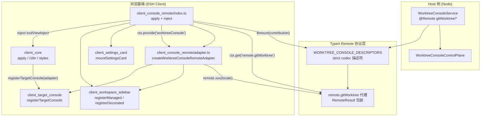
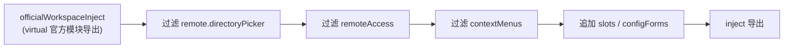
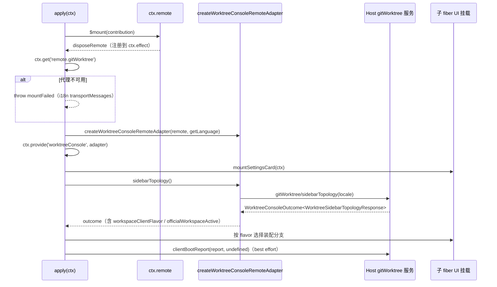
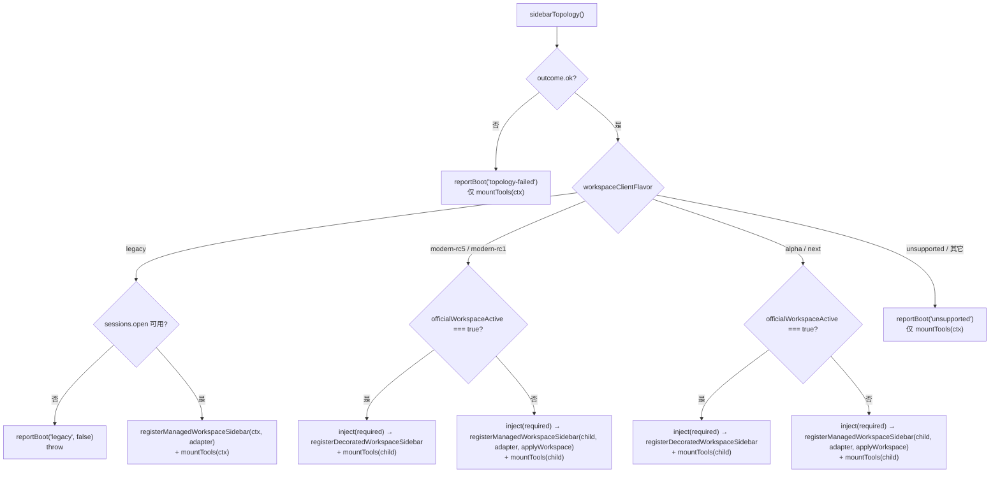
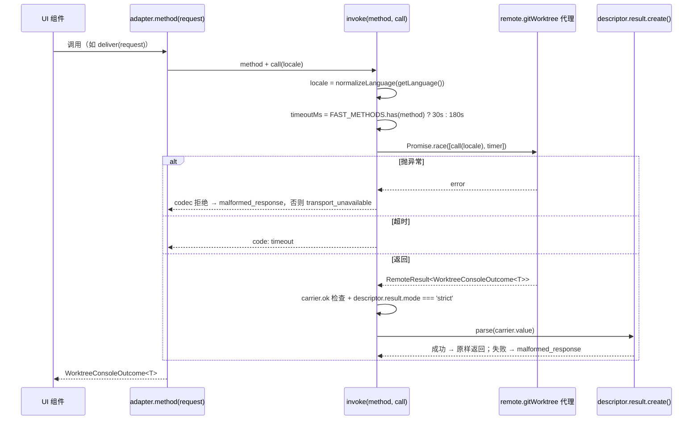
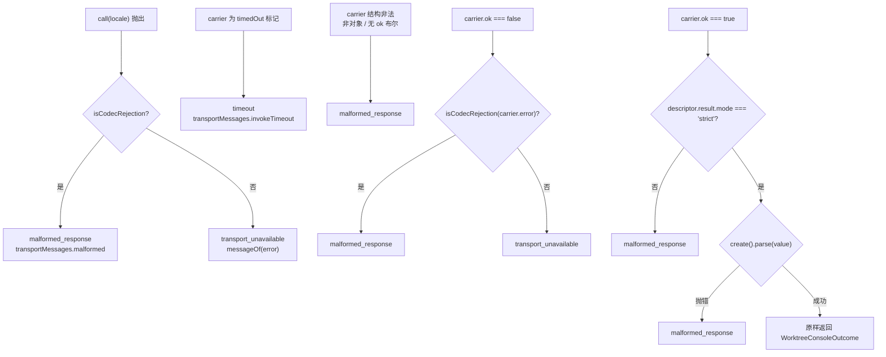

# client_console_remote 模块

!!! info "Generated documentation"
    This page was written by CodeWiki from the source code at commit [`5b95f640`](https://github.com/wloops/dsh-git-worktree/commit/5b95f640c1b489cd3e1c7dd85445c51573405e3f) on 2026-11-11 with `mimo-v2.6-flash`. Check the code before relying on details.

`client_console_remote` 是 `dsh-git-worktree` 在浏览器端（DSH Client / Web 渲染进程）的**入口与传输层**。它由两个文件构成，承担两件互不相同但强耦合的职责：

1. **`index.ts` —— 客户端启动编排（boot orchestration）**：把包自有的 strict Remote contribution 挂载进当前 Client fiber，把远端命名空间包装成 `WorktreeConsoleAdapter` 并 `provide` 为 `worktreeConsole` 服务，探测 Host 侧的侧栏拓扑（`sidebarTopology`），再依据 Host 报告的 Workspace Client「代际」（`workspaceClientFlavor`）与接管选举结果（`officialWorkspaceActive`）选择唯一的装配分支，最后把工具视图、设置卡片、侧栏装饰挂到正确的子 fiber 上。
2. **`adapter.ts` —— Remote 适配器（transport adapter）**：把 `WorktreeConsoleAdapter` 的 25 个方法逐一映射为对 `remote.gitWorktree` 代理的 RPC 调用，并在客户端侧补齐 **超时、传输失败、strict codec 校验** 三类防护，把任何异常都收敛成统一的 `WorktreeConsoleOutcome` 判别联合。

换言之：本模块是「Host 侧 Typert RPC 表面」与「客户端 UI 组件树」之间唯一的一层薄适配，**自身不含任何业务规则**——所有权限、状态机与 git 语义都在 Host 侧（见 [console_host：Worktree 控制平面与 Host RPC 服务](console_host.md) 与 [核心工作树领域（core_worktree_domain）](core_worktree_domain.md)）。

## 在系统中的位置

要点：

- 本模块**只依赖** `console_contract` 的类型契约（`WorktreeConsoleAdapter`、`WorktreeConsoleOutcome`、`WorktreeClientBootReport`）、`console_remote` 的描述符/远端类型、`i18n` 的翻译原语，以及 `client_core` / `client_workspace_sidebar` / `client_settings_card` 的挂载函数。
- 它是客户端插件唯一的入口文件：`tsdown.config.ts` 的 `entry` 就是 `src/client/console-remote/index.ts`，`package.json` 的 `exports["./client"]` 指向产物 `lib/client.js`。

## 组件一：启动编排（`index.ts`）

### `inject` 声明与「不能静态声明」的服务

`inject` 是一个由官方 Workspace Client 的注入列表推导出的白名单：

三处过滤各有明确原因，且都是**避免 web boot 死锁**的硬性要求：

| 被过滤的服务 | 原因 |
| --- | --- |
| `remote.directoryPicker` | 它的 provider 条目自身等待 `uiWorkspace`；本入口若声明它，就会在提供 `uiWorkspace` 之前等它，形成环。改为在调用时通过托管上下文代理惰性解析。 |
| `remoteAccess` | 0.2.0-rc.2 等旧 Host 不提供该服务，静态声明会让整个 web boot 永久 pending（「waiting for service: remoteAccess」→「14 entries did not activate」）。托管分支用 stub 兜底。 |
| `contextMenus` | 仅 0.2.2-rc.1+ 存在；只在 `MODERN_RC1_INJECT` 中、且只在子 fiber 上追加，避免 0.2.1 Host 永久等待。 |

`slots` 与 `configForms` 则**必须**声明：cordis 只解析本 fiber 已声明名字的服务读取，否则 `ctx.get('slots')` 永久为 `undefined`，Plugins 页的设置卡片会静默不挂载。

### `apply` 主流程

`getLanguage` 是一个**取值函数**而非快照值：`readClientLanguage(ctx.get('locale'))` 在每次调用时重新读取 LocaleFace 的 `getSnapshot().active`，因此语言切换会即时作用于后续 RPC 的 `locale` 参数与错误文案。

### 分支选择

分支语义：

- **拓扑读不出来**（最常见是 registry 损坏）时**绝不整条挂载失败**：那会连工具视图和控制台一起消失，而用户恰恰需要它们去修 registry。退化为「不挂侧栏、只挂工具」。
- **`officialWorkspaceActive === true`（decorate 模式）**：Host 保留了官方 Workspace Client，重放模块 `apply` 会重复 `provide('uiWorkspace')` 并崩溃，因此改为在官方已声明的子插槽上做装饰。
- **`officialWorkspaceActive === false`（takeover 模式）**：由本插件重放对应代际的官方模块 `apply`，并通过上下文代理替换 Browser 组件。
- **每一代官方 Client 都用自己的派生物**：`modern-rc5` 用 `virtual:dsh-official-workspace-client-rc5`，`modern-rc1` 用 `virtual:dsh-official-workspace-client`，`alpha` / `next` 各用自己的 virtual 模块。单个装饰无法横跨两代，因为它在构建期就对着一份钉死的官方 Client 编译。
- 代际判定**只看 Host 报告的版本**，不靠客户端服务启动时序（`shortcuts` 在 alpha 中不存在、在 rc.2 中启动偏晚）。

### 工具视图的子 fiber

`mountTools` 用 `workspaceCtx.inject(toolViewInject, child => applyToolViews(child, adapter))` 把会话相关视图挂到**当前 UI Workspace provider 之下**的子 fiber。这是刻意的：`uiConversation → uiWorkspace` 的启动依赖边必须先被打破，兄弟 fiber 无法安全假设导航服务已存在。`applyToolViews`（即 [client_core 模块](client_core.md) 的 `apply`）会收到显式传入的 `adapterOverride`，因为同一 fiber 内刚 `provide` 的服务在 provider effect 落定前对 `ctx.get` 不可见。

### 启动诊断 `reportBoot`

`reportBoot(branch, registered, detail?)` 通过 `remote.clientBootReport(report, undefined)` 向 Host 回写一条 ndjson 面包屑（`WorktreeClientBootReport`，含 `flavor`、`branch`、`registered`、`elapsedMountMs`、`elapsedTopologyMs`）。注意：

- 必须**位置化**地传末尾 `locale`（即使为 `undefined`），否则 Remote 代理的 arity 校验会失败。
- 全部包在 `try/catch` 里并吞掉 rejection——诊断永远不能破坏 boot 路径。

## 组件二：Remote 适配器（`adapter.ts`）

### 调用骨架

`createWorktreeConsoleRemoteAdapter(remote, getLanguage = () => 'zh')` 先用 `WORKTREE_CONSOLE_DESCRIPTORS` 建一张 `method → descriptor` 的 Map，然后为每个方法生成一个 `invoke` 包装：

### 方法映射表

适配器的方法签名严格对应 `WorktreeConsoleAdapter`，参数被「摊平」成位置参数传给 Remote 代理（`sessionId` 作为第一个位置参数，`locale` 恒为末位）：

| 分组 | 适配器方法 | Remote 方法 |
| --- | --- | --- |
| 拓扑/会话 | `sidebarTopology` / `current` / `list` / `inspect` / `initializeProject` | `sidebarTopology` / `current` / `list` / `inspect` / `initProject` |
| 交付与清理 | `discard` / `deliver` / `setRetention` / `setPermanent` / `retryCleanup` / `beginNextIteration` / `returnToLocal` | 同名 |
| 工作树生命周期 | `createWorktree` / `clearSidebarBadge` / `listAbandoned` / `restoreAbandoned` | 同名 |
| Git 只读 | `gitOverview` / `gitGraph` / `gitListTags` / `gitPruneMergedBranches` | 同名 |
| Git 变更 | `gitCreateBranch` / `gitSwitchBranch` / `gitCreateTag` / `gitDeleteTag` / `gitPushTag` | 同名 |

`clientBootReport` **不**在适配器表面上：它是 `index.ts` 直接对 `remote` 代理调用的诊断通道，不进 `WorktreeConsoleAdapter` 契约。

### 三层错误收敛

三类错误码补充了 `SessionCheckoutErrorCode` 之外的**传输层语义**（`WorktreeConsoleErrorCode = SessionCheckoutErrorCode | 'transport_unavailable' | 'malformed_response' | 'timeout'`），使 UI 能区分「业务失败」与「RPC 失败」。

`isCodecRejection` 通过匹配错误文案识别 codec 拒绝（`rejected "` 或 `返回了不符合 strict contract`），把这类本应属于契约违约的失败从 `transport_unavailable` 中摘出来，避免 UI 提示「连接不可用」而误导用户重试。

### 超时策略

Web RPC 载体**没有超时**：服务端 handler 卡住（binding-lock 队列、hung git）时请求会永久 pending，把调用方 UI 冻结在 pending 态。适配器因此用 `Promise.race` 在客户端侧兜底：

| 档位 | 时长 | 方法 |
| --- | --- | --- |
| `FAST_TIMEOUT_MS` | 30 s | `sidebarTopology`、`current`、`inspect`、`previewRecoveryPreflight`、`gitOverview`、`gitGraph`、`listAbandoned` |
| `SLOW_TIMEOUT_MS` | 180 s | 其余方法（含 `list` 与各变更操作） |

`list` 之所以走慢档：它是全量重算，多记录时会产生 20+ 次 git spawn，可能逼近 30 s。超时后**服务端工作仍在继续**，而变更类调用因带 `expectedRevision` 乐观并发控制，重试是安全的——这一点由 `invokeTimeout` 文案直接告知用户。

## 兼容性与打包约束

- **代际 virtual 模块**：`virtual:dsh-official-workspace-client`、`-rc5`、`-next`、`-alpha` 由 `tsdown.config.ts` 中的自定义插件在构建期从 `scripts/workspace-sidebar-upstream*.mjs` 物化（`resolveId` + `load`），并各自映射到一个 resolved id。
- **ModuleLoader 包装**：产物以 `window.__ModuleLoader__.load({ id: 'dsh-git-worktree', factory })` 形式封装（`outputOptions.banner/intro/footer`），`format: 'cjs'`、`platform: 'neutral'`，`react` / `@deepseek-ai/cordis` / `@deepseek-ai/dsh-client-store` / `@deepseek-ai/dsh-client-ui-primitives` 为 external。
- **Host 侧挂载点**：`cordis.patch.yml` 以 `insert` 方式把 `dsh-git-worktree` 条目加入 profile；`package.json` 的 `dsh.client` 声明 `platform: "web"` 与一组 `inject`（含 `@deepseek-ai/dsh-api-remote-access`），`exports["./typert"]` 让官方 Typert Loader 发现 `src/console-remote/typert.ts` 的 `TYPERT` contribution。
- **测试替身**：`vitest.config.ts` 把四个 virtual 模块 alias 到 `tests/official-workspace-client*.mock.ts`，并 alias `@deepseek-ai/dsh-client-ui-primitives`；因为本模块直接 import virtual 模块，任何分支测试都必须依赖这层 alias。

详见 [build_deployment_configuration：构建、打包与发布部署配置](build_deployment_configuration.md)。

## 依赖关系一览

| 依赖对象 | 用途 | 相关页面 |
| --- | --- | --- |
| `WORKTREE_CONSOLE_DESCRIPTORS` / `WORKTREE_CONSOLE_REMOTE` / `GitWorktreeRemote` | strict 描述符与远端命名空间类型 | [console_remote：控制台远程契约层（Typert Remote）](console_remote.md) |
| `WorktreeConsoleService` / `WorktreeConsoleControlPlane` | 服务端对端实现 | [console_host：Worktree 控制平面与 Host RPC 服务](console_host.md) |
| `WorktreeConsoleAdapter` / `WorktreeConsoleOutcome` / `WorktreeClientBootReport` | 客户端契约 | [console_contract 模块（Worktree Console 共享契约）](console_contract.md) |
| `apply` / `inject`（`client_core`） | 工具视图与控制台挂载 | [client_core 模块](client_core.md) |
| `registerManagedWorkspaceSidebar` / `registerDecoratedWorkspaceSidebar` | 侧栏装配的两种模式 | [client_workspace_sidebar 模块](client_workspace_sidebar.md) |
| `mountSettingsCard` | Plugins 页设置卡片 | [Worktree 设置卡片（client_settings_card）](client_settings_card.md) |
| `registerTargetConsole` | 顶部胶囊与目标控制台 | [会话目标胶囊与工作树控制台（client_target_console）](client_target_console.md) |
| `createTranslator` / `normalizeLanguage` / `transportMessages` | 传输层错误文案 | [i18n：中英双语文案与语言解析基础设施](i18n.md) |
| `officialWorkspaceActive` | 接管选举结果，决定 decorate / takeover | [核心工作树领域（core_worktree_domain）](core_worktree_domain.md) |

## 扩展指引

- **新增一个 Remote 方法**：先在 `src/console-remote/descriptors.ts` 添加描述符（参数顺序决定代理的 arity），再在 `src/console-remote/remote.ts` 的 `TypertRemoteMap` 补签名，最后在 `adapter.ts` 的返回对象中加一条 `invoke(...)`，并据实决定是否加入 `FAST_METHODS`。三处缺一都会在编译期或运行期（`malformed_response`）暴露。
- **新增一代官方 Workspace Client**：需要新增 `virtual:*` 模块 + `tsdown.config.ts` 的 `resolveId`/`load` + `workspaceClientFlavor` 联合成员 + `index.ts` 的 `inject` 推导与分支，以及 `vitest.config.ts` 的 alias。
- **调整超时**：`FAST_METHODS` 的成员语义是「一次 RPC 只做少量 git spawn」，新增全量重算类方法时不要误入快档。

??? abstract "Documented components (3)"
    - [`createWorktreeConsoleRemoteAdapter`](https://github.com/wloops/dsh-git-worktree/blob/5b95f640c1b489cd3e1c7dd85445c51573405e3f/src%5Cclient%5Cconsole-remote%5Cadapter.ts) — `src\client\console-remote\adapter.ts`
    - [`ConsoleClientContext`](https://github.com/wloops/dsh-git-worktree/blob/5b95f640c1b489cd3e1c7dd85445c51573405e3f/src%5Cclient%5Cconsole-remote%5Cindex.ts) — `src\client\console-remote\index.ts`
    - [`Context`](https://github.com/wloops/dsh-git-worktree/blob/5b95f640c1b489cd3e1c7dd85445c51573405e3f/src%5Cclient%5Cconsole-remote%5Cindex.ts) — `src\client\console-remote\index.ts`

