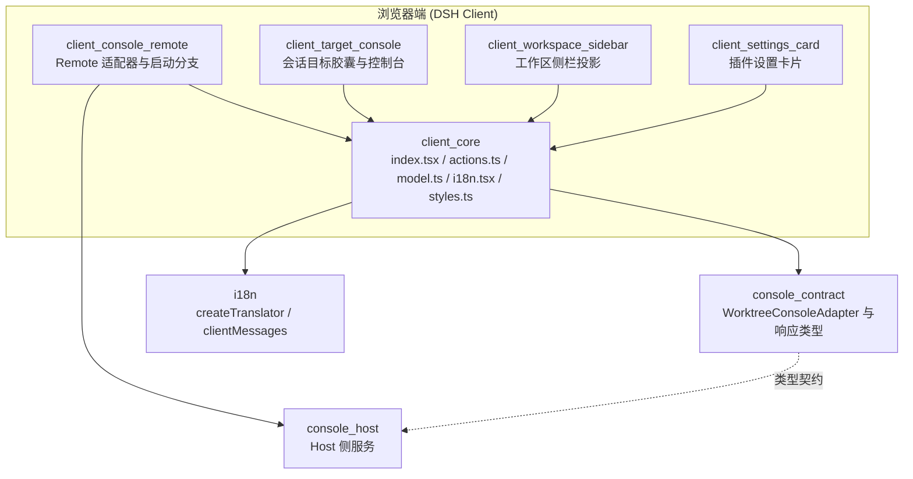
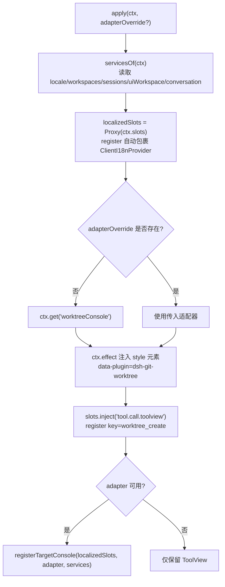
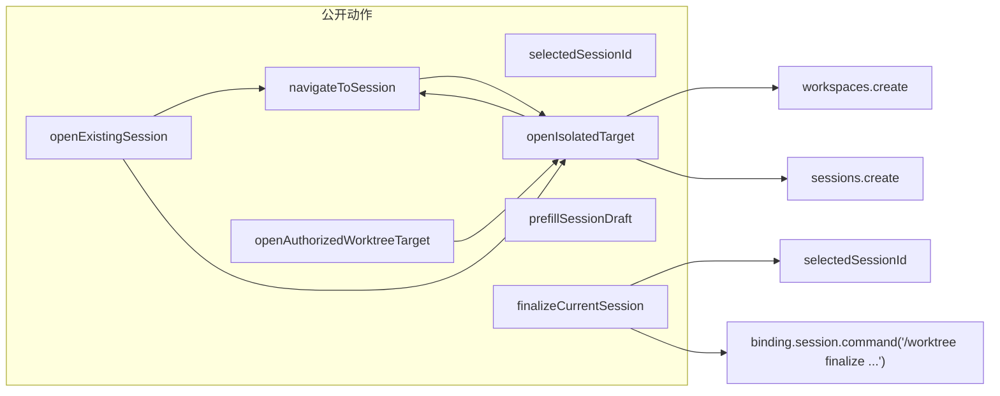
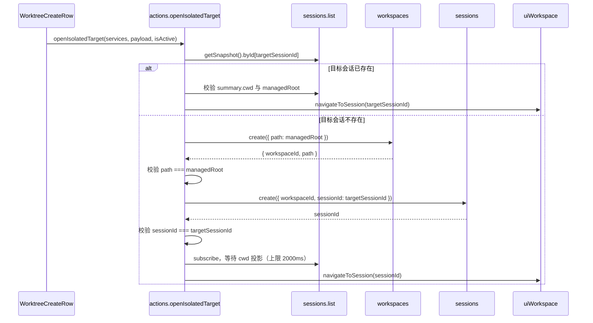
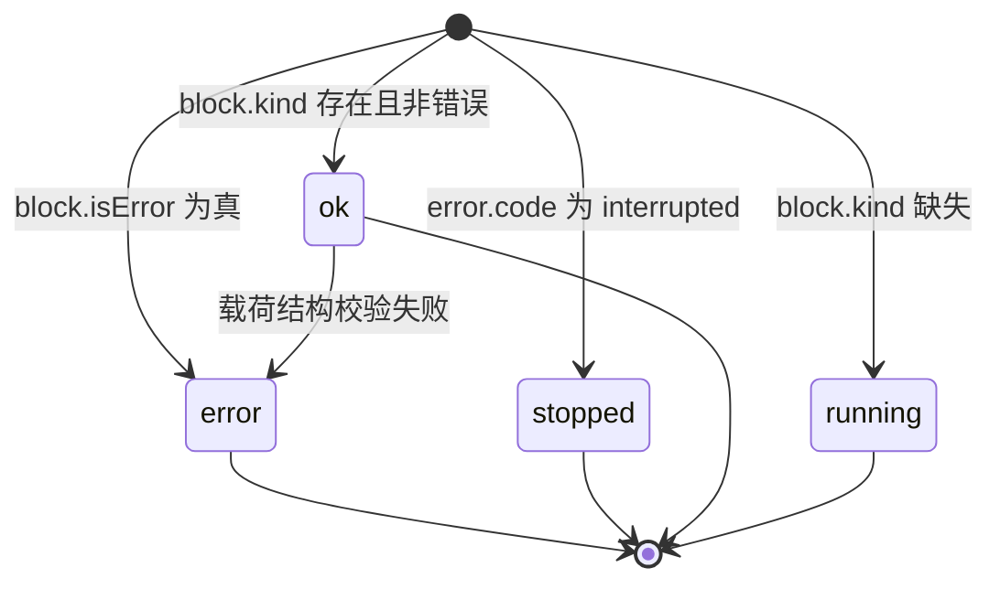
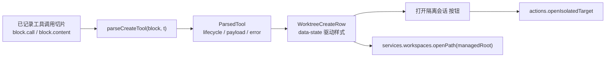
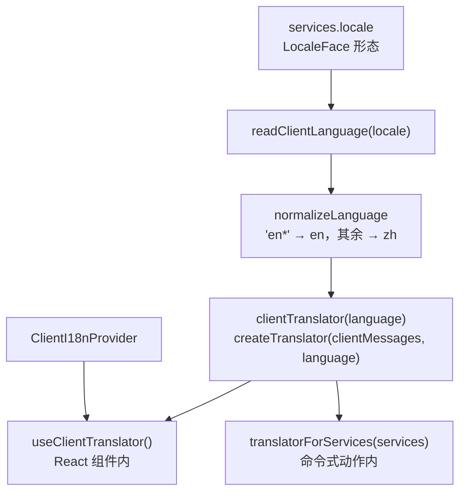

# client_core 模块

!!! info "Generated documentation"
    This page was written by CodeWiki from the source code at commit [`61ce8eff`](https://github.com/wloops/dsh-git-worktree/commit/61ce8eff634a8779fc304e26e02fe09c833f01e2) on 2026-11-09 with `deepseek-v4.1-flash`. Check the code before relying on details.

`client_core` 是 `dsh-git-worktree` 浏览器端（DSH Client / Web 渲染进程）的核心底座层。它不直接实现业务面板，而是提供四类「基座能力」，供本插件所有客户端子模块复用：

1. **入口与插槽注册骨架**（`index.tsx`）：声明 cordis `inject` 依赖、包装插槽注册以注入 i18n、注入样式表、注册 Worktree 创建 ToolView，并把控制台适配器交给 `client_target_console`。
2. **Harness 服务编排层**（`actions.ts`）：把 Harness 的 Workspace / Session 运行时能力收敛为一组可测试的纯函数式动作（导航、打开隔离目标、草稿预填、验收提交），并强制「先校验 cwd / 身份，再导航」的安全策略。
3. **ToolView 纯模型层**（`model.ts`）：只从已记录的工具调用切片（call/result）推导出可重放的视图模型，保证刷新/回放时渲染结果稳定。
4. **本地化与样式基座**（`i18n.tsx`、`styles.ts`）以及 **宿主平台类型声明**（`harness-platform.d.ts`）。

## 在系统中的位置

`client_core` 是客户端一侧的最底层模块：`client_console_remote`、`client_target_console`、`client_workspace_sidebar`、`client_settings_card` 都直接或间接依赖它，而它本身只依赖 `console_contract` 的类型契约与 `i18n` 的翻译原语，不依赖任何 Host（Node 侧）实现。

关键事实：`client_core` 从不直接发起 Remote 调用。所有 Host 交互都通过 `WorktreeConsoleAdapter` 接口（定义在 `console_contract`）完成，具体实现由 `client_console_remote` 的 `createWorktreeConsoleRemoteAdapter` 注入。这使 `client_core` 可以在测试中用桩适配器完全替换。

## 组件清单

| 文件 | 主要导出 | 职责 |
| --- | --- | --- |
| `src/client/index.tsx` | `apply`、`inject`、`WORKTREE_CONSOLE_ADAPTER_SERVICE`、`ClientContextLike` | 浏览器入口：服务收集、i18n 插槽包装、样式注入、ToolView 与目标控制台注册 |
| `src/client/actions.ts` | `WorktreeClientServices`、`ClientSessions`、`ClientWorkspaces`、`ClientSessionBinding`、`ClientSessionSnapshot`、`SnapshotStore`、`IsolatedTargetLocation`、`openIsolatedTarget`、`openAuthorizedWorktreeTarget`、`openExistingSession`、`navigateToSession`、`selectedSessionId`、`prefillSessionDraft`、`finalizeCurrentSession` | Harness 服务抽象与用户动作编排 |
| `src/client/model.ts` | `ParsedTool`、`ToolCallBlockLike`、`ToolCallViewPropsLike`、`ToolContentBlock`、`WorktreeCreatePayload`、`parseCreateTool` | 纯函数式 ToolView 模型解析 |
| `src/client/i18n.tsx` | `ClientLocaleSource`、`ClientI18nProvider`、`useClientTranslator`、`useClientLanguage`、`translatorForServices`、`readClientLanguage`、`clientTranslator`、`defaultClientTranslator` | 客户端语言解析与 React 上下文 |
| `src/client/WorktreeCreateRow.tsx` | `WorktreeCreateRow` | `worktree_create` 工具调用的专用行视图（含「打开隔离会话」按钮） |
| `src/client/styles.ts` | `WORKTREE_STYLES` | 卡片与侧栏徽标的全局 CSS 字符串 |
| `src/client/harness-platform.d.ts` | `MenuEntry` | 对 `virtual:dsh-official-workspace-client*` 与 `@deepseek-ai/dsh-client-ui-primitives` 的环境声明 |

## 入口与注册流程

`apply` 是插件在浏览器侧的启动点，签名允许一个可选的 `adapterOverride`（由 `client_console_remote` 传入刚创建的适配器，规避「同一 fiber 内服务尚未可见」的问题）。

设计要点：

- **插槽注册必须自持**：`ctx.slots.register` 被 Proxy 拦截，在渲染时用 `ClientI18nProvider` 包裹组件，从而保证每个 DSH Client 实例的语言上下文相互隔离；`Proxy` 只拦截 `register`，其他方法透传。
- **样式所有权**：client-module 系统会「认领」任何没有 `data-plugin` 的 `<style>`，并在该模块失效时删除。因此这里显式写入 `data-dsh-git-worktree`、`data-plugin=dsh-git-worktree`、`data-plugin-css=dsh-git-worktree/styles`，并在 `ctx.effect` 的清理函数中移除节点。
- **注册的可重放性**：ToolView 以 `{ name: 'tool.call.toolview', key: 'worktree_create' }` 键控注册，回放历史时同一 key 复用同一行组件，不会因重复注册而分裂。
- **`inject` 常量**：`['slots', 'workspaces', 'sessions', 'conversation', 'connection', 'locale']`，与 `package.json` 中 `dsh.client.inject` 的包级依赖声明互补。

## 服务抽象层（actions.ts）

### 服务契约

`WorktreeClientServices` 是 `client_core` 对外暴露给所有子组件的唯一「依赖注入容器」：

| 字段 | 可选性 | 说明 |
| --- | --- | --- |
| `sessions: ClientSessions` | 必填 | 会话列表快照、`create`、`binding`，以及可选的 `using` / `open` |
| `workspaces: ClientWorkspaces` | 必填 | `create({ path })` 注册工作区、`openPath(path)` 打开目录 |
| `uiWorkspace?: { openSession }` | 可选 | Harness 0.1.6+ 由 UI Workspace 拥有导航权 |
| `locale?: unknown` | 可选 | DSH LocaleFace 形态的语言源（`getSnapshot` + `subscribe`） |
| `conversation?: { input: { for(ctx) } }` | 可选 | 仅用于「草稿预填」的公开 composer 面 |

`SnapshotStore<T>` 统一了「外部存储订阅」形状（`getSnapshot` + `subscribe`），使得 `sessions.list`、设置卡片的 `hooks.worktreeCard` 等都用同一种方式被 React 消费。

### 主要动作

- **`navigateToSession`**：优先 `uiWorkspace.openSession`，其次 `sessions.open`，两者皆无则抛出本地化错误 —— 明确「宁可失败，也不静默丢失目标选择」。
- **`selectedSessionId`**：同时兼容旧的 `snapshot.current` 与新的 `retainedBy.mainView` 契约；当两者冲突（存在多个被保留会话，或 `current` 与被保留者不一致）时返回 `undefined`，让调用方放弃操作而不是猜。
- **`openExistingSession`**：仅当会话列表证明 `cwd` 与期望路径一致时才导航；`samePath` 会归一化分隔符与尾斜杠，并对 Windows 盘符路径做大小写不敏感比较。
- **`openIsolatedTarget`**：幂等打开隔离目标的完整流程（见下方时序图）。
- **`openAuthorizedWorktreeTarget`**：先通过 `adapter.inspect` 取回「无路径的授权」，再逐项校验 `checkoutId`、`ownerSessionId`、`targetSessionId`、`capabilities.inspect/open` 与非空 `managedRoot`，最后复用 `openIsolatedTarget`。路径永远来自 Host 的最新检查结果，而不是来自 UI 载荷。
- **`prefillSessionDraft`**：只调用 `conversation.input.for(ctx).setDraft(text)`，绝不触发 command / send / followup —— 恢复请求必须由用户显式发送。
- **`finalizeCurrentSession`**：把验收卡片的接受动作翻译成显式用户命令 `/worktree finalize <reviewId> <revision> <retention>`，并区分「命令执行失败」与「Host 未识别该命令」两种错误。

### 打开隔离目标的时序

`waitForProjectedSessionPath` 是本层最容易被忽视的健壮性来源：Harness 的 `create` 返回后，会话的 `cwd` 可能尚未投影到列表快照中。这里用 `subscribe` + `inspect` 立即自检 + `setTimeout(2000)` 兜底，并通过 `isActive()` 在组件卸载后提前返回 `false`，避免「已卸载组件继续导航」。所有动作都接受 `isActive: () => boolean` 参数（默认恒为 `true`），由调用方提供挂载状态。

## ToolView 纯模型层（model.ts）

`model.ts` 的契约是「只读已记录切片、零副作用、可重放」。它不访问网络、不读取时间，只把 `ToolCallBlockLike` 折叠成 `ParsedTool<TPayload, TArgs>`：

- **载荷校验是白名单式**：`parseCreateTool` 要求 `kind === 'worktree_target_created'` 且 `checkoutId / targetSessionId / managedRoot / phase / currentOid / sourceSessionId` 全部为非空字符串，否则把生命周期降级为 `error` 并给出本地化的「结果格式错误」文案。
- **只解析创建载荷**：`model.ts` 现在只保留 `worktree_create` 这一条解析链（`WorktreeCreatePayload`），因此 `ParsedTool.args` 恒为 `null`；此前的验收结果载荷与参数（`WorktreeReviewPayload`、`ReviewArgs`、`parseReviewTool`）已从本模块移除。
- **翻译器可注入**：解析函数接受 `t: ClientTranslator`（默认 `defaultClientTranslator`），因此错误文案跟随当前语言，同时保持函数纯净。

### 行视图的数据流

`WorktreeCreateRow` 自身只维护两个本地状态：`openState`（`idle` / `opening` / `error`）与 `openError`。它用 `mounted` ref 在 `await` 之后判断是否仍挂载，避免卸载后 `setState`；当 `payload.cwdSelected` 为真（Host 已把当前会话移入 checkout）时不再渲染打开按钮，改为展示说明文案。

## 本地化基座（i18n.tsx）

三个使用场景被明确区分：

1. **React 组件**：`ClientI18nProvider` 用 `useSyncExternalStore` 订阅语言源，`useClientTranslator()` 在语言变化时重建翻译器（`useMemo`）。
2. **命令式动作**：`translatorForServices(services)` 在**调用时**解析语言，而不是模块加载时；这保证 `actions.ts` 抛出的错误总是当前语言。
3. **默认回退**：`defaultClientTranslator` 固定为 `zh`，供纯函数默认参数与宿主缺失 `locale` 时使用。`readClientLanguage` 对异常 `getSnapshot` 做了 try/catch 兜底。

消息目录本身位于 `src/i18n/client-messages.ts`，详见 [i18n：中英双语文案与语言解析基础设施](i18n.md)。

## 样式基座（styles.ts）

`WORKTREE_STYLES` 是一个 `String.raw` 常量，包含两类规则：

- **侧栏装饰**：`.dsh-git-worktree-sidebar-icon` / `.dsh-git-worktree-sidebar-badge`，通过 `data-worktree-state` 属性映射到主题别名变量（`--dsw-alias-state-business-primary`、`warn-label`、`error-primary`、`success-primary` 等），覆盖 `working / ready_for_review / preview_active / preview_detached / recovery_required / finalized / discarded` 七种状态。
- **卡片与面板**：`.dsh-wt-*` 命名空间（`-card`、`-head`、`-mark`、`-grid`、`-button`、`-badge`、`-commit`、`-test` 等），全部基于 `color-mix(in srgb, currentColor …)` 派生色阶，因此天然适配亮/暗主题；`data-state="running"` 触发 `dsh-wt-pulse` 动画，并在 `prefers-reduced-motion: reduce` 下关闭。

样式字符串由 `index.tsx` 与 `TARGET_CONSOLE_STYLES` 合并写入单个 `<style>` 元素，因此全插件只有一份样式表、一次注入、一次清理。

## 平台类型声明（harness-platform.d.ts）

该文件只提供环境声明，不产生运行时代码：

- 四个虚拟模块 `virtual:dsh-official-workspace-client`、`-rc5`、`-alpha`、`-next`（分别对应官方 Workspace Client 的不同代际），每个都由 `tsdown.config.ts` 在构建期通过 `materialize*WorkspaceClientModule()` 物化源码后打包。声明中导出的 `WorkspaceBrowser` 是**被装饰的衍生组件**，注释明确指出它必须渲染自身而非官方组件，否则投影的 Worktree 图标/徽标会丢失。
- `@deepseek-ai/dsh-client-ui-primitives` 的 `Menu`、`Modal`、`MenuItemButton`、`MenuEntry` 与两个 lucide 图标，供目标控制台的下拉菜单与模态框使用。

## 构建与打包约束

本模块的行为与构建方式强相关，改动时需要同步关注：

| 工件 | 影响 |
| --- | --- |
| `tsdown.config.ts` | 入口为 `src/client/console-remote/index.ts`，输出 CJS 到 `lib/client.js`；`banner` 写入 `window.__ModuleLoader__.load({ id: "dsh-git-worktree", factory: … })`，`intro`/`footer` 提供模块包装；`external` 保留 `react`、`@deepseek-ai/cordis`、`@deepseek-ai/dsh-client-ui-primitives` 等 |
| `package.json` → `exports["./client"]` | 对外暴露的客户端入口指向 `lib/client.js`，类型指向 `lib/client/console-remote/index.d.ts` |
| `package.json` → `dsh.client` | `platform: "web"` 与 `inject` 包级依赖列表，决定本 bundle 在 DSH 中的加载前置条件 |
| `package.json` → `dependencies` | `lucide-react` 被 `ReviewIcon` 使用并被 `noExternal` 内联；`zod` 用于 Remote 侧 schema |
| `tsconfig.json` | `jsx: "react-jsx"`、`strict`、`noUncheckedIndexedAccess` —— 后者解释了 `actions.ts` 中大量显式 `undefined` 判断 |
| `vitest.config.ts` | 把四个 `virtual:dsh-official-workspace-client*` 与 `ui-primitives` 别名到 `tests/` 下的桩实现，使 `client_core` 可在 jsdom 中独立测试 |
| `cordis.patch.yml` | 通过 `insert` 把 `dsh-git-worktree` 注入 Loader 条目列表 |

## 错误处理与健壮性约定

- **本地化错误优先**：`actions.ts` 的所有抛出都经过 `translatorForServices`，错误消息直接面向用户。
- **拒绝静默降级**：导航不可用、cwd 不匹配、身份不一致、Host 未提供路径 —— 全部抛错而不是「尝试打开最接近的会话」。
- **竞态防护**：`isActive()`（卸载感知）+ `mounted` ref（`WorktreeCreateRow`）+ `waitForProjectedSessionPath` 的 `settled` 标志，三层保证异步结果不会写回已失效的上下文。
- **幂等**：`openIsolatedTarget` 在目标会话已存在时只做校验与导航，重复点击「打开隔离会话」不会重复创建 workspace/session。

## 与其他模块的关系

| 模块 | 关系 |
| --- | --- |
| [client_console_remote 模块](client_console_remote.md) | 提供 `createWorktreeConsoleRemoteAdapter`，并以 `adapterOverride` 调用本模块的 `apply`；同时挂载侧栏、设置卡片 |
| [会话目标胶囊与工作树控制台（client_target_console）](client_target_console.md) | 消费 `TargetConsoleContextLike`、`WorktreeClientServices` 与 `openIsolatedTarget` / `openAuthorizedWorktreeTarget` |
| [client_workspace_sidebar 模块](client_workspace_sidebar.md) | 复用 `selectedSessionId`、`WORKTREE_STYLES` 中的侧栏装饰类与 `ClientI18nProvider` |
| [Worktree 设置卡片（client_settings_card）](client_settings_card.md) | 复用 `SnapshotStore` 形状与 `ClientI18nProvider`；由 `client_console_remote` 挂载 |
| [console_contract 模块（Worktree Console 共享契约）](console_contract.md) | `WorktreeConsoleAdapter` 与全部响应类型 |
| [Console_API_and_Host_Integration：控制台 API 与 Host 集成](Console_API_and_Host_Integration.md) | 适配器的 Host 侧实现与 Remote 编解码 |
| [i18n：中英双语文案与语言解析基础设施](i18n.md) | `createTranslator`、`normalizeLanguage`、`clientMessages` |
| [build_deployment_configuration：构建、打包与发布部署配置](build_deployment_configuration.md) | `tsdown` / `package.json` / `vitest` 对本模块的打包与测试约束 |

??? abstract "Documented components (19)"
    - [`__file__`](https://github.com/wloops/dsh-git-worktree/blob/61ce8eff634a8779fc304e26e02fe09c833f01e2/src%5Cclient%5CWorktreeCreateRow.tsx) — `src\client\WorktreeCreateRow.tsx`
    - [`ClientSessionBinding`](https://github.com/wloops/dsh-git-worktree/blob/61ce8eff634a8779fc304e26e02fe09c833f01e2/src%5Cclient%5Cactions.ts) — `src\client\actions.ts`
    - [`ClientSessionSnapshot`](https://github.com/wloops/dsh-git-worktree/blob/61ce8eff634a8779fc304e26e02fe09c833f01e2/src%5Cclient%5Cactions.ts) — `src\client\actions.ts`
    - [`ClientSessions`](https://github.com/wloops/dsh-git-worktree/blob/61ce8eff634a8779fc304e26e02fe09c833f01e2/src%5Cclient%5Cactions.ts) — `src\client\actions.ts`
    - [`ClientWorkspaces`](https://github.com/wloops/dsh-git-worktree/blob/61ce8eff634a8779fc304e26e02fe09c833f01e2/src%5Cclient%5Cactions.ts) — `src\client\actions.ts`
    - [`IsolatedTargetLocation`](https://github.com/wloops/dsh-git-worktree/blob/61ce8eff634a8779fc304e26e02fe09c833f01e2/src%5Cclient%5Cactions.ts) — `src\client\actions.ts`
    - [`SnapshotStore`](https://github.com/wloops/dsh-git-worktree/blob/61ce8eff634a8779fc304e26e02fe09c833f01e2/src%5Cclient%5Cactions.ts) — `src\client\actions.ts`
    - [`WorktreeClientServices`](https://github.com/wloops/dsh-git-worktree/blob/61ce8eff634a8779fc304e26e02fe09c833f01e2/src%5Cclient%5Cactions.ts) — `src\client\actions.ts`
    - [`MenuEntry`](https://github.com/wloops/dsh-git-worktree/blob/61ce8eff634a8779fc304e26e02fe09c833f01e2/src%5Cclient%5Charness-platform.d.ts) — `src\client\harness-platform.d.ts`
    - [`ClientLocaleSource`](https://github.com/wloops/dsh-git-worktree/blob/61ce8eff634a8779fc304e26e02fe09c833f01e2/src%5Cclient%5Ci18n.tsx) — `src\client\i18n.tsx`
    - [`ClientContextLike`](https://github.com/wloops/dsh-git-worktree/blob/61ce8eff634a8779fc304e26e02fe09c833f01e2/src%5Cclient%5Cindex.tsx) — `src\client\index.tsx`
    - [`ParsedTool`](https://github.com/wloops/dsh-git-worktree/blob/61ce8eff634a8779fc304e26e02fe09c833f01e2/src%5Cclient%5Cmodel.ts) — `src\client\model.ts`
    - [`ReviewArgs`](https://github.com/wloops/dsh-git-worktree/blob/61ce8eff634a8779fc304e26e02fe09c833f01e2/src%5Cclient%5Cmodel.ts) — `src\client\model.ts`
    - [`ToolCallBlockLike`](https://github.com/wloops/dsh-git-worktree/blob/61ce8eff634a8779fc304e26e02fe09c833f01e2/src%5Cclient%5Cmodel.ts) — `src\client\model.ts`
    - [`ToolCallViewPropsLike`](https://github.com/wloops/dsh-git-worktree/blob/61ce8eff634a8779fc304e26e02fe09c833f01e2/src%5Cclient%5Cmodel.ts) — `src\client\model.ts`
    - [`ToolContentBlock`](https://github.com/wloops/dsh-git-worktree/blob/61ce8eff634a8779fc304e26e02fe09c833f01e2/src%5Cclient%5Cmodel.ts) — `src\client\model.ts`
    - [`WorktreeCreatePayload`](https://github.com/wloops/dsh-git-worktree/blob/61ce8eff634a8779fc304e26e02fe09c833f01e2/src%5Cclient%5Cmodel.ts) — `src\client\model.ts`
    - [`WorktreeReviewPayload`](https://github.com/wloops/dsh-git-worktree/blob/61ce8eff634a8779fc304e26e02fe09c833f01e2/src%5Cclient%5Cmodel.ts) — `src\client\model.ts`
    - [`__file__`](https://github.com/wloops/dsh-git-worktree/blob/61ce8eff634a8779fc304e26e02fe09c833f01e2/src%5Cclient%5Cstyles.ts) — `src\client\styles.ts`

