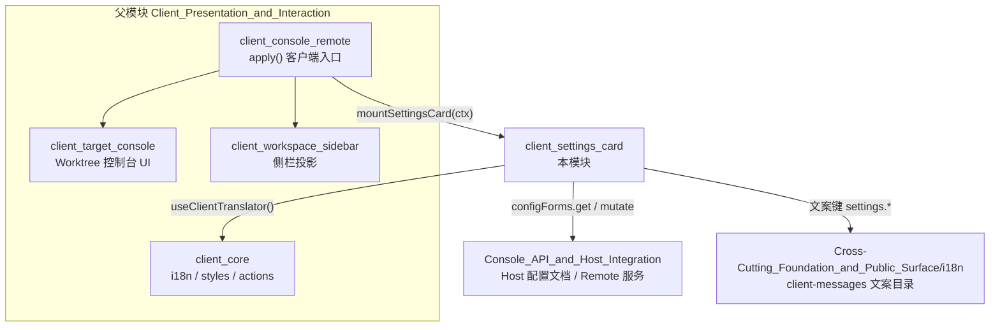
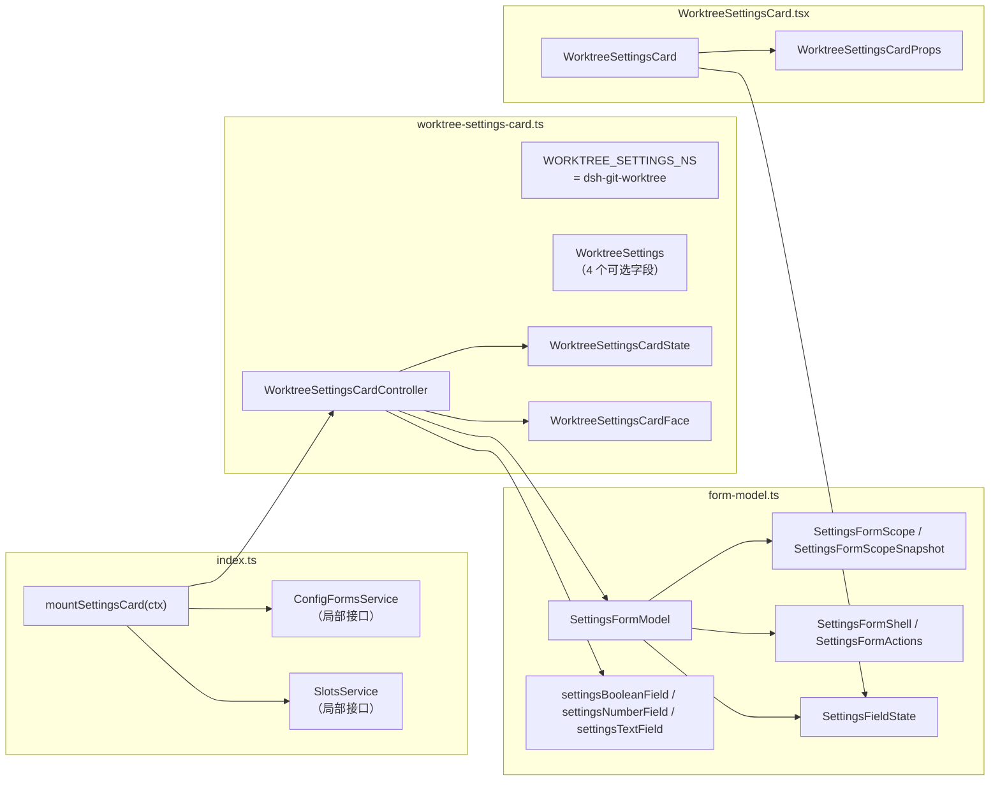
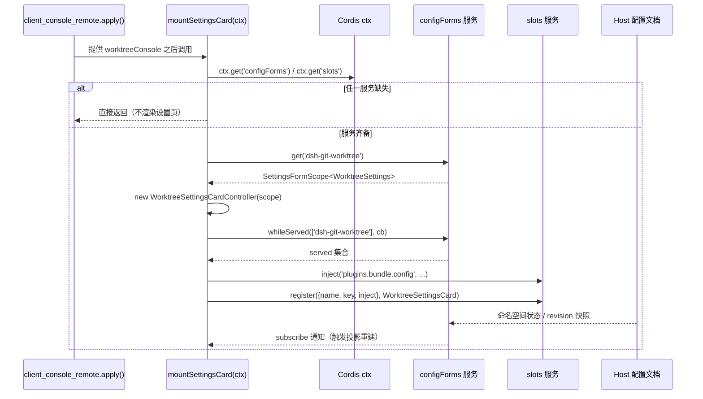
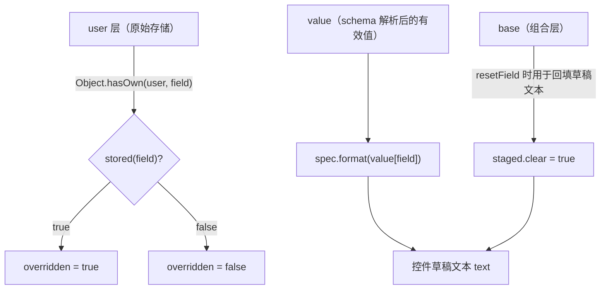
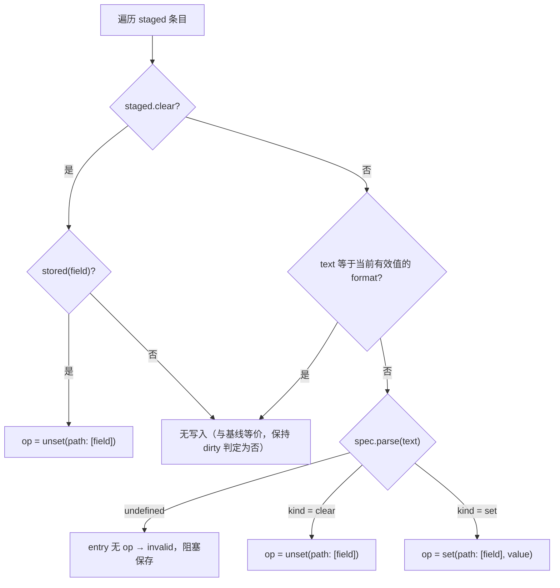
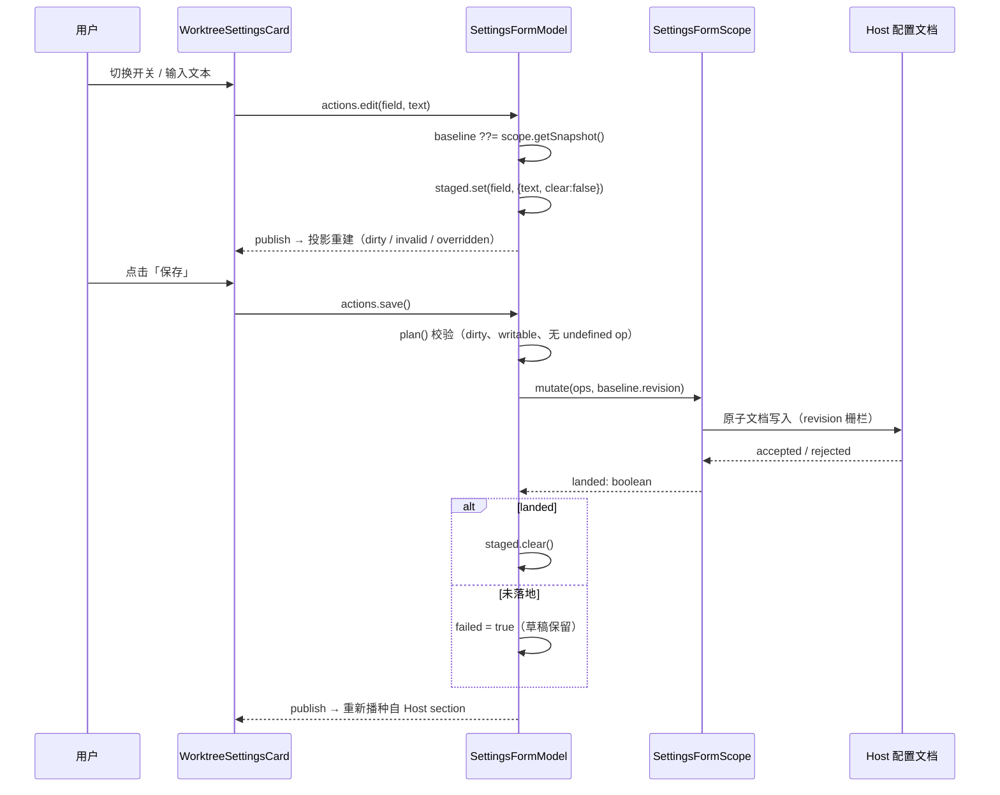

# Worktree 设置卡片（client_settings_card）

!!! info "Generated documentation"
    This page was written by CodeWiki from the source code at commit [`8b44e2a7`](https://github.com/wloops/dsh-git-worktree/commit/8b44e2a7098c49d39abae5f42bd3e205e5f608b1) on 2026-11-12 with `mimo-v2.6-flash`. Check the code before relying on details.

`client_settings_card` 是 `dsh-git-worktree` 客户端中唯一写入配置的界面模块：它把 `dsh-git-worktree` 命名空间下的可编辑字段（自动交付、自动推送、两个 Git 超时）渲染成一张「暂存—保存」式的设置卡片，并挂载到 Host 的 Plugins 页 `plugins.bundle.config` 插槽上。

该模块刻意保持**自包含**：卡片不使用宿主 `@deepseek-ai/dsh-client-ui-primitives` 中的共享 `SettingsForm`（随插件安装的版本早于该模块），行与控件全部用内联样式绘制，因此不依赖任何外部样式表，也不参与客户端样式表的装配流程（对比 [client_core 模块](client_core.md) 中 `WORKTREE_STYLES` / `TARGET_CONSOLE_STYLES` 的注入方式）。

---

## 1. 在系统中的位置

本模块是 [Client_Presentation_and_Interaction 模块概览](Client_Presentation_and_Interaction.md) 的叶子子模块，只有唯一的宿主入口：[client_console_remote 模块](client_console_remote.md) 的 `apply()` 在解析出 `remote.gitWorktree` 代理、提供 `worktreeConsole` 适配器之后，直接调用 `mountSettingsCard(ctx)`。



与其它子模块的关键差别：

| 维度 | 本模块 | 其它子模块 |
| --- | --- | --- |
| 数据来源 | Host 的配置文档（`configForms` 服务） | `worktreeConsole` Remote 适配器（见 [console_contract 模块（Worktree Console 共享契约）](console_contract.md)） |
| 主要交互 | 表单暂存 + 原子写入 | 只读投影 + 显式命令 |
| 失败策略 | 保存失败保留草稿、可重试 | 错误分类后引导恢复（`error.category.*`） |
| 挂载前提 | `configForms` 与 `slots` 均存在，且命名空间被服务 | 拓扑探测后按官方 Workspace 代际分支 |

---

## 2. 文件与组件构成



### 2.1 `form-model.ts` — 暂存式表单模型

这是整个模块的核心抽象，从宿主 `@deepseek-ai/dsh-client-ui-primitives` 0.1.7-rc.2 的 settings-form 模型裁剪而来，并**去掉了只写密钥控件**（本卡片只编辑可见字段）。

| 类型 | 职责 |
| --- | --- |
| `SettingsFormScopeSnapshot<T>` | 模型对 Host 一个条目表单的只读视图：`status`、`value`（schema 解析后的有效值）、`base`（组合层）、`user`（用户层原始值）、`writable`、`revision` |
| `SettingsFormScope<T>` | 模型依赖的最小 Host 接口：`getSnapshot()`、`subscribe()`、`mutate(ops, expectedRevision?)` |
| `SettingsFieldSpec` | 单字段在「存储值」与「草稿文本」之间的转换规格：`format` 与 `parse` |
| `SettingsFieldState` | 单个控件渲染所需的三元信息：`text`、`overridden`、`invalid` |
| `SettingsFormShell` | 所有插件卡片共享的表单状态：`available`、`writable`、`dirty`、`invalid`、`saving`、`failed` |
| `SettingsFormActions` | 槽位注入给组件的四个动作：`edit`、`resetField`、`save`、`discard` |
| `StagedEdit` / `PlannedWrite` | 内部类型：一条暂存编辑，以及它解析出的一次文档写入（`set` / `unset`） |
| `SettingsFormPathOp` | 写入操作的线上形态，与共享配置表单的 `mutate` 接受格式一致 |

`SettingsFormModel<T>` 的公开方法只有四个：

- `bind<S>(project)`：注册一个投影函数，返回 `SnapshotStore<S>`；scope 或草稿变化时整体重建投影（槽位组件通过快照选择器读取，因此必须经过 store 而不是直接读字段）。
- `shell()`：读取卡片级状态，`dirty` / `invalid` 都由当前 `plan()` 推导。
- `field(field)`：读取单个控件状态；无暂存时回落到 `format(sectionValue(field))`。
- `actions()` / `save()` / `dispose()`：动作绑定、异步写入、释放订阅。

### 2.2 `worktree-settings-card.ts` — 字段声明与控制器

```ts
export const WORKTREE_SETTINGS_NS = 'dsh-git-worktree'
```

- `WorktreeSettings`：卡片编辑的 Config 片段，4 个字段全部可选（`autoDeliver`、`autoPush`、`gitTimeoutMs`、`worktreeAddTimeoutMs`）。
- `WorktreeSettingsCardState`：`SettingsFormShell` 的扩展，逐字段附带一个 `SettingsFieldState`。
- `WorktreeSettingsCardFace`：槽位条目注入给组件的对象，形状为 `SettingsFormActions & { hooks: { worktreeCard: SnapshotStore<WorktreeSettingsCardState> } }`。
- `WorktreeSettingsCardController`：在构造时把 4 个字段规格交给 `SettingsFormModel`，用 `form.bind(() => this.projection())` 建立快照 store，并通过 `inject()` 同时暴露 store 与动作；`dispose()` 释放订阅。

字段规格与 Host 侧 schema 的对应关系（`src/index.ts` 的 `Config`，字段均以 `volatile(...)` 标记）：

| 字段 | 规格 | Host schema 约束 | 空草稿语义 |
| --- | --- | --- | --- |
| `autoDeliver` | `settingsBooleanField` | `z.boolean().default(true)` | `unset`，回落到组合层/默认值 |
| `autoPush` | `settingsBooleanField` | `z.boolean().default(true)` | 同上 |
| `gitTimeoutMs` | `settingsNumberField` | `min(1_000).max(MAX_GIT_TIMEOUT_MS).default(120_000)` | `unset` |
| `worktreeAddTimeoutMs` | `settingsNumberField` | `min(1_000).max(MAX_GIT_TIMEOUT_MS).default(300_000)` | `unset` |

`volatile` 标记使这些字段成为 Host 设置页的「活引用」字段：编辑写入 `cordis.patch.yml` 而不重挂插件，读取侧每次使用时取值（参见 `src/adapters/git-options.ts` 的 `gitTimeoutMs()`，它在每次 Git 调用时读取 `worktreeAddTimeoutMs` / `gitTimeoutMs`）。因此卡片保存后的效果是**下一次 Git 命令立即生效**，无需重启。

### 2.3 `WorktreeSettingsCard.tsx` — 视图

- `WorktreeSettingsCardProps extends SettingsFormActions`，含 `view?: string` 与 `useWorktreeCard`。渲染器把 face 中保留的 `hooks.worktreeCard` 源转换为 `useWorktreeCard` 选择器钩子，因此组件本身**永远看不到 `hooks` prop**。
- `view === 'summary'` 时只返回一行 `t('settings.description')`（Plugins 页列表用的一行摘要）；其余情况渲染表单。
- `state.available === false` 时返回 `null`（命名空间未被服务给此客户端）。
- 所有交互控件在 `disabled = !state.writable || state.saving` 时禁用；保存按钮额外要求 `dirty && !invalid`。
- 视觉常量（`ACCENT`、`MUTED`、`DANGER`、`BORDER`）与全部样式对象都定义在文件内；开关按钮使用 `role="switch"` + `aria-checked` + `aria-label`，输入框使用 `aria-label` 与 `inputMode="numeric"`，以满足可访问性而不引入样式表。
- 每个字段行由内部函数 `fieldRow(...)` 统一绘制：标签 + 提示 + 控件 + 无效提示 + 「已覆盖」徽标 + 「还原」按钮。文案键全部位于 `settings.*`（见 [i18n：中英双语文案与语言解析基础设施](i18n.md)）。

### 2.4 `index.ts` — 挂载与插槽注册

`mountSettingsCard(ctx)` 的流程是**全程 fail-soft**：

1. 用 `ctx.get('configForms')` / `ctx.get('slots')` 读取服务（不用属性 getter，避免 Cordis 的 “cannot get property without inject”）；任一缺失即直接返回，Host 上没有设置栈就只是「没有这张卡片」。
2. `ctx.effect(...)` 内构造 `WorktreeSettingsCardController`，以 `configForms.get<WorktreeSettings>(WORKTREE_SETTINGS_NS)` 作为 scope；卸载时 `dispose()`。
3. 另一个 `ctx.effect(...)` 内调用 `configForms.whileServed([WORKTREE_SETTINGS_NS], ...)`，仅在 Host 确实服务该命名空间时向 `plugins.bundle.config` 插槽注册，注册描述符为 `{ name: 'plugins.bundle.config', key: WORKTREE_SETTINGS_NS, inject: () => controller?.inject() }`。

> 插槽选择说明：Plugins 页在 bundle 自己的页面上渲染 `plugins.bundle.config`（按 bundle 包名键控）；`plugins.item` 是官方插件列表槽位，第三方 bundle 的卡片永远不会出现在那里。



---

## 3. 数据流：有效值、覆盖判定与写入

### 3.1 三层取值模型

字段显示的是**有效值**：用户层（`user`）覆盖组合层（`base`），组合层覆盖 schema 默认值（Host 已解析进 `value`）。关键不变式是：**「是否被覆盖」由用户层中该键的「存在性」决定，而不是值比较**——一个与组合层默认值相等的覆盖仍然是覆盖。



### 3.2 字段解析规则

| 规格 | `format(value)` | `parse(text)` |
| --- | --- | --- |
| `settingsBooleanField` | `boolean → 'true' / 'false'`，其余为空串 | 空 → `clear`；`'true'` / `'false'` → `set`；其它 → `undefined`（阻止保存） |
| `settingsNumberField` | `number → String(value)`，其余为空串 | 空 → `clear`；`Number.isSafeInteger` → `set`；其它 → `undefined` |
| `settingsTextField` | `string → 原值`，其余为空串 | trim 后空 → `clear`；否则 `set(trimmed)` |

`settingsTextField` 仍由 `form-model.ts` 导出，但本卡片已不再声明任何文本字段（`worktreesRoot` 已从 `WorktreeSettings` 与规格数组中移除），因此当前只有布尔与数字两种规格在用。

注意 `parse` 返回 `undefined` 的语义：**不是丢弃这次编辑，而是把保存整体阻塞**——表单保持 `dirty`，`invalid` 为真，保存按钮禁用，行内显示 `settings.invalid.value`。

### 3.3 计划生成（`plan()`）

`plan()` 遍历所有暂存编辑，产出 `PlannedWrite[]`：



由此推出三条对外可观察的行为：

- `dirty = plan.length > 0`：把文本改回原值即视为不脏，不产生写入。
- `invalid = plan.some(item => item.op === undefined)`：任何一条无法解析的草稿都阻塞整次保存。
- 「还原」（`resetField`）不是把文本改成基线文本了事，而是**显式 `clear`**，只在用户层确实存在该键时才产生 `unset`。

### 3.4 保存与丢弃

`save()` 的前置条件是：有计划、未在保存中、文档可写、且计划中不含无效项；否则静默返回。满足后：

1. `saving = true`、`failed = false`，立即 `publish()` 让 UI 进入「保存中」。
2. 调用 `scope.mutate(ops, this.baseline?.revision)`——`baseline` 是**第一次暂存编辑时**捕获的 scope 快照，其 `revision` 作为修订栅栏（revision fencing），保证这次写入不会覆盖用户在暂存期间被别人改动过的文档。
3. `mutate` 返回 `landed`：成功则清空暂存；无论成败都清空 `baseline`，`failed = !landed`。
4. 抛异常时 `failed = true`（草稿保留，用户可修正后重试，不必重打）。
5. `finally` 中 `saving = false` 并 `publish()`。

Host 是「值是否被接受」的唯一权威（其校验器拥有 schema 无法表达的约束），因此**保存后是从 Host 回读的 section 重新播种**，而不是本地预测结果。



`discard()` 只有在「无暂存且无失败」时才提前返回；否则清空 `staged`、清 `baseline`、清 `failed` 并 `publish()`。

---

## 4. 渲染状态矩阵

`WorktreeSettingsCard` 的可见输出由 `SettingsFormShell` 与各字段状态共同决定：

| 条件 | 界面表现 |
| --- | --- |
| `view === 'summary'` | 仅一行 `settings.description` 摘要文本 |
| `!state.available` | 渲染 `null`（命名空间未服务给此客户端） |
| `!state.writable` | 所有控件禁用，页脚显示 `settings.readonly` |
| `state.saving` | 控件与保存按钮禁用，页脚显示 `settings.saving` |
| `state.failed` | 页脚以危险色显示 `settings.failed`（草稿仍在，可重试） |
| `field.invalid` | 行内显示 `settings.invalid.value`，保存按钮禁用 |
| `field.overridden` | 行内显示 `settings.overridden` 徽标 + 可用的「还原」按钮 |
| `!state.dirty` | 「放弃修改」与「保存」均禁用 |

---

## 5. 与其他模块的边界

- **不经过 Remote 适配器**：本模块完全不触碰 `worktreeConsole` / `WorktreeConsoleAdapter`（对比 [client_console_remote 模块](client_console_remote.md) 与 [console_contract 模块（Worktree Console 共享契约）](console_contract.md)），它读写的是 Host 的配置文档通道。
- **不共享 Host 的 settings-form 组件**：`form-model.ts` 是本地裁剪版；`tsdown.config.ts` 虽把 `@deepseek-ai/dsh-client-ui-primitives` 列为 external，但本模块的代码路径并不引用它（构建产物仍是自包含的）。
- **只读消费 i18n**：通过 [client_core 模块](client_core.md) 的 `useClientTranslator()` 取当前语言的翻译器，文案键定义在 `src/i18n/client-messages.ts` 的 `settings.*` 段（`settings.title`、`settings.description`、各字段标签与 hint、`settings.save` / `discard` / `saving` / `failed` / `overridden` / `reset` / `invalid.value` / `readonly`）。
- **字段语义归属 Host 域**：`gitTimeoutMs` / `worktreeAddTimeoutMs` 的取值语义由 `src/adapters/git-options.ts`（`DEFAULT_GIT_TIMEOUT_MS = 120_000`、`DEFAULT_WORKTREE_ADD_TIMEOUT_MS = 5min`、`MAX_GIT_TIMEOUT_MS = 60min`、`validateGitTimeouts`）定义。卡片只负责把文本变成 `set` / `unset`。

---

## 6. 构建与测试关注点

- **打包**：客户端入口是 `src/client/console-remote/index.ts`（`tsdown.config.ts` 的 `entry.client`），输出 CJS 形式的 `window.__ModuleLoader__.load({ id: 'dsh-git-worktree', ... })` 工厂；`@deepseek-ai/dsh-client-store` 与 `react` 保持 external，因此 `createSnapshotStore` 用的是宿主提供的实例。
- **测试**：`vitest.config.ts` 把 `@deepseek-ai/dsh-client-ui-primitives` 别名到 `tests/support/ui-primitives.tsx`，正是为了让「不用真实 primitives 的自包含卡片」在测试环境里也能编译通过。
- **CI**：`.github/workflows/ci.yml` 依次执行 `typecheck` → `build` → `check:publish:release` → `test`，卡片相关改动必须同时满足类型与打包检查。
- **配置来源**：`package.json` 的 `dsh.client.inject` 声明了客户端依赖；`configForms` 与 `slots` 由 `client_console_remote` 的 `inject` 列表显式声明（`'slots'`、`'configForms'`），否则 `ctx.get('configForms')` 会永久为 `undefined`，设置卡片会静默不挂载。

---

## 7. 维护提示

1. **新增字段**：在 `WorktreeSettings` 中加可选字段 → 在 `WorktreeSettingsCardController` 的规格数组里加对应 `settings*Field` → 在 `WorktreeSettingsCardState` 与 `projection()` 中补一项 → 在 `WorktreeSettingsCard.tsx` 加一个 `fieldRow(...)` → 在 `client-messages.ts` 补 `settings.<field>` 与 `settings.<field>.hint`。漏掉规格会导致 `spec(field)` 抛出 `plugin card has no field <field>`——这是刻意的：接线错误不能退化成「静默无效的控件」。
2. **不要改成即时提交**：每次设置写入都是一次持久化、带修订栅栏的文档变更；把控件改成「变化即提交」会让一次编辑变成用户没要求也无法预览的写入。暂存文本保证「屏幕上看到的」就是「保存会写入的」。
3. **不要用值比较判断覆盖**：覆盖判定必须走用户层的键存在性，否则「显式设为默认值」会被误判为未覆盖，「还原」按钮的语义也会随之失真。
4. **保持 fail-soft**：任何新增的 Host 服务依赖都要走 `ctx.get(...)` 并在缺失时静默返回，否则会在没有设置栈的旧 Host 上直接炸掉整个客户端挂载。

??? abstract "Documented components (16)"
    - [`WorktreeSettingsCardProps`](https://github.com/wloops/dsh-git-worktree/blob/8b44e2a7098c49d39abae5f42bd3e205e5f608b1/src%5Cclient%5Csettings-card%5CWorktreeSettingsCard.tsx) — `src\client\settings-card\WorktreeSettingsCard.tsx`
    - [`PlannedWrite`](https://github.com/wloops/dsh-git-worktree/blob/8b44e2a7098c49d39abae5f42bd3e205e5f608b1/src%5Cclient%5Csettings-card%5Cform-model.ts) — `src\client\settings-card\form-model.ts`
    - [`SettingsFieldSpec`](https://github.com/wloops/dsh-git-worktree/blob/8b44e2a7098c49d39abae5f42bd3e205e5f608b1/src%5Cclient%5Csettings-card%5Cform-model.ts) — `src\client\settings-card\form-model.ts`
    - [`SettingsFieldState`](https://github.com/wloops/dsh-git-worktree/blob/8b44e2a7098c49d39abae5f42bd3e205e5f608b1/src%5Cclient%5Csettings-card%5Cform-model.ts) — `src\client\settings-card\form-model.ts`
    - [`SettingsFormActions`](https://github.com/wloops/dsh-git-worktree/blob/8b44e2a7098c49d39abae5f42bd3e205e5f608b1/src%5Cclient%5Csettings-card%5Cform-model.ts) — `src\client\settings-card\form-model.ts`
    - [`SettingsFormModel`](https://github.com/wloops/dsh-git-worktree/blob/8b44e2a7098c49d39abae5f42bd3e205e5f608b1/src%5Cclient%5Csettings-card%5Cform-model.ts) — `src\client\settings-card\form-model.ts`
    - [`SettingsFormScope`](https://github.com/wloops/dsh-git-worktree/blob/8b44e2a7098c49d39abae5f42bd3e205e5f608b1/src%5Cclient%5Csettings-card%5Cform-model.ts) — `src\client\settings-card\form-model.ts`
    - [`SettingsFormScopeSnapshot`](https://github.com/wloops/dsh-git-worktree/blob/8b44e2a7098c49d39abae5f42bd3e205e5f608b1/src%5Cclient%5Csettings-card%5Cform-model.ts) — `src\client\settings-card\form-model.ts`
    - [`SettingsFormShell`](https://github.com/wloops/dsh-git-worktree/blob/8b44e2a7098c49d39abae5f42bd3e205e5f608b1/src%5Cclient%5Csettings-card%5Cform-model.ts) — `src\client\settings-card\form-model.ts`
    - [`StagedEdit`](https://github.com/wloops/dsh-git-worktree/blob/8b44e2a7098c49d39abae5f42bd3e205e5f608b1/src%5Cclient%5Csettings-card%5Cform-model.ts) — `src\client\settings-card\form-model.ts`
    - [`ConfigFormsService`](https://github.com/wloops/dsh-git-worktree/blob/8b44e2a7098c49d39abae5f42bd3e205e5f608b1/src%5Cclient%5Csettings-card%5Cindex.ts) — `src\client\settings-card\index.ts`
    - [`SlotsService`](https://github.com/wloops/dsh-git-worktree/blob/8b44e2a7098c49d39abae5f42bd3e205e5f608b1/src%5Cclient%5Csettings-card%5Cindex.ts) — `src\client\settings-card\index.ts`
    - [`WorktreeSettings`](https://github.com/wloops/dsh-git-worktree/blob/8b44e2a7098c49d39abae5f42bd3e205e5f608b1/src%5Cclient%5Csettings-card%5Cworktree-settings-card.ts) — `src\client\settings-card\worktree-settings-card.ts`
    - [`WorktreeSettingsCardController`](https://github.com/wloops/dsh-git-worktree/blob/8b44e2a7098c49d39abae5f42bd3e205e5f608b1/src%5Cclient%5Csettings-card%5Cworktree-settings-card.ts) — `src\client\settings-card\worktree-settings-card.ts`
    - [`WorktreeSettingsCardFace`](https://github.com/wloops/dsh-git-worktree/blob/8b44e2a7098c49d39abae5f42bd3e205e5f608b1/src%5Cclient%5Csettings-card%5Cworktree-settings-card.ts) — `src\client\settings-card\worktree-settings-card.ts`
    - [`WorktreeSettingsCardState`](https://github.com/wloops/dsh-git-worktree/blob/8b44e2a7098c49d39abae5f42bd3e205e5f608b1/src%5Cclient%5Csettings-card%5Cworktree-settings-card.ts) — `src\client\settings-card\worktree-settings-card.ts`

