# 会话目标胶囊与工作树控制台（client_target_console）

!!! info "Generated documentation"
    This page was written by CodeWiki from the source code at commit [`4590253f`](https://github.com/wloops/dsh-git-worktree/commit/4590253f2eed5085260efc337415f413b373e084) on 2026-11-10 with `mimo-v2.6-flash`. Check the code before relying on details.

`client_target_console` 是 `dsh-git-worktree` 在 DSH Client（浏览器 / 渲染进程）中**面向用户的唯一主界面**。它把 Host 侧的托管工作树台账渲染成一个「会话目标胶囊（Session Target capsule）」、一个可弹出的分支/工作树菜单、一个托管工作树管理面板，以及三个围绕 Git 的模态框（提交图、标签管理、分支清理）。

模块的设计约束可以概括为三条：

1. **只经 `WorktreeConsoleAdapter` 说话**：模块内不出现任何 fetch、git 命令或 Host 路径拼接，所有事实来自 [console_contract 模块（Worktree Console 共享契约）](console_contract.md) 定义的方法；具体实现由 [client_console_remote 模块](client_console_remote.md) 的 `createWorktreeConsoleRemoteAdapter` 注入。
2. **只做展示与转发**：状态机、权限、清理语义、修订号 CAS 全在 Host 侧（见 [console_host：Worktree 控制平面与 Host RPC 服务](console_host.md) 与 [核心工作树领域（core_worktree_domain）](core_worktree_domain.md)）。客户端不推断「这个操作应该被允许」，只按 `capabilities` 决定按钮是否出现。
3. **异步结果绝不写回失效上下文**：每个组件都用 `mounted` ref、`generation` / `scope` 计数器和请求序号守卫，卸载、切换会话、连点都不会让迟到的响应污染 UI。

---

## 1. 在系统中的位置

本模块是 [Client_Presentation_and_Interaction 模块概览](Client_Presentation_and_Interaction.md) 的子模块，由 [client_core 模块](client_core.md) 的 `apply()` 通过 `registerTargetConsole` 挂载，适配器则由 [client_console_remote 模块](client_console_remote.md) 显式传入。

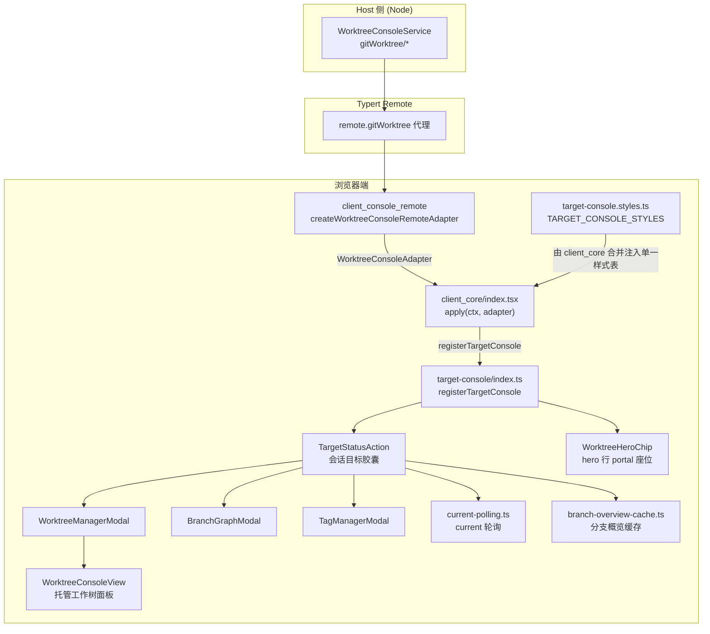

关键点：胶囊（`TargetStatusAction`）是**枢纽组件**——它自己订阅 `current`、持有分支概览缓存、并把管理面板与三个模态框挂在同一个 React 子树下。因此用户在任何会话头部看到的那一枚小胶囊，实际上承载了整个工作树控制台的入口。

---

## 2. 组件清单

| 文件 | 主要导出 | 职责 |
| --- | --- | --- |
| `src/client/target-console/index.ts` | `registerTargetConsole`、`TargetConsoleContextLike`、`TargetStatusAction`、`WorktreeConsoleView`、`WorktreeHeroChip`、`WorktreeManagerModal` | 插槽注册与对外再导出 |
| `src/client/target-console/TargetStatusAction.tsx` | `TargetStatusAction`、`TargetStatusActionProps` | 会话目标胶囊：状态投影、下拉菜单、分支切换/新建、交付、清理、初始化仓库 |
| `src/client/target-console/WorktreeHeroChip.tsx` | `WorktreeHeroChip`、`WorktreeHeroChipProps` | 空白会话的 hero 座位：定位官方 `heroWorkspaceRow` 并 portal 进去 |
| `src/client/target-console/WorktreeManagerModal.tsx` | `WorktreeManagerModal`、`WorktreeManagerModalProps` | 以 Modal 包裹 `WorktreeConsoleView`（`embedded`） |
| `src/client/target-console/WorktreeConsoleView.tsx` | `WorktreeConsoleView`、`WorktreeConsoleViewProps` | 托管工作树列表、当前目标、放弃快照恢复、行内操作与确认对话框 |
| `src/client/target-console/BranchGraphModal.tsx` | `BranchGraphModal`、`BranchGraphModalProps`、`GraphEdge`、`GraphRowLanes`、`GraphRefBadge`、`mergeRefs`、`computeGraphLanes` | 仓库级提交图（lane 拓扑在客户端计算，SVG 绘制） |
| `src/client/target-console/TagManagerModal.tsx` | `TagManagerModal`、`TagManagerModalProps` | 本地标签的列表 / 创建 / 删除 / 推送 |
| `src/client/target-console/current-polling.ts` | `Poll`（内部类）、`subscribeCurrent` | 按 adapter + session + 语言共享的 `current` 轮询器 |
| `src/client/target-console/branch-overview-cache.ts` | `cachedBranchOverview`、`ensureBranchOverview`、`refreshBranchOverviewInBackground`、`patchBranchOverview`、`invalidateBranchOverview`、`bumpEpoch`（内部） | 模块级分支概览缓存（TTL + stale-while-revalidate + 乐观补丁） |
| `src/client/target-console/target-console.styles.ts` | `TARGET_CONSOLE_STYLES` | `.dsh-wtc-*` 全量样式字符串 |

---

## 3. 插槽注册与挂载拓扑

`registerTargetConsole(ctx, adapter, services)` 是模块唯一入口，它向三个 Harness 插槽贡献内容：

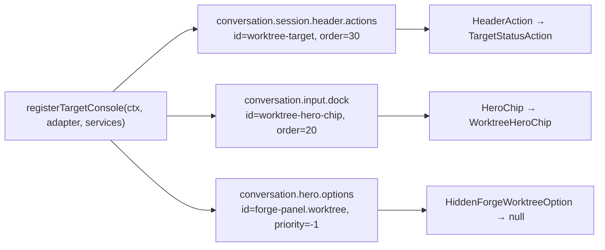

- **`forge-panel.worktree` 的 `priority: -1`** 是一个刻意的「遮蔽」技巧：同一 cell 只渲染 priority 最低的一条注册，因此本插件渲染 `null` 就把官方 forge 面板那对「分支按钮 + 新建工作树复选框」整体让出来，功能收进胶囊菜单。注释里明确解释了为什么用遮蔽而不是停用官方插件——变更请求、diff、review 都在同一个包内，停用会连带砍掉真正的功能。
- **`TargetConsoleContextLike`** 只声明 `slots.inject` 与 `slots.register` 两个方法，使得本模块可以在测试里用一个极小的假上下文驱动，不依赖 cordis 运行时。
- 插槽注册经由 [client_core 模块](client_core.md) 的 `localizedSlots` Proxy，因此每个注册组件渲染时都会被 `ClientI18nProvider` 包裹，语言上下文按 DSH Client 实例隔离。

### 3.1 hero 座位的 DOM 提升

`WorktreeHeroChip` 解决的是一类「宿主没有提供插槽」的问题：官方的 hero workspace 行只在会话为空白时存在，而它的 DOM 位置在 `composerStack` 内、紧挨 dock outlet。组件因此采用「先按结构定位、再 portal」的提升模式：

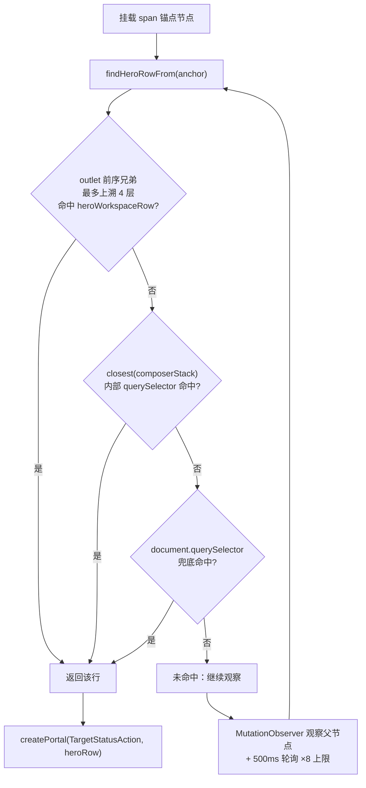

两点实现细节值得注意：

- **portal 渲染器是惰性解析的**：`resolvePortalRenderer()` 通过模块加载器注入的 `require('react-dom')` 取 `createPortal`，取不到就缓存 `null`。这样在没有 `react-dom` 的宿主里，整个插件 bundle 只是「没有 hero 胶囊」，而不是加载期直接抛错。
- **`session?.blank === false` 时不渲染**：非空白会话由头部胶囊负责，避免同一会话出现两个目标胶囊。

---

## 4. 会话目标胶囊（TargetStatusAction）

### 4.1 状态投影

胶囊自己不计算业务状态，而是消费 `WorktreeConsoleCurrentResponse.target.state`（由 Host 的 `consoleStateFromDomain` 投影得出）。渲染时只补两种「客户端局部状态」：

| 局部状态 | 触发条件 | 展示 |
| --- | --- | --- |
| `loading` | 首次 `current` 尚未返回 | `t("loading")` |
| `not_git_repository` | `failure.code === 'not_git_repository'` | `t("not.a.git.repository")`，中性灰色、不报警，并提供「初始化仓库」动作 |
| `error` | `current` 失败（其他错误码） | `t("unavailable")`，真实 `code: message` 放进 tooltip |

把「非 Git 仓库」从「不可用」里拆出来是本模块一个明确的产品判断：任何普通文件夹都会得到这个结果，如果和真正的探测失败共用一句 `unavailable`，胶囊会在一切正常的会话上看起来是坏的。

`STATE_LABELS` 把 11 个 `WorktreeConsoleTargetState` 映射到本地化文案；`retained` 态额外把 `expiresAt` 格式化为当前语言的日期，并以 `· <date>` 附在胶囊尾部。

胶囊标签的优先级是 **分支名 → 「状态：<状态>」→ 状态名**：只要 `currentBranch` 非空就只显示分支名（Git 图形化客户端的心智），仅在分支未知（加载中 / 出错 / detached）时才退回状态文案。

### 4.2 菜单结构

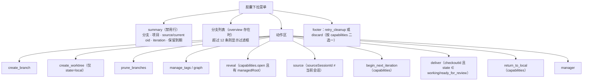

非 Git 仓库时菜单被裁剪成只剩 `summary` + `initialize` 两项，因为分支、标签、提交图在这个仓库里都必然失败。

分支列表的排序规则：当前分支 / 会话分支优先，其余按名称 `localeCompare`。`showBranchSearch` 在分支数 > 12 时出现，输入框在菜单内拦截 `Enter` / 方向键 / `Tab` 的冒泡（菜单卡片会把这些键当成行导航），`Enter` 直接切换到第一个非当前分支，并复用 `pendingAction !== null` 的同一道闸门防止重复切换。

### 4.3 动作的并发与竞态防护

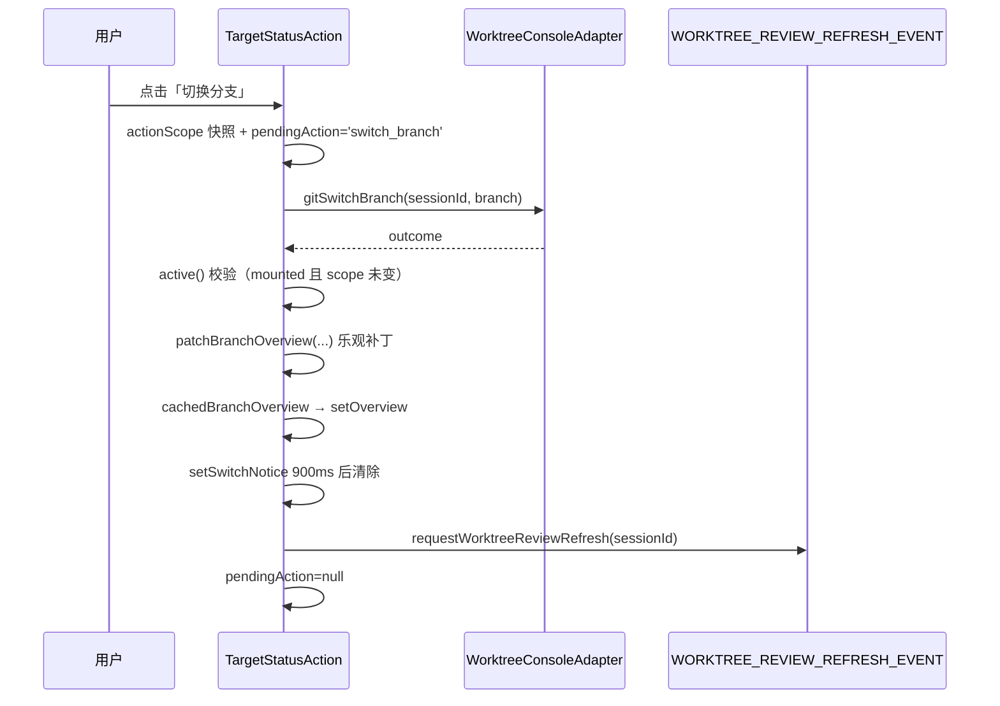

- **`actionScope` + `activeSession`**：`sessionId` 变化时（渲染期检测）自增 `actionScope`，所有 `await` 之后都必须通过 `active()`，避免切会话后旧响应写回新会话。
- **`mounted` ref**：`reveal()`、`createWorktreeNow()` 等非 `pendingAction` 路径单独依赖 `mounted.current` 守卫。
- **`pendingAction` 单闸**：一次只允许一个变更在飞，菜单项同步 `disabled`。
- **乐观补丁即最终态**：`gitSwitchBranch` 的 RPC 已确认分支，因此不再 `invalidate + ensure` 重取（那会多花 4 次 git spawn 并让 UI 闪回旧值），而是直接读回 `cachedBranchOverview`。

### 4.4 各动作的语义要点

| 动作 | 关键行为 |
| --- | --- |
| `create_worktree` | **即点即建**：`adapter.createWorktree({ sessionId, from: currentBranch ?? null })` 返回时 checkout 已在磁盘、台账已登记、会话 cwd 已切换。失败时把原因写进胶囊自己的 `switchNotice`（此时菜单已收起，只写 `error` 用户看不到） |
| `deliver` | 走 `deliver` RPC，不要求 `reviewId`，会话停在 `working` 也能交付；`retention` 用 `DEFAULT_WORKTREE_RETENTION`（`retain_manual`），与 `/worktree finish` 一致；提交信息为空或含 `\0` 时本地拦截 |
| `prune_branches` | 先 `gitPruneMergedBranches(sessionId, true)` 拿 dry-run 预览，再以 `false` 确认执行；预览里 `pruned` / `skipped` 分两组展示，含 `reason` |
| `initialize` | `adapter.initializeProject` 可选（`?`），宿主不支持时菜单项直接 `disabled`；成功后同时 `requestWorktreeReviewRefresh` 与 `invalidateBranchOverview`，让胶囊不依赖 5s 轮询就翻面 |
| `discard` | 若 `state === 'preview_active'` 或 `capabilities.rollbackPreview`，请求体带 `rollbackPreview: true`；`confirmDirty: true`（确认框已在前一步给出） |
| `retry_cleanup` / `begin_next_iteration` / `return_to_local` | 均带 `expectedRevision` CAS；错误码为 `stale_target` 时立刻 `refresh()` 重新探测 |
| `source` | 用 `openExistingSession(services, sourceSessionId, sourceRoot)` 跳回源会话，cwd 不匹配则报本地化错误而不猜 |

---

## 5. 托管工作树面板（WorktreeConsoleView）

`WorktreeConsoleView` 是「同一个项目的所有托管工作树」的表格化视图，由 `WorktreeManagerModal` 以 `embedded` 模式承载（嵌入时隐藏自己的 `<h2>`，头部只保留刷新按钮）。

### 5.1 数据装配

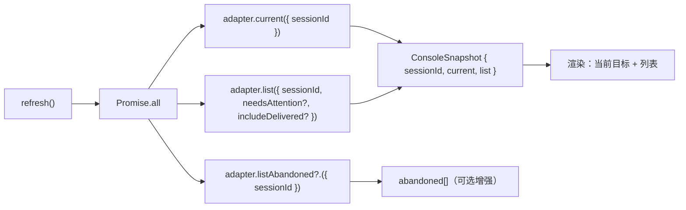

- `current` 与 `list` 任一失败即整体报错（用 `errorText` 把 `code` 展开成 `message / category / recovery` 三段本地化文本，分类表来自 `worktreeConsoleErrorMeta`）。
- `listAbandoned` 是**可选能力**：未实现时 `abandoned` 置空、整块隐藏；失败也只静默，不打断主面板。
- `refreshAbandoned` 是轻量刷新（只拉放弃快照），用于清理/放弃之后。

### 5.2 排序与筛选

`ATTENTION_RANK` 决定列表顺序：`recovery_required`(0) → `preview_detached` → `cleanup_pending` → `ready_for_review` → `preview_active` → `retained` → `working` → `creating` → `delivered` → `local` → `discarded`(10)。`focusCheckoutId` 命中的行永远排最前（从胶囊打开面板时，用户想看的就是当前这棵）。同 rank 内按 `iteration` 降序。

两个过滤器直接映射到 `list` 请求参数：`needsAttention` 与 `includeDelivered`，因此筛选是 Host 侧完成的，客户端不做二次过滤。

### 5.3 行内操作与确认

| 按钮 | 前置能力 | 备注 |
| --- | --- | --- |
| 打开 | `capabilities.open && capabilities.inspect && checkoutId` | 走 `openAuthorizedWorktreeTarget`：先 `inspect` 取回无路径的授权，再逐项校验 `checkoutId / ownerSessionId / targetSessionId / managedRoot`，路径永远来自 Host |
| 放弃 | `capabilities.discard` | 行 `dirty` 为真时先弹确认框；`preview_active` 时请求体带 `rollbackPreview` |
| 常驻 | `capabilities.setPermanent` | 切换 `permanent`，用于豁免自动清理 |
| 重试清理 | `capabilities.retryCleanup` | 见下方「交付后新改动」的二次确认 |
| 保留策略 | `capabilities.setRetention` | `<select>` 三档：`retain_24h` / `retain_3d` / `retain_manual` |
| 恢复快照 | `adapter.restoreAbandoned` 存在 | 恢复后 `invalidateBranchOverview` + `refresh(false)` + notice |

**「交付后出现新改动」的二次确认**是这里最重要的交互修正：`retryCleanup` 若返回 `target.cleanupReason === 'modified_after_finalize'`，界面不会让用户对着同一句说明反复点重试，而是先 `applyMutation` 同步 Host 已写入的阻塞原因，再弹出一个 `role="alertdialog"` 的确认框，用户确认后带 `discardPostDeliveryChanges: true` 重发一次。

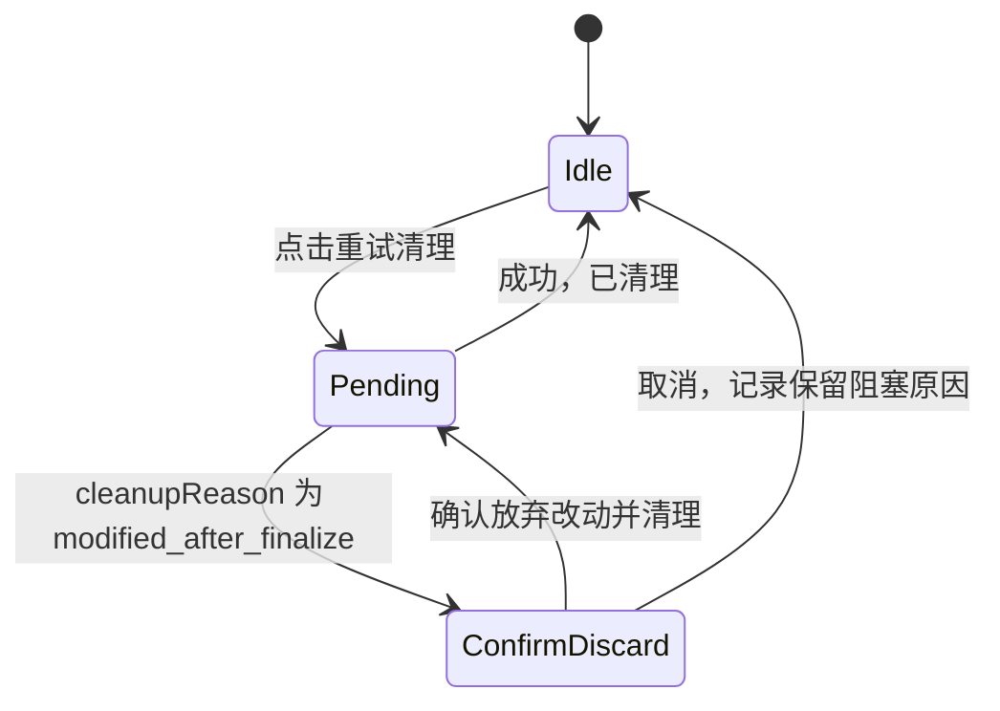

### 5.4 竞态防护：双令牌

`WorktreeConsoleView` 用两套令牌：`sessionGeneration`（会话切换）与 `request` / `abandonedRequest`（请求序号）。`isActive(generation)` 同时校验 `mounted` 与 generation，`refresh` 还额外比较 `token === request.current`，从而保证「旧会话的 list 结果」「被新刷新覆盖的旧刷新」都不会写入状态。`stale_target` / `stale_local` / `stale_isolated` 三类错误会自动触发 `refresh(false)`（保留错误文本）。

---

## 6. 提交图（BranchGraphModal）

### 6.1 数据与分页

`adapter.gitGraph(sessionId, limit)` 一次取 `git log --topo-order` 的若干行（`WorktreeConsoleGitGraphCommit`：`oid / parents / author / authorTime / refs / subject`）。首屏 `INITIAL_LIMIT = 200`，每次「显示更多」`PAGE_STEP = 100`；`hasMore` 的判据是 `commits.length >= limit`。每次加载都用 `requestSeq` 递增守卫，弹窗关闭时 `requestSeq += 1` 让在飞请求作废。

### 6.2 lane 拓扑在客户端计算

`computeGraphLanes` 把「每行一个父提交集合」折叠成「每行若干条带几何的边」，这样相邻行能严丝合缝地接上：

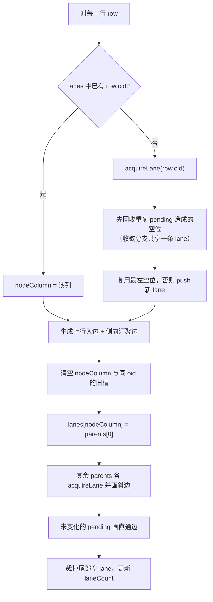

设计意图：**lane 数跟随并发分支数而非历史总分支数**。一个 lane 只有在所有子提交都渲染完之后才会「安静」下来，安静下来的空位按最左优先复用；收敛分支留下的重复 pending 会被识别为空洞，从而让兄弟分支共用一条 lane 而不是一路向右扩张。

绘制参数：`LANE_WIDTH = 14`、`ROW_HEIGHT = 36`、`NODE_RADIUS = 4`、6 色 `LANE_COLORS` 循环；同列直线用 `L`，跨列用三次贝塞尔（中点为控制点）画 S 形。

### 6.3 ref 徽标合并

`mergeRefs(refs)` 把 `foo` 与 `origin/foo` 折叠成一个徽标（`full` 用 ` · ` 连接全部原始 ref 作为 tooltip），但**标签永不与同名分支合并**——标签 ref 由 git 适配器以 `tag:<name>` 前缀传入，key 前缀不同。当前分支（`currentBranch`）命中的徽标通过 `data-gitgraph-ref-current` 高亮，标签用 `data-gitgraph-ref-tag` 并加 `⌗` 前缀。行 hover 时浮现「标签管理」按钮，把该 `oid` 作为 `tagTarget` 传给标签模态框。

时间列由 `formatTime` 按「刚刚 / N 分钟 / N 小时 / N 天 / 绝对日期」分档本地化。

---

## 7. 标签管理（TagManagerModal）

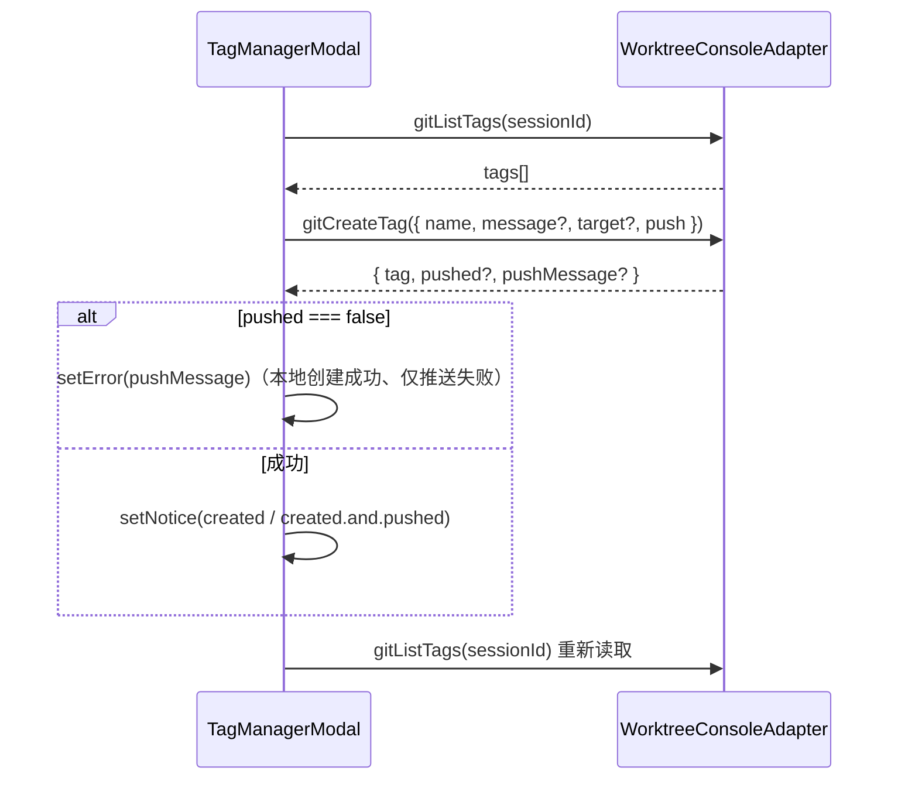

三条刻意的不对称设计：

1. **每次变更后重新读列表**，而不是本地增删：git spawn 便宜、标签数量小，重新读永远不会显示过期的标签集合。
2. **`load()` 不清 `error`**：创建成功但推送失败的报告写在 `error` 里，随后的重读如果清空 `error`，用户会在读到之前丢掉这条消息。
3. **`pushed === null` 不等于「未推送」**：远端查不到（离线 / 没有 `origin`）时展示「推送状态未知」，而不是谎报未推送。`pushed === false` 被视为一种**可报告的结果**而非失败的变更——本地标签依然存在。

删除走二次确认，并可选 `remote: true`（永不 `--force`）；`busy` 期间 `Modal` 的 `onClose` 被拦住，防止操作中途关窗。

---

## 8. 轮询与缓存

### 8.1 `current` 轮询（current-polling.ts）

胶囊的状态必须跟随 Host 侧变化（Agent 在 checkout 里提交、清理任务推进），但每个会话都轮询 `current` 会带来成本（一次 `git status` + 两次 `git rev-parse`）。因此轮询器是**共享单例**：

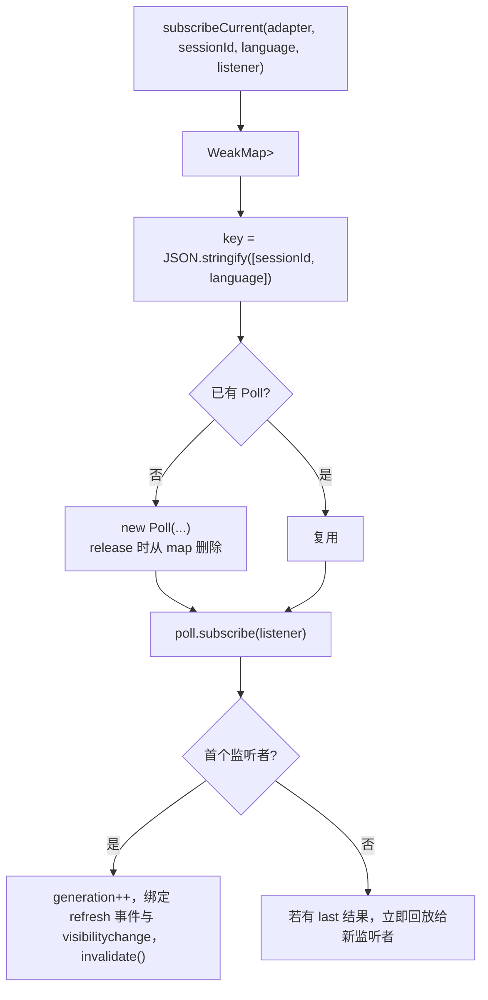

- **adapter 作 WeakMap 键**：不同 DSH Client 实例（不同 adapter）互不共享。
- **language 进 key**：`current` 的返回值里含本地化文本，语言变了必须换一个轮询器。
- **5 秒常规间隔 / 60 秒隐藏间隔**：`document.visibilityState === 'hidden'` 时循环被拉长到 60 秒；`visibilitychange` 回到可见时立刻 `invalidate()` 重新拉取——「切回标签页」正是胶囊必须正确的时刻。
- **`WORKTREE_REVIEW_REFRESH_EVENT`**：任何组件（含侧栏、管理面板）调用 `requestWorktreeReviewRefresh(sessionId)` 都会让匹配 sessionId 的轮询器立即失效重取，这是模块间唯一的跨组件通知通道。
- **generation 守卫 + `dirty` 标记**：`invalidate()` 递增 generation 并清 `last`；在飞结果只在 generation 未变时派发。最后一个监听者离开时清 `last` 并 `release()`。
- **只用于展示**：注释明确写着「Display-only observation. Never used to authorize a mutation or Git cleanup」——所有变更仍然携带 `expectedRevision` 由 Host 做 CAS。

### 8.2 分支概览缓存（branch-overview-cache.ts）

展开胶囊菜单会触发 `gitOverview`（3 次 git spawn：分支列表、HEAD、status）。缓存因此是**模块级**的：

| 状态 | 结构 | 说明 |
| --- | --- | --- |
| `cache` | `Map<sessionId, { value, fetchedAt }>` | TTL `60_000` ms；概览是仓库级的，同项目多个会话会覆盖同一份视图 |
| `flights` | `Map<sessionId, Promise>` | 同会话并发只发一次请求 |
| `patchEpochs` | `Map<sessionId, number>` | `bumpEpoch` 由 `patchBranchOverview` / `invalidateBranchOverview` 自增 |

三个读取入口对应三种交互：

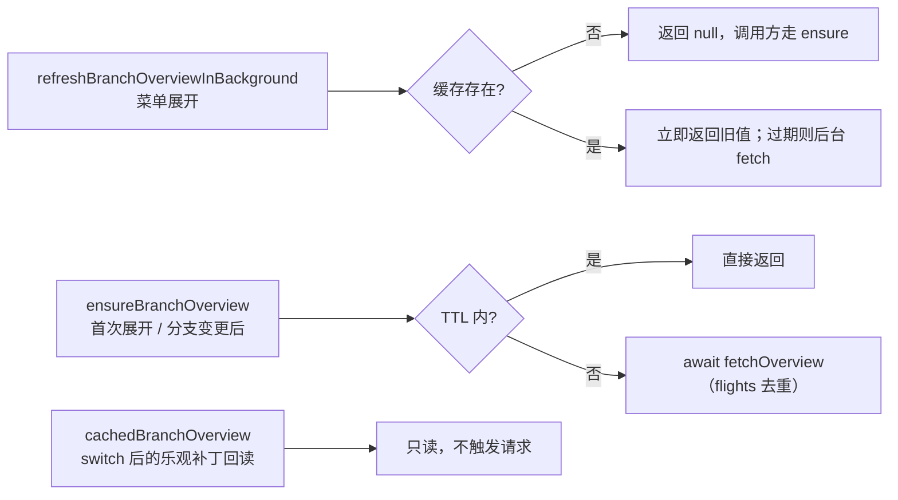

**epoch 机制**是这份缓存最容易踩坑的地方：一个在 `patchBranchOverview`（切分支确认后的乐观写入）**之前**起飞、**之后**才解析的 flight，如果直接回写缓存，就会把补丁踩掉并重赋 TTL。因此 flight 在发起时记录当时的 epoch，只有 epoch 未变才写回；失败与异常路径同样受 epoch 保护（避免清掉刚写入的补丁），但**失败必须清缓存槽**，否则陈旧快照会带着过期 TTL 一直展示。

---

## 9. 样式与主题（target-console.styles.ts）

`TARGET_CONSOLE_STYLES` 是一段 `String.raw` CSS 字符串，由 [client_core 模块](client_core.md) 的 `apply()` 与 `WORKTREE_STYLES` 合并写入**同一个** `<style>` 元素（`data-plugin="dsh-git-worktree"`），全插件只有一次注入、一次清理。命名空间为 `.dsh-wtc-*`，与 ToolView 的 `.dsh-wt-*` 分开。

- **状态色是 CSS 变量驱动的**：每个状态容器设 `--wtc-state`，`data-target-state` 选择器只改这一个变量，边框 / 背景 / 圆点全部用 `color-mix(in srgb, var(--wtc-state) …)` 派生，因此亮暗主题自动适配。
- **状态语义**：`creating` / `cleanup_pending` 橙、`working` 蓝、`ready_for_review` 绿、`retained` 紫、`recovery_required` 与 `error` 红；`not_git_repository` 刻意用中性灰并降低不透明度（不是故障）；`delivered` / `discarded` 半透明表示终态。
- **图形元素**：`.dsh-wtc-graph-lane-svg` 的宽度由 `laneCount * LANE_WIDTH` 计算，行高固定 36px 与 `ROW_HEIGHT` 常量保持一致；`.dsh-wtc-graph-ref[data-gitgraph-ref-current]` / `[data-gitgraph-ref-tag]` 分别高亮当前分支与标签。
- **响应式**：`@media (max-width: 620px)` 把行与当前目标卡改为纵向堆叠，操作按钮左对齐。
- **无障碍**：胶囊按钮带 `aria-haspopup="menu"` / `aria-expanded`，确认框用 `role="alertdialog"` + `aria-modal` 并支持 `Escape` 关闭，图标统一 `aria-hidden`（`ReviewIcon` 负责）。

---

## 10. 错误处理与健壮性约定

| 约定 | 实现位置 | 说明 |
| --- | --- | --- |
| 错误必须可诊断 | `TargetStatusAction` 的 `triggerTitle` | 探测失败时 tooltip 显示 `<code>: <message>`，胶囊不只是一句「不可用」 |
| 错误分类展开 | `WorktreeConsoleView.errorText` | 用 `worktreeConsoleErrorMeta` 把 `code` 翻成 `category` + `recovery` 三段文案 |
| 陈旧修订自动重探 | `mutationError` / 各动作的 `stale_target` 分支 | `stale_target` / `stale_local` / `stale_isolated` 一律触发刷新 |
| 静默失败禁止 | `createWorktreeNow` 的 `switchNotice`、`load()` 不清 `error` | 菜单收起后仍必须让用户看到失败原因 |
| 异步不写回失效上下文 | `mounted` / `generation` / `requestSeq` / `actionScope` | 四套守卫覆盖卸载、切会话、连点、关窗 |
| 能力位驱动 UI | `capabilities.*` | 不猜测权限：按钮只在 Host 声明能力时出现，且请求仍带 `expectedRevision` |
| 可选适配器能力降级 | `initializeProject?`、`listAbandoned?`、`restoreAbandoned?` | 宿主缺能力时对应入口隐藏或禁用，而不是点击后报错 |

---

## 11. 测试与构建约束

| 工件 | 对本模块的影响 |
| --- | --- |
| `vitest.config.ts` | 把 `@deepseek-ai/dsh-client-ui-primitives` 别名到 `tests/support/ui-primitives.tsx`，那里提供了 `Menu` / `Modal` / `MenuItemButton` 的窄化替身（含 `Escape` 关闭、`role="dialog"`、`role="menu"`），因此本模块的菜单与模态框可在 jsdom 中驱动 |
| `vitest.config.ts` → `test.fileParallelism` | Windows 上关闭文件级并行，避免 git 夹具争抢进程与文件句柄 |
| `tsconfig.json` | `jsx: "react-jsx"`、`strict`、`noUncheckedIndexedAccess`（解释了 `lanes[index]!`、`sortedBranches[0]` 之类的显式非空断言） |
| `tsdown.config.ts` | 客户端产物以 `src/client/console-remote/index.ts` 为入口打包成 CJS，`react` / `@deepseek-ai/dsh-client-ui-primitives` 保持 external；本模块的组件随该 bundle 一起产出 |
| `package.json` → `dependencies` | `lucide-react` 被 `ReviewIcon` 使用且被 `noExternal` 内联 |
| `.github/workflows/ci.yml` | `typecheck` → `build` → `check:publish:release` → `test` 四步门禁 |

---

## 12. 与其他模块的关系

| 模块 | 关系 |
| --- | --- |
| [client_core 模块](client_core.md) | 提供 `registerTargetConsole` 的调用方（`apply`）、`ClientI18nProvider` / `useClientTranslator`、`WorktreeClientServices`、`openAuthorizedWorktreeTarget` / `openIsolatedTarget` / `openExistingSession`，以及样式表的统一注入 |
| [client_console_remote 模块](client_console_remote.md) | 创建并注入 `WorktreeConsoleAdapter`（本模块的唯一数据源），并在启动编排中经 `mountTools` 间接挂载本模块 |
| [client_workspace_sidebar 模块](client_workspace_sidebar.md) | 与本模块共享 `WORKTREE_REVIEW_REFRESH_EVENT` 刷新通道；侧栏徽章与胶囊状态同源（都来自 Host 投影） |
| [Worktree 设置卡片（client_settings_card）](client_settings_card.md) | 同一父模块下的另一个 UI 叶子，无直接数据耦合（设置影响 Host 侧的自动交付/推送行为） |
| [console_contract 模块（Worktree Console 共享契约）](console_contract.md) | `WorktreeConsoleAdapter`、全部请求/响应 DTO、`WorktreeConsoleOutcome`、`worktreeConsoleErrorMeta`、`WORKTREE_CONSOLE_TARGET_STATES` |
| [console_remote：控制台远程契约层（Typert Remote）](console_remote.md) | 描述符与 `gitWorktree/*` RPC 表面；本模块只看到适配器，看不到 Typert |
| [console_host：Worktree 控制平面与 Host RPC 服务](console_host.md) | 状态投影、能力位、修订号 CAS 与清理语义的权威来源 |
| [session_checkout_engine 模块概览](session_checkout_engine.md) | 交付、预览回滚、清理重试等操作的领域实现 |
| [i18n：中英双语文案与语言解析基础设施](i18n.md) | `clientMessages` 中本模块使用的全部文案键（`worktree.*`、`branch.*`、`tag.*`、`commit.graph.*`、`deliver.*`、`error.*` 等） |
| [build_deployment_configuration：构建、打包与发布部署配置](build_deployment_configuration.md) | `vitest` / `tsdown` / `tsconfig` 对本模块的打包与测试约束 |

??? abstract "Documented components (14)"
    - [`BranchGraphModalProps`](https://github.com/wloops/dsh-git-worktree/blob/4590253f2eed5085260efc337415f413b373e084/src%5Cclient%5Ctarget-console%5CBranchGraphModal.tsx) — `src\client\target-console\BranchGraphModal.tsx`
    - [`GraphEdge`](https://github.com/wloops/dsh-git-worktree/blob/4590253f2eed5085260efc337415f413b373e084/src%5Cclient%5Ctarget-console%5CBranchGraphModal.tsx) — `src\client\target-console\BranchGraphModal.tsx`
    - [`GraphRefBadge`](https://github.com/wloops/dsh-git-worktree/blob/4590253f2eed5085260efc337415f413b373e084/src%5Cclient%5Ctarget-console%5CBranchGraphModal.tsx) — `src\client\target-console\BranchGraphModal.tsx`
    - [`GraphRowLanes`](https://github.com/wloops/dsh-git-worktree/blob/4590253f2eed5085260efc337415f413b373e084/src%5Cclient%5Ctarget-console%5CBranchGraphModal.tsx) — `src\client\target-console\BranchGraphModal.tsx`
    - [`TagManagerModalProps`](https://github.com/wloops/dsh-git-worktree/blob/4590253f2eed5085260efc337415f413b373e084/src%5Cclient%5Ctarget-console%5CTagManagerModal.tsx) — `src\client\target-console\TagManagerModal.tsx`
    - [`TargetStatusActionProps`](https://github.com/wloops/dsh-git-worktree/blob/4590253f2eed5085260efc337415f413b373e084/src%5Cclient%5Ctarget-console%5CTargetStatusAction.tsx) — `src\client\target-console\TargetStatusAction.tsx`
    - [`WorktreeConsoleViewProps`](https://github.com/wloops/dsh-git-worktree/blob/4590253f2eed5085260efc337415f413b373e084/src%5Cclient%5Ctarget-console%5CWorktreeConsoleView.tsx) — `src\client\target-console\WorktreeConsoleView.tsx`
    - [`WorktreeHeroChipProps`](https://github.com/wloops/dsh-git-worktree/blob/4590253f2eed5085260efc337415f413b373e084/src%5Cclient%5Ctarget-console%5CWorktreeHeroChip.tsx) — `src\client\target-console\WorktreeHeroChip.tsx`
    - [`WorktreeManagerModalProps`](https://github.com/wloops/dsh-git-worktree/blob/4590253f2eed5085260efc337415f413b373e084/src%5Cclient%5Ctarget-console%5CWorktreeManagerModal.tsx) — `src\client\target-console\WorktreeManagerModal.tsx`
    - [`bumpEpoch`](https://github.com/wloops/dsh-git-worktree/blob/4590253f2eed5085260efc337415f413b373e084/src%5Cclient%5Ctarget-console%5Cbranch-overview-cache.ts) — `src\client\target-console\branch-overview-cache.ts`
    - [`Poll`](https://github.com/wloops/dsh-git-worktree/blob/4590253f2eed5085260efc337415f413b373e084/src%5Cclient%5Ctarget-console%5Ccurrent-polling.ts) — `src\client\target-console\current-polling.ts`
    - [`TargetConsoleContextLike`](https://github.com/wloops/dsh-git-worktree/blob/4590253f2eed5085260efc337415f413b373e084/src%5Cclient%5Ctarget-console%5Cindex.ts) — `src\client\target-console\index.ts`
    - [`__file__`](https://github.com/wloops/dsh-git-worktree/blob/4590253f2eed5085260efc337415f413b373e084/src%5Cclient%5Ctarget-console%5Ctarget-console.styles.ts) — `src\client\target-console\target-console.styles.ts`
    - [`SwitchBranchAssistModalProps`](https://github.com/wloops/dsh-git-worktree/blob/4590253f2eed5085260efc337415f413b373e084/src%5Cclient%5Ctarget-console%5CSwitchBranchAssistModal.tsx) — `src\client\target-console\SwitchBranchAssistModal.tsx`

