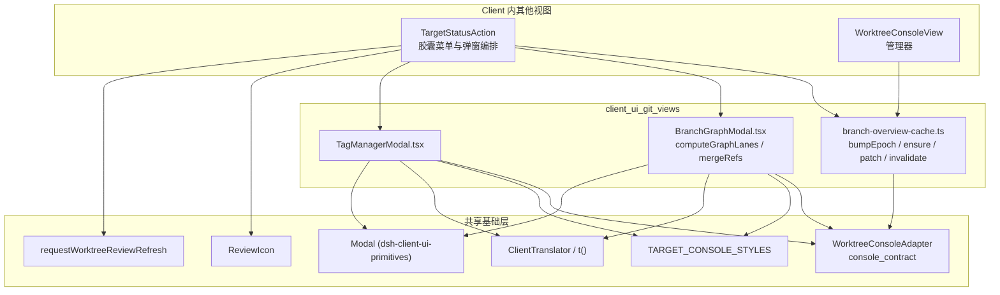
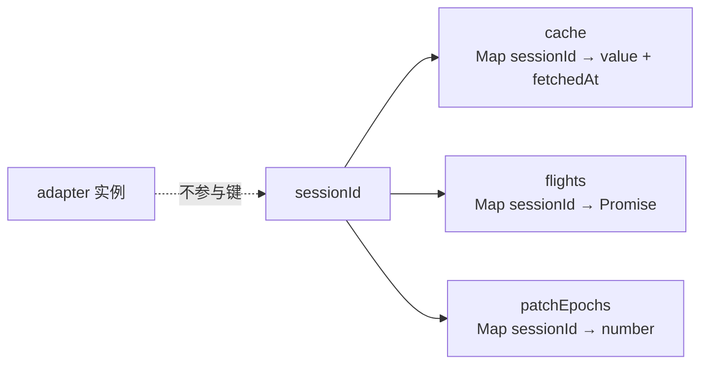
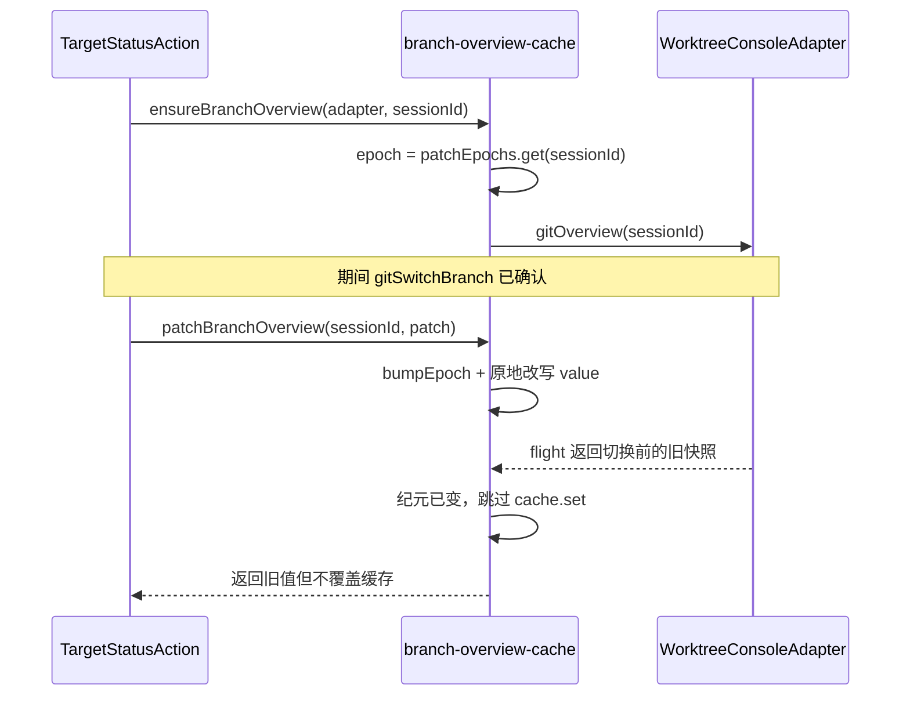
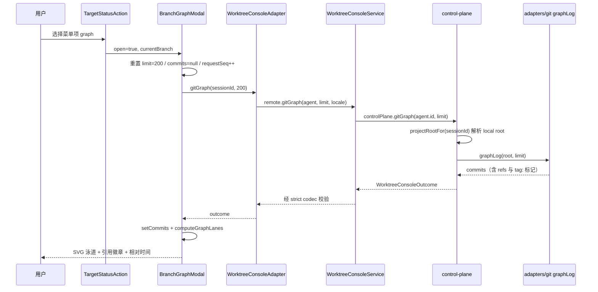
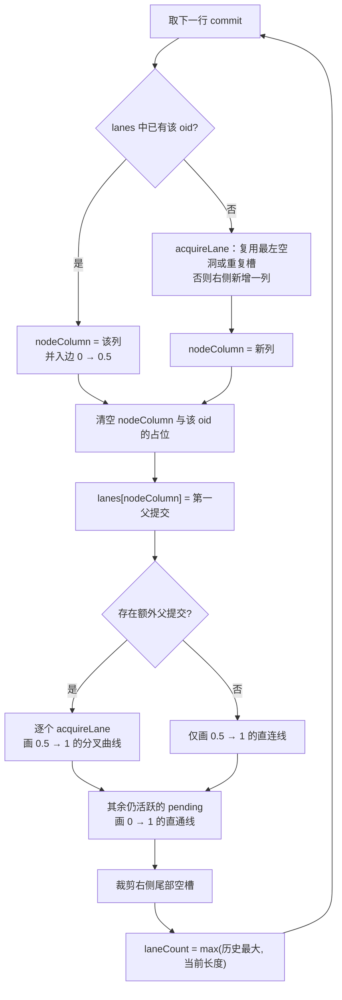
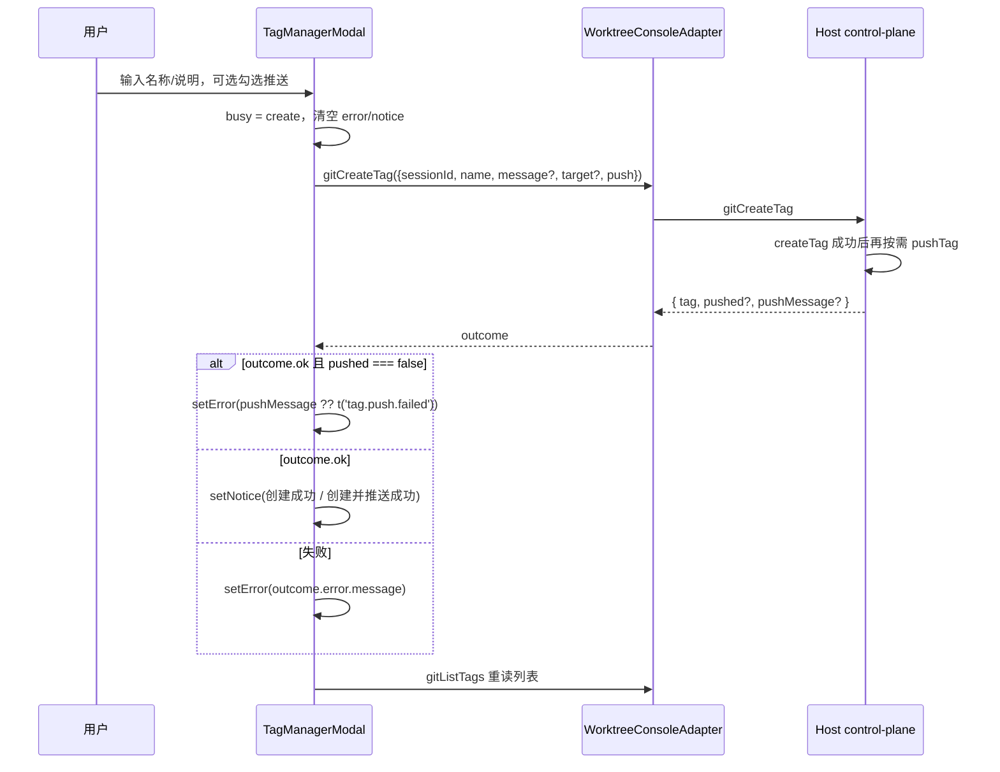

# client_ui_git_views：Git 视图（提交图、标签管理、分支概览缓存）

!!! info "Generated documentation"
    This page was written by CodeWiki from the source code at commit [`e01d7c5f`](https://github.com/wloops/dsh-git-worktree/commit/e01d7c5f2f3a0d2f734a5a3415598ae6d7d6f387) on 2026-11-07 with `deepseek-v4.1-flash`. Check the code before relying on details.

## 简介

`client_ui_git_views` 是 `dsh-git-worktree` 浏览器端的**仓库级 Git 只读/轻量写视图**子模块，源码位于 `src/client/target-console/`。它把 Host 侧仓库范围内的 Git 事实（分支列表、提交拓扑、标签集合）渲染成三块用户可见的界面，并为它们提供一份进程内的缓存：

| 组件 | 文件 | 职责 |
| --- | --- | --- |
| `BranchGraphModal`（含 `mergeRefs`、`computeGraphLanes`、`GraphEdge`、`GraphRowLanes`、`GraphRefBadge`） | `src/client/target-console/BranchGraphModal.tsx` | 仓库级提交图：分页读取 `git log --topo-order`，在客户端计算泳道拓扑并用 SVG 绘制 |
| `TagManagerModal` | `src/client/target-console/TagManagerModal.tsx` | 本地标签管理：列出、创建（可附注、可推送）、删除（可选远端）、推送 |
| `bumpEpoch` 及同文件的缓存 API | `src/client/target-console/branch-overview-cache.ts` | 每 Session 的分支概览缓存：TTL、single-flight、stale-while-revalidate、乐观补丁与纪元守卫 |

三条不可动摇的约束贯穿整个子模块：

1. **Git 事实只来自 Host**。本模块不 spawn 任何 `git` 进程，所有读取与变更都经 `WorktreeConsoleAdapter`（见 [console_contract：Worktree Console 共享契约层](../console_contract.md)）走一次 RPC；Host 侧在 `src/console-host/control-plane.ts` 的 `projectRootFor(sessionId)` 上把仓库根解析成**调用方 Session 所属项目的 local root**，因此这些视图天然是「仓库范围」而非「当前 worktree 范围」。
2. **布局是纯函数**。泳道拓扑（`computeGraphLanes`）与引用徽章合并（`mergeRefs`）都是无副作用的纯函数，不触碰 React 状态，可以独立测试与复用。
3. **不引入第二份真相**。分支列表、脏文件计数、标签推送状态都以 Host 返回值为准；唯一允许的本地改写是「RPC 已确认」的乐观补丁（`patchBranchOverview`），且必须受纪元守卫保护。

本页只描述这三块组件。打开它们的胶囊菜单、状态机与能力门控由 [client_ui_target_console —— 会话目标胶囊与工作树管理控制台](client_ui_target_console.md) 负责；样式表文本与图标、翻译器、刷新事件由 [client_ui_i18n_presentation：国际化桥接与呈现基础层](client_ui_i18n_presentation.md) 负责；适配层的超时与 strict 编解码由 [client_ui_bootstrap：浏览器端启动与 Remote 适配引导](client_ui_bootstrap.md) 负责。

---

## 架构与组件关系

### 在胶囊菜单中的位置

三个视图都不是独立入口，而是 `TargetStatusAction` 菜单项的产物（`src/client/target-console/TargetStatusAction.tsx`）：

| 菜单项 id | 文案 key | 打开的视图 | 传入参数 |
| --- | --- | --- | --- |
| `graph` | `commit.graph.title` | `BranchGraphModal` | `currentBranch` = `overview?.branch ?? target?.currentBranch` |
| `manage_tags` | `tag.manager.title` | `TagManagerModal` | `target = null`（指向 HEAD） |
| 提交行内的 `tag.graph.action` | `tag.graph.action` | `TagManagerModal` | `target = commit.oid` |

因此从提交图可以直接「对某个提交打标签」：`BranchGraphModal` 的 `onTagCommit(oid)` 会关闭图并带着该 oid 打开标签管理器；`onManageTags()` 则不带目标。这个串联完全由父组件完成，两个弹窗之间没有直接依赖。

---

## 分支概览缓存 `branch-overview-cache.ts`

### 为什么需要缓存

分支胶囊的 popover 需要 `gitOverview`，而 Host 侧一次 `gitOverview` 是 `for-each-ref` + `git status` 的多次 spawn（见 `src/adapters/git.ts` 的 `branchOverview`）。胶囊在每个 Session 上都挂载，如果挂载即预取，用户从没打开的 popover 也要付这份成本；如果每次展开都重取，则每次点击都要等 spawn。缓存因此采取「**首次展开才取、TTL 内直接命中、过期则先渲染旧值再后台替换**」的策略。

`TargetStatusAction` 的注释明确写了这条取舍：不在 mount 时预取，改在触发器 `onClick` 时调用 `refreshBranchOverviewInBackground`，命中不到再 `ensureBranchOverview`。

### 数据结构与键

- **`TTL_MS = 60_000`**：新鲜期一分钟。概览是仓库级只读投影，一分钟的陈旧度对菜单展示足够。
- **`cache`**：`sessionId → { value, fetchedAt }`。注释说明该视图是**仓库范围**的，所以同一项目下多个 Session 会互相覆盖同一份底层仓库视图——这是有意为之，不做 project 级归并。
- **`flights`**：同一 session 的并发读只产生一次 RPC（single-flight）。
- **`patchEpochs`**：每个 session 一个单调递增的纪元号，由内部函数 `bumpEpoch` 维护（该函数**不对外导出**，只被 `invalidateBranchOverview`、`patchBranchOverview` 与 `fetchOverview` 的落地判定使用）。

### 读路径

| API | 语义 |
| --- | --- |
| `cachedBranchOverview(sessionId)` | 纯读，不触发任何 RPC；未命中返回 `null` |
| `ensureBranchOverview(adapter, sessionId)` | TTL 内直接返回缓存值，否则 `await` 一次 fetch；失败返回 `null` |
| `refreshBranchOverviewInBackground(adapter, sessionId)` | stale-while-revalidate：**同步返回**已有缓存值（哪怕已过期），并在后台发起刷新；无缓存时返回 `null` |

失败语义在源码注释中被特别强调：fetch 失败**必须清槽**，否则一份陈旧快照会带着过期 TTL 一直展示；同时清槽也要受纪元守卫，避免踩掉飞行中落地的乐观补丁。

### 写路径与纪元守卫

- `patchBranchOverview(sessionId, patch)`：只对**已存在**的缓存条目生效（未命中直接返回，不创建半成品条目）。它 `bumpEpoch` 后原地替换 `value`，并**保留原 `fetchedAt`**，因此补丁不会刷新 TTL。
- `invalidateBranchOverview(sessionId)`：`bumpEpoch` + `cache.delete`。用于「新数据必须重取」的场合——`TargetStatusAction` 在新建分支、清理已合并分支、初始化仓库后调用它，随后 `ensureBranchOverview` 立刻重取。
- `bumpEpoch` 本身是私有函数：它存在的唯一理由是让 `fetchOverview` 的 `.then/.catch` 能判定「我这次飞行是否还属于当前纪元」，从而避免旧响应覆盖新事实。

`TargetStatusAction` 的 `switchBranch` 展示了这套机制的最终收益：switch 的 RPC 已经确认分支，于是直接 `patchBranchOverview` 打补丁并**从缓存读回**，省掉一次 `invalidate + ensure` 重取（注释估算为 4 次 git spawn 加一次 UI 闪回旧值）。

---

## 提交图 `BranchGraphModal.tsx`

### 数据获取与分页

| 常量 | 值 | 含义 |
| --- | --- | --- |
| `INITIAL_LIMIT` | `200` | 首次打开读取的提交数（与 Host `controlPlane.gitGraph` 的 `limit ?? 200` 默认值一致） |
| `PAGE_STEP` | `100` | 每次「加载更多」的增量 |
| `LANE_WIDTH` | `14` | 单条泳道的像素宽度 |
| `ROW_HEIGHT` | `36` | 单行高度，与 CSS `.dsh-wtc-graph-row { height:36px }` 对齐 |
| `NODE_RADIUS` | `4` | 提交节点圆点半径 |
| `LANE_COLORS` | 6 色 | 按列号取模，保证同一列颜色稳定 |

打开即加载：`useEffect` 在 `open` 变为真时重置 `limit`、`commits`、`lanes`、`error`，然后 `load(INITIAL_LIMIT)`；卸载或再次切换时 `requestSeq.current += 1`，使在途响应作废。

`load` 用 `requestSeq` 序号做**过期响应防护**（`seq !== requestSeq.current` 直接返回，不写任何状态）。`hasMore` 的判定是启发式的：`commits !== null && commits.length >= limit`——返回条数达到请求上限即认为可能还有更多。

分页上限由契约收口：`gitGraphLimitSchema = z.number().int().min(1).max(1000)`，`gitGraphResponseSchema.commits` 最多 1000 条，`parents` 最多 32，`refs` 最多 50（`src/console-remote/schemas.ts`）。因此「加载更多」最多把 `limit` 推到 1000 后自然停止。

`refs` 的来源在 Host 侧：`src/adapters/git.ts` 的 `graphLog` 用 `git log --branches --tags --remotes --topo-order --parents --format=%H%x00%P%x00%an%x00%at%x00%D%x00%s%x1e` 读取，再由 `parseDecoration` 把 `%D` 解析成 ref 名——`HEAD` 被丢弃、`tag: x` 被改写成 `tag:x`（这正是 `mergeRefs` 依赖的标记）、`HEAD -> main` 被削成 `main`。

### 泳道布局算法 `computeGraphLanes`

算法说明（源码注释）称其泳道拓扑移植自 `@linxin666/dsh-client-ui-git-graph` 的 `computeLanes`，但输出从「逐行字形」改成了「边几何」，使相邻行能首尾相接：

- 每行输出 `GraphRowLanes`：`nodeColumn`（提交所在列）、`laneCount`（**全图最大**列数，保证每行 SVG 同宽）、`edges`（每条边是 `{x1, y1, x2, y2, color}`，`x` 以列为单位，`y` 以行高比例为单位：0 = 行顶，0.5 = 节点中心，1 = 行底）。
- **第一父提交继承该提交的列**；其余父提交通过 `acquireLane` 在右侧开新列。
- **`acquireLane` 复用最左空槽**：先扫一遍当前 `lanes`，把 `null` 记为空洞；同时把**重复的 pending oid**（收敛分支会让同一 oid 停在多个槽里）保留最左一份、其余释放成空洞。这样兄弟分支共享一条泳道，而不是各自把图往右撑。
- 一行处理完毕后清空 `nodeColumn` 与该 oid 的所有占位列，右侧尾部空槽会被 `pop` 掉，`laneCount` 取历史最大值。

渲染时 `edgePath` 决定线的形状：同列直接 `M x1 y1 L x2 y2`；跨列则用三次贝塞尔 `C x1 midY, x2 midY, x2 y2`，`midY` 取两端中点，于是分叉与汇合在行中线处平滑过渡。`color` 取**该边所属列号**，映射到 `LANE_COLORS`。

### 引用徽章 `mergeRefs`

`mergeRefs(refs: string[]): GraphRefBadge[]` 把同一短名的本地与远端引用合并成一枚徽章：

| 输入 | 输出 |
| --- | --- |
| `main`、`origin/main` | 一枚 `{ label: 'main', full: 'main · origin/main', tag: false }` |
| `tag:v1.0.0` | 一枚 `{ label: 'v1.0.0', full: 'v1.0.0', tag: true }` |
| `v1.0.0`（同名分支）+ `tag:v1.0.0` | **两枚**徽章：标签与分支是不同对象，永不合并 |

合并键是 `${isTag ? 'tag' : 'ref'}:${label}`；`full` 用 ` · ` 连接全部原始 ref 名并作为 tooltip。当前分支高亮同时接受两种匹配：`entry.label === currentBranch`，或 `currentBranch` 出现在 `entry.full` 的任一原始 ref 中（覆盖「远端已跟踪」的情况）。

### 渲染与交互

- 头部/脚注通过 `Modal`（`@deepseek-ai/dsh-client-ui-primitives`）提供，`className="dsh-wtc-graph-modal"` 绑定 `.dsh-wtc-graph-modal { width:min(720px, 100vw - 32px) }` 等样式。
- 行结构：短 oid（7 位）→ 泳道 SVG → 主体（subject + meta）。`meta` 内依次是引用徽章、作者、相对时间、以及一个**悬停才显形**的「在此提交打标签」按钮（`.dsh-wtc-graph-tag-action { opacity:0 }`，行 hover 或 `:focus-visible` 时 `opacity:1`）。
- `formatTime` 把 epoch 秒格式化成 `time.just.now` / `time.minutes.ago` / `time.hours.ago` / `time.days.ago`，超过 30 天回落成 `YYYY-MM-DD`。
- 可访问性：容器 `role="log"` 且带 `aria-label={t("commit.graph.title")}`；泳道 SVG 与其中的路径/圆点整体 `aria-hidden`，图形信息不进入无障碍树（文字信息由 subject、徽章、作者、时间承载）。
- 徽章通过 `data-gitgraph-ref-tag` / `data-gitgraph-ref-current` 属性驱动样式（标签绿、当前分支蓝，标签前有 `⌗` 伪元素）。
- 空态与错误分开：`commits === null && !error` 显示加载中，`commits.length === 0` 显示 `commit.graph.empty`，错误走 `.dsh-wtc-menu-error`。

---

## 标签管理 `TagManagerModal.tsx`

### 设计要点

源码注释写明了核心策略：**列表是一次 RPC；每个变更之后重新读取列表**，因此创建/删除/推送之后弹窗不会显示过期标签——理由是 git spawn 便宜且标签数量小。

`busy` 是一个联合状态 `'create' | 'delete' | 'push' | null`，它同时用于禁用按钮与**阻止关闭**：`onClose` 只在 `busy === null` 时才生效，避免用户在半途关掉弹窗导致结果不可见。

`requestSeq` 与提交图同构：`open` 变化时递增使在途响应作废（注释特别说明「关闭弹窗会 bump requestSeq，所以迟到的回复不能写状态」）。

### 状态分层：`error` 与 `notice`

这个弹窗刻意把「变更失败」和「变更成功但推送失败」分成两个通道：

- `notice`（绿色 `.dsh-wtc-tag-notice`）只承载成功文案。
- `error`（红色 `.dsh-wtc-menu-error`）承载 RPC 失败，也承载**软失败**：当 `outcome.ok === true` 但 `outcome.value.pushed === false` 时，本地变更其实已经成功，此时用 `outcome.value.pushMessage ?? t("tag.push.failed")` 报错，而**不会隐藏已创建的标签**。
- `load` **从不清理 `error`**：源码注释解释，创建在本地成功而推送失败时会通过 `error` 上报，随后触发的列表重读若清空错误，用户就来不及读到这条消息。

契约层的对应语义：`WorktreeConsoleGitTag.pushed` 是 `boolean | null`，`null` 表示远端无法查询（离线或没有 `origin`），**绝不能降级成 `false`**（`src/console-remote/schemas.ts` 与 `src/console-contract.ts` 都有注释强调）。UI 对三种状态分别渲染：`pushed === true` 显示「已推送」徽章并隐藏推送按钮；`pushed === null` 显示「推送状态未知」；`false` 显示推送按钮。

### 创建

细节：

- 名称为空或 `busy !== null` 时直接返回；名称**不在客户端做完整校验**，交由 Host/`git check-ref-format`（`tagNameSchema` 上限 255、禁空白与 `~^:?*[\`，Host 侧 `createTag` 会先跑 `check-ref-format refs/tags/<name>`）。
- 说明为空即**轻量标签**，非空即**附注标签**（Host 用 `git tag -a ... -m ...`）。占位文案 `tag.message.placeholder` 明确写出这一点。
- 目标提交由 `target` 属性决定：非空时显示 `tag.target.hint`（截断 7 位 oid），为空时显示 `tag.target.head`。省略时 Host 以 `HEAD` 为目标。
- `Enter` 提交前检查 `event.nativeEvent.isComposing`，避免中文输入法候选确认被当成提交。

### 删除与推送

- 删除采用**两段确认**：点「删除」只设置 `confirmDelete` 与重置 `deleteRemote`，真正的 RPC 在确认行里触发。确认行提供「同时删除 origin 上的同名标签」勾选框。
- 删除的**远端优先顺序由 Host 保证**：`gitDeleteTag` 在 `remote === true` 时先删远端，远端失败则直接返回 `pushed: false` + `pushMessage`，本地标签仍然存在（源码注释：这样用户可以重试，而不是丢掉唯一副本）。UI 对应显示 `tag.delete.remote.failed`。
- 推送是独立按钮，`gitPushTag` 同样走软失败通道：`pushed === false` 时报错但**不视为变更失败**。Host 侧 `pushTag` 从不 force（`git push origin refs/tags/<name>:refs/tags/<name>`）。

---

## 与 Host / 契约的接口

本模块用到的 `WorktreeConsoleAdapter` 方法（`src/console-contract.ts`，descriptor 见 `src/console-remote/descriptors.ts`）：

| 方法 | 请求 | 响应 | Host 侧实现 |
| --- | --- | --- | --- |
| `gitOverview(sessionId)` | — | `{ root, branch, headOid, branches[], dirtyCount }` | `controlPlane.gitOverview` → `git.branchOverview` |
| `gitGraph(sessionId, limit?)` | `limit ∈ [1,1000]` | `{ root, branch, commits[] }` | `controlPlane.gitGraph` → `git.graphLog` |
| `gitListTags(sessionId)` | — | `{ root, tags[] }` | `controlPlane.gitListTags` → `git.listTags` |
| `gitCreateTag(request)` | `{ sessionId, name, message?, target?, push? }` | `{ tag, pushed?, pushMessage? }` | `controlPlane.gitCreateTag` |
| `gitDeleteTag(request)` | `{ sessionId, name, remote? }` | `{ tag, pushed?, pushMessage? }` | `controlPlane.gitDeleteTag` |
| `gitPushTag(request)` | `{ sessionId, name }` | `{ tag, pushed?, pushMessage? }` | `controlPlane.gitPushTag` |

两个容易被忽略的契约事实：

- **`dirtyCount === -1` 表示未知**，不是 0。`git status` 读不出来时 `git.branchOverview` 返回 `-1`，胶囊菜单渲染 `branch.dirty.unknown` 而不是「干净」。schema 里也是 `z.number().int().min(-1)`。
- **`headOid` 可以是 `'unborn'`**（`gitOverviewResponseSchema` 用 `gitOidSchema | 'unborn'`），所以任何使用 oid 的展示都必须容忍非哈希值——胶囊侧的 `shortOid` 就对此做了特判。

所有调用都是快路径 30s 超时档（`gitOverview`、`gitGraph` 在 `src/client/console-remote/adapter.ts` 的 `FAST_METHODS` 中），标签相关方法走 180s 慢档；超时返回 `code: 'timeout'`，服务端工作继续且可安全重试。

---

## 样式与可访问性

样式文本集中在 `TARGET_CONSOLE_STYLES`（`src/client/target-console/target-console.styles.ts`），由 `src/client/index.tsx` 注入为单个 `<style data-plugin="dsh-git-worktree">` 标签。与本模块相关的类：

| 类 / 属性 | 作用 |
| --- | --- |
| `.dsh-wtc-graph-modal`、`.dsh-wtc-tag-modal` | 弹窗宽度约束（`min(720px / 620px, 100vw - 32px)`） |
| `.dsh-wtc-graph` | `max-height:min(64vh, 620px)` 的可滚动等宽字体容器 |
| `.dsh-wtc-graph-row` / `.dsh-wtc-graph-lane-svg` / `.dsh-wtc-graph-main` | 行布局与 SVG 占位 |
| `.dsh-wtc-graph-ref[data-gitgraph-ref-tag]` / `[data-gitgraph-ref-current]` | 标签徽章（绿、带 `⌗`）与当前分支徽章（蓝、加粗） |
| `.dsh-wtc-graph-tag-action` | 行内「打标签」按钮，默认 `opacity:0`，hover / focus 时显形 |
| `.dsh-wtc-tag-row[data-tag-pushed]` / `[data-tag-push-unknown]` | 已推送 / 推送状态未知的行态 |
| `.dsh-wtc-tag-kind` / `.dsh-wtc-tag-message` / `.dsh-wtc-tag-actions` | 徽章、说明省略号、右侧操作区 |

交互态均使用原生 `button`，危险操作带 `.dsh-wtc-danger`，主操作带 `.dsh-wtc-primary`；`:focus-visible` 有 2px 外描边，键盘可达。`busy` 期间按钮 `disabled`，CSS 里 `:disabled` 用 `cursor: wait` 表达「进行中」。

---

## 与其他模块的关系

- **`console_contract`**（[console_contract：Worktree Console 共享契约层](../console_contract.md)）：提供 `WorktreeConsoleAdapter` 与 `WorktreeConsoleGit*` 全部 DTO。本模块不 import 任何 Host 内部模块，只面向这一个接口面。
- **`console_host`**（[console_host：Worktree 控制台的 Host 侧服务层](../console_host.md)）：`gitOverview` / `gitGraph` / 标签四件事的最终实现与授权点。仓库根由 `projectRootFor(sessionId)` 解析，因此视图始终指向调用方 Session 所属项目的 local root，而不是当前所在的托管 worktree。
- **`console_remote`**（[console_remote —— Worktree Console 的严格 Remote 契约层](../console_remote.md)）：`descriptors.ts` 为上述方法声明 strict codec，`schemas.ts` 定义 `gitGraphLimitSchema`、`gitOverviewResponseSchema`、`gitTagListResponseSchema` 等边界；返回体校验失败会被适配层归一成 `malformed_response`。
- **`adapters`**（[adapters 模块：DSH 宿主适配层](../adapters.md)）：`src/adapters/git.ts` 的 `graphLog`（含 `parseDecoration` 的 `tag:` 标记）、`branchOverview`（`dirtyCount = -1` 语义）、`listTags`（`ls-remote` 决定 `pushed`）、`createTag` / `deleteLocalTag` / `pushTag` / `deleteRemoteTag` 是本模块数据的实际来源。
- **`client_ui_target_console`**（[client_ui_target_console —— 会话目标胶囊与工作树管理控制台](client_ui_target_console.md)）：胶囊菜单打开这三个视图，并在变更后调用 `invalidateBranchOverview` 与 `requestWorktreeReviewRefresh` 让所有面板同步。
- **`client_ui_i18n_presentation`**（[client_ui_i18n_presentation：国际化桥接与呈现基础层](client_ui_i18n_presentation.md)）：`ClientTranslator` / `t()`、`TARGET_CONSOLE_STYLES`、`ReviewIcon`、刷新事件都来自这里。
- **`i18n`**（[i18n：多语言文案目录与本地化解析层](../i18n.md)）：`commit.graph.*`、`tag.*`、`time.*` 文案位于 `src/i18n/client-messages.ts`，中英双语齐全。
- **`build_and_config`**（[build_and_config 构建与配置](../build_and_config.md)）：`tsdown.config.ts` 把 `react`、`@deepseek-ai/dsh-client-ui-primitives` 设为 external（`Modal` 由宿主提供）；`package.json` 的 `pnpm test` / `pnpm typecheck` 是本模块的验证入口。

---

## 测试与构建

- **纯函数可直接测**：`computeGraphLanes` 与 `mergeRefs` 不依赖 React，也不需要 DOM；它们只消费 `{ oid, parents }` 与 `string[]`，因此可以用构造好的提交序列断言泳道列号、`laneCount` 与 `edges`。
- **组件测试环境**：`vitest.config.ts` 把 `@deepseek-ai/dsh-client-ui-primitives` 别名到 `tests/support/ui-primitives.tsx`，其中提供了 `Modal`（`role="dialog"`、Escape 关闭、`closeLabel` 关闭按钮）与 `Menu` 的窄替身；组件测试文件用 `// @vitest-environment jsdom` 注释开启 DOM。测试超时为 60s，Windows 上禁用文件级并行（git 夹具会争抢进程与文件句柄）。
- **夹具**：`tests/support/worktree-console.ts` 提供 `createWorktreeConsoleAdapterFixture`，可记录每次 `adapter` 调用的方法与请求，因此可以断言「创建标签后确实重读了一次列表」「`pushed === false` 时渲染错误而不是通知」这类行为。
- **CI**：`.github/workflows/ci.yml` 的 `check` job 依次执行 `pnpm typecheck`、`pnpm build`、`pnpm check:publish:release`、`pnpm test`，本模块的任何类型或行为回归都会在这里拦住。

---

## 常见改动指引

| 想做的事 | 应改哪里 | 注意 |
| --- | --- | --- |
| 支持新的 ref 展示形态（如 `origin/HEAD`） | `mergeRefs` 的归一化与 `full` 拼装 | 标签与分支永不合并；改动会同时影响 tooltip 与当前分支高亮判定 |
| 调整泳道密度/配色 | `LANE_WIDTH`、`ROW_HEIGHT`、`NODE_RADIUS`、`LANE_COLORS` | `ROW_HEIGHT` 必须与 `.dsh-wtc-graph-row { height }` 保持一致，否则相邻行接不上 |
| 提交图加载更多策略 | `INITIAL_LIMIT` / `PAGE_STEP` / `hasMore` | 上限受 `gitGraphLimitSchema`（1000）与 `commits` 的 `max(1000)` 约束 |
| 新增标签操作（如重命名） | 契约 → descriptor/schema → Host `control-plane` → `adapters/git` → `TagManagerModal` | 必须保持「本地成功 / 远端失败」的软失败通道与 `pushed: boolean \| null` 三态语义 |
| 改变分支概览的陈旧容忍度 | `branch-overview-cache.ts` 的 `TTL_MS` | 任何新的写入点都必须 `bumpEpoch`，否则在途 flight 会覆盖新事实 |

??? abstract "Documented components (6)"
    - [`BranchGraphModalProps`](https://github.com/wloops/dsh-git-worktree/blob/e01d7c5f2f3a0d2f734a5a3415598ae6d7d6f387/src%5Cclient%5Ctarget-console%5CBranchGraphModal.tsx) — `src\client\target-console\BranchGraphModal.tsx`
    - [`GraphEdge`](https://github.com/wloops/dsh-git-worktree/blob/e01d7c5f2f3a0d2f734a5a3415598ae6d7d6f387/src%5Cclient%5Ctarget-console%5CBranchGraphModal.tsx) — `src\client\target-console\BranchGraphModal.tsx`
    - [`GraphRefBadge`](https://github.com/wloops/dsh-git-worktree/blob/e01d7c5f2f3a0d2f734a5a3415598ae6d7d6f387/src%5Cclient%5Ctarget-console%5CBranchGraphModal.tsx) — `src\client\target-console\BranchGraphModal.tsx`
    - [`GraphRowLanes`](https://github.com/wloops/dsh-git-worktree/blob/e01d7c5f2f3a0d2f734a5a3415598ae6d7d6f387/src%5Cclient%5Ctarget-console%5CBranchGraphModal.tsx) — `src\client\target-console\BranchGraphModal.tsx`
    - [`TagManagerModalProps`](https://github.com/wloops/dsh-git-worktree/blob/e01d7c5f2f3a0d2f734a5a3415598ae6d7d6f387/src%5Cclient%5Ctarget-console%5CTagManagerModal.tsx) — `src\client\target-console\TagManagerModal.tsx`
    - [`bumpEpoch`](https://github.com/wloops/dsh-git-worktree/blob/e01d7c5f2f3a0d2f734a5a3415598ae6d7d6f387/src%5Cclient%5Ctarget-console%5Cbranch-overview-cache.ts) — `src\client\target-console\branch-overview-cache.ts`

