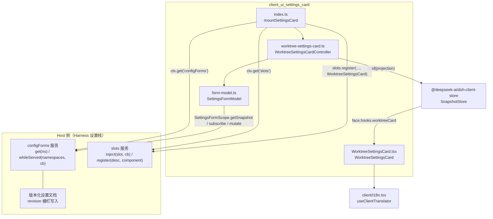
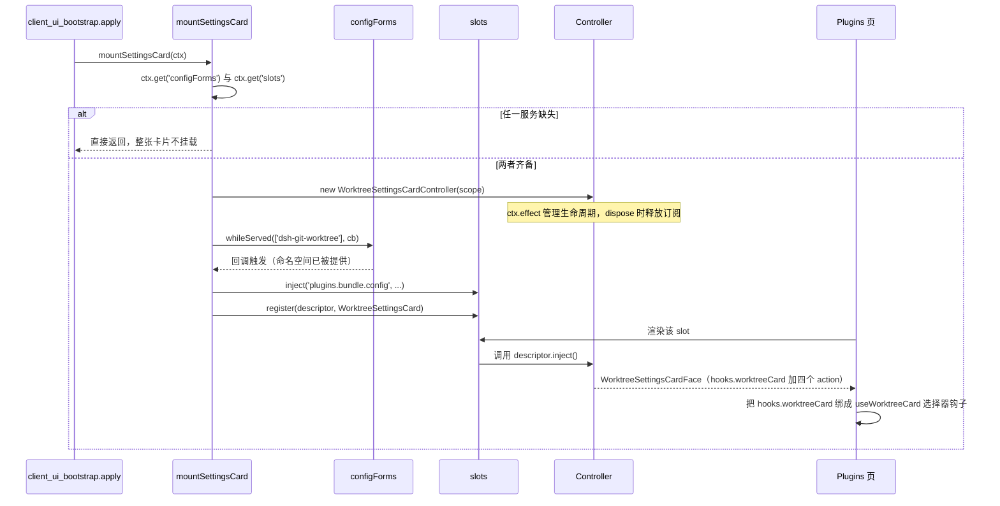
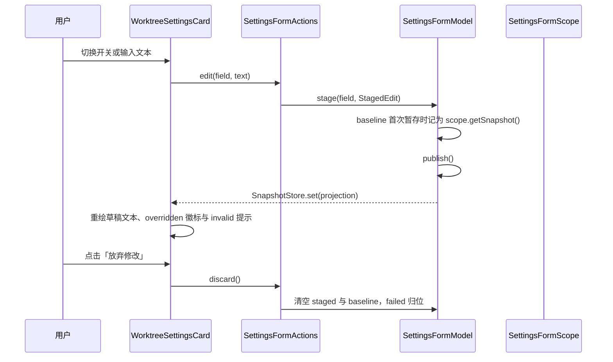
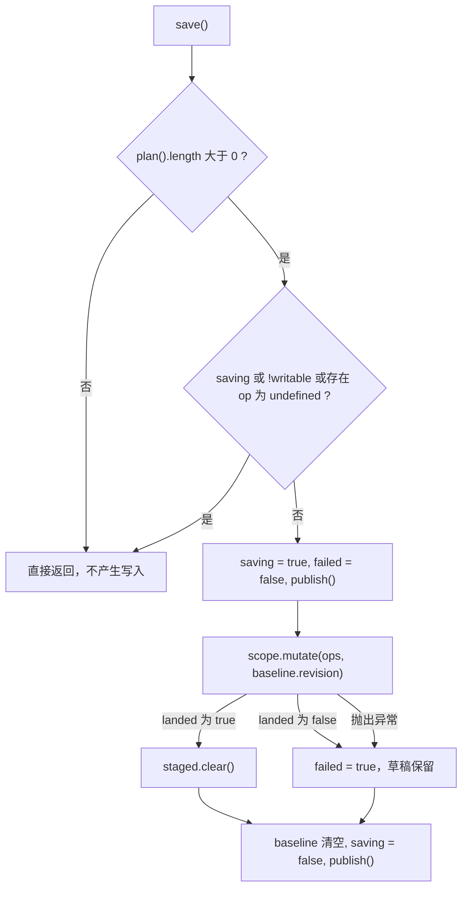

# client_ui_settings_card：Worktree 插件设置卡片

!!! info "Generated documentation"
    This page was written by CodeWiki from the source code at commit [`e01d7c5f`](https://github.com/wloops/dsh-git-worktree/commit/e01d7c5f2f3a0d2f734a5a3415598ae6d7d6f387) on 2026-11-07 with `deepseek-v4.1-flash`. Check the code before relying on details.

## 简介

`client_ui_settings_card` 是 `dsh-git-worktree` 浏览器 bundle 中负责**插件设置页**的模块，源码位于 `src/client/settings-card/`。它把本插件的 Config 命名空间（`WORKTREE_SETTINGS_NS = 'dsh-git-worktree'`）投影成 Harness「Plugins」页上的一张卡片：交付与推送开关、受管 Worktree 根目录、以及两条 Git 超时。

本模块要解决的问题不是「画一个表单」，而是**在版本化的设置文档上做可预览的写入**：

1. **暂存式编辑（staged）**：用户输入的文本先留在本地草稿里，只有点击「保存」才产生一次真正的文档变更。每次设置写入都是 durable 且以 `revision` 作栅栏的文档突变，逐键即时提交会把一次编辑变成用户没要求、也无法预览的多次写入。
2. **Host 是唯一权威**：卡片不推断取值是否合法。字段的「有效值」由 Host 返回（用户层 over composition 层 over schema 默认），写入是否被接受也由 Host 的校验器裁决，卡片只把结果读回来。
3. **fail-soft 挂载**：Host 没有设置栈（`configForms` / `slots` 服务）时，整个卡片静默不挂载，绝不让 bundle 加载失败。
4. **自包含**：本插件安装的 `@deepseek-ai/dsh-client-ui-primitives` 版本早于其共享 `SettingsForm`，因此表单模型与控件全部在本模块内自持，用内联样式绘制，不引入额外样式表。

本模块包含四个文件、四个核心组件：

| 组件 | 文件 | 职责 |
| --- | --- | --- |
| `mountSettingsCard`（及 `ConfigFormsService` / `SlotsService`） | `src/client/settings-card/index.ts` | 探测 Host 服务、建立 controller 生命周期、在命名空间被提供时注册到 `plugins.bundle.config` 插槽 |
| `WorktreeSettingsCardController` / `WorktreeSettingsCardState` / `WorktreeSettingsCardFace` / `WorktreeSettings` | `src/client/settings-card/worktree-settings-card.ts` | 声明命名空间与可编辑字段、把表单模型投影成卡片状态、向插槽条目注入 face |
| `SettingsFormModel`（及 `SettingsFieldSpec`、`SettingsFieldState`、`SettingsFormActions`、`SettingsFormShell`、`SettingsFormScope`、`SettingsFormScopeSnapshot`、`PlannedWrite`、`StagedEdit`） | `src/client/settings-card/form-model.ts` | 与具体字段无关的暂存式表单引擎：草稿、计划、保存、回读、失效判定 |
| `WorktreeSettingsCard`（`WorktreeSettingsCardProps`） | `src/client/settings-card/WorktreeSettingsCard.tsx` | 纯展示组件：一行摘要或完整表单，内联样式开关与输入框 |

> 挂载发生在 [client_ui_bootstrap：浏览器端启动与 Remote 适配引导](client_ui_bootstrap.md) 的 `apply()` 内（`mountSettingsCard(ctx)`），文案由 [client_ui_i18n_presentation：国际化桥接与呈现基础层](client_ui_i18n_presentation.md) 提供的 `useClientTranslator()` 解析。本页只描述设置卡片自身。

---

## 架构与组件关系

模块严格分为四层，**自下而上单向依赖**：展示层只认识 `SettingsFormActions` 与快照存储，不认识 Host 服务；表单引擎只认识 `SettingsFormScope`，不认识 React。



### 挂载流程

`mountSettingsCard` 全程使用 `ctx.get()` 这种 **fail-soft 读取**，而不是 Cordis 的属性 getter：插件 fiber 读取未在 `inject` 中声明的服务时，属性 getter 会抛 "cannot get property without inject"，而 `ctx.get()` 只返回 `undefined`。这是本仓库对可选服务的一贯写法（`host-compat` 同样如此）。相应地，`src/client/console-remote/index.ts` 的入口 `inject` 数组里必须显式列出 `configForms`，否则 `ctx.get('configForms')` 会永远是 `undefined`、设置卡片静默不挂载（该取舍的完整说明见 [client_ui_bootstrap：浏览器端启动与 Remote 适配引导](client_ui_bootstrap.md)）。



两个细节值得注意：

- **插槽选型**：注册目标是 `plugins.bundle.config`（按 bundle 包名作 `key`），也就是 Plugins 页在本 bundle 自己的页面上、描述与插件行之间渲染的区域。`plugins.item` 是官方插件列表槽，永远不会显示第三方 bundle 的卡片。
- **`inject` 是惰性闭包**：descriptor 的 `inject: () => controller?.inject()` 在 slot 真正渲染时才取值，因此 controller 尚未创建或被 dispose 后不会产生悬空引用。两段逻辑都包在 `ctx.effect(...)` 里，随 fiber 销毁自动回滚（第二段在命名空间不再被提供时也会自动注销插槽注册）。

---

## 表单数据流

### 编辑：只改草稿，不写文档



`stage()` 是唯一的草稿入口，它做三件事：首次暂存时把当前 scope 快照记为 `baseline`（保存时用作 `expectedRevision`）、写入 `staged`、清掉 `failed` 并广播。`publish()` 遍历 `listeners`，每个 listener 由 `bind(project)` 注册，负责把重新计算出的投影 `set` 进对应的 `SnapshotStore`——这正是「slot 组件通过快照选择器读取，而 scope 与草稿都在下面变化」这一组合的解法：任何一侧变化都重建整份投影。

### 保存：写一次，再读回



关键约定：

- **栅栏用草稿起始的 revision**：`expectedRevision` 取 `baseline.revision`（第一次暂存时读到的版本），而不是保存瞬间的版本，保证「用户看到的那份内容」被写回同一版本上。
- **Host 是唯一裁判**：`mutate` 返回 `landed` 布尔值即代表文档是否真的接受。卡片不去预测 schema 校验结果，因为 Host 的校验器拥有 schema 无法表达的约束。
- **失败保留草稿**：`failed` 为真时草稿不清空，用户可以就地修正而不是重打一遍；`failed` 会被下一次 `edit` / `resetField` / `save` 清除。

### 计划生成（`plan()`）

`plan()` 把每个草稿翻译成路径操作（`set` / `unset`），并决定「脏」的边界：

| 草稿状态 | 计划结果 |
| --- | --- |
| `clear` 且 user 层确实带该字段 | `{ op: 'unset', path: [field] }` |
| `clear` 但 user 层本就没有该字段 | 不产生计划（不是脏） |
| 文本等于当前 section 有效值的格式化结果 | 不产生计划（回改成原值即不脏） |
| 文本无法被字段解析 | 产生 `{ field }`，`op` 缺省——表单保持脏，保存被阻塞 |
| 解析为 `clear` | `{ op: 'unset', path: [field] }` |
| 解析为 `set` | `{ op: 'set', path: [field], value }` |

因此「无效输入」不会被静默丢弃，而是让保存按钮保持禁用并给出提示——这是本模块最重要的语义之一。

---

## 状态模型

### `SettingsFormScopeSnapshot<T>`：来自 Host 的一次读取

| 字段 | 含义 |
| --- | --- |
| `status` | 三态之一：`loading` / `ready` / `unavailable`；只有 `ready` 时卡片才渲染表单 |
| `value` | 最近一次被接受、经 schema 解析的 section；首次接受前为 `undefined` |
| `base` | 组合层（composition layer）的值：字段被清空后回退到的目标 |
| `user` | 原始用户层；**字段是否存在于这里**决定它是否「已覆盖」 |
| `writable` | Host 文档是否接受写入 |
| `revision` | 读取时的版本号，保存时用于栅栏 |

`SettingsFormScope<T>` 只暴露三个方法：`getSnapshot()`、`subscribe(listener)`、`mutate(ops, expectedRevision?)`。这正是 Host 共享配置表单服务（`configForms.get(ns)`）的形态，卡片不依赖其实现细节。

> **「已覆盖」是存在性判断，不是值比较。** `stored(field)` 用 `Object.hasOwn(user, field)` 判定：一个等于组合层默认值的覆盖仍然是覆盖。这也是卡片必须同时读 `value`、`base`、`user` 三份数据的原因。

### `SettingsFormShell` 与 `WorktreeSettingsCardState`

`shell()` 给出所有卡片共享的表单级状态，`WorktreeSettingsCardState` 在它之上追加每个字段一份 `SettingsFieldState`：

| 状态位 | 来源 | 界面表现 |
| --- | --- | --- |
| `available` | `status === 'ready'` | 为假时组件返回 `null` |
| `writable` | `snapshot.writable` | 为假时全部控件与保存按钮禁用，页脚显示只读提示 |
| `dirty` | `plan().length > 0` | 为假时「放弃修改」与「保存」均禁用 |
| `invalid` | 任一计划项 `op === undefined` | 为真时保存禁用，对应行显示「取值无效」 |
| `saving` | 内部 `saving` 标志 | 期间控件与两个按钮全部禁用，页脚显示「保存中…」 |
| `failed` | 上次保存未生效 | 页脚以危险色显示「保存未生效，请重试。」 |

每个 `SettingsFieldState` 只含三个值：`text`（控件渲染的草稿文本）、`overridden`（保存后 user 层是否会留下条目）、`invalid`（该草稿是否阻塞保存）。三者都由「草稿 + section 有效值」重新推导，不缓存。

---

## 字段规范

`WorktreeSettings` 声明了卡片可编辑的 volatile section；controller 在构造时把它映射成五个 `SettingsFieldSpec`：

| 字段 | 工厂 | 类型 | 空文本 | 非法输入 |
| --- | --- | --- | --- | --- |
| `autoDeliver` | `settingsBooleanField` | `boolean` | `unset`（回退组合层默认） | 除 `'true'` / `'false'` 外一律非法 |
| `autoPush` | `settingsBooleanField` | `boolean` | `unset` | 同上 |
| `worktreesRoot` | `settingsTextField` | `string` | `unset` | 无（trim 后非空即接受） |
| `gitTimeoutMs` | `settingsNumberField` | `number` | `unset` | 非 `Number.isSafeInteger` 的输入 |
| `worktreeAddTimeoutMs` | `settingsNumberField` | `number` | `unset` | 同上 |

三个工厂的语义差异都是刻意的：

- **布尔**：`format` 只把真正的 `boolean` 渲染成 `'true'` / `'false'`，其余渲染为空串；`parse` 先 `trim`，空串为 `clear`。界面上布尔字段不出现输入框，而是 `role="switch"` 的开关，点击时写入字面量 `'true'` / `'false'`。
- **数字**：只有安全整数才算合法；空文本渲染为空串而不是 `0`——「没人选过的值」不该显示成某个具体数字。
- **文本**：`parse` 会 `trim` 后写入，因此「清空输入框再保存」与「点击还原」是同一个手势（都落到 `unset`）。

`SettingsFormModel` 的 `spec()` 在遇到未声明的字段名时**抛错**而不是退化成惰性控件——调用点必然是本卡片声明过的字段，缺失只可能是装配错误，静默失败会把它藏起来。

---

## 渲染层

### Props 与 face

`WorktreeSettingsCardProps` 由 Plugins 页插槽绑定：

```ts
interface WorktreeSettingsCardProps extends SettingsFormActions {
  view?: string
  useWorktreeCard: (selector: (snapshot: WorktreeSettingsCardState) => WorktreeSettingsCardState) => WorktreeSettingsCardState
}
```

- `view === 'summary'` 时只渲染 `settings.description` 一行摘要（Plugins 页的列表态），且**优先于** `available` 判断；其余情况渲染完整表单。
- `useWorktreeCard` 由 slot runtime 从 controller 的 `WorktreeSettingsCardFace.hooks.worktreeCard`（一个 `SnapshotStore`）绑定而来，因此组件自身永远看不到 `hooks` prop，也不需要知道存储实现。
- `SettingsFormActions` 的 `edit` / `resetField` / `save` / `discard` 直接来自 `SettingsFormModel.actions()`，组件只负责把它们接到 DOM 事件上。

### 控件与禁用矩阵

| 控件 | 渲染方式 | 禁用条件 |
| --- | --- | --- |
| 布尔开关 | `<button role="switch" aria-checked aria-label>` 加内联滑块 | 文档不可写，或正在保存 |
| 文本输入 | `<input type="text">`；数字字段附加 `inputMode="numeric"` | 文档不可写，或正在保存 |
| 行内「还原」按钮 | 仅当该字段 `overridden` 为真时出现 | 文档不可写，或正在保存 |
| 「放弃修改」 | 页脚次按钮 | 表单不脏，或正在保存 |
| 「保存」 | 页脚主按钮 | 文档不可写、表单不脏、任一草稿非法、正在保存，四者任一成立 |

对应的代码条件分别是 `!state.writable || state.saving`、`!state.dirty || state.saving`，以及保存按钮的 `!state.writable || !state.dirty || state.invalid || state.saving`。

页脚左侧是一格状态文案，按优先级取 `failed` → `saving` → `!writable` → 空：失败用危险色，其余用灰色。行内还会在 `invalid` 时显示「取值无效，无法保存。」，在 `overridden` 时显示「已覆盖」徽标加「还原」按钮。

### 样式策略

所有样式都是文件内的 `CSSProperties` 常量（`cardStyle`、`rowStyle`、`inputStyle`、`switchStyle`、`knobStyle` 等），不注入 `<style>`、也不引用 `styles.ts` / `target-console.styles.ts` 那两份样式表。原因是本卡片要在「`dsh-client-ui-primitives` 版本早于共享 `SettingsForm`」的宿主上照常工作，自包含是唯一不会随宿主版本漂移的选择。

---

## 与 Host Config schema 的对应

卡片编辑的五个字段在 Host 侧都是 `volatile` 字段（`src/index.ts` 的 `Config`）：Harness 设置宿主读取 `meta.volatile` 后把它们投影进设置页，编辑**写入 profile 的 patch 文件而无需重新挂载插件**，值以 live reference 形式在每次使用时读取。仓库内的 `cordis.patch.yml` 就是这种补丁机制的落点（当前内容是一条 `insert`，把 `dsh-git-worktree` 插件条目插入 profile）。

由此产生两条必须理解的分工：

- **卡片只校验「可解析」**（布尔字面量、安全整数），**范围约束由 Host 裁决**。例如 `gitTimeoutMs` 在 schema 上有 `min(1_000)` 与 `max(MAX_GIT_TIMEOUT_MS)`，卡片本身不复制这两个边界；越界输入会被 Host 拒绝，表现为保存后 `failed` 为真、草稿保留。
- **清空即回退**：`unset` 让字段重新继承组合层（含 schema `default`），所以「留空 Worktree 根目录」等于「使用默认位置」，这与 `worktreesRoot` 在 Host 侧的可选语义一致。

字段的业务含义（自动交付、自动推送、Worktree 根目录、两条超时）属于插件配置语义，本页不重复，参见 [core_domain 核心域概览](../core_domain.md) 与 [build_and_config 构建与配置](../build_and_config.md)。

---

## 工程约束与设计取舍

| 取舍 | 理由 |
| --- | --- |
| 暂存而非即时提交 | 每次设置写入都是 durable、revision 栅栏的文档突变；即时提交会把一次编辑变成多次用户没要求的写入，且无法预览。暂存让「屏幕上看到的」与「保存会写下的」严格一致 |
| 自持表单模型，不复用 primitives 的 `SettingsForm` | 本插件安装的 `@deepseek-ai/dsh-client-ui-primitives` 版本早于该模块，而 client bundle 必须自包含（`tsdown.config.ts` 把 primitives 列为 external，版本由宿主决定） |
| 只编辑可见字段，无 secret 控件 | 从上游模型裁剪时移除了 write-only 的密钥控件，本卡片只处理可见字段 |
| 无效草稿阻塞保存而非丢弃 | 丢弃会让用户以为改动已生效；阻塞并提示才是可预期的行为 |
| `ctx.get()` 探测而非声明式 `inject` | 缺设置栈的宿主上卡片应静默缺席，而不是让整条 client 启动失败；代价是入口 `inject` 必须显式声明 `configForms`（见 [client_ui_bootstrap：浏览器端启动与 Remote 适配引导](client_ui_bootstrap.md)） |
| 未声明字段抛错 | 装配错误必须立刻暴露，不能退化成点了没反应的控件 |

`dispose()` 会解除对 Host scope 的订阅并清空 listener 集合，由 `ctx.effect` 的清理函数调用，保证 fiber 销毁后不再向已卸载的 `SnapshotStore` 推送投影。

---

## 跨模块关系

- **[client_ui — 浏览器端 UI 层](../client_ui.md)**：本模块是其「插件设置页」子模块，与工具视图、目标控制台、Git 视图、Workspace 侧栏并列。
- **[client_ui_bootstrap：浏览器端启动与 Remote 适配引导](client_ui_bootstrap.md)**：唯一调用方。包级入口在 `provide('worktreeConsole')` 之后调用 `mountSettingsCard(ctx)`，并在其 `inject` 中声明 `configForms`——没有该声明本模块永远不会挂载。
- **[client_ui_i18n_presentation：国际化桥接与呈现基础层](client_ui_i18n_presentation.md)**：`WorktreeSettingsCard` 通过 `useClientTranslator()` 取翻译器，随 locale 变化重渲染。
- **[i18n：多语言文案目录与本地化解析层](../i18n.md)**：文案目录 `src/i18n/client-messages.ts` 中的 `settings.*` 键族（`settings.description`、`settings.autoDeliver` / `.hint`、`settings.autoPush` / `.hint`、`settings.worktreesRoot` / `.hint`、`settings.gitTimeoutMs` / `.hint`、`settings.worktreeAddTimeoutMs` / `.hint`、`settings.save`、`settings.discard`、`settings.saving`、`settings.failed`、`settings.readonly`、`settings.overridden`、`settings.reset`、`settings.invalid.value`）全部由本模块消费；`settings.title` 在目录中但不由卡片渲染，供 Plugins 页使用。
- **[build_and_config 构建与配置](../build_and_config.md)**：`tsdown.config.ts` 决定本模块被内联进 `lib/client.js`、`react` 与 `@deepseek-ai/dsh-client-store` 由宿主提供；`src/index.ts` 的 `Config` schema 与本卡片共享同一份字段定义；`cordis.patch.yml` 是 volatile 编辑的持久化落点。
- **不依赖 `WorktreeConsoleAdapter`**：设置写入走 Host 的共享配置表单服务，不经过 Worktree 控制台的 RPC 链路（[console_contract：Worktree Console 共享契约层](../console_contract.md) / [console_host：Worktree 控制台的 Host 侧服务层](../console_host.md)）。这是本模块与 client_ui 其余子模块最大的结构差异。

---

## 测试与验证

- 测试入口为 `vitest.config.ts`（`include: tests/**/*.test.{ts,tsx}`，`testTimeout: 60_000`），并把 `@deepseek-ai/dsh-client-ui-primitives` 别名到 `tests/support/ui-primitives.tsx`。本卡片不引用该 primitives 模块的 `SettingsForm`，因此不依赖该 mock 的完整性。
- 渲染验证可用 `devDependencies` 中的 `@testing-library/react` 与 `jsdom`：只需构造一个内存版 `SettingsFormScope`（`getSnapshot` / `subscribe` / `mutate`），即可覆盖「暂存 → 脏 → 保存 → 回读 / 失败保留草稿」全链路，无需真实 Host。
- 类型闸门由 `pnpm run typecheck`（`tsc --noEmit`，`strict` + `noUncheckedIndexedAccess`）覆盖；构建由 `pnpm run build`（`tsc && tsdown`）产出 `lib/client.js`，CI 与发布闸门的细节见 [build_and_config 构建与配置](../build_and_config.md)。

??? abstract "Documented components (16)"
    - [`WorktreeSettingsCardProps`](https://github.com/wloops/dsh-git-worktree/blob/e01d7c5f2f3a0d2f734a5a3415598ae6d7d6f387/src%5Cclient%5Csettings-card%5CWorktreeSettingsCard.tsx) — `src\client\settings-card\WorktreeSettingsCard.tsx`
    - [`PlannedWrite`](https://github.com/wloops/dsh-git-worktree/blob/e01d7c5f2f3a0d2f734a5a3415598ae6d7d6f387/src%5Cclient%5Csettings-card%5Cform-model.ts) — `src\client\settings-card\form-model.ts`
    - [`SettingsFieldSpec`](https://github.com/wloops/dsh-git-worktree/blob/e01d7c5f2f3a0d2f734a5a3415598ae6d7d6f387/src%5Cclient%5Csettings-card%5Cform-model.ts) — `src\client\settings-card\form-model.ts`
    - [`SettingsFieldState`](https://github.com/wloops/dsh-git-worktree/blob/e01d7c5f2f3a0d2f734a5a3415598ae6d7d6f387/src%5Cclient%5Csettings-card%5Cform-model.ts) — `src\client\settings-card\form-model.ts`
    - [`SettingsFormActions`](https://github.com/wloops/dsh-git-worktree/blob/e01d7c5f2f3a0d2f734a5a3415598ae6d7d6f387/src%5Cclient%5Csettings-card%5Cform-model.ts) — `src\client\settings-card\form-model.ts`
    - [`SettingsFormModel`](https://github.com/wloops/dsh-git-worktree/blob/e01d7c5f2f3a0d2f734a5a3415598ae6d7d6f387/src%5Cclient%5Csettings-card%5Cform-model.ts) — `src\client\settings-card\form-model.ts`
    - [`SettingsFormScope`](https://github.com/wloops/dsh-git-worktree/blob/e01d7c5f2f3a0d2f734a5a3415598ae6d7d6f387/src%5Cclient%5Csettings-card%5Cform-model.ts) — `src\client\settings-card\form-model.ts`
    - [`SettingsFormScopeSnapshot`](https://github.com/wloops/dsh-git-worktree/blob/e01d7c5f2f3a0d2f734a5a3415598ae6d7d6f387/src%5Cclient%5Csettings-card%5Cform-model.ts) — `src\client\settings-card\form-model.ts`
    - [`SettingsFormShell`](https://github.com/wloops/dsh-git-worktree/blob/e01d7c5f2f3a0d2f734a5a3415598ae6d7d6f387/src%5Cclient%5Csettings-card%5Cform-model.ts) — `src\client\settings-card\form-model.ts`
    - [`StagedEdit`](https://github.com/wloops/dsh-git-worktree/blob/e01d7c5f2f3a0d2f734a5a3415598ae6d7d6f387/src%5Cclient%5Csettings-card%5Cform-model.ts) — `src\client\settings-card\form-model.ts`
    - [`ConfigFormsService`](https://github.com/wloops/dsh-git-worktree/blob/e01d7c5f2f3a0d2f734a5a3415598ae6d7d6f387/src%5Cclient%5Csettings-card%5Cindex.ts) — `src\client\settings-card\index.ts`
    - [`SlotsService`](https://github.com/wloops/dsh-git-worktree/blob/e01d7c5f2f3a0d2f734a5a3415598ae6d7d6f387/src%5Cclient%5Csettings-card%5Cindex.ts) — `src\client\settings-card\index.ts`
    - [`WorktreeSettings`](https://github.com/wloops/dsh-git-worktree/blob/e01d7c5f2f3a0d2f734a5a3415598ae6d7d6f387/src%5Cclient%5Csettings-card%5Cworktree-settings-card.ts) — `src\client\settings-card\worktree-settings-card.ts`
    - [`WorktreeSettingsCardController`](https://github.com/wloops/dsh-git-worktree/blob/e01d7c5f2f3a0d2f734a5a3415598ae6d7d6f387/src%5Cclient%5Csettings-card%5Cworktree-settings-card.ts) — `src\client\settings-card\worktree-settings-card.ts`
    - [`WorktreeSettingsCardFace`](https://github.com/wloops/dsh-git-worktree/blob/e01d7c5f2f3a0d2f734a5a3415598ae6d7d6f387/src%5Cclient%5Csettings-card%5Cworktree-settings-card.ts) — `src\client\settings-card\worktree-settings-card.ts`
    - [`WorktreeSettingsCardState`](https://github.com/wloops/dsh-git-worktree/blob/e01d7c5f2f3a0d2f734a5a3415598ae6d7d6f387/src%5Cclient%5Csettings-card%5Cworktree-settings-card.ts) — `src\client\settings-card\worktree-settings-card.ts`

