# client_ui_tool_views_and_actions — ToolView 卡片与 Session 导航动作

!!! info "Generated documentation"
    This page was written by CodeWiki from the source code at commit [`e01d7c5f`](https://github.com/wloops/dsh-git-worktree/commit/e01d7c5f2f3a0d2f734a5a3415598ae6d7d6f387) on 2026-11-07 with `deepseek-v4.1-flash`. Check the code before relying on details.

## 简介

`client_ui_tool_views_and_actions` 是 [client_ui — 浏览器端 UI 层](../client_ui.md) 中**面向「一次建树结果」的最小闭环**：它把 Host 侧 `worktree_create` 工具调用的日志切片渲染成一张会话内卡片，并把「打开这个隔离目标」这一动作翻译成 Harness 的 Workspace / Session 运行时调用。

模块只有四个文件，职责边界非常清晰：

| 文件 | 职责 | 是否纯函数 |
| --- | --- | --- |
| `src/client/model.ts` | 从日志化的 call/result 切片解析出 `ParsedTool`（生命周期、payload、参数、错误文案） | 是（除翻译器注入外无副作用） |
| `src/client/WorktreeCreateRow.tsx` | `tool.call.toolview` 中 key 为 `worktree_create` 的卡片组件 | 否（React 状态 + 一次打开动作） |
| `src/client/actions.ts` | 浏览器侧编排：Session 创建/导航/草稿预填/命令提交 | 否（依赖注入的宿主服务） |
| `src/client/index.tsx` | 插件级 `apply` / `inject`，注册 ToolView、注入样式、透传 adapter | 否（Cordis 副作用） |

三条贯穿全模块的设计约束：

1. **可重放（replay-stable）**：卡片内容**只**由已记录的 `block` 派生，不读取任何实时状态。历史消息重放、刷新页面、重新挂载都得到同一张卡片（`src/client/model.ts` 的模块注释即声明这一点）。
2. **fail-closed 的导航**：任何「打开目标」的路径都必须先用 Host 或 Harness 的数据证明 `cwd` / `checkoutId` / `ownerSessionId` 身份一致，证明不了就抛错，绝不静默跳到错误的目录（`src/client/actions.ts`）。
3. **不伪造副作用**：`actions.ts` 只做「注册工作目录 + 创建 Session + 导航 + 预填草稿 + 显式命令」，从不代用户发送消息。`prefillSessionDraft` 明确只 `setDraft`，不调用 `command` / `prompt`。

> 本页只覆盖上述四个文件。目标胶囊、Worktree 管理器、Git 图/标签、侧栏装饰、设置页分别见 [client_ui_target_console —— 会话目标胶囊与工作树管理控制台](client_ui_target_console.md)、[client_ui_git_views：Git 视图（提交图、标签管理、分支概览缓存）](client_ui_git_views.md)、[client_ui_workspace_sidebar —— Workspace 侧栏投影与装饰](client_ui_workspace_sidebar.md)、[client_ui_settings_card：Worktree 插件设置卡片](client_ui_settings_card.md)；包级启动与跨代装配见 [client_ui_bootstrap：浏览器端启动与 Remote 适配引导](client_ui_bootstrap.md)。

## 架构总览

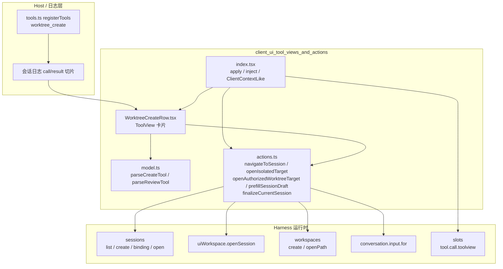

依赖方向是单向的：`index.tsx` → (`WorktreeCreateRow`, `target-console`, `styles`) → `model.ts` / `actions.ts` → `console-contract` 类型与 `i18n` 翻译器。`model.ts` 与 `actions.ts` **互不依赖**，这使得模型层可以在没有 DOM、没有 Cordis 的环境里单独测试。

## 注册入口：`src/client/index.tsx`

`index.tsx` 是本模块（也是整个 client bundle 的视图侧）的装配点。它导出三样东西：`inject`、`apply`、以及 `WORKTREE_CONSOLE_ADAPTER_SERVICE` 常量。

### 必需服务声明

```typescript
export const inject = ['slots', 'workspaces', 'sessions', 'conversation', 'connection', 'locale']
```

`inject` 是 Cordis 的**服务声明**，同时决定了插件的启动时机。`ClientContextLike` 只描述本模块真正用到的三个面：`get(name)`、`effect(setup, label)`、`slots.inject` / `slots.register`。

`servicesOf(ctx)` 把宿主服务收集成 `WorktreeClientServices`（定义在 `actions.ts`）。注意 `uiWorkspace` 与 `conversation` 是**可选**的：前者在旧 Harness 上不存在，后者在缺 composer 的宿主上不存在。

### 装配流程

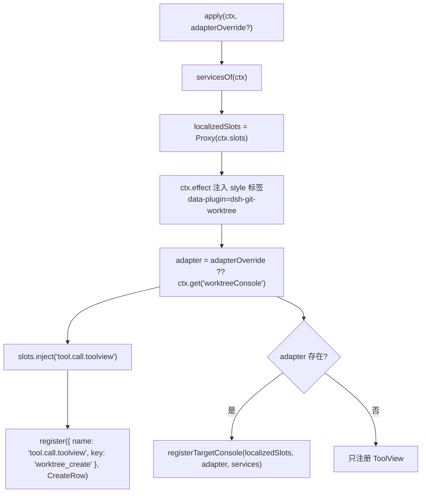

四个细节值得单独说明：

1. **i18n 包裹用 Proxy 而不是改组件**：`localizedSlots` 代理了 `ctx.slots` 的 `register`，把每个注册组件包进 `ClientI18nProvider`。这样同一 bundle 的多个 DSH Client 实例各自持有自己的 `locale`，语言切换互不串扰。Provider 与翻译器的细节见 [client_ui_i18n_presentation：国际化桥接与呈现基础层](client_ui_i18n_presentation.md) 与 [i18n：多语言文案目录与本地化解析层](../i18n.md)。
2. **样式表自持有**：client-module 系统会把任何没有 `data-plugin` 的 head `<style>` 认领给下一个物化的模块（`claimStyles`），并在该模块失效时删除（`removeOwnedStyles`）。因此这里显式打上 `data.plugin = 'dsh-git-worktree'` 与 `data.pluginCss = 'dsh-git-worktree/styles'`，并用 `ctx.effect` 返回的清理函数在 fiber 销毁时移除节点。
3. **adapter 的双通道来源**：本插件自己提供的服务在同一 fiber 的 provider effect 落定之前不可见，所以包级 Remote 入口会通过 `adapterOverride` 显式传入刚创建的 adapter；直接消费方仍可用 `ctx.get(WORKTREE_CONSOLE_ADAPTER_SERVICE)` 注入。`registerTargetConsole` 的细节见 [client_ui_target_console —— 会话目标胶囊与工作树管理控制台](client_ui_target_console.md)。
4. **key 而非组件类型作为身份**：注册描述符使用 `{ name, key: 'worktree_create' }`，Harness 依此把日志中 `toolName === 'worktree_create'` 的调用路由到 `CreateRow`。因此 `CreateRow` 是无状态函数组件，真正的状态全部在 `WorktreeCreateRow` 内部。

## 模型层：`src/client/model.ts`

### 输入类型

`model.ts` 刻意不 import Harness 的运行时类型，而是声明结构兼容的窄接口：

| 类型 | 用途 |
| --- | --- |
| `ToolContentBlock` | 结果内容块：`type` + 可选 `text`，其余键保留 |
| `ToolCallBlockLike` | 日志切片：`callId`、`argsRaw`、`call.argsRaw`、`content`、`kind`、`isError`、`error` |
| `ToolCallViewPropsLike` | Harness 传给 ToolView 的 props：`callId`、`sessionId`、`toolName`、`block`、`cwd`、`openFile`、`inspect` |
| `ParsedTool<TPayload, TArgs>` | 解析结果：`lifecycle` / `payload` / `args` / `error` |
| `WorktreeCreatePayload` | `kind: 'worktree_target_created'` + `checkoutId`、`targetSessionId`、`managedRoot`、`phase`、`currentOid`、`sourceSessionId`、可选 `cwd` / `cwdSelected` |
| `WorktreeReviewPayload` | `kind: 'worktree_ready_for_review'` + `reviewId`、`revision`、`iteration`、`changedFiles` |
| `ReviewArgs` | 验收参数：`summary`、`validationStatus`、`tests[]`、`suggestedCommitMessage` 等 |

### 生命周期判定

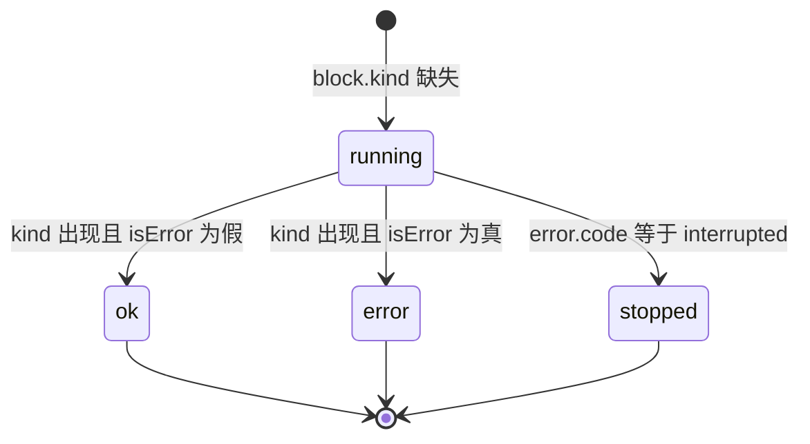

`textContent(block)` 把 `content` 中的文本块拼接，非文本块 `JSON.stringify`；当内容为空但有 `block.error` 时，退化为 `"<name>: <code>"`。`parseJson` 解析失败返回 `null` 而不抛错——畸形输入必须变成卡片上的错误文案，不能炸掉整个消息列表。

### `parseCreateTool`

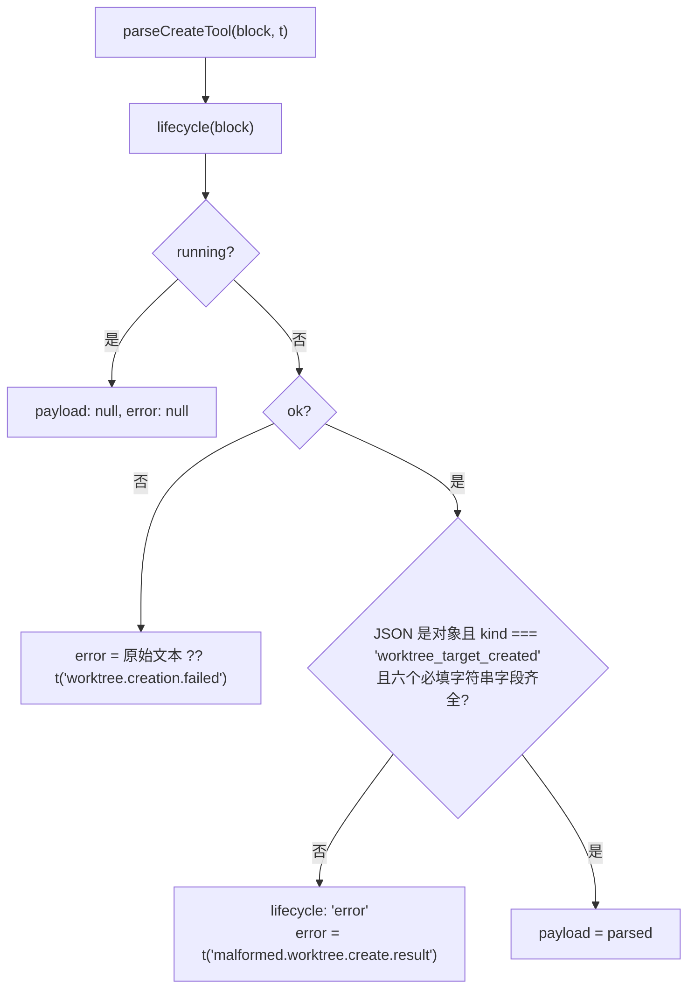

六个必填字段是 `checkoutId`、`targetSessionId`、`managedRoot`、`phase`、`currentOid`、`sourceSessionId`；`stringField` 要求非空字符串，因此空串与缺失同等对待。这套校验与 Host 侧 `tools.ts` 的 `output.schema` 一一对应（见 [会话结账工具层（session_checkout_tools）](../core_domain/core_domain_session_checkout/session_checkout_orchestration/session_checkout_tools.md)），客户端只是拒绝在日志被篡改或截断时渲染出误导性卡片。

### `parseReviewTool`

`parseReviewTool` 与 `parseCreateTool` 结构对称，但额外要求 `args` 可解析：`reviewArgs` 校验 `summary`、`validationStatus`（四个枚举值之一）、`suggestedCommitMessage` 与 `tests[]` 数组，`tests` 每项需有 `command` 与非空 `status`。若结果合法但参数畸形，返回 `error: t('malformed.ready.for.review.arguments')` 并清空 `payload`——因为验收卡片的按钮需要 `reviewId + revision` 才能发出请求，缺参数就不能给出可点击的入口。

`iteration` 做了数值兜底：非整数或负数一律归零，保证卡片不会显示 `第 -1 轮`。

> 说明：当前 `index.tsx` 只注册了 `worktree_create` 一个 ToolView。验收面板已从 UI 移除（Host 侧 `WorktreeConsoleDeliverRequest` 的注释也记录了这一点），`parseReviewTool` 与其类型保留为纯函数契约，供后续视图或测试复用。

## 卡片组件：`src/client/WorktreeCreateRow.tsx`

`WorktreeCreateRow` 接收 `ToolCallViewPropsLike` 与注入的 `services`，用 `parseCreateTool(block, t)` 得到模型，然后渲染一张 `section.dsh-wt-card`。

### 内部状态

| 状态 | 类型 | 说明 |
| --- | --- | --- |
| `openState` | `'idle' \| 'opening' \| 'error'` | 打开动作的进行态，用于禁用按钮并切换文案 |
| `openError` | `string \| null` | 打开失败的原始 message，以 `role="alert"` 呈现 |
| `mounted` | `useRef(true)` | 卸载后丢弃迟到的异步结果（过期写入防护） |

`data-state` 由 `model.lifecycle` 归并而来：`running` 与 `ok` 原样透出，其余（`error`、`stopped`）统一为 `error`，使样式与语义状态同源而不必在 CSS 里区分「中断」与「失败」。

### 渲染分支

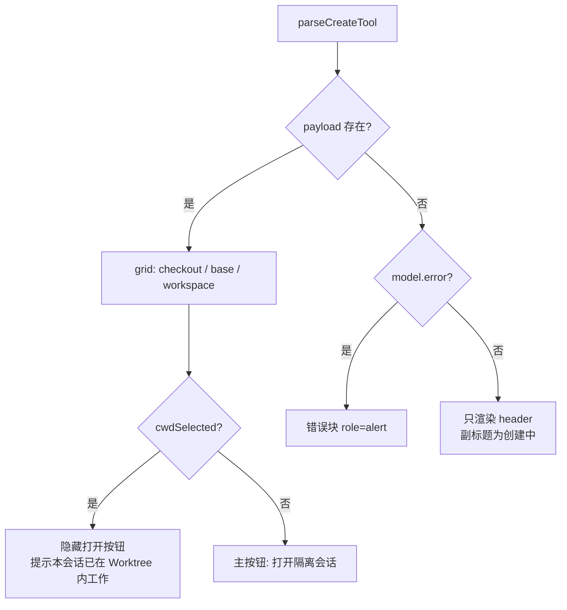

三个交互要点：

- **`base` 只显示前 12 位 oid**（`payload.currentOid.slice(0, 12)`），与 Host 侧命令行输出 `slice(0, 7)` 的约定保持同一意图：可辨识即可，不铺满长哈希。
- **`workspace` 是可点击路径**，点击调用 `services.workspaces.openPath(payload.managedRoot)`，走宿主自己的目录打开能力，而不是自建一个 `window.open`。
- **打开按钮是三态文案**：`open.isolated.session` → `opening.2`（禁用）→ `retry.opening.isolated.session`（`openState === 'error'`）。失败后按钮仍可点，因为失败原因（cwd 不一致、Session 未投影）往往是瞬时的。

`openTarget` 的实现只有一句关键调用：

```typescript
await openIsolatedTarget(services, payload)
```

它刻意**不**传 `isActive`：卡片自身的 `mounted` ref 已经足够保证不会在卸载后写入状态。

## 编排层：`src/client/actions.ts`

`actions.ts` 是本模块的核心逻辑文件，文件头注释即定义了它的定位：**浏览器侧、面向 Harness Workspace 与 Session 运行时的编排**。它不 import 任何 Host 内部模块，只依赖 `console-contract` 的 `WorktreeConsoleAdapter` 类型。

### 服务面类型

| 类型 | 关键成员 | 语义 |
| --- | --- | --- |
| `SnapshotStore<T>` | `getSnapshot()` / `subscribe()` | 与 `useSyncExternalStore` 同构的只读存储 |
| `ClientSessions` | `list`、`create`、`using?`、`open?`、`binding` | Session 目录、创建、保留期借出、旧版导航、绑定获取 |
| `ClientWorkspaces` | `create({ path })`、`openPath(path)` | 把磁盘路径注册成 Workspace / 在系统文件管理器中打开 |
| `ClientSessionBinding` | `ctx?`、`session.getSnapshot?`、`session.prompt?`、`session.command` | 单会话的运行时把手 |
| `ClientSessionSnapshot` | `running`、`openState`、`removed` | 会话运行态快照 |
| `WorktreeClientServices` | `uiWorkspace?`、`locale?`、`sessions`、`workspaces`、`conversation?` | 本模块全部依赖的聚合 |
| `ComposerInput` | `setDraft`、`addImages`/`removeImage` 或 `addAttachments`/`removeAttachment` | composer 草稿面（Harness 在加入通用附件时改过名，两种形状都接受） |
| `IsolatedTargetLocation` | `managedRoot`、`targetSessionId` | 打开目标所需的最小身份 |

`ClientSessions` 的可选成员是本模块兼容多代 Harness 的关键：`using?` 是较新 Session Controller 的「保留借出」语义，`open?` 是旧版导航；两者都可能缺席。

### 路径比较：`samePath`

```typescript
const normalize = (value) => value.replace(/[\\/]+$/u, '').replaceAll('\\', '/')
```

先去掉尾部所有分隔符、把反斜杠统一成正斜杠；若任一侧形如 `C:/...`（盘符路径），则整体小写后比较，否则大小写敏感比较。这解决了 Windows 上 `C:\a\b\` 与 `c:/a/b` 表示同一目录却字符串不等的问题，同时避免在 POSIX 上误把两个真实不同的目录判为相同。

### 导航解析：`navigateToSession`

优先级被刻意固定，因为「静默丢失选择」是不可接受的失败：

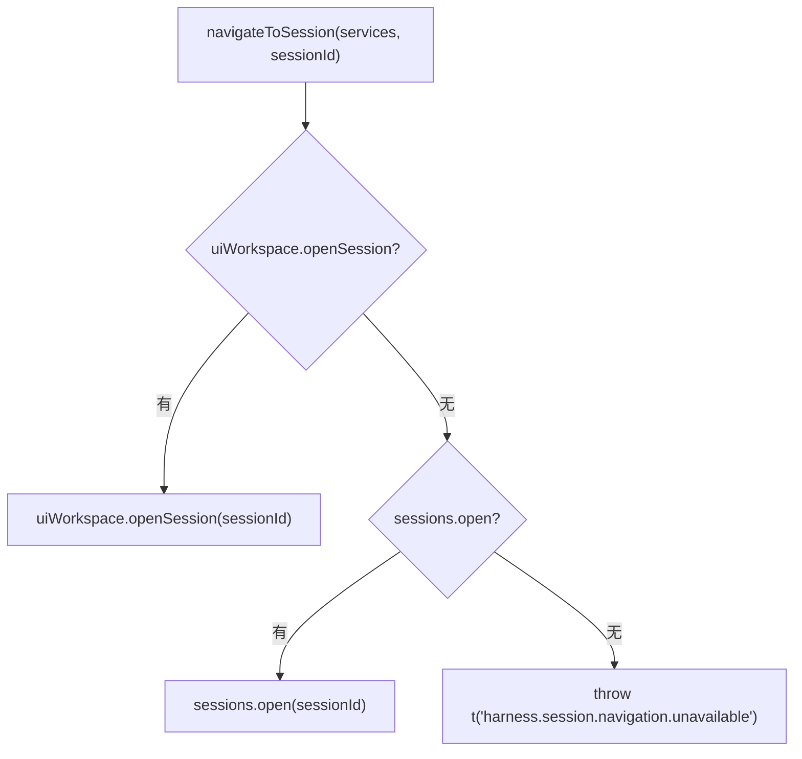

注释写明规则：**优先 UI 侧导航所有者**（Harness 0.1.6+ 由 UI Workspace 拥有选择权），旧版回落到 `sessions.open`，两者都没有时宁可报错也不假装成功。

### 选中会话判定：`selectedSessionId`

新 Host 用 `retainedBy.mainView > 0` 表示「被主视图保留」，旧 Host 用 `list.current`。函数把两者合并：

1. 收集所有 `retainedBy.mainView > 0` 的 Session。
2. 保留集数量 > 1 → 返回 `undefined`（歧义即无选择）。
3. `current` 存在且与唯一保留项不一致 → 返回 `undefined`（两个来源互相矛盾）。
4. 否则返回 `current || retained[0]`。

`finalizeCurrentSession` 依赖这个判定：拿不到唯一会话就不发命令。

### `openExistingSession`

```typescript
const summary = services.sessions.list.getSnapshot().byId[sessionId]
if (summary?.cwd === undefined || !samePath(summary.cwd, expectedCwd)) return false
navigateToSession(services, sessionId)
return true
```

返回 `boolean` 而非抛错，让调用方决定「这是预期内的不存在」还是「这是错误」。注意它**不做任何创建**——已存在的 Session 不应因为打开动作而被重建。

### `waitForProjectedSessionPath`

新建 Session 之后，Harness 需要把 `cwd` 投影回 `sessions.list`，这个投影是异步的。函数用订阅 + 超时实现等待：

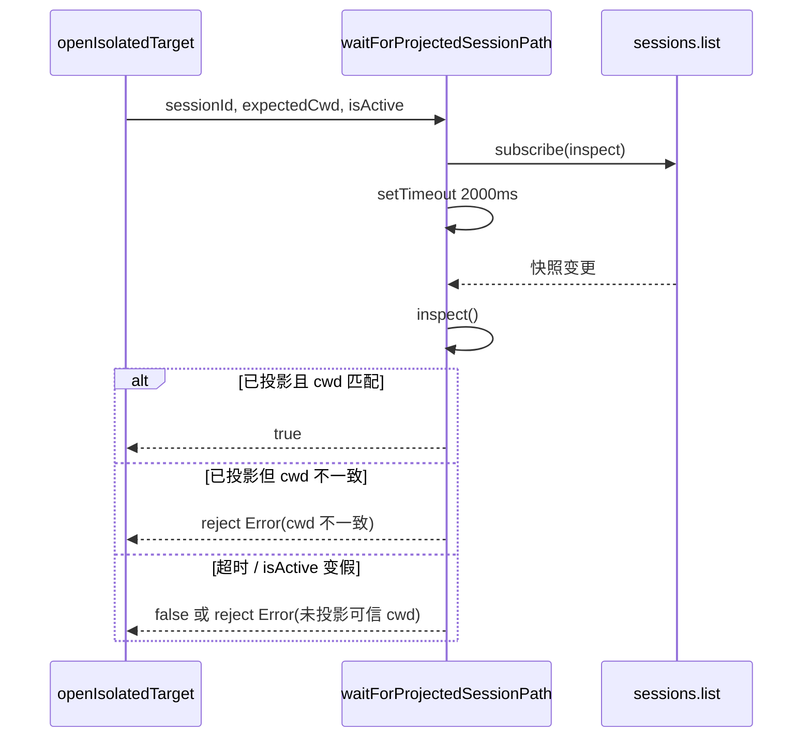

`settled` 标志保证 `resolve` / `reject` 只发生一次，`unsubscribe` 在任一分支都被调用；`isActive()` 每次检查都会短路，避免会话切换后仍继续等待旧请求。

### `openIsolatedTarget`：幂等打开

这是 ToolView 卡片按钮与目标控制台「打开」动作共同走的主路径。

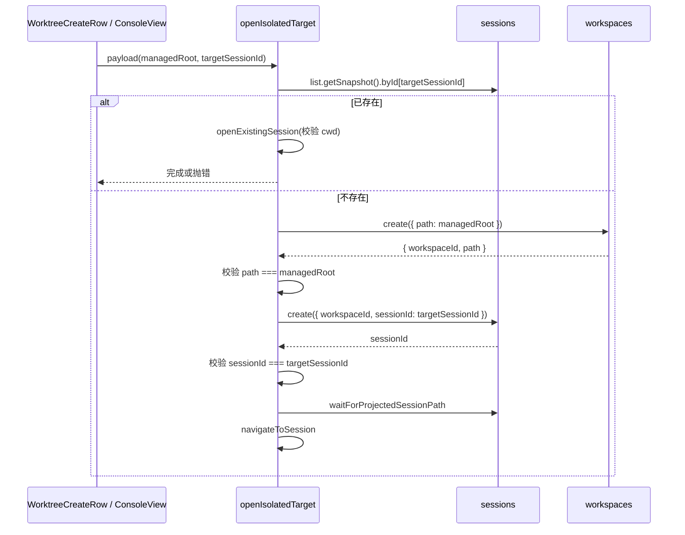

三次身份校验（workspace path、session id、投影后的 cwd）全部是**相等断言**，任何一处不匹配都抛错并附上翻译后的诊断文案。`isActive()` 在每一个 `await` 之后都被重新检查，因此切换会话或卸载组件会让整条链路提前静默退出（不抛错——用户已经不关心这个结果了）。

### `openAuthorizedWorktreeTarget`：带 Host 授权的打开

当调用方不是目标的所有者（例如等待中的 Session、或管理面板里的其他行），客户端不能仅凭自己手上的 `managedRoot` 就去注册目录。此时必须让 Host 先 `inspect`：

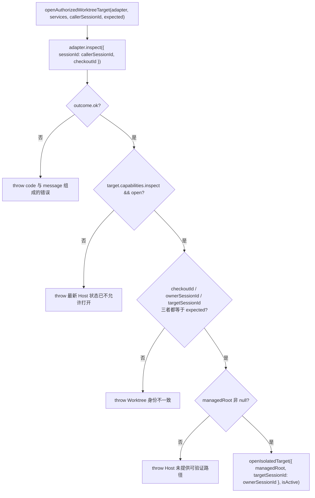

关键点：`inspect` 返回的是**经过 Host 身份校验的详情**（`WorktreeConsoleTargetDetails` 比 `Summary` 多了 `managedRoot` / `sourceRoot` / `sourceOid` / `currentBranch`，见 [console_contract：Worktree Console 共享契约层](../console_contract.md)）。客户端据此才拿到可信路径。`target.targetSessionId !== expected.ownerSessionId` 也一并检查，因为某些恢复路径上 owner 与 target 可能不同名。

### `prefillSessionDraft`

```typescript
const binding = services.sessions.binding(sessionId)
if (binding?.ctx === undefined || services.conversation === undefined) return false
services.conversation.input.for(binding.ctx).setDraft(text)
return true
```

只写草稿，**不**调用 `command`、`prompt` 或任何发送通道；返回 `false` 表示宿主没有 composer 面，调用方应改用「展示文案」而不是假装已预填。`ComposerInput` 的联合类型让本函数同时兼容 `addImages` 与 `addAttachments` 两代 API（本函数本身只用 `setDraft`）。

### `finalizeCurrentSession`

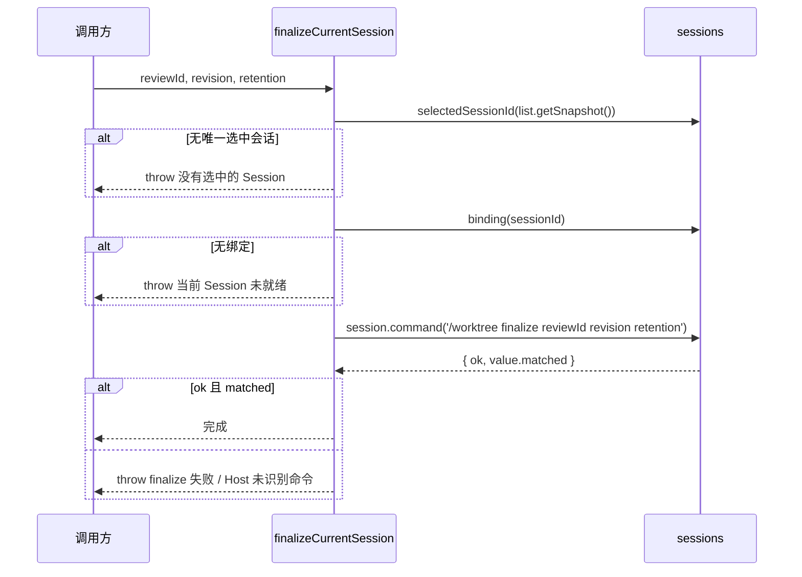

把验收提交做成**显式用户命令**而不是直接 RPC，是刻意的：命令会经过 Host 的 `/worktree` 处理器，从而复用同一套权限与 CAS 校验（见 [core_domain_primitives 核心域基础原语](../core_domain/core_domain_primitives.md) 中 `commands.ts` 的注册面）。`result.value.matched === false` 被视为错误，因为「命令没被识别」与「命令执行失败」对用户是两种不同的坏消息，不能合并成静默成功。

## 数据流：一次「打开隔离会话」

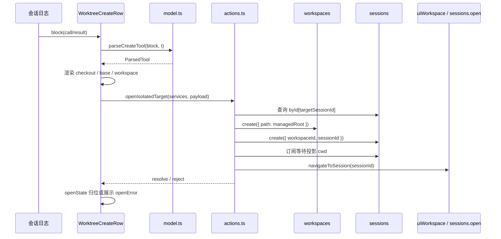

## 不变量与失败模式

| 不变量 | 违反时的行为 | 位置 |
| --- | --- | --- |
| 卡片内容只来自日志切片 | 结构不符 → 卡片显示 `malformed.*` 错误，不渲染半截数据 | `model.ts` |
| 创建结果的六个身份字段必须非空 | `lifecycle` 降级为 `error` | `parseCreateTool` |
| 已存在 Session 的 cwd 必须与 Host 记录一致 | 抛错，不重建 Workspace | `openExistingSession` |
| 新建 Session 必须在 2s 内投影可信 cwd | 抛错「Harness 未投影可信 cwd」 | `waitForProjectedSessionPath` |
| 注册的 workspace 路径必须等于 `managedRoot` | 抛错，不导航 | `openIsolatedTarget` |
| 打开非自有目标必须先 `inspect` 且身份三项相等 | 抛错，不导航 | `openAuthorizedWorktreeTarget` |
| 导航服务缺失时不得假装成功 | 抛错 | `navigateToSession` |
| 预填草稿不得触发发送 | 只在 `setDraft` 层操作 | `prefillSessionDraft` |
| 验收必须有唯一选中会话 | 抛错「没有选中的 Session」 | `finalizeCurrentSession` |
| 异步结果不得写入已卸载/已切换的组件 | `mounted` ref / `isActive()` 提前返回 | `WorktreeCreateRow`、`actions.ts` |

## 与其他模块的关系

- **[console_contract：Worktree Console 共享契约层](../console_contract.md)**：`actions.ts` 唯一 import 的跨层模块（`WorktreeConsoleAdapter` 类型）。`inspect` 的返回结构（`WorktreeConsoleTargetDetails`）是本模块「可信路径」的唯一来源。
- **[console_host：Worktree 控制台的 Host 侧服务层](../console_host.md)**：`inspect`、`deliver`、`finalize` 等操作的权威实现；本模块只消费其返回值，从不自行推断能力位。
- **[core_domain / session_checkout_tools](../core_domain/core_domain_session_checkout/session_checkout_orchestration/session_checkout_tools.md)**：`worktree_create` 工具的输出 schema 与 `WorktreeCreatePayload` 的字段集一一对应；两侧任何一侧改动都需要同步。
- **[core_domain_primitives 核心域基础原语](../core_domain/core_domain_primitives.md)**：`/worktree finalize` 命令处理器位于 `src/commands.ts`，是 `finalizeCurrentSession` 的对端。
- **[i18n：多语言文案目录与本地化解析层](../i18n.md)**：`model.ts` 接受注入的 `ClientTranslator`（默认 `defaultClientTranslator`），`actions.ts` 用 `translatorForServices(services)` 在**调用时**解析语言；`client-messages.ts` 提供全部诊断文案。
- **[client_ui_i18n_presentation：国际化桥接与呈现基础层](client_ui_i18n_presentation.md)**：`useClientTranslator` / `ClientI18nProvider` 的实现与 `ReviewIcon` 图标集（卡片使用 `external` 图标）。
- **[client_ui_target_console —— 会话目标胶囊与工作树管理控制台](client_ui_target_console.md)**：与本模块共享 `actions.ts`——目标胶囊与管理面板的「打开」按钮走的都是 `openAuthorizedWorktreeTarget`。
- **[client_ui_bootstrap：浏览器端启动与 Remote 适配引导](client_ui_bootstrap.md)**：包级入口把 adapter 通过 `adapterOverride` 传进 `index.tsx` 的 `apply`，并决定本模块在哪个 fiber 中挂载。
- **[build_and_config 构建与配置](../build_and_config.md)**：`tsdown.config.ts` 把 `src/client/console-remote/index.ts` 作为唯一 client 入口，本模块被内联进 `lib/client.js`；`react` / `react/jsx-runtime` 为 external。

## 验证与测试

- `tests/client-actions.test.ts` 覆盖本模块的导航不变量：唯一 `mainView` 保留会话才能 finalize、多保留项必须拒绝、`uiWorkspace.openSession` 优先于 `sessions.open`、cwd 不一致时 fail closed、`inspect` 返回他人身份时抛错、inspect 在途时会话失活则不导航、预填草稿不发送、以及 2 秒投影超时。
- 测试使用共享假件 `tests/support/worktree-console.ts`（`createWorktreeConsoleAdapterFixture`），它按真实契约构造 `WorktreeConsoleTargetDetails` 与 `capabilities`。
- `vitest.config.ts` 把 `@deepseek-ai/dsh-client-ui-primitives` 别名到 `tests/support/ui-primitives.tsx`，使依赖 `Menu` / `Modal` 的视图能在 jsdom 下渲染；Windows 上关闭 `fileParallelism` 以避免 Git fixture 争抢句柄。
- CI（`.github/workflows/ci.yml`）依次执行 `typecheck` → `build` → `check:publish:release` → `test`。其中 `check:publish.mjs` 会实际求值 client bundle 的 ModuleLoader handoff，并断言工厂返回 `apply + inject`——这间接保证 `index.tsx` 的导出形状不会在打包过程中被破坏。

??? abstract "Documented components (16)"
    - [`__file__`](https://github.com/wloops/dsh-git-worktree/blob/e01d7c5f2f3a0d2f734a5a3415598ae6d7d6f387/src%5Cclient%5CWorktreeCreateRow.tsx) — `src\client\WorktreeCreateRow.tsx`
    - [`ClientSessionBinding`](https://github.com/wloops/dsh-git-worktree/blob/e01d7c5f2f3a0d2f734a5a3415598ae6d7d6f387/src%5Cclient%5Cactions.ts) — `src\client\actions.ts`
    - [`ClientSessionSnapshot`](https://github.com/wloops/dsh-git-worktree/blob/e01d7c5f2f3a0d2f734a5a3415598ae6d7d6f387/src%5Cclient%5Cactions.ts) — `src\client\actions.ts`
    - [`ClientSessions`](https://github.com/wloops/dsh-git-worktree/blob/e01d7c5f2f3a0d2f734a5a3415598ae6d7d6f387/src%5Cclient%5Cactions.ts) — `src\client\actions.ts`
    - [`ClientWorkspaces`](https://github.com/wloops/dsh-git-worktree/blob/e01d7c5f2f3a0d2f734a5a3415598ae6d7d6f387/src%5Cclient%5Cactions.ts) — `src\client\actions.ts`
    - [`IsolatedTargetLocation`](https://github.com/wloops/dsh-git-worktree/blob/e01d7c5f2f3a0d2f734a5a3415598ae6d7d6f387/src%5Cclient%5Cactions.ts) — `src\client\actions.ts`
    - [`SnapshotStore`](https://github.com/wloops/dsh-git-worktree/blob/e01d7c5f2f3a0d2f734a5a3415598ae6d7d6f387/src%5Cclient%5Cactions.ts) — `src\client\actions.ts`
    - [`WorktreeClientServices`](https://github.com/wloops/dsh-git-worktree/blob/e01d7c5f2f3a0d2f734a5a3415598ae6d7d6f387/src%5Cclient%5Cactions.ts) — `src\client\actions.ts`
    - [`ClientContextLike`](https://github.com/wloops/dsh-git-worktree/blob/e01d7c5f2f3a0d2f734a5a3415598ae6d7d6f387/src%5Cclient%5Cindex.tsx) — `src\client\index.tsx`
    - [`ParsedTool`](https://github.com/wloops/dsh-git-worktree/blob/e01d7c5f2f3a0d2f734a5a3415598ae6d7d6f387/src%5Cclient%5Cmodel.ts) — `src\client\model.ts`
    - [`ReviewArgs`](https://github.com/wloops/dsh-git-worktree/blob/e01d7c5f2f3a0d2f734a5a3415598ae6d7d6f387/src%5Cclient%5Cmodel.ts) — `src\client\model.ts`
    - [`ToolCallBlockLike`](https://github.com/wloops/dsh-git-worktree/blob/e01d7c5f2f3a0d2f734a5a3415598ae6d7d6f387/src%5Cclient%5Cmodel.ts) — `src\client\model.ts`
    - [`ToolCallViewPropsLike`](https://github.com/wloops/dsh-git-worktree/blob/e01d7c5f2f3a0d2f734a5a3415598ae6d7d6f387/src%5Cclient%5Cmodel.ts) — `src\client\model.ts`
    - [`ToolContentBlock`](https://github.com/wloops/dsh-git-worktree/blob/e01d7c5f2f3a0d2f734a5a3415598ae6d7d6f387/src%5Cclient%5Cmodel.ts) — `src\client\model.ts`
    - [`WorktreeCreatePayload`](https://github.com/wloops/dsh-git-worktree/blob/e01d7c5f2f3a0d2f734a5a3415598ae6d7d6f387/src%5Cclient%5Cmodel.ts) — `src\client\model.ts`
    - [`WorktreeReviewPayload`](https://github.com/wloops/dsh-git-worktree/blob/e01d7c5f2f3a0d2f734a5a3415598ae6d7d6f387/src%5Cclient%5Cmodel.ts) — `src\client\model.ts`

