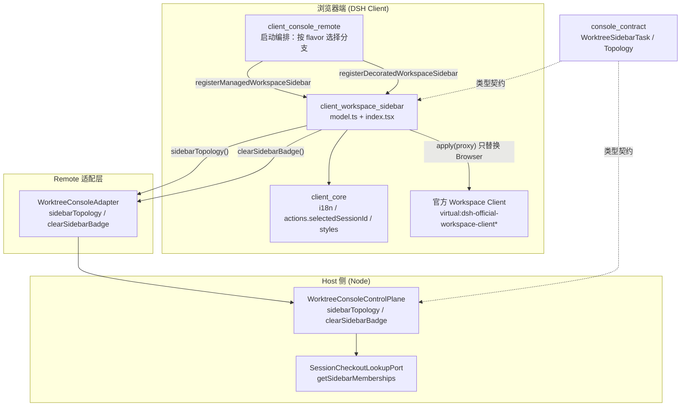
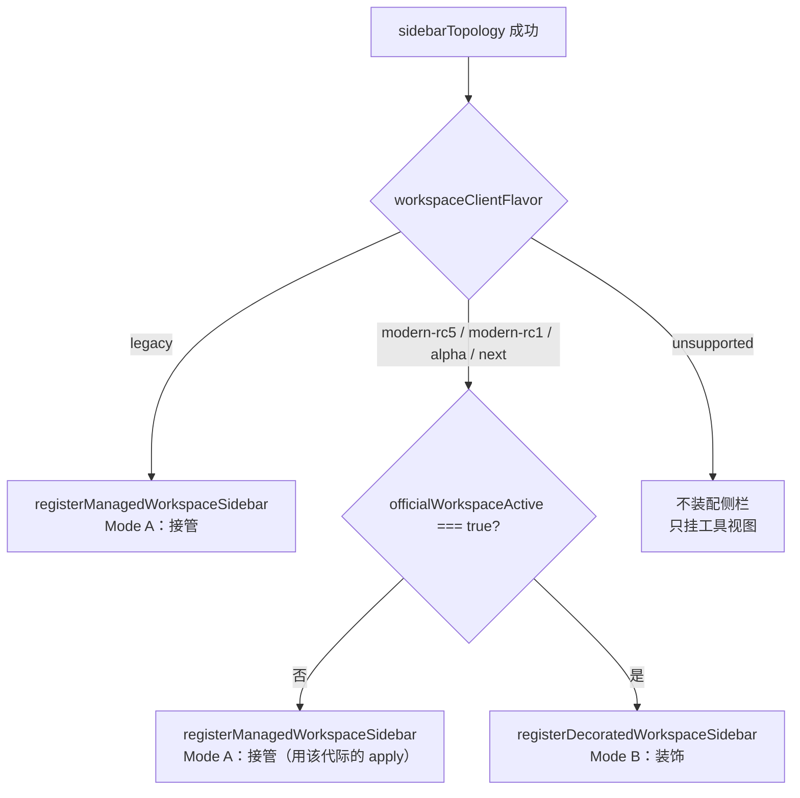
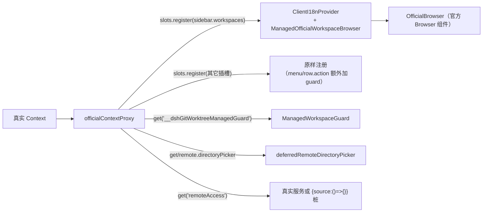
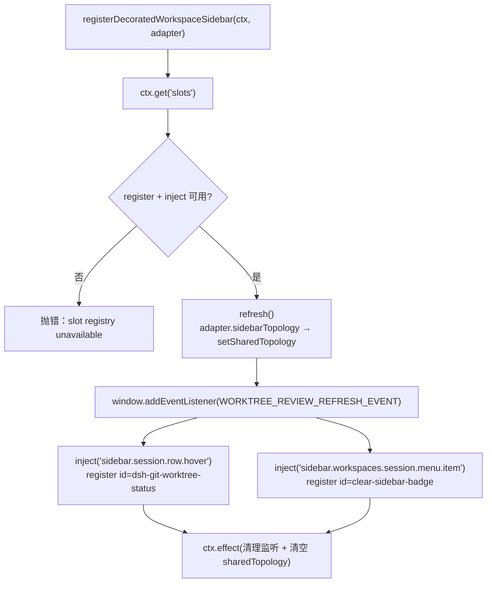
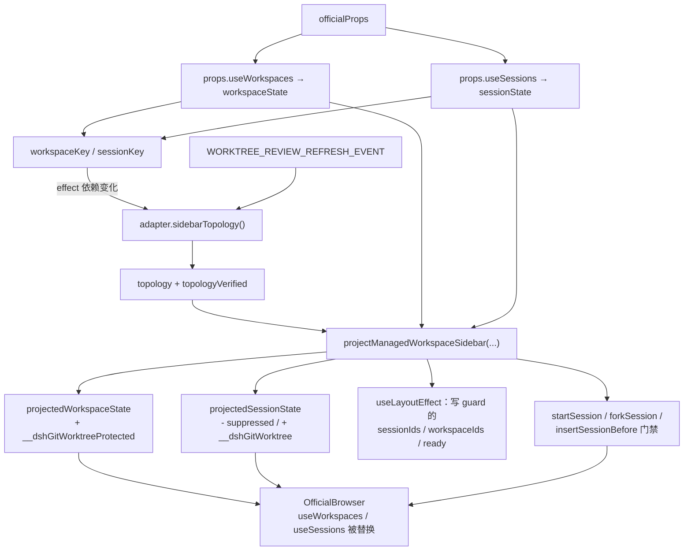
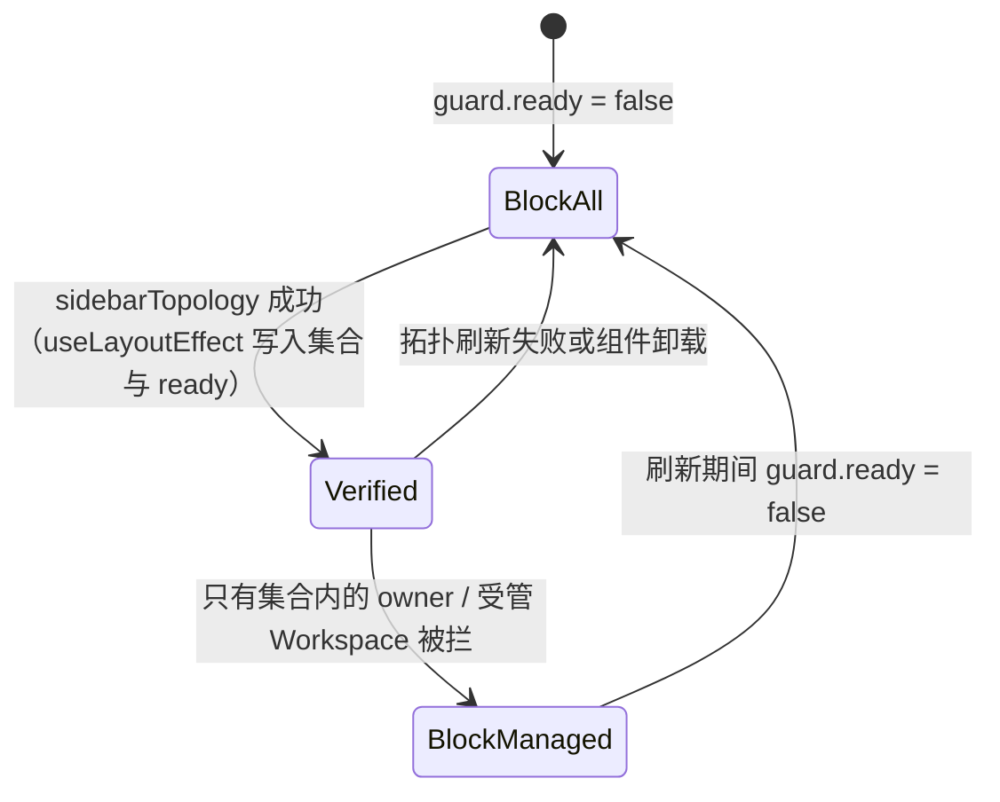
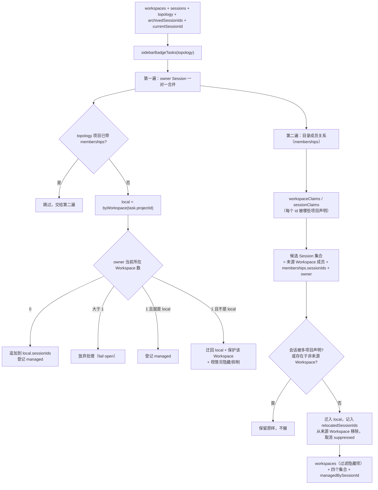
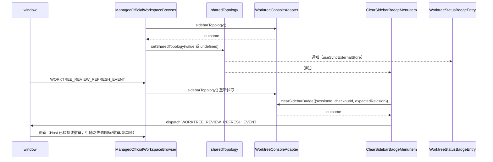
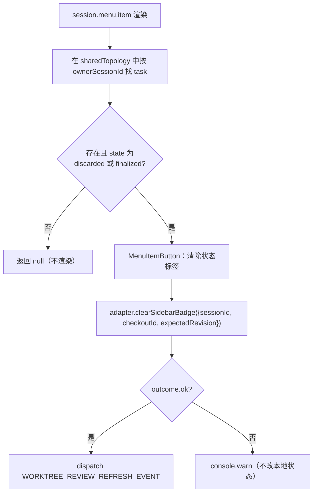

# client_workspace_sidebar 模块

!!! info "Generated documentation"
    This page was written by CodeWiki from the source code at commit [`8b44e2a7`](https://github.com/wloops/dsh-git-worktree/commit/8b44e2a7098c49d39abae5f42bd3e205e5f608b1) on 2026-11-12 with `mimo-v2.6-flash`. Check the code before relying on details.

`client_workspace_sidebar` 负责把插件自有的「Managed Worktree 任务」注入 DSH 官方的 Workspace 侧栏（Session 列表）。它**不实现自己的侧栏 UI**：官方 Workspace Client 已被 Host 声明为侧栏的唯一提供者，本模块的全部工作都是「在官方实现之上做数据投影与装饰」——把每个受管 Worktree 的 owner Session 从它自己的临时 Workspace 搬回原来的 Local 项目下、给它加上分支图标与状态徽章、并在 owner 行上屏蔽会破坏「一个 Worktree 对应一个 Session」不变式的官方操作。

模块由两个文件组成：

1. **`src/client/workspace-sidebar/model.ts` —— 纯函数投影层**。输入是「官方 Workspace/Session 快照 + Host 拓扑（`WorktreeSidebarTopologyResponse`）」，输出是一个 `ManagedWorkspaceSidebarProjection`：投影后的 Workspace 列表、owner Session 的装饰数据，以及四个集合（受保护的 Session、受保护的 Workspace、被搬迁的 Session、被抑制的 Session）。零副作用、零网络、零 React，可直接单测。
2. **`src/client/workspace-sidebar/index.tsx` —— 装配与装饰层**。提供两条互斥的装配路径（Mode A「接管式衍生 Browser」与 Mode B「在官方子插槽上装饰」），一个跨 React 树的拓扑共享存储，以及针对终态徽章的「清除状态标签」菜单项。

## 在系统中的位置

关键约束：本模块**只读** Host 拓扑，唯一的写操作是 `clearSidebarBadge`（清除终态徽章）。所有身份校验、目录归属与权限判定都在 Host 侧完成，客户端投影只决定「怎么显示」，不决定「能不能做」——真正的门禁在 [console_host：Worktree 控制平面与 Host RPC 服务](console_host.md) 的 `authorize` / `linkedReadAccess` 里。

## 组件清单

| 文件 | 主要导出 | 职责 |
| --- | --- | --- |
| `model.ts` | `ManagedWorkspaceSidebarProjection`、`ProjectedManagedTask`、`SidebarSessionSummary`、`SidebarWorkspaceView`、`sidebarBadgeTasks`、`projectManagedWorkspaceSidebar` | 纯函数：任务聚合、状态本地化、Workspace 成员搬迁、保护/抑制集合计算 |
| `index.tsx` | `ManagedWorktreeSessionDecoration`、`ManagedOfficialWorkspaceBrowser`、`registerManagedWorkspaceSidebar`、`registerDecoratedWorkspaceSidebar` | Mode A 衍生 Browser、官方 Context 代理、Mode B 子插槽装饰、终态徽章菜单项 |

## 两种装配模式

官方 Workspace Client 存在「由本插件接管提供 `uiWorkspace`」与「官方保持存活、本插件只做装饰」两种情况，由 Host 上报的 `officialWorkspaceActive` 决定（见 [client_console_remote 模块](client_console_remote.md) 的启动分支）：

### Mode A：接管式衍生 Browser

`registerManagedWorkspaceSidebar(ctx, adapter, applyWorkspace = applyOfficialWorkspace)` 并不重写官方注册，而是**把官方 `apply` 跑在一个 Context 代理上**（`officialContextProxy`），让官方的声明树、locale 注册、目录选择器与 store 全部原样建立，只把 `sidebar.workspaces` 这一个插槽的组件替换为 `ManagedOfficialWorkspaceBrowser` 包裹后的衍生版本。

为什么不重放官方模块：官方 `apply` 会 `provide('uiWorkspace')`，在官方已存活时重放会与已注册服务冲突（Mode B 存在的原因）。

代理层刻意处理的四个兼容性缺口（每一处都对应一个真实的启动崩溃或静默失效）：

| 代理点 | 处理 | 原因 |
| --- | --- | --- |
| `slots.register` | 仅拦截 `sidebar.workspaces` 与 `sidebar.workspaces.session.menu.item` / `.row.action` | 其余插槽必须原样透传，否则官方声明树被破坏 |
| `get('remote.directoryPicker')` / `remote.directoryPicker` | 返回**调用时**才解析的 `Proxy` 门面（`deferredRemoteDirectoryPicker`） | 目录选择器 provider 自身等待 `uiWorkspace`，静态声明会死锁 web 启动 |
| `get('remoteAccess')` / `remoteAccess` 属性 | 真实服务优先，否则返回 `{ source: () => ({}) }` 桩 | 0.2.1 官方 apply 把 `ctx.remoteAccess.source(...)` 读作属性；0.2.0-rc.2 Host 根本没有该服务 |
| `get('__dshGitWorktreeManagedGuard')` | 返回 per-instance guard | 官方衍生代码在构造函数里取它，让菜单/快捷键共享同一套门禁 |

### Mode B：在官方子插槽上装饰

当官方 Workspace Client 保持存活时，`sidebar.workspaces` 已被官方条目声明，**再次声明同一插槽是死路**：一个插槽只有一个声明者，且 `renderSlot` 只授权声明者，衍生 Browser 在渲染第一个子插槽时就会崩溃。因此 Mode B 改为向官方 Browser **已声明的子插槽**注入条目：

`ROW_SEATS` 目前只包含 `sidebar.session.row.hover`。这是刻意的：官方行在 Session 运行时没有任何「始终可见」的座位——leading 座位被状态点替换，trailing action 座位在 hover 前 `display:none`，`sidebar.session.row.trailing` 在 DSH 0.2.x 中根本不存在（注入它会永远等不到声明，回调永不执行）。因此行本身不挂 Worktree 标记，目标信息由顶部胶囊承担（见 [会话目标胶囊与工作树控制台（client_target_console）](client_target_console.md)），悬停卡只负责复述。

### 两种模式的对照

| 维度 | Mode A（接管） | Mode B（装饰） |
| --- | --- | --- |
| 是否重放官方 `apply` | 是（经 Context 代理） | 否 |
| Browser 组件 | 替换为 `ManagedOfficialWorkspaceBrowser` | 官方 Browser 原样渲染 |
| Workspace 行保护 | 通过投影元数据 `__dshGitWorktreeProtected` | 由官方条目自行渲染，不注入 |
| Session 行装饰 | 通过投影元数据 `__dshGitWorktree` | 通过 `sidebar.session.row.hover` 子插槽 |
| 菜单门禁 | `guard` + 官方 apply 的 service 级补丁 | 依赖官方自身的门禁 |
| 拓扑数据来源 | Browser 内部 `useState` + 模块级 `sharedTopology` | 仅模块级 `sharedTopology` |

## Mode A 的核心组件：`ManagedOfficialWorkspaceBrowser`

该组件保留官方 Browser 的全部 props 与渲染，只替换两样东西：**数据选择器**与**危险变更的回调**。

### 投影数据注入的两种元数据

衍生 Browser 通过给快照对象加私有字段传递信息，官方衍生代码在构建期被打了对应的补丁读取它们（见 `scripts/workspace-sidebar-upstream.mjs`）：

| 元数据 | 挂载对象 | 官方衍生侧消费方式 |
| --- | --- | --- |
| `__dshGitWorktreeProtected: true` | Workspace 条目 | 禁止拖拽排序、隐藏 Workspace 菜单按钮、隐藏「新建 Session」按钮 |
| `__dshGitWorktree: ManagedWorktreeSessionDecoration` | Session summary | 在行内与搜索结果的标题前渲染分支图标 + 状态徽章；行 `aria-label` 与 `data-managed-worktree`；hover 卡增加一行 Worktree 身份；菜单中过滤掉 `fork`；禁止拖拽 |

`ManagedWorktreeSessionDecoration` 的形状是 `{ kind: 'managed-worktree', state, label, originalTitle }`。`originalTitle` 保留官方原始标题，**标题本身不被改写**——徽章是标题前的固定前缀，不参与标题截断。

### 变更门禁

| 回调 | 门禁条件 | 说明 |
| --- | --- | --- |
| `startSession(workspaceId)` | `protectedWorkspaceIds.has(workspaceId)` → 直接返回 | 受管 Workspace 不允许再开新 Session（会破坏 1:1 所有权） |
| `forkSession(sessionId)` | `protectedSessionIds.has(sessionId)` → 直接返回 | 分叉受管 owner 会产生第二个指向同一 checkout 的会话 |
| `insertSessionBefore(workspaceId, sessionId, before?)` | 任一 id 属于 protected / relocated → 直接返回 | 搬迁过的会话不能再被手工挪动 |
| `renameSession` / `archiveSession` / `pin` | **不拦截** | `OWNER_SAFE_SESSION_ACTIONS = {'pin','rename','archive'}`：这些操作不创建新 Session，也不改变 Workspace 归属 |

门禁失败时**静默返回**（不弹 `alert`、不抛错），因为官方 UI 自身没有「该行受管」的概念，弹窗只会制造噪音。

### `ManagedWorkspaceGuard`：跨组件与跨服务边界的门禁

`guard` 是一个可变对象，`ready` 为 `false` 时**阻塞一切**，只有首次 `sidebarTopology` 成功后才放开：

设计意图：拓扑未验证时无法区分「普通 Session」与「受管 owner」，此时放开会让官方快捷键绕过所有权（例如对 owner 执行 fork）。官方 apply 的 service 级补丁（`this.managedWorktreeGuard.blockSession(...)` / `blockWorkspace(...)`）与本对象共用同一实例，因此菜单、快捷键与 Browser props 三条路径的判定完全一致。

## 投影算法（`model.ts`）

### 状态词与标签

`sidebarBadgeTasks` 把 Host 拓扑折叠成「每个 owner Session 一个 `ProjectedManagedTask`」：

- 跳过缺少 `checkoutId` / `ownerSessionId` / `sourceSessionId` 的条目，以及缺少 `project.id` / `project.name` / `tasks` 数组的项目。
- `stateLabel` 只包含状态词（`STATE_LABELS` 经 `ClientTranslator` 本地化）：`working → in.progress`、`ready_for_review → ready.for.review`、`preview_active → previewing`、`preview_detached → awaiting.recovery`、`recovery_required → recovery.required`、`finalized → completed`、`discarded → discarded`。
- `label` = `stateLabel` 或 `stateLabel · sourceBranch`（有分支时），仅用于 tooltip / `aria-label`。行内徽章只显示 `stateLabel`，避免官方行被分支名挤占。
- 同一 owner 有多条记录时，按 `iteration` 升序、同 `iteration` 内按 `revision` 升序保留最后一条——与 Host 侧 `sidebarTopology` 的聚合规则一致。

### `projectManagedWorkspaceSidebar` 的两遍结构

第一遍的隐藏条件（`canHide`）值得单独说明：只有当被搬空的 Workspace 剩余成员**全部**是「已归档」或「空白且不是当前选中会话」时，才隐藏该 Workspace 并抑制这些成员。它绝不因为「摘要缺失」推断为空，也绝不隐藏当前选中的 launcher——归档归属是持久事实，而这里只是一次侧栏投影。

第二遍处理的是「目录成员关系」：Host 从 registry roots 与不可变 Session header 反推出 `memberships`，因此即使 Workspace 账号为空/被过滤，历史会话仍能回到正确的项目下。第二遍还会给这些普通历史会话**不**添加 owner 徽章（`managedBySessionId` 只登记真正有 task 的 owner）。

### 四个集合的语义

| 集合 | 含义 | 消费方 |
| --- | --- | --- |
| `protectedSessionIds` | 有受管 task 的 owner Session | 变更门禁、官方 apply 的 `blockSession` |
| `protectedWorkspaceIds` | 受管 Workspace（含被搬空的来源 Workspace） | 变更门禁、`__dshGitWorktreeProtected` 元数据、`blockWorkspace` |
| `relocatedSessionIds` | 由第二遍从别处搬回 Local 的会话 | `insertSessionBefore` 门禁 |
| `suppressedSessionIds` | 因所属 Workspace 被隐藏而从会话列表移除的会话 | `projectedSessionState` 的 `ids` / `byId` 过滤 |

**失败即放行（fail open）**：任何无法证明安全的判断——owner 出现在多个 Workspace、会话被多个项目声明、缺少摘要——都选择「保持官方原样显示」，而不是隐藏一个可能仍在用的 Session。这与 [client_core 模块](client_core.md) 中 `selectedSessionId` 「冲突时返回 `undefined` 而不是猜」是同一套原则。

## 拓扑共享存储与刷新

`sharedTopology` 是一个模块级变量加监听器集合，通过 `useSyncExternalStore` 暴露给 `useSharedTopology()`。它存在的原因很具体：Mode B 的插槽条目（hover 卡、菜单项）**渲染在 Browser 的 React 树之外**，拿不到 props；Mode A 的 Browser 卸载后条目也可能仍挂载。

刷新触发点有三类：`workspaceKey` / `sessionKey` 变化（Workspace 成员或会话集合变动）、`WORKTREE_REVIEW_REFRESH_EVENT` 事件、组件挂载。事件常量与派发函数来自 `src/client/review-console/status-events.ts`（`WORKTREE_REVIEW_REFRESH_EVENT` / `requestWorktreeReviewRefresh`）。

## 终态徽章的清除入口

`clearSidebarBadge` 是 Host 侧唯一的写操作入口，客户端只在**终态**行上提供它：

Host 侧 `clearSidebarBadge` 会先 `authorize` 再要求状态为 `discarded` / `finalized`，然后写 `sidebarBadgeClearedRevision = revision`；`sidebarTopology` 在 `sidebarBadgeClearedRevision === revision` 时跳过该 task 的投影。因此清除是**记录级**的：目录成员关系保留，只是行上不再有图标/徽章/菜单项，也不需要任何「重置」路径。

`expectedRevision` 是乐观并发控制：Host 用它拒绝过期请求，客户端因此无需自己维护版本号，只要把拓扑里的 `revision` 原样回传。

## 样式

行内装饰使用 `WORKTREE_STYLES`（来自 [client_core 模块](client_core.md) 的 `styles.ts`）中已存在的两个类：

- `.dsh-git-worktree-sidebar-icon`：16×16 分支图标，颜色取 `--dsw-alias-state-business-primary`。
- `.dsh-git-worktree-sidebar-badge`：胶囊徽章，`max-width: 168px`，超出省略；边框与背景用 `color-mix` 从 `--dsh-wt-sidebar-accent` 派生。

七个状态通过 `data-worktree-state` 属性映射到不同的主题别名（`business-primary`、`warn-label`、`business-primary`/`error-primary` 混色、`error-primary`、`success-primary`、`label-tertiary`）。本模块不新增任何 CSS，因此无需在 `ctx.effect` 中额外注入样式表。

## 构建期约束：官方客户端的版本与哈希门禁

Mode A/B 都依赖「构建期把官方 Workspace Client 源码物化成虚拟模块并打补丁」。这条链路对本模块的行为有直接影响：

| 工件 | 与本模块的关系 |
| --- | --- |
| `scripts/workspace-sidebar-upstream.mjs` | 读取 `@deepseek-ai/dsh-client-ui-workspace` 的 `client` 产物，**校验包版本 `0.2.2-rc.1` 与 SHA-256**，然后逐处做精确字符串替换：注入 `managedWorktreeGuard`、给 `forkSession` / 新建 Session 加门禁、写入中英文 Worktree locale、透传 `__dshGitWorktreeProtected` 与 `__dshGitWorktree` 元数据、导出衍生 `WorkspaceBrowser`。任一处「匹配 0 次或多次」即抛错（fail closed） |
| `scripts/workspace-sidebar-upstream-rc5.mjs` / `-next.mjs` / `-alpha.mjs` | 其余三个代际各自从自己的字节派生补丁，因为一个装饰在构建期就冻结在某一代官方 Client 上 |
| `tsdown.config.ts` | `official-workspace-client-source` 插件把四个虚拟 id 解析并 `load` 成物化源码；`entry` 为 `src/client/console-remote/index.ts`，产物 `lib/client.js` 用 `window.__ModuleLoader__.load({ id: "dsh-git-worktree" })` 包装 |
| `package.json` → `scripts.check:sidebar-version` | 运行 `scripts/check-workspace-sidebar-version.mjs`，同时校验 locale 版本与四个代际的哈希；被 `prepublishOnly` 串联 |
| `src/client/harness-platform.d.ts` | 为四个虚拟模块与 `@deepseek-ai/dsh-client-ui-primitives` 提供环境声明；注释明确指出衍生 `WorkspaceBrowser` 必须被渲染，否则投影的图标/徽章会丢失 |
| `vitest.config.ts` | 把四个虚拟模块与 `ui-primitives` 别名到 `tests/` 下的桩实现，使本模块可在 jsdom 中独立测试 |

推论：**修改本模块的投影元数据字段名或类名时，必须同步修改 `scripts/workspace-sidebar-*.mjs` 中的补丁字符串**，否则衍生 Browser 会静默丢弃装饰（字段名不再匹配），或被哈希门禁直接拒绝（上游产物变化）。

## 失败模式与不变式

| 场景 | 行为 | 依据 |
| --- | --- | --- |
| `sidebarTopology` 返回 `ok: false` | `topology = EMPTY_TOPOLOGY`、`topologyVerified = false`、`sharedTopology = undefined`；官方投影原样显示（不做任何搬迁/隐藏） | `refresh()` 的错误分支 |
| 拓扑未验证 | `guard.ready = false`，所有受管相关的官方变更被阻塞 | `blockSession` / `blockWorkspace` 的首条判断 |
| owner 出现在多个 Workspace | 放弃处理，保留官方原样 | `memberships.length !== 1` |
| 会话被多个项目声明 | 保留原样，不搬迁 | `sessionClaims.size > 1` |
| 会话存在于非来源 Workspace | 视为手工账号，不抢占 | `sources` 判定 |
| Mode B 拿不到 slot registry | 抛错（不静默降级） | `registerDecoratedWorkspaceSidebar` 的首段校验 |
| `clearSidebarBadge` 失败 | 仅 `console.warn`，不修改任何本地状态；下次刷新仍以 Host 为准 | 菜单项的错误分支 |
| 组件卸载 | `guard.ready = false`、`setSharedTopology(undefined)`、移除事件监听 | 两个 effect 的清理函数 |

核心不变式：**客户端投影永远不创造所有权**。它只把 Host 已经证明的 `memberships` 与 `tasks` 重新排版；任何一步无法证明，就退回官方行为。

## 测试

`tests/client-workspace-sidebar.test.tsx`（jsdom 环境）覆盖了本模块的全部关键路径：

- Mode A 只替换 Browser 组件、保留完整声明树（`sidebar.workspaces` + `conversation.hero.workspace`）与 locale 注册。
- 拓扑未验证时阻塞全部官方变更，验证后只阻塞 owner / 受管 Workspace；卸载后重新回到阻塞。
- 投影出唯一 owner Session、`rename`/`archive` 放行、`fork`/`insertSessionBefore`/`startSession` 被静默拦截且不弹 `alert`。
- 归档 owner 从列表消失时仍能重新投影，取消归档后恢复。
- 拓扑不可用时回退到未改动的官方投影。
- 语言切换只改徽章文案（`Ready for review` ⇄ `待验收`），官方标题与 Workspace 标签不变，且不重复拉取拓扑。
- Host 证明的历史成员被搬回 Local 但不获得 owner 徽章。
- Mode B 只注入 `sidebar.session.row.hover` 与 `sidebar.workspaces.session.menu.item`，不注入不存在的座位；徽章只显示状态词，分支只出现在 `title`；`ctx.effect` 的清理函数不抛错。
- 终态行才出现「清除状态标签」，点击后按 `{sessionId, checkoutId, expectedRevision}` 精确调用并触发刷新。

## 与其他模块的关系

| 模块 | 关系 |
| --- | --- |
| [client_console_remote 模块](client_console_remote.md) | 唯一的装配调用方：按 `workspaceClientFlavor` + `officialWorkspaceActive` 选择 `registerManagedWorkspaceSidebar` 或 `registerDecoratedWorkspaceSidebar`，并把 `adapter` 传进来 |
| [client_core 模块](client_core.md) | 复用 `ClientI18nProvider` / `useClientTranslator`、`selectedSessionId`、`WORKTREE_STYLES` 中的侧栏装饰类；`ManagedWorktreeSessionDecoration` 与 `ClientLocaleSource` 同属客户端基座 |
| [会话目标胶囊与工作树控制台（client_target_console）](client_target_console.md) | 顶部胶囊负责在行内座位不可用时承担目标信息展示；两者共享 `WORKTREE_REVIEW_REFRESH_EVENT` |
| [console_contract 模块（Worktree Console 共享契约）](console_contract.md) | `WorktreeSidebarTopologyResponse`、`WorktreeSidebarTask`、`WorktreeSidebarProject`、`WorktreeConsoleClearSidebarBadgeRequest` |
| [console_host：Worktree 控制平面与 Host RPC 服务](console_host.md) | `sidebarTopology` 的聚合与 `clearSidebarBadge` 的授权；`sidebarBadgeClearedRevision` 的抑制逻辑 |
| [核心端口与类型契约（core_ports_and_types）](core_ports_and_types.md) | `SidebarDirectoryMembership` 与 `SessionCheckoutLookupPort.getSidebarMemberships` 提供 `memberships` 的事实来源 |
| [i18n：中英双语文案与语言解析基础设施](i18n.md) | `in.progress`、`ready.for.review`、`previewing`、`awaiting.recovery`、`recovery.required`、`completed`、`discarded`、`clear.sidebar.badge` 等消息键 |
| [build_deployment_configuration：构建、打包与发布部署配置](build_deployment_configuration.md) | `tsdown` 虚拟模块插件、`check:sidebar-version` 版本/哈希门禁、`vitest` 别名 |

??? abstract "Documented components (5)"
    - [`ManagedWorktreeSessionDecoration`](https://github.com/wloops/dsh-git-worktree/blob/8b44e2a7098c49d39abae5f42bd3e205e5f608b1/src%5Cclient%5Cworkspace-sidebar%5Cindex.tsx) — `src\client\workspace-sidebar\index.tsx`
    - [`ManagedWorkspaceSidebarProjection`](https://github.com/wloops/dsh-git-worktree/blob/8b44e2a7098c49d39abae5f42bd3e205e5f608b1/src%5Cclient%5Cworkspace-sidebar%5Cmodel.ts) — `src\client\workspace-sidebar\model.ts`
    - [`ProjectedManagedTask`](https://github.com/wloops/dsh-git-worktree/blob/8b44e2a7098c49d39abae5f42bd3e205e5f608b1/src%5Cclient%5Cworkspace-sidebar%5Cmodel.ts) — `src\client\workspace-sidebar\model.ts`
    - [`SidebarSessionSummary`](https://github.com/wloops/dsh-git-worktree/blob/8b44e2a7098c49d39abae5f42bd3e205e5f608b1/src%5Cclient%5Cworkspace-sidebar%5Cmodel.ts) — `src\client\workspace-sidebar\model.ts`
    - [`SidebarWorkspaceView`](https://github.com/wloops/dsh-git-worktree/blob/8b44e2a7098c49d39abae5f42bd3e205e5f608b1/src%5Cclient%5Cworkspace-sidebar%5Cmodel.ts) — `src\client\workspace-sidebar\model.ts`

