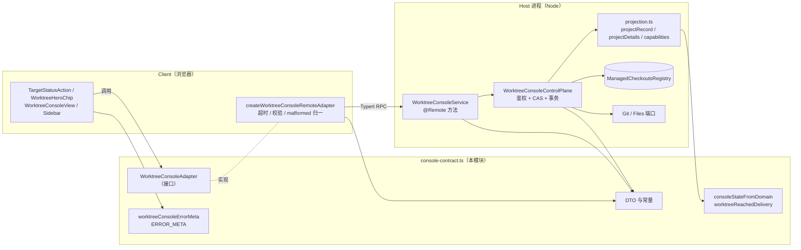
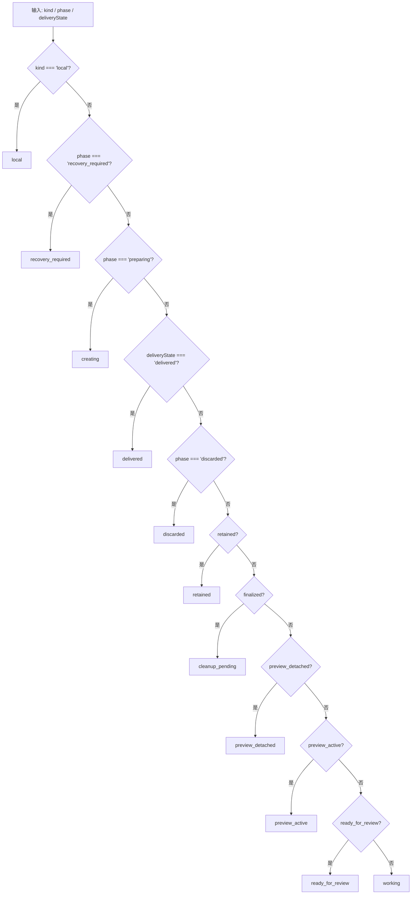
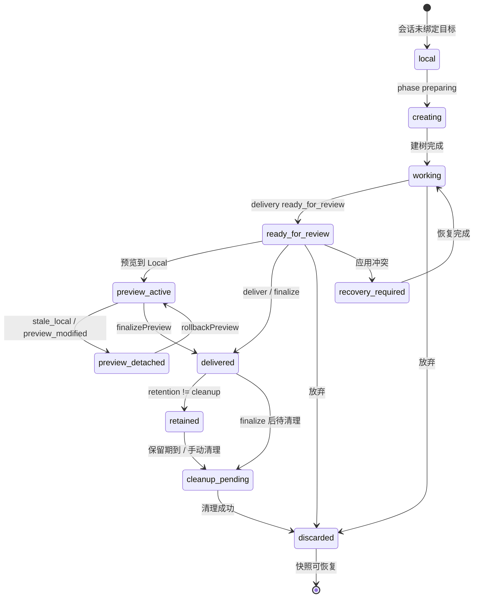
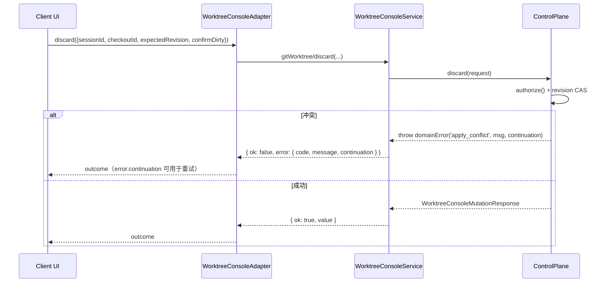
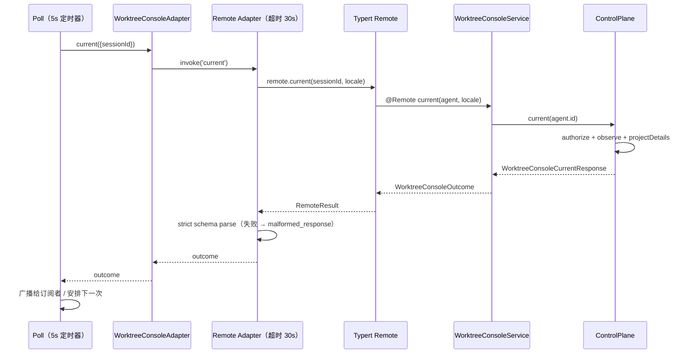
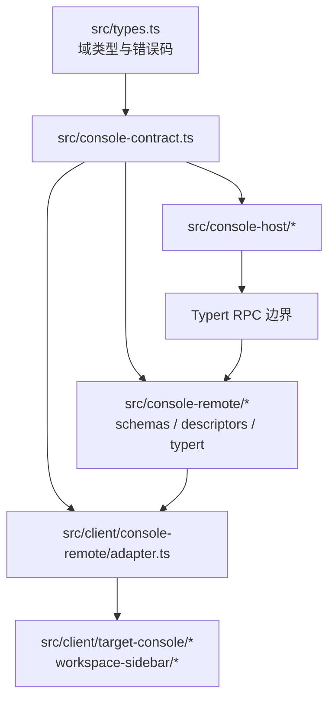

# console_contract 模块（Worktree Console 共享契约）

!!! info "Generated documentation"
    This page was written by CodeWiki from the source code at commit [`8f9cf699`](https://github.com/wloops/dsh-git-worktree/commit/8f9cf6994dc49650288c98a7865f70f20bc9ea24) on 2026-11-08 with `deepseek-v4.1-flash`. Check the code before relying on details.

`src/console-contract.ts` 是本插件的 **唯一跨进程/跨端数据契约**：它用纯 TypeScript 类型、常量与两个纯函数，定义了 Host 侧 Worktree Console 服务与 Client 侧 UI（顶部胶囊、侧栏、管理面板、Git 面板）之间传递的全部 DTO。该文件刻意不引入 Cordis、React、Remote 传输或文件系统实现，因此可以同时被 Host 打包（`lib/index.js`）、Client 打包（`lib/client.js`）以及 Typert 描述符（`lib/console-remote/*`）引用，而不产生循环依赖。

模块的核心职责有三点：

1. **定义"目标"的统一视图**：把台账记录（`ManagedCheckoutRecord`）、生命周期阶段（`SessionCheckoutPhase`）与交付状态（`WorktreeConsoleDeliveryState`）折叠成 11 个稳定的 UI 状态。
2. **定义一次调用的封装与失败语义**：所有 RPC 都返回 `WorktreeConsoleOutcome<T>`，失败时携带稳定错误码，并可附带"继续凭据"（`WorktreeConsoleContinuation` / `WorktreeRecoveryProof`）。
3. **定义 Client 侧唯一缝隙**：`WorktreeConsoleAdapter` 把 Remote 传输、超时、payload 校验全部挡在一个接口之后，UI 组件只依赖该接口。

---

## 1. 设计原则

| 原则 | 体现 |
| --- | --- |
| **JSON-only** | 契约里只有 interface / type / 字符串字面量联合 / 常量数组；没有任何类、装饰器、`Date`、`Map`、`Symbol`。可以直接被 `JSON.stringify` 穿过 RPC 边界。 |
| **无框架依赖** | 文件顶部注释明确禁止 Cordis / React / Remote / 文件系统实现。Host 与 Client 两条打包产物共享同一份 `.d.ts`。 |
| **Host 权威** | 每个 Host 操作在执行时都会重新解析调用方 Session，并重新校验 project / owner / cwd / revision / review 身份；契约里的字段只是"投影结果"，**不是**授权凭据。 |
| **乐观并发（revision CAS）** | 所有变更请求都带 `expectedRevision: number`；Host 用它做 CAS，不匹配即返回 `stale_target`。 |
| **路径最小暴露** | `WorktreeConsoleTargetSummary` 是"无路径"行（用于列表与状态胶囊）；只有通过身份校验的 `WorktreeConsoleTargetDetails` 才带 `managedRoot` / `sourceRoot`。 |
| **增量兼容** | 新增能力位与新增响应字段必须容忍缺失（见第 8 节"版本兼容与演进"），因为 Client 与 Host 是两份独立部署的产物。 |

---

## 2. 架构与在系统中的位置



要点：

- **契约是唯一的类型交换面**。Host 侧 `WorktreeConsoleService` 与 `WorktreeConsoleControlPlane` 的所有方法签名、Client 侧 `WorktreeConsoleAdapter` 的所有方法签名，均直接引用本模块的类型（详见 [console_host：Worktree 控制平面与 Host RPC 服务](Console_API_and_Host_Integration/console_host.md) 与 [console_remote：控制台远程契约层（Typert Remote）](Console_API_and_Host_Integration/console_remote.md)）。
- **两个纯函数是"状态真理"的唯一来源**。Host 投影（`src/console-host/projection.ts`）与侧栏拓扑（`sidebarTaskState`）都调用 `consoleStateFromDomain` / `worktreeReachedDelivery`，因此 UI 标签、鉴权分支（"已交付后允许读 Local 边界"）不会各自漂移。
- **传输细节不外泄**。超时、`malformed_response` 归一、strict codec 校验都发生在 `src/client/console-remote/adapter.ts` 内部，`WorktreeConsoleAdapter` 只承诺 `Promise<WorktreeConsoleOutcome<T>>`。

---

## 3. 目标状态投影

### 3.1 状态集合

`WORKTREE_CONSOLE_TARGET_STATES` 是唯一的 UI 状态枚举（作为 `as const` 数组同时充当运行时白名单，Zod schema 直接用 `z.enum(WORKTREE_CONSOLE_TARGET_STATES)` 复用它）：

```
local · creating · working · ready_for_review · preview_active · preview_detached
retained · cleanup_pending · recovery_required · delivered · discarded
```

`WorktreeConsoleDeliveryState` 是更底层的"交付状态"，来自台账记录 `record.delivery.state`：
`working · ready_for_review · preview_active · preview_detached · finalized · retained · delivered`。

### 3.2 折叠规则（`consoleStateFromDomain`）

判定顺序即优先级，**先命中先返回**：



三个关键顺序决策（源码注释与 `tests/console-contract.test.ts` 均有覆盖）：

- `recovery_required` 与 `preparing` **优先于**交付标签：处于恢复/变更中的记录不能被旧的 `delivered` 掩盖。
- `delivered` **优先于** `discarded`：成功清理会把 phase 推到 `discarded`，但任务确实完成过，不能读成"已放弃"。
- `discarded` **优先于** `retained` / `finalized`：被放弃的记录会保留放弃前的交付标签，只有 `delivered` 能穿过 `discarded`。

### 3.3 交付终态判定（`worktreeReachedDelivery`）

`deliveryState ∈ {delivered, finalized, retained}` **或** `phase ∈ {finalized, retained}` 即为"任务已抵达用户"。这个谓词被三处共用：

- 侧栏徽章：`finalized` 而非 `discarded`（`control-plane.ts::sidebarTaskState`）。
- 能力位：`returnToLocal` 仅在抵达交付后开放（`projection.ts::capabilities`）。
- Host 鉴权：已交付的 owner Session 允许以 **Local 边界**作为授权基准（`control-plane.ts::verifyCallerRoot`）。



---

## 4. 能力位（`WorktreeConsoleCapabilities`）

Host 在投影时按 **调用方身份 × 记录阶段 × 交付状态** 计算 16 个布尔位（实现见 `src/console-host/projection.ts::capabilities`）。Client 只根据这些位决定渲染哪些菜单项，**绝不自行推导**：

| 能力位 | 语义 | 典型门槛 |
| --- | --- | --- |
| `create` | 从 Local 建树 | Local 目标且 `currentOid !== 'unversioned'` |
| `open` / `inspect` | 打开/读取目标 | owner 或 source，或授权链接读（`linkedRead`） |
| `discard` | 放弃 | owner / source 保留位，且未清理、未 detach |
| `preflight` / `preview` | 交付前检查 / 预览到 Local | owner 且 `ready_for_review` |
| `checkpoint` | 保存仅存在于 Worktree 的阶段 | owner 且 `ready_for_review` 或 `preview_active` |
| `resumeRevision` | 作废未同步的评审、原地继续同一 iteration | owner 且 `ready_for_review` |
| `rollbackPreview` | 回滚预览 | owner 且 `preview_active` / `preview_detached` / 预览恢复中 |
| `finalize` / `finalizePreview` | 直接提交 / 从预览提交 | owner 且对应阶段 |
| `setRetention` | 修改保留期 | owner 且 `retained` |
| `setPermanent` | 常驻标记（豁免自动清理） | owner 且记录活跃 |
| `retryCleanup` | 重试清理 | owner 且 `finalized` / `retained` |
| `beginNextIteration` | 为已清理的已交付 owner 重建 cwd（iteration+1） | owner 且 `phase === 'discarded' && delivery === 'delivered'` |
| `returnToLocal` | 把已交付会话释放回 Local 边界 | owner 且 `worktreeReachedDelivery(...)` |

> 注意：`reviewSlot`（评审位）在 Host 侧还有一层"同 Local 检出只能有一个评审持有者"的仲裁。被他人占位时，投影会把 `preview` / `checkpoint` / `finalize` 强制降为 `false` 并填充 `reviewSlotHolder`（`WorktreeAcceptanceBlockerView`），Client 因此无需理解仲裁规则。

---

## 5. DTO 分组

### 5.1 会话与目标读取

| 类型 | 说明 |
| --- | --- |
| `WorktreeConsoleProject` | `{ id, name }`，最小项目身份。 |
| `WorktreeConsoleTargetSummary` | **无路径**行。含 `checkoutId`、`sourceSessionId` / `ownerSessionId` / `targetSessionId`、`iteration`、`revision`、`state`、`phase`、`dirty`、`currentOid`、`commitOid`、`sourceBranch`，以及可选的保留期、清理信息、交付证明、评审摘要、检查点、评审位、预览恢复信息与 `capabilities`。 |
| `WorktreeConsoleTargetDetails` | 在 Summary 之上追加 `managedRoot`、`sourceRoot`、`sourceOid`、`currentBranch`、`recoveryContinuation`。**只在调用方有权打开该目标时返回。** |
| `WorktreeConsoleCurrentRequest/Response` | `current` 请求只需 `sessionId`；响应带 `target` 与可选的 `adoptionFailure`（官方建的树未能接入台账的原因，胶囊直接显示）。 |
| `WorktreeConsoleListRequest/Response` | 支持 `needsAttention`、`includeDelivered` 过滤。 |
| `WorktreeConsoleInspectRequest/Response` | 按 `checkoutId` 取详情。 |

`sourceBranch` 的语义值得注意：优先取会话自己的分支（`record.sessionBranch`），否则退回记录的 fork 点（`sourceRef`）；Local 侧 detached / 无版本时为 `null`。`currentBranch` 在已交付场景会被 Host 替换为 **Local 侧当前分支**（用户实际所在的分支），而不是冻结的任务分支。

### 5.2 生命周期变更

所有变更请求都以 `sessionId + checkoutId + expectedRevision` 为公共前缀：

| 请求 | 附加字段 | 说明 |
| --- | --- | --- |
| `WorktreeConsoleDeliverRequest` | `commitMessage`、`retention` | 从 `working` 直接交付，不要求评审身份（评审面板已移除；旧的 `/worktree finalize` 命令仍走带 `reviewId` 的路径）。 |
| `WorktreeConsoleDiscardRequest` | `confirmDirty`、`rollbackPreview?` | 放弃；脏工作区需显式确认。 |
| `WorktreeConsoleSetRetentionRequest` | `retention: Exclude<WorktreeRetentionMode,'cleanup'>` | 保留期不含 `cleanup`（清理有独立入口）。 |
| `WorktreeConsoleSetPermanentRequest` | `permanent` | 常驻标记，豁免自动清理。 |
| `WorktreeConsoleRetryCleanupRequest` | `discardPostDeliveryChanges?` | 清理默认在"交付后又出现改动"时停下，只有显式确认才越过 `modified_after_finalize`。 |
| `WorktreeConsoleBeginNextIterationRequest` | — | 为已交付并清理的 owner 重建不可变 cwd。 |
| `WorktreeConsoleClearSidebarBadgeRequest` | — | 清除侧栏终态徽章（已放弃/已完成）。 |
| `WorktreeConsoleReturnToLocalRequest/Response` | — | 仅对已交付 Worktree 生效；未交付会被拒绝，避免把未合并工作留在冻结目录。记录与保留期不变。 |
| `WorktreeConsoleCreateWorktreeRequest/Response` | `from: string \| null` | `null` 表示基于当前 HEAD；**立即建树**（返回时 checkout 已在磁盘、台账已登记、会话 cwd 已切换）。失败时 `target: null` 且 `failure` 带说明。 |

变更的统一响应是 `WorktreeConsoleMutationResponse`：`target`（Summary）+ 可选的 `changedFiles`、`commitOid`、`checkpoint`、`recoveryContinuation`。

### 5.3 放弃快照与恢复

`WorktreeConsoleAbandonedSnapshot`（`checkoutId`、`projectName`、`snapshotOid`、`snapshotAt`、`revision`）用于"带未提交内容放弃"留下的安全快照；`listAbandoned` / `restoreAbandoned` 在适配器上是**可选方法**（`?`），因为它们依赖 Host 侧快照能力。

### 5.4 Git 面板（只读 + 受控变更）

| 类型 | 说明 |
| --- | --- |
| `WorktreeConsoleGitBranch` / `WorktreeConsoleGitOverviewResponse` | 分支概览；`dirtyCount === -1` 表示 `git status` 读不出来（**不能**当作 0 报"干净"）。 |
| `WorktreeConsoleGitGraphCommit` / `...GraphResponse` | 一行 `git log`；lane 拓扑由 Client 侧计算。 |
| `WorktreeConsoleGitMutationResponse` | `{ branch }`，创建/切换分支的结果。 |
| `WorktreeConsoleGitPruneEntry` / `...PruneResponse` | 安全修剪已完全合并的本地分支（`git branch -d` 语义），区分 `pruned` / `skipped`。 |
| `WorktreeConsoleGitTag` / `...TagListResponse` | `pushed: boolean \| null` —— `null` 表示远端查不到（离线/无 origin），**不得**读成"未推送"。 |
| `WorktreeConsoleGitCreateTagRequest` / `DeleteTagRequest` / `PushTagRequest` / `TagMutationResponse` | 创建（可注解、可推送）/ 删除（可同时删远端、永不 force）/ 推送标签。 |
| `WorktreeConsoleDiffFile` | `status: 'added' \| 'modified' \| 'deleted' \| 'renamed' \| 'binary'`，`patch` 可为 `null`，`truncated` 标记截断。 |

### 5.5 侧栏拓扑与启动报告

- `WorktreeSidebarTask`：**无路径、只读**的任务身份，含 `state: WorktreeSidebarTaskState`（7 个状态，注意与 `WorktreeConsoleTargetState` 不同：侧栏没有 `local` / `creating` / `retained` / `cleanup_pending` / `delivered`）。
- `WorktreeSidebarProject`：按项目聚合任务，并可选携带 Host 证明的目录成员关系 `memberships`（含已清理与旧 iteration，**不含路径与变更权限**）。
- `WorktreeSidebarTopologyResponse`：`projects` + `workspaceClientFlavor`（`legacy | alpha | next | modern-rc5 | modern-rc1 | unsupported`）+ `officialWorkspaceActive`。未知 generation **不得**挂载猜测的 Client Browser。
- `WorktreeClientBootReport`：Client 侧"面包屑"，回报实际走到的侧栏分支、是否注册成功、`elapsedMountMs` / `elapsedTopologyMs`，供 Host 写入诊断日志。

---

## 6. 结果封装与错误模型

### 6.1 `WorktreeConsoleOutcome<T>`

```ts
type WorktreeConsoleOutcome<T> =
  | { ok: true; value: T }
  | { ok: false; error: WorktreeConsoleError }
```

`WorktreeConsoleError` = `{ code, message, details?, continuation? }`。

### 6.2 错误码

`WORKTREE_CONSOLE_ERROR_CODES` = 29 个域错误码（直接复用 `SESSION_CHECKOUT_ERROR_CODES`，来自 `src/types.ts`）+ 3 个传输层错误码：`transport_unavailable`、`malformed_response`、`timeout`。

### 6.3 元数据驱动的恢复策略

`worktreeConsoleErrorMeta(code)` 返回 `{ category, recovery, retryable }`，UI 用它生成"错误详情 + 建议动作"文案（见 `WorktreeConsoleView.tsx::errorText`），而不是在组件里写 `switch`：

| category | 含义 | 典型码 |
| --- | --- | --- |
| `permission` | 身份不允许 | `not_owner`、`project_mismatch`、`checkout_mismatch` |
| `stale` | 数据过期 | `stale_target`、`stale_local`、`stale_isolated`、`preview_modified` |
| `confirmation` | 需用户确认 | `dirty_confirmation_required` |
| `recovery` | 需进入恢复流程 | `recovery_required`、`registry_corrupt`、`recovery_unsafe` |
| `conflict` | 冲突/占用 | `apply_conflict`、`commit_isolation_conflict`、`project_acceptance_busy` |
| `unavailable` | 暂时不可用 | `session_not_found`、`checkout_missing`、`transport_unavailable`、`timeout` |
| `invalid` | 输入/状态非法 | `invalid_input`、`invalid_plan`、`operation_not_allowed`、`preview_not_active` |
| `internal` | 内部失败 | `git_error`、`git_operation_failed`、`apply_failed`、`malformed_response` |

`recovery` 取值：`none | refresh | confirm_dirty | open_recovery | retry`。

`ERROR_META` 用 `satisfies Record<WorktreeConsoleErrorCode, WorktreeConsoleErrorMeta>` 声明，因此**新增错误码时忘记登记会编译失败**（`pnpm run typecheck`）。

### 6.4 继续凭据（continuation / recovery proof）

冲突类失败不能只报错——调用方需要一个**可重放的、带身份的**续做凭据：

- `WorktreeApplyConflictContinuation`（`kind: 'worktree_apply_conflict'`）：只允许挂在 `apply_conflict` 错误上（Host 与 Client schema 双向校验：`consoleErrorSchema.superRefine` 明确禁止其它错误码携带 continuation）。字段含 `requestId`（Client 单飞与重试的稳定标识）、`checkoutId`、`reviewId`、`revision`、`localHeadOid`、`conflictingFiles`。
- `WorktreeRecoveryProof` 是四类"owner 专属证明"的联合：`worktree_apply_conflict`、`worktree_review_regeneration`、`worktree_preview_recovery_analysis`、`worktree_preview_recovery_handoff`。它们由 Host 在 `WorktreeConsoleTargetDetails.recoveryContinuation` 上发放，且**仅当调用方就是 owner 且非链接读时**才出现。



---

## 7. 适配器缝隙（`WorktreeConsoleAdapter`）

这是 Client 侧唯一依赖的接口。它把 25 个方法分成四组：

- **读取**：`sidebarTopology()`、`current()`、`list()`、`inspect()`、`gitOverview()`、`gitGraph()`、`gitListTags()`、`listAbandoned?()`。
- **生命周期变更**：`discard()`、`deliver()`、`setRetention()`、`setPermanent()`、`retryCleanup()`、`beginNextIteration()`、`returnToLocal()`、`createWorktree()`、`clearSidebarBadge()`、`restoreAbandoned?()`。
- **Git 变更**：`gitCreateBranch()`、`gitSwitchBranch()`、`gitPruneMergedBranches()`、`gitCreateTag()`、`gitDeleteTag()`、`gitPushTag()`。
- **初始化**：`initializeProject?()`（可选，用于确保项目台账存在）。

三个方法带 `?`（`initializeProject`、`listAbandoned`、`restoreAbandoned`），因为它们依赖较新的 Host 能力；Client 必须容忍缺失。

### 一次 `current` 轮询的完整链路

顶部胶囊每 5 秒（隐藏窗口降到 60 秒）触发一次 `current`（`src/client/target-console/current-polling.ts`）：



该链路上的契约约束：

- Host 侧 `current` 会记录耗时与失败码到诊断文件（`DIAG_MAX_BYTES = 8MB` 轮转为 `.1`），用于回答"胶囊为什么一直不可用"。
- Remote Adapter 对 `current` 使用 **30 秒快速档**（`list` / `preflight` 等全量重算走 180 秒慢档），超时归为 `timeout`，服务端工作可能仍在继续，变更类调用因此必须可安全重试。
- 结果会再次用 `descriptors.ts` 中登记的 strict schema 解析；解析失败统一映射为 `malformed_response`。

---

## 8. 版本兼容与演进

Client 与 Host 是**两份独立部署的产物**（Client 通过 `package.json` 的 `dsh.client` 注入，Host 走 `cordis.patch.yml`），因此契约必须能承受"新 Client + 旧 Host"与"旧 Client + 新 Host"：

| 场景 | 契约策略 | 代码位置 |
| --- | --- | --- |
| 新增能力位 | 声明为 `z.boolean().default(false)` —— 输入可缺省，输出仍是确定 boolean，契约类型不必变宽。若写成必填，旧 Host 的 `current` 会让整条 payload 校验失败、胶囊塌成"不可用"。 | `src/console-remote/schemas.ts::capabilitiesSchema.returnToLocal` |
| 新增响应字段 | 同理用 `.default(null)`（如 `adoptionFailure`）。 | `src/console-remote/schemas.ts::currentResponseSchema` |
| 新增错误码 | 追加进 `WORKTREE_CONSOLE_ERROR_CODES` 并**同时**补 `ERROR_META`；`satisfies` 保证漏登记即类型错误。 | `src/console-contract.ts` |
| 新增状态 | 追加进 `WORKTREE_CONSOLE_TARGET_STATES`；Zod 直接复用该数组，无需第二处修改。 | 同上 |
| 未知 Workspace generation | `workspaceClientFlavor: 'unsupported'` 时 Client 不得挂载猜测的 Browser。 | `WorktreeSidebarTopologyResponse` |

**契约不承载的东西**（保持可演进性）：不承载授权结论、不承载文件系统路径（除 `TargetDetails`）、不承载 Cordis 服务引用、不承载 UI 文案（文案在 [i18n：中英双语文案与语言解析基础设施](Cross-Cutting_Foundation_and_Public_Surface/i18n.md) 的 `src/i18n/*` 中按语言分离）。

---

## 9. 构建与发布

契约文件是**发布面的一部分**，通过 `package.json` 的独立子路径导出：

```json
"./console-contract": {
  "types": "./lib/console-contract.d.ts",
  "default": "./lib/console-contract.js"
}
```

- `pnpm run build` = `node scripts/clean-lib.mjs && tsc && tsdown`：`tsc`（`tsconfig.json`，`strict` + `noUncheckedIndexedAccess`）产出 `lib/**/*.d.ts` 与 ESM 产物，`tsdown` 另行把 `src/client/console-remote/index.ts` 打成 `lib/client.js`（CJS + `__ModuleLoader__` banner）。
- `./typert` 子路径导出 `src/console-remote/typert.ts` 的 `TYPERT` 贡献（`invocations: WORKTREE_CONSOLE_DESCRIPTORS`），供官方 Typert Loader 发现 Host 侧严格契约。
- CI（`.github/workflows/ci.yml`）依次执行 `typecheck` → `build` → `check:publish:release` → `test`，因此契约的类型漂移（例如漏登记的 `ERROR_META`、schema 与 DTO 不一致）会在 PR 阶段被拦截。
- 契约的单元测试位于 `tests/console-contract.test.ts`，覆盖状态投影优先级、`worktreeReachedDelivery` 语义与错误元数据映射；适配器 fixture 在 `tests/support/worktree-console.ts`。

更多打包/发布细节见 [build_deployment_configuration：构建、打包与发布部署配置](Cross-Cutting_Foundation_and_Public_Surface/build_deployment_configuration.md)。

---

## 10. 依赖关系

| 方向 | 对象 | 说明 |
| --- | --- | --- |
| 上游（被引用） | `src/types.ts` | `SESSION_CHECKOUT_ERROR_CODES`、`SessionCheckoutPhase`、`WorktreeRetentionMode`、`WorktreeCleanupReason`、`WorktreeValidationItem/Status`、`WorktreeCheckpointView`、`WorktreeDeliveryProofView`、`WorktreeAcceptanceBlockerView`。详见 [核心端口与类型契约（core_ports_and_types）](Ports,_Adapters,_and_Infrastructure/core_ports_and_types.md)。 |
| 下游（引用本模块） | `src/console-host/*` | 服务方法签名、控制面接口、投影与错误归一。见 [console_host：Worktree 控制平面与 Host RPC 服务](Console_API_and_Host_Integration/console_host.md)。 |
| 下游 | `src/console-remote/*` | Zod schema（`schemas.ts`）、Typert 描述符（`descriptors.ts`）、`TypertRemoteMap` 声明（`remote.ts`）。见 [console_remote：控制台远程契约层（Typert Remote）](Console_API_and_Host_Integration/console_remote.md)。 |
| 下游 | `src/client/console-remote/adapter.ts` | 实现 `WorktreeConsoleAdapter`。见 [client_console_remote 模块](Client_Presentation_and_Interaction/client_console_remote.md)。 |
| 下游 | `src/client/target-console/*`、`src/client/workspace-sidebar/*`、`src/client/index.tsx` | UI 组件与侧栏投影消费 DTO 与错误元数据。见 [会话目标胶囊与工作树控制台（client_target_console）](Client_Presentation_and_Interaction/client_target_console.md)、[client_workspace_sidebar 模块](Client_Presentation_and_Interaction/client_workspace_sidebar.md)。 |
| 语义来源 | `src/console-host/projection.ts` | `capabilities()` 与 `projectRecord/projectDetails/projectLocal` 是 Summary/Details 字段的权威填充者。 |



---

## 11. 使用约定与常见陷阱

1. **不要在 Client 里推导状态**。要展示"是否可交付"，读 `target.capabilities`，不要自己比较 `phase` 与 `deliveryState`。
2. **不要把 `revision` 当成普通字段**。它是 CAS 令牌：`inspect`/`current`/`list` 拿到的 `revision` 必须原样回传；Host 的 `observeFromCaller` 只在 revision 一致时才复用已付出的观测成本，否则会重新走 `git` 校验。
3. **`dirtyCount === -1`、`pushed === null`、`sourceBranch === null` 都是"未知"**，不是 `0` / `false` / 空字符串。把它们渲染成确定值会给出错误的结论。
4. **`TargetSummary` 不得用于变更**。只有 `TargetDetails` 才带路径；变更请求只需 `checkoutId + expectedRevision`，路径由 Host 重新解析。
5. **`continuation` 只属于 `apply_conflict`**。其它错误携带 continuation 会被 schema 拒绝（`only apply_conflict may carry a continuation`）。
6. **新增可选能力位必须带默认值**，否则旧 Host 会让整条响应校验失败。
7. **`returnToLocal` 不是"放弃"**：它只解绑已交付会话，记录、保留期与已交付徽章都不变；未交付的 Worktree 会被 Host 拒绝。

??? abstract "Documented components (57)"
    - [`WorktreeApplyConflictContinuation`](https://github.com/wloops/dsh-git-worktree/blob/8f9cf6994dc49650288c98a7865f70f20bc9ea24/src%5Cconsole-contract.ts) — `src\console-contract.ts`
    - [`WorktreeApplyConflictRecoveryProof`](https://github.com/wloops/dsh-git-worktree/blob/8f9cf6994dc49650288c98a7865f70f20bc9ea24/src%5Cconsole-contract.ts) — `src\console-contract.ts`
    - [`WorktreeClientBootReport`](https://github.com/wloops/dsh-git-worktree/blob/8f9cf6994dc49650288c98a7865f70f20bc9ea24/src%5Cconsole-contract.ts) — `src\console-contract.ts`
    - [`WorktreeConsoleAbandonedListRequest`](https://github.com/wloops/dsh-git-worktree/blob/8f9cf6994dc49650288c98a7865f70f20bc9ea24/src%5Cconsole-contract.ts) — `src\console-contract.ts`
    - [`WorktreeConsoleAbandonedListResponse`](https://github.com/wloops/dsh-git-worktree/blob/8f9cf6994dc49650288c98a7865f70f20bc9ea24/src%5Cconsole-contract.ts) — `src\console-contract.ts`
    - [`WorktreeConsoleAbandonedSnapshot`](https://github.com/wloops/dsh-git-worktree/blob/8f9cf6994dc49650288c98a7865f70f20bc9ea24/src%5Cconsole-contract.ts) — `src\console-contract.ts`
    - [`WorktreeConsoleAdapter`](https://github.com/wloops/dsh-git-worktree/blob/8f9cf6994dc49650288c98a7865f70f20bc9ea24/src%5Cconsole-contract.ts) — `src\console-contract.ts`
    - [`WorktreeConsoleBeginNextIterationRequest`](https://github.com/wloops/dsh-git-worktree/blob/8f9cf6994dc49650288c98a7865f70f20bc9ea24/src%5Cconsole-contract.ts) — `src\console-contract.ts`
    - [`WorktreeConsoleCapabilities`](https://github.com/wloops/dsh-git-worktree/blob/8f9cf6994dc49650288c98a7865f70f20bc9ea24/src%5Cconsole-contract.ts) — `src\console-contract.ts`
    - [`WorktreeConsoleClearSidebarBadgeRequest`](https://github.com/wloops/dsh-git-worktree/blob/8f9cf6994dc49650288c98a7865f70f20bc9ea24/src%5Cconsole-contract.ts) — `src\console-contract.ts`
    - [`WorktreeConsoleCreateResponse`](https://github.com/wloops/dsh-git-worktree/blob/8f9cf6994dc49650288c98a7865f70f20bc9ea24/src%5Cconsole-contract.ts) — `src\console-contract.ts`
    - [`WorktreeConsoleCreateWorktreeRequest`](https://github.com/wloops/dsh-git-worktree/blob/8f9cf6994dc49650288c98a7865f70f20bc9ea24/src%5Cconsole-contract.ts) — `src\console-contract.ts`
    - [`WorktreeConsoleCreateWorktreeResponse`](https://github.com/wloops/dsh-git-worktree/blob/8f9cf6994dc49650288c98a7865f70f20bc9ea24/src%5Cconsole-contract.ts) — `src\console-contract.ts`
    - [`WorktreeConsoleCurrentRequest`](https://github.com/wloops/dsh-git-worktree/blob/8f9cf6994dc49650288c98a7865f70f20bc9ea24/src%5Cconsole-contract.ts) — `src\console-contract.ts`
    - [`WorktreeConsoleCurrentResponse`](https://github.com/wloops/dsh-git-worktree/blob/8f9cf6994dc49650288c98a7865f70f20bc9ea24/src%5Cconsole-contract.ts) — `src\console-contract.ts`
    - [`WorktreeConsoleDeliverRequest`](https://github.com/wloops/dsh-git-worktree/blob/8f9cf6994dc49650288c98a7865f70f20bc9ea24/src%5Cconsole-contract.ts) — `src\console-contract.ts`
    - [`WorktreeConsoleDiffFile`](https://github.com/wloops/dsh-git-worktree/blob/8f9cf6994dc49650288c98a7865f70f20bc9ea24/src%5Cconsole-contract.ts) — `src\console-contract.ts`
    - [`WorktreeConsoleDiscardRequest`](https://github.com/wloops/dsh-git-worktree/blob/8f9cf6994dc49650288c98a7865f70f20bc9ea24/src%5Cconsole-contract.ts) — `src\console-contract.ts`
    - [`WorktreeConsoleError`](https://github.com/wloops/dsh-git-worktree/blob/8f9cf6994dc49650288c98a7865f70f20bc9ea24/src%5Cconsole-contract.ts) — `src\console-contract.ts`
    - [`WorktreeConsoleErrorMeta`](https://github.com/wloops/dsh-git-worktree/blob/8f9cf6994dc49650288c98a7865f70f20bc9ea24/src%5Cconsole-contract.ts) — `src\console-contract.ts`
    - [`WorktreeConsoleGitBranch`](https://github.com/wloops/dsh-git-worktree/blob/8f9cf6994dc49650288c98a7865f70f20bc9ea24/src%5Cconsole-contract.ts) — `src\console-contract.ts`
    - [`WorktreeConsoleGitCreateTagRequest`](https://github.com/wloops/dsh-git-worktree/blob/8f9cf6994dc49650288c98a7865f70f20bc9ea24/src%5Cconsole-contract.ts) — `src\console-contract.ts`
    - [`WorktreeConsoleGitDeleteTagRequest`](https://github.com/wloops/dsh-git-worktree/blob/8f9cf6994dc49650288c98a7865f70f20bc9ea24/src%5Cconsole-contract.ts) — `src\console-contract.ts`
    - [`WorktreeConsoleGitGraphCommit`](https://github.com/wloops/dsh-git-worktree/blob/8f9cf6994dc49650288c98a7865f70f20bc9ea24/src%5Cconsole-contract.ts) — `src\console-contract.ts`
    - [`WorktreeConsoleGitGraphResponse`](https://github.com/wloops/dsh-git-worktree/blob/8f9cf6994dc49650288c98a7865f70f20bc9ea24/src%5Cconsole-contract.ts) — `src\console-contract.ts`
    - [`WorktreeConsoleGitMutationResponse`](https://github.com/wloops/dsh-git-worktree/blob/8f9cf6994dc49650288c98a7865f70f20bc9ea24/src%5Cconsole-contract.ts) — `src\console-contract.ts`
    - [`WorktreeConsoleGitOverviewResponse`](https://github.com/wloops/dsh-git-worktree/blob/8f9cf6994dc49650288c98a7865f70f20bc9ea24/src%5Cconsole-contract.ts) — `src\console-contract.ts`
    - [`WorktreeConsoleGitPruneEntry`](https://github.com/wloops/dsh-git-worktree/blob/8f9cf6994dc49650288c98a7865f70f20bc9ea24/src%5Cconsole-contract.ts) — `src\console-contract.ts`
    - [`WorktreeConsoleGitPruneResponse`](https://github.com/wloops/dsh-git-worktree/blob/8f9cf6994dc49650288c98a7865f70f20bc9ea24/src%5Cconsole-contract.ts) — `src\console-contract.ts`
    - [`WorktreeConsoleGitPushTagRequest`](https://github.com/wloops/dsh-git-worktree/blob/8f9cf6994dc49650288c98a7865f70f20bc9ea24/src%5Cconsole-contract.ts) — `src\console-contract.ts`
    - [`WorktreeConsoleGitTag`](https://github.com/wloops/dsh-git-worktree/blob/8f9cf6994dc49650288c98a7865f70f20bc9ea24/src%5Cconsole-contract.ts) — `src\console-contract.ts`
    - [`WorktreeConsoleGitTagListResponse`](https://github.com/wloops/dsh-git-worktree/blob/8f9cf6994dc49650288c98a7865f70f20bc9ea24/src%5Cconsole-contract.ts) — `src\console-contract.ts`
    - [`WorktreeConsoleGitTagMutationResponse`](https://github.com/wloops/dsh-git-worktree/blob/8f9cf6994dc49650288c98a7865f70f20bc9ea24/src%5Cconsole-contract.ts) — `src\console-contract.ts`
    - [`WorktreeConsoleInspectRequest`](https://github.com/wloops/dsh-git-worktree/blob/8f9cf6994dc49650288c98a7865f70f20bc9ea24/src%5Cconsole-contract.ts) — `src\console-contract.ts`
    - [`WorktreeConsoleInspectResponse`](https://github.com/wloops/dsh-git-worktree/blob/8f9cf6994dc49650288c98a7865f70f20bc9ea24/src%5Cconsole-contract.ts) — `src\console-contract.ts`
    - [`WorktreeConsoleListRequest`](https://github.com/wloops/dsh-git-worktree/blob/8f9cf6994dc49650288c98a7865f70f20bc9ea24/src%5Cconsole-contract.ts) — `src\console-contract.ts`
    - [`WorktreeConsoleListResponse`](https://github.com/wloops/dsh-git-worktree/blob/8f9cf6994dc49650288c98a7865f70f20bc9ea24/src%5Cconsole-contract.ts) — `src\console-contract.ts`
    - [`WorktreeConsoleMutationResponse`](https://github.com/wloops/dsh-git-worktree/blob/8f9cf6994dc49650288c98a7865f70f20bc9ea24/src%5Cconsole-contract.ts) — `src\console-contract.ts`
    - [`WorktreeConsolePreviewRecovery`](https://github.com/wloops/dsh-git-worktree/blob/8f9cf6994dc49650288c98a7865f70f20bc9ea24/src%5Cconsole-contract.ts) — `src\console-contract.ts`
    - [`WorktreeConsoleProject`](https://github.com/wloops/dsh-git-worktree/blob/8f9cf6994dc49650288c98a7865f70f20bc9ea24/src%5Cconsole-contract.ts) — `src\console-contract.ts`
    - [`WorktreeConsoleProjectionSource`](https://github.com/wloops/dsh-git-worktree/blob/8f9cf6994dc49650288c98a7865f70f20bc9ea24/src%5Cconsole-contract.ts) — `src\console-contract.ts`
    - [`WorktreeConsoleRestoreAbandonedRequest`](https://github.com/wloops/dsh-git-worktree/blob/8f9cf6994dc49650288c98a7865f70f20bc9ea24/src%5Cconsole-contract.ts) — `src\console-contract.ts`
    - [`WorktreeConsoleRestoreAbandonedResponse`](https://github.com/wloops/dsh-git-worktree/blob/8f9cf6994dc49650288c98a7865f70f20bc9ea24/src%5Cconsole-contract.ts) — `src\console-contract.ts`
    - [`WorktreeConsoleRetryCleanupRequest`](https://github.com/wloops/dsh-git-worktree/blob/8f9cf6994dc49650288c98a7865f70f20bc9ea24/src%5Cconsole-contract.ts) — `src\console-contract.ts`
    - [`WorktreeConsoleReturnToLocalRequest`](https://github.com/wloops/dsh-git-worktree/blob/8f9cf6994dc49650288c98a7865f70f20bc9ea24/src%5Cconsole-contract.ts) — `src\console-contract.ts`
    - [`WorktreeConsoleReturnToLocalResponse`](https://github.com/wloops/dsh-git-worktree/blob/8f9cf6994dc49650288c98a7865f70f20bc9ea24/src%5Cconsole-contract.ts) — `src\console-contract.ts`
    - [`WorktreeConsoleReviewSummary`](https://github.com/wloops/dsh-git-worktree/blob/8f9cf6994dc49650288c98a7865f70f20bc9ea24/src%5Cconsole-contract.ts) — `src\console-contract.ts`
    - [`WorktreeConsoleSetPermanentRequest`](https://github.com/wloops/dsh-git-worktree/blob/8f9cf6994dc49650288c98a7865f70f20bc9ea24/src%5Cconsole-contract.ts) — `src\console-contract.ts`
    - [`WorktreeConsoleSetRetentionRequest`](https://github.com/wloops/dsh-git-worktree/blob/8f9cf6994dc49650288c98a7865f70f20bc9ea24/src%5Cconsole-contract.ts) — `src\console-contract.ts`
    - [`WorktreeConsoleTargetDetails`](https://github.com/wloops/dsh-git-worktree/blob/8f9cf6994dc49650288c98a7865f70f20bc9ea24/src%5Cconsole-contract.ts) — `src\console-contract.ts`
    - … and 7 more

