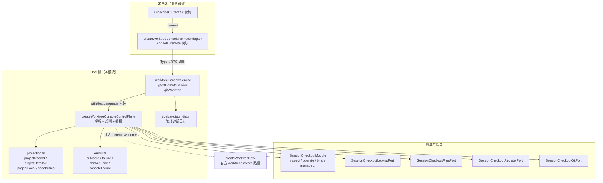
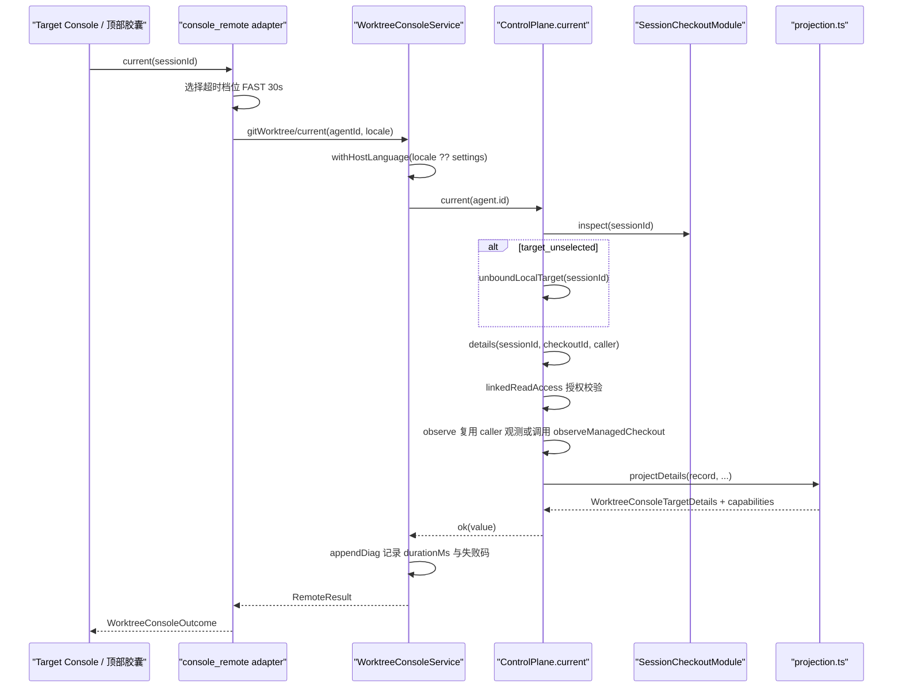
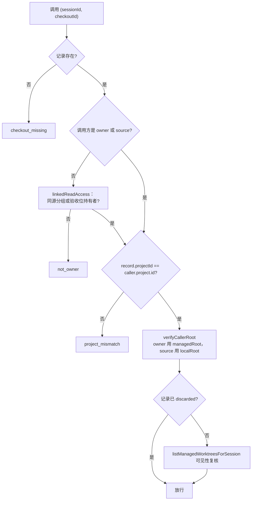
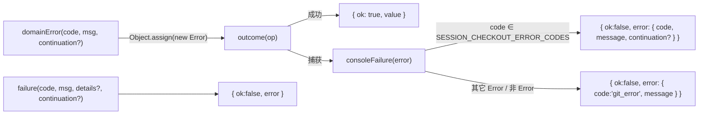

# console_host：Worktree 控制平面与 Host RPC 服务

!!! info "Generated documentation"
    This page was written by CodeWiki from the source code at commit [`d2e564da`](https://github.com/wloops/dsh-git-worktree/commit/d2e564da3f02d8dd8750e589cff38ee45f31861b) on 2026-11-10 with `mimo-v2.6-flash`. Check the code before relying on details.

`console_host` 是本插件在 **Host 侧**的控制平面（control plane）与远程服务（RPC service）层。它把
[SessionCheckoutModule](Worktree_and_Session_Checkout_Domain.md) 的领域状态机、端口实现
（[端口、适配器与基础设施（Ports, Adapters, and Infrastructure）](Ports,_Adapters,_and_Infrastructure.md)）与
[console_contract 模块（Worktree Console 共享契约）](console_contract.md) 中定义的 JSON-only 契约连接起来，向
[console_remote：控制台远程契约层（Typert Remote）](console_remote.md) 暴露一组以 `gitWorktree` 为命名空间的 Typert Remote 调用。

它承担三件不可分割的事：

1. **调用方授权**：每一次调用都从 `agentId` 解析出真实 Session，重新校验项目、owner/source 归属、
   Session 当前 cwd 与记录 revision，绝不相信客户端传入的身份。
2. **观测与投影**：把注册表里的 `ManagedCheckoutRecord`（含路径、journal、delivery 等内部事实）
   投影成 **不含路径**、面向 UI 的 `WorktreeConsoleTargetSummary` / `WorktreeConsoleTargetDetails`，
   并同时算出能力位（capabilities），让客户端只显示真正可用的动作。
3. **变更编排**：把 UI 语义（discard、deliver、setRetention、beginNextIteration、returnToLocal、
   Git 分支/标签操作……）翻译成领域模块的 `operate` / `manageManagedWorktreeForSession` /
   `bind` 调用，并把结果或领域错误统一包成 `WorktreeConsoleOutcome<T>`。

> 本模块**不**实现 Git、不实现持久化、不渲染 UI。它只做「谁可以做什么 + 现在是什么状态」的裁决，
> 因此可以在没有 UI 的情况下被单元测试，也可以被未来的其它传输面复用。

## 架构总览



### 装配位置

控制平面与服务的实例化只有一处，位于插件入口 `src/index.ts` 的 `apply()` 中：

```ts
new WorktreeConsoleService(ctx, createWorktreeConsoleControlPlane({
  module,
  lookup,
  files,
  registry,
  git,
  createWorktree: (sessionId, from) => createWorktreeNow(ctx, module, sessionId, from),
  adoptionFailure: (sessionId) => module.adoptionFailure(sessionId),
}), join(stateDir, 'sidebar-diag.ndjson'), providerLifecycle.officialWorkspaceActive)
```

两个细节值得注意：

- **建树被注入而不是内建**：`createWorktree` 走 `createWorktreeNow` → `module.createOfficialTarget`，
  因为建树需要 `feat/sess-*` 命名、`.worktreeinclude` 与本地未提交修改继承，且需要 live `Agent`；
  控制平面本身只拿得到只读的导航记录（见 `src/worktree-creation.ts`）。
- **`officialWorkspaceActive` 透传**：该布尔来自 `mountWorkspaceProviderLifecycle` 的选举结果，
  会被回填进 `sidebarTopology` 响应，客户端据此决定是否挂载官方 Workspace 派生 UI。

## 子模块

| 子模块 | 代码 | 职责 |
| --- | --- | --- |
| [Worktree Console 控制面（Host 业务编排层）](console_host_control_plane.md) | `src/console-host/control-plane.ts` | 25 个控制平面方法：授权门、观测复用、评审位仲裁、变更编排、Git 面代理 |
| [console_host_projection — Host 侧投影与能力门控](console_host_projection.md) | `src/console-host/projection.ts`（含 `errors.ts` 的错误信封细节） | 记录 → 契约 DTO 的投影、`capabilities` 能力位计算、`WorktreeConsoleOutcome` 归一化 |
| [console_host_rpc_service 模块](console_host_rpc_service.md) | `src/console-host/service.ts` | Typert Remote 服务面：`@Remote` 方法、locale 包装、诊断日志轮转 |

`src/console-host/errors.ts` 只有约 60 行，是三个子模块共同的底座，因此不单独成页：
`consoleFailure` / `failure` / `outcome` / `domainError` 的语义记录在
[console_host_projection — Host 侧投影与能力门控](console_host_projection.md) 的「错误信封」小节，
下面「错误信封」一节给出与调用路径相关的行为约束。

## 一次 RPC 调用的完整生命周期

以客户端每 5 秒触发的 `current` 为例（`src/client/target-console/current-polling.ts` 中 `DELAY = 5_000`，
页面隐藏时降为 `HIDDEN_DELAY = 60_000`）：



要点：`current` 是**唯一**会把「调用方观测」透传给后续投影的入口（`observedCaller`），
因此它避免了同一记录在一个轮询周期内被 `git status` + 两次 `git rev-parse` 重复验证；
变更类方法（`discard`、`deliver`、`setRetention`…）**故意不传** `observedCaller`，一律在事务前重新 inspect。

## 授权模型

控制平面的所有读取/写入都经过同一组判据，顺序固定：



三个容易踩坑但已被显式处理的边界：

- **owner 的 live cwd 就是工作树根**，而 `project.root` 永远指向 Local。因此 `verifyCallerRoot`
  先看 `lookup.getSessionCwd()`，只有当它是 owner 且命中 `managedRoot`（或已交付后的 `localRoot`）
  时才放行；对 source Session 仍使用 Workspace 根门，避免「同项目任意 source 会话」借道拿到 owner 的路径。
- **已交付的终态读走 Local 边界**：`worktreeReachedDelivery(phase, deliveryState)` 为真且
  phase ∈ {`discarded`, `finalized`, `retained`} 时，授权边界切换为 `record.localRoot`，
  因为 owner 已经回到 Local，冻结目录可能仍在磁盘上（默认保留期内）或已被删除。
- **规范路径被记忆化**：`canonicalize` 在单次校验内最多被问 4 次（live cwd、expectedRoot、
  record.localRoot、project.root），用 `Map<string, Promise<string>>` 保证每个不同路径只付一次 IO。

`requireOwner()` 是更严格的一层：保留期、常驻标记与清理派发都会**删除磁盘目录**，所以只允许 owner 调用，
不允许 source Session 以「owner 已消失」的名义代为清理。

## 观测与性能取舍

| 机制 | 位置 | 作用 |
| --- | --- | --- |
| `observeFromCaller` | control-plane | 当 `callerTarget` 已付出一次 `inspect` 且 revision/phase/ownership 完全一致时，直接复用其 `branch`/`headOid`/`dirty`，省掉约三分之一轮询成本 |
| `observeManagedCheckouts` | 领域模块可选批量端口 | `list` 在模块侧一次持锁并行验证；抛错时整体降级为逐条 `observe` |
| 单条降级 | `list` | 身份无法验证的记录以「无观测投影」呈现，面板其余记录照常渲染，CAS 校验仍会兜底拒绝写入 |
| `settledLocalBranch` | control-plane | 已交付且 owner 已离开冻结根时，胶囊改报 Local 当前分支（如 `master`），而不是冻结的任务分支 |

`withCreation()` 用进程内 `Set` 做了双层互斥：`session:<id>` 与会话规范化后的 `root:<path>`，
后者在 Windows 下小写化，避免同一仓库被两个会话并发 `initProject` / 建树。

## 状态投影与能力位

投影的权威映射在 `console_contract.ts` 的 `consoleStateFromDomain()`：`recovery_required` 与
`discarded` 优先于过期的 delivery 标签，`preparing` 显示为 `creating`。本模块只负责**补充事实**：

- `dirty`、`currentOid`、`sourceBranch`（优先取 `record.sessionBranch`，回退 `sourceRef`）
- `retention` / `retainedAt` / `expiresAt`、`permanent`、`cleanupMessage` / `cleanupReason`
- `review`、`deliveryProof`、`checkpoints`、`checkpointGeneration`（SHA-256 CAS 代际）
- `reviewSlot`：当项目内已有别的记录持有 Local 预览/验收位时，把 `available` 降为 `waiting`，
  并附带 `reviewSlotHolder` 与 `capabilities: { preview:false, checkpoint:false, finalize:false }`
- `previewRecovery`：`preview_detached` 时的恢复线索
- `recoveryContinuation`（仅 owner、非 linked read）：一次性的恢复证明

能力位由 `capabilities(record, callerSessionId, ownerSessionAvailable, linkedRead)` 计算，
遵循「owner 才可写、source 只在 owner 缺席时保留 discard 保留权」的规则。详见
[console_host_projection — Host 侧投影与能力门控](console_host_projection.md)。

## 错误信封（`src/console-host/errors.ts`）

所有方法返回 `WorktreeConsoleOutcome<T> = { ok: true, value } | { ok: false, error }`。
`errors.ts` 提供三种构造方式与一个归一化器：



四个导出的分工：

| 导出 | 用途 | 关键行为 |
| --- | --- | --- |
| `domainError(code, message, continuation?)` | 在控制平面内部抛出领域错误 | 返回带 `code` 属性的 `Error`，可被 `consoleFailure` 识别并原样保留 |
| `outcome(operation)` | 绝大多数方法的统一包装 | `try/catch` 后转成 `consoleFailure`，把抛出式代码收敛成信封 |
| `consoleFailure(error)` | 归一化任意错误 | `code` 命中 `SESSION_CHECKOUT_ERROR_CODES` 时保留原 `code`/`message`/`continuation`；否则一律降级为 `git_error` |
| `failure(code, message, details?, continuation?)` | 在已确定失败时**直接构造**失败信封 | 不需要抛异常，用于 `deliver` 这类手工控制流程的路径 |

`deliver` 是唯一手工展开 try/catch 的方法：它需要在冲突时额外挂上
`applyConflictContinuation`（含 `requestId`、`localHeadOid`、`conflictingFiles` 的恢复凭据），
并做提交信息与 revision 的前置校验（`isValidCommitMessage`），因此用 `failure(...)` 逐条返回
而不是靠 `outcome` 兜底。

非领域错误的消息是**原样透传**的（本地控制台需要看到 Git 的真实 stderr，`tests/host-i18n.test.ts` 依赖这一点）；
源码注释明确标注了这层的适用边界：一旦出现真正的远程传输面，必须先在此处做脱敏或截断。
投影与能力位的细节见 [console_host_projection — Host 侧投影与能力门控](console_host_projection.md)。

## 诊断与可观测性

`WorktreeConsoleService` 把两类面包屑写入 `<stateDir>/sidebar-diag.ndjson`：

- `kind: 'current'`：`durationMs`、`ok`、失败时的 `code`/`message`。顶部胶囊「永远不可用」时，
  这条记录是唯一能区分「未持验收位 / 项目不匹配 / Git 报错」的现场证据。
- `kind: 'host'`：`sidebarTopology` 的项目数、`hostWorkspaceClientFlavor()` 与
  `workspaceFlavorDiagnostics().anchors`（哪些锚点解析出了 Host `@deepseek-ai/dsh-agent` 版本）。
- `kind: 'client'`：客户端启动自检报告 `WorktreeClientBootReport`（走了哪个 sidebar 分支、是否注册成功、耗时）。

日志是**尽力而为**的：`appendDiag` 内部吞掉所有异常，绝不让诊断写盘破坏 RPC 面；
超过 `DIAG_MAX_BYTES = 8 MiB` 时把现有文件改名为 `.1`，只保留最近一段（实测 30 天约 12 MB）。

## 构建与发布面

本模块是插件 `main` 入口（`lib/index.js`）的一部分，随 `pnpm run build`（`node scripts/clean-lib.mjs && tsc && tsdown`）
一起编译；`tsconfig.json` 的 `rootDir: "src"`、`strict`、`noUncheckedIndexedAccess` 意味着控制平面里大量
`Object.values(...)`、`record.journal?.operation`、`delivery.proof` 的窄化都必须显式处理——源码里那些
`in` 收窄（`'review' in record.delivery`）和 `??` 回退正是为满足该配置而写。

`package.json` 的 `exports` 把 `./console-contract`（含本模块消费的全部 DTO）单独导出，`./typert` 与
`./remote` 分别暴露 `WORKTREE_CONSOLE_DESCRIPTORS` 与命名空间类型声明；Host 与 Client 因此共享同一份
方法签名，本模块任何签名改动都必须同步 `src/console-remote/descriptors.ts` 与 `src/console-remote/remote.ts`，
否则 `pnpm run typecheck` 会在 Typert 的 `TypertRemoteMap` 接口处报错。

`vitest.config.ts` 用 `virtual:dsh-official-workspace-client*` 别名替换四个官方 Workspace 客户端版本，
并把 Windows 下的 `fileParallelism` 关掉——控制平面的测试需要真实 Git fixture，而 Windows 上并发文件
句柄会互相锁住临时目录。

## 与其它模块的关系

| 模块 | 关系 |
| --- | --- |
| [console_contract 模块（Worktree Console 共享契约）](console_contract.md) | 全部请求/响应 DTO、`consoleStateFromDomain`、`worktreeReachedDelivery`、错误码集合的定义处；本模块只消费不扩展 |
| [console_remote：控制台远程契约层（Typert Remote）](console_remote.md) | 同一批方法在 Typert 层的 descriptor + Zod strict schema + 客户端 adapter（30s/180s 超时、codec 拒绝识别）；Host 方法签名必须与之逐参数对齐 |
| [Worktree 与会话检出领域（Worktree_and_Session_Checkout_Domain）](Worktree_and_Session_Checkout_Domain.md) | `SessionCheckoutModule` 提供 `inspect` / `operate` / `bind` / `manageManagedWorktreeForSession` / `observeManagedCheckout(s)` / `beginNextIteration` / 废弃快照与分支剪枝 |
| [端口、适配器与基础设施（Ports, Adapters, and Infrastructure）](Ports,_Adapters,_and_Infrastructure.md) | `lookup`、`files`、`registry`、`git` 四个端口的真实实现；`ManagedCheckoutRecord` 类型来源 |
| [Client_Presentation_and_Interaction 模块概览](Client_Presentation_and_Interaction.md) | `current` 的 5s 轮询、`TargetConsoleContextLike`、侧栏拓扑消费方 |
| [public_api 模块：插件公共入口与契约面](public_api.md) | `SessionCheckoutModule`、`IsolatedTargetLaunch`、`ManageManagedWorktreeInput` 等本模块调用的领域契约 |
| [横切基础与公共交付面模块总览](Cross-Cutting_Foundation_and_Public_Surface.md) | 构建/CI/打包配置（`package.json`、`tsconfig.json`、`vitest.config.ts`、`cordis.patch.yml`）与 i18n 目录 |
| [i18n：中英双语文案与语言解析基础设施](i18n.md) | `withHostLanguage` / `hostMessage` / `languageFromSettings`；每次调用一个不可变 locale 快照 |

## 方法分组速览

控制平面的 25 个方法可按用途分为四组（签名与错误语义见
[Worktree Console 控制面（Host 业务编排层）](console_host_control_plane.md)）；服务面在此之上多一个
`clientBootReport` 客户端自检通道（共 26 个 `@Remote` 方法，见
[console_host_rpc_service 模块](console_host_rpc_service.md)）：

| 分组 | 方法 |
| --- | --- |
| 只读观测 | `sidebarTopology`、`current`、`list`、`inspect`、`listAbandoned` |
| 交付与清理 | `deliver`、`discard`、`setRetention`、`setPermanent`、`retryCleanup`、`clearSidebarBadge` |
| 迭代与归属 | `beginNextIteration`、`returnToLocal`、`createWorktree`、`initProject`、`restoreAbandoned` |
| Git 仓库面 | `gitOverview`、`gitGraph`、`gitCreateBranch`、`gitSwitchBranch`、`gitPruneMergedBranches`、`gitListTags`、`gitCreateTag`、`gitDeleteTag`、`gitPushTag` |

Git 面刻意以**项目 Local 根**（`projectRootFor`）为作用域，而不是会话当前所在的 Worktree：
分支视图是全仓库的，必须与会话恰好停在哪个 checkout 无关；同时 `gitSwitchBranch` 会在
本会话或其它会话正处于交付/预览/恢复态时拒绝（`localBranchSwitchBlockedDuringDelivery` /
`localBranchSwitchBlockedByAnotherDelivery`），因为切换 Local HEAD 会改写所有「应用到 Local」的基线。

??? abstract "Documented components (5)"
    - [`WorktreeConsoleControlPlane`](https://github.com/wloops/dsh-git-worktree/blob/d2e564da3f02d8dd8750e589cff38ee45f31861b/src%5Cconsole-host%5Ccontrol-plane.ts) — `src\console-host\control-plane.ts`
    - [`WorktreeConsoleControlPlaneOptions`](https://github.com/wloops/dsh-git-worktree/blob/d2e564da3f02d8dd8750e589cff38ee45f31861b/src%5Cconsole-host%5Ccontrol-plane.ts) — `src\console-host\control-plane.ts`
    - [`consoleFailure`](https://github.com/wloops/dsh-git-worktree/blob/d2e564da3f02d8dd8750e589cff38ee45f31861b/src%5Cconsole-host%5Cerrors.ts) — `src\console-host\errors.ts`
    - [`capabilities`](https://github.com/wloops/dsh-git-worktree/blob/d2e564da3f02d8dd8750e589cff38ee45f31861b/src%5Cconsole-host%5Cprojection.ts) — `src\console-host\projection.ts`
    - [`WorktreeConsoleService`](https://github.com/wloops/dsh-git-worktree/blob/d2e564da3f02d8dd8750e589cff38ee45f31861b/src%5Cconsole-host%5Cservice.ts) — `src\console-host\service.ts`

