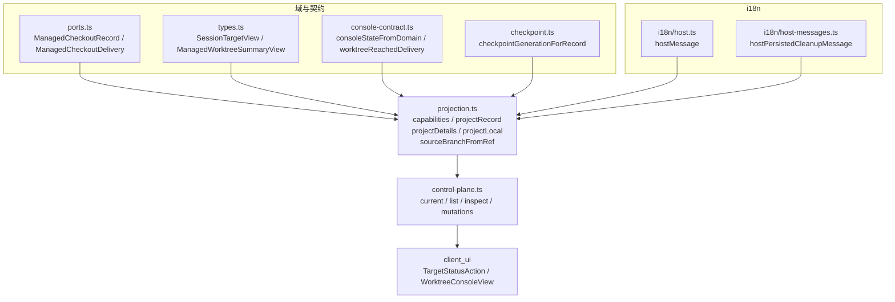
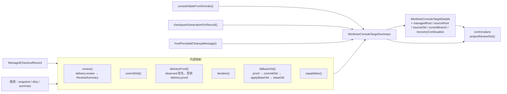
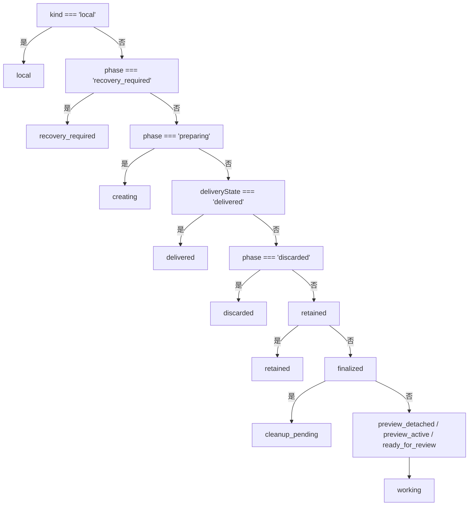
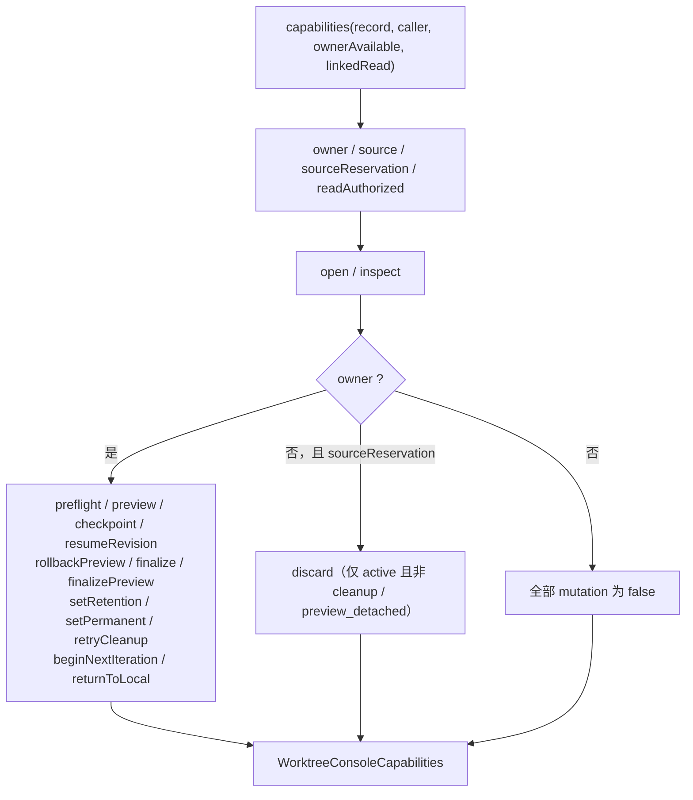
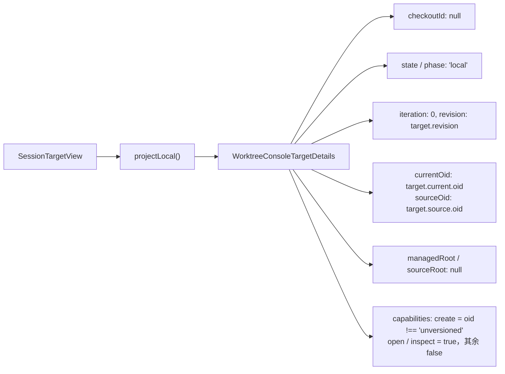
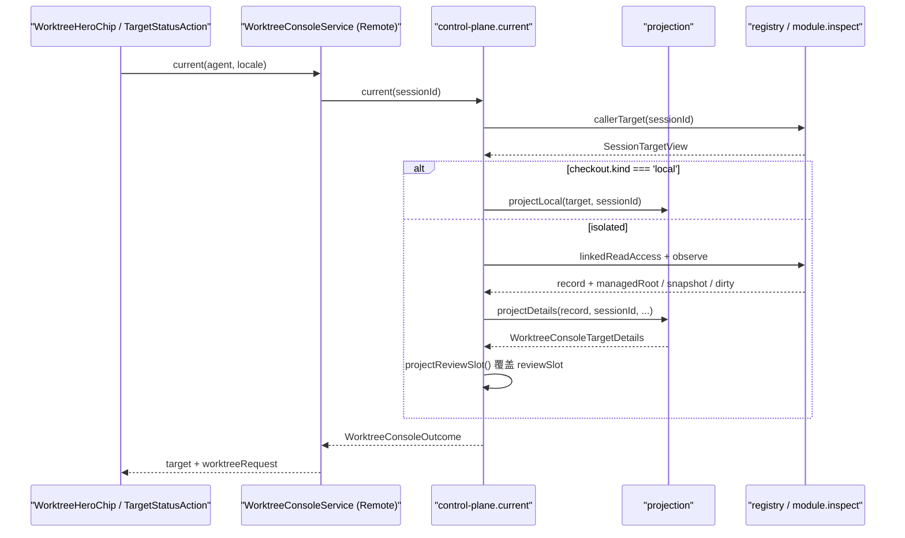

# console_host_projection 投影层

!!! info "Generated documentation"
    This page was written by CodeWiki from the source code at commit [`e01d7c5f`](https://github.com/wloops/dsh-git-worktree/commit/e01d7c5f2f3a0d2f734a5a3415598ae6d7d6f387) on 2026-11-07 with `deepseek-v4.1-flash`. Check the code before relying on details.

`src/console-host/projection.ts` 是 Worktree Console 宿主侧（Host）的**纯投影层**：它把持久化的域记录 `ManagedCheckoutRecord`（外加可选的实时 Git 观测快照）映射成 [console_contract：Worktree Console 共享契约层](../console_contract.md) 中定义的 JSON-only DTO —— `WorktreeConsoleTargetSummary` / `WorktreeConsoleTargetDetails`，并同时计算该调用方 Session 在这条记录上被允许执行的操作矩阵 `WorktreeConsoleCapabilities`。

该文件不含任何 Cordis、React、Remote 或文件系统调用：**不读注册表、不 spawn git、不做授权**。所有输入由 [console_host_control_plane 控制平面](console_host_control_plane.md) 提供，投影结果再经 [console_host_remote_face 模块文档](console_host_remote_face.md) 通过 Typert Remote 暴露给客户端。这一"纯函数投影"的划分保证了同一份记录在 `current` / `list` / `inspect` / 各种 mutation 响应中得到的字段语义完全一致。

## 模块定位与职责边界

| 职责 | 归属 |
| --- | --- |
| 解析调用方 Session、校验 owner/source/cwd/revision、读取注册表 | [console_host_control_plane 控制平面](console_host_control_plane.md) |
| 一次 `git status` / `git rev-parse` 观测（`observe`） | [console_host_control_plane 控制平面](console_host_control_plane.md) |
| 域记录 + 观测 → 控制台 DTO | **本模块** |
| capability 权限矩阵计算 | **本模块** |
| review slot（验收位）竞争裁决、`projectReviewSlot` 覆盖 | [console_host_control_plane 控制平面](console_host_control_plane.md) |
| diff 读取与 stale 检测 | [console_host_review_diff：评审差异读取器](console_host_review_diff.md) |
| 错误码归一化 | [console_host_remote_face 模块文档](console_host_remote_face.md) |

> 关键约定：`capabilities` 只用于**界面提示与按钮可用性**。Host 在执行任何 mutation 时都会重新 `authorize()` 并重新校验 revision / review 身份，因此投影结果过期绝不会被当作授权凭据。

## 依赖关系



投影层只依赖类型（`import type`）与两个 i18n 翻译入口，因此可以被单元测试直接以"记录对象进、DTO 出"的方式覆盖。

## 公开 API

| 导出 | 签名要点 | 说明 |
| --- | --- | --- |
| `capabilities` | `(record, callerSessionId, ownerSessionAvailable = true, linkedRead = false) => WorktreeConsoleCapabilities` | 计算调用方在记录上的可用操作集合 |
| `projectRecord` | `(record, callerSessionId, observed?) => WorktreeConsoleTargetSummary` | 列表 / mutation 响应用的摘要投影 |
| `projectDetails` | `(record, callerSessionId, managedRoot, snapshot?, dirty?, ownerSessionAvailable?, linkedRead?, observedDeliveryProof?, settledLocalBranch?) => WorktreeConsoleTargetDetails` | `current` / `inspect` 用的详情投影（摘要 + 定位信息 + 恢复续办证明） |
| `projectLocal` | `(target: SessionTargetView, sessionId) => WorktreeConsoleTargetDetails` | 把 Local 目标投影成"无 checkout"的详情视图 |
| `sourceBranchFromRef` | `(sourceRef: string) => string \| null` | 从 `refs/heads/…` 提取分支短名，非分支引用返回 `null` |

`projectRecord` 的可选观测参数：

```ts
observed?: {
  snapshot?: Pick<GitCheckoutSnapshot, 'branch' | 'headOid'>
  dirty?: boolean
  summary?: ManagedWorktreeSummaryView
  ownerSessionAvailable?: boolean
  linkedRead?: boolean
  deliveryProof?: WorktreeConsoleDeliveryProof
}
```

`summary` 由 `list` 传入（`listManagedWorktreesForSession` 的批量结果），仅在缺少直接观测时提供 `dirty` 兜底。

## 数据流：从记录到 DTO



### 字段来源对照

| DTO 字段 | 来源 | 备注 |
| --- | --- | --- |
| `project` | `record.projectId` / `record.projectName` | 直接拷贝为 `{ id, name }` |
| `checkoutId` | `record.checkoutId` | Local 投影中为 `null` |
| `sourceSessionId` | `record.sourceSessionId ?? record.ownerSessionId` | 历史记录缺字段时回落到 owner |
| `ownerSessionId` / `targetSessionId` | `record.ownerSessionId` | `targetSessionId` 与 owner 相同 |
| `iteration` | 有 `review` 时取 `delivery.review.iteration`，否则取 `delivery.iteration` | |
| `revision` | `record.revision` | 客户端所有 mutation 的 CAS 期望值 |
| `state` | `consoleStateFromDomain({ kind: 'isolated', phase, deliveryState })` | 见下方状态映射 |
| `phase` | `record.phase` | `SessionCheckoutPhase` |
| `dirty` | `observed.dirty ?? observed.summary.dirty ?? false` | 无观测时为 `false` |
| `currentOid` | `observed.snapshot.headOid ?? fallbackOid(record)` | 观测不到时回退到记录内的 OID |
| `commitOid` | `'commitOid' in delivery ? delivery.commitOid : null` | 仅交付类状态带提交号 |
| `sourceBranch` | `sourceBranchFromRef(record.sessionBranch ?? record.sourceRef)` | 会话自有分支优先于分叉点，避免侧栏误标 |
| `retention` / `retainedAt` / `expiresAt` | `delivery.state === 'retained'` 时透出 | |
| `cleanupMessage` | `hostPersistedCleanupMessage(delivery.cleanupMessage, hostMessage, delivery.cleanupMessageKey)` | 按持久化的 i18n key 重新翻译，兼容旧的中文原文 |
| `cleanupReason` | `delivery.cleanupReason` | 结构化阻塞原因，客户端据此给出显式确认 |
| `permanent` | `record.permanent === true` | 常驻标记，豁免自动清理 |
| `deliveryProof` | 见 `deliveryProof()` | `linkedRead` 时一律省略 |
| `review` | `review(record)` | `tests` 与 `changedFiles` 做浅拷贝，防止调用方改动记录 |
| `checkpoints` | `record.checkpoints` 映射为 `WorktreeCheckpointView` | 只暴露界面需要的字段（不含 `commitOid` / `requestId`） |
| `checkpointGeneration` | `checkpointGenerationForRecord(record)` | 仅在 `ready_for_review` / `preview_active` 时存在 |
| `reviewSlot` | 投影层写 `'available'`，control-plane 可覆盖为 `'waiting'` | |
| `previewRecovery` | `delivery.state === 'preview_detached'` 时取 `preview.previewId` / `detachedAt` / `reason` / `attemptedAction` | |
| `capabilities` | `capabilities(record, callerSessionId, observed.ownerSessionAvailable, observed.linkedRead)` | |

### 交付证明的两种来源

`deliveryProof()` 优先使用调用方传入的 `observed`（来自 mutation 结果里的 `target.delivery.proof`），此时保留 `commitInLocalHistory` 的真实值；否则从 `record.delivery.proof` 派生，并把 `commitInLocalHistory` 置为 `null` —— 该字段表示"本轮提交是否仍在 Local HEAD 祖先链上"，投影层没有 Git 能力去验证它。所有 `changedFiles` 数组都会被复制，避免 DTO 与注册表共享可变数组。

`projectRecord` 在 `observed.linkedRead === true` 时**整体省略** `deliveryProof`：同组链接读取者不应该看到 owner 的交付证明。

## 状态投影

`state` 由 [console_contract：Worktree Console 共享契约层](../console_contract.md) 的 `consoleStateFromDomain` 统一决定，投影层不重复实现优先级，避免界面与服务端判定漂移：



`worktreeReachedDelivery(phase, deliveryState)` 是"任务是否已到达用户"的**唯一**终态谓词（`delivered` / `finalized` / `retained`，或 phase 为 `finalized` / `retained`），被投影层（`returnToLocal`）与 control-plane（授权边界、侧栏徽章）共同复用，注释中明确要求该谓词只能有一处定义。

## capability 权限矩阵

`capabilities()` 先把调用方归纳为三种身份，再逐项判定：

- `owner`：`callerSessionId === record.ownerSessionId`
- `source`：`callerSessionId === record.sourceSessionId`
- `sourceReservation`：`source && !ownerSessionAvailable` —— owner 会话已消失时，源会话临时接管
- `readAuthorized = owner || source || linkedRead`（同组链接读取）



| 能力 | 判定条件 |
| --- | --- |
| `create` | 恒为 `false`（仅 `projectLocal` 中按 `current.oid !== 'unversioned'` 计算） |
| `open` | `readAuthorized && active && (!linkedRead \|\| ownerSessionAvailable)` |
| `inspect` | `readAuthorized` |
| `discard` | `(owner \|\| sourceReservation) && active && !cleanup && !previewDetached` |
| `preflight` / `preview` / `finalize` | `owner && ready`（`phase === 'ready' && delivery.state === 'ready_for_review'`） |
| `checkpoint` | `owner && (ready \|\| previewActive)` |
| `resumeRevision` | `owner && ready` |
| `rollbackPreview` | `owner && (previewActive \|\| previewDetached \|\| previewRecovery)`，其中 `previewRecovery` 需 `phase === 'recovery_required'`、`delivery.state === 'preview_active'` 且 `journal.operation === 'rollback_preview'` |
| `finalizePreview` | `owner && (previewActive \|\| previewDetached)` |
| `setRetention` | `owner && delivery.state === 'retained'` |
| `setPermanent` | `owner && active`（`phase !== 'discarded'`） |
| `retryCleanup` | `owner && cleanup`（`finalized` \|\| `retained`） |
| `beginNextIteration` | `owner && delivered`（`phase === 'discarded' && delivery.state === 'delivered'`） |
| `returnToLocal` | `owner && worktreeReachedDelivery(phase, delivery.state)` |

其中 `cleanup = delivery.state === 'finalized' || delivery.state === 'retained'`，`active = phase !== 'discarded'`。

两条设计约束写在源码注释里，值得维护者注意：

1. **保留期/常驻/清理类能力只授予 owner**。这些操作直接删除磁盘上的冻结目录，而域模块在 owner 会话消失时会回退到源会话执行 —— 若投影层也给源会话开这些按钮，一个 Local 会话就能清理它从未拥有的 Worktree。
2. **`returnToLocal` 只对已交付的记录开放**。未交付就解绑会把未合并的工作遗留在冻结目录里，且 review/preview 状态失去任何会话指针。

`projectRecord` 调用时把 `observed?.ownerSessionAvailable` / `observed?.linkedRead` 原样传入，`undefined` 会落到默认值 `true` / `false` —— 即"owner 会话可用、非链接读取"的乐观默认。

## 详情投影：`projectDetails`

在摘要之上追加定位与导航信息：

| 附加字段 | 来源 |
| --- | --- |
| `managedRoot` | control-plane 的观测结果（`discarded` 时为 `null`） |
| `sourceRoot` | `record.localRoot` |
| `sourceOid` | `record.baseOid`（本次迭代的分叉基点，不随 apply 变化） |
| `currentBranch` | `settledLocalBranch ?? snapshot?.branch ?? sourceBranchFromRef(record.sessionBranch ?? '')` |
| `recoveryContinuation` | 仅 `owner && !linkedRead && record.recoveryContinuation` 时输出 |

### `currentBranch` 的三级回退

1. `settledLocalBranch`：已交付记录由 control-plane 解析出"用户此刻真正站在的分支"（通常是合并后的 `master`）。`undefined` 表示"不是已交付 owner 读取，保留 Worktree 分支"，`null` 表示"已交付但 Local 此刻不可观测"。
2. `snapshot.branch`：本次实时观测到的分支。
3. 记录内的 `sessionBranch`：Worktree 冻结/消失、瞬时 inspect 失败时，仍让对话胶囊命名会话自己的分支，而不是塌缩成裸的"Worktree · 状态"。

### `recoveryContinuation` 的判别式

按 `record.recoveryContinuation.kind` 分四支展开，各自只暴露该恢复路径需要的身份字段：

| `kind` | 附加字段 |
| --- | --- |
| `worktree_apply_conflict` | `requestId`、`reviewId`、`workingRevision`（输出为 `revision`）、`localHeadOid`、`conflictingFiles` |
| `worktree_review_regeneration` | `requestId`、`reviewId`、`revision` |
| `worktree_preview_recovery_analysis` | `requestId`、`reviewId`、`previewId`、`revision`、`generation` |
| `worktree_preview_recovery_handoff` | `requestId`、`sourceCheckoutId`、`reviewId`、`previewId`、`sourceRevision`（输出为 `revision`）、`generation` |

这是"一次性授权证明"：Host 只对 owner 会话、且非链接读取时下发，客户端必须原样回传才能续办，Host 侧会再次比对注册表中的 `requestId`。

## Local 目标投影：`projectLocal`

Local 会话没有 checkout 记录，投影成一个"零能力 + 定位信息"的详情视图：



`create` 的判定依赖哨兵值 `'unversioned'`：一个尚未产生任何提交的目录不能建 Worktree，客户端据此禁用"独立 Worktree"入口（需要先走 `initProject` 创建初始版本）。

## 调用链：`current` 轮询

`current` 是投影层最高频的消费者 —— 顶部胶囊每 5 秒轮询一次（`src/client/target-console/current-polling.ts` 的 `DELAY`，窗口隐藏时降为 60 秒）。



注意 `current` 会把 `callerTarget` 已付出的观测通过 `observedCaller` 复用（control-plane 的 `observeFromCaller`），投影层因此只接收 `snapshot` / `dirty` 两个值，不做任何 IO 复用判断。

## 与 review slot 的关系

`projectRecord` 在 `delivery.state === 'ready_for_review'` 时写入 `reviewSlot: 'available'`，随后 control-plane 的 `projectReviewSlot()` 会在同项目的另一个 checkout 正持有 Local Preview / 相关 journal 时把它改写为 `'waiting'`，并附加 `reviewSlotOwnerSessionId`、`reviewSlotHolder`，同时把 `preview` / `checkpoint` / `finalize` 三个能力置为 `false`。

因此：**投影层负责"这条记录自身允许什么"，control-plane 负责"项目级并发下现在还能做什么"**。修改 capability 逻辑时必须同时检查这两处，否则会出现按钮可点但请求被拒的死角。

## 国际化

投影层是唯一把持久化文案还原成当前语言的宿主位置：

- `cleanupMessage`：`hostPersistedCleanupMessage(delivery.cleanupMessage, hostMessage, delivery.cleanupMessageKey)` —— 优先使用记录中持久化的 i18n key，若 key 缺失则按中文原文反查 `persistedCleanupKeys`，仍匹配不上就原样透出旧文案（历史记录兼容）。
- 翻译上下文由 `hostMessage` 从 `AsyncLocalStorage` 中的语言快照读取（`src/i18n/host.ts` 的 `currentHostLanguage` / `withHostLanguage`），`WorktreeConsoleService` 在每个 Remote 方法外层用 `withHostLanguage(locale ?? languageFromSettings(...))` 包裹，因此投影过程中的每次翻译都落在调用方请求的语言上。详见 [i18n：多语言文案目录与本地化解析层](../i18n.md)。

## 维护要点

- **只加字段，不改语义**：DTO 已通过 `console-contract` 的 strict codec 序列化到客户端（`src/console-remote/schemas.ts` / `descriptors.ts`），新增可选字段必须同步更新 schema，否则会被 strict contract 拒绝。详见 [console_remote —— Worktree Console 的严格 Remote 契约层](../console_remote.md)。
- **保持纯净**：`projection.ts` 不得引入 IO。需要新的观测（例如 `commitInLocalHistory`）应通过 `observed` 参数由 control-plane 传入。
- **数组复制**：`tests`、`changedFiles`、`checkpoints`、`conflictingFiles` 均做浅拷贝，避免 DTO 与注册表共享引用；新增数组字段请沿用此约定。
- **默认值即语义**：`capabilities` 的 `ownerSessionAvailable = true` / `linkedRead = false` 默认值决定了"乐观放行"，调用方漏传会静默放宽权限显示；新增调用点请显式传参。

## 测试与构建

投影层是纯函数，可在 `vitest` 中直接以对象字面量构造 `ManagedCheckoutRecord` 进行断言（`vitest.config.ts` 的 `test.include` 为 `tests/**/*.test.{ts,tsx}`，超时 60s，Windows 下禁用文件级并行以避免 Git fixture 争抢句柄）。

提交前流水线：`pnpm run typecheck` → `pnpm run build`（`tsc` + `tsdown`）→ `pnpm run test`，与 `.github/workflows/ci.yml` 的 `check` job 保持一致。详见 [build_and_config 构建与配置](../build_and_config.md)。

## 相关页面

- [console_host：Worktree 控制台的 Host 侧服务层](../console_host.md) —— 宿主侧总览
- [console_host_control_plane 控制平面](console_host_control_plane.md) —— 授权、观测与 review slot 裁决
- [console_host_remote_face 模块文档](console_host_remote_face.md) —— Typert Remote 暴露与错误归一化
- [console_host_review_diff：评审差异读取器](console_host_review_diff.md) —— diff 读取与 stale 判定
- [console_contract：Worktree Console 共享契约层](../console_contract.md) —— DTO 契约与状态映射函数
- [core_domain_ports 端口契约与持久化数据模型](../core_domain/core_domain_ports.md) —— `ManagedCheckoutRecord` / `ManagedCheckoutDelivery` 定义
- [client_ui — 浏览器端 UI 层](../client_ui.md) —— 消费投影结果的胶囊、面板与侧栏
- [i18n：多语言文案目录与本地化解析层](../i18n.md) —— 宿主文案与语言快照

??? abstract "Documented components (1)"
    - [`capabilities`](https://github.com/wloops/dsh-git-worktree/blob/e01d7c5f2f3a0d2f734a5a3415598ae6d7d6f387/src%5Cconsole-host%5Cprojection.ts) — `src\console-host\projection.ts`

