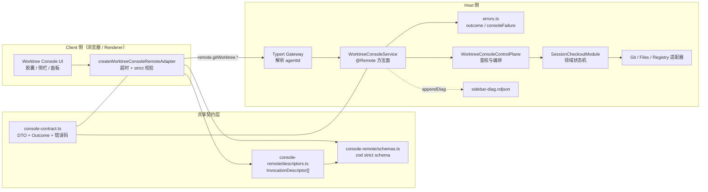
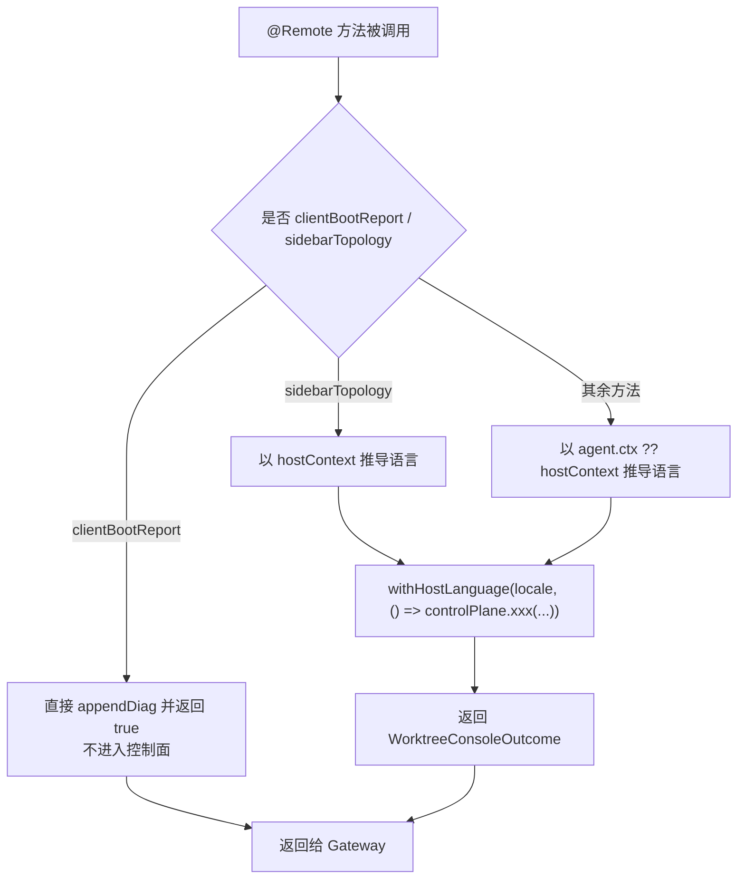
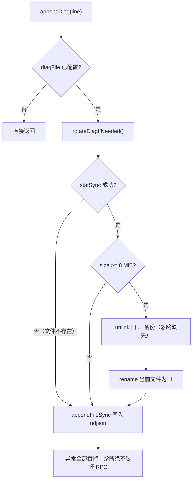
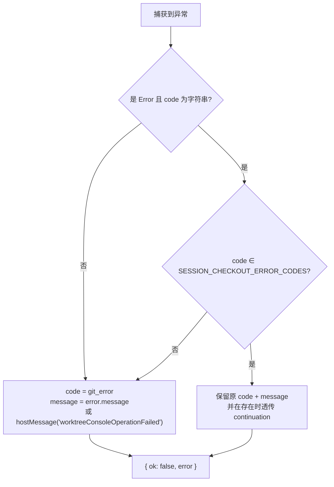
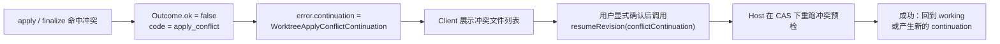
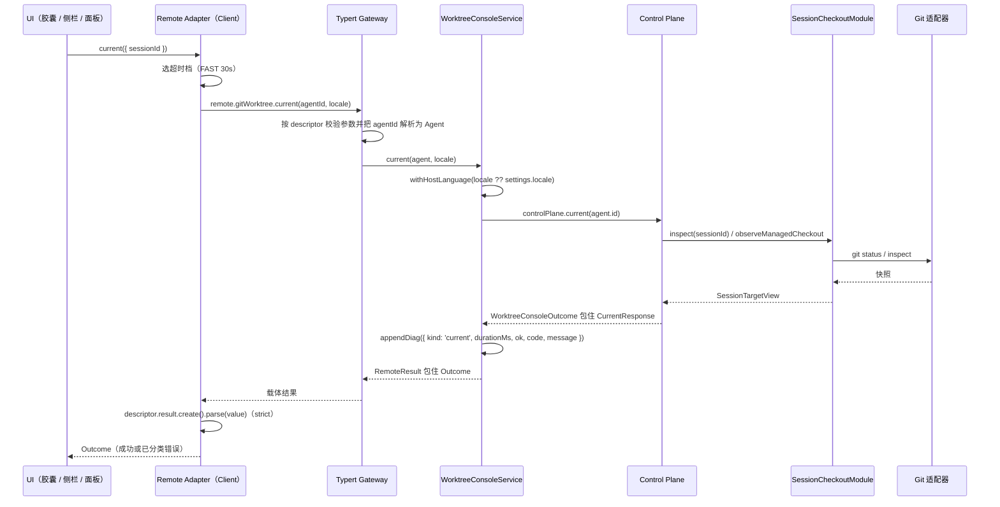

# console_host_remote_face 模块文档

!!! info "Generated documentation"
    This page was written by CodeWiki from the source code at commit [`e01d7c5f`](https://github.com/wloops/dsh-git-worktree/commit/e01d7c5f2f3a0d2f734a5a3415598ae6d7d6f387) on 2026-11-07 with `deepseek-v4.1-flash`. Check the code before relying on details.

## 概述

`console_host_remote_face` 是 Worktree Console 宿主侧的 **远程调用面（Remote Face）**：它把控制面的业务方法包装成官方 Typert Remote 服务，供浏览器侧（Client）通过 Gateway 以严格 schema 的方式调用。该模块由两个文件构成：

- `src/console-host/service.ts`：`WorktreeConsoleService`，继承 `TypertRemoteService`，命名空间为 `gitWorktree`，用 `@Remote` 装饰器暴露 38 个 RPC 方法。
- `src/console-host/errors.ts`：`consoleFailure` 及其同族工具（`domainError`、`failure`、`outcome`），负责把任意异常与业务失败**归一化成契约规定的 `WorktreeConsoleOutcome<T>`**。

该模块自身**不含业务规则**：所有身份校验、所有权判定、CAS 版本比对、Git 操作都在控制面与 session-checkout 领域中完成。Remote Face 只做四件事：

1. 解析调用者身份（`agentId` → `Agent`）与语言（`locale` / 设置项）；
2. 以位置参数把请求转发给控制面；
3. 把结果与异常转换成 `WorktreeConsoleOutcome<T>`；
4. 写诊断面包屑（ndjson），且保证诊断永不破坏 RPC。

## 在系统中的位置



关键关系：

- **契约唯一来源**是 [console_contract 模块](../console_contract.md)：Remote Face 的方法签名、返回值类型、错误码全部来自 `src/console-contract.ts`，自身不定义 DTO。
- **描述符与实现必须逐位对齐**：[console_remote 模块](../console_remote.md) 中的 `WORKTREE_CONSOLE_DESCRIPTORS`（参数名、顺序、可选性、结果类型符号）与 `remote.ts` 里 `TypertRemoteMap` 的方法签名，都是按 `WorktreeConsoleService` 的位置参数逐条声明的。
- **业务语义**在 [console_host_control_plane 控制平面](console_host_control_plane.md) 中，投影/状态计算在 [console_host_projection 投影层](console_host_projection.md) 中，评审 diff 读取在 [console_host_review_diff：评审差异读取器](console_host_review_diff.md) 中。父页面见 [console_host：Worktree 控制台的 Host 侧服务层](../console_host.md)。

## 组件清单

| 文件 | 组件 | 职责 |
| --- | --- | --- |
| `src/console-host/service.ts` | `WorktreeConsoleService` | Typert Remote 服务本体：38 个 `@Remote` 方法、语言作用域、诊断落盘与轮转 |
| `src/console-host/errors.ts` | `consoleFailure` | 把未知异常归一化为 `WorktreeConsoleOutcome<never>`（识别领域错误码，否则降级为 `git_error`） |
| `src/console-host/errors.ts` | `domainError` | 构造携带 `code`（及可选 `continuation`）的 `Error`，供控制面抛出 |
| `src/console-host/errors.ts` | `failure` | 直接构造失败结果，可带 `details` 与 `continuation` |
| `src/console-host/errors.ts` | `outcome` | `try/catch` 包装器：成功包成 `{ ok: true, value }`，异常交给 `consoleFailure` |

> `errors.ts` 中 `consoleFailure` 是模块树里点名的核心组件，`domainError` / `failure` / `outcome` 与它同属一条归一化管线，因此一并记录。

## WorktreeConsoleService

### 构造与依赖

```ts
new WorktreeConsoleService(
  hostContext: Context,
  controlPlane: WorktreeConsoleControlPlane,
  diagFile?: string,
  officialWorkspaceActive = true,
)
```

- 调用 `super(hostContext, 'gitWorktree')` 完成 Typert 服务注册，命名空间固定为 `gitWorktree`。
- `controlPlane`：唯一业务出口（见 [console_host_control_plane 控制平面](console_host_control_plane.md)）。
- `diagFile`：诊断日志路径。`src/index.ts` 在插件 `apply` 时传入 `join(stateDir, 'sidebar-diag.ndjson')`，`stateDir` 默认位于 `$DSH_HOME/plugins/dsh-git-worktree`。
- `officialWorkspaceActive`：来自 `mountWorkspaceProviderLifecycle` 的提供者选举结果，仅用于在 `sidebarTopology` 响应中告知 Client「官方 Workspace 仍是活着的侧栏提供者」，让 Client 选择装饰（decorate）还是接管（re-provide）分支。

### 方法面的三条统一约定

每个 `@Remote` 方法都遵循同一骨架：



1. **语言作用域**：所有业务方法都包在 `withHostLanguage(locale ?? languageFromSettings(agent.ctx ?? this.hostContext), ...)` 中。`locale` 来自 RPC 参数（`'zh' | 'en' | undefined`），缺省时读取宿主设置里的 locale 偏好；`withHostLanguage` 使用 `AsyncLocalStorage`，保证一次调用内的 `hostMessage()` 取到同一份不可变语言快照，且不跨异步续体泄漏。详见 [i18n 模块](../i18n.md)。
2. **身份来源**：方法签名的第一个参数是 `agent: Agent`，但线上传输的是 `agentId` 字符串——描述符里该参数声明为 `source: 'lookup', lookup: 'agent', wire: 'agentId'`，由 Gateway 在业务代码运行前解析成 `Agent` 对象。因此服务层**永远拿到一个已解析的调用者**，并以 `agent.id` 作为 `sessionId` 传入控制面。
3. **位置参数**：Remote 代理按位置强制校验参数个数，可选项也必须显式传 `undefined`（Client 侧 `clientBootReport` 的注释明确记录了这一点）。服务方法内部再用 `...(x === undefined ? {} : { x })` 把位置参数折叠成控制面的请求对象，避免把显式 `undefined` 写进请求体。

### 与服务描述符的对齐规则

`descriptor()` 助手（`src/console-remote/descriptors.ts`）决定了线上参数表的固定形态：

- 当 `withAgent` 为真（默认），**首位**自动插入 `agent` 参数，其 `wire` 名为 `agentId`、`source: 'lookup'`、`lookup: 'agent'`、codec 为 `sessionIdSchema`；
- **末位**总是自动追加 `locale`（`optionalLanguageSchema`，`acceptsUndefined: true`）；
- 结果 codec 的类型符号为 `` `dsh-git-worktree/console-contract#${resultType}` ``，模式 `strict`。

由此得到两条容易踩错的约束：

1. `sidebarTopology` 与 `clientBootReport` 是唯一以 `withAgent = false` 声明的方法，因此服务端对应方法签名里没有 `agent` 参数。
2. `clientBootReport` 的客户端签名带尾部 `locale`，但服务端 `clientBootReport(report)` **不声明**该参数——它只返回 `boolean`、不产生翻译文本，尾部实参被忽略。这是有意的简化，但意味着该方法在服务端无法感知调用语言。

另一个值得留意的复用：`returnToLocal` 的描述符复用了 `outcomeSchema(currentResponseSchema)`。因为 `WorktreeConsoleReturnToLocalResponse` 的 `target` 同样是 `WorktreeConsoleTargetDetails`，而 `currentResponseSchema` 里的 `worktreeRequest` 带 `default(null)`，所以缺少该字段的 `returnToLocal` 载荷仍能通过校验。新增响应类型时不要依赖这种巧合，应按 `resultType` 单独声明 schema。

### 方法分组

| 分组 | 方法 | 说明 |
| --- | --- | --- |
| 启动与拓扑 | `sidebarTopology`、`clientBootReport` | 唯二不需要 `agent` 参数的方法。`sidebarTopology` 汇总项目/任务拓扑，并附带 `workspaceClientFlavor` 与 `officialWorkspaceActive`。`clientBootReport` 是纯诊断通道，返回 `true`。 |
| 当前态与列表 | `current`、`list`、`inspect`、`initProject` | `current` 供顶部胶囊轮询（约 5 秒一次），返回目标详情 + 待办 `worktreeRequest`。`list` 支持 `needsAttention` / `includeDelivered` 过滤。 |
| 评审读取 | `reviewDiff`、`preflight` | 均以 `expectedRevision` + `expectedReviewId` 做身份绑定，只读。 |
| Preview / 评审恢复 | `previewRecoveryPreflight`、`preparePreviewRecoveryAnalysis`、`createPreviewRecoveryHandoff`、`rollbackPreview`、`prepareReviewRegeneration`、`resumeRevision` | 处理 `preview_detached` 与「评审失效」的证明-再校验流程。`recoveryProof` / `conflictContinuation` 只是待复核的上下文，不是承载权限的凭证：Host 会在锁内重算并比对。其中 `preparePreviewRecoveryAnalysis` 与 `createPreviewRecoveryHandoff` 额外要求 `expectedPreviewId` + `recoveryProof`。 |
| 交付与清理 | `preview`、`checkpoint`、`discard`、`finalize`、`deliver`、`finalizePreview`、`setRetention`、`setPermanent`、`retryCleanup`、`beginNextIteration`、`clearSidebarBadge` | 全部是 CAS 变更，必须携带 `expectedRevision`。其中 `preview`、`checkpoint`、`finalize`、`finalizePreview` 还要求 `expectedReviewId`；`checkpoint` 另外要求 `expectedGeneration` 与 `requestId`。`discard` 不要求 `expectedReviewId`，但需要 `confirmDirty`；`finalizePreview` 可选 `recoveryProof`。`deliver` 刻意**不**要求 `expectedReviewId`（评审面板已删除，`working` 可直接交付）。 |
| 释放与待建请求 | `returnToLocal`、`setWorktreeRequest` | 两者都**不带** `expectedRevision`。`returnToLocal` 只对已交付 Worktree 生效（未交付会被拒，避免把未合并工作留在冻结目录）；`setWorktreeRequest` 记录或撤回「下一次 turn 在新树里开始」，`from` 省略表示撤回、`null` 表示基于当前 HEAD，真正的 `git worktree add` 发生在 turn 的第 1 步（见 `src/worktree-request.ts`），因此勾选本身不付一次完整 checkout。 |
| 仓库级 Git | `gitOverview`、`gitGraph`、`gitCreateBranch`、`gitSwitchBranch`、`gitPruneMergedBranches`、`gitListTags`、`gitCreateTag`、`gitDeleteTag`、`gitPushTag` | 作用于会话项目的 Local 仓库根，而非托管 worktree，供分支胶囊与标签管理器使用。 |
| 放弃快照 | `listAbandoned`、`restoreAbandoned` | `discarded` 记录没有活的 target，因此单独一对方法。 |

### `current` 的额外职责

`current` 是唯一额外记录耗时的方法：它测量 `controlPlane.current(agent.id)` 的墙钟时长并写入诊断行，因为顶部胶囊每 5 秒轮询一次，其成本直接决定刷新手感。当胶囊长期显示「不可用」时，这条 `code`/`message` 记录就是唯一现场证据（区分「会话未持验收位」「项目不匹配」「git 报错」）。

### 诊断日志（`appendDiag` / `rotateDiagIfNeeded`）



- 上限 `DIAG_MAX_BYTES = 8 * 1024 * 1024`，只保留一段备份（`.1`）。原因记录在源码注释里：顶部胶囊每 5 秒写一条 `current`，一天一万多行，实测 30 天 12 MB。
- 三种记录类型：`kind: 'host'`（`sidebarTopology`：项目数、flavor、flavor 探测锚点）、`kind: 'client'`（`clientBootReport`：Client 报告哪条侧栏分支真正跑起来了、mount/topology 耗时）、`kind: 'current'`（耗时与失败码）。
- 整个写入过程包在 `try/catch` 里，任何 IO 异常都不上抛：诊断是面包屑，不是契约的一部分。

#### 排障用法

| 症状 | 查看方式 |
| --- | --- |
| 胶囊长期显示「不可用」 | 取最后一条 `kind: 'current'` 且 `ok: false` 的记录，看 `code` 与 `message`（`not_owner` / `project_mismatch` / `git_error` 分别指向不同环节） |
| 胶囊刷新卡顿 | 对比 `kind: 'current'` 的 `durationMs` 分布；单次偏高通常是 Git spawn 变慢（Windows 冷启动尤其明显） |
| 侧栏没出现托管任务 | 看 `kind: 'host'` 记录的 `projects` 数量与 `flavor`；再看 `kind: 'client'` 的 `branch` / `registered` / `detail`，确认走的是 decorate 还是 managed 分支 |
| 宿主形态识别错误 | `kind: 'host'` 的 `anchors` 数组记录三个探测锚点（`entry` / `cwd` / `plugin`）各自的 `ok` 与 `version`，第一个成功的锚点决定 `flavor` |

## 错误与结果归一化（`errors.ts`）

### 统一返回类型

所有 RPC 方法返回 `WorktreeConsoleOutcome<T>`：

```ts
type WorktreeConsoleOutcome<T> =
  | { ok: true, value: T }
  | { ok: false, error: { code, message, details?, continuation? } }
```

这种「结果即数据」的形态让 Client 无需依赖异常传输，也让严格 schema 能在两侧校验同一份 payload。

### `consoleFailure` 的映射规则



要点：

- **白名单机制**：只有落在 `SESSION_CHECKOUT_ERROR_CODES` 里的 `code` 才会被当作领域错误原样透出。任何第三方库抛出的 `Error`（可能恰好带一个同名字段 `code`）都会被降级为 `git_error`，避免把不受契约管理的错误码泄漏到线上。
- **`continuation` 仅在存在时出现**：`continuation` 是 `apply_conflict` 专用的一次性恢复上下文，`schemas.ts` 的 `consoleErrorSchema.superRefine` 会在 Client 侧再次强制「只有 `apply_conflict` 可以携带 continuation」。
- **本地化的边界**：源码注释明确写下「第三方消息原样透传是刻意的，由 `tests/host-i18n.test.ts` 固化观察行为；若将来出现真正的远程面，需要在序列化出机前做脱敏（truncate/replace）」。也就是说，当前 Remote Face 的设计假设是**本地控制台**，`message` 里可能包含用户路径等原始文本；新增跨机器传输时必须先处理这一点。
- **测试锚点**：`tests/host-i18n.test.ts` 校验「源自有消息按调用语言渲染且不改 code」以及「第三方错误消息原样透传」。

### `continuation` 的单向流

`continuation` 是唯一一种「错误里携带可执行数据」的形态，只服务于 `apply_conflict`：



- 服务端从不缓存这个 token：`requestId` 形如 `apply-conflict:<checkoutId>:<reviewId>:<revision>:<localHeadOid>`，完全由状态派生，因此 Client 重放同一请求是幂等的。
- `conflictingFiles` 在服务端生成时经 `safeConflictFile` 过滤（拒绝绝对路径、控制字符、`..` 段、长度上限），在 Client 侧再由 schema 复检一次——因为它会进入 UI 渲染。
- 其余恢复类凭证（`WorktreeRecoveryProof` 各变体）走的是 `MutationResponse.recoveryContinuation` 这条**成功**通道，而不是 `error.continuation`，语义是「已完成这一步，这是下一步的凭据」。

### `domainError` / `failure` / `outcome` 的分工

| 工具 | 使用位置 | 语义 |
| --- | --- | --- |
| `domainError(code, message, continuation?)` | 控制面在需要「抛出即失败」的路径上使用 | 返回 `Object.assign(new Error(message), { code, continuation? })`，与 `SessionCheckoutError` 的 `code` 字段同形，因而能被 `consoleFailure` 识别 |
| `failure(code, message, details?, continuation?)` | 控制面在需要携带 `details` 或多分支判定时直接构造失败结果 | 不经过异常路径，避免用异常做控制流 |
| `outcome(operation)` | 服务层与控制面方法的统一包装 | `try { ok: true } catch { consoleFailure(error) }` |

`consoleFailure` 本身不做日志、不做重试、不做语言选择——语言必须由调用方事先用 `withHostLanguage` 建立作用域，否则 `hostMessage` 会回落到默认的 `zh`。

### 与 Client 侧错误码的分工

`WORKTREE_CONSOLE_ERROR_CODES` = `SESSION_CHECKOUT_ERROR_CODES` + `transport_unavailable` / `malformed_response` / `timeout`。后三个**只由 Client 产生**，不会出现在 Remote Face 的返回里：

- `transport_unavailable`：RPC 载体本身失败；
- `malformed_response`：payload 未通过 strict schema；
- `timeout`：Client 侧主动放弃等待（快路径 30 秒 / 慢路径 180 秒，见 `src/client/console-remote/adapter.ts`）。

因此服务端实现无需为这三种码构造分支，但契约类型必须容纳它们，以便 Client 与 UI 使用同一套错误分类（`worktreeConsoleErrorMeta` 提供 `category` / `recovery` / `retryable`）。详见 [console_contract 模块](../console_contract.md) 与 [client_ui 模块](../client_ui.md)。

## 一次调用的完整数据流



### 只读与变更的路径差异

- **观测复用**：只有 `current` 与 `list` 会把本次请求中已经拿到的调用者视图（`SessionTargetView`）继续传给后续步骤，从而跳过 `observe()` 里的重复 `git status + inspect` 三元组 spawn。复用条件严格：同 checkout、同 `revision`、`phase === 'ready'`、`ownership === 'owner'`——否则旧的分支/HEAD 数据会被投影到新的评审状态旁边。已交付终态（`finalized` / `retained` / `discarded`）故意不走复用，因为胶囊必须显示冻结环境的真实 Git 状态。
- **只读方法**（`inspect`、`reviewDiff`、`preflight`、`previewRecoveryPreflight`、`gitOverview`、`gitGraph`、`gitListTags`、`listAbandoned`、`sidebarTopology`）不做任何写入：`reviewDiff` 甚至会在读取前后各跑一次 `preflight`，并在读取后重新读取 registry 比对 `reviewId` / `isolatedHeadOid` / `isolatedFingerprint`，一旦发现漂移就丢弃已读到的 diff 字节并返回 `stale_isolated`。
- **CAS 变更方法**（`preview`、`checkpoint`、`resumeRevision`、`prepareReviewRegeneration`、`preparePreviewRecoveryAnalysis`、`createPreviewRecoveryHandoff`、`rollbackPreview`、`discard`、`finalize`、`deliver`、`finalizePreview`、`setRetention`、`setPermanent`、`retryCleanup`、`beginNextIteration`、`clearSidebarBadge`、`restoreAbandoned`）必须走**新鲜校验**：控制面在事务内重新 `inspect` 并比对 `expectedRevision`（必要时还有 `expectedReviewId` / `expectedGeneration` / `requestId`），任何不匹配都返回 `stale_target` / `stale_local` / `stale_isolated`。
- **无版本号的变更**：`returnToLocal` 与 `setWorktreeRequest` 不参与 CAS——前者只做「已交付 → Local」的边界释放，后者只写一条 session record；`gitCreateBranch` / `gitSwitchBranch` / `gitCreateTag` / `gitDeleteTag` / `gitPushTag` / `gitPruneMergedBranches` / `initProject` 属于仓库级操作，其保护来自控制面的验收槽位与 `creating` 闸门（例如 `gitSwitchBranch` 会在本会话或他人正处交付态时拒绝，因为切分支会改写每次 apply-to-local 的基线）。

Remote Face 不参与这一区分，它只负责把参数原样（含 CAS 版本号）传给控制面。CAS 语义的完整说明见 [core_domain_session_checkout 模块](../core_domain/core_domain_session_checkout.md)。

## 语言解析细节

| 方法类别 | 语言来源 |
| --- | --- |
| `sidebarTopology` | `locale ?? languageFromSettings(this.hostContext)`（无 `agent` 参数） |
| 其余业务方法 | `locale ?? languageFromSettings(agent.ctx ?? this.hostContext)`（优先调用者 Agent 上下文，避免作用域设置跨用户泄漏） |

`normalizeLanguage` 只把 `en*` 识别为 `en`，其余一律 `zh`（`src/i18n/core.ts`）。设置缺失或组合期/拆除期读取失败时同样回落到 `zh`。文案键全部来自 `hostMessages`，`tests/host-i18n.test.ts` 强制每个键双语齐全、占位符集合一致、且英文侧不含中日韩字符。

## 构建、打包与挂载

- **入口导出**：`package.json` 的 `exports` 暴露 `./typert`（`lib/console-remote/typert.js`，即 `TYPERT` 贡献）、`./remote`（`lib/console-remote/remote.js`，即 `WORKTREE_CONSOLE_REMOTE` 与类型映射）、`./console-contract`（DTO 与错误码）。Remote Face 的实现随主入口 `lib/index.js` 一起发布，因此 `files` 中的 `lib` 是唯一必需产物。
- **插件挂载**：`cordis.patch.yml` 只做一条 `insert`，把 `dsh-git-worktree` 加进插件链；`apply` 中 `new WorktreeConsoleService(ctx, createWorktreeConsoleControlPlane({...}), join(stateDir, 'sidebar-diag.ndjson'), providerLifecycle.officialWorkspaceActive)` 完成实例化。
- **构建链**：`pnpm run build` = `clean-lib` + `tsc`（产出 `lib/index.js`、`lib/console-host/*`、`lib/console-remote/*` 的 ESM 与 `.d.ts`）+ `tsdown`（只负责浏览器侧 `lib/client.js` CJS bundle，入口 `src/client/console-remote/index.ts`）。Remote Face 属服务端产物，走 `tsc`。
- **校验**：`pnpm run typecheck`（`tsc --noEmit`）、`pnpm run test`（`vitest run`，配置见 `vitest.config.ts`）。发布前 `prepublishOnly` 会串联 `check:sidebar-version`、`build`、`check:publish:release`、`test`。CI 见 `.github/workflows/ci.yml`。

## 新增一个 RPC 方法的检查清单

因为一条 RPC 由契约、schema、描述符、类型映射、服务方法、控制面实现、Client 适配器共同定义，新增方法必须**同时**改动下列位置，否则会在运行期退化为 `malformed_response` 或参数错位：

1. `src/console-contract.ts`：请求/响应 DTO，以及（如需要）新的错误码或 `WorktreeConsoleAdapter` 方法。
2. `src/console-remote/schemas.ts`：对应的 `strict({...})` zod schema，并导出。
3. `src/console-remote/descriptors.ts`：在 `WORKTREE_CONSOLE_DESCRIPTORS` 中追加 `descriptor(...)`，注意参数顺序要与服务方法（去掉 `agent`、`locale` 之后）逐位一致。
4. `src/console-remote/remote.ts`：在 `TypertRemoteMap` 中声明 `'gitWorktree/<method>'` 签名（`agentId` 在前、`locale?` 在后）。
5. `src/console-host/service.ts`：新增 `@Remote` 方法，用 `withHostLanguage(...)` 包裹，并以省略键方式把位置参数折叠成控制面请求。
6. `src/console-host/control-plane.ts`：实现 `WorktreeConsoleControlPlane` 上的同名方法，返回 `outcome(...)`。
7. `src/client/console-remote/adapter.ts`：在返回的适配器对象里加一行 `invoke(...)`，并决定它属于 `FAST_METHODS`（30 秒）还是慢路径（180 秒）。

只增不改的响应字段（例如新的 `capabilities` 位）必须给 schema 一个 `default(...)`，否则「新 Client + 旧 Host」的组合会让整条响应校验失败。

## 设计约束与注意事项

1. **Remote Face 不持有状态**。唯一可变状态是 `creating` 集合之类的并发闸门，位于控制面；服务层只有诊断文件句柄的隐式状态。
2. **方法签名必须与三处保持同步**：`WorktreeConsoleService` 的位置参数、`WORKTREE_CONSOLE_DESCRIPTORS` 的参数列表、`TypertRemoteMap` 的声明。任何一处增删参数都会让 Client 的位置校验或 schema 校验失败并退化为 `malformed_response`。
3. **可选项一律用「省略键」而非 `undefined` 值**构造请求对象，避免下游 `'key' in record` 判定被污染。
4. **新增能力位必须容忍缺失**：`capabilities` 中较新的键（如 `returnToLocal`）在 schema 里用 `z.boolean().default(false)` 而非必填——Client 与 Host 是两份独立部署的产物，旧 Host 不认识新键时不应让整条 `current` 校验失败、把胶囊塌成「不可用」。
5. **诊断永不阻塞**：`appendDiag` 的异常全部吞掉，且轮转只保留一段备份；不要在此路径上引入同步重 IO 或抛错。
6. **脱敏是未来工作**：当前假设本地控制台，第三方错误消息原样透出。若要把 `WorktreeConsoleError` 序列化出机，必须先在此处做截断/替换（源码注释中的 `ponytail` 备注）。

## 相关模块

- [console_host：Worktree 控制台的 Host 侧服务层](../console_host.md)：宿主侧控制台总览
- [console_host_control_plane 控制平面](console_host_control_plane.md)：鉴权、CAS、编排（本模块的唯一业务出口）
- [console_host_projection 投影层](console_host_projection.md)：目标状态与能力位的投影
- [console_host_review_diff：评审差异读取器](console_host_review_diff.md)：评审 diff 读取器
- [console_contract：Worktree Console 共享契约层](../console_contract.md)：DTO、`WorktreeConsoleOutcome`、错误码与元信息
- [console_remote —— Worktree Console 的严格 Remote 契约层](../console_remote.md)：Typert 描述符、schema 与类型映射
- [client_ui — 浏览器端 UI 层](../client_ui.md)：Client 侧适配器、超时策略与 UI 消费方
- [i18n：多语言文案目录与本地化解析层](../i18n.md)：`withHostLanguage`、消息目录与语言归一化
- [core_domain_session_checkout：会话检出领域核心](../core_domain/core_domain_session_checkout.md)：Remote Face 下游的领域状态机

??? abstract "Documented components (2)"
    - [`consoleFailure`](https://github.com/wloops/dsh-git-worktree/blob/e01d7c5f2f3a0d2f734a5a3415598ae6d7d6f387/src%5Cconsole-host%5Cerrors.ts) — `src\console-host\errors.ts`
    - [`WorktreeConsoleService`](https://github.com/wloops/dsh-git-worktree/blob/e01d7c5f2f3a0d2f734a5a3415598ae6d7d6f387/src%5Cconsole-host%5Cservice.ts) — `src\console-host\service.ts`

