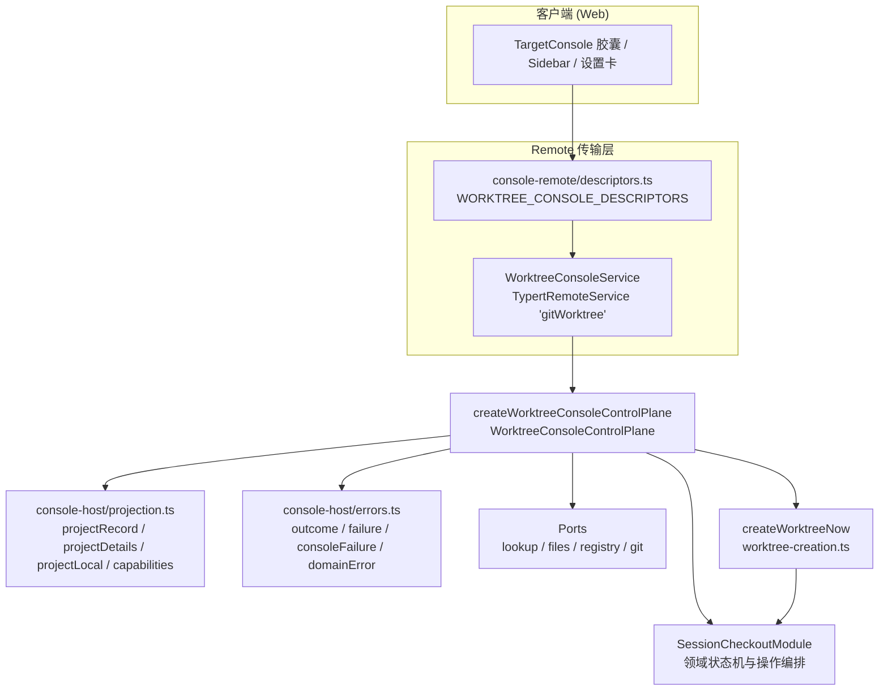
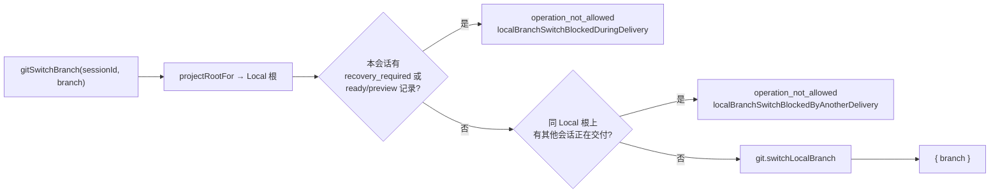
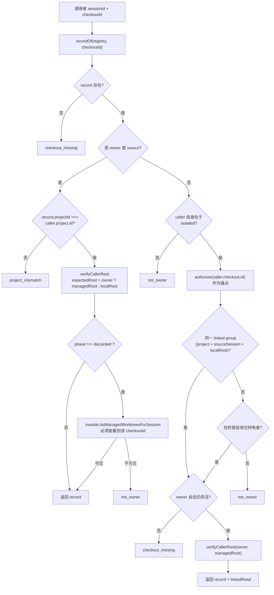
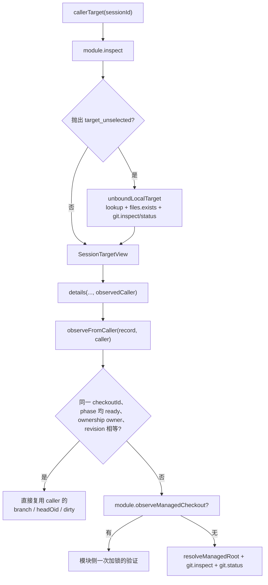
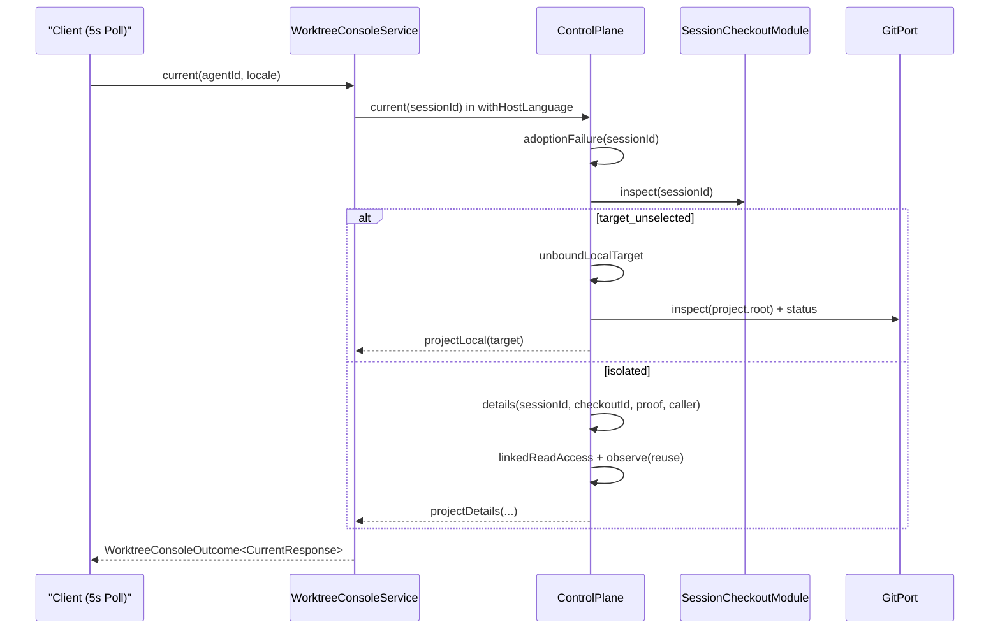
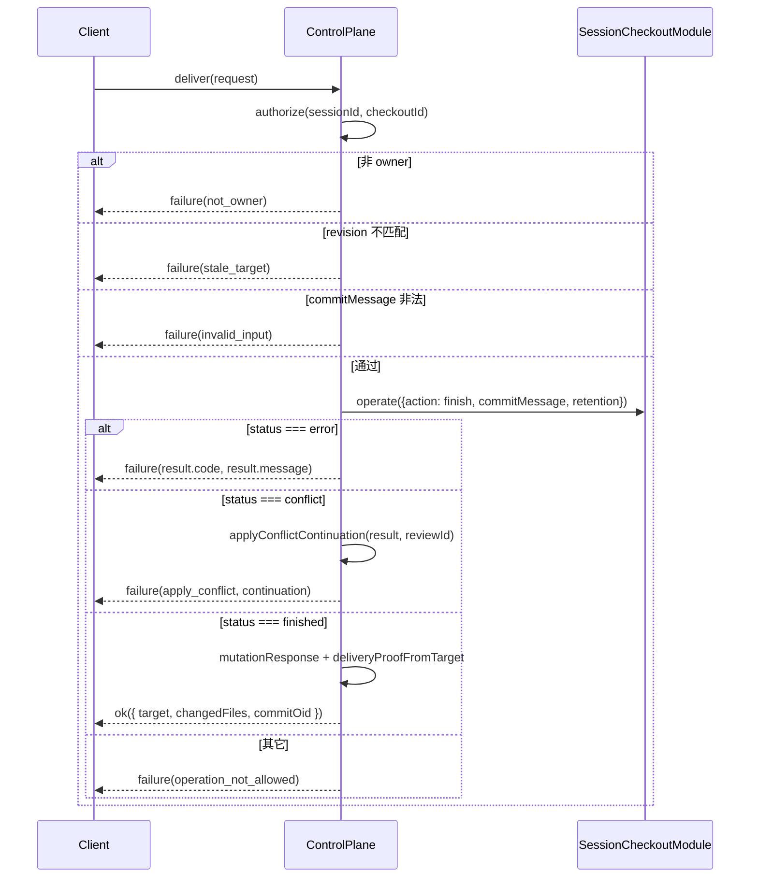
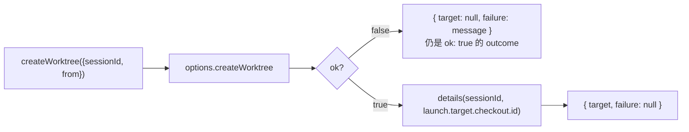
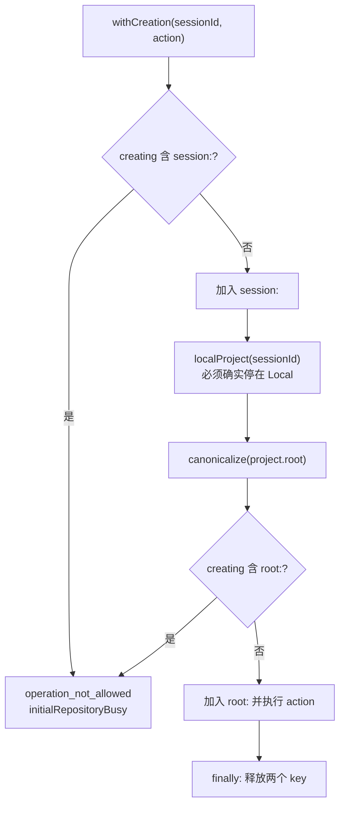
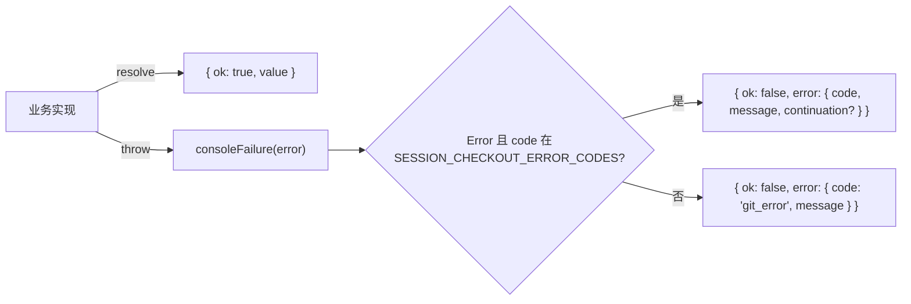

# Worktree Console 控制面（Host 业务编排层）

!!! info "Generated documentation"
    This page was written by CodeWiki from the source code at commit [`86439d17`](https://github.com/wloops/dsh-git-worktree/commit/86439d17222ffee9fc0f92ded6f736585d844e62) on 2026-11-08 with `deepseek-v4.1-flash`. Check the code before relying on details.

`src/console-host/control-plane.ts` 是 Worktree Console 在 **Host 侧的业务控制面**：它把「远程 RPC 面」与「领域状态机 + 端口」之间的所有判断收拢到一个纯函数式工厂里。对外只暴露一个工厂 `createWorktreeConsoleControlPlane(options)`，返回实现了 `WorktreeConsoleControlPlane` 接口的对象；构造参数的类型是 `WorktreeConsoleControlPlaneOptions`。

这一层承担四件事，且只承担这四件事：

1. **解析调用者身份**：把 `sessionId` 变成可验证的 `SessionTargetView`（Local 或 isolated），并处理 `target_unselected` 这类「尚未绑定」的合法中间态。
2. **授权与再校验**：owner / source 归属、project 一致、cwd 与台账根一致、revision CAS、验收位（acceptance slot）归属——全部在**执行时刻**重新判定，绝不信任持久化的 owner id。
3. **投影**：把 `ManagedCheckoutRecord` 与 `SessionTargetView` 投影成 path-free 的 Console DTO（具体投影逻辑在 [console_host_projection — Host 侧投影与能力门控](console_host_projection.md)）。
4. **归一化结果**：所有方法都返回 `WorktreeConsoleOutcome<T>`，异常通过 `outcome()` / `consoleFailure()` 收敛为稳定的错误码。

控制面**不写台账**：它对 `SessionCheckoutRegistryPort` 只调用 `read()`，任何变更都通过 `SessionCheckoutModule` 的 `operate` / `manageManagedWorktreeForSession` / `bind` 等能力完成（测试 `tests/console-host.test.ts` 用一个 `update()` 直接抛错的 registry 双件把这条约束钉死）。

---

## 1. 在系统中的位置



- 上游入口是 [console_host_rpc_service 模块](console_host_rpc_service.md)：`WorktreeConsoleService` 只做三件事——取 `agent.id`、包一层 `withHostLanguage(...)`、把请求参数原样交给控制面。因此**语言上下文**由 Service 通过 `AsyncLocalStorage` 设定，控制面内部直接调用 `hostMessage(...)` 即可得到正确语种（见 [i18n：中英双语文案与语言解析基础设施](i18n.md)）。
- 下游领域能力见 [public_api 模块：插件公共入口与契约面](public_api.md)（`SessionCheckoutModule` 契约）与 [session_checkout_engine 模块概览](session_checkout_engine.md)。
- 端口定义见 [核心端口与类型契约（core_ports_and_types）](core_ports_and_types.md)。
- DTO 契约见 [console_contract 模块（Worktree Console 共享契约）](console_contract.md)。

装配点在 `src/index.ts` 的 `apply()`：

```ts
new WorktreeConsoleService(ctx, createWorktreeConsoleControlPlane({
  module,
  lookup,
  files,
  registry,
  git,
  createWorktree: (sessionId, from) => createWorktreeNow(ctx, module, sessionId, from),
  adoptionFailure: (sessionId) => module.adoptionFailure(sessionId),
}), join(stateDir, 'sidebar-diag.ndjson'), providerLifecycle.officialWorkspaceActive)
```

---

## 2. 构造参数（`WorktreeConsoleControlPlaneOptions`）

| 字段 | 类型 | 说明 |
| --- | --- | --- |
| `module` | `SessionCheckoutModule` | 领域模块。控制面把它当作**唯一的变更入口**。 |
| `lookup` | `SessionCheckoutLookupPort` | 读取会话、项目根、以及可选的 `getSessionCwd`（owner 会话的 live cwd）与 `getSidebarMemberships`（侧栏目录归属）。 |
| `files` | `SessionCheckoutFilesPort` | 只用到 `exists` 与 `canonicalize`：路径存在性与真实路径归一化，是 cwd 身份校验的基础。 |
| `registry` | `SessionCheckoutRegistryPort` | 台账**只读**视图（`ManagedCheckoutRecord` / `sessionBindings`）。 |
| `git` | `SessionCheckoutGitPort` | `inspect` / `status` / `branchOverview` / `graphLog` / 分支与标签操作；全部可选方法都做了能力探测。 |
| `adoptionFailure` | `(sessionId: string) => string \| null` | 本会话最近一次「官方建的树没能接进台账」的原因，由 `current` 原样透传给顶部胶囊；成功接管后模块侧会清空。 |
| `createWorktree` | `(sessionId, from: string \| null) => Promise<CreateWorktreeOutcome>` | **由 Host 注入**的即时建树能力。控制面拿不到官方 `worktrees.create` 需要的 live `Agent`，因此建树必须回注到 Host。 |
| `createTargetSessionId` | `() => string` | 可选，默认 `randomUUID`。工厂内部解析为局部变量，为「需要预分配目标会话 id」的调用路径预留；当前实现中建树走注入的 `createWorktree`，该值尚未被读取。 |

`CreateWorktreeOutcome` 也在本文件导出：

```ts
export type CreateWorktreeOutcome =
  | { readonly ok: true; readonly launch: IsolatedTargetLaunch }
  | { readonly ok: false; readonly message: string }
```

---

## 3. 方法总览（`WorktreeConsoleControlPlane`）

读取类方法接收位置参数（`sessionId`、`checkoutId`…），变更类方法接收**带 `sessionId` 的完整请求 DTO**——这样 Service 只需把 `agent.id` 填进去，控制面内部统一做授权。

### 3.1 观察与投影

| 方法 | 作用 | 关键约束 |
| --- | --- | --- |
| `sidebarTopology()` | 侧栏拓扑：按项目聚合任务 + 目录归属 | 只读台账；输出 path-free；每个 owner 会话只保留最新迭代 |
| `current(sessionId)` | 顶部胶囊轮询 | Local 走 `projectLocal`；isolated 走完整 `details`；附带 `adoptionFailure` |
| `list(request)` | 项目管理面板列表 | 按调用者 project + `sourceSessionId` + `localRoot` 三重过滤；批量观察失败时逐条降级 |
| `inspect(sessionId, checkoutId)` | 打开某个目标 | 与 `current` 共用 `details`，但没有「本请求已观察过」的复用证据 |
| `gitOverview(sessionId)` | 分支 chip 的仓库总览 | 始终解析到 **Local 项目根**，与当前所在 worktree 无关 |
| `gitGraph(sessionId, limit = 200)` | 提交图（lane 由客户端计算） | 同上 |
| `listAbandoned(sessionId)` | 放弃快照列表 | 直接委托模块 |

### 3.2 生命周期变更

| 方法 | 委托给 | 额外前置条件 |
| --- | --- | --- |
| `discard(request)` | owner → `module.operate({action:'discard'})`；source 且 owner 已消失 → `manageManagedWorktreeForSession` | source 会话在 owner 仍可用时被拒绝（`theOwnerSessionHasTakenOverThisWorktreeOnly467`） |
| `deliver(request)` | `module.operate({action:'finish'})`，**不传 `expectedReviewId`** | owner + revision CAS + `isValidCommitMessage`；冲突转 `apply_conflict` + continuation |
| `setRetention` / `setPermanent` / `retryCleanup` | `manageManagedWorktreeForSession` | 一律 `requireOwner`：保留期/常驻/清理会真的删冻结目录 |
| `beginNextIteration(request)` | `module.beginNextIteration` | owner + revision + `phase==='discarded' && delivery.state==='delivered'` + owner 根匹配 `managedRoot` **或** `localRoot` + 血缘校验 |
| `returnToLocal(request)` | `module.bind(sessionId, {kind:'local'})` | 仅已交付且处于终态（`discarded`/`finalized`/`retained`）；幂等：绑定已不在该 checkout 时返回当前 Local 投影 |
| `createWorktree(request)` | 注入的 `options.createWorktree` | 失败以**值**返回（`{ target: null, failure }`），不是错误 |
| `clearSidebarBadge(request)` | `manageManagedWorktreeForSession({action:'clear_sidebar_badge'})` | 只有终态（`discarded`/`finalized`）徽章可清 |
| `initProject(sessionId)` | `git.initializeProject` | 走 `withCreation` 互斥；要求调用者确实停在 Local |

### 3.3 Git 仓库操作

`gitCreateBranch` / `gitSwitchBranch` / `gitListTags` / `gitCreateTag` / `gitDeleteTag` / `gitPushTag` 全部先经 `projectRootFor(sessionId)` 解析到 **Local 项目根**（分支 chip 是仓库级界面，不能因为会话恰好位于某个 worktree 而漂移）。`gitOverview` / `gitGraph` 同样如此。

唯一的例外是 `gitPruneMergedBranches`：它直接委托 `module.pruneMergedBranchesForSession(sessionId, { dryRun })`，因为「哪些分支可安全删除」必须由领域层自己判定（`git branch -d` 语义，永不 force）。

`gitSwitchBranch` 是唯一带「交付互锁」的 Git 变更：



理由写在源码注释里：切换 Local 分支会改变 **所有** 待应用的 apply-to-local 的基线。

### 3.4 放弃快照

`listAbandoned` 直接返回模块的 `listAbandonedWorktreeSnapshots`；`restoreAbandoned` 先 `authorize` 再调用模块恢复（`discarded` 记录没有活 target，所以不能走 `details`）。

---

## 4. 授权模型

授权是这一层最厚的部分，入口有三个：`authorize`（本 checkout 的直接参与者）、`linkedReadAccess`（同组只读 / 验收位持有者）、`requireOwner`（破坏性维护）。



### 4.1 `verifyCallerRoot`：cwd 身份的四条证据链

`expectedRoot` 对 owner 是 `managedRoot`，对 source 是 `localRoot`。但真实世界里还有几种「合理但不等」的情形，源码逐条列出：

1. **owner 的 live cwd**（`lookup.getSessionCwd`）：托管会话运行期 cwd 就是 `managedRoot`，而 `project.root` 永远指向 Local。只按 `project.root` 判会把每个 owner 调用都判成 `project_mismatch`。
2. **已交付的 owner 回落到 Local**：交付后 cwd 已回到 Local，冻结环境还在磁盘上（`retained`/`finalized`），或已被清掉（`discarded` + `delivered`）。此时 Local 就是授权边界。
3. **目录已被清理**：`managedRoot` 仍在记录里但目录已不存在，`canonicalize` 会抛 `ENOENT`——若不拦住，胶囊会永久显示「不可用」。因此终态 owner 分支必须在 canonicalize 之前可达。
4. **项目根目录缺失**：`project.root` 不存在且 `resolve(project.root) === resolve(expectedRoot)` 时，仍按终态 owner 放行。

实现细节：`canonical()` 用 `Map` 做**单请求内记忆化**——这个闸门最多会对同一路径问四次（live cwd、`expectedRoot`、`record.localRoot`、`project.root`），而 `realpath` 是真实系统调用。`sameLocalRoot` 在 win32 上做大小写归一。

`ownerDeliverySettled` 的判定刻意同时要求「delivery 已达」与「phase 处于 `discarded`/`finalized`/`retained`」，避免半写状态或未来的非法组合借 Local 边界绕过校验。

### 4.2 `linkedReadAccess` 与验收位

同一 Local 根上可能挂着多个 checkout（历史迭代、同项目的其他会话）。只读访问允许「同组」放宽，但必须：

- 调用者自己先通过 `authorize`（锚点）；
- 被请求记录与锚点 **project、sourceSession、localRoot 三者相同**；
- 或恰好命中 `acceptanceHolder`（锚点处于 `ready` + `ready_for_review` 且其验收位正是该 checkoutId）；
- 且被请求记录的 **owner 会话仍然存活**（`ownerSessionAvailable`），否则 `checkout_missing`。

验收位是「一次只能有一个 preview/finish」的串行化装置。命中验收位时，`details` 会在投影前**再读一次台账**做二次确认（`currentHolder` / `currentRequested` / `localRoot` / `managedRoot` 全部重比），失败即 `not_owner` + `theAcceptanceSlotHolderHasChangedCheckAgain`。

`projectReviewSlot` 把这件事投影成 UI 可见的两态：

| 状态 | 条件 | 附带字段 |
| --- | --- | --- |
| `reviewSlot: 'available'` | `delivery.state === 'ready_for_review'` 且无其他持有者 | — |
| `reviewSlot: 'waiting'` | 存在 `acceptanceHolder` | `reviewSlotOwnerSessionId`、`reviewSlotHolder`，并把 `capabilities` 的 `preview`/`checkpoint`/`finalize` 全部置 false |

`acceptanceHolder` 的判定覆盖 `preview_active` 以及 journal 处于 `preview` / `rollback_preview` / `finalize_preview` / `finish` 的记录——即「正在动 Local 的那一个」。

---

## 5. 观察复用与性能

胶囊每 5 秒轮询一次 `current`（见 [会话目标胶囊与工作树控制台（client_target_console）](client_target_console.md)），而一次 `current` 的第一件事是 `module.inspect(sessionId)`：`inspectIsolated` 会跑一次 `git status` 加两次 `git inspect`。若随后投影再调 `observe()`，同一组三次 spawn 会被重放。

因此控制面做了三层复用：



- `observeFromCaller` 只复用 **活跃（`ready`）owner 视图**。已交付终态故意走权威路径：`committedFollowupView` 会保守地报 `dirty: true`，胶囊必须显示冻结环境的真实状态。
- `observeManagedCheckout` / `observeManagedCheckouts`（模块可选能力）能顺带返回 `localSnapshot`，这份快照就是 `settledLocalBranch` 的答案，省掉一次对 `localRoot` 的 `inspect`。
- `list` 用**批量**观察：`observeManagedCheckouts(ids)` 一次拿锁并行验证；抛错则退回逐条 `observe`，并且**单条失败只让该条降级**（以无观察投影呈现，后续操作的 CAS 校验仍会兜底拒绝），不允许一条坏记录拖垮整个面板。

`settledLocalBranch` 解决的是「交付后胶囊仍在念 `feat/...`」的症状：

| 返回值 | 含义 |
| --- | --- |
| `undefined` | 不是「已交付 owner 读取」，保留 worktree 分支 |
| `string` | 已交付且 Local 可观察，显示用户真正站着的分支（如 `master`） |
| `null` | 已交付但 Local 此刻不可观察（根缺失 / Git 瞬时失败），退回记录的 session 分支 |

额外守卫：若 owner 又重新进入了保留中的冻结目录（`withinRoot(liveCwd, managedRoot)`），则不切换标签——它确实还在 worktree 里。

---

## 6. 关键流程

### 6.1 `current`：胶囊轮询



Service 侧会记录 `durationMs` / `code` / `message` 到 `sidebar-diag.ndjson`（8 MiB 轮转，保留一个 `.1` 备份）——这是「胶囊为什么一直显示不可用」唯一的一手现场证据。

### 6.2 `deliver`：交付与冲突延续



`deliver` 是**唯一不走 `outcome()` 包装**的变更方法：它自己 `try/catch` 并在 catch 里用 `consoleFailure(error)`，因为它需要在中途返回 `failure(...)` 而不是抛异常。

它**不传 `expectedReviewId`**：评审面板已移除，会话正常停在 `working`，胶囊的「交付」必须能在没有评审身份时直接完成（测试 `deliver commits from the working state without demanding a review identity` 固化了这点）。

冲突延续（`WorktreeApplyConflictContinuation`）在 Host 侧就被清洗，避免把不可信内容回灌给客户端：

| 校验 | 规则 | 失败错误 |
| --- | --- | --- |
| `localHeadOid` | 必须匹配 `^(?:[0-9a-f]{40}|[0-9a-f]{64})$` | `git_error` |
| `conflictingFiles` 数量 | ≤ 500 | `git_error` |
| 单文件路径 | 非空、≤ 1000 字符、无控制字符、非绝对路径（Windows 盘符或 `/`）、无空/`.`/`..` 段 | `git_error` |
| `requestId` | `apply-conflict:<checkoutId>:<reviewId>:<revision>:<localHeadOid>`，稳定可用于单飞与重试 | — |

（同文件的 `safeRecoveryRequestId` 是给 continuation 请求 id 预留的长度/换行校验器，当前未被任何返回方法引用。）

### 6.3 建树：失败是值，不是错误



这样客户端在点击那一刻就能看到结果与原因，不需要再发一条消息去「激活」请求；也不会把「用户会话不活跃」这类可预期原因变成红色错误。

---

## 7. 侧栏拓扑与徽章状态

`sidebarTopology` 是唯一不依赖调用者身份的读方法（侧栏是全局的），因此它**只输出 path-free 结构**：`project`、`tasks`、`memberships`（目录归属 id 列表）。测试断言 `JSON.stringify(result)` 中不出现任何 root 路径。

`sidebarTaskState(record)` 的映射顺序即优先级：

| 顺序 | 条件 | 状态 |
| --- | --- | --- |
| 1 | `worktreeReachedDelivery(phase, delivery.state)` | `finalized` |
| 2 | `phase === 'discarded'` | `discarded` |
| 3 | `phase === 'recovery_required'` | `recovery_required` |
| 4 | `delivery.state === 'preview_detached'` | `preview_detached` |
| 5 | `delivery.state === 'preview_active'` | `preview_active` |
| 6 | `delivery.state === 'ready_for_review'` | `ready_for_review` |
| 7 | 其它 | `working` |

第 1 条优先于 phase 是刻意的：一个「已交付到 Local 然后被清理」的 worktree（`phase: discarded` + `delivery: delivered`）是**完成了的任务**，绝不能读成「已放弃」；只有「discard 但从未 delivered」才是真放弃。这个谓词定义在 [console_contract 模块（Worktree Console 共享契约）](console_contract.md) 的 `worktreeReachedDelivery`，控制面只引用不复写，避免闸门与 UI 投影漂移。

另外两条规则：

- **用户清空的终态徽章**：当 `sidebarBadgeClearedRevision === record.revision` 且状态为 `discarded`/`finalized` 时，该任务不再投影（但目录归属保留）。revision 一变，标记自然失效。
- **每个 owner 会话只保留最新迭代**：`tasksByOwner` 按 `iteration` 优先、`revision` 次优取大。
- **目录归属取并集**：`memberships` 从**所有**迭代累加，不只最新 owner——清理可能已经删掉了成员目录，但目录身份仍需保留。

`list` 的 `needsAttention` 是白名单而非黑名单：只有 `cleanup_pending`、`preview_detached`、`recovery_required` 三种投影态会被保留（预览漂移和清理阻塞一样需要用户处理）。

---

## 8. 并发控制

只有一个「互斥集合」，用于建树/初始化这类「同一仓库不能并行起两次」的操作：



`root:` 键在 win32 上做小写归一。这样「同一会话连点两次」与「两个会话对同一仓库同时建树」都会被拦下，而不同仓库互不阻塞。

其余并发安全依赖领域层：`operate` / `manageManagedWorktreeForSession` 在跨进程文件锁内做读-改-写，`expectedRevision` 提供 CAS。控制面在变更前**总是重新 `inspect`**（`authorize` 不传 `observedCaller`），只有只读端点才复用本请求内的观察。

---

## 9. 错误与结果归一化

所有方法（除 `deliver`）都被 `outcome(...)` 包裹：



要点：

- `domainError(code, message, continuation?)` 构造带 `code` 的 `Error`，是控制面内部的**唯一抛出方式**；`message` 一律来自 `hostMessage(...)`，因此语种跟随 Service 设定的 `AsyncLocalStorage`。
- 非领域异常统一降级为 `git_error`，并保留原始 message（本地控制台 UI 需要可观测性；源码注释标注了「若将来出现远程面需先脱敏」）。
- `failure(...)` 用于需要**携带 details / continuation** 的显式失败分支（如 `deliver`）。
- 客户端拿到 `code` 后如何决定提示与恢复动作，见 [console_contract 模块（Worktree Console 共享契约）](console_contract.md) 的 `worktreeConsoleErrorMeta`。

控制面实际产出的错误码集合：`session_not_found`、`project_not_found`、`project_root_missing`、`not_git_repository`、`checkout_missing`、`checkout_mismatch`、`project_mismatch`、`not_owner`、`stale_target`、`invalid_input`、`operation_not_allowed`、`preview_not_active`、`apply_conflict`、`git_error`。

---

## 10. 与测试

`tests/console-host.test.ts` 是本模块的主要行为契约，覆盖：

- `deliver` 不带 `expectedReviewId`、从 `working` 直接交付；
- `target_unselected` 被投影成 Local 且**不触发 `bind`**（不隐式改绑定）；
- 分支标签优先级：`sessionBranch` → 记录的 `sourceRef` → `null`；
- 非 Git 仓库不给 `capabilities.create`，且**不读 `git status`**；
- 侧栏只保留最新迭代、`discarded`+`delivered` 读作 `finalized`、真放弃读作 `discarded`；
- `memberships` 跨迭代取并集且输出无路径；
- 已清理的交付 owner 在目录缺失时仍可投影。

测试用的 registry 双件把 `update()` 实现为抛错，从而静态保证「控制面不写台账」。运行方式见 `package.json` 的 `test`（`vitest run`）与 `vitest.config.ts`（Windows 上关闭文件级并行以避免 Git fixture 争抢句柄）。

---

## 11. 相关页面

- 上层 RPC 面：[console_host_rpc_service 模块](console_host_rpc_service.md)
- 投影与能力位：[console_host_projection — Host 侧投影与能力门控](console_host_projection.md)
- 父模块总览：[console_host：Worktree 控制平面与 Host RPC 服务](console_host.md) / [Console_API_and_Host_Integration：控制台 API 与 Host 集成](Console_API_and_Host_Integration.md)
- 共享 DTO 与错误元数据：[console_contract 模块（Worktree Console 共享契约）](console_contract.md)
- Remote 描述符与客户端适配器：[console_remote：控制台远程契约层（Typert Remote）](console_remote.md)
- 领域模块契约：[public_api 模块：插件公共入口与契约面](public_api.md)
- 端口与类型：[核心端口与类型契约（core_ports_and_types）](core_ports_and_types.md)
- 客户端消费方：[会话目标胶囊与工作树控制台（client_target_console）](client_target_console.md)
- 多语言消息：[i18n：中英双语文案与语言解析基础设施](i18n.md)

??? abstract "Documented components (2)"
    - [`WorktreeConsoleControlPlane`](https://github.com/wloops/dsh-git-worktree/blob/86439d17222ffee9fc0f92ded6f736585d844e62/src%5Cconsole-host%5Ccontrol-plane.ts) — `src\console-host\control-plane.ts`
    - [`WorktreeConsoleControlPlaneOptions`](https://github.com/wloops/dsh-git-worktree/blob/86439d17222ffee9fc0f92ded6f736585d844e62/src%5Cconsole-host%5Ccontrol-plane.ts) — `src\console-host\control-plane.ts`

