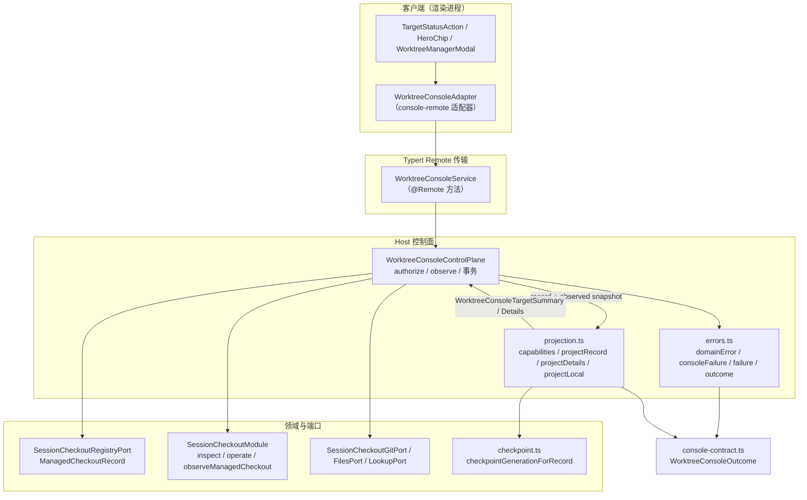
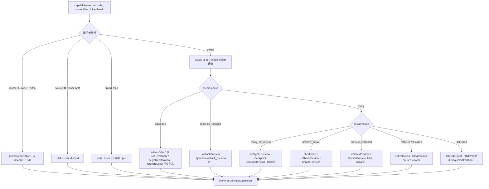
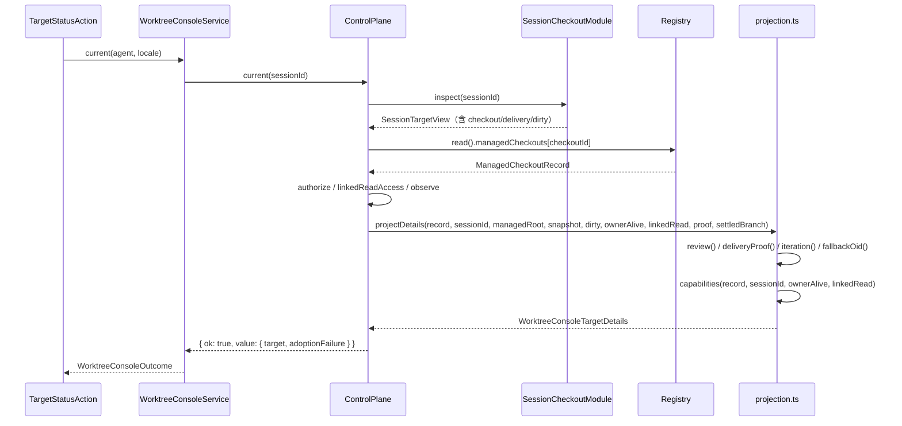
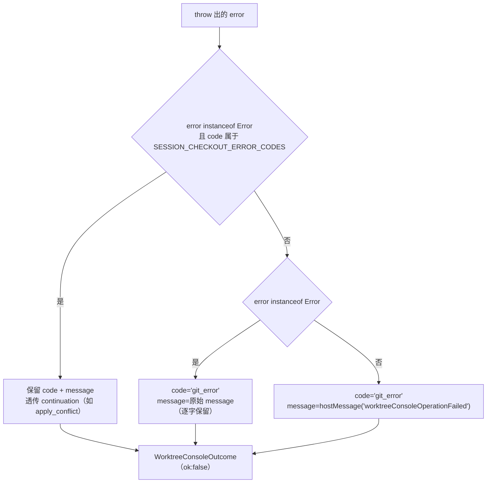
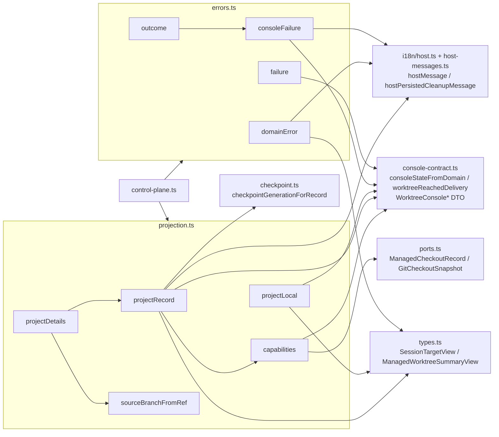

# console_host_projection — Host 侧投影与能力门控

!!! info "Generated documentation"
    This page was written by CodeWiki from the source code at commit [`a31b152e`](https://github.com/wloops/dsh-git-worktree/commit/a31b152eb2d94b07c91dc0c4efe18370375de1af) on 2026-11-12 with `mimo-v2.6-flash`. Check the code before relying on details.

本模块是 `console_host` 的**只读投影层**：它把领域层的 `ManagedCheckoutRecord`（台账记录）与一次性的 Git 观测结果，翻译成 Console 契约中面向 UI 的 DTO（`WorktreeConsoleTargetSummary` / `WorktreeConsoleTargetDetails`），并在同一趟里算出调用者 Session 对每个操作的能力开关（`WorktreeConsoleCapabilities`）。同时它提供 Host 侧统一的**错误封装**，把领域异常与第三方异常收敛成 `WorktreeConsoleOutcome` 这一可序列化的结果形状。

它不做任何授权判定、不做 IO 写操作、不持有状态：所有"是否允许"的**判定结果**由控制面（`WorktreeConsoleControlPlane`）先行求出，投影层只负责**表达**。授权与事务边界见 [Worktree Console 控制面（Host 业务编排层）](console_host_control_plane.md)，RPC 入口见 [console_host_rpc_service 模块](console_host_rpc_service.md)。

---

## 1. 模块构成

| 文件 | 核心导出 | 职责 |
| --- | --- | --- |
| `src/console-host/projection.ts` | `capabilities`、`projectRecord`、`projectDetails`、`projectLocal`、`sourceBranchFromRef` | 领域记录 → Console DTO；按调用者身份与记录状态计算能力开关 |
| `src/console-host/errors.ts` | `consoleFailure`、`domainError`、`failure`、`outcome` | 领域错误构造、错误 → `WorktreeConsoleOutcome` 的归一化、结果包装 |

两个文件的共同特征：**纯函数 + 无副作用**。`projection.ts` 只以 `import type` 引用端口类型（`ports.ts` 的 `ManagedCheckoutRecord`、`GitCheckoutSnapshot`），从不引入任何端口实现、Cordis 上下文、React 或 Remote 符号；`errors.ts` 只做对象构造。因此两者可以被控制面在任意事务边界之后调用，也便于用假记录做单测。

---

## 2. 架构位置



关键读法：

- **投影是控制面的下游、传输的上游**。控制面拿到"授权通过的记录 + 已观测到的快照"后调用投影，把结果直接塞进 `WorktreeConsoleOutcome.value`；传输层（Typert）再按 `console-remote/schemas.ts` 校验序列化。契约定义见 [console_contract 模块（Worktree Console 共享契约）](console_contract.md)。
- **投影层不产生新的 IO**。它需要的 Git 观测（`snapshot`、`dirty`、`managedRoot`、`localSnapshot`）由控制面 `observe()` / `module.inspect()` 一次性取得后以参数传入，这也是控制面刻意复用调用者视图（`observeFromCaller`）以省掉重复 `git status`/`git inspect` 的原因。

---

## 3. 能力门控：`capabilities()`

`capabilities(record, callerSessionId, ownerSessionAvailable = true, linkedRead = false)` 返回一个**布尔矩阵**，描述"当前调用者此刻能不能做这件事"。它是整个 Console UI 唯一的按钮可用性来源——客户端不再自行推断状态。

### 3.1 输入

| 参数 | 含义 | 来源 |
| --- | --- | --- |
| `record` | 台账中的 `ManagedCheckoutRecord`（`phase` + `delivery` + `journal`） | `SessionCheckoutRegistryPort.read()` |
| `callerSessionId` | 本次调用的 Session（Host 已解析，绝不信任客户端传值） | `Agent.id` |
| `ownerSessionAvailable` | owner Session 是否仍然存在（被删除的 Agent 会话为 `false`） | `lookup.getSession(record.ownerSessionId)` |
| `linkedRead` | 是否走了"同源组只读"通道（非 owner/source 的关联会话） | 控制面 `linkedReadAccess()` |

### 3.2 派生的身份与状态谓词

```text
owner            = callerSessionId === record.ownerSessionId
source           = callerSessionId === record.sourceSessionId
sourceReservation= source && !ownerSessionAvailable      // owner 消失后 source 可代为收尾
readAuthorized   = owner || source || linkedRead
ready            = phase === 'ready' && delivery.state === 'ready_for_review'
previewActive    = phase === 'ready' && delivery.state === 'preview_active'
previewDetached  = phase === 'ready' && delivery.state === 'preview_detached'
previewRecovery  = phase === 'recovery_required'
                   && delivery.state === 'preview_active'
                   && journal?.operation === 'rollback_preview'
cleanup          = delivery.state === 'finalized' || delivery.state === 'retained'
delivered        = phase === 'discarded' && delivery.state === 'delivered'
active           = phase !== 'discarded'
```

### 3.3 能力表

| 能力 | 表达式 | 设计意图 |
| --- | --- | --- |
| `create` | 恒为 `false` | 建树能力只属于 Local 投影（见 `projectLocal`）；隔离目标不能自我复刻 |
| `open` | `readAuthorized && active && (!linkedRead \|\| ownerSessionAvailable)` | 只读关联者仅在 owner 仍存活时可打开 |
| `inspect` | `readAuthorized` | 详情读取与打开解耦：已放弃记录仍可查看历史 |
| `discard` | `(owner \|\| sourceReservation) && active && !cleanup && !previewDetached` | 预览漂移（detached）时禁止删除，必须先撤回 Preview 以保留恢复证据 |
| `preflight` | `owner && ready` | 同步预检 |
| `preview` | `owner && ready` | 写入 Local Preview |
| `checkpoint` | `owner && (ready \|\| previewActive)` | 保存只存在于托管 Worktree 的阶段 |
| `resumeRevision` | `owner && ready` | 让未同步的 Review 失效并回到同一轮 Working |
| `rollbackPreview` | `owner && (previewActive \|\| previewDetached \|\| previewRecovery)` | 三个需要撤回的入口合一 |
| `finalize` | `owner && ready` | Ready → Commit，跳过 Local Preview |
| `finalizePreview` | `owner && (previewActive \|\| previewDetached)` | 完成 Preview 验收 |
| `setRetention` | `owner && delivery.state === 'retained'` | 只有已保留态才有保留期可改 |
| `setPermanent` | `owner && active` | 常驻标记豁免自动清理 |
| `retryCleanup` | `owner && cleanup` | 仅在 finalized/retained 的清理阻塞下可重试 |
| `beginNextIteration` | `owner && delivered` | 只有在"已交付且清理成功"（`phase='discarded'` + `delivery='delivered'`）时才允许复用同一个 immutable cwd 进入下一轮 |
| `returnToLocal` | `owner && worktreeReachedDelivery(phase, delivery.state)` | 只有任务成果已经落到 Local，才允许把 Session 从 isolated 解绑回 Local；在途 Worktree 解绑会把未合并工作留在冻结目录 |

> `returnToLocal` 与 `beginNextIteration` 共用 `worktreeReachedDelivery()`（定义在 `src/console-contract.ts`），保证"已交付"的判据只有一份，不会在 UI 投影与控制面校验之间漂移。

### 3.4 门控决策流



### 3.5 与控制面的"复核槽位"协作

`capabilities` 只回答"这个调用者能不能"，不回答"这个项目此刻允不允许"。同项目的 Local 验收槽位互斥由控制面的 `projectReviewSlot()` 负责：当另一条记录占用槽位时，它会覆盖投影结果，把 `reviewSlot` 置为 `'waiting'` 并强制 `preview` / `checkpoint` / `finalize` 为 `false`。因此**能力矩阵是可被上层收窄的**，客户端必须使用最终返回值而非自行重算。槽位判定细节见 [Worktree Console 控制面（Host 业务编排层）](console_host_control_plane.md)。

---

## 4. 记录投影：`projectRecord()` / `projectDetails()` / `projectLocal()`

### 4.1 投影主流程



### 4.2 `projectRecord()` 的字段来源

`projectRecord(record, callerSessionId, observed?)` 产出**无路径**的 `WorktreeConsoleTargetSummary`，可安全用于列表与状态胶囊。

| DTO 字段 | 来源 / 规则 |
| --- | --- |
| `project` | `record.projectId` + `record.projectName` |
| `checkoutId` | 记录主键 |
| `sourceSessionId` | `record.sourceSessionId ?? record.ownerSessionId`（历史记录无 source 字段时退化为 owner） |
| `ownerSessionId` / `targetSessionId` | 均为 `record.ownerSessionId`（目标 Session 即 owner） |
| `iteration` | `review` 存在时取 `review.iteration`，否则取 `delivery.iteration` |
| `state` | `consoleStateFromDomain({ kind: 'isolated', phase, deliveryState })`，状态机定义在契约层，见 [console_contract 模块（Worktree Console 共享契约）](console_contract.md) |
| `dirty` | `observed.dirty ?? observed.summary?.dirty ?? false` |
| `currentOid` | `observed.snapshot?.headOid`，否则 `fallbackOid()`：`proof.localHeadAfter` → `delivery.commitOid` → `applyBaseOid` → `baseOid` |
| `sourceBranch` | `sourceBranchFromRef(record.sessionBranch ?? record.sourceRef)`；**会话分支优先于分叉点**，否则侧栏卡片会把别人的分支名当作本任务的标签 |
| `retention` / `retainedAt` / `expiresAt` | 仅 `delivery.state === 'retained'` 时出现 |
| `cleanupMessage` | 仅 retained/finalized 且存在时出现；经 `hostPersistedCleanupMessage()` 按当前语言翻译（见 [i18n：中英双语文案与语言解析基础设施](i18n.md)） |
| `cleanupReason` | 结构化的清理阻塞原因，供客户端给出"放弃改动再清理"的显式确认 |
| `permanent` | `record.permanent === true` 时出现 |
| `deliveryProof` | `observed.deliveryProof` 优先；`linkedRead === true` 时**强制丢弃**（只读关联者不获取交付证据） |
| `review` | `delivery` 中带 `review` 时投影：`reviewId`、`revision`、`iteration`、`preparedAt`、`summary`、`validationStatus`、`tests`、`changedFiles`、`suggestedCommitMessage` |
| `checkpoints` | `record.checkpoints` 非空时逐条投影（`changedFiles` 复制为数组） |
| `checkpointGeneration` | `checkpointGenerationForRecord(record)` 的 CAS 代际（仅 ready_for_review / preview_active 有值） |
| `reviewSlot` | `delivery.state === 'ready_for_review'` 时预置 `'available'`，由控制面按槽位占用改为 `'waiting'` |
| `previewRecovery` | 仅 `preview_detached`：`previewId`、`detachedAt`、`reason`、`attemptedAction` |
| `capabilities` | `capabilities(record, callerSessionId, ownerSessionAvailable, linkedRead)` |

### 4.3 `projectDetails()` 追加的字段

`projectDetails()` 先复用 `projectRecord()`，再补上**只在通过身份校验后才可下发**的路径与恢复上下文：

| 字段 | 规则 |
| --- | --- |
| `managedRoot` | 控制面 `observe()` 返回的托管根；已放弃记录为 `null` |
| `sourceRoot` | `record.localRoot`（Host 校验过的规范路径） |
| `sourceOid` | `record.baseOid`（记录时的分叉基点） |
| `currentBranch` | `settledLocalBranch ?? snapshot?.branch ?? sourceBranchFromRef(record.sessionBranch ?? '')`：已交付记录优先显示 owner 真正所在的 Local 分支（如 `master`）；`undefined` 表示非"已交付 owner 读取"场景，保持 Worktree 分支；`null` 表示 Local 暂不可观测，退回记录的分支名 |
| `recoveryContinuation` | 仅 `callerSessionId === ownerSessionId && !linkedRead && record.recoveryContinuation` 存在时下发，按四种 `kind` 展开为带 `requestId` / `checkoutId` / `reviewId` / `revision` 等字段的**一次性恢复凭证** |

四种恢复续作（`worktree_apply_conflict`、`worktree_review_regeneration`、`worktree_preview_recovery_analysis`、`worktree_preview_recovery_handoff`）的完整字段语义见 [console_contract 模块（Worktree Console 共享契约）](console_contract.md)；其持久化结构在 [核心端口与类型契约（core_ports_and_types）](core_ports_and_types.md) 的 `ManagedCheckoutRecord.recoveryContinuation`。

### 4.4 `projectLocal()`

Local 目标的投影是一张**写死的零能力表**，只有三个例外：

- `create`：`target.current.oid !== 'unversioned'`（空仓库尚未有提交时不能建树）
- `open` / `inspect`：恒为 `true`
- 其余全部 `false`，并且 `checkoutId = null`、`iteration = 0`、`state = phase = 'local'`、`commitOid = null`

这保证了客户端在 Local 与 Isolated 两种投影之间可以使用同一套渲染逻辑，无需分支判断。

### 4.5 数组复制与不可变性

投影对 `changedFiles`、`tests`、`checkpoints`、`deliveryProof.changedFiles` 一律做浅复制。原因：`ManagedCheckoutRecord` 是台账读出的对象，直接共享引用会让客户端（或后续投影）意外改写内存中的台账视图。这条约束在维护时应保持不变。

---

## 5. 错误封装：`errors.ts`

### 5.1 四个导出

| 导出 | 签名要点 | 用途 |
| --- | --- | --- |
| `domainError(code, message, continuation?)` | 返回 `Error`，并 `Object.assign` 上 `code`（必要时 `continuation`） | 控制面在 `throw` 路径构造**可识别的领域错误**，由 `outcome()` 统一捕获 |
| `consoleFailure(error)` | `unknown` → `WorktreeConsoleOutcome<never>` | 把任意抛出物归一化为失败结果 |
| `failure(code, message, details?, continuation?)` | 直接构造失败结果 | 控制面在**不需要 throw** 的分支（如 `deliver` 的 CAS 校验）返回结构化失败 |
| `outcome(operation)` | `() => Promise<T>` → `Promise<WorktreeConsoleOutcome<T>>` | 把"抛异常式"实现包成"结果式"接口 |

### 5.2 `consoleFailure()` 的两条路径



要点：

1. **错误码白名单校验**。只有落在 `SESSION_CHECKOUT_ERROR_CODES` 内的 `code` 才会被保留，避免第三方库自带的 `code`（如 `ENOENT`、`ERR_*`）冒充领域错误码污染客户端的 `worktreeConsoleErrorMeta()` 分类。
2. **第三方文案逐字保留**是有意为之：本地 Console UI 需要让用户看到真实的 Git 报错，`tests/host-i18n.test.ts` 会显式断言这条透传行为。源码注释同时标注了天花板——一旦错误要经远程传输离开本机，必须先在此处脱敏/截断。
3. **`continuation` 透传**让 `apply_conflict` 的冲突恢复凭证（`requestId`、`conflictingFiles`、`localHeadOid`）能从 `throw` 路径一路带到客户端，客户端据此做单飞（single-flight）与重试。

### 5.3 与控制面的协作约定

- 控制面里每个对外方法都包在 `outcome(async () => …)` 中，所以**抛错即失败**，不必为每个 `throw` 手写返回。
- `deliver` 是唯一同时使用 `failure()`（前置 CAS 校验失败）与 `consoleFailure()`（`catch` 兜底）的方法，因为它需要在应用冲突时携带 `continuation`，同时又要保证异常不外泄。
- 错误码 → 分类/恢复建议的映射表（`ERROR_META` / `worktreeConsoleErrorMeta`）在契约层，不在本模块，见 [console_contract 模块（Worktree Console 共享契约）](console_contract.md)。

---

## 6. 依赖关系



依赖方向严格单向：`projection.ts` 与 `errors.ts` **不 import** `control-plane.ts`、`service.ts` 或任何 Cordis/React/Remote 符号。这保证了：

- 可用假 `ManagedCheckoutRecord` 做纯函数单测；
- 未来若把 Console 面替换为远程传输，投影层无需改动。

---

## 7. 与其它模块的边界

| 关注点 | 归属模块 | 说明 |
| --- | --- | --- |
| Host 侧整体分层（控制面 / 投影 / RPC） | [console_host：Worktree 控制平面与 Host RPC 服务](console_host.md) | 本页是其中的投影子模块 |
| 授权、路径证明、验收槽位互斥、CAS 事务 | [Worktree Console 控制面（Host 业务编排层）](console_host_control_plane.md) | 投影层只消费其结果，不重复判定 |
| `@Remote` 方法、语言上下文、诊断日志 | [console_host_rpc_service 模块](console_host_rpc_service.md) | 每个方法用 `withHostLanguage()` 包住控制面调用，投影内的 `hostMessage` 因此拿到正确语言 |
| DTO 形状、状态机、错误码分类表 | [console_contract 模块（Worktree Console 共享契约）](console_contract.md) | `consoleStateFromDomain`、`worktreeReachedDelivery`、`WorktreeConsoleCapabilities` 等 |
| 台账记录结构、`delivery` 联合类型 | [核心端口与类型契约（core_ports_and_types）](core_ports_and_types.md) | `ManagedCheckoutRecord`、`ManagedCheckoutDelivery`、`ManagedDeliveryProof` |
| 状态机与操作实现（`operate()`） | [session_checkout_engine 模块概览](session_checkout_engine.md) | 投影只读记录，不驱动状态迁移 |
| 语言快照、持久化清理文案翻译 | [i18n：中英双语文案与语言解析基础设施](i18n.md) | `withHostLanguage` / `hostPersistedCleanupMessage` |
| 客户端如何消费能力矩阵 | [会话目标胶囊与工作树控制台（client_target_console）](client_target_console.md) | `TargetStatusAction`、`WorktreeHeroChip` 等组件 |
| Remote 描述符与 schema 校验 | [console_remote：控制台远程契约层（Typert Remote）](console_remote.md) | 投影产出的 DTO 必须能通过 `console-remote/schemas.ts` |

---

## 8. 维护要点（不变量）

1. **"已交付"判据唯一**。任何"这个任务是否已经到过 Local"的判断都必须调用 `worktreeReachedDelivery()`，不要在投影层或控制面另写一份。历史教训：交付后默认保留 24 小时，记录处于 `phase='retained'` + `delivery='retained'`，此时 owner 的 cwd 已经回到 Local——用 `phase === 'discarded'` 单条件判断会把整整一天的健康记录读成"仍在隔离中"。
2. **`phase='discarded'` 优先于交付标签**。`consoleStateFromDomain` 内部已处理：已放弃但未交付的记录必须读作 `discarded`，不能被 `retained`/`finalized` 覆盖。
3. **分支标签用会话分支**。`sourceRef` 只是分叉点，历史记录里可能指向另一个 Session 的分支；`sourceBranchFromRef(record.sessionBranch ?? record.sourceRef)` 是唯一正确取法。
4. **`linkedRead` 双重降权**：既丢弃 `deliveryProof`，也收紧 `open`（要求 owner 存活），并屏蔽 `recoveryContinuation`。
5. **能力矩阵可被上层收窄，不可被上层放宽**。新增能力时先问："这项操作是否需要 owner 独占？是否需要项目级互斥？"再决定放在 `capabilities()` 还是 `projectReviewSlot()`。
6. **不要在投影里加 IO**。需要新观测时，扩展控制面的 `observe()` / `observeManagedCheckout*()` 批量接口，避免"每记录一次 spawn"的轮询成本回归。
7. **`consoleFailure` 的透传天花板**。若将来 `WorktreeConsoleError` 需要跨机器序列化，必须在 `consoleFailure()` 内加脱敏/截断，并同步更新 `tests/host-i18n.test.ts` 的透传断言。

---

## 9. 验证方式

- 单元测试可直接构造 `ManagedCheckoutRecord` 断言能力矩阵与投影字段（纯函数，无 IO）。
- i18n 契约由 `tests/host-i18n.test.ts` 覆盖：中英双语键完整、占位符一致、领域错误码在两种语言下保持不变、第三方文案逐字透传、持久化清理文案仅对 `persistedCleanupKeys` 白名单翻译。
- 构建与类型门禁：`pnpm run typecheck` 与 `pnpm run build`（见 `.github/workflows/ci.yml`，与 `package.json` 中的 `typecheck` / `build` 脚本对应）；测试通过 `pnpm run test`（`vitest.config.ts`，Windows 下关闭文件级并行以避免 Git fixture 争抢句柄）。

??? abstract "Documented components (2)"
    - [`consoleFailure`](https://github.com/wloops/dsh-git-worktree/blob/a31b152eb2d94b07c91dc0c4efe18370375de1af/src%5Cconsole-host%5Cerrors.ts) — `src\console-host\errors.ts`
    - [`capabilities`](https://github.com/wloops/dsh-git-worktree/blob/a31b152eb2d94b07c91dc0c4efe18370375de1af/src%5Cconsole-host%5Cprojection.ts) — `src\console-host\projection.ts`

