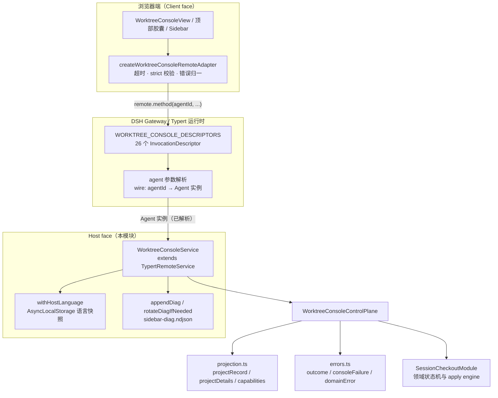
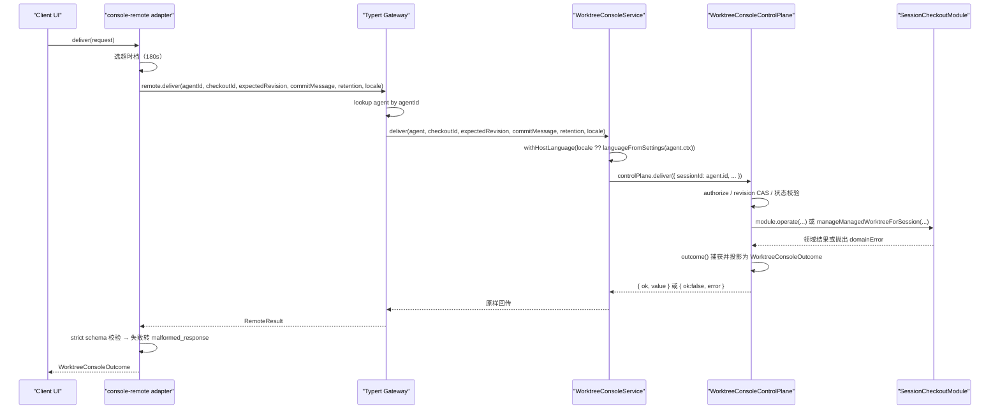
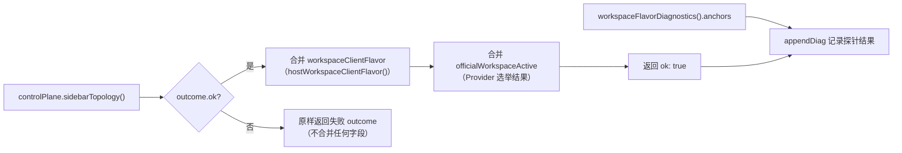
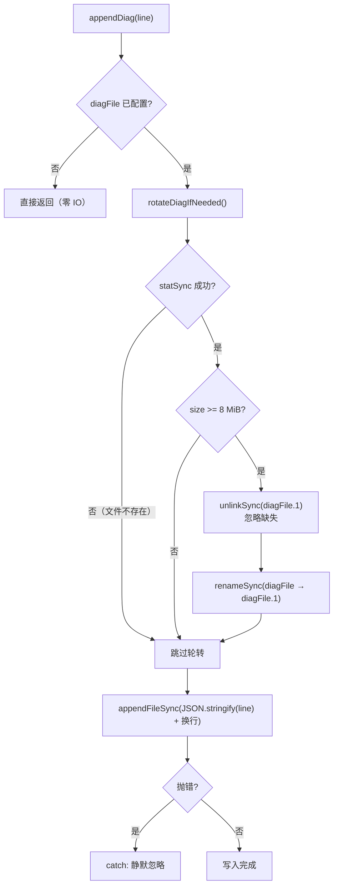
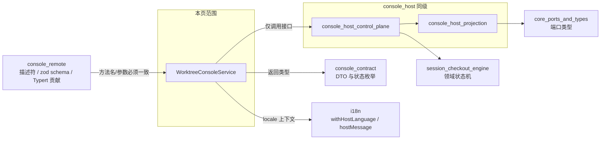

# console_host_rpc_service 模块

!!! info "Generated documentation"
    This page was written by CodeWiki from the source code at commit [`f749bed8`](https://github.com/wloops/dsh-git-worktree/commit/f749bed8d2a00be44e579a433f88985c9d03ea73) on 2026-11-11 with `mimo-v2.6-flash`. Check the code before relying on details.

`console_host_rpc_service` 是 Host 侧的 **Typert Remote 服务实现层**，唯一实现体是 `src/console-host/service.ts` 中的 `WorktreeConsoleService`。它把 26 个 `@Remote` 方法暴露为 `gitWorktree` 命名空间，是浏览器端 Console / 顶部胶囊 / Sidebar 与 Worktree 领域逻辑之间唯一的进程边界。

本页只描述「远程调用的接线、语言上下文、诊断日志与错误边界」；业务授权、状态投影、Git 操作分别由 [Worktree Console 控制面（Host 业务编排层）](console_host_control_plane.md)、[console_host_projection — Host 侧投影与能力门控](console_host_projection.md) 与领域模块承担。

## 1. 模块定位

一句话职责：**把每个 RPC 调用翻译成一次「语言上下文 + 控制面调用」，并把结果原样回传，同时留下可运维的 ndjson 面包屑。**

| 关注点 | 是否由本模块负责 | 说明 |
| --- | --- | --- |
| 会话/所有者/项目授权、revision CAS | 否 | 交给 `WorktreeConsoleControlPlane` |
| 状态投影（`WorktreeConsoleTargetSummary` 等） | 否 | 交给 `projection.ts` |
| 错误信封 `WorktreeConsoleOutcome` | 否（本模块只透传） | 由 `errors.ts` 的 `outcome()` / `consoleFailure()` 产生 |
| 语言（`zh` / `en`）绑定 | **是** | `withHostLanguage(...)` 包裹整次调用 |
| 调用耗时与失败原因留痕 | **是** | `appendDiag` + 8MB 轮转 |
| Host 能力自述（flavor / 官方 Workspace 是否存活） | **是** | `sidebarTopology` 返回值合并这两个字段 |

关键设计取舍：`WorktreeConsoleService` **不写业务判断**。所有方法体都是同一形状——解析 locale、包一层语言上下文、调用控制面、必要时写一行诊断——因此新增 RPC 方法的成本极低，且不会意外绕过授权链。

## 2. 架构与组件关系



依赖方向严格单向：Client → 描述符 → 服务 → 控制面 → 领域。本模块只依赖控制面接口 `WorktreeConsoleControlPlane`，不直接触碰注册表、Git 或文件系统，因此可以在测试中用纯内存控制面替换。

## 3. `WorktreeConsoleService` 构造与依赖

`src/index.ts` 的 `apply()` 是唯一的装配点：

```ts
new WorktreeConsoleService(ctx, createWorktreeConsoleControlPlane({...}), join(stateDir, 'sidebar-diag.ndjson'), providerLifecycle.officialWorkspaceActive)
```

| 构造参数 | 类型 | 作用 |
| --- | --- | --- |
| `hostContext` | `Context` | Cordis 上下文，传给 `TypertRemoteService` 完成服务注册；同时作为 locale 的兜底来源 |
| `controlPlane` | `WorktreeConsoleControlPlane` | 全部业务入口；接口定义见 [Worktree Console 控制面（Host 业务编排层）](console_host_control_plane.md) |
| `diagFile?` | `string` | ndjson 诊断文件路径；`undefined` 时诊断被整体关闭（无 IO 开销） |
| `officialWorkspaceActive` | `boolean` | 来自 `mountWorkspaceProviderLifecycle` 的选举结果，`true` 表示官方 `ui-workspace` 仍在提供服务 |

基类调用 `super(hostContext, 'gitWorktree')`，其中 `'gitWorktree'` 必须与 `src/console-remote/descriptors.ts` 中的 `SERVICE` 常量一致，否则描述符与实现无法配对。

## 4. 请求生命周期

### 4.1 通用调用模板

所有方法遵循同一模式，以 `inspect` 为例：

```ts
return withHostLanguage(locale ?? languageFromSettings(agent.ctx ?? this.hostContext),
  () => this.controlPlane.inspect(agent.id, checkoutId))
```

三个要点：

1. **`agent` 不是普通参数。** 描述符把它声明为 `{ name: 'agent', wire: 'agentId', source: 'lookup', lookup: 'agent' }`，Gateway 在业务代码执行前就把它解析成 `Agent` 实例，因此控制面拿到的是可信的 `agent.id`，而不是客户端自报的字符串。
2. **locale 解析顺序**：显式传入的 `locale` → `agent.ctx` 上的 `settings.locale.preference` → 插件自身的 `hostContext` → 默认 `'zh'`。优先用 Agent 上下文是为了避免多用户场景下语言互相泄漏（见 [i18n：中英双语文案与语言解析基础设施](i18n.md)）。
3. **`withHostLanguage` 基于 `AsyncLocalStorage`**，所以控制面内部抛出的 `domainError(hostMessage(...))` 在同一个异步链上取到的就是本次调用的语言，无需把 locale 透传到每一层。



### 4.2 错误边界

本模块**不做 try/catch**：它要求控制面永远返回 `WorktreeConsoleOutcome` 而不是抛出。`errors.ts` 中的 `outcome(operation)` 负责把领域异常收敛为错误信封：

- 带合法 `SESSION_CHECKOUT_ERROR_CODES` 码的 `Error` → 保留 `code`、`message`、可选 `continuation`；
- 其他异常 → 归一为 `git_error`，消息取原 `Error.message`（第三方 Git 输出刻意原样保留，便于本地 Console 观察）。

跨进程的失败（`transport_unavailable`、`malformed_response`、`timeout`）由客户端适配器产生，不在本模块职责内，详见 [console_remote：控制台远程契约层（Typert Remote）](console_remote.md) 与 [client_console_remote 模块](client_console_remote.md)。

## 5. RPC 方法清单

按用途分组；「语言包装」列全部为「是」（除 `clientBootReport` 只写诊断、不解析 locale）。

### 5.1 拓扑与自述

| 方法 | 签名要点 | 控制面调用 | 返回 |
| --- | --- | --- | --- |
| `sidebarTopology` | `(locale?)`，无 agent | `controlPlane.sidebarTopology()` | `WorktreeSidebarTopologyResponse` + `workspaceClientFlavor` + `officialWorkspaceActive` |
| `clientBootReport` | `(report)`，无 agent | 无 | `boolean`（恒 `true`） |

这两个方法是**唯一不带 `agent` 参数**的远程方法（描述符 `withAgent = false`），因为它们服务于「Client 还没绑定任何会话」的启动阶段。

`sidebarTopology` 的返回值在控制面结果之上**合并两个 Host 自述字段**，客户端据此决定挂载哪一代 Sidebar 分支：



### 5.2 读取与观察

| 方法 | 参数 | 控制面调用 |
| --- | --- | --- |
| `current` | `(agent, locale?)` | `controlPlane.current(agent.id)` |
| `list` | `(agent, needsAttention?, includeDelivered?, locale?)` | `controlPlane.list({ sessionId, needsAttention, includeDelivered })` |
| `inspect` | `(agent, checkoutId, locale?)` | `controlPlane.inspect(agent.id, checkoutId)` |
| `initProject` | `(agent, locale?)` | `controlPlane.initProject(agent.id)` |
| `listAbandoned` | `(agent, locale?)` | `controlPlane.listAbandoned(agent.id)` |
| `gitOverview` | `(agent, locale?)` | `controlPlane.gitOverview(agent.id)` |
| `gitGraph` | `(agent, limit?, locale?)` | `controlPlane.gitGraph(agent.id, limit)` |
| `gitListTags` | `(agent, locale?)` | `controlPlane.gitListTags(agent.id)` |

### 5.3 生命周期变更

| 方法 | 参数 | 控制面调用 |
| --- | --- | --- |
| `createWorktree` | `(agent, from: string \| null, locale?)` | `controlPlane.createWorktree({ sessionId, from })` |
| `discard` | `(agent, checkoutId, expectedRevision, confirmDirty, rollbackPreview?, locale?)` | `controlPlane.discard({...})` |
| `deliver` | `(agent, checkoutId, expectedRevision, commitMessage, retention, locale?)` | `controlPlane.deliver({...})` |
| `setRetention` | `(agent, checkoutId, expectedRevision, retention, locale?)` | `controlPlane.setRetention({...})` |
| `setPermanent` | `(agent, checkoutId, expectedRevision, permanent, locale?)` | `controlPlane.setPermanent({...})` |
| `retryCleanup` | `(agent, checkoutId, expectedRevision, discardPostDeliveryChanges?, locale?)` | `controlPlane.retryCleanup({...})` |
| `beginNextIteration` | `(agent, checkoutId, expectedRevision, locale?)` | `controlPlane.beginNextIteration({...})` |
| `returnToLocal` | `(agent, checkoutId, locale?)` | `controlPlane.returnToLocal({...})` |
| `clearSidebarBadge` | `(agent, checkoutId, expectedRevision, locale?)` | `controlPlane.clearSidebarBadge({...})` |
| `restoreAbandoned` | `(agent, checkoutId, locale?)` | `controlPlane.restoreAbandoned({...})` |

所有变更类方法都携带 `expectedRevision`（`returnToLocal`、`createWorktree`、`restoreAbandoned` 除外，因为它们不基于既有快照做写入），乐观并发控制在控制面内部完成，见 [Worktree Console 控制面（Host 业务编排层）](console_host_control_plane.md)。

`createWorktree` 的 `from` 语义：`string` 为基点分支，`null` 表示基于当前 HEAD。该方法**同步完成建树**——返回时 checkout 已在磁盘上、台账已登记、会话 cwd 已切换；失败原因通过响应的 `failure` 字段回传而非抛错。

### 5.4 Git 操作

| 方法 | 参数 | 控制面调用 |
| --- | --- | --- |
| `gitCreateBranch` | `(agent, name, locale?)` | `controlPlane.gitCreateBranch(agent.id, name)` |
| `gitSwitchBranch` | `(agent, branch, locale?)` | `controlPlane.gitSwitchBranch(agent.id, branch)` |
| `gitPruneMergedBranches` | `(agent, dryRun, locale?)` | `controlPlane.gitPruneMergedBranches(agent.id, dryRun)` |
| `gitCreateTag` | `(agent, name, message?, target?, push?, locale?)` | `controlPlane.gitCreateTag({...})` |
| `gitDeleteTag` | `(agent, name, remote?, locale?)` | `controlPlane.gitDeleteTag({...})` |
| `gitPushTag` | `(agent, name, locale?)` | `controlPlane.gitPushTag({...})` |

可选参数一律用 `...(x === undefined ? {} : { x })` 展开而非直接传 `undefined`，以保持请求对象在 `exactOptionalPropertyTypes` 语义下与描述符的 `acceptsUndefined` 声明一致。

## 6. 诊断日志

诊断文件是 `stateDir/sidebar-diag.ndjson`（`stateDir` 默认 `$DSH_HOME/plugins/dsh-git-worktree`，见 `src/index.ts` 的 `resolveStateDir`）。写入是 **best effort**：任何 IO 异常都被吞掉，绝不因为日志失败而破坏 RPC 面。



轮转策略与动机：顶部胶囊每 5 秒写一条 `current`，一天即上万行；实测 30 天可增长到 12MB。因此设 `DIAG_MAX_BYTES = 8 MiB` 上限，超限时拆成 `.1` 备份，**只保留最近一段**。

三类记录：

| `kind` | 产生方法 | 关键字段 | 用途 |
| --- | --- | --- | --- |
| `host` | `sidebarTopology` | `ok`、`projects`、`flavor`、`anchors` | 回答「Sidebar 为什么走了某个分支」：Host 版本锚点探针的逐个结果 |
| `client` | `clientBootReport` | `flavor`、`branch`、`registered`、`detail`、`elapsedMountMs`、`elapsedTopologyMs` | Client 侧自报「实际跑了哪条启动分支」，与 `host` 记录配对定位挂载失败 |
| `current` | `current` | `durationMs`、`ok`、`agentId`、`code`、`message` | 回答「胶囊为什么一直显示不可用 / 到底慢在哪」 |

`current` 是唯一记录**耗时**的方法，因为它是被轮询最频繁的调用，一次调用的成本直接决定胶囊刷新手感。

## 7. 与相邻模块的边界



必须保持的跨模块不变量：

1. **方法名与顺序**：`src/console-remote/descriptors.ts` 里的 26 个描述符方法名必须与 `@Remote` 方法名逐字一致，否则 Gateway 找不到实现。
2. **返回形状**：描述符用 `outcomeSchema(...)` 做 strict 校验，本模块多返回一个字段（如把 `sidebarTopology` 的两个自述字段塞进 `value`）不会被拒——它们在 `WorktreeSidebarTopologyResponse` 内声明；但**在别处新增未声明字段会导致客户端 `malformed_response`**。
3. **错误码集合**：`WORKTREE_CONSOLE_ERROR_CODES` = 领域码 + 三个传输码，服务层不得自行发明新码。

## 8. 构建与发布约束

- `package.json` 的 `exports` 暴露 `./typert`（`lib/console-remote/typert.js`）与 `./remote`（`lib/console-remote/remote.js`），Host 侧 Typert Loader 通过 `TYPERT` 贡献发现本服务；`dsh.bundle.patch` 指向 `cordis.patch.yml`，插件由 Loader 按 patch 插入。
- `tsconfig.json` 开启 `strict` 与 `noUncheckedIndexedAccess`，这解释了服务层对每个可选参数的显式 `undefined` 分支处理。
- CI（`.github/workflows/ci.yml`）依次执行 `typecheck → build → check:publish:release → test`；`pnpm run test` 由 `vitest.config.ts` 驱动，测试目录为 `tests/**/*.test.{ts,tsx}`，Windows 上关闭文件级并行以避免 Git 夹具争用句柄。构建与发布细节见 [build_deployment_configuration：构建、打包与发布部署配置](build_deployment_configuration.md)。

## 9. 维护提示

- **新增一个 RPC 方法需要三处同步改动**：`console-contract.ts` 的请求/响应 DTO → `descriptors.ts` 的描述符与 zod schema → 本服务的 `@Remote` 方法 + 控制面接口方法。漏掉任何一处都会在客户端表现为 `malformed_response` 或方法不存在。
- **不要在服务层加业务判断。** 一旦在服务层做「这个会话能不能交付」之类的判断，就会与控制面里基于注册表快照的授权出现第二套真相。
- **不要给服务层加 `try/catch`。** 错误信封统一由 `outcome()` 生成；在这里兜底会把领域错误码压成 `git_error`，让客户端失去 `refresh` / `confirm_dirty` 之类的恢复指引。
- **诊断字段只增不改。** ndjson 被人工和脚本共同消费，重命名字段等于让历史日志失去可比性。

## 相关页面

- [console_host：Worktree 控制平面与 Host RPC 服务](console_host.md)：Host 侧三层结构总览
- [Worktree Console 控制面（Host 业务编排层）](console_host_control_plane.md)：授权、CAS 与操作分派
- [console_host_projection — Host 侧投影与能力门控](console_host_projection.md)：错误信封与视图投影
- [console_remote：控制台远程契约层（Typert Remote）](console_remote.md)：描述符、schema 与 Typert 贡献
- [console_contract 模块（Worktree Console 共享契约）](console_contract.md)：共享 DTO 与状态枚举
- [client_console_remote 模块](client_console_remote.md)：客户端调用侧的超时与校验
- [session_checkout_engine 模块概览](session_checkout_engine.md)：被控制面驱动的领域状态机
- [i18n：中英双语文案与语言解析基础设施](i18n.md)：`withHostLanguage` 与消息表
- [Console_API_and_Host_Integration：控制台 API 与 Host 集成](Console_API_and_Host_Integration.md)：上层模块入口

??? abstract "Documented components (1)"
    - [`WorktreeConsoleService`](https://github.com/wloops/dsh-git-worktree/blob/f749bed8d2a00be44e579a433f88985c9d03ea73/src%5Cconsole-host%5Cservice.ts) — `src\console-host\service.ts`

