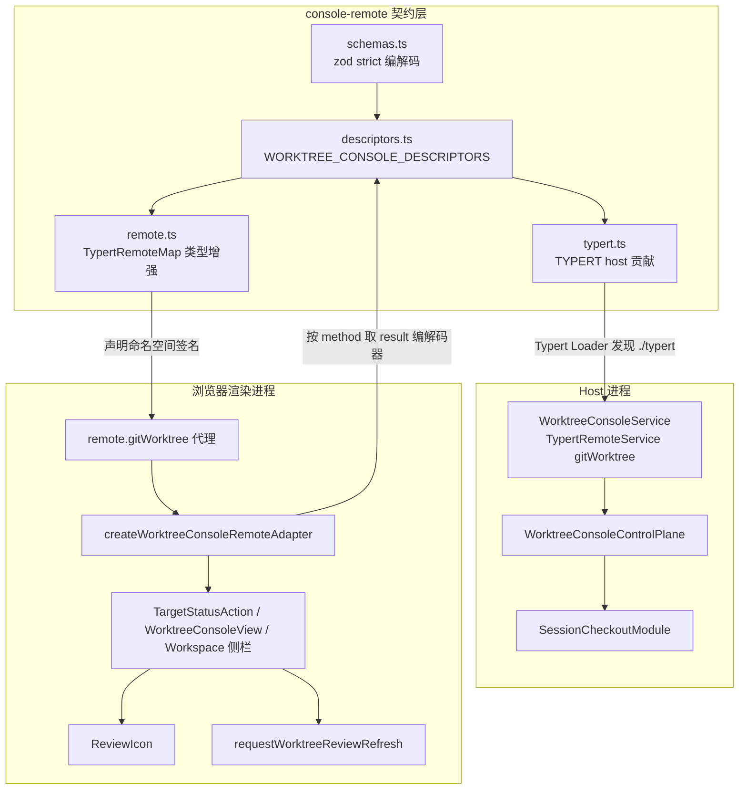
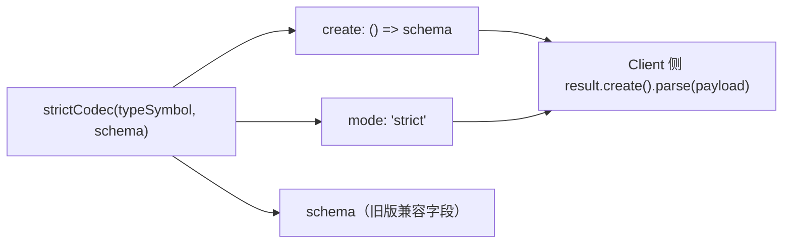
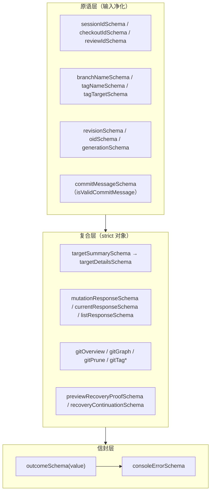
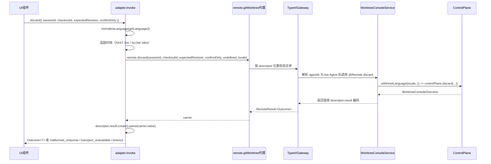
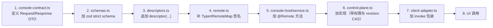

# console_remote：控制台远程契约层（Typert Remote）

!!! info "Generated documentation"
    This page was written by CodeWiki from the source code at commit [`84724981`](https://github.com/wloops/dsh-git-worktree/commit/84724981404027b926acaeb166b6b6ef5545ee4a) on 2026-11-12 with `mimo-v2.6-flash`. Check the code before relying on details.

`src/console-remote/` 是本插件 Host 与 Client 之间**唯一的 RPC 契约面**。它不实现任何业务逻辑，只做三件事：

1. 用 zod 把 `src/console-contract.ts` 里的 JSON DTO 变成**严格可校验的运行时 schema**（`schemas.ts`）；
2. 把每个远端方法声明成 Typert 的 `InvocationDescriptor`，并组装成 Host 侧贡献（`descriptors.ts`、`typert.ts`）；
3. 用 TypeScript 模块增强把同名方法暴露成 Client 侧类型安全的 `remote.gitWorktree` 命名空间（`remote.ts`）。

此外该模块还托管两个客户端侧的轻量支撑件：`ReviewIcon`（图标注册表）与 `requestWorktreeReviewRefresh`（跨组件刷新事件）。

> 业务语义（状态机、权限、git 操作）属于 [console_host：Worktree 控制平面与 Host RPC 服务](console_host.md) 与 [Worktree 与会话检出领域（Worktree_and_Session_Checkout_Domain）](Worktree_and_Session_Checkout_Domain.md)；DTO 定义属于 [console_contract 模块（Worktree Console 共享契约）](console_contract.md)；客户端调用封装属于 [client_console_remote 模块](client_console_remote.md)。本页只描述契约层本身。

---

## 1. 在整体系统中的位置



关键点：

- **Host 侧入口是 `TYPERT` 贡献**（`src/console-remote/typert.ts`），由官方 Typert Loader 通过 `package.json` 的 `"./typert"` 导出发现；`WorktreeConsoleService` 上的 `@Remote` 装饰器方法与 `descriptors` 里的 `method` 一一对应。
- **Client 侧入口是 `WORKTREE_CONSOLE_REMOTE`**（`package.json` 的 `"./remote"` 导出），`src/client/console-remote/index.ts` 在 `apply()` 里执行 `ctx.remote.$mount(contribution)` 挂载，随后 `ctx.get('remote.gitWorktree')` 取得代理。
- 两侧共享同一份 schema 实例：客户端在拿到 payload 后会用**同一个** `descriptor.result.create()` 再解析一次（见 [client_console_remote 模块](client_console_remote.md)）。

---

## 2. 文件职责

| 文件 | 导出 | 职责 |
| --- | --- | --- |
| `src/console-remote/schemas.ts` | `outcomeSchema` 及约 30 个 schema | zod 严格对象（`.strict()`），负责输入净化与输出契约校验 |
| `src/console-remote/descriptors.ts` | `descriptor`、`WORKTREE_CONSOLE_DESCRIPTORS`、`WORKTREE_CONSOLE_REMOTE` | 方法表：id / 参数 / 结果编解码器 |
| `src/console-remote/typert.ts` | `TYPERT` | Host 面贡献：`package: 'dsh-git-worktree'`、`face: 'host'`、`invocations` |
| `src/console-remote/remote.ts` | `GitWorktreeRemote`、`TypertRemoteMap`、`TypertRemoteNamespaceMap`（模块增强） | 纯类型层：把 26 个方法写成 `(agentId, ..., locale?) => Promise<RemoteResult<Outcome<T>>>` |
| `src/client/review-console/ReviewIcon.tsx` | `ReviewIcon`、`ReviewIconName` | lucide 图标的**命名白名单**（`file`/`branch`/`preview`/`rollback`/…），统一 `dsh-wt-icon` 类名与尺寸 |
| `src/client/review-console/status-events.ts` | `WORKTREE_REVIEW_REFRESH_EVENT`、`requestWorktreeReviewRefresh` | 广播 `dsh-git-worktree:review-refresh` 自定义事件，detail 携带 `sessionId` |

---

## 3. descriptor：方法表是如何拼出来的

`descriptor(method, parameters, resultSchema, resultType, withAgent = true)` 产出一条 `InvocationDescriptor`：

```ts
{
  id: `dsh-git-worktree#gitWorktree/${method}`,
  service: 'gitWorktree',
  namespace: 'gitWorktree',
  method,
  invocation: { kind: 'direct' },
  parameters: [...(withAgent ? [agentParameter] : []), ...parameters, json('locale', optionalLanguageSchema, 'string | undefined', true)],
  result: strictCodec(`dsh-git-worktree/console-contract#${resultType}`, resultSchema),
}
```

三个约定值得单独记住：

1. **`agent` 参数由 Gateway 解析**。`agentParameter` 的 `source: 'lookup'` + `lookup: 'agent'` 表示 Host 侧不接收裸字符串，而是由框架用 `agentId` 换成 live `Agent` 对象；`wire: 'agentId'` 是线上字段名。`sidebarTopology` 与 `clientBootReport` 用 `withAgent = false`，因为它们与会话无关。
2. **`locale` 永远是最后一个位置参数**，且 `acceptsUndefined: true`。Client 的 `$mount` 代理按**位置**校验收到的实参，所以即使不想指定语言也必须显式传 `undefined`（`index.ts` 的 `reportBoot` 就是这样调用的）。
3. **`strictCodec` 同时带 `create()` 与旧版 `schema` 字段**。DSH 0.2 走惰性 `create()`，旧适配器读 `schema`；一个 descriptor 只保留一份 schema 实例，保证客户端校验与 Typert 生成的元数据一致。



`WORKTREE_CONSOLE_DESCRIPTORS` 是一个 `Object.freeze` 的只读数组，`WORKTREE_CONSOLE_REMOTE` 再把它包成 `TypertRemoteContribution`（`package: 'dsh-git-worktree'`）。

---

## 4. 方法清单

共 26 个远端方法，全部通过 `gitWorktree` 命名空间暴露。`agent` 列表示是否需要 live Agent。

### 4.1 拓扑与自检

| 方法 | agent | 结果 |
| --- | --- | --- |
| `sidebarTopology` | 否 | `Outcome<WorktreeSidebarTopologyResponse>` |
| `clientBootReport` | 否 | `boolean`（非 Outcome） |

`clientBootReport` 是唯一返回裸 `boolean` 的方法：它是纯诊断上报，失败也不该影响 UI，因此不套 `WorktreeConsoleOutcome`。

### 4.2 目标查询

| 方法 | agent | 关键参数 |
| --- | --- | --- |
| `current` | 是 | — |
| `list` | 是 | `needsAttention?`、`includeDelivered?` |
| `inspect` | 是 | `checkoutId` |
| `initProject` | 是 | — |
| `listAbandoned` | 是 | — |
| `restoreAbandoned` | 是 | `checkoutId` |

### 4.3 目标变更（全部带 `expectedRevision` CAS）

| 方法 | agent | 关键参数 |
| --- | --- | --- |
| `discard` | 是 | `checkoutId`、`expectedRevision`、`confirmDirty`、`rollbackPreview?` |
| `deliver` | 是 | `checkoutId`、`expectedRevision`、`commitMessage`、`retention` |
| `setRetention` | 是 | `checkoutId`、`expectedRevision`、`retention`（不含 `cleanup`） |
| `setPermanent` | 是 | `checkoutId`、`expectedRevision`、`permanent` |
| `retryCleanup` | 是 | `checkoutId`、`expectedRevision`、`discardPostDeliveryChanges?` |
| `beginNextIteration` | 是 | `checkoutId`、`expectedRevision` |
| `returnToLocal` | 是 | `checkoutId` |
| `createWorktree` | 是 | `from: string \| null` |
| `clearSidebarBadge` | 是 | `checkoutId`、`expectedRevision` |

`setRetention` 的 schema 用 `retainedModeSchema`（`retain_24h | retain_3d | retain_manual`），从类型层面就禁止把「设置保留」误用成「立即清理」。

### 4.4 Git 只读与变更

| 方法 | agent | 关键参数 |
| --- | --- | --- |
| `gitOverview` | 是 | — |
| `gitGraph` | 是 | `limit?`（1–1000） |
| `gitListTags` | 是 | — |
| `gitCreateBranch` | 是 | `name` |
| `gitSwitchBranch` | 是 | `branch` |
| `gitPruneMergedBranches` | 是 | `dryRun` |
| `gitCreateTag` | 是 | `name`、`message?`、`target?`、`push?` |
| `gitDeleteTag` | 是 | `name`、`remote?` |
| `gitPushTag` | 是 | `name` |

---

## 5. schemas：契约校验的三层结构



### 5.1 原语层：输入即净化

所有字符串标识都带长度上限与字符集 `refine`，把路径穿越与换行注入挡在契约边界上：

- `checkoutIdSchema`：禁 `..`、禁 `/` `\`、禁控制字符；
- `previewIdSchema`：禁分隔符与控制字符；
- `branchNameSchema`：禁 `\0 \t \r \n \ ~ ^ : ? * [ ]`，禁以 `-` `/` 开头、禁以 `/` `.lock` 结尾、禁含 `..`；
- `tagNameSchema`：`^[^\s~^:?*[\\]+$`，长度 ≤ 255；
- `oidSchema`：`unversioned | unborn | 40/64 位 hex`——把「未初始化仓库」显式建模成合法值，而不是用 `null` 掩盖。

`commitMessageSchema` 复用领域层的 `isValidCommitMessage`（见 [核心工作树领域（core_worktree_domain）](core_worktree_domain.md)），保证「提交信息合法性」只有一处定义。

### 5.2 复合层：`.strict()` 是硬约束

模块顶部定义了 `strict = z.object(shape).strict()`。所有对象都拒绝未知字段，因此**任何一侧私自加字段都会让另一端解析失败**。这也是 `capabilities` 与 `currentResponse` 里那两处 `.default(...)` 的由来（见 §7）。

数组普遍带 `max(...)`：`checkpoints` ≤ 100、`conflictingFiles` ≤ 500、`branches` ≤ 2000、`commits` ≤ 1000、`tags` ≤ 2000、`snapshots` ≤ 200——契约层直接给 DoS 面兜底。

`targetDetailsSchema` 在 `targetSummarySchema` 上 `extend` 出 `managedRoot`/`sourceRoot`/`currentBranch`/`recoveryContinuation`，所以「列表行」天然不可能泄漏路径：路径字段只存在于 `inspect`/`current` 的详情响应里。

### 5.3 信封层：`outcomeSchema`

```ts
function outcomeSchema<T>(value: z.ZodType<T>): z.ZodType<WorktreeConsoleOutcome<T>> {
  return z.discriminatedUnion('ok', [
    strict({ ok: z.literal(true), value }),
    strict({ ok: z.literal(false), error: consoleErrorSchema }),
  ]) as z.ZodType<WorktreeConsoleOutcome<T>>
}
```

判别式是字面量 `ok`，与 `WorktreeConsoleOutcome<T>` 的联合类型完全同构。错误分支还带一条 `superRefine`：**只有 `apply_conflict` 允许携带 `continuation`**，其余错误码若带上恢复凭据会被判为非法 payload。

---

## 6. 一次调用的完整数据流



要点：

- **编码/解码使用同一个 schema 实例**，两端不会漂移；
- Host 侧 `consoleFailure`（见 [console_host：Worktree 控制平面与 Host RPC 服务](console_host.md)）负责把异常收敛成 `WorktreeConsoleError`；本模块只负责「这个错误对象长什么样」以及「它是否合法」；
- 客户端把任何解析失败折叠成 `malformed_response`，把传输异常折叠成 `transport_unavailable`，把超时折叠成 `timeout`——这三者都在 `WORKTREE_CONSOLE_ERROR_CODES` 里，与领域错误码共享同一套 `worktreeConsoleErrorMeta` 分类。

> 传输层的具体封装、超时档位表与 `FAST_METHODS` 白名单见 [client_console_remote 模块](client_console_remote.md)，本页不重复。

---

## 7. 版本兼容：为什么契约层必须「宽进严出」

Host 与 Client 是**两份独立部署的产物**：宿主进程重启前跑的是旧 Host，浏览器里可能已经是新 Client（或反之）。契约层因此遵循一条明确规则：

| 场景 | 做法 | 代码位置 |
| --- | --- | --- |
| 新增能力位 | `z.boolean().default(false)` | `capabilitiesSchema.returnToLocal` |
| 新增响应字段 | `z.string().nullable().default(null)` | `currentResponseSchema.adoptionFailure` |
| 新增可选参数 | `optionalBooleanSchema` + `acceptsUndefined: true` | `descriptors.ts` |
| 编解码器字段演进 | 同时提供 `create()` 与 `schema` | `strictCodec` |

注释里记录的原因值得保留：如果把纯增量的能力位写成必填，旧 Host 根本不知道这个键，整条 `current` 的 payload 会校验失败，顶部胶囊直接塌成「不可用」——**一个新增能力位没有资格否决整个响应**。用 `.default(false)` 而非 `.optional()`，是为了让输出仍是确定的 `boolean`，契约类型不必跟着变宽。

---

## 8. 客户端侧的两个支撑件

### 8.1 `ReviewIcon`

把 lucide 图标收敛成命名白名单，避免各视图各自 import 造成图标语义漂移：

```ts
export type ReviewIconName = keyof typeof icons
```

`file`、`branch`、`check`、`warning`、`preview`、`rollback`、`discard`、`local`、`create`、`manager`、`retain`、`send`、`shield`、`pin`… 全部经 `<ReviewIcon name="..." />` 渲染，统一 `dsh-wt-icon` 类名、`size={18}`、`strokeWidth={1.75}`，并带 `aria-hidden="true"` + `focusable="false"`（装饰性图标不进入无障碍树）。

### 8.2 `requestWorktreeReviewRefresh`

```ts
export const WORKTREE_REVIEW_REFRESH_EVENT = 'dsh-git-worktree:review-refresh'
export function requestWorktreeReviewRefresh(sessionId: string): void {
  window.dispatchEvent(new CustomEvent(WORKTREE_REVIEW_REFRESH_EVENT, { detail: { sessionId } }))
}
```

一次变更成功后，所有挂载中的评审界面都要重新读取 Host 权威目标。这里刻意选择 `window` 自定义事件而非模块级订阅表：

- 事件常量是**模块间唯一耦合点**，`current-polling.ts` 也监听它来触发一次立即轮询（见 [会话目标胶囊与工作树控制台（client_target_console）](client_target_console.md)）；
- `detail.sessionId` 让监听方只对本会话的事件作出反应，避免多会话同屏时互相刷新。

---

## 9. 扩展指南：新增一个远端方法



每一步的检查点：

- `schemas.ts`：新字符串标识必须有长度上限与字符集 `refine`；新数组必须有 `max`；
- `descriptors.ts`：确认是否需要 `withAgent`；`locale` 不要手动追加（`descriptor` 已统一加）；
- `remote.ts`：`TypertRemoteMap` 的键必须是 `` `gitWorktree/${method}` ``，`locale` 放在最后且可选；
- 兼容性：如果这是**纯增量**字段，按 §7 的规则给 `default`，不要用必填。

---

## 10. 构建、打包与验证

契约层通过 `package.json` 的三个子路径导出（`src/console-remote/` → `lib/console-remote/`）：

```json
"./typert":  { "types": "./lib/console-remote/typert.d.ts",  "default": "./lib/console-remote/typert.js" },
"./remote":  { "types": "./lib/console-remote/remote.d.ts",  "default": "./lib/console-remote/remote.js" },
"./console-contract": { "types": "./lib/console-contract.d.ts", "default": "./lib/console-contract.js" }
```

- `./typert` 是官方 Typert Loader 的发现点，`./remote` 是 Client `$mount` 用的贡献点，`./console-contract` 供外部消费 DTO 类型；
- `tsdown.config.ts` 只打包 Client 入口（`src/client/console-remote/index.ts` → `lib/client.js`），把 `zod` 与 `lucide-react` 以 `noExternal` 内联进 bundle；Host 侧 `console-remote/*` 由 `tsc` 输出 ESM；
- CI（`.github/workflows/ci.yml`）依次执行 `typecheck` → `build` → `check:publish:release` → `test`；`vitest.config.ts` 用 `virtual:dsh-official-workspace-client*` 别名把官方 Workspace 客户端替换为 mock，使契约层与侧栏装配可在 jsdom 下测试。

构建与发布的完整说明见 [build_deployment_configuration：构建、打包与发布部署配置](build_deployment_configuration.md)。

---

## 11. 已知注意事项

- `FAST_METHODS`（`src/client/console-remote/adapter.ts`）里保留了 `previewRecoveryPreflight`，但当前 `WORKTREE_CONSOLE_DESCRIPTORS` 并未暴露该方法——历史残留，不影响行为，因为 `invoke` 只是查表决定超时档。
- 快档（30s）只覆盖 `sidebarTopology`、`current`、`inspect`、`gitOverview`、`gitGraph`、`listAbandoned`；`list`、`deliver`、`discard`、`retryCleanup` 等落在 180s 慢档——全量重算可能触发 20+ 次 git spawn。
- `clientBootReport` 不返回 `Outcome`，因此调用方不能用统一错误处理；它被设计成「永不阻塞启动」的 best-effort 上报（见 `src/client/console-remote/index.ts` 的 `reportBoot`）。
- `consoleErrorSchema` 的 `superRefine` 限制了 `continuation` 只能随 `apply_conflict` 出现；新增可恢复错误码时必须同步放开这条约束，否则会被判为非法 payload。

---

## 相关页面

- [Console_API_and_Host_Integration：控制台 API 与 Host 集成](Console_API_and_Host_Integration.md) — 父模块总览
- [console_host：Worktree 控制平面与 Host RPC 服务](console_host.md) — `WorktreeConsoleService`、`ControlPlane`、权限投影与诊断日志
- [console_contract 模块（Worktree Console 共享契约）](console_contract.md) — 全部 DTO 与错误码定义
- [client_console_remote 模块](client_console_remote.md) — 客户端 `$mount` 与 `invoke` 封装
- [会话目标胶囊与工作树控制台（client_target_console）](client_target_console.md) — 胶囊、管理器、分支图与轮询
- [i18n：中英双语文案与语言解析基础设施](i18n.md) — `Language`、`createTranslator` 与 `transportMessages`
- [Worktree 与会话检出领域（Worktree_and_Session_Checkout_Domain）](Worktree_and_Session_Checkout_Domain.md) — 状态机与交付/清理语义

??? abstract "Documented components (7)"
    - [`ReviewIcon`](https://github.com/wloops/dsh-git-worktree/blob/84724981404027b926acaeb166b6b6ef5545ee4a/src%5Cclient%5Creview-console%5CReviewIcon.tsx) — `src\client\review-console\ReviewIcon.tsx`
    - [`requestWorktreeReviewRefresh`](https://github.com/wloops/dsh-git-worktree/blob/84724981404027b926acaeb166b6b6ef5545ee4a/src%5Cclient%5Creview-console%5Cstatus-events.ts) — `src\client\review-console\status-events.ts`
    - [`descriptor`](https://github.com/wloops/dsh-git-worktree/blob/84724981404027b926acaeb166b6b6ef5545ee4a/src%5Cconsole-remote%5Cdescriptors.ts) — `src\console-remote\descriptors.ts`
    - [`TypertRemoteMap`](https://github.com/wloops/dsh-git-worktree/blob/84724981404027b926acaeb166b6b6ef5545ee4a/src%5Cconsole-remote%5Cremote.ts) — `src\console-remote\remote.ts`
    - [`TypertRemoteNamespaceMap`](https://github.com/wloops/dsh-git-worktree/blob/84724981404027b926acaeb166b6b6ef5545ee4a/src%5Cconsole-remote%5Cremote.ts) — `src\console-remote\remote.ts`
    - [`outcomeSchema`](https://github.com/wloops/dsh-git-worktree/blob/84724981404027b926acaeb166b6b6ef5545ee4a/src%5Cconsole-remote%5Cschemas.ts) — `src\console-remote\schemas.ts`
    - [`__file__`](https://github.com/wloops/dsh-git-worktree/blob/84724981404027b926acaeb166b6b6ef5545ee4a/src%5Cconsole-remote%5Ctypert.ts) — `src\console-remote\typert.ts`

