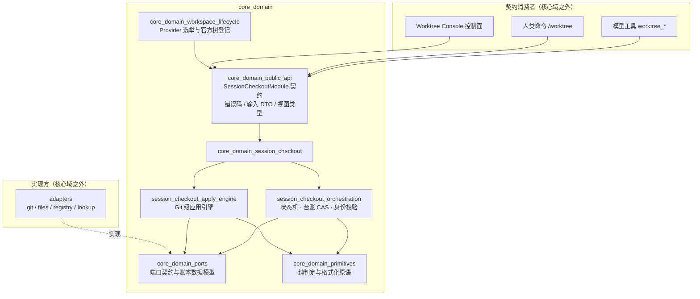
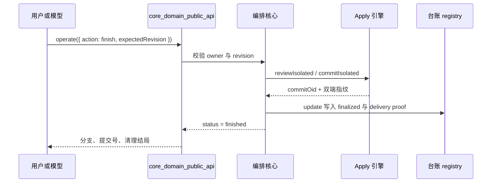

# core_domain 核心域概览

!!! info "Generated documentation"
    This page was written by CodeWiki from the source code at commit [`e01d7c5f`](https://github.com/wloops/dsh-git-worktree/commit/e01d7c5f2f3a0d2f734a5a3415598ae6d7d6f387) on 2026-11-07 with `deepseek-v4.1-flash`. Check the code before relying on details.

`core_domain` 是 `dsh-git-worktree` 插件的宿主无关领域层。它把「让一个会话在隔离的 Git Worktree 中工作，并在评审、交付、清理全过程中不污染 Local 仓库」这件事，拆解为**纯原语、端口契约、生命周期编排、状态机与 Git 应用引擎、对外 API** 五个可独立理解的子模块。

核心域不直接 `spawn` Git、不直接读写文件、不依赖 Cordis 服务：所有外部能力都经由端口注入，因此域逻辑可以用假实现单测，也能在不改动状态机的前提下替换宿主后端。真正的仓库改写由 Apply 引擎承担，编排层只负责身份授权、CAS 并发控制、账本持久化与崩溃恢复。

## 架构

依赖方向严格单向：`core_domain_primitives` 只依赖 Node 内建模块与纯类型；`core_domain_ports` 只声明接口与账本结构；编排层与引擎层消费端口，绝不 import 适配器实现；`core_domain_public_api` 是唯一对外暴露的契约面，消费者只依赖它。

### 一次交付的协作路径

## 子模块与文档

| 子模块 | 职责 | 文档 |
| --- | --- | --- |
| `core_domain_primitives` | 提交信息守卫、受管路径与分支命名、交付排除 pathspec、检查点代际指纹、结果文本渲染等无 I/O 纯原语 | [core_domain_primitives 核心域基础原语](core_domain/core_domain_primitives.md) |
| `core_domain_ports` | 五大端口（lookup / git / files / registry / officialWorktrees）、依赖注入包与账本数据模型 | [core_domain_ports 端口契约与持久化数据模型](core_domain/core_domain_ports.md) |
| `core_domain_workspace_lifecycle` | 宿主版本识别、`uiWorkspace` Provider 选举、官方 `.agents/worktrees/` 树的登记与接管 | [工作区与官方工作树生命周期（core_domain_workspace_lifecycle）](core_domain/core_domain_workspace_lifecycle.md) |
| `core_domain_session_checkout` | 会话检出领域核心：编排状态机与 Git 应用引擎的总览 | [core_domain_session_checkout：会话检出领域核心](core_domain/core_domain_session_checkout.md) |
| `core_domain_public_api` | `SessionCheckoutModule` 契约、操作与结果联合、错误码、插件入口 `apply` 与配置面 | [core_domain_public_api — 会话检出领域的公共 API 面](core_domain/core_domain_public_api.md) |

`core_domain_session_checkout` 之下还有三层细化文档：编排总览 [会话检出编排（session_checkout_orchestration）](core_domain/core_domain_session_checkout/session_checkout_orchestration.md)、状态机与台账实现 [session_checkout_orchestration_core：会话检出编排核心](core_domain/core_domain_session_checkout/session_checkout_orchestration/session_checkout_orchestration_core.md)、面向模型的工具边界 [会话结账工具层（session_checkout_tools）](core_domain/core_domain_session_checkout/session_checkout_orchestration/session_checkout_tools.md)，以及唯一直接改写 Git 的 [session_checkout_apply_engine：Git 级应用引擎](core_domain/core_domain_session_checkout/session_checkout_apply_engine.md)。

## 关键不变量

- **先收据、后动作**：任何改动磁盘的操作都先把 journal / receipt 写进台账，`reconcile()` 才能在崩溃后判定「做到了哪一步」。
- **交付只写会话分支**：Local 的工作区、索引与 HEAD 全程不被交付流程改写。
- **CAS 令牌贯穿写路径**：`expectedRevision`、`expectedReviewId`、`expectedGeneration` 分别防止旧版本覆盖新版本、过期评审卡片与同一 revision 下的内容替换。
- **身份证据优先于权限**：路径、目录 `device`/`inode`/`birthtimeNs`、Git common dir 等证据必须先通过，才允许删除或隔离。
- **模型只推进到 Ready for Review**：`discard` / `remove` 等破坏性动词保留为人类命令。

## 相关文档

- 真实 I/O 实现：[adapters 模块：DSH 宿主适配层](adapters.md)
- Console 控制面与 Remote 契约：[console_host：Worktree 控制台的 Host 侧服务层](console_host.md)、[console_contract：Worktree Console 共享契约层](console_contract.md)
- 客户端界面：[client_ui — 浏览器端 UI 层](client_ui.md)
- 构建、类型检查与测试：[build_and_config 构建与配置](build_and_config.md)
- 本地化文案目录：[i18n：多语言文案目录与本地化解析层](i18n.md)

??? abstract "Documented components (148)"
    - [`canonicalJson`](https://github.com/wloops/dsh-git-worktree/blob/e01d7c5f2f3a0d2f734a5a3415598ae6d7d6f387/src%5Ccheckpoint.ts) — `src\checkpoint.ts`
    - [`finishedText`](https://github.com/wloops/dsh-git-worktree/blob/e01d7c5f2f3a0d2f734a5a3415598ae6d7d6f387/src%5Ccommands.ts) — `src\commands.ts`
    - [`isValidCommitMessage`](https://github.com/wloops/dsh-git-worktree/blob/e01d7c5f2f3a0d2f734a5a3415598ae6d7d6f387/src%5Ccommit-message.ts) — `src\commit-message.ts`
    - [`WorktreeCreationFailure`](https://github.com/wloops/dsh-git-worktree/blob/e01d7c5f2f3a0d2f734a5a3415598ae6d7d6f387/src%5Ccreation-failure.ts) — `src\creation-failure.ts`
    - [`deliveryExcludePathspecs`](https://github.com/wloops/dsh-git-worktree/blob/e01d7c5f2f3a0d2f734a5a3415598ae6d7d6f387/src%5Cdelivery-excludes.ts) — `src\delivery-excludes.ts`
    - [`WorkspaceFlavorAnchorDiagnostic`](https://github.com/wloops/dsh-git-worktree/blob/e01d7c5f2f3a0d2f734a5a3415598ae6d7d6f387/src%5Chost-compat.ts) — `src\host-compat.ts`
    - [`WorkspaceFlavorDiagnostics`](https://github.com/wloops/dsh-git-worktree/blob/e01d7c5f2f3a0d2f734a5a3415598ae6d7d6f387/src%5Chost-compat.ts) — `src\host-compat.ts`
    - [`IsolatedTargetLaunch`](https://github.com/wloops/dsh-git-worktree/blob/e01d7c5f2f3a0d2f734a5a3415598ae6d7d6f387/src%5Cindex.ts) — `src\index.ts`
    - [`ListManagedWorktreesInput`](https://github.com/wloops/dsh-git-worktree/blob/e01d7c5f2f3a0d2f734a5a3415598ae6d7d6f387/src%5Cindex.ts) — `src\index.ts`
    - [`LocalAdaptationConfig`](https://github.com/wloops/dsh-git-worktree/blob/e01d7c5f2f3a0d2f734a5a3415598ae6d7d6f387/src%5Cindex.ts) — `src\index.ts`
    - [`ManageManagedWorktreeInput`](https://github.com/wloops/dsh-git-worktree/blob/e01d7c5f2f3a0d2f734a5a3415598ae6d7d6f387/src%5Cindex.ts) — `src\index.ts`
    - [`MarkReadyForReviewInput`](https://github.com/wloops/dsh-git-worktree/blob/e01d7c5f2f3a0d2f734a5a3415598ae6d7d6f387/src%5Cindex.ts) — `src\index.ts`
    - [`MergeBranchForSessionInput`](https://github.com/wloops/dsh-git-worktree/blob/e01d7c5f2f3a0d2f734a5a3415598ae6d7d6f387/src%5Cindex.ts) — `src\index.ts`
    - [`PruneMergedBranchesInput`](https://github.com/wloops/dsh-git-worktree/blob/e01d7c5f2f3a0d2f734a5a3415598ae6d7d6f387/src%5Cindex.ts) — `src\index.ts`
    - [`SessionCheckoutError`](https://github.com/wloops/dsh-git-worktree/blob/e01d7c5f2f3a0d2f734a5a3415598ae6d7d6f387/src%5Cindex.ts) — `src\index.ts`
    - [`SessionCheckoutModule`](https://github.com/wloops/dsh-git-worktree/blob/e01d7c5f2f3a0d2f734a5a3415598ae6d7d6f387/src%5Cindex.ts) — `src\index.ts`
    - [`SessionCheckoutReconcileSummary`](https://github.com/wloops/dsh-git-worktree/blob/e01d7c5f2f3a0d2f734a5a3415598ae6d7d6f387/src%5Cindex.ts) — `src\index.ts`
    - [`ManagedWorktreePathCandidates`](https://github.com/wloops/dsh-git-worktree/blob/e01d7c5f2f3a0d2f734a5a3415598ae6d7d6f387/src%5Cmanaged-worktree-path.ts) — `src\managed-worktree-path.ts`
    - [`OfficialWorktreeRegistration`](https://github.com/wloops/dsh-git-worktree/blob/e01d7c5f2f3a0d2f734a5a3415598ae6d7d6f387/src%5Cofficial-worktree-registration.ts) — `src\official-worktree-registration.ts`
    - [`OfficialWorktreeRegistrationDependencies`](https://github.com/wloops/dsh-git-worktree/blob/e01d7c5f2f3a0d2f734a5a3415598ae6d7d6f387/src%5Cofficial-worktree-registration.ts) — `src\official-worktree-registration.ts`
    - [`BranchOverviewEntry`](https://github.com/wloops/dsh-git-worktree/blob/e01d7c5f2f3a0d2f734a5a3415598ae6d7d6f387/src%5Cports.ts) — `src\ports.ts`
    - [`DirectoryIdentity`](https://github.com/wloops/dsh-git-worktree/blob/e01d7c5f2f3a0d2f734a5a3415598ae6d7d6f387/src%5Cports.ts) — `src\ports.ts`
    - [`GitCheckoutSnapshot`](https://github.com/wloops/dsh-git-worktree/blob/e01d7c5f2f3a0d2f734a5a3415598ae6d7d6f387/src%5Cports.ts) — `src\ports.ts`
    - [`GraphLogCommit`](https://github.com/wloops/dsh-git-worktree/blob/e01d7c5f2f3a0d2f734a5a3415598ae6d7d6f387/src%5Cports.ts) — `src\ports.ts`
    - [`InitialCommitPreflight`](https://github.com/wloops/dsh-git-worktree/blob/e01d7c5f2f3a0d2f734a5a3415598ae6d7d6f387/src%5Cports.ts) — `src\ports.ts`
    - [`LiveValue`](https://github.com/wloops/dsh-git-worktree/blob/e01d7c5f2f3a0d2f734a5a3415598ae6d7d6f387/src%5Cports.ts) — `src\ports.ts`
    - [`ManagedApplyConflictRecoveryContinuation`](https://github.com/wloops/dsh-git-worktree/blob/e01d7c5f2f3a0d2f734a5a3415598ae6d7d6f387/src%5Cports.ts) — `src\ports.ts`
    - [`ManagedCheckoutCreateJournal`](https://github.com/wloops/dsh-git-worktree/blob/e01d7c5f2f3a0d2f734a5a3415598ae6d7d6f387/src%5Cports.ts) — `src\ports.ts`
    - [`ManagedCheckoutJournalBase`](https://github.com/wloops/dsh-git-worktree/blob/e01d7c5f2f3a0d2f734a5a3415598ae6d7d6f387/src%5Cports.ts) — `src\ports.ts`
    - [`ManagedCheckoutMutationJournal`](https://github.com/wloops/dsh-git-worktree/blob/e01d7c5f2f3a0d2f734a5a3415598ae6d7d6f387/src%5Cports.ts) — `src\ports.ts`
    - [`ManagedCheckoutRecord`](https://github.com/wloops/dsh-git-worktree/blob/e01d7c5f2f3a0d2f734a5a3415598ae6d7d6f387/src%5Cports.ts) — `src\ports.ts`
    - [`ManagedCheckoutsRegistry`](https://github.com/wloops/dsh-git-worktree/blob/e01d7c5f2f3a0d2f734a5a3415598ae6d7d6f387/src%5Cports.ts) — `src\ports.ts`
    - [`ManagedDeliveryProof`](https://github.com/wloops/dsh-git-worktree/blob/e01d7c5f2f3a0d2f734a5a3415598ae6d7d6f387/src%5Cports.ts) — `src\ports.ts`
    - [`ManagedPreviewReceipt`](https://github.com/wloops/dsh-git-worktree/blob/e01d7c5f2f3a0d2f734a5a3415598ae6d7d6f387/src%5Cports.ts) — `src\ports.ts`
    - [`ManagedPreviewRecoveryAnalysisContinuation`](https://github.com/wloops/dsh-git-worktree/blob/e01d7c5f2f3a0d2f734a5a3415598ae6d7d6f387/src%5Cports.ts) — `src\ports.ts`
    - [`ManagedPreviewRecoveryHandoffContinuation`](https://github.com/wloops/dsh-git-worktree/blob/e01d7c5f2f3a0d2f734a5a3415598ae6d7d6f387/src%5Cports.ts) — `src\ports.ts`
    - [`ManagedReviewRegenerationContinuation`](https://github.com/wloops/dsh-git-worktree/blob/e01d7c5f2f3a0d2f734a5a3415598ae6d7d6f387/src%5Cports.ts) — `src\ports.ts`
    - [`ManagedWorktreeCheckpointRecord`](https://github.com/wloops/dsh-git-worktree/blob/e01d7c5f2f3a0d2f734a5a3415598ae6d7d6f387/src%5Cports.ts) — `src\ports.ts`
    - [`ManagedWorktreePreviousReviewRecord`](https://github.com/wloops/dsh-git-worktree/blob/e01d7c5f2f3a0d2f734a5a3415598ae6d7d6f387/src%5Cports.ts) — `src\ports.ts`
    - [`ManagedWorktreeReviewRecord`](https://github.com/wloops/dsh-git-worktree/blob/e01d7c5f2f3a0d2f734a5a3415598ae6d7d6f387/src%5Cports.ts) — `src\ports.ts`
    - [`OfficialWorktreesPort`](https://github.com/wloops/dsh-git-worktree/blob/e01d7c5f2f3a0d2f734a5a3415598ae6d7d6f387/src%5Cports.ts) — `src\ports.ts`
    - [`SessionBindingRecord`](https://github.com/wloops/dsh-git-worktree/blob/e01d7c5f2f3a0d2f734a5a3415598ae6d7d6f387/src%5Cports.ts) — `src\ports.ts`
    - [`SessionCheckoutDependencies`](https://github.com/wloops/dsh-git-worktree/blob/e01d7c5f2f3a0d2f734a5a3415598ae6d7d6f387/src%5Cports.ts) — `src\ports.ts`
    - [`SessionCheckoutFilesPort`](https://github.com/wloops/dsh-git-worktree/blob/e01d7c5f2f3a0d2f734a5a3415598ae6d7d6f387/src%5Cports.ts) — `src\ports.ts`
    - [`SessionCheckoutGitPort`](https://github.com/wloops/dsh-git-worktree/blob/e01d7c5f2f3a0d2f734a5a3415598ae6d7d6f387/src%5Cports.ts) — `src\ports.ts`
    - [`SessionCheckoutLookupPort`](https://github.com/wloops/dsh-git-worktree/blob/e01d7c5f2f3a0d2f734a5a3415598ae6d7d6f387/src%5Cports.ts) — `src\ports.ts`
    - [`SessionCheckoutProjectRecord`](https://github.com/wloops/dsh-git-worktree/blob/e01d7c5f2f3a0d2f734a5a3415598ae6d7d6f387/src%5Cports.ts) — `src\ports.ts`
    - [`SessionCheckoutRegistryPort`](https://github.com/wloops/dsh-git-worktree/blob/e01d7c5f2f3a0d2f734a5a3415598ae6d7d6f387/src%5Cports.ts) — `src\ports.ts`
    - [`SessionCheckoutSessionRecord`](https://github.com/wloops/dsh-git-worktree/blob/e01d7c5f2f3a0d2f734a5a3415598ae6d7d6f387/src%5Cports.ts) — `src\ports.ts`
    - [`SidebarDirectoryMembership`](https://github.com/wloops/dsh-git-worktree/blob/e01d7c5f2f3a0d2f734a5a3415598ae6d7d6f387/src%5Cports.ts) — `src\ports.ts`
    - … and 98 more

