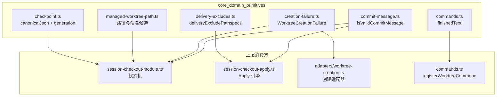
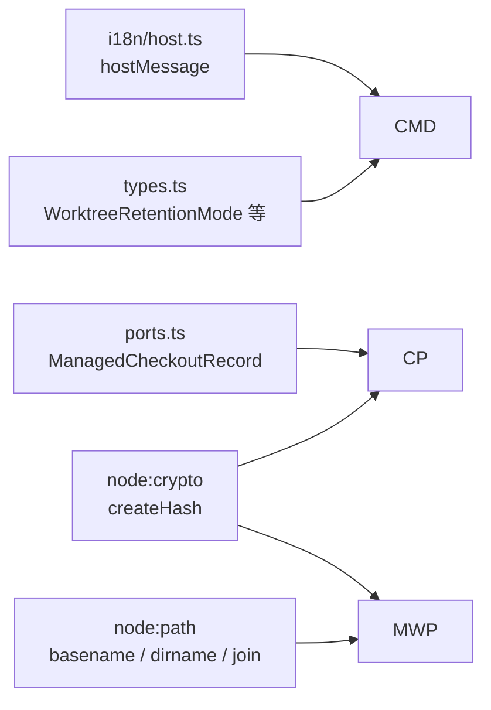
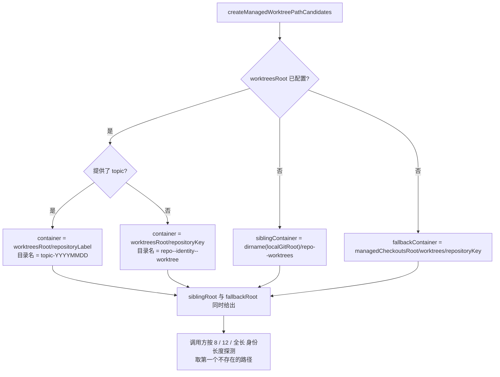
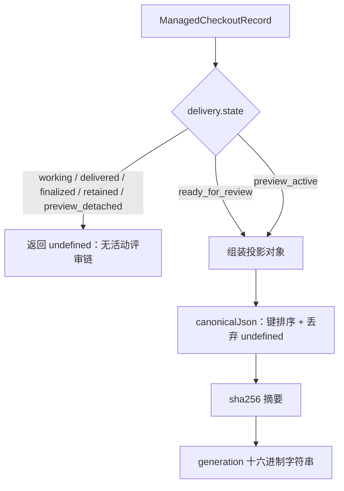
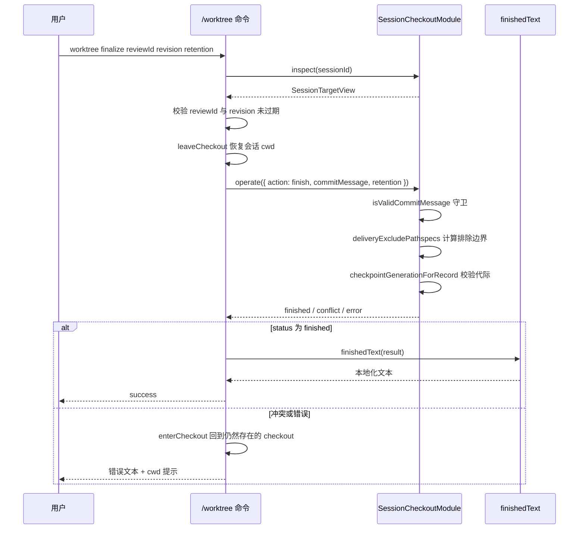

# core_domain_primitives 核心域基础原语

!!! info "Generated documentation"
    This page was written by CodeWiki from the source code at commit [`e01d7c5f`](https://github.com/wloops/dsh-git-worktree/commit/e01d7c5f2f3a0d2f734a5a3415598ae6d7d6f387) on 2026-11-07 with `deepseek-v4.1-flash`. Check the code before relying on details.

`core_domain_primitives` 是 `dsh-git-worktree` 核心域中最底层、无状态、无 I/O 的一层：它把「什么算一条合法提交信息」「受管 Worktree 的目录与分支该怎么命名」「哪些路径不属于交付物」「一次交付结果该怎么说给用户听」「检查点代际指纹怎么算」这些**纯判定与纯格式化**的规则抽成可独立复用的原语。上层状态机（[core_domain_session_checkout：会话检出领域核心](core_domain_session_checkout.md)）、端口契约（[core_domain_ports 端口契约与持久化数据模型](core_domain_ports.md)）与适配器（[adapters 模块：DSH 宿主适配层](../adapters.md)）都直接依赖这些原语，因此这里的任何语义变更都会同时影响评审、交付与清理三条链路。

## 模块定位

| 维度 | 说明 |
| --- | --- |
| 层次 | 核心域最底层（不依赖 Cordis 服务、不调用 `git`、不读写注册表） |
| 输入 | 字符串、纯数据记录（`ManagedCheckoutRecord` 等结构体） |
| 输出 | 布尔判定、字符串路径/分支名、git pathspec 列表、SHA-256 代际指纹、本地化文本 |
| 可测性 | 全部为同步纯函数或轻量 `Error` 子类，可用 fake 依赖直接单测（测试入口见 [build_and_config 构建与配置](../build_and_config.md) 中的 `vitest.config.ts`） |
| 反向依赖 | 无：本模块不 import 状态机、端口实现或任何适配器 |

## 组件清单

| 文件 | 核心组件 | 职责 |
| --- | --- | --- |
| `src/commit-message.ts` | `isValidCommitMessage` | 提交信息合法性判定（类型守卫） |
| `src/creation-failure.ts` | `WorktreeCreationFailure` | 创建失败的领域错误，携带「是否已回滚」证据 |
| `src/delivery-excludes.ts` | `deliveryExcludePathspecs`（含 `HOST_RUNTIME_ARTIFACTS`） | 把宿主运行期产物转成 git 排除 pathspec |
| `src/managed-worktree-path.ts` | `ManagedWorktreePathCandidates` 及同文件命名函数 | 目录名、分支名、路径候选的确定性生成 |
| `src/checkpoint.ts` | `canonicalJson`（及 `checkpointGenerationForRecord`） | 确定性 JSON 序列化 + 检查点代际指纹 |
| `src/commands.ts` | `finishedText` | `/worktree` 命令的交付结果文本渲染 |

## 架构与依赖关系





依赖方向是严格单向的：原语只依赖 Node 内建模块（`node:crypto`、`node:path`）与纯类型定义；`commands.ts` 是唯一允许触碰运行时上下文的文件（它通过 `hostMessage` 与 i18n 目录交互），但被文档化的核心组件 `finishedText` 本身仍是纯文本渲染函数。

## 各原语详解

### `isValidCommitMessage` —— 提交信息守卫

```ts
export function isValidCommitMessage(value: unknown): value is string {
  return typeof value === 'string' && value.trim().length > 0 && !value.includes('\0')
}
```

三条判定规则：

1. 必须是字符串（`unknown` 收窄为 `string`，供调用方在类型层面直接使用）；
2. `trim()` 后不能为空，避免生成只有空白的提交标题；
3. 不允许包含 NUL 字符（`\0`）——提交正文经 stdin 送入 `git commit -F -`，NUL 会破坏管道载荷。

刻意**不**校验长度：源码注释明确「500 字符不是 Git 的限制」，长度限制属于产品策略而非域不变量，因此不在此处固化。该守卫同时被状态机（`session-checkout-module.ts`）与 Apply 引擎（`session-checkout-apply.ts`）在提交前调用，保证「模型给的提交信息」与「引擎真正写进 Git 的正文」用同一把尺子衡量。

### `WorktreeCreationFailure` —— 创建失败与回滚证据

```ts
export class WorktreeCreationFailure extends Error {
  constructor(message: string, readonly rolledBack: boolean) {
    super(message)
    this.name = 'WorktreeCreationFailure'
  }
}
```

设计要点在于 `rolledBack` 这个只读字段，它把「失败」拆成两种**语义完全不同**的失败：

| `rolledBack` | 含义 | 调用方可做的推断 |
| --- | --- | --- |
| `true` | 本次尝试已证明磁盘上没有留下属于它的东西（目录已 `rmdir`，或从未 claim 过） | 可以把该路径视为「本次未占用」 |
| `false` | 可能留下残留（未注册的目录、quarantine 路径、未知元数据对象） | **不得**把「看起来是空目录」当成安全信号，必须保留或走隔离流程 |

这正是源码注释强调的约束：「A creation failure is not permission to infer that an empty-looking path is safe.」抛出方 `src/adapters/worktree-creation.ts` 在每条清理分支上都要先验证目录身份（`rootIdentity`/`parentIdentity`/`commonIdentity`）、元数据指纹、索引字节与工作区内容完全等于授权的 base 提交，才会给出 `rolledBack: true`；任一验证失败即降级为 `rolledBack: false`。

### `deliveryExcludePathspecs` —— 交付边界排除

```ts
export const HOST_RUNTIME_ARTIFACTS: readonly string[] = [
  '.dsh-ops',
  'desktop-runtime.json',
  '.dsh-runtime.json',
]
```

会话 cwd 就位于受管 Worktree 内部，因此宿主与插件自己写入的运行期产物（面板日志目录、桌面运行期标记）会出现在工作区里。它们不是会话的交付物，必须同时从三处排除：

1. 评审变更集（`review` 看到的 diff）；
2. 交付提交（`commit` 实际写入的内容）；
3. 清理指纹（判断「交付后是否又被改过」的依据）。

否则会出现两类误判：用户被要求评审一堆自己没写的日志文件；或者面板多写几行日志就把一次合法交付判成 `modified_after_finalize`（stale）。

每个输入路径会被规范化（去首尾空白、去首尾斜杠/反斜杠，空串直接跳过）后展开为 4 条 pathspec：

| pathspec | 覆盖场景 |
| --- | --- |
| `:(exclude)<path>` | 路径本身 |
| `:(exclude)<path>/**` | 该路径下的整棵子树 |
| `:(exclude,glob)**/<path>` | 在任意深度嵌套出现（同一插件在子目录里再挂一份工作区） |
| `:(exclude,glob)**/<path>/**` | 嵌套出现的整棵子树 |

规则的**作用域被刻意收窄**：只覆盖插件确知由宿主写出的路径，不猜测业务目录。`build/`、`dist/` 之类由用户自己的 `.gitignore` 决定（Git 本来就已忽略未跟踪的忽略项），插件不越权替用户定义交付边界。

### `managed-worktree-path.ts` —— 受管路径与命名

该文件用一组确定性函数把「会话标识 / 主题 / 仓库名」压成**跨平台安全**的目录段与分支段。所有变换都不访问文件系统，碰撞消解由调用方通过「探测候选路径是否已存在」完成。

#### 规范化常量

| 常量 | 作用 |
| --- | --- |
| `WINDOWS_INVALID_CHARACTERS` | `< > : " / \ | ? *` 与控制字符 → `-` |
| `WINDOWS_RESERVED_NAME` | `CON`/`PRN`/`AUX`/`NUL`/`COM1-9`/`LPT1-9` → 前缀 `_` |
| `REPEATED_DASHES` | 连续 `-` 折叠为单个 |
| `MAX_LABEL_LENGTH = 40` | 标签码点上限 |
| `DEFAULT_IDENTITY_LENGTH = 8` | 默认 checkout 身份前缀长度 |
| `BRANCH_INVALID_CHARACTERS` | 保留 `A-Za-z0-9._/-`，其余 → `-` |
| `BRANCH_SEGMENT_FORBIDDEN` | 修复 git 拒绝的分支形态（前导 `.`、`..`、`@{`、`/.`、`//`、`.lock` 结尾、`/` 结尾） |

`truncateCodePoints` 用 `Array.from` 按**码点**截断，避免把代理对（emoji 等）劈成半个字符而产生非法路径。

#### 主要导出函数

| 函数 | 输入 | 输出形态 |
| --- | --- | --- |
| `sanitizeManagedWorktreeLabel` | 原始仓库名 | 安全、可读的路径段；空值 → `repository` |
| `checkoutIdentity` | checkoutId + 长度 | 仅保留字母数字并小写的前缀；空值 → `checkout` |
| `createManagedWorktreeRepositoryKey` | `canonicalGitRoot` | sha256 前 12 位十六进制 |
| `sanitizeBranchSegment` | 任意会话标识/主题 | 安全的分支路径片段 |
| `createSessionBranchCandidates` | `{ sessionId, topic?, limit? }` | `feat/sess-<session>[--<topic>]` 及 `-2`…`-N` |
| `createManagedWorktreeDirectoryName` | `{ repositoryName, checkoutId, identityLength? }` | `<repo>--<identity>--worktree` |
| `createTopicManagedWorktreeDirectoryName` | `{ topic, dateStamp, checkoutId, identityLength? }` | `<topic>-<YYYYMMDD>`（身份足够长时追加 `-<identity>`） |
| `createTopicDateStamp` | `Date`（默认今天） | 本地 `YYYYMMDD` |
| `createManagedWorktreePathCandidates` | 见下 | `ManagedWorktreePathCandidates` |

`createManagedWorktreeRepositoryKey` 解决的是「多个仓库共享同一个 basename」的稳定分区问题：路径段可能因人类可读性而重名，但哈希键只由规范化的 Git 根路径决定，因此永远稳定且唯一。

#### 路径候选生成流程



`ManagedWorktreePathCandidates` 四个字段的语义：

| 字段 | 语义 |
| --- | --- |
| `siblingContainer` | 首选容器目录（与仓库同级，或 `worktreesRoot` 下） |
| `siblingRoot` | 首选容器内的具体 Worktree 目录 |
| `fallbackContainer` | 首选不可用时的回退容器（插件状态目录下，按仓库键分区） |
| `fallbackRoot` | 回退容器内的具体 Worktree 目录 |

配置 `worktreesRoot` 时两者**合流为同一个容器**（`siblingContainer === fallbackContainer`），这是刻意的：一旦用户显式指定了根目录，就不该再悄悄把 Worktree 落回仓库旁边或状态目录里。未配置时则保留「仓库同级优先、状态目录兜底」的历史行为。相关配置字段定义在插件入口 `src/index.ts` 的 `Config`（`worktreesRoot` 等为 volatile 字段）。

分支命名与目录命名共享同一套清理规则，但目标不同：

- **目录名**（`<repo>--<identity>--worktree`）只允许「仓库身份 + 可信 checkout 身份」，不含用户可编辑文本，因此不可被伪造或误导；
- **分支名**（`feat/sess-<session>--<topic>`）是交付目标，必须一眼看出属于哪个会话、对应哪次任务，因此保留可读的 `session`/`topic` 片段，并在重名时用 `-2`、`-3`… 递增，由调用方逐个尝试创建。

### `checkpoint.ts` —— 确定性序列化与检查点代际

#### `canonicalJson`

```ts
function canonicalJson(value: unknown): string {
  if (Array.isArray(value)) return `[${value.map(canonicalJson).join(',')}]`
  if (value !== null && typeof value === 'object') {
    const entries = Object.entries(value as Record<string, unknown>)
      .filter(([, entry]) => entry !== undefined)
      .sort(([left], [right]) => left.localeCompare(right))
    return `{${entries.map(([key, entry]) => `${JSON.stringify(key)}:${canonicalJson(entry)}`).join(',')}}`
  }
  return JSON.stringify(value)
}
```

三条规范化规则使同一逻辑值的字节表示唯一：

1. 对象键按 `localeCompare` 排序——插入顺序不影响结果；
2. `undefined` 值的键被丢弃——与「键不存在」等价，避免记录迁移时凭空改变指纹；
3. 数组保持顺序（顺序本身是语义），标量交给 `JSON.stringify`。

#### `checkpointGenerationForRecord`



投影对象包含 8 个字段：`checkoutId`、`revision`、`reviewId`、`isolatedHeadOid`、`isolatedFingerprint`、`checkpointCount`、`previewId`（仅在 `preview_active` 时取真实值，否则为 `null`）、`phase`。

这个字符串是**宿主派生的 CAS 代际**，用于「精确锁定当前活动的 Review 与检查点链」：任何一次评审更新、检查点追加、预览开启/回滚或阶段迁移都会改变它的值。因此一次性请求（检查点提交、评审重生成、预览恢复分析/交接）只要携带 generation，就可以在不加额外锁的情况下判定「这个请求针对的还是不是同一条链」，从而拒绝过期请求，而不是把它应用到已经变化的评审上。语义上与 `ManagedCheckoutRecord.revision` 的单调递增互补：`revision` 防的是「旧版本覆盖新版本」，`generation` 防的是「同一 revision 下内容被替换」。

### `commands.ts` —— `finishedText` 结果渲染

`src/commands.ts` 注册人类 `/worktree` 命令面：破坏性动词（`finalize`/`finish`/`discard`/`remove`）一律由用户发起，模型工具只走到 Ready for Review。命令的动词分发与 cwd 进出细节属于编排层，见 [会话结账工具层（session_checkout_tools）](core_domain_session_checkout/session_checkout_orchestration/session_checkout_tools.md)；本页只文档化其中的核心原语 `finishedText`。

```ts
function finishedText(result: Extract<
  Awaited<ReturnType<SessionCheckoutModule['operate']>>,
  { status: 'finished' }
>): string
```

它把 `operate({ action: 'finish' })` 的成功分支渲染成一句本地化文本，并**穷尽覆盖推送的三种结局**：

| 条件 | 渲染 |
| --- | --- |
| `result.push` 缺失（未尝试推送，例如 `autoPush` 关闭） | 仅基础句 |
| `result.push.status === 'pushed'` | 基础句 + `autoPushOutcome(autoPushPushed)` |
| `result.push.status === 'skipped'` | 基础句 + `autoPushOutcome(skipped 的原因)` |
| `result.push.status === 'failed'` | 基础句 + `autoPushOutcome(autoPushFailed(原因))` |

基础句由 `hostMessage('finishedCommittedFileSAsCleanup', ...)` 组成，参数为：变更文件数、提交号前 7 位（`commitOid` 为 `null` 时渲染 `commandNoOp`，表示 Worktree 与 Local 已一致、没有创建空提交）、以及清理结局 `cleanup`。

设计约束：

- **推送失败绝不改变成功判定**：推送是尽力而为的附加动作（`pushLocalBranchBestEffort` 把异常降级为 `{ status: 'failed', message }`），交付本身已经完成，因此文本只追加说明，不返回错误；
- **不自行拼装英文**：所有人类可读片段都经 `hostMessage` 从 i18n 目录取，语种由外层 `withHostLanguage(languageForInvocation(invocation.agent, ctx))` 写入的 `AsyncLocalStorage` 快照决定（详见 [i18n：多语言文案目录与本地化解析层](../i18n.md)）；
- **只用截断后的 OID**：面向人的输出统一取前 7 位，完整 OID 保留在结构化结果里供客户端使用。

同一文件中的 `targetText`（`status` 动词）、`sessionIdOf`、`usage` 与 `leaveCheckout`/`enterCheckout`/`enterNote`（删除型操作前后的 cwd 保护）遵循同样的「纯渲染 + 明确失败」风格：`leaveCheckout` 返回非空原因时必须中止删除，否则会话 cwd 会指向即将消失的目录。

## 交付成功路径上的原语协作



## 不变量与设计约束

1. **纯函数优先**：除 `commands.ts` 的 i18n 取词外，本模块所有原语不读环境、不读时钟（`createTopicDateStamp` 接受注入的 `Date`）、不访问文件系统，因此可在测试中用固定输入断言固定输出。
2. **身份来自可信来源，可读性来自用户输入**：目录名只允许仓库身份与 checkout 身份；主题、会话标识只能进入「人类可读但仍被严格清理」的片段（目录名后缀或分支名）。
3. **排除规则不得越权**：`HOST_RUNTIME_ARTIFACTS` 只列插件确知由宿主写出的路径，业务目录的忽略策略留给用户 `.gitignore`。
4. **失败必须携带可推断性边界**：`WorktreeCreationFailure.rolledBack` 是唯一允许上层判断「磁盘是否干净」的依据；错误文本本身不构成删除授权。
5. **跨平台安全在生成期解决**：Windows 非法字符、保留名、码点截断、大小写不敏感路径，全部在命名阶段处理，而不是留给后续 `git`/`fs` 报错。
6. **CAS 只认规范化字节**：任何进入 `generation` 的值都必须先经 `canonicalJson`，禁止直接 `JSON.stringify` 原始对象（键序不稳定会导致同一逻辑状态算出不同指纹）。

## 与其他文档的关系

| 主题 | 去处 |
| --- | --- |
| 状态机、评审/交付/清理状态迁移 | [core_domain_session_checkout：会话检出领域核心](core_domain_session_checkout.md) |
| 端口契约（`ManagedCheckoutRecord`、`WorktreeCreationEvidence` 等） | [core_domain_ports 端口契约与持久化数据模型](core_domain_ports.md) |
| Apply 引擎（`review`/`commit`/`finish` 的实际 Git 操作） | [session_checkout_apply_engine：Git 级应用引擎](core_domain_session_checkout/session_checkout_apply_engine.md) |
| 模型工具与 `/worktree` 命令注册 | [会话结账工具层（session_checkout_tools）](core_domain_session_checkout/session_checkout_orchestration/session_checkout_tools.md) |
| 对外模块接口（`SessionCheckoutModule`） | [core_domain_public_api — 会话检出领域的公共 API 面](core_domain_public_api.md) |
| 宿主 Git/文件/注册表实现 | [adapters 模块：DSH 宿主适配层](../adapters.md) |
| 消息目录与语言选择 | [i18n：多语言文案目录与本地化解析层](../i18n.md) |
| 构建、类型检查与测试命令 | [build_and_config 构建与配置](../build_and_config.md) |

??? abstract "Documented components (6)"
    - [`canonicalJson`](https://github.com/wloops/dsh-git-worktree/blob/e01d7c5f2f3a0d2f734a5a3415598ae6d7d6f387/src%5Ccheckpoint.ts) — `src\checkpoint.ts`
    - [`finishedText`](https://github.com/wloops/dsh-git-worktree/blob/e01d7c5f2f3a0d2f734a5a3415598ae6d7d6f387/src%5Ccommands.ts) — `src\commands.ts`
    - [`isValidCommitMessage`](https://github.com/wloops/dsh-git-worktree/blob/e01d7c5f2f3a0d2f734a5a3415598ae6d7d6f387/src%5Ccommit-message.ts) — `src\commit-message.ts`
    - [`WorktreeCreationFailure`](https://github.com/wloops/dsh-git-worktree/blob/e01d7c5f2f3a0d2f734a5a3415598ae6d7d6f387/src%5Ccreation-failure.ts) — `src\creation-failure.ts`
    - [`deliveryExcludePathspecs`](https://github.com/wloops/dsh-git-worktree/blob/e01d7c5f2f3a0d2f734a5a3415598ae6d7d6f387/src%5Cdelivery-excludes.ts) — `src\delivery-excludes.ts`
    - [`ManagedWorktreePathCandidates`](https://github.com/wloops/dsh-git-worktree/blob/e01d7c5f2f3a0d2f734a5a3415598ae6d7d6f387/src%5Cmanaged-worktree-path.ts) — `src\managed-worktree-path.ts`

