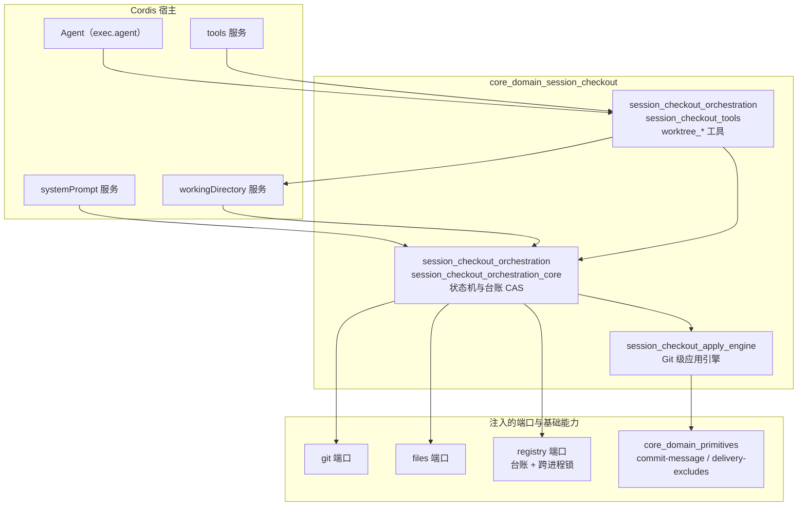
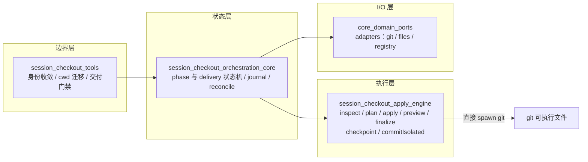
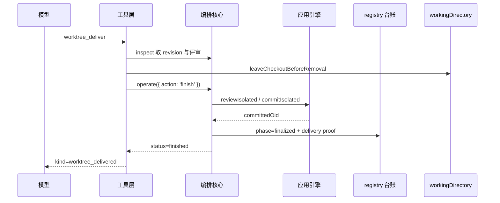

# core_domain_session_checkout：会话检出领域核心

!!! info "Generated documentation"
    This page was written by CodeWiki from the source code at commit [`e01d7c5f`](https://github.com/wloops/dsh-git-worktree/commit/e01d7c5f2f3a0d2f734a5a3415598ae6d7d6f387) on 2026-11-07 with `deepseek-v4.1-flash`. Check the code before relying on details.

`core_domain_session_checkout` 是 `dsh-git-worktree` 插件中「会话检出（Session Checkout）」能力的领域核心层。它负责把一个会话放进隔离的 Git Worktree 中工作，并在整个生命周期内保证 Local 仓库（用户的工作区、索引与 HEAD）不被污染；同时，在进程崩溃、目录被外部删除、并发请求交错等异常情况下，仍能收敛到可解释、可恢复的状态。

该模块位于 `core_domain` 之下，宿主无关、不含任何 I/O 实现：既不 `spawn` Git，也不直接读写文件，而是把注入的端口（Git、文件系统、台账 registry、Apply 引擎）组合成一个带 CAS、并发锁与崩溃恢复能力的编排状态机，并把真正的仓库改写委托给可校验、可回滚、可恢复的应用引擎。

## 模块定位

| 维度 | 说明 |
| --- | --- |
| 所属层次 | `core_domain` / `core_domain_session_checkout`（领域核心，宿主无关） |
| 主要构成 | 编排状态机（`session_checkout_orchestration`）+ Git 级应用引擎（`session_checkout_apply_engine`） |
| 对外形态 | `SessionCheckoutModule` 门面、`SessionCheckoutApplyEngine` 接口、模型可见的 `worktree_*` 工具子集 |
| 一致性基础 | `expectedRevision` / `expectedReviewId` 构成的 CAS 令牌、进程内串行锁、跨进程台账锁 |
| 关键不变量 | Local 的 HEAD / 索引 / 工作区不被交付流程改写；引擎方法不抛异常，错误码即契约 |

## 架构

模块由两个源文件层面的子模块构成，二者共享同一个门面：编排层负责状态迁移、账本持久化与身份授权，引擎层负责真正的 `git` 调用、指纹计算、三方合并与索引原子替换。

### 分层职责

### 一次典型交付的流向

## 核心组件

| 组件 | 定位 | 主要内容 |
| --- | --- | --- |
| [会话检出编排](core_domain_session_checkout/session_checkout_orchestration.md) | 中枢层总览 | 两个子模块的分工、依赖方向、关键设计约束 |
| [编排核心](core_domain_session_checkout/session_checkout_orchestration/session_checkout_orchestration_core.md) | 领域状态机与宿主接线 | `createSessionCheckoutModule` 工厂、台账与绑定数据模型、`phase` / `delivery.state` 两张状态机、`withBindingLock` 并发控制、三态身份校验（`valid` / `invalid` / `unavailable`）、创建/交付/评审/checkpoint/清理/恢复流程、`runtimeContext` 运行时文案 |
| [工具层](core_domain_session_checkout/session_checkout_orchestration/session_checkout_tools.md) | 面向模型的边界层 | `registerTools` 注册的 8 个 `worktree_*` 工具、严格 JSON Schema 输出契约、`withHostLanguage` 语言作用域、`enterCheckout` / `leaveCheckoutBeforeRemoval` 的 cwd 安全不变量、交付门禁与错误处理矩阵 |
| [Git 级应用引擎](core_domain_session_checkout/session_checkout_apply_engine.md) | 唯一直接改写 Git 的模块 | `createSessionCheckoutApplyEngine` 工厂、快照与指纹（CAS 基础）、有效基线与三方合并、任务增量剥离、检查点与索引原子替换、错误契约、Git 执行硬化 |

## 关键设计约束

- **先收据、后动作**：任何改动磁盘的操作都先把 journal / receipt 写进台账，`reconcile()` 才能在崩溃后判定「做到了哪一步」。
- **交付只写会话分支**：Local 的工作区、索引与 HEAD 全程不动；遗留的「写进 Local」路径会被 `refuseLegacyLocalWrite()` 直接拒绝。
- **身份校验优先于权限**：路径、目录 inode / birthtime、Git common dir 等证据必须先通过，才允许删除或改写。
- **区分瞬时故障与真实不匹配**：`invalid` 与 `unavailable` 分流，避免把 Git 超时之类的瞬时故障持久化为无法自愈的 `recovery_required`。
- **引擎不持久化、不授权**：journal、receipt、`applyBaseOid`、清理配额均由编排层维护；`ownerSessionId`、`revision`、`expectedGeneration` 的校验也在状态机，引擎只做 Git 事实校验（同一对象库、同一项目子目录、指纹一致）。
- **模型只推进到 Ready for Review**：`Discard` / `Remove` 保留为人类命令，`worktree_deliver` 在 `autoDeliver` 关闭时被拒绝。

## 相关文档

- 接口与视图类型：[core_domain_public_api — 会话检出领域的公共 API 面](core_domain_public_api.md)、[core_domain_ports 端口契约与持久化数据模型](core_domain_ports.md)
- 路径候选与 checkpoint 等基础能力：[core_domain_primitives 核心域基础原语](core_domain_primitives.md)
- 官方 Worktree 注册与宿主兼容：[工作区与官方工作树生命周期（core_domain_workspace_lifecycle）](core_domain_workspace_lifecycle.md)
- 真实 I/O 实现：[adapters 模块：DSH 宿主适配层](../adapters.md)
- 控制面与客户端：[console_host：Worktree 控制台的 Host 侧服务层](../console_host.md)、[client_ui — 浏览器端 UI 层](../client_ui.md)
- 构建与发布约束：[build_and_config 构建与配置](../build_and_config.md)

??? abstract "Documented components (45)"
    - [`ApplyConflictPlanResult`](https://github.com/wloops/dsh-git-worktree/blob/e01d7c5f2f3a0d2f734a5a3415598ae6d7d6f387/src%5Csession-checkout-apply.ts) — `src\session-checkout-apply.ts`
    - [`ApplyErrorResult`](https://github.com/wloops/dsh-git-worktree/blob/e01d7c5f2f3a0d2f734a5a3415598ae6d7d6f387/src%5Csession-checkout-apply.ts) — `src\session-checkout-apply.ts`
    - [`ApplyPlan`](https://github.com/wloops/dsh-git-worktree/blob/e01d7c5f2f3a0d2f734a5a3415598ae6d7d6f387/src%5Csession-checkout-apply.ts) — `src\session-checkout-apply.ts`
    - [`ApplyPlanErrorResult`](https://github.com/wloops/dsh-git-worktree/blob/e01d7c5f2f3a0d2f734a5a3415598ae6d7d6f387/src%5Csession-checkout-apply.ts) — `src\session-checkout-apply.ts`
    - [`ApplyPlanInput`](https://github.com/wloops/dsh-git-worktree/blob/e01d7c5f2f3a0d2f734a5a3415598ae6d7d6f387/src%5Csession-checkout-apply.ts) — `src\session-checkout-apply.ts`
    - [`ApplyReadyPlanResult`](https://github.com/wloops/dsh-git-worktree/blob/e01d7c5f2f3a0d2f734a5a3415598ae6d7d6f387/src%5Csession-checkout-apply.ts) — `src\session-checkout-apply.ts`
    - [`ApplyScope`](https://github.com/wloops/dsh-git-worktree/blob/e01d7c5f2f3a0d2f734a5a3415598ae6d7d6f387/src%5Csession-checkout-apply.ts) — `src\session-checkout-apply.ts`
    - [`ApplySuccessResult`](https://github.com/wloops/dsh-git-worktree/blob/e01d7c5f2f3a0d2f734a5a3415598ae6d7d6f387/src%5Csession-checkout-apply.ts) — `src\session-checkout-apply.ts`
    - [`CheckoutSnapshot`](https://github.com/wloops/dsh-git-worktree/blob/e01d7c5f2f3a0d2f734a5a3415598ae6d7d6f387/src%5Csession-checkout-apply.ts) — `src\session-checkout-apply.ts`
    - [`CheckpointInput`](https://github.com/wloops/dsh-git-worktree/blob/e01d7c5f2f3a0d2f734a5a3415598ae6d7d6f387/src%5Csession-checkout-apply.ts) — `src\session-checkout-apply.ts`
    - [`CheckpointRecoverySuccessResult`](https://github.com/wloops/dsh-git-worktree/blob/e01d7c5f2f3a0d2f734a5a3415598ae6d7d6f387/src%5Csession-checkout-apply.ts) — `src\session-checkout-apply.ts`
    - [`CheckpointSuccessResult`](https://github.com/wloops/dsh-git-worktree/blob/e01d7c5f2f3a0d2f734a5a3415598ae6d7d6f387/src%5Csession-checkout-apply.ts) — `src\session-checkout-apply.ts`
    - [`CommitIsolatedInput`](https://github.com/wloops/dsh-git-worktree/blob/e01d7c5f2f3a0d2f734a5a3415598ae6d7d6f387/src%5Csession-checkout-apply.ts) — `src\session-checkout-apply.ts`
    - [`CommitIsolatedSuccess`](https://github.com/wloops/dsh-git-worktree/blob/e01d7c5f2f3a0d2f734a5a3415598ae6d7d6f387/src%5Csession-checkout-apply.ts) — `src\session-checkout-apply.ts`
    - [`CommitIsolationApplyError`](https://github.com/wloops/dsh-git-worktree/blob/e01d7c5f2f3a0d2f734a5a3415598ae6d7d6f387/src%5Csession-checkout-apply.ts) — `src\session-checkout-apply.ts`
    - [`DefaultSessionCheckoutApplyEngine`](https://github.com/wloops/dsh-git-worktree/blob/e01d7c5f2f3a0d2f734a5a3415598ae6d7d6f387/src%5Csession-checkout-apply.ts) — `src\session-checkout-apply.ts`
    - [`EffectiveApplyBase`](https://github.com/wloops/dsh-git-worktree/blob/e01d7c5f2f3a0d2f734a5a3415598ae6d7d6f387/src%5Csession-checkout-apply.ts) — `src\session-checkout-apply.ts`
    - [`FinishSuccessResult`](https://github.com/wloops/dsh-git-worktree/blob/e01d7c5f2f3a0d2f734a5a3415598ae6d7d6f387/src%5Csession-checkout-apply.ts) — `src\session-checkout-apply.ts`
    - [`GitApplyError`](https://github.com/wloops/dsh-git-worktree/blob/e01d7c5f2f3a0d2f734a5a3415598ae6d7d6f387/src%5Csession-checkout-apply.ts) — `src\session-checkout-apply.ts`
    - [`GitCommandFailure`](https://github.com/wloops/dsh-git-worktree/blob/e01d7c5f2f3a0d2f734a5a3415598ae6d7d6f387/src%5Csession-checkout-apply.ts) — `src\session-checkout-apply.ts`
    - [`GitResult`](https://github.com/wloops/dsh-git-worktree/blob/e01d7c5f2f3a0d2f734a5a3415598ae6d7d6f387/src%5Csession-checkout-apply.ts) — `src\session-checkout-apply.ts`
    - [`InvalidInputApplyError`](https://github.com/wloops/dsh-git-worktree/blob/e01d7c5f2f3a0d2f734a5a3415598ae6d7d6f387/src%5Csession-checkout-apply.ts) — `src\session-checkout-apply.ts`
    - [`InvalidPlanApplyError`](https://github.com/wloops/dsh-git-worktree/blob/e01d7c5f2f3a0d2f734a5a3415598ae6d7d6f387/src%5Csession-checkout-apply.ts) — `src\session-checkout-apply.ts`
    - [`MergeConflictResult`](https://github.com/wloops/dsh-git-worktree/blob/e01d7c5f2f3a0d2f734a5a3415598ae6d7d6f387/src%5Csession-checkout-apply.ts) — `src\session-checkout-apply.ts`
    - [`MergeReadyResult`](https://github.com/wloops/dsh-git-worktree/blob/e01d7c5f2f3a0d2f734a5a3415598ae6d7d6f387/src%5Csession-checkout-apply.ts) — `src\session-checkout-apply.ts`
    - [`OperationNotAllowedApplyError`](https://github.com/wloops/dsh-git-worktree/blob/e01d7c5f2f3a0d2f734a5a3415598ae6d7d6f387/src%5Csession-checkout-apply.ts) — `src\session-checkout-apply.ts`
    - [`PreviewModifiedApplyError`](https://github.com/wloops/dsh-git-worktree/blob/e01d7c5f2f3a0d2f734a5a3415598ae6d7d6f387/src%5Csession-checkout-apply.ts) — `src\session-checkout-apply.ts`
    - [`PreviewReceipt`](https://github.com/wloops/dsh-git-worktree/blob/e01d7c5f2f3a0d2f734a5a3415598ae6d7d6f387/src%5Csession-checkout-apply.ts) — `src\session-checkout-apply.ts`
    - [`PreviewRecoveryAssessment`](https://github.com/wloops/dsh-git-worktree/blob/e01d7c5f2f3a0d2f734a5a3415598ae6d7d6f387/src%5Csession-checkout-apply.ts) — `src\session-checkout-apply.ts`
    - [`PreviewRecoveryBlockedAction`](https://github.com/wloops/dsh-git-worktree/blob/e01d7c5f2f3a0d2f734a5a3415598ae6d7d6f387/src%5Csession-checkout-apply.ts) — `src\session-checkout-apply.ts`
    - [`PreviewRecoverySafeFinalize`](https://github.com/wloops/dsh-git-worktree/blob/e01d7c5f2f3a0d2f734a5a3415598ae6d7d6f387/src%5Csession-checkout-apply.ts) — `src\session-checkout-apply.ts`
    - [`PreviewRecoverySafeRollback`](https://github.com/wloops/dsh-git-worktree/blob/e01d7c5f2f3a0d2f734a5a3415598ae6d7d6f387/src%5Csession-checkout-apply.ts) — `src\session-checkout-apply.ts`
    - [`PreviewSuccessResult`](https://github.com/wloops/dsh-git-worktree/blob/e01d7c5f2f3a0d2f734a5a3415598ae6d7d6f387/src%5Csession-checkout-apply.ts) — `src\session-checkout-apply.ts`
    - [`ReviewIsolatedInput`](https://github.com/wloops/dsh-git-worktree/blob/e01d7c5f2f3a0d2f734a5a3415598ae6d7d6f387/src%5Csession-checkout-apply.ts) — `src\session-checkout-apply.ts`
    - [`ReviewSnapshotResult`](https://github.com/wloops/dsh-git-worktree/blob/e01d7c5f2f3a0d2f734a5a3415598ae6d7d6f387/src%5Csession-checkout-apply.ts) — `src\session-checkout-apply.ts`
    - [`RollbackSuccessResult`](https://github.com/wloops/dsh-git-worktree/blob/e01d7c5f2f3a0d2f734a5a3415598ae6d7d6f387/src%5Csession-checkout-apply.ts) — `src\session-checkout-apply.ts`
    - [`SessionCheckoutApplyEngine`](https://github.com/wloops/dsh-git-worktree/blob/e01d7c5f2f3a0d2f734a5a3415598ae6d7d6f387/src%5Csession-checkout-apply.ts) — `src\session-checkout-apply.ts`
    - [`SessionCheckoutApplyEngineOptions`](https://github.com/wloops/dsh-git-worktree/blob/e01d7c5f2f3a0d2f734a5a3415598ae6d7d6f387/src%5Csession-checkout-apply.ts) — `src\session-checkout-apply.ts`
    - [`StaleIsolatedApplyError`](https://github.com/wloops/dsh-git-worktree/blob/e01d7c5f2f3a0d2f734a5a3415598ae6d7d6f387/src%5Csession-checkout-apply.ts) — `src\session-checkout-apply.ts`
    - [`StaleLocalApplyError`](https://github.com/wloops/dsh-git-worktree/blob/e01d7c5f2f3a0d2f734a5a3415598ae6d7d6f387/src%5Csession-checkout-apply.ts) — `src\session-checkout-apply.ts`
    - [`StoredPlan`](https://github.com/wloops/dsh-git-worktree/blob/e01d7c5f2f3a0d2f734a5a3415598ae6d7d6f387/src%5Csession-checkout-apply.ts) — `src\session-checkout-apply.ts`
    - [`TreeMergeReadyResult`](https://github.com/wloops/dsh-git-worktree/blob/e01d7c5f2f3a0d2f734a5a3415598ae6d7d6f387/src%5Csession-checkout-apply.ts) — `src\session-checkout-apply.ts`
    - [`ResolvedSessionProject`](https://github.com/wloops/dsh-git-worktree/blob/e01d7c5f2f3a0d2f734a5a3415598ae6d7d6f387/src%5Csession-checkout-module.ts) — `src\session-checkout-module.ts`
    - [`ContextAgent`](https://github.com/wloops/dsh-git-worktree/blob/e01d7c5f2f3a0d2f734a5a3415598ae6d7d6f387/src%5Csession-target-context.ts) — `src\session-target-context.ts`
    - [`enterCheckout`](https://github.com/wloops/dsh-git-worktree/blob/e01d7c5f2f3a0d2f734a5a3415598ae6d7d6f387/src%5Ctools.ts) — `src\tools.ts`

