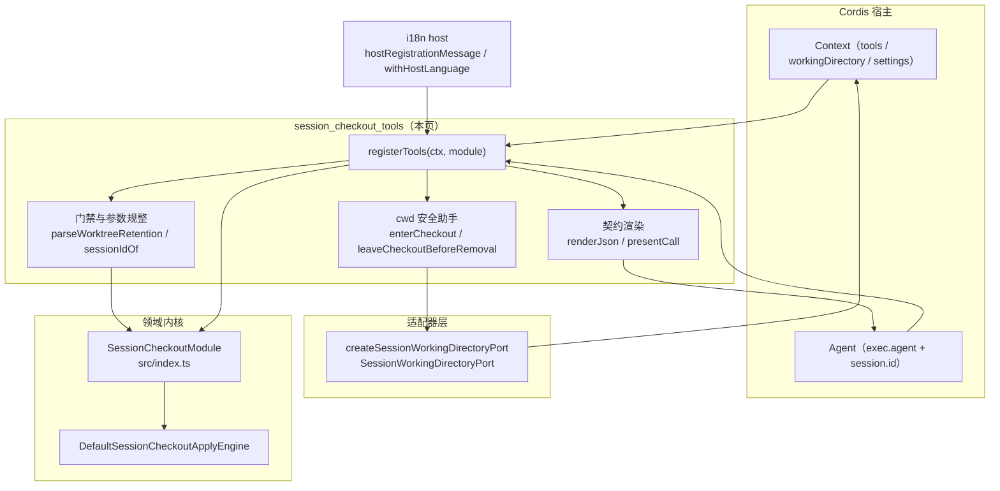
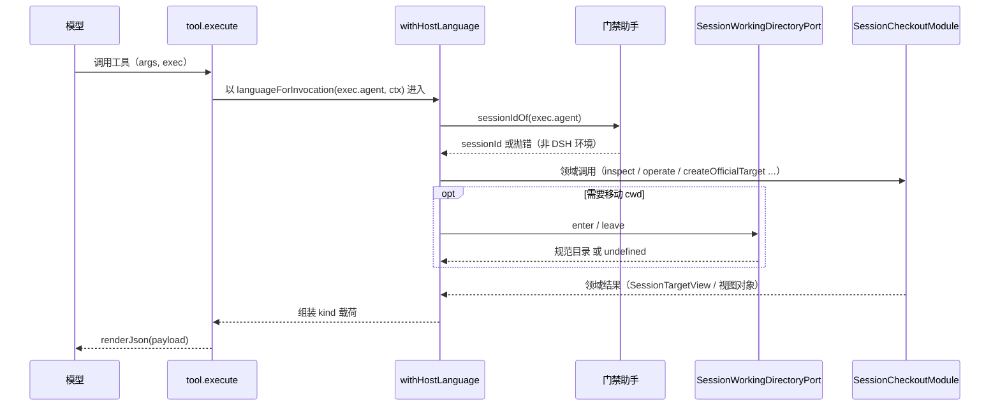
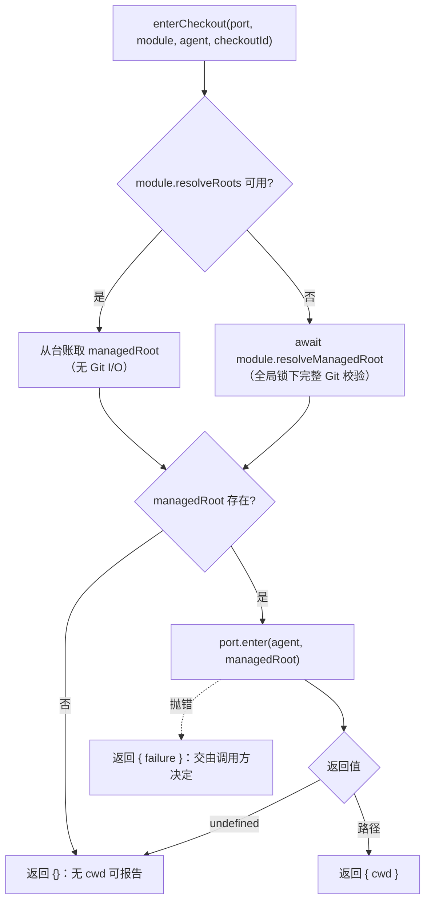
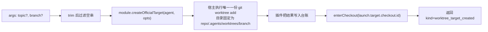
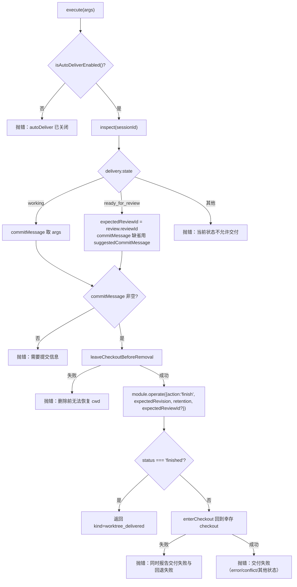

# 会话结账工具层（session_checkout_tools）

!!! info "Generated documentation"
    This page was written by CodeWiki from the source code at commit [`e01d7c5f`](https://github.com/wloops/dsh-git-worktree/commit/e01d7c5f2f3a0d2f734a5a3415598ae6d7d6f387) on 2026-11-07 with `deepseek-v4.1-flash`. Check the code before relying on details.

`session_checkout_tools` 是 `dsh-git-worktree` 插件面向**模型（Agent）**的边界层。它以 `src/tools.ts` 中的 `registerTools` 为唯一入口，向 Cordis 宿主注册 8 个受控工具，把模型的自然语言意图翻译成对 `SessionCheckoutModule` 的类型化调用，并负责三件不属于领域内核的事：

1. **身份与授权收敛**：从 `exec.agent` 推导出唯一合法的 `sessionId`，所有查询与变更都以调用者会话为作用域。
2. **cwd（会话工作目录）安全**：在进入新建 Worktree、或在删除 Worktree 前把会话"搬走/搬回"，避免会话停在一个即将消失的目录里。
3. **契约与本地化**：输出严格遵循 JSON Schema（`additionalProperties: false`），并统一使用宿主语言（`withHostLanguage`）与中英双语注册文案。

本层**不含任何 Git 逻辑**：Git 操作、台账写入、评审状态机全部委托给 [会话结账编排层](../session_checkout_orchestration.md) 与 [会话结账应用引擎](../session_checkout_apply_engine.md)。工具层是可替换的"外壳"，领域规则不在此处定义。

---

## 1. 在系统中的位置

| 依赖 | 用途 | 说明 |
| --- | --- | --- |
| `@deepseek-ai/dsh-tools` 的 `defineTool` | 声明参数 / 输出 Schema / `presentCall` | 见 `package.json` 的 peerDependencies |
| `SessionCheckoutModule` | 全部业务能力 | 接口定义见 [公共 API](../../core_domain_public_api.md) |
| `createSessionWorkingDirectoryPort` | 移动会话 cwd | 见 [适配器](../../../adapters.md) |
| `src/i18n/host.ts` | `hostMessage` / `hostRegistrationMessage` / `withHostLanguage` / `languageForInvocation` | 见 [i18n：多语言文案目录与本地化解析层](../../../i18n.md) |

---

## 2. 注册的工具清单

`registerTools` 一次性注册下列工具，全部通过 `ctx.tools.register(defineTool({...}))` 声明：

| 工具名 | 面向模型的能力 | 委托的模块方法 | 关键前置状态 |
| --- | --- | --- | --- |
| `worktree_create` | 通过宿主 `worktrees` 服务创建一个受管 Worktree，并把会话切进新目录 | `createOfficialTarget` | 无（仅需 `agent.session.id`） |
| `worktree_list` | 列出**当前会话可见**的受管 Worktree | `listManagedWorktreesForSession` | 无 |
| `worktree_resume_revision` | 作废尚未同步的评审，回到同一迭代的 `working` 状态 | `inspect` → `resumeRevision` | `delivery.state === 'ready_for_review'` |
| `worktree_begin_next_iteration` | 已交付且被清理后，安全开启下一轮迭代 | `inspect` → `beginNextIteration` | 上一轮已 `finalized` |
| `worktree_deliver` | 提交 / 推送 / 清理（交付） | `operate({ action: 'finish' })` | `isAutoDeliverEnabled()` 为真，且状态为 `working` 或 `ready_for_review` |
| `worktree_cleanup` | 清理已保留（retained）的 Worktree | `manageManagedWorktreeForSession({ action: 'cleanup_retained' })` | 需要 `checkoutId` + `expectedRevision` |
| `worktree_prune_branches` | 安全修剪已完全合并的本地分支 | `pruneMergedBranchesForSession` | 无 |
| `worktree_merge` | 会话分支与 Local 之间的双向合并（支持 `dryRun`） | `mergeBranchForSession` | `sourceBranch` 必填 |

> **有意不暴露给模型的能力**：`Discard` / `Remove`（丢弃与移除）保留为**人类命令**，由客户端 ToolView 呈现；`worktree_deliver` 在 `autoDeliver` 关闭时会被拒绝，此时交付路径改为"`worktree_ready_for_review` + 人工验收"。这体现了"模型只能推进到 Ready for Review，最终交付由人确认"的设计约束。

### 2.1 输出契约的通用约定

- 每个工具的 `output.schema` 都是 `type: 'object'`、`additionalProperties: false`，字段以 `required: true` 标注。
- **可选字段一律"省略"而非置 `null`/`''`**：宿主把 `undefined` 视为"非无损 JSON"并拒绝，因此代码中大量使用 `...(x ? { k: x } : {})` 的展开写法（例如 `commitOid`、`cwd`、`cleanupMessage`）。
- `render: (_args, value) => renderJson(value)` 把结果序列化为**唯一一段文本块** `[{ type: 'text', text: JSON.stringify(value) }]`；该载荷同时供模型阅读与被 keyed ToolView 解析（见 [客户端工具视图与动作](../../../client_ui/client_ui_tool_views_and_actions.md)）。
- 每个工具都返回带 `kind` 判别字段的对象（`worktree_target_created`、`worktree_list`、`worktree_revision_resumed`、`worktree_next_iteration_started`、`worktree_delivered`、`worktree_cleanup`、`worktree_prune_branches`、`worktree_merge`），便于前端按 `kind` 分派渲染。

---

## 3. 调用生命周期

所有 `execute` 都被同一层包装包裹，形成固定的执行骨架：

要点：

- **语言作用域按调用解析**：`languageForInvocation(exec.agent, ctx)` 优先读取 `agent.ctx`，退化到插件 `ctx`，再由 `withHostLanguage` 以 `AsyncLocalStorage` 绑定，保证并发调用之间互不污染。
- **`sessionIdOf` 是唯一身份来源**：`agent.session.id` 必须是字符串，否则抛出"工具只能在 DSH 会话内调用"。因此工具层不存在"传入任意 sessionId"的越权入口。

---

## 4. cwd 安全策略（本层最核心的副作用）

工具层是唯一关心"会话当前站在哪个目录"的层。两个助手函数构成一对对称的不变量。

### 4.1 `enterCheckout`：进入 Worktree

设计意图（与源码注释一致）：**先读台账，再做校验**。`resolveManagedRoot` 会在全局锁下执行完整 Git 校验，若在一次恢复中途或瞬时 Git 故障时失败，会话就会被卡在 Worktree 之外；而 `resolveRoots` 只读台账，能稳定给出边界。校验路径仅作为"模块无法从台账回答"时的兜底。

同时，`cwd: undefined` 与 `failure` 被严格区分：前者表示宿主未挂载 `workingDirectory` 服务（合法的降级，工具仍返回 `cwdSelected: false`），后者表示真实错误——绝不能把真实错误折叠进"未选择 cwd"，否则后续所有相对路径写入都会落到原始仓库里。

### 4.2 `leaveCheckoutBeforeRemoval`：删除前撤离

在 `worktree_deliver` 与 `worktree_cleanup` 中，操作**可能删除**当前 checkout。因此必须先 `port.leave(agent, managedRoot, localRoot)` 把会话退回 Local 边界：

- 返回 `undefined` → 撤离成功或本就无需撤离，可继续删除。
- 返回字符串 → 撤离失败原因，调用方**必须中止删除**，否则会话将站在一个即将消失的目录中。
- 内部异常不会中断流程，而是 `console.warn` 记录并把消息回传给调用方，最终以 `worktreeCwdCouldNotBeRestoredBeforeRemoval` 的形式抛给模型。

`SessionWorkingDirectoryPort.leave` 的实现还会先用 `isWithin` 判断会话是否真的在该目录内；不在则直接返回 `undefined`（不打扰用户当前的 cwd）。

---

## 5. 关键工具的行为细节

### 5.1 `worktree_create`

- `sourceSessionId` 与 `targetSessionId` 都等于调用者会话 id：官方机制下"创建"不改变来源会话身份。
- 返回值携带 `managedRoot`、`phase`、`currentOid`，以及 `branch`（创建即建好会话分支，Worktree 不再是 detached HEAD）。
- `cwdSelected` 由 `entered.cwd !== undefined` 决定；失败信息放进 `cwdError`，避免"声称已切换 cwd 但其实没切"。

### 5.2 `worktree_deliver`：带门禁的交付

- **乐观并发**：`expectedRevision` 来自 `inspect` 的 `revision`，`expectedReviewId` 来自当前评审，二者共同构成 CAS 语义，避免对过期状态做交付。
- **失败回滚语义**：交付失败后 checkout 仍然存在，因此必须把会话**搬回**其中；否则相对路径写入会污染 Local 仓库。回退失败时错误信息会同时携带交付失败原因与 cwd 回退失败原因（`worktreeCwdCouldNotBeRestoredAfterFailedDelivery`）。
- **清理结果三态**：`cleanup` 为 `discarded | pending | retained`（见 `SessionCheckoutFinishedResult`），`retention` 参数由 `parseWorktreeRetention` 校验，缺省为 `DEFAULT_WORKTREE_RETENTION`，非法值直接抛错。
- **推送不阻塞交付**：`push` 存在时表示自动推送已开启，其 `status`/`message` 仅作信息回传，失败不会让交付失败。

### 5.3 `worktree_resume_revision` 与 `worktree_begin_next_iteration`

两者都采用"**inspect → 领域调用 → 校验终态**"的三段式：

- `resume_revision`：要求当前 `delivery.state === 'ready_for_review'`（否则以当前状态回报错误），调用 `resumeRevision(sessionId, revision, review.reviewId)`，并要求返回状态回到 `working`。
- `begin_next_iteration`：调用 `beginNextIteration(sessionId, current.revision)`，要求进入 `working`；由于上一轮清理掉了 cwd、宿主已把会话还原到原项目，随后必须 `enterCheckout` 重新进入重建的 checkout，失败通过 `cwdError` 上报。

### 5.4 分支与仓库级工具

| 工具 | 参数 | 行为要点 |
| --- | --- | --- |
| `worktree_prune_branches` | `dryRun`、`olderThanDays`（仅接受 `> 0` 的有限数，向下取整） | 对应 `git branch -d` 语义，**永不 force**；输出 `pruned[]` 与 `skipped[]`（含 `reason`），`headBranch` 可选 |
| `worktree_merge` | `sourceBranch`（必填）、`dryRun`、`direction`（`forward` \| `reverse`，其他值视为缺省） | `forward`：Worktree → Local；`reverse`：Local HEAD → Worktree（冲突留在 Worktree 内）。`type === 'failed'` 时抛错并优先使用领域返回的 `reason` |

---

## 6. 错误处理矩阵

| 场景 | 抛出位置 | 文案来源 |
| --- | --- | --- |
| 非 DSH 会话 / `agent.session.id` 缺失 | `sessionIdOf` | `worktreeToolsCanOnlyBeCalledInADSH` |
| `retention` 非法 | `parseWorktreeRetention` | `worktreeDeliverInvalidRetention`（带 `p0`） |
| `autoDeliver` 关闭 | `worktree_deliver` | `worktreeDeliverDisabledByAutoDeliver` |
| 状态不允许交付 | `worktree_deliver` | `worktreeDeliverNotAllowedInState` |
| 无评审可恢复 | `worktree_resume_revision` | `theCurrentWorktreeHasNoUnsyncedReviewToResume372` |
| 迭代未进入 `working` | `resume_revision` / `begin_next_iteration` | `worktreeDidNotReturnToWorkingState` / `theNextWorktreeIterationDidNotEnterWorkingState` |
| 删除前 cwd 无法撤离 | `deliver` / `cleanup` | `worktreeCwdCouldNotBeRestoredBeforeRemoval` |
| 交付失败且回退 cwd 也失败 | `worktree_deliver` | `worktreeCwdCouldNotBeRestoredAfterFailedDelivery`（`p0`=交付原因，`p1`=cwd 原因） |
| `merge` 返回 `failed` | `worktree_merge` | 领域 `reason`，否则 `gitOperationFailedGit` |

所有文案都经 `hostMessage` 取用，遵循当前调用语言；而 `presentCall.title` 使用 `hostRegistrationMessage`，返回 `zh / en` 双语并置文案（注册期尚无调用语言上下文）。

---

## 7. 与其他模块的关系

- 领域能力与状态机：[会话结账编排层](../session_checkout_orchestration.md)、[编排内核](session_checkout_orchestration_core.md)、[会话结账应用引擎](../session_checkout_apply_engine.md)、[会话结账总览](../../core_domain_session_checkout.md)。
- 接口与视图类型：[公共 API](../../core_domain_public_api.md)（`SessionCheckoutModule`、`IsolatedTargetLaunch`、各类 `*View`）、[端口与记录](../../core_domain_ports.md)。
- cwd 端口实现：[适配器](../../../adapters.md)（`SessionWorkingDirectoryPort`、`WorkingDirectoryServiceLike`）。
- 客户端呈现：工具返回的 `kind` 载荷由 [客户端工具视图与动作](../../../client_ui/client_ui_tool_views_and_actions.md) 与 [目标控制台](../../../client_ui/client_ui_target_console.md) 消费；`presentCall` 声明的 `card: 'generic'` 决定回退卡片。
- 远端面：等价的非模型入口定义在 [console_host：Worktree 控制台的 Host 侧服务层](../../../console_host.md) 与 [console_contract：Worktree Console 共享契约层](../../../console_contract.md)，本层只覆盖"模型可调用"的子集。
- 构建与测试：`package.json` 的 `build`（`tsc && tsdown`）、`typecheck`、`test`（`vitest run`）脚本负责产出 `lib/`；`tsconfig.json` 与 `vitest.config.ts` 见 [构建与配置](../../../build_and_config.md)。

---

## 8. 扩展指引

新增一个模型可用工具时，请遵循既有骨架：

1. 用 `defineTool` 声明 `name` / `description`（走 `hostRegistrationMessage` 键，而不是硬编码文案）/ `parameters` / `output.schema`。
2. `output.schema` 必须 `additionalProperties: false`，可选字段在返回值中**省略**而不是置空。
3. `execute` 内部第一步必须是 `withHostLanguage(languageForInvocation(exec.agent, ctx), ...)`，第二部取 `sessionIdOf(exec.agent)`。
4. 任何可能删除 checkout 的操作，前面必须有 `leaveCheckoutBeforeRemoval`，并在失败时中止。
5. 任何需要把会话放进 checkout 的操作，使用 `enterCheckout`，并把 `cwdError` 如实回传。
6. 领域方法一律通过 `SessionCheckoutModule` 调用；**不要在本层直接调用 Git**。
7. 为 `presentCall` 提供标题键，保持 `card: 'generic'`、`kind: 'other'`、`rawInput: {}` 的一致形态。

??? abstract "Documented components (1)"
    - [`enterCheckout`](https://github.com/wloops/dsh-git-worktree/blob/e01d7c5f2f3a0d2f734a5a3415598ae6d7d6f387/src%5Ctools.ts) — `src\tools.ts`

