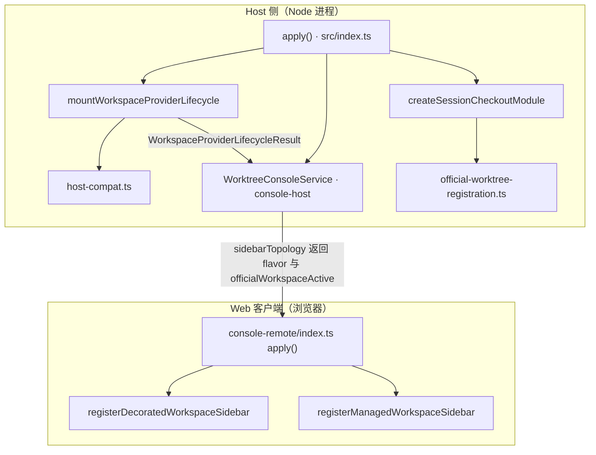
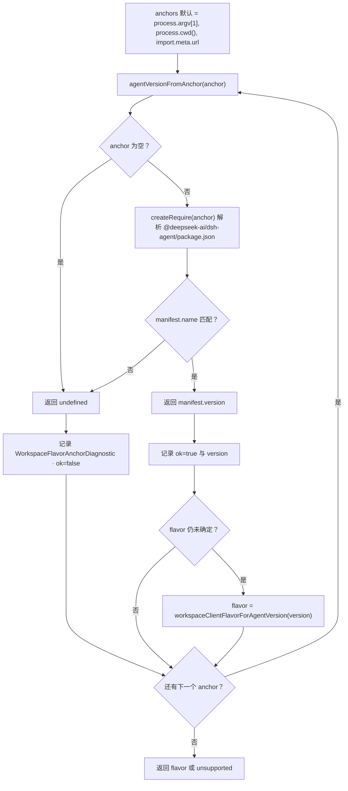
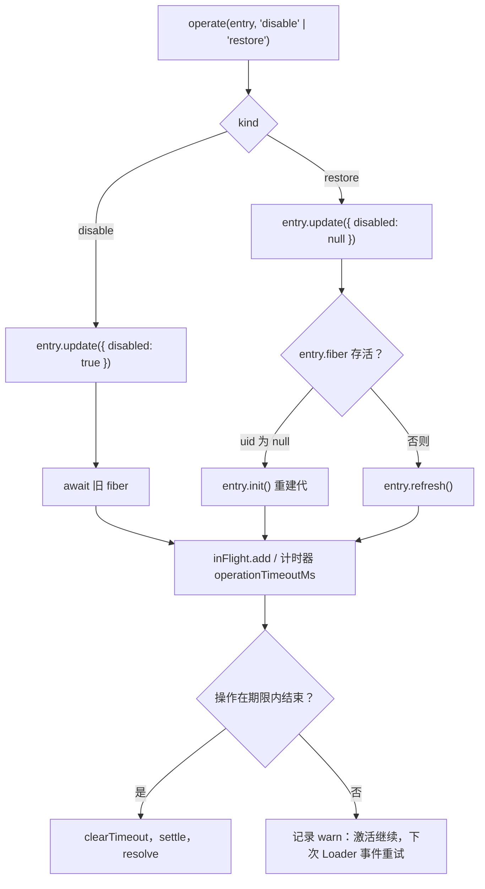
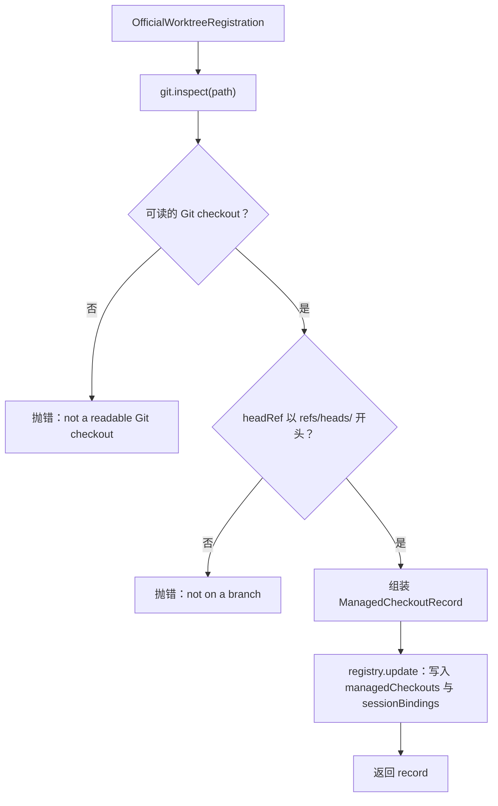
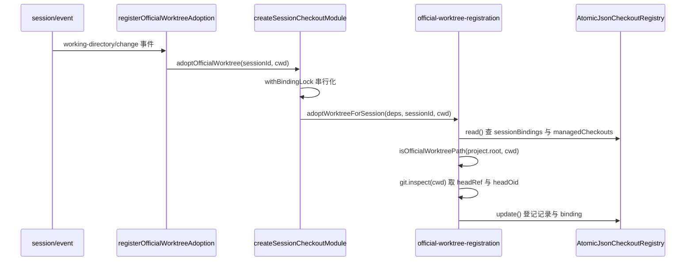
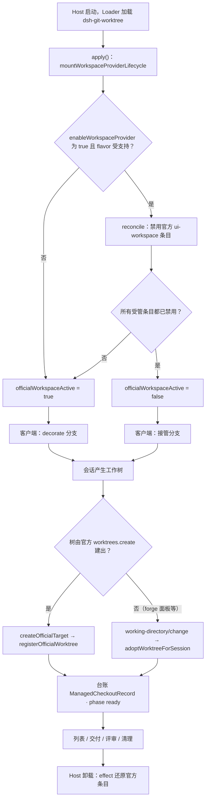

# 工作区与官方工作树生命周期（core_domain_workspace_lifecycle）

!!! info "Generated documentation"
    This page was written by CodeWiki from the source code at commit [`e01d7c5f`](https://github.com/wloops/dsh-git-worktree/commit/e01d7c5f2f3a0d2f734a5a3415598ae6d7d6f387) on 2026-11-07 with `deepseek-v4.1-flash`. Check the code before relying on details.

本模块负责 `dsh-git-worktree` 与 **Host 官方能力**交界处的两件"生命周期"事务：

1. **工作区 Provider 选举**：判断当前 Host 属于哪一代 Workspace Client（`WorkspaceClientFlavor`），并决定本插件是"接管"官方 `uiWorkspace` 条目，还是与官方条目"装饰式共存"。
2. **官方工作树登记与接管**：把 Host 官方 `worktrees.create`（以及 forge 面板等其它路径）在 `.agents/worktrees/` 下建出的工作树登记进本插件台账，使列表、交付、评审、清理对这些树同样生效。

它不含 Git 状态机与交付逻辑（见 [core_domain_session_checkout：会话检出领域核心](core_domain_session_checkout.md)），也不含具体端口实现（见 [adapters 模块：DSH 宿主适配层](../adapters.md)）；本模块只做"版本识别 → 选举 → 登记"这三步的决策与簿记。

---

## 1. 组件总览

| 文件 | 核心导出 | 职责 |
| --- | --- | --- |
| `src/host-compat.ts` | `WorkspaceFlavorAnchorDiagnostic`、`WorkspaceFlavorDiagnostics`、`workspaceClientFlavorForAgentVersion`、`workspaceFlavorDiagnostics`、`hostWorkspaceClientFlavor` | 从多个 anchor 解析 Host 的 `@deepseek-ai/dsh-agent` 版本，映射为 `WorkspaceClientFlavor`，并记录每次探测的诊断信息 |
| `src/workspace-provider-lifecycle.ts` | `Context`（`worktreeWorkspaceProvider` 声明）、`WorkspaceProviderLifecycleOptions`、`WorkspaceProviderLifecycleResult`、`mountWorkspaceProviderLifecycle` | 通过 Loader 的条目操作完成 `uiWorkspace` Provider 选举：禁用官方条目（接管）或保持其存活（装饰共存），并在卸载时还原 |
| `src/official-worktree-registration.ts` | `OfficialWorktreeRegistration`、`OfficialWorktreeRegistrationDependencies`、`isOfficialWorktreePath`、`registerOfficialWorktree`、`adoptWorktreeForSession` | 判定官方目录布局、把新建的官方工作树写进台账、把"会话走进官方树"的事件转换为台账登记 |

### 1.1 组件关系



`apply()` 先挂载 Provider 生命周期、再构建域模块与控制面，因此 `officialWorkspaceActive` 的结论会在客户端首次 `sidebarTopology` 调用前就已确定（见 `src/index.ts` 第 386、423–432 行）。

---

## 2. 宿主版本识别：`src/host-compat.ts`

### 2.1 版本 → flavor 映射

`workspaceClientFlavorForAgentVersion(version)` 把 Host 的 agent 版本映射为装饰所需的具体分支：

| Host agent 版本 | `WorkspaceClientFlavor` | 依据 |
| --- | --- | --- |
| `0.1.2-rc.1` | `legacy` | 精确匹配 |
| `0.1.6-alpha.2` | `alpha` | 精确匹配 |
| `0.1.7-rc.2` | `next` | 精确匹配 |
| `0.2.0-rc.2` | `modern-rc5` | 精确匹配 |
| `0.2.x` 且 patch ≥ 2（如 `0.2.2-rc.1`） | `modern-rc1` | `isModernGeneration` + `patchVersion` |
| `0.2.x` 且 patch < 2（如 `0.2.1-rc.5`） | `modern-rc5` | `isModernGeneration` + `patchVersion` |
| 其它 / `undefined` | `unsupported` | 兜底 |

`modern-rc1` 与 `modern-rc5` 之所以必须分成两代，是因为装饰是**在构建期针对某一版官方 Client 编译进去的**：`0.2.2-rc.1` 引入了 `contextMenus` 服务、把内置 Session 动作迁到该服务、把 `apply` 改为按属性读取 `ctx.remoteAccess`，并给 Session 节点与悬停卡加了 `cwd` 字段；`0.2.1` 系列完全没有这些。`patchVersion` 对不可解析的版本会抛 `Unparsable Host version`（在 `isModernGeneration` 已通过的前提下才会走到）。

### 2.2 anchor 探测与诊断



关键语义：

- **anchor 顺序即优先级**：`entry`（运行中的入口脚本）、`cwd`、`plugin`（`import.meta.url`）。在 `link:` 安装下，插件自己的 `node_modules` 会遮住 Host 的树，所以入口脚本与它的 cwd 优先，插件路径只作最后兜底。
- **首个成功的 anchor 决定 flavor**，但**每个 anchor 的探测结果都会被记录**到 `WorkspaceFlavorDiagnostics.anchors`（`kind` 为 `entry` / `cwd` / `plugin`，越界索引记为 `extra`）。
- 解析失败是**正常路径**：某个 anchor 看不到 Host 的 agent 树时静默跳过（源码中 `catch` 块带注释）。
- `hostWorkspaceClientFlavor()` 是 `workspaceFlavorDiagnostics().flavor` 的便捷封装，被 `apply()` 与 `WorktreeConsoleService` 使用。

### 2.3 诊断落地

`WorktreeConsoleService.sidebarTopology`（`src/console-host/service.ts`）在返回拓扑时附带 `workspaceClientFlavor` 与 `officialWorkspaceActive`，并把 `flavor` 与 `workspaceFlavorDiagnostics().anchors` 追加进 `sidebar-diag.ndjson`；该文件超过 8 MB 时轮转为 `.1`。排查"客户端选错分支"时，这条记录是唯一的现场证据。控制面细节见 [console_host：Worktree 控制台的 Host 侧服务层](../console_host.md)。

---

## 3. Provider 选举：`src/workspace-provider-lifecycle.ts`

### 3.1 为什么不用 client 侧表达式

旧实现把接管写成 `cordis.patch.yml` 里的条件禁用表达式（`disabled: !!get('worktreeWorkspaceProvider') && ...`）。同一表达式在两处求值、时机不同步：

- Host 侧插件 `apply` 期间，插件 fiber 仍处于 `LOADING`，Cordis 严格服务读取返回 `undefined` → 选举恒败 → 走 decorate 回退；
- Web renderer 稍后审计时插件已 `ACTIVE` → 表达式求值为 `true` → 官方条目被跳过不启动。

结果没有任何条目提供 `uiWorkspace`，下游 17 个条目 pending，web boot 崩溃（2026-10-17 18:11 / 20:25 两次事故）。当前 `cordis.patch.yml` 已彻底移除该表达式块，只保留插件自身的 `insert`；接管完全由 Host 侧生命周期驱动，历史 profile patch 中残留的旧表达式会被本模块识别并替换。

因此本模块的选举原则是：**用 Loader 操作写确定性布尔值，只求值一次，发生在 Host 侧**。`entry.update({ disabled: true })` 写入的是普通布尔，之后任何读取（Host 审计、序列化的 renderer 树、模块事件）都不再求值。

### 3.2 入口与开关

`mountWorkspaceProviderLifecycle(ctx, flavor, options)`：

| 参数 / 选项 | 含义 |
| --- | --- |
| `flavor` | 默认 `hostWorkspaceClientFlavor()` |
| `options.enabled` | 仅当为 `true` 才尝试接管；`apply()` 传入 `config.enableWorkspaceProvider === true` |
| `options.operationTimeoutMs` | 单次 Loader 禁用/还原操作的上限，默认 `DEFAULT_OPERATION_TIMEOUT_MS = 10_000` |

两条提前返回路径，都会让官方 Provider 保持存活并返回 `{ officialWorkspaceActive: true }`：

1. `enabled` 非真值 → 记录 info 日志，官方 `ui-workspace` 保持活动；
2. `flavor === 'unsupported'` → 记录 warn 日志，没有针对该代的钉版 Browser。

接管之所以是显式开关：禁用官方 `ui-workspace` 条目会把它对应的 client 包从 Host 的 client graph 中移除，所有 import 该包的包都会加载失败，所以只在被要求时执行。

### 3.3 所有权簿记

选举必须区分"我们禁用的"与"别人禁用的"：

| 结构 | 含义 |
| --- | --- |
| `adopted: Set<string>` | **本次生命周期**禁用过的条目 id（写入的是我们写的 `options.disabled === true`），只有这些条目才可能被还原 |
| `overridden: Set<string>` | 首次见到时**已被**普通真值禁用、且不属于我们的条目（用户或市场决定），永不触碰 |
| `ownedDisables: WeakSet<Entry>` | 跨代所有权：`Entry` 对象被所有代共享，重启后新一代的 `adopted` 为空，但官方条目可能仍带着上一代写入的 `disabled: true`；记录在 Entry 上，避免把"自己待还原的禁用"误判为外部决定，并在该还原落地后重新选举 |
| `inFlight: Set<string>` | 真实 Loader 操作仍在进行（可能已超过上限）的条目；后续 reconcile 跳过它们，保证每个条目同一时刻最多一个 Loader 变更 |
| `released: boolean` | 已进入清理流程，后续 reconcile 直接返回 |

`official()` 收集候选条目：名称为 `OFFICIAL_WORKSPACE`（`@deepseek-ai/dsh-client-ui-workspace`）、未被 `overridden`，并且"不是条件表达式、不是我们 adopted 的、不是 `ownedDisables` 的、`disabled` 为假"的条目才会被过滤掉。

`selfDisabled()` 读取 `ctx.fiber.entry?.disabled`：市场会在 bundle 条目出现时立即回放持久化的禁用列表，因此本条目可能在选举进行中就被外部禁用；**被禁用的 owner 不得接管任何东西**，选举让位给官方 Provider，并在条目被重新启用后重试。

### 3.4 单次 Loader 操作：`operate`



两个关键适配：

- `disabled: true` 会 dispose 正在运行的 fiber，`disabled: null` 会删除该键（`isNullable`），从而允许条目重新启动；写普通值让后续所有读取保持确定性。
- **Loader 1.0.6 适配**（吸收自上游 `e2c6c70`）：`update()` 不等待 fiber dispose，且会把已 dispose 的 fiber 留在条目上；`refresh()` 把任何残留引用视为仍在运行，只有 `init()` 会替换死掉的代。因此禁用必须 `await` 旧 fiber，还原必须重建死代而不是 refresh。

`package.json` 的 peerDependencies 为 `@deepseek-ai/cordis ^4.0.5` / `@deepseek-ai/cordis-plugin-loader ^1.0.6`，devDependencies 钉在 `4.1.0` / `1.1.0`，这段逻辑同时覆盖两代 Loader 行为。

### 3.5 选举主循环 `reconcile`

`reconcile()` 以 Promise 链串行化（`pending = pending.then(...)`），每轮：

1. `released` 或 `selfDisabled()` 为真 → 直接返回；
2. 遍历 `official()`，跳过 `inFlight`；
3. 读 `entry.disabled`（读取失败只 warn 并跳过该条目）；
4. 未禁用则 `operate(entry, 'disable')`；**只有** `entry.options.disabled === true`（`update` 在 dispose 前同步提交）才加入 `adopted` 与 `ownedDisables`，卡住或失败的条目保持"无主"，稍后重试。

选举永不阻塞、也不失败插件激活：Host 启动时各条目并发启动，禁用官方条目可能与仍在启动的 fiber 竞争，且不同 Loader 版本对这类 dispose 的收束方式不同，因此每次操作都与一个上限赛跑；卡住的操作只报一次，条目在下一次 Loader 事件时重试。

触发点：

| 事件 | 条件 |
| --- | --- |
| `ctx.on('internal/status', fiber)` | `fiber === ctx.fiber && !released`（Includes 可能在替换插件激活后才加入官方行） |
| `ctx.on('internal/plugin', fiber)` | `fiber.uid` 存在且 `fiber.entry?.options.name === OFFICIAL_WORKSPACE`（外部重新启用被禁条目） |
| 首次 `await reconcile()` | 激活返回前执行，使 Sidebar 拓扑能报告真实结果 |

### 3.6 卸载与还原

清理挂在 `ctx.effect` 上，按顺序：

1. `released = true`；
2. `await releaseMarker()` 显式撤回 `worktreeWorkspaceProvider` 标记（Cordis 4.0.5 的 effect 是并发卸载而非 LIFO，所以必须显式撤回，包括替换 apply 失败的情况）；
3. 若本代 fiber 已 `uid === null`，调用 `withdraw()` 清掉 `entry.fiber` 引用并发出 `internal/plugin`（Loader 会保留失败/已 dispose 的 fiber，而 Web 注册表只检查条目引用，不看 fiber 状态；Cordis 4.1.0 的 `ctx.plugin()` 返回 `Object.create(fiber)` 包装，故同时识别"同一对象"与"原型相同"两种形态）；
4. Root/Include 正在拆除（`ctx.root.fiber.uid === null` 或状态为 `UNLOADING`）时**不复活**该树，直接返回；
5. 等待 `pending`，对每个仍在 `adopted`、仍处于禁用状态、父 ctx 存活的条目执行 `operate(entry, 'restore')`，并从 `adopted` / `ownedDisables` 中移除；
6. 用 `setTimeout(settle, 0)` 轮询等待状态离开 `UNLOADING`（`UNLOADING = 5` 取自 Cordis 的声明式 const enum），再决定是否 `withdraw()`——在条目仍 `UNLOADING` 时清引用会破坏 Loader 自身拆除流程，而 `fiber.await()` 会在保留的 transition 上自旋。

### 3.7 返回值语义

`WorkspaceProviderLifecycleResult.officialWorkspaceActive`：

- **仅在真的禁用了所有受管官方条目时**才为 `false`（接管）；
- 只要有受管条目未禁用、读取 `entry.disabled` 抛错、或没有任何受管条目，即为 `true`（装饰共存），并记录"无法通过 Loader 操作禁用官方条目，回退到装饰式共存"的 warn。

这个布尔会经 `WorktreeConsoleService` → `sidebarTopology` → 客户端 `apply()` 决定走哪条注册路径（见 [client_ui — 浏览器端 UI 层](../client_ui.md)）：

| `officialWorkspaceActive` | 客户端行为 |
| --- | --- |
| `true` | `registerDecoratedWorkspaceSidebar`：装饰正在运行的官方注册，**绝不重放**模块 apply |
| `false` | `registerManagedWorkspaceSidebar`：以本插件的 Browser 重新提供 `uiWorkspace` |

报告必须真实：谎称接管会让 Web 客户端重放官方 apply，并以 `service "uiWorkspace" has been registered` 崩溃（2026-10-11 事故）。

---

## 4. 官方工作树登记与接管：`src/official-worktree-registration.ts`

### 4.1 官方目录布局

```ts
const OFFICIAL_WORKTREE_DIRECTORY = '.agents/worktrees'
```

`isOfficialWorktreePath(localRoot, path)` 只承认 `<repositoryRoot>/.agents/worktrees/<branch>` 之下的路径（用 `relative` 判定，空字符串与 `..` 前缀都拒绝）。只认这个前缀是有意为之：用户手工 `git worktree add` 出来的目录不属于本插件，纳管它们等于凭空接管别人的目录。

### 4.2 登记一条官方工作树

`registerOfficialWorktree(dependencies, registration)` 把一次官方 `worktrees.create` 的结果写进台账：



`OfficialWorktreeRegistration` 字段：`ownerSessionId`、`projectId`、`projectName`、`localRoot`、`path`（官方建好的 checkout 目录）、`baseCommit`（分叉基准提交）。

记录的字段映射：

| `ManagedCheckoutRecord` 字段 | 取值 |
| --- | --- |
| `checkoutId` | `dependencies.createCheckoutId()`（生产为 `randomUUID`） |
| `localRoot` / `managedRoot` / `managedGitRoot` | `resolve(registration.localRoot)` / `resolve(registration.path)` / `resolve(snapshot.root)` |
| `gitCommonDir` / `gitDir` | 来自 `git.inspect` 快照 |
| `baseOid` | `registration.baseCommit` |
| `sourceRef` / `sessionBranch` | `snapshot.headRef`（台账里的分支一律是完整 ref，与 `attachSessionBranch` 写出的 `branchRef` 同形） |
| `phase` | `'ready'`——官方已完成 checkout，这棵树从诞生起就是就绪态 |
| `delivery` | `{ state: 'working', iteration: 1 }` |
| `journal` / `revision` | `null` / `1` |

同时写入 `sessionBindings[ownerSessionId]`：`target` 指向 `{ kind: 'isolated', checkoutId }`，`sourceRef` / `sourceOid` 取官方树当前分支与 HEAD，`revision` 在既有值上递增。归属不需要猜测——调用方就是这棵树的 owner。所有写入都走 `registry.update`（同一把跨进程锁内的读-改-写），避免与其它进程的写入交错。

### 4.3 接管"会话走进去的树"

官方 `worktrees.create` 的最后一步是 `workingDirectory.set`，因此 `working-directory/change` 是"这棵树建好了、且是某个会话的落脚点"的唯一可靠信号——比轮询 `git worktree list` 及时，也不需要为每个项目起子进程。



`adoptWorktreeForSession` 的跳过条件（任一成立即返回 `undefined`，不产生任何写入）：

1. 会话没有 `projectId`，或项目记录不存在；
2. `cwd` 不在 `.agents/worktrees/` 之下；
3. 会话**已有** binding；
4. 台账里**已有**记录指向这棵树（`isTracked` 同时按 `managedRoot` 与 `managedGitRoot` 对齐，并排除 `phase === 'discarded'`；Windows 下路径小写归一）。

原因很直接：官方每条请求都真的执行 `git worktree add`，重复登记会产生指向同一目录的两条记录。此外快照必须是 `refs/heads/` 上的分支，否则无法为一个 Session 提供落点。

调用侧有两处入口，都经 `withBindingLock` 与其它绑定变更串行化：

- `src/index.ts` 的 `registerOfficialWorktreeAdoption` 监听 `session/event`，只处理 `working-directory/change`，并把异步登记接到 `catch`（事件 feed 不等待监听者，未捕获的 rejection 会逃出这个 fire-and-forget 调用）；
- `SessionCheckoutModule.createOfficialTarget` 走官方 `worktrees.create`，成功后调用 `registerOfficialWorktree`；若本会话已站在一棵未丢弃的树里则直接复用而不重复建树。

---

## 5. 端到端生命周期



### 5.1 记录状态与生命周期边界

本模块创建的记录直接落在 `phase: 'ready'`、`delivery: { state: 'working' }`，此后由会话检出状态机接管（`preparing` / `mutating` / `recovery_required` / `finalized` / `retained` / `discarded`）。状态机、互斥锁与恢复流程见 [core_domain_session_checkout：会话检出领域核心](core_domain_session_checkout.md)，记录与台账类型见 [core_domain_ports 端口契约与持久化数据模型](core_domain_ports.md)。

---

## 6. 依赖与契约

| 依赖 | 用途 |
| --- | --- |
| `SessionCheckoutLookupPort`（`getSession` / `getProject`） | 把会话解析到项目，判断官方路径归属 |
| `SessionCheckoutGitPort`（`inspect`） | 读取工作树的 `root` / `commonDir` / `gitDir` / `headRef` / `headOid` |
| `SessionCheckoutRegistryPort`（`read` / `update`） | 台账读写；单条记录更新必须走 `update`，否则两个进程的读-改-写会互相覆盖 |
| `@deepseek-ai/cordis` `Context` / `FiberState` / `Entry` | 服务声明（`worktreeWorkspaceProvider`）、effect 卸载、Loader 条目操作 |
| `@deepseek-ai/cordis-plugin-loader` | `loader.entries()`、`entry.update` / `init` / `refresh`、`entry.disabled` |

端口抽象的意义是让本模块与域逻辑保持 host 无关、可用 fake 测试；具体实现见 [adapters 模块：DSH 宿主适配层](../adapters.md)。

---

## 7. 构建、测试与版本门禁

Workspace 生命周期与"钉版官方 Client"强耦合，构建期即固化版本假设：

- **虚拟模块**：`tsdown.config.ts` 注册 `virtual:dsh-official-workspace-client` 及其 `-rc5` / `-alpha` / `-next` 派生模块，`load` 时调用各 `materialize*WorkspaceClientModule()` 生成装饰后的源码。每个 `modern` 代必须使用**自己的**派生，因为装饰是针对单一钉版官方 Client 编译进去的。
- **哈希与版本门禁**：`scripts/workspace-sidebar-upstream.mjs` 固定 `WORKSPACE_UI_VERSION = '0.2.2-rc.1'` 与 `WORKSPACE_CLIENT_SHA256`，`pnpm run check:sidebar-version`（`scripts/check-workspace-sidebar-version.mjs`）校验官方 Client 的 SHA-256 与 `dsh-client-locale` 版本，任何上游漂移都会 fail closed。
- **测试替身**：`vitest.config.ts` 把四个 `virtual:*` 模块别名到 `tests/*.mock.ts`，并按平台关闭文件级并行（Windows 上重型 Git fixture 会争抢进程与文件句柄）。
- **CI**：`.github/workflows/ci.yml` 依次执行 `pnpm run typecheck`、`build`、`check:publish:release`、`test`。

细节见 [build_and_config 构建与配置](../build_and_config.md)。

---

## 8. 失败模式与排查

| 现象 | 可能原因 | 证据位置 |
| --- | --- | --- |
| Sidebar 显示官方工作区，本插件只装饰 | `enableWorkspaceProvider` 未开启，或 `flavor === 'unsupported'`，或官方条目禁用未收敛 | `apply()` 的 info/warn 日志；`sidebarTopology` 返回的 `officialWorkspaceActive` |
| 客户端选错代（例如在 `0.2.2` 上用了 rc5 派生） | anchor 命中了错误的 agent 树（`link:` 安装下插件自身 `node_modules` 遮蔽） | `sidebar-diag.ndjson` 中的 `flavor` 与 `anchors` 数组 |
| web boot 崩溃 / 大量条目 pending | 谎报接管导致重放官方 apply；或 `uiWorkspace` 无人提供 | 客户端 `clientBootReport` 记录（`branch` / `registered` / `detail`） |
| 官方建出的树不在列表里 | 会话未触发 `working-directory/change`，或路径不在 `.agents/worktrees/` 下 | `console.warn('[dsh-git-worktree] could not adopt the official Worktree: ...')` |
| 同一目录出现两条记录 | 绕过了 binding / `isTracked` 幂等检查（例如手改台账） | `managed-checkouts.json` 的 `managedCheckouts` 键 |
| 升级后官方条目仍被禁用 | 上一代写入的 `disabled: true` 尚在还原；`ownedDisables` 会在还原落地后重新选举 | "did not settle within ...ms" warn |

日志语言由 `i18n/host.ts` 的 `hostMessage` 提供，见 [i18n：多语言文案目录与本地化解析层](../i18n.md)。

---

## 9. 相关页面

- 域总览与文件清单：[core_domain 核心域概览](../core_domain.md)
- 状态机、互斥锁与交付流程：[core_domain_session_checkout：会话检出领域核心](core_domain_session_checkout.md)
- 记录 / 台账 / 端口类型：[core_domain_ports 端口契约与持久化数据模型](core_domain_ports.md)
- 路径候选、失败类型等基础件：[core_domain_primitives 核心域基础原语](core_domain_primitives.md)
- 模块对外契约（`SessionCheckoutModule`、视图类型）：[core_domain_public_api — 会话检出领域的公共 API 面](core_domain_public_api.md)
- 端口实现（Git / 文件 / 台账 / 查找）：[adapters 模块：DSH 宿主适配层](../adapters.md)
- 控制面、投影与 Remote 服务：[console_host：Worktree 控制台的 Host 侧服务层](../console_host.md)
- 客户端装配与装饰式侧栏：[client_ui — 浏览器端 UI 层](../client_ui.md)
- 构建、虚拟模块与版本门禁：[build_and_config 构建与配置](../build_and_config.md)

??? abstract "Documented components (7)"
    - [`WorkspaceFlavorAnchorDiagnostic`](https://github.com/wloops/dsh-git-worktree/blob/e01d7c5f2f3a0d2f734a5a3415598ae6d7d6f387/src%5Chost-compat.ts) — `src\host-compat.ts`
    - [`WorkspaceFlavorDiagnostics`](https://github.com/wloops/dsh-git-worktree/blob/e01d7c5f2f3a0d2f734a5a3415598ae6d7d6f387/src%5Chost-compat.ts) — `src\host-compat.ts`
    - [`OfficialWorktreeRegistration`](https://github.com/wloops/dsh-git-worktree/blob/e01d7c5f2f3a0d2f734a5a3415598ae6d7d6f387/src%5Cofficial-worktree-registration.ts) — `src\official-worktree-registration.ts`
    - [`OfficialWorktreeRegistrationDependencies`](https://github.com/wloops/dsh-git-worktree/blob/e01d7c5f2f3a0d2f734a5a3415598ae6d7d6f387/src%5Cofficial-worktree-registration.ts) — `src\official-worktree-registration.ts`
    - [`Context`](https://github.com/wloops/dsh-git-worktree/blob/e01d7c5f2f3a0d2f734a5a3415598ae6d7d6f387/src%5Cworkspace-provider-lifecycle.ts) — `src\workspace-provider-lifecycle.ts`
    - [`WorkspaceProviderLifecycleOptions`](https://github.com/wloops/dsh-git-worktree/blob/e01d7c5f2f3a0d2f734a5a3415598ae6d7d6f387/src%5Cworkspace-provider-lifecycle.ts) — `src\workspace-provider-lifecycle.ts`
    - [`WorkspaceProviderLifecycleResult`](https://github.com/wloops/dsh-git-worktree/blob/e01d7c5f2f3a0d2f734a5a3415598ae6d7d6f387/src%5Cworkspace-provider-lifecycle.ts) — `src\workspace-provider-lifecycle.ts`

