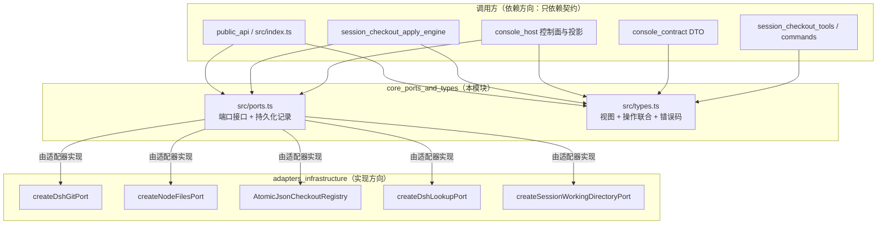
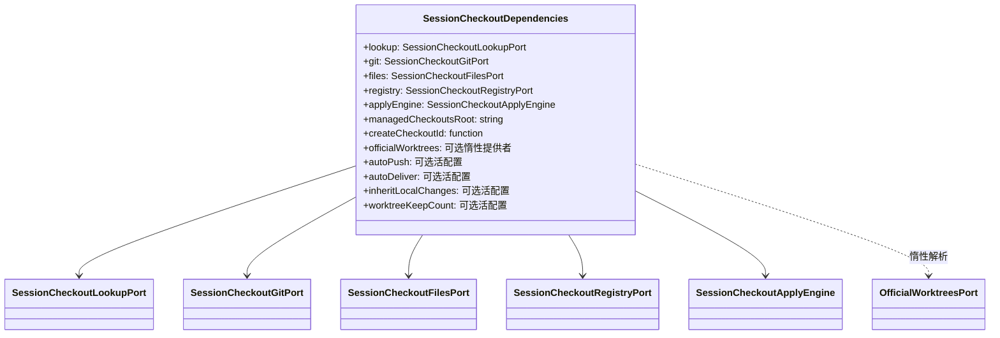
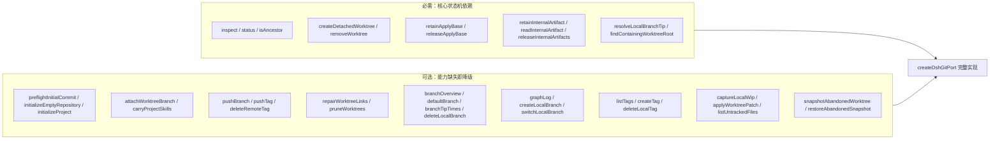
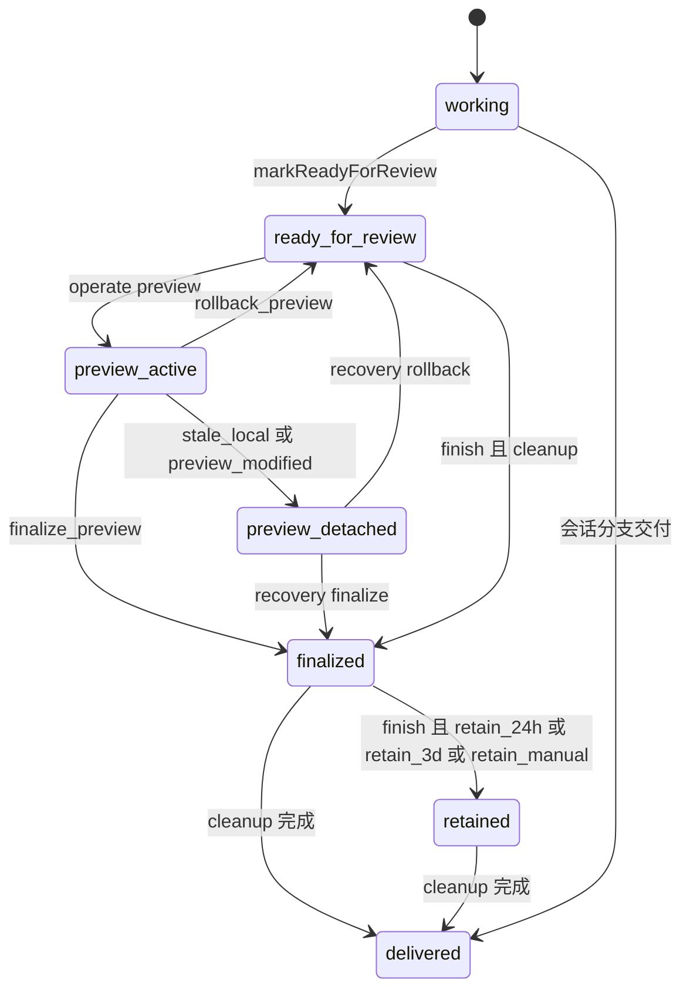
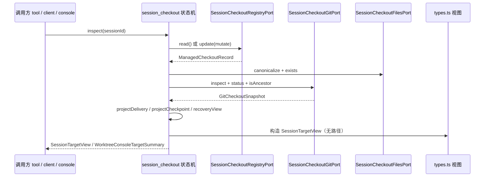

# 核心端口与类型契约（core_ports_and_types）

!!! info "Generated documentation"
    This page was written by CodeWiki from the source code at commit [`b8091103`](https://github.com/wloops/dsh-git-worktree/commit/b80911033130c51a168edf227c46032016feb0c4) on 2026-11-11 with `mimo-v2.6-flash`. Check the code before relying on details.

本页说明 `dsh-git-worktree` 插件的**领域边界层**：`src/ports.ts`（端口接口与持久化记录）与 `src/types.ts`（纯数据视图、操作联合与错误码）。这两个文件不含任何 Cordis、React、子进程或文件系统实现，它们是 session-checkout 状态机与 DSH 宿主之间的唯一契约面。

## 模块定位

`core_ports_and_types` 是整个插件中"最内向"的一层：

- **向下**：声明 `SessionCheckoutGitPort`、`SessionCheckoutFilesPort`、`SessionCheckoutRegistryPort`、`SessionCheckoutLookupPort`、`OfficialWorktreesPort` 五个端口，由 [适配器与基础设施（adapters_infrastructure）](adapters_infrastructure.md) 中的 Node/DSH 适配器实现。状态机与 apply 引擎只依赖这些端口，因此可用 fake 完整测试。
- **向上**：`src/types.ts` 输出路径无关（path-free）的视图与操作联合，被 [session_checkout_apply_engine](session_checkout_apply_engine.md)、[Session Checkout 集成核心（session_checkout_integration_core）](session_checkout_integration_core.md)、[public_api 模块：插件公共入口与契约面](public_api.md)、[console_host：Worktree 控制平面与 Host RPC 服务](console_host.md) 与 [console_contract 模块（Worktree Console 共享契约）](console_contract.md) 复用。
- **平级**：`src/ports.ts` 的 `ManagedCheckoutRecord` 与 `src/types.ts` 的 `SessionTargetView` 是同一条事实的两种表示——前者是**持久层事实**（含绝对路径、journal、指纹），后者是**调用方视图**（无路径、含派生能力）。二者之间的投影由状态机完成。

## `src/ports.ts`：端口与持久化记录

文件头注释明确了设计意图：领域逻辑只依赖端口，DSH 适配器（子进程 git、插件自有 registry 存储、session/workspace 查询）藏在端口之后，使状态机与 apply 引擎保持宿主无关且可用 fake 测试。

### 端口清单

| 端口 | 职责 | 实现方 |
| --- | --- | --- |
| `SessionCheckoutLookupPort` | 会话/项目的**只读导航证据**：`getSession`、`getProject`、可选 `getSessionCwd`、`listLiveSessions`、`getSidebarMemberships` | `createDshLookupPort`（`src/adapters/lookup.ts`） |
| `SessionCheckoutGitPort` | 全部 Git 操作：快照、状态、worktree 增删、内部 ref 保留、分支/标签/图日志、WIP 捕获、放弃快照、项目 Skill 携带 | `createDshGitPort`（`src/adapters/git.ts`） |
| `SessionCheckoutFilesPort` | 目录身份（device/inode/birthtime）用于隔离区 CAS、空树残余收集、符号链接防护删除、字节统计 | `createNodeFilesPort`（`src/adapters/files.ts`） |
| `SessionCheckoutRegistryPort` | 版本 2 台账的读、写与**锁内读-改-写** `update` | `AtomicJsonCheckoutRegistry`（`src/adapters/registry.ts`） |
| `OfficialWorktreesPort` | 宿主自身 `worktrees` 服务的窄化视图，只取 `create` | 宿主通过 `ctx.get('worktrees')` 动态解析 |
| `SessionCheckoutApplyEngine` | 由 apply 引擎实现（`src/session-checkout-apply.ts`），通过 `SessionCheckoutDependencies.applyEngine` 注入 | 见 [session_checkout_apply_engine](session_checkout_apply_engine.md) |

`SessionCheckoutDependencies` 是端口的总装点：`lookup`、`git`、`files`、`registry`、`applyEngine` 五个必需端口，加 `managedCheckoutsRoot`、`createCheckoutId()`，再加一组**可选宿主能力与本地适配开关**（`officialWorktrees`、`autoPush`、`autoDeliver`、`inheritLocalChanges`、`worktreeKeepCount`）。`src/index.ts` 的 `apply()` 负责把具体适配器装配进去。

### 可选方法即"宿主能力探测"

`SessionCheckoutGitPort` 与 `SessionCheckoutFilesPort` 中大量方法标为可选（`?`），这是刻意的契约设计：**能力缺失必须降级，而不是抛错**。

- `preflightInitialCommit` / `initializeEmptyRepository` / `initializeProject`：不支持初始化的第三方端口不得初始化仓库。
- `attachWorktreeBranch`：缺失时保留旧的 detached-HEAD 行为。
- `carryProjectSkills`：把项目 Skills 携进一棵**已建好**的 Worktree。建树改由官方 `worktrees` 服务负责后，`createDetachedWorktree` 不再参与官方路径，而 Skill 只存在于项目工作区、不在 Git 里，因此携带必须单独成步；缺失时不携带。
- `pushBranch`、`pushTag`、`deleteRemoteTag`：返回 `{ ok, message }` 而不是抛异常，让自动推送"软失败"。
- `repairWorktreeLinks`、`pruneWorktrees`：返回布尔值，缺失时调用方原样保留记录。
- `branchTipTimes`：缺失即关闭"陈旧分支年龄过滤"，绝不猜。
- `snapshotAbandonedWorktree` / `restoreAbandonedSnapshot`：codex 对齐的放弃/恢复链路。
- `readTextFile` / `copyFile` / `isSymbolicLink`：`.worktreeinclude` 复制所需。

同理 `SessionCheckoutLookupPort` 的 `getSessionCwd` 缺失时，状态机退回 `getProject().root` 语义；`listLiveSessions` 缺失时并发分支竞态守卫保持静默。

### 记录类型族

持久化事实分为三层：

1. **导航记录**：`SessionCheckoutSessionRecord`（`id`、`projectId`、`title`）、`SessionCheckoutProjectRecord`（`id`、`name`、`root`）、`SidebarDirectoryMembership`（`managedRoot`、`workspaceIds`、`sessionIds`）。`title` 仅用于可读目录名，**永不作身份**。
2. **绑定与台账**：`SessionBindingRecord`（`sessionId`、`projectId`、`target: SessionTargetRef`、`ownerSessionId`、`inheritedFromSessionId`、`sourceRef`、`sourceOid`、`revision`）与 `ManagedCheckoutsRegistry`（`version: 2`、`revision`、`sessionBindings`、`managedCheckouts`）。
3. **托管 checkout**：`ManagedCheckoutRecord` 是核心聚合根。

`ManagedCheckoutRecord` 的字段分组值得单独记忆：

- **身份**：`checkoutId`、`projectId`、`ownerSessionId`、`sourceSessionId`、`predecessorCheckoutId`。
- **双边界路径**：`localRoot`（Local 检出规范根）、`managedRoot`（受管 Worktree 中项目根，同时是租约 cwd）、`managedGitRoot`（仓库顶层）、`gitCommonDir`、`gitDir`。项目根可以是仓库子目录，因此两个 root 必须分开存。
- **基线**：`baseOid`（创建基点）与 `applyBaseOid`（最近一次成功 apply 的隔离快照，**不**改变用户可见的 Session Base）。
- **分支归属**：`sourceRef`（分叉来源）、`sessionBranch`（本 Worktree 提交到的会话分支，历史记录可能缺失）、`sessionTopic`（决定会话分支名 `feat/sess-<session>--<topic>`，必须持久化以免改名）。
- **状态机**：`phase`（`SessionCheckoutPhase`）、`delivery`（`ManagedCheckoutDelivery`）、`journal`（崩溃恢复日志，`null` 表示无在飞操作）、`revision`（乐观并发版本）。
- **附属证据**：`checkpoints[]`、`previousReview`、`recoveryContinuation`、`abandonedSnapshotOid`/`abandonedSnapshotAt`、`permanent`、`sidebarBadgeClearedRevision`。

### `ManagedCheckoutDelivery`：交付状态机

`ManagedCheckoutDelivery` 是判别联合，与 `phase` 正交组合出全部可观测状态（投影逻辑见 [console_host_projection — Host 侧投影与能力门控](console_host_projection.md)）：

各分支携带的证据不同：`finalized`/`retained` 带 `commitOid`、`proof: ManagedDeliveryProof`、`cleanup: 'pending' | 'blocked'`、`cleanupMessage(Key)`、`cleanupReason`、`isolatedFingerprint`；`retained` 额外带 `retention`、`retainedAt`、`expiresAt`；`delivered` 只保留 `iteration`、`commitOid`、`proof`、`deliveredAt`。

### 崩溃恢复：journal 与 recovery continuation

`ManagedCheckoutCreateJournal`（`operation: 'create'`，`step: 'creating_worktree'`，携带 `WorktreeCreationEvidence`）与 `ManagedCheckoutMutationJournal`（`operation: 'apply' | 'preview' | 'checkpoint' | 'rollback_preview' | 'finish' | 'finalize_preview' | 'cleanup'`，`step` 覆盖 `planning` → `artifacts_retained` → `committing_session_branch` → `writing_local` → `updating_ref` → `replacing_index` → `removing_worktree`）共同构成"进程被杀之后能否收敛"的唯一依据。两者共享 `ManagedCheckoutJournalBase`（`operationId`、`startedAt`）。

`ManagedRecoveryContinuation` 是四种一次性续跑上下文的联合：`worktree_apply_conflict`、`worktree_review_regeneration`、`worktree_preview_recovery_analysis`、`worktree_preview_recovery_handoff`。它们由 Host 权威写入，**只作为需要重新校验的上下文，绝不作为 bearer 权限**。

### 快照与只读概览类型

| 类型 | 用途 |
| --- | --- |
| `GitCheckoutSnapshot` | `root`、`commonDir`、`gitDir`、`branch`、`headOid`、`headRef`，是所有身份校验的输入 |
| `InitialCommitPreflight` | `kind`（`ready`/`empty`/`files`）+ `fingerprint` + 快照，用于未出生仓库初始化 |
| `BranchOverviewEntry` | 分支芯片弹出层：`name`、`oid`、`isCurrent`、`upstream` |
| `WorktreeListingEntry` | Git 自己行政列表中的一项：`path`、`headOid`、`branchRef` |
| `TagOverviewEntry` | 标签管理器：`annotated`、`message`、`pushed`（三态：`true`/`false`/`null`；远端不可查时为 `null`，绝不臆造"未推送"） |
| `GraphLogCommit` | 一行 `git log`：`oid`、`parents`、`author`、`authorTime`、`refs`、`subject`，lane 由客户端计算 |
| `DirectoryIdentity` | `device`、`inode`、`birthtimeNs`，用于隔离区原子移动前的 CAS |
| `WorktreeCreationEvidence` | 创建期目录与 Git 身份指纹、锁原因、可选隔离区路径 |

### `LiveValue`：易变配置的活引用

`LiveValue<T>` 与 `liveConfigValue()` 是本文件唯一的运行时代码。设置页编辑的易变（volatile）字段以活引用形式抵达，每次使用都重新 `get()`，因此改配置无需重挂插件。`autoPush`、`autoDeliver`、`inheritLocalChanges`、`worktreeKeepCount` 全部声明为 `T | LiveValue<T>`。`src/adapters/git-options.ts` 的 `gitTimeoutMs()` 也复用了同一机制。

`src/index.ts` 中的 `Config`（schemastery）用 `volatile()` 标注这些字段，因此它们被投影到设置页、写入 `cordis.patch.yml` 而无需重挂；本模块的 `LiveValue` 就是这条链路在领域层的表示。相关宿主适配见 [Worktree 设置卡片（client_settings_card）](client_settings_card.md) 与 [build_deployment_configuration：构建、打包与发布部署配置](build_deployment_configuration.md)。

### 台账的持久化与校验契约

`ManagedCheckoutsRegistry` 的类型声明承担着比"数据结构"更重的责任：它是版本 2 的磁盘格式契约。`src/adapters/registry.ts` 对每一次读取都做逐记录校验：

- 校验失败的单条记录会从**内存视图**中剔除并告警，但**磁盘原样保留**——因为降级只属于调用方视图，任何写回都必须以磁盘事实为基础，否则被丢弃的记录会被这次写入悄悄抹掉。
- 版本 1 台账由 `migrateLegacyRegistry` 保守迁移：除 `ready`/`discarded` 之外的一切旧 phase 一律落到 `recovery_required` 并递增 `revision`，`delivery` 置为 `{ state: 'working', iteration: 1 }`。
- 文件损坏时抛 `registry_corrupt`（`SessionCheckoutError`），而不是静默覆盖。

因此，`ManagedCheckoutRecord`、`SessionBindingRecord`、`ManagedCheckoutDelivery` 各分支上的字段增删，都会直接影响兼容性：新增字段必须让校验器放行，并想清楚历史记录缺失时的默认语义。

## `src/types.ts`：视图、操作与错误码

### 身份与枚举

- `SessionTargetRef`：`{ kind: 'unselected' } | { kind: 'local' } | { kind: 'isolated', checkoutId }`。**路径与分支不是 checkout 身份**。
- `SessionCheckoutKind`：`'local' | 'isolated'`。
- `SessionCheckoutPhase`：`preparing`、`ready`、`mutating`、`recovery_required`、`finalized`、`retained`、`discarded`，外加已废弃的 `applying`（v1 兼容，新变更一律用 `mutating`）。
- `WorktreeValidationStatus`：`passed | failed | partial | not_run`。
- `WorktreeRetentionMode`：`cleanup | retain_24h | retain_3d | retain_manual`；`DEFAULT_WORKTREE_RETENTION = 'retain_manual'`——默认不设到期时间，后台定时器不会在用户背后删除交付物。
- `WorktreeCleanupReason`：`directory_busy | modified_after_finalize | identity_changed | detached_residue | quarantine_busy`。

### 视图层：`SessionTargetView`

`SessionTargetView` 是模型与 UI 共用的会话目标投影，包含 `project`、`checkout`、`source`、`current`、`ownership`、`dirty`、`revision`，以及按需出现的 `delivery`、`checkpoints`、`checkpointGeneration`、`reviewSlot`、`reviewSlotOwnerSessionId`。**它不含任何绝对路径**。

`WorktreeDeliveryView` 是持久层 `ManagedCheckoutDelivery` 的视图镜像，但做了三处关键收敛：

1. `preview_active` 只保留 `previewedAt`，不暴露完整 `ManagedPreviewReceipt` 的指纹字段；
2. `finalized`/`retained` 的 `proof` 换成 `WorktreeDeliveryProofView`，多出 `commitInLocalHistory: boolean | null`（视图时刻是否仍是 Local HEAD 祖先）；
3. `cleanupMessage` 经 i18n key 解析后输出，`cleanupReason` 结构化保留。

`WorktreeCheckpointView`、`WorktreeReviewView`、`WorktreeDeliveryProofView`、`ManagedWorktreeSummaryView`、`ManagedWorktreeCleanupView` 同属该层：全部路径无关，且 `ManagedWorktreeCleanupView` 明确标注"只读检查结论，批量变更会重新校验，本结果永不作为授权"。

### 操作联合：`SessionCheckoutOperation`

所有写操作共用 `SessionCheckoutOperationBase`（`sessionId` + `expectedRevision`），共九个成员：`apply`、`finish`、`preview`、`checkpoint`、`rollback_preview`、`finalize_preview`、`retry_cleanup`、`discard`、`recover`。

带条件的字段体现授权语义：

- `finish.expectedReviewId`：把 Finish 绑定到某份已被人审阅的快照。
- `checkpoint` 必须同时给出 `expectedReviewId`、`expectedGeneration`、`requestId`（幂等键）。
- `rollback_preview` / `finalize_preview` 的 `recoveryProof` **只在** `preview_detached` 时必需，且"是待复验的上下文，不是 bearer 权限"。
- `discard.confirmDirty` / `rollbackPreview`：脏工作区与预览回滚必须显式确认。

结果侧 `SessionCheckoutOperationResult` 有十种：`applied`、`previewed`、`checkpointed`、`preview_rolled_back`、`preview_detached`、`finished`、`conflict`、`discarded`、`recovered`、`error`。`SessionCheckoutFinishedResult` 携带 `commitOid`（`null` 表示无任务差异、未创建空提交）、`branch`（会话分支，交付永不触碰 Local）、`cleanup: 'discarded' | 'pending' | 'retained'` 与可选 `push: WorktreePushOutcome`。

### 预检与恢复证明

- `WorktreeApplyPreflightFacts` + `WorktreeApplyPreflightView`：只读预检，三态 `ready | local_advanced | already_in_local`、`conflict`（含 `conflictingFiles` 与可选 `conflictDetails`）、`blocked`（`WorktreeApplyPreflightBlockedReason` 八种，可携带 `WorktreeAcceptanceBlockerView` 指向占用项目验收槽的 Worktree）。
- `WorktreePreviewRecoveryProof`：Host 签发的只读恢复上下文，含 `receiptFingerprint`（对完整 durable receipt 做 SHA-256）、Local 三方 tree oid、以及 `rollback`/`finalize` 两个动作的 `safe | blocked` 判定。`WorktreePreviewRecoveryPreflightView` 是其外层封装（`assessed | blocked`）。
- `ApplyConflictDetail` + `CONFLICT_DETAIL_FILE_LIMIT = 6` / `CONFLICT_DETAIL_DIFF_LIMIT = 4096`：冲突详情 payload 上限，防止撑爆模型上下文。

### 错误码

`SESSION_CHECKOUT_ERROR_CODES` 是 29 个稳定码的 `as const` 元组，`SessionCheckoutErrorCode` 由它派生。`SessionCheckoutFailure`（`code` + `message`）是领域失败的传输形态；`src/index.ts` 的 `SessionCheckoutError` 是其抛出形态，`src/console-host/errors.ts` 的 `consoleFailure()` 依靠"码是否在该元组内"来区分领域错误与第三方异常。该元组同时被 [console_contract 模块（Worktree Console 共享契约）](console_contract.md) 与远程 schema 校验复用，因此**新增错误码属于跨层变更**。

### 管理面与分支视图

- `ManagedWorktreeSummaryState`（`working`、`ready_for_review`、`preview_active`、`retained`、`cleanup_pending`、`needs_attention`、`delivered`）驱动管理面板。
- `BulkCleanupManagedWorktreeCandidate` / `BulkCleanupManagedWorktreesResult`：批量清理以 `{ checkoutId, expectedRevision }` 为输入，输出 `cleaned` 与 `retained` 两组。
- `PruneMergedBranchEntry` / `PruneMergedBranchesView`：`dryRun` 预览 + `pruned`/`skipped` 双列表。
- `MergeBranchForSessionView`：在 `MergeLocalBranchResult` 上增加 `dryRun`、`sourceBranch`、`targetBranch`、`direction: 'forward' | 'reverse'`。
- `AbandonedWorktreeSnapshotView`：放弃快照的可恢复视图。

## 数据流：从持久层事实到调用方视图

下面的时序展示一次"读路径"如何穿过本模块：状态机读 registry 拿到 `ManagedCheckoutRecord`，用端口取证，再投影成 `SessionTargetView`（types）与 `WorktreeConsoleTargetSummary`（console_contract）。

写路径遵循同一分层，但必须经过 `registry.update()`：`read()` 与 `write()` 之间隔着两次调用，任何在缝隙里发生的另一进程写入都会被后写者抹掉，因此**单条记录更新必须走锁内的读-改-写**。

## 关键设计规则

1. **持久层与视图层严格分离**：`ManagedCheckoutRecord` 有路径与指纹，`SessionTargetView`/`ManagedWorktreeSummaryView` 一律没有。任何需要路径的调用方必须通过 `resolveRoots`、`observeManagedCheckout` 等显式入口，先做身份校验。
2. **revision 乐观并发**：`SessionBindingRecord.revision`、`ManagedCheckoutRecord.revision`、`ManagedCheckoutsRegistry.revision` 三层版本号；所有变更操作都带 `expectedRevision`，不匹配即 `stale_target`。
3. **指纹 CAS 优先于"看起来对"**：`isolatedFingerprint`、`localFingerprint*`、`receiptFingerprint`、`DirectoryIdentity` 是唯一可信的"同一棵树/同一个目录"证据。
4. **journal 先于副作用**：所有可能中途崩溃的步骤都在动手前落 journal，恢复路径只信 journal 与指纹。
5. **能力可选、降级有声**：可选端口方法缺失时功能关闭并保持静默或降级告警，绝不臆造事实（`pushed: null` 而非 `false`）。
6. **状态机与宿主无关**：本模块不 import 任何 DSH 运行时包，因此可在 vitest 中用 fake 端口全量覆盖（配置见 `vitest.config.ts`）。

## 与其他模块的关系

| 关系 | 页面 |
| --- | --- |
| 所属上层模块概览 | [端口、适配器与基础设施（Ports, Adapters, and Infrastructure）](Ports,_Adapters,_and_Infrastructure.md) |
| 端口的真实实现（git、fs、registry、lookup、working-directory） | [适配器与基础设施（adapters_infrastructure）](adapters_infrastructure.md) |
| 消费 `SessionCheckoutDependencies` 的状态机与生命周期 | [Session Checkout 集成核心（session_checkout_integration_core）](session_checkout_integration_core.md) |
| apply/preview/rollback/finalize 引擎（实现 `SessionCheckoutApplyEngine`） | [session_checkout_apply_engine](session_checkout_apply_engine.md) |
| `ManagedCheckoutRecord` 的写入与投影（控制面、服务） | [console_host：Worktree 控制平面与 Host RPC 服务](console_host.md) |
| 视图 DTO 向客户端与远程传输的再封装 | [console_contract 模块（Worktree Console 共享契约）](console_contract.md)、[console_remote：控制台远程契约层（Typert Remote）](console_remote.md) |
| 对外导出的模块接口与错误类型 | [public_api 模块：插件公共入口与契约面](public_api.md) |
| 工具层如何使用 `WorktreeRetentionMode`、`WorktreeValidationStatus` | [session_checkout_tools 模型工具层](session_checkout_tools.md) |
| 目录/分支命名与 `sessionTopic` 的生成规则 | [核心工作树领域（core_worktree_domain）](core_worktree_domain.md) |

## 修改本模块时的注意事项

- 新增**可选**端口方法是向后兼容的；新增**必需**方法会同时打断所有适配器与 fake，需要一次性更新 `src/index.ts` 的装配代码。
- 新增错误码必须同步 `SESSION_CHECKOUT_ERROR_CODES`，并检查 [console_contract 模块（Worktree Console 共享契约）](console_contract.md) 与远程 schema（`src/console-remote/schemas.ts` 的 `WORKTREE_CONSOLE_ERROR_CODES`）是否需要跟随。
- 新增 `ManagedCheckoutRecord` 字段时，`src/adapters/registry.ts` 的校验器（`isManagedCheckout`）必须放行，否则该记录会在读取时被降级丢弃；同时考虑历史记录缺失该字段时的默认语义。
- 新增 `ManagedCheckoutDelivery` 分支时，`projectDelivery`、`capabilities`、`consoleStateFromDomain` 与 `checkpointGenerationForRecord` 四处投影都要覆盖。
- 项目以 `strict` + `noUncheckedIndexedAccess` 编译（`tsconfig.json`），联合类型上的可选字段需显式窄化，避免在投影处引入 `undefined` 泄漏。

??? abstract "Documented components (78)"
    - [`BranchOverviewEntry`](https://github.com/wloops/dsh-git-worktree/blob/b80911033130c51a168edf227c46032016feb0c4/src%5Cports.ts) — `src\ports.ts`
    - [`DirectoryIdentity`](https://github.com/wloops/dsh-git-worktree/blob/b80911033130c51a168edf227c46032016feb0c4/src%5Cports.ts) — `src\ports.ts`
    - [`GitCheckoutSnapshot`](https://github.com/wloops/dsh-git-worktree/blob/b80911033130c51a168edf227c46032016feb0c4/src%5Cports.ts) — `src\ports.ts`
    - [`GraphLogCommit`](https://github.com/wloops/dsh-git-worktree/blob/b80911033130c51a168edf227c46032016feb0c4/src%5Cports.ts) — `src\ports.ts`
    - [`InitialCommitPreflight`](https://github.com/wloops/dsh-git-worktree/blob/b80911033130c51a168edf227c46032016feb0c4/src%5Cports.ts) — `src\ports.ts`
    - [`LiveValue`](https://github.com/wloops/dsh-git-worktree/blob/b80911033130c51a168edf227c46032016feb0c4/src%5Cports.ts) — `src\ports.ts`
    - [`ManagedApplyConflictRecoveryContinuation`](https://github.com/wloops/dsh-git-worktree/blob/b80911033130c51a168edf227c46032016feb0c4/src%5Cports.ts) — `src\ports.ts`
    - [`ManagedCheckoutCreateJournal`](https://github.com/wloops/dsh-git-worktree/blob/b80911033130c51a168edf227c46032016feb0c4/src%5Cports.ts) — `src\ports.ts`
    - [`ManagedCheckoutJournalBase`](https://github.com/wloops/dsh-git-worktree/blob/b80911033130c51a168edf227c46032016feb0c4/src%5Cports.ts) — `src\ports.ts`
    - [`ManagedCheckoutMutationJournal`](https://github.com/wloops/dsh-git-worktree/blob/b80911033130c51a168edf227c46032016feb0c4/src%5Cports.ts) — `src\ports.ts`
    - [`ManagedCheckoutRecord`](https://github.com/wloops/dsh-git-worktree/blob/b80911033130c51a168edf227c46032016feb0c4/src%5Cports.ts) — `src\ports.ts`
    - [`ManagedCheckoutsRegistry`](https://github.com/wloops/dsh-git-worktree/blob/b80911033130c51a168edf227c46032016feb0c4/src%5Cports.ts) — `src\ports.ts`
    - [`ManagedDeliveryProof`](https://github.com/wloops/dsh-git-worktree/blob/b80911033130c51a168edf227c46032016feb0c4/src%5Cports.ts) — `src\ports.ts`
    - [`ManagedPreviewReceipt`](https://github.com/wloops/dsh-git-worktree/blob/b80911033130c51a168edf227c46032016feb0c4/src%5Cports.ts) — `src\ports.ts`
    - [`ManagedPreviewRecoveryAnalysisContinuation`](https://github.com/wloops/dsh-git-worktree/blob/b80911033130c51a168edf227c46032016feb0c4/src%5Cports.ts) — `src\ports.ts`
    - [`ManagedPreviewRecoveryHandoffContinuation`](https://github.com/wloops/dsh-git-worktree/blob/b80911033130c51a168edf227c46032016feb0c4/src%5Cports.ts) — `src\ports.ts`
    - [`ManagedReviewRegenerationContinuation`](https://github.com/wloops/dsh-git-worktree/blob/b80911033130c51a168edf227c46032016feb0c4/src%5Cports.ts) — `src\ports.ts`
    - [`ManagedWorktreeCheckpointRecord`](https://github.com/wloops/dsh-git-worktree/blob/b80911033130c51a168edf227c46032016feb0c4/src%5Cports.ts) — `src\ports.ts`
    - [`ManagedWorktreePreviousReviewRecord`](https://github.com/wloops/dsh-git-worktree/blob/b80911033130c51a168edf227c46032016feb0c4/src%5Cports.ts) — `src\ports.ts`
    - [`ManagedWorktreeReviewRecord`](https://github.com/wloops/dsh-git-worktree/blob/b80911033130c51a168edf227c46032016feb0c4/src%5Cports.ts) — `src\ports.ts`
    - [`OfficialWorktreesPort`](https://github.com/wloops/dsh-git-worktree/blob/b80911033130c51a168edf227c46032016feb0c4/src%5Cports.ts) — `src\ports.ts`
    - [`SessionBindingRecord`](https://github.com/wloops/dsh-git-worktree/blob/b80911033130c51a168edf227c46032016feb0c4/src%5Cports.ts) — `src\ports.ts`
    - [`SessionCheckoutDependencies`](https://github.com/wloops/dsh-git-worktree/blob/b80911033130c51a168edf227c46032016feb0c4/src%5Cports.ts) — `src\ports.ts`
    - [`SessionCheckoutFilesPort`](https://github.com/wloops/dsh-git-worktree/blob/b80911033130c51a168edf227c46032016feb0c4/src%5Cports.ts) — `src\ports.ts`
    - [`SessionCheckoutGitPort`](https://github.com/wloops/dsh-git-worktree/blob/b80911033130c51a168edf227c46032016feb0c4/src%5Cports.ts) — `src\ports.ts`
    - [`SessionCheckoutLookupPort`](https://github.com/wloops/dsh-git-worktree/blob/b80911033130c51a168edf227c46032016feb0c4/src%5Cports.ts) — `src\ports.ts`
    - [`SessionCheckoutProjectRecord`](https://github.com/wloops/dsh-git-worktree/blob/b80911033130c51a168edf227c46032016feb0c4/src%5Cports.ts) — `src\ports.ts`
    - [`SessionCheckoutRegistryPort`](https://github.com/wloops/dsh-git-worktree/blob/b80911033130c51a168edf227c46032016feb0c4/src%5Cports.ts) — `src\ports.ts`
    - [`SessionCheckoutSessionRecord`](https://github.com/wloops/dsh-git-worktree/blob/b80911033130c51a168edf227c46032016feb0c4/src%5Cports.ts) — `src\ports.ts`
    - [`SidebarDirectoryMembership`](https://github.com/wloops/dsh-git-worktree/blob/b80911033130c51a168edf227c46032016feb0c4/src%5Cports.ts) — `src\ports.ts`
    - [`TagOverviewEntry`](https://github.com/wloops/dsh-git-worktree/blob/b80911033130c51a168edf227c46032016feb0c4/src%5Cports.ts) — `src\ports.ts`
    - [`WorktreeCreationEvidence`](https://github.com/wloops/dsh-git-worktree/blob/b80911033130c51a168edf227c46032016feb0c4/src%5Cports.ts) — `src\ports.ts`
    - [`WorktreeListingEntry`](https://github.com/wloops/dsh-git-worktree/blob/b80911033130c51a168edf227c46032016feb0c4/src%5Cports.ts) — `src\ports.ts`
    - [`AbandonedWorktreeSnapshotView`](https://github.com/wloops/dsh-git-worktree/blob/b80911033130c51a168edf227c46032016feb0c4/src%5Ctypes.ts) — `src\types.ts`
    - [`ApplyConflictDetail`](https://github.com/wloops/dsh-git-worktree/blob/b80911033130c51a168edf227c46032016feb0c4/src%5Ctypes.ts) — `src\types.ts`
    - [`BulkCleanupManagedWorktreeCandidate`](https://github.com/wloops/dsh-git-worktree/blob/b80911033130c51a168edf227c46032016feb0c4/src%5Ctypes.ts) — `src\types.ts`
    - [`BulkCleanupManagedWorktreesResult`](https://github.com/wloops/dsh-git-worktree/blob/b80911033130c51a168edf227c46032016feb0c4/src%5Ctypes.ts) — `src\types.ts`
    - [`ManagedWorktreeCleanupView`](https://github.com/wloops/dsh-git-worktree/blob/b80911033130c51a168edf227c46032016feb0c4/src%5Ctypes.ts) — `src\types.ts`
    - [`ManagedWorktreeSummaryView`](https://github.com/wloops/dsh-git-worktree/blob/b80911033130c51a168edf227c46032016feb0c4/src%5Ctypes.ts) — `src\types.ts`
    - [`MergeBranchForSessionView`](https://github.com/wloops/dsh-git-worktree/blob/b80911033130c51a168edf227c46032016feb0c4/src%5Ctypes.ts) — `src\types.ts`
    - [`MergeLocalBranchResult`](https://github.com/wloops/dsh-git-worktree/blob/b80911033130c51a168edf227c46032016feb0c4/src%5Ctypes.ts) — `src\types.ts`
    - [`PruneMergedBranchEntry`](https://github.com/wloops/dsh-git-worktree/blob/b80911033130c51a168edf227c46032016feb0c4/src%5Ctypes.ts) — `src\types.ts`
    - [`PruneMergedBranchesView`](https://github.com/wloops/dsh-git-worktree/blob/b80911033130c51a168edf227c46032016feb0c4/src%5Ctypes.ts) — `src\types.ts`
    - [`SessionCheckoutAppliedResult`](https://github.com/wloops/dsh-git-worktree/blob/b80911033130c51a168edf227c46032016feb0c4/src%5Ctypes.ts) — `src\types.ts`
    - [`SessionCheckoutApplyOperation`](https://github.com/wloops/dsh-git-worktree/blob/b80911033130c51a168edf227c46032016feb0c4/src%5Ctypes.ts) — `src\types.ts`
    - [`SessionCheckoutCheckpointOperation`](https://github.com/wloops/dsh-git-worktree/blob/b80911033130c51a168edf227c46032016feb0c4/src%5Ctypes.ts) — `src\types.ts`
    - [`SessionCheckoutCheckpointedResult`](https://github.com/wloops/dsh-git-worktree/blob/b80911033130c51a168edf227c46032016feb0c4/src%5Ctypes.ts) — `src\types.ts`
    - [`SessionCheckoutConflictResult`](https://github.com/wloops/dsh-git-worktree/blob/b80911033130c51a168edf227c46032016feb0c4/src%5Ctypes.ts) — `src\types.ts`
    - [`SessionCheckoutDiscardOperation`](https://github.com/wloops/dsh-git-worktree/blob/b80911033130c51a168edf227c46032016feb0c4/src%5Ctypes.ts) — `src\types.ts`
    - [`SessionCheckoutDiscardedResult`](https://github.com/wloops/dsh-git-worktree/blob/b80911033130c51a168edf227c46032016feb0c4/src%5Ctypes.ts) — `src\types.ts`
    - … and 28 more

