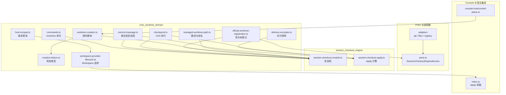
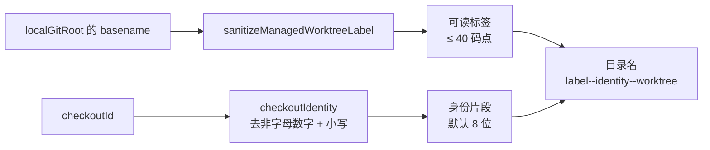
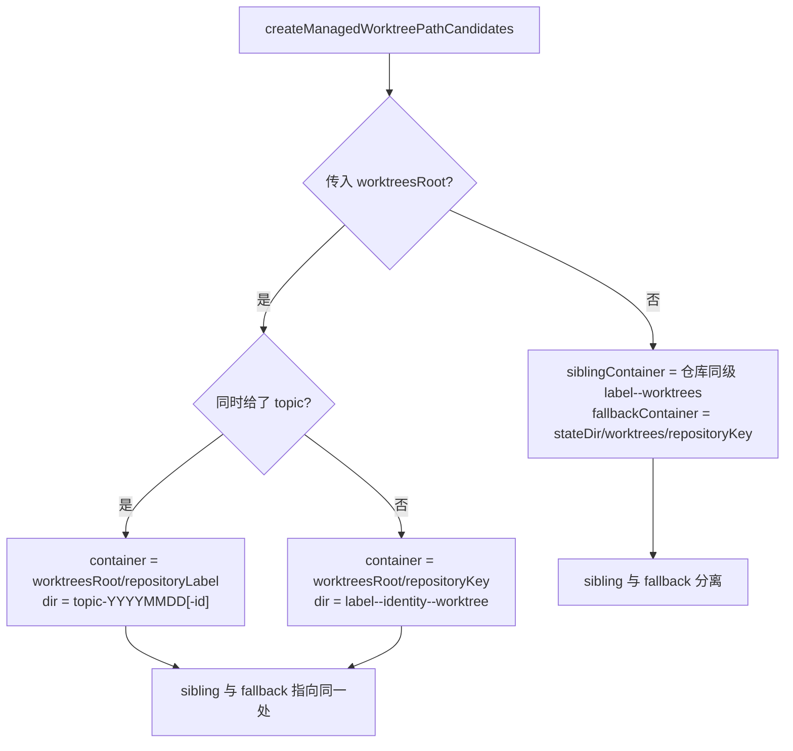
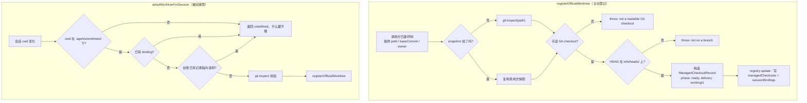
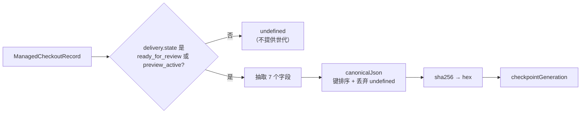
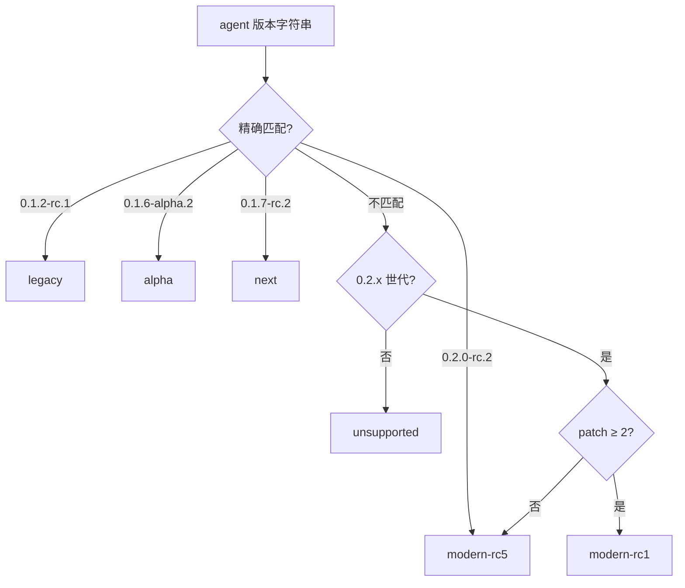
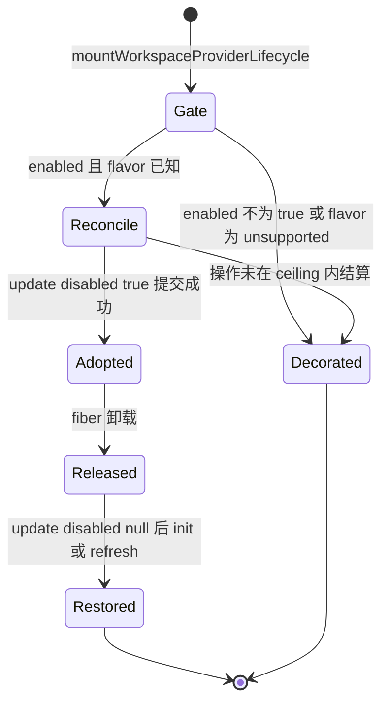
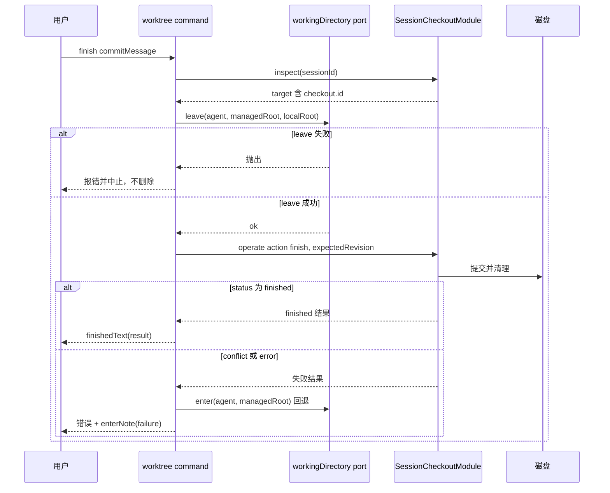
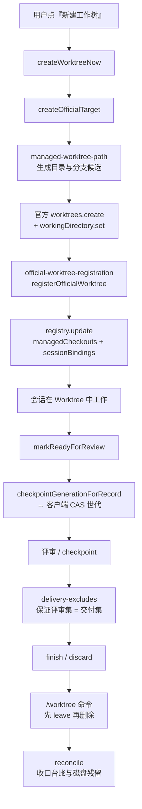

# 核心工作树领域（core_worktree_domain）

!!! info "Generated documentation"
    This page was written by CodeWiki from the source code at commit [`24641287`](https://github.com/wloops/dsh-git-worktree/commit/246412876ab9f4286405ff3f415072012e61fdaa) on 2026-11-10 with `mimo-v2.6-flash`. Check the code before relying on details.

## 简介

`core_worktree_domain` 是 `Worktree_and_Session_Checkout_Domain` 的**领域基础层**：它不实现状态机、也不执行 Git 合并，而是提供受管 Worktree 从「被命名」到「被登记进台账」、再到「被宿主接纳为一个合法工作目录」这一整条链路上的**确定性基础构件**。

这一层解决四类问题：

1. **路径与命名的确定性** —— 受管 Worktree 放在哪里、目录叫什么、会话分支叫什么，且必须在 Windows 与 POSIX 上同样安全、可读、可预测（`src/managed-worktree-path.ts`）。
2. **创建入口的即时性** —— 用户点「新建工作树」就立刻建树，不再排队到下一次消息（`src/worktree-creation.ts`、`src/creation-failure.ts`）。
3. **官方树的归属登记** —— 官方 `worktrees.create` 建出来的树，必须被本插件台账接管，才能享受列表、交付、评审、清理（`src/official-worktree-registration.ts`）。
4. **宿主兼容与 Workspace 选举** —— 不同 `@deepseek-ai/dsh-agent` 版本需要不同的 Workspace 客户端，且「接管官方 `ui-workspace`」必须在 Host 侧用确定性的 Loader 操作完成（`src/host-compat.ts`、`src/workspace-provider-lifecycle.ts`）。

此外还包含三个被上层反复调用的**纯函数级安全边界**：检查点 CAS 世代（`src/checkpoint.ts`）、交付排除路径（`src/delivery-excludes.ts`）、提交信息校验（`src/commit-message.ts`），以及面向人的 `/worktree` 命令外壳（`src/commands.ts`）。

> 状态机、Apply 引擎、台账事务等重量级逻辑属于兄弟页面 [session_checkout_engine 模块概览](session_checkout_engine.md)；端口与适配器契约属于 [核心端口与类型契约（core_ports_and_types）](core_ports_and_types.md) 与 [适配器与基础设施（adapters_infrastructure）](adapters_infrastructure.md)。

---

## 组件总览

| 文件 | 核心导出 | 职责 |
| --- | --- | --- |
| `src/managed-worktree-path.ts` | `ManagedWorktreePathCandidates`、`createManagedWorktreePathCandidates`、`createSessionBranchCandidates`、`sanitizeManagedWorktreeLabel`、`createManagedWorktreeRepositoryKey`、`createTopicDateStamp` | 纯计算：目录名、容器路径、会话分支名候选，全程不触碰文件系统 |
| `src/worktree-creation.ts` | `WorktreeCreationResult`、`createWorktreeNow` | 「点了就建」的即时建树入口，内部走 `module.createOfficialTarget` |
| `src/creation-failure.ts` | `WorktreeCreationFailure` | 携带 `rolledBack` 事实的建树失败类型：回滚成功与否决定上层是退回就绪态还是进入恢复态 |
| `src/official-worktree-registration.ts` | `OfficialWorktreeRegistration`、`OfficialWorktreeRegistrationDependencies`、`registerOfficialWorktree`、`adoptWorktreeForSession`、`isOfficialWorktreePath` | 把官方建的树登记进台账；会话走进 `.agents/worktrees/` 时自动接管 |
| `src/checkpoint.ts` | `canonicalJson`、`checkpointGenerationForRecord` | 规范化 JSON 序列化 + 由台账记录推导 SHA-256 CAS 世代 |
| `src/delivery-excludes.ts` | `HOST_RUNTIME_ARTIFACTS`、`deliveryExcludePathspecs` | 把宿主/插件自己写进 cwd 的运行期产物转成 git pathspec 排除项 |
| `src/commit-message.ts` | `isValidCommitMessage` | 提交信息的最小合法性判定（非空、无 `\0`） |
| `src/host-compat.ts` | `WorkspaceFlavorAnchorDiagnostic`、`WorkspaceFlavorDiagnostics`、`workspaceClientFlavorForAgentVersion`、`hostWorkspaceClientFlavor` | 由 Host 上真实解析到的 agent 版本判定 Workspace 客户端代际 |
| `src/workspace-provider-lifecycle.ts` | `WorkspaceProviderLifecycleOptions`、`WorkspaceProviderLifecycleResult`、`mountWorkspaceProviderLifecycle` | 用 Loader 操作选举唯一的 `uiWorkspace` 提供者，并在卸载时还原 |
| `src/commands.ts` | `finishedText`、`registerWorktreeCommand` | 注册 `/worktree` 人类命令，把领域结果翻译成可读文本，并负责 cwd 进出 |

---

## 架构与依赖关系



关键点：本层**只依赖端口接口**（`ports.ts`），从不直接 `spawn` Git 或读写台账文件。所有落盘与 Git 操作都通过 `SessionCheckoutDependencies` 注入，因此这一层可以在没有真实仓库的测试中完整驱动。

---

## 一、路径与命名：`managed-worktree-path.ts`

这是本模块最"纯"的一块：全部函数都是无 I/O 的字符串计算，因此可以被上层在**探路**阶段反复调用（`createManagedWorktreePathCandidates` 每次只生成一档冲突长度候选，调用方按 8/12/全长依次探测目录是否已存在）。

### 命名规则



- `sanitizeManagedWorktreeLabel`：NFC 归一化 → 替换 Windows 非法字符为 `-` → 折叠连续 `-` → 去首尾 `.`/空白/`-` → 截断到 40 个**码点**（`truncateCodePoints` 用 `Array.from` 切分，避免把代理对切成半个字符）。空结果回落为 `repository`，命中 Windows 保留名（`CON`/`PRN`/`AUX`/`NUL`/`COM1-9`/`LPT1-9`）时前置下划线。
- `createManagedWorktreeRepositoryKey`：`sha256(canonicalGitRoot)` 取前 12 位十六进制，作为「同名仓库的稳定分区」，避免两个都叫 `app` 的仓库互相踩路径。
- `createManagedWorktreeDirectoryName`：`<repositoryLabel>--<identity>--worktree`，只使用仓库身份与可信的 checkout 身份，不含用户自由文本。
- `createTopicManagedWorktreeDirectoryName` + `createTopicDateStamp`：本地适配的**可读命名** `<topic>-<YYYYMMDD>`；仅当调用方传入的 `identityLength` 大于默认 8 位时才追加 `-<identity>` 后缀，用长度递增来消解「同一天同一主题」的碰撞。
- `sanitizeBranchSegment` + `createSessionBranchCandidates`：会话分支名候选 `feat/sess-<session>[--<topic>]`，重名时依次追加 `-2`、`-3`……（默认上限 5 个），最后统一用 `BRANCH_SEGMENT_FORBIDDEN` 把 git 拒绝的片段（`..`、`@{`、`.lock` 结尾等）替换为 `-`。

### 容器布局：两条互斥策略

`ManagedWorktreePathCandidates` 同时给出 `sibling*`（仓库同级）与 `fallback*`（状态目录下）两组容器，供调用方在「首选位置不可用」时降级：



当 `worktreesRoot` 被设置时，`sibling*` 与 `fallback*` **刻意指向同一个目录**：本地适配的语义是「受管 Worktree 绝不落在仓库旁边、也绝不落在状态目录里」，因此不存在第二选择。该值在插件配置里是 volatile 的（见 `src/index.ts` 的 `worktreesRoot` 字段），设置页修改后无需重挂载即生效。

---

## 二、即时建树：`worktree-creation.ts`

早期版本把建树做成排队（客户端只写一条 plugin record，真正的 `git worktree add` 留到 `agent/pre-step` 兑现）。现在的语义是**调用即建树**：`createWorktreeNow` 返回时，树已在磁盘上、台账已登记、会话 cwd 已切过去。

```mermaid
sequenceDiagram
    participant CP as control-plane
    participant CW as createWorktreeNow
    participant AG as agents service
    participant MOD as SessionCheckoutModule
    participant OFF as official worktrees
    participant WD as workingDirectory

    CP->>CW: createWorktreeNow(ctx, module, sessionId, from)
    CW->>AG: get(sessionId)
    alt 会话不在线
        AG-->>CW: undefined
        CW-->>CP: ok false, message Session is not live
    else 会话在线
        AG-->>CW: Agent
        CW->>MOD: createOfficialTarget(agent, branch from)
        MOD->>OFF: create(agent, from)
        OFF-->>MOD: path, branch, baseCommit, repositoryRoot
        MOD->>WD: set(agent, path)
        MOD-->>CW: IsolatedTargetLaunch
        CW-->>CP: ok true, launch
    end
```

设计要点：

- **只走一条建树路径**。`createWorktreeNow` 不自己调 Git，而是复用 `module.createOfficialTarget`——后者负责 `feat/sess-*` 命名、`.worktreeinclude` 继承、本地未提交修改继承，这些官方 `worktrees.create` 都不做。
- **不重复切 cwd**。官方 `worktrees.create` 的最后一步就是 `ctx.workingDirectory.set(agent, path)`，因此这里不再二次切换。
- **失败不抛出**。`WorktreeCreationResult` 是判别联合 `{ ok: true, launch } | { ok: false, message }`，因为调用方是 Console 请求处理器，需要把失败原因原样回传给面板，而不是抛异常打断请求链。
- **依赖注入而非直接取服务**。`createWorktreeNow` 从 `ctx.get('agents')` 取 Agent；`console-host/control-plane.ts` 的 `WorktreeConsoleControlPlaneOptions.createWorktree` 之所以由 Host 侧注入，正是因为 control-plane 只拿得到 lookup 的只读导航记录，拿不到官方 `worktrees.create` 需要的 live Agent。

`WorktreeCreationFailure`（`src/creation-failure.ts`）承担另一个语义：它记录 `rolledBack` 事实。回滚成功意味着「磁盘上没有留下任何东西」，上层可以安全地把台账记录删掉并退回就绪态；回滚失败意味着残留仍可能被误认为一个 checkout，必须进入 `recovery_required`。详见 [session_checkout_engine 模块概览](session_checkout_engine.md) 中对 `phase` 的说明。

---

## 三、官方树登记：`official-worktree-registration.ts`

本插件的台账（`managed-checkouts.json`）是列表、交付、评审、清理的**唯一事实来源**。官方 `worktrees.create` 建出来的树若不在台账里，对这些能力而言就不存在。本文件提供两条入口：



### 为什么只认 `.agents/worktrees/`

`isOfficialWorktreePath` 只承认 `<repositoryRoot>/.agents/worktrees` 前缀。用户手工 `git worktree add` 出来的目录不属于本插件，纳管它们等于凭空接管别人的目录。这是刻意的边界，而不是能力缺失。

### 为什么用 `working-directory/change` 作为触发信号

官方 `worktrees.create` 的最后一步是 `workingDirectory.set`，因此「会话 cwd 落进官方目录」是「这棵树建好了且有人站在里面」的唯一可靠信号——比轮询 `git worktree list` 及时，也不需要为每个项目起子进程。

### 错误处理的两难

一旦确认 cwd 在官方目录下，「读不出 Git」和「不在分支上」就**不是**「这棵树不归我管」，而是**接管失败**。静默跳过会让那棵树永远进不了台账，而交付、清理、列表全靠台账定位。因此这两个分支选择抛错，由调用方（`session-target-context.ts` / `module.recordAdoptionFailure`）决定如何把原因说给用户——这也是 `SessionCheckoutModule.adoptionFailure` 存在的原因。

### 去重与幂等

`isTracked` 同时对齐 `managedRoot` 与 `managedGitRoot`（Windows 下统一小写），并跳过 `phase === 'discarded'` 的记录。若不去重，官方每条请求都真的建树，重复登记会产生指向同一目录的两条记录。

登记写入通过 `registry.update`（读-改-写同锁）完成，因此跨进程并发不会互相抹掉记录——该语义由 [适配器与基础设施（adapters_infrastructure）](adapters_infrastructure.md) 中的 `AtomicJsonCheckoutRegistry` 保证。

---

## 四、检查点 CAS 世代：`checkpoint.ts`

`checkpointGenerationForRecord` 从一条台账记录推导出一个 **SHA-256 世代字符串**，客户端把它随检查点请求带回，Host 端再用同一函数重算比对。这是「乐观并发」在本领域的具体落地：客户端不需要知道记录全貌，只需要持有一个能代表「我看到的那个确切状态」的指纹。



参与哈希的字段刻意收敛为「评审 + 检查点链」的身份：`checkoutId`、`revision`、`review.reviewId`、`review.isolatedHeadOid`、`review.isolatedFingerprint`、`checkpoints.length`、`previewId`（仅 preview 态）、`phase`。

`canonicalJson` 本身是一个**确定性序列化器**：数组保序，对象按键名 `localeCompare` 排序并丢弃值为 `undefined` 的项。这一点至关重要——JavaScript 对象字面量的键顺序在跨进程、跨构建时不保证稳定，直接 `JSON.stringify` 会得到不同哈希，从而把每一次合法请求都判成 `stale_target`。

上层使用方式见 `operateCheckpoint`：`expectedGeneration` 必须匹配 `/^[0-9a-f]{64}$/u`，且与 `checkpointGenerationForRecord(record)` 逐字相等，否则返回 `stale_target`。

---

## 五、交付排除：`delivery-excludes.ts`

会话 cwd 就在受管 Worktree 里，因此 DSH 面板日志、桌面运行期标记这类**宿主自己写出**的文件会出现在工作区中。它们不是会话的交付物。若不过滤：

- 评审看到的变更集 ≠ 交付出去的变更集；
- 面板多写几行日志就会把一次合法交付判成 `stale_isolated`。

`HOST_RUNTIME_ARTIFACTS` 当前只包含插件**确知**由宿主写出的三个路径：`.dsh-ops`、`desktop-runtime.json`、`.dsh-runtime.json`。

`deliveryExcludePathspecs` 把每个路径展开成 4 条 git pathspec：

| 形态 | 作用 |
| --- | --- |
| `:(exclude)<path>` | 排除该路径本身 |
| `:(exclude)<path>/**` | 排除整棵子树 |
| `:(exclude,glob)**/<path>` | 排除任意深度的同名项 |
| `:(exclude,glob)**/<path>/**` | 排除任意深度的同名子树 |

后两条 `glob` 变体覆盖「同一插件在子目录里再挂一份工作区」的嵌套情形。规则**不猜测业务目录**：`build/`、`dist/` 之类由用户自己的 `.gitignore` 决定，git 本来就已忽略未跟踪的忽略项。

---

## 六、提交信息校验：`commit-message.ts`

`isValidCommitMessage` 只做三件事：类型是 `string`、`trim()` 后非空、不含 `\0`。

注释明确指出 500 字符**不是** Git 的限制——提交正文经 stdin 送入 Git，长度由上层业务规则（评审字段长度限制）单独约束，而不是在这里硬编码。这个函数同时被 `session-checkout-apply.ts` 与 `session-checkout-module.ts` 引用，是「提交前必须过的一道闸」。

---

## 七、宿主兼容与 Workspace 选举

这一对文件解决的是**跨版本共存**问题：插件要在 0.1.x 与 0.2.x 两代 Host 上运行，而官方 Workspace 客户端在两代之间是不兼容的二进制产物。

### `host-compat.ts`：版本 → 客户端代际



为什么 0.2.x 要分成两支：`0.2.2-rc.1` 引入了 `contextMenus` 服务、把内置 Session 动作迁到该服务上、把 `apply` 改成以属性方式读取 `ctx.remoteAccess`，并给 Session 节点及其 hover card 加了 `cwd` 字段。0.2.1 线完全没有这些（Client 体积 232824 → 284999 字节）。一个 decoration 是**冻结进构建产物、绑定某一固定官方 Client** 的，无法同时跨越两代，因此必须按字节分片。

`workspaceFlavorDiagnostics` 的探针顺序是 `process.argv[1]` → `process.cwd()` → `import.meta.url`（可再追加 `extra`），并记录每一次探测结果（`WorkspaceFlavorAnchorDiagnostic`）。顺序刻意「最像 Host 的排最前」：在 `link:` 安装下，插件自己的 `node_modules` 会遮蔽 Host 树，所以运行入口脚本与其 cwd 优先，插件路径只作最后手段。第一个能解析出 `@deepseek-ai/dsh-agent` 树的锚点胜出。

### `workspace-provider-lifecycle.ts`：唯一的 `uiWorkspace` 提供者

这是整个模块中注释最密集、事故驱动最明显的文件。它要保证「恰好一个 `uiWorkspace` 提供者」，且**绝不用客户端求值的 `!!js` 表达式**。

历史事故（`cordis.patch.yml` 与源码注释均有记载）：旧的 `disabled: !!get('worktreeWorkspaceProvider') && ...` 在同一进程的两个不同步时刻被求值——插件 Host apply 期间自身 fiber 仍是 `LOADING`，Cordis 严格服务读返回 `undefined`，选举恒失败（走 decorate 回退）；而 Web renderer 稍后审计时插件已 `ACTIVE`，同一表达式求值为 `true`，官方条目被跳过不启动——结果 `uiWorkspace` 无人提供，17 个下游条目 pending，0.2.x web boot 崩溃（2026-10-17 18:11 与 20:25 两次）。

因此选举改为在 Host 侧**一次性**决定：



设计约束逐条对应实现：

| 约束 | 实现 |
| --- | --- |
| 不用表达式求值 | `entry.update({ disabled: true })` 写**普通布尔**，之后任何读取（Host 审计、序列化 renderer 树、模块事件）都确定 |
| 不阻塞插件激活 | 每个 Loader 操作都与 `DEFAULT_OPERATION_TIMEOUT_MS`（10s）赛跑；超时只告警一次，条目保持 guarded，下一个 Loader 事件重试 |
| 不夺走用户的决定 | 首次见到时已被禁用且不属于本插件的条目进入 `overridden` 集合，永不触碰 |
| 跨代所有权 | `ownedDisables: WeakSet<Entry>` 记录在 Entry 对象上（各代共享），防止新一代把自己的 pending disable 误认为用户决定 |
| 只还原自己禁用的 | `adopted` 集合是唯一允许 restore 的来源；`releaseMarker()` 先撤标记再还原，避免 Cordis 4.0.5 并发卸载乱序 |
| 不误报接管 | 只有「所有 owned 官方条目确实 `disabled === true`」才返回 `officialWorkspaceActive: false`；否则回退 decorate 共存 |

`Loader 1.0.6` 的两个细节被显式吸收：`update()` 不 await fiber 销毁且把已销毁 fiber 留在 entry 上，因此 disable 必须 `.then(() => fiber?.await())`；restore 必须对死掉的 generation 走 `entry.init()` 而不是 `refresh()`。

返回的 `WorkspaceProviderLifecycleResult.officialWorkspaceActive` 会传入 `WorktreeConsoleService`（见 `src/index.ts`），由 Sidebar topology 响应如实上报。这是「不谎报接管」的最后一环——谎报会让 Web 客户端重放官方 apply 并以 `service "uiWorkspace" has been registered` 崩溃（2026-10-11 事故）。

配置入口是 `enableWorkspaceProvider`（默认 `false`）：接管会禁用官方条目，从而把其客户端包从 Host 客户端图中移除，所有 import 它的包都会失去 bundle，所以必须显式请求。

---

## 八、`/worktree` 命令：`commands.ts`

`registerWorktreeCommand` 注册人类命令面。核心设计原则写在文件头：**破坏性动词必须由人发起，模型工具止步于 Ready for Review**。

### 动词表

| 动词 | 语义 | 触碰 Local？ |
| --- | --- | --- |
| `status`（默认） | 打印当前 target 的阶段、脏状态、当前分支/OID、交付状态 | 否 |
| `list` | 列出本会话可见的受管 Worktree 摘要 | 否 |
| `next` | 开启下一个隔离迭代，并把会话 cwd 切进新建的树 | 否 |
| `finish <message>` | 提交并清理（可选自动 push） | 是（通过会话分支） |
| `discard` | 放弃本次目标；preview 活跃时同时回滚 | 否 |
| `remove <checkoutId>` | 放弃指定的另一棵受管树 | 否 |

### cwd 进出的安全契约

命令层最容易出错的地方不是领域逻辑，而是**会话 cwd 与磁盘目录的生命周期耦合**。`worktree_create` 现在真的会把 Session 移进树里（与官方 `ctx.workingDirectory.set` 对齐），因此任何可能删除 checkout 的操作都必须先退出来，否则会话就站在一个即将消失的目录里。



三条不可让步的规则：

1. **`leave` 失败必须中止删除**。注释写得很直白：继续下去会把会话 cwd 指向一个不存在的目录。
2. **`enter` 失败必须让用户看见**。会话此时站在 Local 边界上，相对路径写入会打到原始仓库——`enterNote` 就是为此存在的。
3. **`cwd: undefined` 不等于失败**。`enterCheckout` 返回 `{ cwd?, failure? }`：`undefined` 表示宿主根本没挂 `workingDirectory` 服务（合法），`failure` 才表示真实失败。两者混为一谈会让命令谎称「会话已在 Worktree 里工作」。

### 文本渲染

`finishedText` 把 `finished` 结果翻译成一行人类可读文本，并在 `result.push` 存在时追加自动推送结论：

- `push.status === 'pushed'` → 「已推送」；
- `push.status === 'skipped'` → 原样带出 `push.message`（通常是「无上游」）；
- 其他 → 「推送失败 + 原因」。

所有面向用户的文案都经 `hostMessage` / `hostRegistrationMessage` 走 i18n，语言由 `withHostLanguage(languageForInvocation(invocation.agent, ctx))` 按调用方 Agent 的上下文决定，而不是进程全局。详见 [i18n：中英双语文案与语言解析基础设施](i18n.md)。

---

## 端到端数据流

下图把本模块的各个构件串成一次完整生命周期：



另外两个横向切面：

- **`official-worktree-registration.adoptWorktreeForSession`** 是并行入口：任何路径（官方 `create_worktree` 工具、forge 面板）在 `.agents/worktrees/` 下建出的树，都会在会话 cwd 落入时被接管，因此台账覆盖 Host 能产出的**所有** Worktree，而不只是本插件建的。
- **`workspace-provider-lifecycle`** 在 `apply` 最开始执行（早于状态机挂载），因为它的选举结果决定客户端能否正常启动，也决定 Sidebar topology 的如实上报。

---

## 与其他模块的关系

| 关系 | 目标页面 | 说明 |
| --- | --- | --- |
| 上游（被本层调用） | [核心端口与类型契约（core_ports_and_types）](core_ports_and_types.md) | `ManagedCheckoutRecord`、`GitCheckoutSnapshot`、`SessionCheckoutGitPort` 等契约；本层只依赖接口 |
| 上游（被本层调用） | [适配器与基础设施（adapters_infrastructure）](adapters_infrastructure.md) | `AtomicJsonCheckoutRegistry`（`update` 的跨进程锁）、`createNodeFilesPort`（目录身份探测） |
| 下游（调用本层） | [session_checkout_engine 模块概览](session_checkout_engine.md) | 状态机使用路径候选、`ensureSessionBranch`、`WorktreeCreationFailure`、`checkpointGenerationForRecord`、`deliveryExcludePathspecs` |
| 下游（调用本层） | [console_host：Worktree 控制平面与 Host RPC 服务](console_host.md) | `control-plane` 注入 `createWorktree`；`WorktreeConsoleService` 接收 `officialWorkspaceActive` |
| 下游（调用本层） | [public_api 模块：插件公共入口与契约面](public_api.md) | `src/index.ts` 的 `apply` 是全部构件的装配点 |
| 横切 | [i18n：中英双语文案与语言解析基础设施](i18n.md) | 命令与失败文案全部走 `hostMessage` |
| 横切 | [build_deployment_configuration：构建、打包与发布部署配置](build_deployment_configuration.md) | `cordis.patch.yml` 的迁移说明、`package.json` 的 volatile 配置字段 |

---

## 构建、配置与测试约束

- **打包入口**：`package.json` 的 `exports` 暴露 `.`、`./client`、`./typert`、`./remote`、`./console-contract` 与 `./cordis.patch.yml`。本模块全部位于主入口 `.` 之下（`lib/index.js`），是纯 Host 侧代码，不进入客户端 bundle。
- **插件补丁**：`cordis.patch.yml` 只做一件事——`insert` 一个 `id: dsh-git-worktree` 的条目。文件头注释记录了「移除 ui-workspace 条件禁用表达式、选举改由 Host 侧 Loader 操作驱动」的原因，与本模块 `workspace-provider-lifecycle.ts` 一一对应。升级到含该修复的版本后，历史 profile patch 里残留的旧表达式会被生命周期识别并替换。
- **配置项与代码的对应**：`src/index.ts` 的 `Config` 中，`enableWorkspaceProvider` → `mountWorkspaceProviderLifecycle(..., { enabled })`；`worktreesRoot` → `createManagedWorktreePathCandidates` 的 `worktreesRoot`；`worktreeAddTimeoutMs` → 建树路径的 `deadline`。volatile 字段以 live reference 形式到达，因此每次使用都重新读取。
- **测试**：`vitest.config.ts` 把四个 `virtual:dsh-official-workspace-client*` 别名指向 `tests/official-workspace-client*.mock.ts`——这正是 `host-compat.ts` 四个代际分支的可测性来源。Windows 上 `fileParallelism` 关闭，因为重型 Git fixture 会争抢进程与文件句柄；超时统一放宽到 60s。
- **CI**：`.github/workflows/ci.yml` 依次执行 `typecheck` → `build` → `check:publish:release` → `test`。`check:sidebar-version` 是发布前门禁（`prepublishOnly`），它校验 `@deepseek-ai/dsh-client-locale` 版本并读取四份官方 Workspace Client 的 SHA-256——与本模块 `host-compat.ts` 的代际划分同源。

---

## 常见陷阱与维护提示

1. **不要给 `canonicalJson` 加新语义**。它是 CAS 世代的地基；任何键顺序或 `undefined` 处理的改动都会让所有在线客户端的 `expectedGeneration` 失效。
2. **`deliveryExcludePathspecs` 只扩不猜**。新增路径必须有「插件确知由宿主写出」这一前提，否则会掩盖用户真实的未跟踪文件。
3. **选举相关代码改动需重读 `workspace-provider-lifecycle.ts` 的注释块**。每一段都对应一次真实崩溃；尤其是 `ownedDisables`、`adopted`、`overridden` 三个集合的语义不能互换。
4. **新增 Workspace 代际要同时改三处**：`host-compat.ts` 的版本判定、`vitest.config.ts` 的 mock 别名、`scripts/check-workspace-sidebar-version.mjs` 的 SHA 校验。
5. **`registerOfficialWorktree` 与 `adoptWorktreeForSession` 的 owner 语义不同**：前者由调用方断言归属（调用方就是建树者），后者从 lookup 推导会话与项目；两者共用 `registerOfficialWorktree` 落库，但校验强度不可混用。
6. **命令层的 `leave`/`enter` 是对称契约**。任何新增「可能删除 checkout」的动词都必须先 `leave`，并在失败时 `enter` 回退。

??? abstract "Documented components (14)"
    - [`canonicalJson`](https://github.com/wloops/dsh-git-worktree/blob/246412876ab9f4286405ff3f415072012e61fdaa/src%5Ccheckpoint.ts) — `src\checkpoint.ts`
    - [`finishedText`](https://github.com/wloops/dsh-git-worktree/blob/246412876ab9f4286405ff3f415072012e61fdaa/src%5Ccommands.ts) — `src\commands.ts`
    - [`isValidCommitMessage`](https://github.com/wloops/dsh-git-worktree/blob/246412876ab9f4286405ff3f415072012e61fdaa/src%5Ccommit-message.ts) — `src\commit-message.ts`
    - [`WorktreeCreationFailure`](https://github.com/wloops/dsh-git-worktree/blob/246412876ab9f4286405ff3f415072012e61fdaa/src%5Ccreation-failure.ts) — `src\creation-failure.ts`
    - [`deliveryExcludePathspecs`](https://github.com/wloops/dsh-git-worktree/blob/246412876ab9f4286405ff3f415072012e61fdaa/src%5Cdelivery-excludes.ts) — `src\delivery-excludes.ts`
    - [`WorkspaceFlavorAnchorDiagnostic`](https://github.com/wloops/dsh-git-worktree/blob/246412876ab9f4286405ff3f415072012e61fdaa/src%5Chost-compat.ts) — `src\host-compat.ts`
    - [`WorkspaceFlavorDiagnostics`](https://github.com/wloops/dsh-git-worktree/blob/246412876ab9f4286405ff3f415072012e61fdaa/src%5Chost-compat.ts) — `src\host-compat.ts`
    - [`ManagedWorktreePathCandidates`](https://github.com/wloops/dsh-git-worktree/blob/246412876ab9f4286405ff3f415072012e61fdaa/src%5Cmanaged-worktree-path.ts) — `src\managed-worktree-path.ts`
    - [`OfficialWorktreeRegistration`](https://github.com/wloops/dsh-git-worktree/blob/246412876ab9f4286405ff3f415072012e61fdaa/src%5Cofficial-worktree-registration.ts) — `src\official-worktree-registration.ts`
    - [`OfficialWorktreeRegistrationDependencies`](https://github.com/wloops/dsh-git-worktree/blob/246412876ab9f4286405ff3f415072012e61fdaa/src%5Cofficial-worktree-registration.ts) — `src\official-worktree-registration.ts`
    - [`Context`](https://github.com/wloops/dsh-git-worktree/blob/246412876ab9f4286405ff3f415072012e61fdaa/src%5Cworkspace-provider-lifecycle.ts) — `src\workspace-provider-lifecycle.ts`
    - [`WorkspaceProviderLifecycleOptions`](https://github.com/wloops/dsh-git-worktree/blob/246412876ab9f4286405ff3f415072012e61fdaa/src%5Cworkspace-provider-lifecycle.ts) — `src\workspace-provider-lifecycle.ts`
    - [`WorkspaceProviderLifecycleResult`](https://github.com/wloops/dsh-git-worktree/blob/246412876ab9f4286405ff3f415072012e61fdaa/src%5Cworkspace-provider-lifecycle.ts) — `src\workspace-provider-lifecycle.ts`
    - [`WorktreeCreationResult`](https://github.com/wloops/dsh-git-worktree/blob/246412876ab9f4286405ff3f415072012e61fdaa/src%5Cworktree-creation.ts) — `src\worktree-creation.ts`

