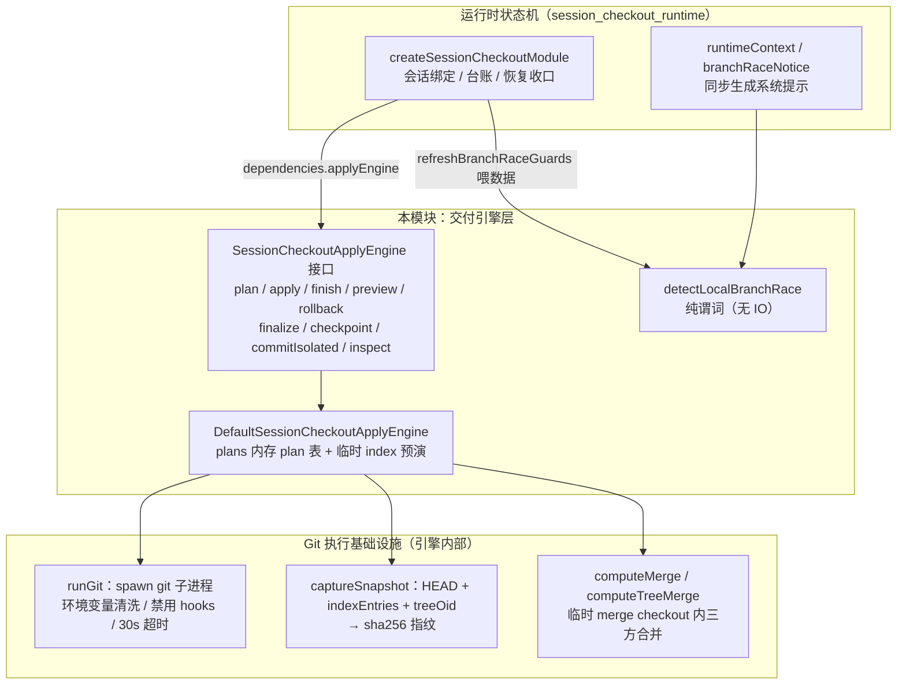
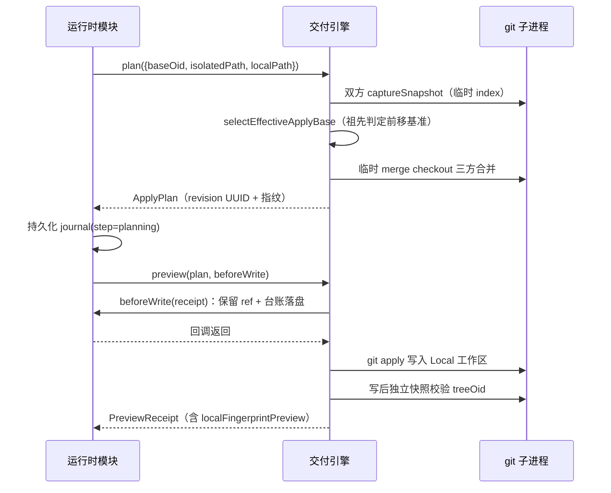

# 会话检出交付引擎（session_checkout_apply_engine）

!!! info "Generated documentation"
    This page was written by CodeWiki from the source code at commit [`8206c2a1`](https://github.com/wloops/dsh-git-worktree/commit/8206c2a19ed446899a5910eda03f5c0685bc27c2) on 2026-11-06 with `doubao-seed-2.1-lite`. Check the code before relying on details.

## 模块定位

本模块是 session-checkout 域的 **Git 执行引擎层**：它回答的是「一次评审交付、预览或检查点在磁盘上到底该怎么写」，而不负责「什么时候写、写完台账怎么记」。后者由运行时状态机 [会话检出运行时模块（session_checkout_runtime）概述](session_checkout_runtime.md)（`src/session-checkout-module.ts`）负责，二者通过 `SessionCheckoutDependencies.applyEngine` 端口装配。

模块由两个文件组成：

| 文件 | 职责 |
| --- | --- |
| `src/session-checkout-apply.ts` | `SessionCheckoutApplyEngine` 接口、`DefaultSessionCheckoutApplyEngine` 实现、全部输入/结果类型，以及 `runGit` 子进程基础设施 |
| `src/concurrent-session-guard.ts` | 纯函数式「并发会话分支竞争」判定谓词，供运行时在同步系统提示中嵌入隔离引导 |

引擎的全部写操作都遵循同一条安全哲学：**先快照取指纹（CAS），再在临时 `GIT_INDEX_FILE` 中预演目标树，最后以 `update-ref` CAS 与 `index.lock` 原子换写落地，并在写入前后各做一次独立校验**。任何一步失败都会把错误归类为 `unchanged`（可证明磁盘未被触碰）或 `uncertain`（保留恢复证据），由运行时决定把会话记录退回 ready 还是进入 recovery_required。

## 架构总览

引擎与运行时之间的回调契约是可靠性的关键：引擎在**权威写操作之前**提供 `beforeWrite` / `beforeCommit` / `beforeFinalLocalValidation` 等 seam，让运行时先把台账（`ManagedCheckoutMutationJournal` 与 preview 保留 ref）持久化，再由引擎落盘。这样任何崩溃点都能在重启时被 [会话检出运行时模块（session_checkout_runtime）概述](session_checkout_runtime.md) 的 reconcile 按 journal 步骤精确收口。

## 两大功能面

### 1. 交付与合并管线（plan → apply / finish）

`calculatePlan`（`preflight` 与 `plan` 共用）对 Local 与隔离 Worktree 两侧分别抓取完整快照（HEAD、symbolic ref、staged 语义叠加工作区），然后：

1. **共享仓库校验**：两侧 `rev-parse --git-path objects` 必须指向同一对象库，项目子目录前缀（`projectPrefix`）必须一致，否则拒绝——这是防跨仓库误用的第一道门。
2. **有效基准选择**（`selectEffectiveApplyBase`）：当记录的 base Oid 同时是两侧 HEAD 的祖先时，利用 `merge-base --is-ancestor` 把基准前移到已包含的一侧 HEAD，减少无谓冲突；否则保守退回 `recorded_base`。结果记入 `ApplyBaseStrategy`（`recorded_base` / `isolated_contains_local_head` / `local_contains_isolated_head`），供 UI 解释与后续去重。
3. **三方合并预演**：用 `commit-tree` 把两侧快照树挂到 base 下成为临时提交，在 `mkdtemp` 出的独立 merge checkout 中执行 `git merge --no-commit --no-ff`；冲突时采集逐文件 combined diff（经 `CONFLICT_DETAIL_FILE_LIMIT` / `CONFLICT_DETAIL_DIFF_LIMIT` 截断）随 `ApplyConflictPlanResult.conflictDetails` 返回，让模型留在会话内就地解决冲突。
4. **plan 持久化**：`plan` 把 `{input, patch, plan, scope}` 存进实例内存 Map（按 isolatedPath 覆盖旧 plan），`apply` / `preview` / `finish` 必须凭 `revision` 取回并经 `planMatches` 全字段比对，两侧指纹任一漂移即返回 `stale_local` / `stale_isolated`。

`finish` 是旧的「直接写入 Local」交付路径：它在合并结果之上做 **任务增量剥离**（`C = H + (M - L)`，把用户 Local 里原有的未提交改动从任务提交中分离），再做 **staged 状态保持**（`S' = C + (S - H)`），全程在 `index.lock` 持锁窗口内完成 patch 应用、`update-ref` CAS 与 index 原子替换。当前会话分支交付语义下，运行时会用 `refuseLegacyLocalWrite` 拒绝 `apply`/`finish`/`preview` 等写 Local 的遗留操作。

### 2. 会话分支交付（commitIsolated / reviewIsolated）

新语义下交付**完全不碰 Local**：`reviewIsolated` 只抓 Worktree 自身快照（连 Local 的 git 根都不解析），`commitIsolated` 把 Worktree 工作区按「评审快照同一条构造路径」（临时 index，排除宿主运行期产物与携带的 Project Skills）整理成树，提交到 Worktree 当前检出的会话分支上。`branchRef` 守门防止把提交落到 detached HEAD；一旦提交已写入 ref 之后失败，结果会带上 `committedOid`，运行时据此把记录停在可检视状态而不是误退回「什么都没发生」。

### 3. 可逆 Local 预览（preview / rollback / finalize）

Preview 是「先在用户 Local 工作区里看得见任务改动，但暂不提交」的临时态：

- `preview`：先按 plan 算出 `previewWorkingTreeOid` 并组装 `PreviewReceipt`（记录 Local 写前指纹、任务树 Oid、隔离快照等全部事实），**回调 `beforeWrite` 让运行时先保留内部 ref 并把台账落盘**，之后才 `git apply`，写后再校验工作区树与预测一致。
- `assessPreviewRecovery`：严格只读。当 Local 在 preview 之后又前进（新提交），它通过一串 `computeTreeMerge` 重算「回滚目标树」与「固化任务树」，并给出 `safe` 或带码阻塞（`stale_local` / `preview_modified` / `commit_isolation_conflict` / `operation_not_allowed`）。运行时把这些事实哈希成 `generation` proof，作为恢复操作的防重放身份。
- `rollback` / `finalize`：分别按评估出的目标树生成反向/正向 patch，同样在 `beforeWrite` seam 持久化 journal 后才落盘；`finalize` 的补偿链会在「ref 已动、index 未换」时按 CAS 回滚 ref，并在无法证明成功也无法完整回滚时保留 index 备份文件（`recoveryState: 'uncertain'`）等待人工/恢复流程介入。

### 4. 隔离 Worktree 检查点（checkpoint / recoverCheckpoint）

`checkpoint` 在 Worktree 内把当前快照保存为提交（不发布到 Local），采用 Git 规范 `index.lock` 协议 + 自有 marker 文件（`index.lock.dsh-<commitOid>`）双重证明归属：先 `commit-tree` 备好提交并经 `beforeCommit` 回调落 journal、保留内部 ref，再 CAS 推进 HEAD/分支（detached 时用 `--no-deref` 更新 HEAD，绝不把会话分支 detach 掉），最后原子替换 index。`recoverCheckpoint` 在启动 reconcile 时区分两种中断：HEAD 仍在父提交（中止检查点，清理残留 lock）与 HEAD 已在检查点提交（完成 index 归位），两种情况都校验 marker 归属，防止误删别人的 lock。

### 5. 并发会话分支竞争守卫

`detectLocalBranchRace` 是**纯同步谓词**（这是系统提示契约不允许 await 的原因）：输入来自运行时异步刷新的两类数据——harness sessions store 里的活跃会话（`GuardSessionInfo`：id / createdAt / cwd）与按 Local 根缓存的分支创建时间表（来自后台 reflog 探测）。它筛出「与当前会话共享同一 Local 边界且更早开始」的会话，以及检测窗口内（默认 30 分钟）新建的非受管分支；两者同时非空即判定 `race_detected`，运行时据此在系统提示里引导后来的会话先 `worktree_create` 隔离，而不是在 Local 里直接 `switch -c` 抢占 HEAD。

## 错误模型

引擎所有写操作统一返回 `ApplyError` 判别联合，运行时按错误码决定状态迁移：

| 错误码 | 含义 | 典型状态迁移 |
| --- | --- | --- |
| `invalid_input` / `invalid_plan` | 输入不合法或 plan 已被消费/篡改 | 退回 ready |
| `stale_local` / `stale_isolated` | 任一侧在规划后漂移（指纹 CAS 失败） | 退回 ready（要求重新规划） |
| `stale_local` / `preview_modified`（预览期） | Local 漂移导致预览不可安全回滚 | 转入 preview_detached 恢复态 |
| `commit_isolation_conflict` | 任务改动无法与用户既有 staged/工作区改动可靠分离 | 退回 ready |
| `operation_not_allowed` | 目标不在正常分支 / 遗留写 Local 语义被拒绝 | 退回 ready |
| `git_error` | git 子进程失败；`recoveryState` 区分 `unchanged`（已证明还原）与 `uncertain`（证据保留） | uncertain → recovery_required |

## 依赖关系

- **向下依赖**：`src/commit-message.ts`（提交信息非空无 NUL 校验）、`src/delivery-excludes.ts`（宿主运行期产物 pathspec 排除）、`src/adapters/project-skills.ts`（携带 Skill 的排除与指纹融合，见 [Project Skills 适配器：随会话携带的项目级 Skill 资源](../src_adapters/src_adapters_project_skills.md)）、`src/i18n/host.ts`（`hostMessage` 按当前调用语言本地化，见 [src_i18n 国际化与消息目录模块](../../project_foundation_and_localization/src_i18n.md)）。
- **向上消费**：运行时模块 `src/session-checkout-module.ts` 通过 `dependencies.applyEngine` 调用全部方法；`PreviewReceipt` 与台账契约 `ManagedPreviewReceipt`（`src/ports.ts`）逐字段对应，属于 [会话检出领域契约（session_checkout_domain_contracts）](session_checkout_domain_contracts.md) 的一部分。
- **同级模块**：本模块只做 Git 字节级正确性；会话绑定、台账 CAS、清理与配额由 [会话检出运行时模块（session_checkout_runtime）概述](session_checkout_runtime.md) 负责，仓库适配（spawn、文件锁、注册表）由 [src_adapters：会话检出（Session Checkout）的宿主适配层](../src_adapters.md) 负责。

## 核心组件索引（按文件）

### `src/session-checkout-apply.ts` — 引擎主体

**端口与实现**

- `SessionCheckoutApplyEngine`：引擎对外接口，方法族按语义分五组——评审快照（`inspectReview`、`reviewIsolated`）、规划与应用（`preflight`、`plan`、`apply`）、交付（`finish`、`commitIsolated`）、预览生命周期（`preview`、`assessPreviewRecovery`、`rollback`、`finalize`）、检查点（`checkpoint`、`recoverCheckpoint`）。
- `SessionCheckoutApplyEngineOptions`：装配选项。`projectSkills` 提供携带 Skill 的排除状态；四个 `before*/after*` seam 是宿主测试与运行时台账落盘的挂钩点。
- `DefaultSessionCheckoutApplyEngine`：默认实现。内部维护 `plans: Map<revision, StoredPlan>`，并持有 git 子进程运行时（`runGit`）、快照指纹（`captureSnapshot`）、临时三方合并（`computeMerge` / `computeTreeMerge`）三组私有能力。

**规划输入与产物**

- `ApplyPlanInput`：`{ baseOid, isolatedPath, localPath }`，所有规划类方法的统一输入。
- `ApplyPlan`：规划产物。`revision`（UUID，plan 取回键）、`localFingerprint` / `isolatedFingerprint`（写前 CAS 指纹）、`effectiveBaseOid` + `baseStrategy`（祖先判定后的有效基准）、`localHeadRef`（null 表示 detached HEAD）、`changedFiles`。
- `StoredPlan`：引擎内部记忆体，`{ input, patch, plan, scope }`；同一 isolatedPath 只保留最新一份。
- `ApplyReadyPlanResult` / `ApplyConflictPlanResult` / `ApplyPlanErrorResult`：`plan`/`preflight` 的三态结果；冲突结果附 `conflictingFiles` 与截断后的逐文件 `conflictDetails`。
- `ApplySuccessResult.nextBaseOid`：无 ref 的「已应用隔离快照」提交，供同 checkout 下一次 Apply 去重。

**交付与检查点输入输出**

- `CommitIsolatedInput` / `CommitIsolatedSuccess`：会话分支交付。`branchRef` 用于守门（Worktree 必须已挂在该分支）；成功结果含 `created`（是否真的新建提交）与提交后干净指纹 `isolatedFingerprint`。
- `ReviewIsolatedInput` / `ReviewSnapshotResult`：只读 Worktree 的评审快照，不触碰 Local。
- `FinishSuccessResult`：旧直接写 Local 路径的结果；`commitOid` 为 null 表示无新增改动、未创建空提交。
- `CheckpointInput` / `CheckpointSuccessResult` / `CheckpointRecoverySuccessResult`：检查点保存与中断恢复；`beforeCommit` 回调在 HEAD/index 变更前持久化 journal 与内部 ref。

**错误判别联合**

`ApplyError` 由以下成员组成，详见上文「错误模型」表：`InvalidInputApplyError`（`invalid_input`）、`InvalidPlanApplyError`（`invalid_plan`）、`StaleLocalApplyError`（`stale_local`）、`StaleIsolatedApplyError`（`stale_isolated`）、`GitApplyError`（`git_error`，带 `recoveryState: 'unchanged' | 'uncertain'`）、`CommitIsolationApplyError`（`commit_isolation_conflict`）、`OperationNotAllowedApplyError`（`operation_not_allowed`）、`PreviewModifiedApplyError`（`preview_modified`）。`ApplyErrorResult.committedOid` 附加于「提交已写进分支 ref 之后才失败」的场景。

**预览恢复类型**

- `PreviewReceipt`：预览事实清单，与台账契约 `ManagedPreviewReceipt` 逐字段对应（见 [会话检出领域契约（session_checkout_domain_contracts）](session_checkout_domain_contracts.md)）。
- `PreviewRecoveryAssessment`：只读评估结果，含当前 Local 全部快照事实与 `rollback` / `finalize` 两个分支的 `safe | blocked` 判定。
- `PreviewRecoverySafeRollback.targetTreeOid` / `PreviewRecoverySafeFinalize`（`taskTreeOid`、`finalIndexTreeOid`、`expectedWorkingTreeOid`、`commitRequired`）：经临时三方合并重算出的目标树，后续 patch 直接按它生成。

**内部基础类型**（不导出但贯穿实现）

- `GitResult` / `GitCommandFailure`：`runGit` 的返回与非零退出异常。
- `CheckoutSnapshot`：`{ fingerprint, headOid, headRef, headTreeOid, indexTreeOid, treeOid, indexEntries }`；指纹 = sha256(headOid + headRef + indexEntries + treeOid)，携带 Skill 时再与 Skill 指纹复合。
- `EffectiveApplyBase`：`{ oid, strategy }`，`selectEffectiveApplyBase` 的输出。
- `MergeReadyResult` / `MergeConflictResult` / `TreeMergeReadyResult`：临时 merge checkout 的内部合并结果。

### `src/concurrent-session-guard.ts` — 并发竞争守卫

- `GuardSessionInfo`：守卫所需的最小会话投影 `{ id, createdAt?, cwd? }`。
- `BranchRaceInput`：谓词输入，含活跃会话列表、当前 sessionId、Local 边界根、分支创建时间表、检测窗口 `windowMs` 与受管分支排除集。
- `BranchRaceFacts`：输出 `{ status: 'race_detected' | 'clear', earlierLocalSessionIds, recentBranchNames }`；运行时把它翻译成系统提示中的隔离引导文案。

> 说明：本模块两个文件规模较小且内聚，未拆分出独立子页面；以上索引即为组件级文档。模块的完整行为叙述见本页前文。

??? abstract "Documented components (45)"
    - [`BranchRaceFacts`](https://github.com/wloops/dsh-git-worktree/blob/8206c2a19ed446899a5910eda03f5c0685bc27c2/src%5Cconcurrent-session-guard.ts) — `src\concurrent-session-guard.ts`
    - [`BranchRaceInput`](https://github.com/wloops/dsh-git-worktree/blob/8206c2a19ed446899a5910eda03f5c0685bc27c2/src%5Cconcurrent-session-guard.ts) — `src\concurrent-session-guard.ts`
    - [`GuardSessionInfo`](https://github.com/wloops/dsh-git-worktree/blob/8206c2a19ed446899a5910eda03f5c0685bc27c2/src%5Cconcurrent-session-guard.ts) — `src\concurrent-session-guard.ts`
    - [`ApplyConflictPlanResult`](https://github.com/wloops/dsh-git-worktree/blob/8206c2a19ed446899a5910eda03f5c0685bc27c2/src%5Csession-checkout-apply.ts) — `src\session-checkout-apply.ts`
    - [`ApplyErrorResult`](https://github.com/wloops/dsh-git-worktree/blob/8206c2a19ed446899a5910eda03f5c0685bc27c2/src%5Csession-checkout-apply.ts) — `src\session-checkout-apply.ts`
    - [`ApplyPlan`](https://github.com/wloops/dsh-git-worktree/blob/8206c2a19ed446899a5910eda03f5c0685bc27c2/src%5Csession-checkout-apply.ts) — `src\session-checkout-apply.ts`
    - [`ApplyPlanErrorResult`](https://github.com/wloops/dsh-git-worktree/blob/8206c2a19ed446899a5910eda03f5c0685bc27c2/src%5Csession-checkout-apply.ts) — `src\session-checkout-apply.ts`
    - [`ApplyPlanInput`](https://github.com/wloops/dsh-git-worktree/blob/8206c2a19ed446899a5910eda03f5c0685bc27c2/src%5Csession-checkout-apply.ts) — `src\session-checkout-apply.ts`
    - [`ApplyReadyPlanResult`](https://github.com/wloops/dsh-git-worktree/blob/8206c2a19ed446899a5910eda03f5c0685bc27c2/src%5Csession-checkout-apply.ts) — `src\session-checkout-apply.ts`
    - [`ApplyScope`](https://github.com/wloops/dsh-git-worktree/blob/8206c2a19ed446899a5910eda03f5c0685bc27c2/src%5Csession-checkout-apply.ts) — `src\session-checkout-apply.ts`
    - [`ApplySuccessResult`](https://github.com/wloops/dsh-git-worktree/blob/8206c2a19ed446899a5910eda03f5c0685bc27c2/src%5Csession-checkout-apply.ts) — `src\session-checkout-apply.ts`
    - [`CheckoutSnapshot`](https://github.com/wloops/dsh-git-worktree/blob/8206c2a19ed446899a5910eda03f5c0685bc27c2/src%5Csession-checkout-apply.ts) — `src\session-checkout-apply.ts`
    - [`CheckpointInput`](https://github.com/wloops/dsh-git-worktree/blob/8206c2a19ed446899a5910eda03f5c0685bc27c2/src%5Csession-checkout-apply.ts) — `src\session-checkout-apply.ts`
    - [`CheckpointRecoverySuccessResult`](https://github.com/wloops/dsh-git-worktree/blob/8206c2a19ed446899a5910eda03f5c0685bc27c2/src%5Csession-checkout-apply.ts) — `src\session-checkout-apply.ts`
    - [`CheckpointSuccessResult`](https://github.com/wloops/dsh-git-worktree/blob/8206c2a19ed446899a5910eda03f5c0685bc27c2/src%5Csession-checkout-apply.ts) — `src\session-checkout-apply.ts`
    - [`CommitIsolatedInput`](https://github.com/wloops/dsh-git-worktree/blob/8206c2a19ed446899a5910eda03f5c0685bc27c2/src%5Csession-checkout-apply.ts) — `src\session-checkout-apply.ts`
    - [`CommitIsolatedSuccess`](https://github.com/wloops/dsh-git-worktree/blob/8206c2a19ed446899a5910eda03f5c0685bc27c2/src%5Csession-checkout-apply.ts) — `src\session-checkout-apply.ts`
    - [`CommitIsolationApplyError`](https://github.com/wloops/dsh-git-worktree/blob/8206c2a19ed446899a5910eda03f5c0685bc27c2/src%5Csession-checkout-apply.ts) — `src\session-checkout-apply.ts`
    - [`DefaultSessionCheckoutApplyEngine`](https://github.com/wloops/dsh-git-worktree/blob/8206c2a19ed446899a5910eda03f5c0685bc27c2/src%5Csession-checkout-apply.ts) — `src\session-checkout-apply.ts`
    - [`EffectiveApplyBase`](https://github.com/wloops/dsh-git-worktree/blob/8206c2a19ed446899a5910eda03f5c0685bc27c2/src%5Csession-checkout-apply.ts) — `src\session-checkout-apply.ts`
    - [`FinishSuccessResult`](https://github.com/wloops/dsh-git-worktree/blob/8206c2a19ed446899a5910eda03f5c0685bc27c2/src%5Csession-checkout-apply.ts) — `src\session-checkout-apply.ts`
    - [`GitApplyError`](https://github.com/wloops/dsh-git-worktree/blob/8206c2a19ed446899a5910eda03f5c0685bc27c2/src%5Csession-checkout-apply.ts) — `src\session-checkout-apply.ts`
    - [`GitCommandFailure`](https://github.com/wloops/dsh-git-worktree/blob/8206c2a19ed446899a5910eda03f5c0685bc27c2/src%5Csession-checkout-apply.ts) — `src\session-checkout-apply.ts`
    - [`GitResult`](https://github.com/wloops/dsh-git-worktree/blob/8206c2a19ed446899a5910eda03f5c0685bc27c2/src%5Csession-checkout-apply.ts) — `src\session-checkout-apply.ts`
    - [`InvalidInputApplyError`](https://github.com/wloops/dsh-git-worktree/blob/8206c2a19ed446899a5910eda03f5c0685bc27c2/src%5Csession-checkout-apply.ts) — `src\session-checkout-apply.ts`
    - [`InvalidPlanApplyError`](https://github.com/wloops/dsh-git-worktree/blob/8206c2a19ed446899a5910eda03f5c0685bc27c2/src%5Csession-checkout-apply.ts) — `src\session-checkout-apply.ts`
    - [`MergeConflictResult`](https://github.com/wloops/dsh-git-worktree/blob/8206c2a19ed446899a5910eda03f5c0685bc27c2/src%5Csession-checkout-apply.ts) — `src\session-checkout-apply.ts`
    - [`MergeReadyResult`](https://github.com/wloops/dsh-git-worktree/blob/8206c2a19ed446899a5910eda03f5c0685bc27c2/src%5Csession-checkout-apply.ts) — `src\session-checkout-apply.ts`
    - [`OperationNotAllowedApplyError`](https://github.com/wloops/dsh-git-worktree/blob/8206c2a19ed446899a5910eda03f5c0685bc27c2/src%5Csession-checkout-apply.ts) — `src\session-checkout-apply.ts`
    - [`PreviewModifiedApplyError`](https://github.com/wloops/dsh-git-worktree/blob/8206c2a19ed446899a5910eda03f5c0685bc27c2/src%5Csession-checkout-apply.ts) — `src\session-checkout-apply.ts`
    - [`PreviewReceipt`](https://github.com/wloops/dsh-git-worktree/blob/8206c2a19ed446899a5910eda03f5c0685bc27c2/src%5Csession-checkout-apply.ts) — `src\session-checkout-apply.ts`
    - [`PreviewRecoveryAssessment`](https://github.com/wloops/dsh-git-worktree/blob/8206c2a19ed446899a5910eda03f5c0685bc27c2/src%5Csession-checkout-apply.ts) — `src\session-checkout-apply.ts`
    - [`PreviewRecoveryBlockedAction`](https://github.com/wloops/dsh-git-worktree/blob/8206c2a19ed446899a5910eda03f5c0685bc27c2/src%5Csession-checkout-apply.ts) — `src\session-checkout-apply.ts`
    - [`PreviewRecoverySafeFinalize`](https://github.com/wloops/dsh-git-worktree/blob/8206c2a19ed446899a5910eda03f5c0685bc27c2/src%5Csession-checkout-apply.ts) — `src\session-checkout-apply.ts`
    - [`PreviewRecoverySafeRollback`](https://github.com/wloops/dsh-git-worktree/blob/8206c2a19ed446899a5910eda03f5c0685bc27c2/src%5Csession-checkout-apply.ts) — `src\session-checkout-apply.ts`
    - [`PreviewSuccessResult`](https://github.com/wloops/dsh-git-worktree/blob/8206c2a19ed446899a5910eda03f5c0685bc27c2/src%5Csession-checkout-apply.ts) — `src\session-checkout-apply.ts`
    - [`ReviewIsolatedInput`](https://github.com/wloops/dsh-git-worktree/blob/8206c2a19ed446899a5910eda03f5c0685bc27c2/src%5Csession-checkout-apply.ts) — `src\session-checkout-apply.ts`
    - [`ReviewSnapshotResult`](https://github.com/wloops/dsh-git-worktree/blob/8206c2a19ed446899a5910eda03f5c0685bc27c2/src%5Csession-checkout-apply.ts) — `src\session-checkout-apply.ts`
    - [`RollbackSuccessResult`](https://github.com/wloops/dsh-git-worktree/blob/8206c2a19ed446899a5910eda03f5c0685bc27c2/src%5Csession-checkout-apply.ts) — `src\session-checkout-apply.ts`
    - [`SessionCheckoutApplyEngine`](https://github.com/wloops/dsh-git-worktree/blob/8206c2a19ed446899a5910eda03f5c0685bc27c2/src%5Csession-checkout-apply.ts) — `src\session-checkout-apply.ts`
    - [`SessionCheckoutApplyEngineOptions`](https://github.com/wloops/dsh-git-worktree/blob/8206c2a19ed446899a5910eda03f5c0685bc27c2/src%5Csession-checkout-apply.ts) — `src\session-checkout-apply.ts`
    - [`StaleIsolatedApplyError`](https://github.com/wloops/dsh-git-worktree/blob/8206c2a19ed446899a5910eda03f5c0685bc27c2/src%5Csession-checkout-apply.ts) — `src\session-checkout-apply.ts`
    - [`StaleLocalApplyError`](https://github.com/wloops/dsh-git-worktree/blob/8206c2a19ed446899a5910eda03f5c0685bc27c2/src%5Csession-checkout-apply.ts) — `src\session-checkout-apply.ts`
    - [`StoredPlan`](https://github.com/wloops/dsh-git-worktree/blob/8206c2a19ed446899a5910eda03f5c0685bc27c2/src%5Csession-checkout-apply.ts) — `src\session-checkout-apply.ts`
    - [`TreeMergeReadyResult`](https://github.com/wloops/dsh-git-worktree/blob/8206c2a19ed446899a5910eda03f5c0685bc27c2/src%5Csession-checkout-apply.ts) — `src\session-checkout-apply.ts`

