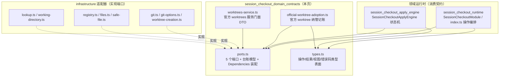
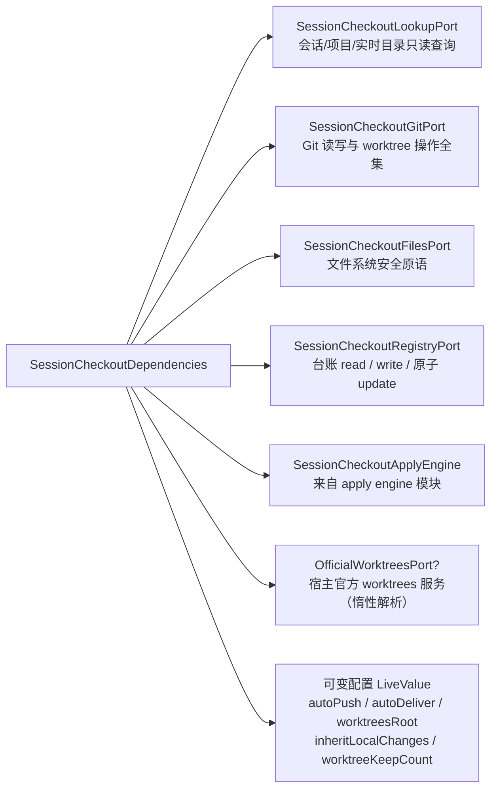
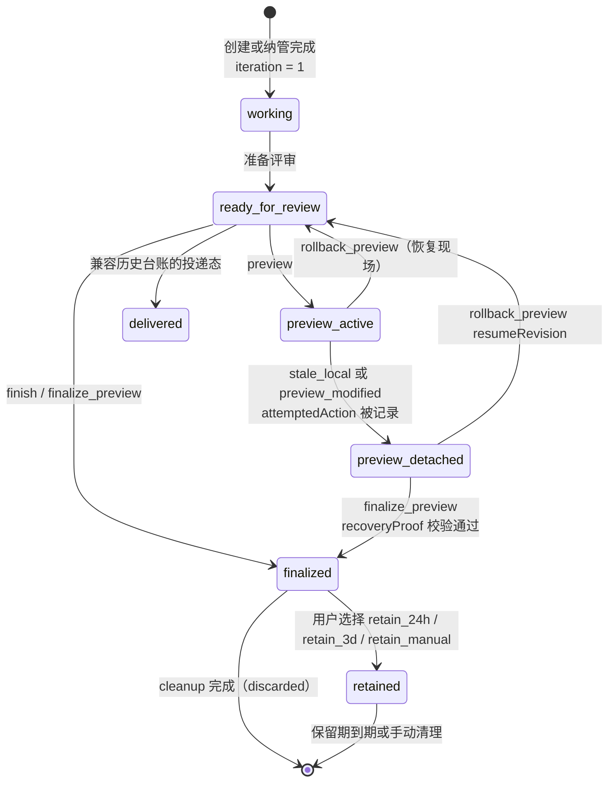
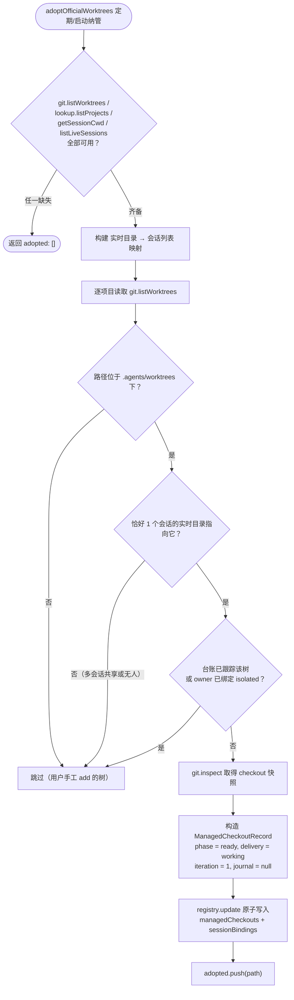

# 会话检出领域契约（session_checkout_domain_contracts）

!!! info "Generated documentation"
    This page was written by CodeWiki from the source code at commit [`e50f4121`](https://github.com/wloops/dsh-git-worktree/commit/e50f4121be2569531679e4f64bfc288bc20f70a3) on 2026-11-06 with `doubao-seed-2.1-lite`. Check the code before relying on details.

## 简介

本模块是 session-checkout 领域的**契约层**：它只定义类型、端口接口与少量纯记账逻辑，不含任何宿主相关实现。其核心设计目标在 `src/ports.ts` 头部注释中说得很清楚——领域逻辑（状态机与 apply 引擎）只依赖这些端口，而 DSH 适配器（子进程 backed 的 git、插件自有台账存储、session/workspace 查询）全部藏在端口之后，从而保证状态机**宿主无关、可用 fake 对象直接测试**。

本模块由四个文件组成：

| 文件 | 角色 | 主要导出 |
| --- | --- | --- |
| `src/ports.ts` | 端口接口 + 持久台账记录模型 + 运行时装配 | `SessionCheckoutLookupPort`、`SessionCheckoutGitPort`、`SessionCheckoutFilesPort`、`SessionCheckoutRegistryPort`、`ManagedCheckoutsRegistry`、`ManagedCheckoutRecord`、`SessionCheckoutDependencies`、`OfficialWorktreesPort` |
| `src/types.ts` | 宿主无关的操作族、结果族、视图族与错误码 | `SessionCheckoutOperation`、`SessionCheckoutOperationResult`、`SessionTargetView`、`WorktreeDeliveryView`、`SESSION_CHECKOUT_ERROR_CODES`、`MergeLocalBranchResult` 等 |
| `src/official-worktree-adoption.ts` | 官方 Worktree 工具产物的纳管与登记（纯函数 + 端口调用） | `adoptOfficialWorktrees`、`registerOfficialWorktree`、`OfficialWorktreeAdoptionDependencies` |
| `src/worktrees-service.ts` | 宿主官方 worktrees 服务的领域侧门面契约 | `WorktreesService`、`CreateWorktreeRequest`、`CreatedWorktree`、`RestoreWorktreeRequest`、`RestoredWorktree` |

## 架构定位



端口的具体实现方式（子进程 git、原子 JSON 注册表、文件锁）见 [git 执行适配器](../src_adapters/src_adapters_git_execution.md)、[持久层适配器](../src_adapters/src_adapters_persistence.md) 与 [宿主绑定适配器](../src_adapters/src_adapters_host_binding.md)，本页不再重复。状态机与应用引擎如何驱动这些端口，见 [会话检出交付引擎（session_checkout_apply_engine）](session_checkout_apply_engine.md)；模块入口如何组装端口，见 [运行时入口](session_checkout_runtime/session_checkout_runtime_entry.md)。

## 端口装配（SessionCheckoutDependencies）

运行时通过 `SessionCheckoutDependencies` 一次性注入全部端口与可变配置。除 `applyEngine` 外，每个端口对应一类基础设施能力：



装配要点：

- `officialWorktrees` 是个**惰性解析的工厂**（`() => OfficialWorktreesPort | undefined`），因为宿主服务可能在本插件之后才挂载；宿主没有时模块退化为自建 worktree 路径。
- 配置项大量使用 `LiveValue<T>`（`{ get(): T }`）：易变的 Cordis 配置字段以实时引用传入，`liveConfigValue()` 统一解包，避免在模块启动时快照配置。
- `createCheckoutId()` 由宿主提供新记录 id；`managedCheckoutsRoot` 是受管 worktree 的默认落点（可被 `worktreesRoot` 覆盖）。

### SessionCheckoutLookupPort —— 宿主身份与导航查询

只读端口，刻意保持**导航证据与授权证据分离**：

| 方法 | 语义 |
| --- | --- |
| `getSession(sessionId)` / `getProject(projectId)` | 持久身份记录；`SessionCheckoutSessionRecord.title` 仅用于生成可读目录名，**永远不作身份** |
| `getSessionCwd?(sessionId)` | 会话的 LIVE 工作目录。受管 owner 会话运行时其 cwd 就是不可变 worktree 根；若只按 `getProject().root`（Local checkout）授权，所有 owner 调用都会被误判 `project_mismatch`。没有 sessions 服务的宿主上缺失 |
| `listLiveSessions?()` | 实时会话列表（创建顺序、cwd），供并发分支竞态守卫使用；缺失时守卫保持沉默，不猜测 |
| `listProjects?()` | 宿主以 Workspace  backing 的全部项目；官方工具创建的 worktree 可能无绑定，纳管时靠它把 Local root 反解回项目 |
| `getSidebarMemberships?(managedRoots)` | 只读导航证据（`SidebarDirectoryMembership`），**绝不用于授权任何检出操作** |

### SessionCheckoutGitPort —— Git 能力全集

端口方法按能力分组；除少量核心方法外大多为可选，第三方端口不支持时领域层保持沉默或软降级，绝不因能力缺失而初始化失败：

| 分组 | 代表方法 | 说明 |
| --- | --- | --- |
| 仓库探测 | `inspect`、`findContainingWorktreeRoot`、`status`、`defaultBranch` | `inspect` 返回 `GitCheckoutSnapshot`（root/commonDir/gitDir/branch/headOid/headRef）；`defaultBranch` 靠 `origin/HEAD` 与 `init.defaultBranch` 解析，**绝不猜 'main'** |
| 初始化 | `preflightInitialCommit`、`initializeEmptyRepository`、`initializeProject` | 把非 Git / unborn 项目在用户显式确认后变成已提交仓库；`InitialCommitPreflight.kind` 区分 `ready / empty / files` |
| Worktree 生命周期 | `createDetachedWorktree`、`attachWorktreeBranch`、`removeWorktree`、`listWorktrees`、`pruneWorktrees`、`repairWorktreeLinks` | `attachWorktreeBranch` 带 `expectedOldOid` CAS：null 表示 ref 不存在才建，否则只从精确旧 OID 移动，并发会话绝不丢提交 |
| 内部保留对象 | `retainApplyBase`、`releaseApplyBase`、`retainInternalArtifact`、`readInternalArtifact`、`releaseInternalArtifacts` | 用 refs 安全保留 apply base 与内部工件，不触碰对象垃圾回收 |
| 分支 | `listLocalBranches`、`resolveLocalBranchTip`、`branchOverview`、`branchTipTimes`、`createLocalBranch`、`switchLocalBranch`、`deleteLocalBranch`、`mergeLocalBranch`、`graphLog` | `mergeLocalBranch` 的 `dryRun` 在一次性 detached worktree 中探测、绝不碰 checkout；真实合并把冲突留在原地（绝不 abort）交给调用方解决 |
| 标签 | `listTags`、`createTag`、`deleteLocalTag`、`pushTag`、`deleteRemoteTag` | `TagOverviewEntry.pushed` 为 `boolean \| null`：远程查不到时是 null，**绝不发明"未推送"** |
| 推送 | `pushBranch` | best-effort，永不 force-push；返回人类可读失败而非抛错，方便软降级 |
| WIP 携带（codex 对齐） | `captureLocalWip`、`applyWorktreePatch`、`listUntrackedFiles` | 仅当 worktree base 等于 Local HEAD 时携带本地未提交改动，失败降级为警告 |
| 放弃快照 | `snapshotAbandonedWorktree`、`restoreAbandonedSnapshot` | 删除带未提交内容的受管 worktree 前，把 tracked 修改 + 未 ignore untracked 固化为提交存于 `refs/dsh-worktree/abandoned/<checkoutId>`，之后可恢复为 Local 分支 |

### SessionCheckoutFilesPort —— 文件系统安全原语

删除与隔离操作全部以**目录身份**（`DirectoryIdentity`：device / inode / birthtimeNs）为前提，防止误删：

- `removeEmptyDirectoryTree`：只删整树为空时；树内链接只解链、绝不跟随。
- `quarantineDirectoryTree(path, expectedIdentity, quarantinePath)`：身份匹配时**原子移动**进插件隔离区（用于 `git worktree add` 残留）。
- `removeDirectoryTree`：删除完全自有的非空目录树；根不得是文件或符号链接。
- `measureDirectoryBytes`：估算真实占用，不跟随符号链接。

### SessionCheckoutRegistryPort —— 台账原子读写

```ts
interface SessionCheckoutRegistryPort {
  read(): ManagedCheckoutsRegistry
  write(registry: ManagedCheckoutsRegistry): void
  update(mutate: (registry) => registry): ManagedCheckoutsRegistry
}
```

`update` 的注释是关键不变量：`read` 与 `write` 之间隔着两次调用，任何在这条缝里发生的另一进程写入都会被后写者抹掉——**单条记录更新必须走 `update`（在同一把跨进程锁里完成读-改-写）**，禁止自己 read 完再 write。

## 台账记录模型（ManagedCheckoutsRegistry）

注册表为版本化结构：`{ version: 2, revision, sessionBindings, managedCheckouts }`。

### ManagedCheckoutRecord 核心字段

| 字段 | 说明 |
| --- | --- |
| `checkoutId` | 检出唯一标识 |
| `predecessorCheckoutId` | 复用前一次已交付检出的不可变 Harness cwd 路径 |
| `projectId / projectName / localRoot` | 项目身份与 Local checkout 规范根 |
| `ownerSessionId / sourceSessionId` | 拥有者会话 / 创建来源会话（历史记录可能缺省） |
| `managedRoot / managedGitRoot / gitCommonDir / gitDir` | 托管 worktree 根（兼租约 cwd）、仓库顶层、Git 目录定位；项目根可能是仓库子目录 |
| `baseOid / applyBaseOid` | 分叉基准提交 / 最近成功应用的隔离快照（不改变用户可见的会话基线） |
| `previousReview / checkpoints / recoveryContinuation` | 失效评审后的有界上下文 / 私有保存阶段列表 / 宿主权威一次性恢复上下文 |
| `abandonedSnapshotOid / abandonedSnapshotAt / permanent` | codex 对齐：放弃快照提交与常驻标记（豁免保留期到期清理与 keep-count LRU 逐出） |
| `sidebarBadgeClearedRevision` | 用户手动清除 sidebar 终态徽章时的 revision；此后任何 revision 变更使标记自然失效 |
| `sessionBranch / sessionTopic` | 会话拥有的分支与话题命名；纳管旧记录据此保持**同一个**分支名，避免改名 |
| `phase / delivery / journal / revision` | 阶段机、交付状态联合、进行中 journal、乐观锁版本号 |

### delivery 状态机（ManagedCheckoutDelivery）



各态的持久化证据：

- `preview_active` / `preview_detached` 持有 `ManagedPreviewReceipt`：configured/effective base OID、`baseStrategy`（`recorded_base` / `isolated_contains_local_head` / `local_contains_isolated_head`）、Local 与隔离两侧的指纹、树 OID、changedFiles——它是 preview 回滚与终态判定的事实来源。
- `finalized` / `retained` 持有 `ManagedDeliveryProof`：交付前后的 Local HEAD、changedFiles、验证状态；cleanup 可为 `pending / blocked / scheduled`，并持久化 `cleanupMessageKey`（i18n 键）与结构化 `cleanupReason`。
- 所有 `review` 持有 `ManagedWorktreeReviewRecord`（迭代号、验证状态、建议提交信息、隔离指纹）；`checkpoints` 为 `ManagedWorktreeCheckpointRecord[]`（带幂等 `requestId` 与 generation）。

### 进行中 Journal（崩溃恢复）

`ManagedCheckoutJournal` 是可区分联合：

- **Create journal**：`operation: 'create'`，`step: 'creating_worktree'`，附 `WorktreeCreationEvidence`（root/parent/commonDir 的目录身份、lockReason、metadata/index 指纹、quarantinePath）——崩溃后可据此判断残留并安全清理。
- **Mutation journal**：`operation` ∈ `apply / preview / checkpoint / rollback_preview / finish / finalize_preview / cleanup`，`step` 细分为 `planning → artifacts_retained → committing_session_branch → writing_local → updating_ref → replacing_index → removing_worktree`，并携带 base OID、planRevision、previewId/reviewId、checkpoint 元数据、retention、`recoveryGeneration`、`resumeRevision`、cleanupQuarantinePath 等，使重启后能精确判断"上次做到哪一步"。

### Recovery Continuation 联合

四种宿主权威的一次性恢复上下文：`ManagedApplyConflictRecoveryContinuation`（应用冲突）、`ManagedReviewRegenerationContinuation`（评审再生成）、`ManagedPreviewRecoveryAnalysisContinuation` 与 `ManagedPreviewRecoveryHandoffContinuation`（preview 恢复分析与交接）。它们由宿主颁发、突变时在宿主锁下重算比对，客户端恢复界面的持久化请求形状与之对应（见 [客户端恢复与交付](../../worktree_client_interface_layer/client_review_console/client_review_console_recovery_delivery.md)）。

## 领域类型表面（src/types.ts）

types.ts 定义了与上述持久模型平行的**宿主无关类型层**：`SessionTargetRef`、`SessionCheckoutPhase`（`preparing / ready / mutating / recovery_required / finalized / retained / discarded`，`applying` 为 v1 兼容的弃用值）、`WorktreeValidationStatus`、`WorktreeRetentionMode`（默认 `DEFAULT_WORKTREE_RETENTION = 'retain_manual'`：交付后的冻结环境**没有定时器在用户背后删除**）。

### 操作族（SessionCheckoutOperation）

每个操作都带 `sessionId` 与 `expectedRevision`（乐观锁）：

| 操作 | 关键字段 | 语义 |
| --- | --- | --- |
| `apply` | — | 把隔离快照应用到 Local |
| `finish` | `commitMessage`、`retention?`、`expectedReviewId?` | 交付定稿 |
| `preview` | — | 在 Local 试放隔离改动 |
| `checkpoint` | `commitMessage`、`expectedReviewId`、`expectedGeneration`、`requestId` | 私有保存阶段（幂等） |
| `rollback_preview` | `resumeRevision?`、`recoveryProof?` | 回滚预览；detached 态下 proof 仅作**待复核上下文，不是授权凭证** |
| `finalize_preview` | `commitMessage`、`retention?`、`recoveryProof?` | 从 detached 预览终态交付 |
| `retry_cleanup` | — | 重试上次被 block 的清理 |
| `discard` | `confirmDirty`、`rollbackPreview?` | 放弃检出 |
| `recover` | — | 从 `recovery_required` 恢复 |

### 结果族与视图

结果为可区分联合（`applied / previewed / checkpointed / preview_rolled_back / preview_detached / finished / conflict / discarded / recovered / error`），每个成功结果都回带最新的 `SessionTargetView`——这是面向 UI 的无路径投影：project / checkout（kind、phase）/ source / current（branch、oid）/ ownership（owner/inherited）/ dirty / revision / delivery / checkpoints / reviewSlot。

冲突结果 `SessionCheckoutConflictResult` 按 `ApplyConflictReason`（`content_conflict / local_dirty / untracked_conflict`）分类，附 `conflictDetails`（上限 `CONFLICT_DETAIL_FILE_LIMIT = 6` 文件、每个 diff `CONFLICT_DETAIL_DIFF_LIMIT = 4096` 字节）与一条具体的 `resolveHint`，让恢复不靠猜。

管理面投影 `ManagedWorktreeSummaryView` 是**去路径化**的：state（`working / ready_for_review / preview_active / retained / cleanup_pending / needs_attention / delivered`）、cleanup 资格结论、approximateBytes、activeSessionIds；它是只读检查结论，批量清理时会重新校验，**永远不作授权**。

### 错误码（SESSION_CHECKOUT_ERROR_CODES）

| 分组 | 错误码 |
| --- | --- |
| 身份与目标 | `session_not_found`、`project_not_found`、`project_root_missing`、`not_git_repository`、`target_unselected`、`target_already_bound`、`project_mismatch`、`checkout_missing`、`checkout_mismatch`、`not_owner`、`dirty_confirmation_required`、`checkout_limit_reached` |
| 并发与陈旧 | `stale_target`、`stale_local`、`stale_isolated`、`recovery_required`、`recovery_unsafe`、`registry_corrupt`、`project_acceptance_busy` |
| Git 与计划 | `git_operation_failed`、`git_error`、`invalid_input`、`invalid_plan`、`apply_failed`、`apply_conflict`、`commit_isolation_conflict`、`operation_not_allowed`、`preview_not_active`、`preview_modified` |

## 官方 Worktree 纳管（official-worktree-adoption.ts）

官方实验性 Worktree 工具只做「创建工作树 + 切目录」，**不写任何台账**。没有纳管时，它建的树不出现在列表里、也无法交付与清理。本模块提供两条记账路径：



设计要点：

- **只认 `.agents/worktrees/` 前缀是有意的**：`git worktree list` 会把用户手工 `git worktree add` 的一切列出来，纳管它们等于凭空接管用户目录。
- **归属只能来自「谁正站在这棵树里」**：官方工具不改 header.cwd，必须读宿主实时工作目录 `getSessionCwd`；多个会话同时站在同一棵树里时无法判定唯一 owner——跳过而不是猜。
- 新登记的记录一律从 `phase: 'ready'` + `delivery: { state: 'working', iteration: 1 }` 开始：树已在磁盘上且可读，不需要创建 journal，交付时按 tree 比较决定是否新建提交。
- `registerOfficialWorktree(deps, registration)` 是 `worktree_create` 的**唯一建树路径**：官方服务负责真正的 Git 操作（`OfficialWorktreesPort.create` 需要 live calling agent 来把该会话工作目录设为最后一步），本插件负责记账并返回 `ManagedCheckoutRecord`，让列表、交付、评审、清理对这棵树同样有效。
- `isTracked` 同时按 `managedRoot` 与 `managedGitRoot` 两边对齐（忽略已 `discarded` 的记录），路径归一化在 Windows 下小写处理。

## Worktrees 服务门面（src/worktrees-service.ts）

该文件是宿主官方 `worktrees` 服务在领域侧的门面契约，与 `ports.ts` 的 `OfficialWorktreesPort` 形状对齐（`create(agent, request?, signal?, onPhase?) → { path, branch, baseCommit, repositoryRoot }`）：

| 导出 | 语义 |
| --- | --- |
| `WorktreesService` | 领域内部对官方 worktrees 服务的统一门面：创建委托宿主服务完成，本插件只记账 |
| `CreateWorktreeRequest` / `CreatedWorktree` | 创建请求与结果 DTO（路径、分支、基线提交） |
| `RestoreWorktreeRequest` / `RestoredWorktree` | 放弃快照恢复请求与结果 DTO，对应 `SessionCheckoutGitPort.snapshotAbandonedWorktree` / `restoreAbandonedSnapshot`，恢复后快照变成 Local 分支（`AbandonedWorktreeSnapshotView`） |

## 设计不变量小结

1. **宿主无关**：状态机与 apply 引擎只依赖端口；适配器可整包替换、可用 fake 测试。
2. **可选能力软降级**：Git/Files/Lookup 端口的可选方法缺失时，模块沉默或警告，绝不因缺能力而初始化失败。
3. **导航与授权分离**：sidebar 成员证据只读导航；授权证据走 `getSessionCwd`。
4. **并发安全三重闸**：`expectedRevision` 乐观锁、`attachWorktreeBranch` 的 ref CAS、checkpoint 的 `requestId + generation`、recovery proof 的 `receiptFingerprint`。
5. **台账原子更新**：一律走 `registry.update` 的跨进程锁内读-改-写。
6. **删除前身份确认**：目录删除/隔离必须通过 `DirectoryIdentity`（device/inode/birthtimeNs）校验。
7. **投影去路径**：面向管理面与客户端的 View 类型不泄漏路径与身份，错误原因结构化（`cleanupReason` 等）并持久化 i18n 键。

## 相关模块

- 父模块总览：[会话检出领域模块（session_checkout_domain）](../session_checkout_domain.md)
- 消费本契约的状态机：[会话检出交付引擎（session_checkout_apply_engine）](session_checkout_apply_engine.md)
- 运行时装配入口：[会话检出运行时入口模块](session_checkout_runtime/session_checkout_runtime_entry.md)
- 宿主工作区生命周期：[工作区提供者生命周期与会话目标上下文](session_checkout_runtime/workspace_provider_lifecycle.md)
- 端口的适配器实现：[持久层](../src_adapters/src_adapters_persistence.md)、[Git 执行](../src_adapters/src_adapters_git_execution.md)、[宿主绑定](../src_adapters/src_adapters_host_binding.md)
- 控制台 RPC 如何消费这些 View 类型：[Worktree Console 共享契约（`src/console-contract.ts`）](../../worktree_console_protocol_and_host_service/worktree_console_contract.md)

??? abstract "Documented components (83)"
    - [`BranchOverviewEntry`](https://github.com/wloops/dsh-git-worktree/blob/e50f4121be2569531679e4f64bfc288bc20f70a3/src%5Cports.ts) — `src\ports.ts`
    - [`DirectoryIdentity`](https://github.com/wloops/dsh-git-worktree/blob/e50f4121be2569531679e4f64bfc288bc20f70a3/src%5Cports.ts) — `src\ports.ts`
    - [`GitCheckoutSnapshot`](https://github.com/wloops/dsh-git-worktree/blob/e50f4121be2569531679e4f64bfc288bc20f70a3/src%5Cports.ts) — `src\ports.ts`
    - [`GraphLogCommit`](https://github.com/wloops/dsh-git-worktree/blob/e50f4121be2569531679e4f64bfc288bc20f70a3/src%5Cports.ts) — `src\ports.ts`
    - [`InitialCommitPreflight`](https://github.com/wloops/dsh-git-worktree/blob/e50f4121be2569531679e4f64bfc288bc20f70a3/src%5Cports.ts) — `src\ports.ts`
    - [`LiveValue`](https://github.com/wloops/dsh-git-worktree/blob/e50f4121be2569531679e4f64bfc288bc20f70a3/src%5Cports.ts) — `src\ports.ts`
    - [`ManagedApplyConflictRecoveryContinuation`](https://github.com/wloops/dsh-git-worktree/blob/e50f4121be2569531679e4f64bfc288bc20f70a3/src%5Cports.ts) — `src\ports.ts`
    - [`ManagedCheckoutCreateJournal`](https://github.com/wloops/dsh-git-worktree/blob/e50f4121be2569531679e4f64bfc288bc20f70a3/src%5Cports.ts) — `src\ports.ts`
    - [`ManagedCheckoutJournalBase`](https://github.com/wloops/dsh-git-worktree/blob/e50f4121be2569531679e4f64bfc288bc20f70a3/src%5Cports.ts) — `src\ports.ts`
    - [`ManagedCheckoutMutationJournal`](https://github.com/wloops/dsh-git-worktree/blob/e50f4121be2569531679e4f64bfc288bc20f70a3/src%5Cports.ts) — `src\ports.ts`
    - [`ManagedCheckoutRecord`](https://github.com/wloops/dsh-git-worktree/blob/e50f4121be2569531679e4f64bfc288bc20f70a3/src%5Cports.ts) — `src\ports.ts`
    - [`ManagedCheckoutsRegistry`](https://github.com/wloops/dsh-git-worktree/blob/e50f4121be2569531679e4f64bfc288bc20f70a3/src%5Cports.ts) — `src\ports.ts`
    - [`ManagedDeliveryProof`](https://github.com/wloops/dsh-git-worktree/blob/e50f4121be2569531679e4f64bfc288bc20f70a3/src%5Cports.ts) — `src\ports.ts`
    - [`ManagedPreviewReceipt`](https://github.com/wloops/dsh-git-worktree/blob/e50f4121be2569531679e4f64bfc288bc20f70a3/src%5Cports.ts) — `src\ports.ts`
    - [`ManagedPreviewRecoveryAnalysisContinuation`](https://github.com/wloops/dsh-git-worktree/blob/e50f4121be2569531679e4f64bfc288bc20f70a3/src%5Cports.ts) — `src\ports.ts`
    - [`ManagedPreviewRecoveryHandoffContinuation`](https://github.com/wloops/dsh-git-worktree/blob/e50f4121be2569531679e4f64bfc288bc20f70a3/src%5Cports.ts) — `src\ports.ts`
    - [`ManagedReviewRegenerationContinuation`](https://github.com/wloops/dsh-git-worktree/blob/e50f4121be2569531679e4f64bfc288bc20f70a3/src%5Cports.ts) — `src\ports.ts`
    - [`ManagedWorktreeCheckpointRecord`](https://github.com/wloops/dsh-git-worktree/blob/e50f4121be2569531679e4f64bfc288bc20f70a3/src%5Cports.ts) — `src\ports.ts`
    - [`ManagedWorktreePreviousReviewRecord`](https://github.com/wloops/dsh-git-worktree/blob/e50f4121be2569531679e4f64bfc288bc20f70a3/src%5Cports.ts) — `src\ports.ts`
    - [`ManagedWorktreeReviewRecord`](https://github.com/wloops/dsh-git-worktree/blob/e50f4121be2569531679e4f64bfc288bc20f70a3/src%5Cports.ts) — `src\ports.ts`
    - [`SessionBindingRecord`](https://github.com/wloops/dsh-git-worktree/blob/e50f4121be2569531679e4f64bfc288bc20f70a3/src%5Cports.ts) — `src\ports.ts`
    - [`SessionCheckoutDependencies`](https://github.com/wloops/dsh-git-worktree/blob/e50f4121be2569531679e4f64bfc288bc20f70a3/src%5Cports.ts) — `src\ports.ts`
    - [`SessionCheckoutFilesPort`](https://github.com/wloops/dsh-git-worktree/blob/e50f4121be2569531679e4f64bfc288bc20f70a3/src%5Cports.ts) — `src\ports.ts`
    - [`SessionCheckoutGitPort`](https://github.com/wloops/dsh-git-worktree/blob/e50f4121be2569531679e4f64bfc288bc20f70a3/src%5Cports.ts) — `src\ports.ts`
    - [`SessionCheckoutLookupPort`](https://github.com/wloops/dsh-git-worktree/blob/e50f4121be2569531679e4f64bfc288bc20f70a3/src%5Cports.ts) — `src\ports.ts`
    - [`SessionCheckoutProjectRecord`](https://github.com/wloops/dsh-git-worktree/blob/e50f4121be2569531679e4f64bfc288bc20f70a3/src%5Cports.ts) — `src\ports.ts`
    - [`SessionCheckoutRegistryPort`](https://github.com/wloops/dsh-git-worktree/blob/e50f4121be2569531679e4f64bfc288bc20f70a3/src%5Cports.ts) — `src\ports.ts`
    - [`SessionCheckoutSessionRecord`](https://github.com/wloops/dsh-git-worktree/blob/e50f4121be2569531679e4f64bfc288bc20f70a3/src%5Cports.ts) — `src\ports.ts`
    - [`SidebarDirectoryMembership`](https://github.com/wloops/dsh-git-worktree/blob/e50f4121be2569531679e4f64bfc288bc20f70a3/src%5Cports.ts) — `src\ports.ts`
    - [`TagOverviewEntry`](https://github.com/wloops/dsh-git-worktree/blob/e50f4121be2569531679e4f64bfc288bc20f70a3/src%5Cports.ts) — `src\ports.ts`
    - [`WorktreeCreationEvidence`](https://github.com/wloops/dsh-git-worktree/blob/e50f4121be2569531679e4f64bfc288bc20f70a3/src%5Cports.ts) — `src\ports.ts`
    - [`AbandonedWorktreeSnapshotView`](https://github.com/wloops/dsh-git-worktree/blob/e50f4121be2569531679e4f64bfc288bc20f70a3/src%5Ctypes.ts) — `src\types.ts`
    - [`ApplyConflictDetail`](https://github.com/wloops/dsh-git-worktree/blob/e50f4121be2569531679e4f64bfc288bc20f70a3/src%5Ctypes.ts) — `src\types.ts`
    - [`BulkCleanupManagedWorktreeCandidate`](https://github.com/wloops/dsh-git-worktree/blob/e50f4121be2569531679e4f64bfc288bc20f70a3/src%5Ctypes.ts) — `src\types.ts`
    - [`BulkCleanupManagedWorktreesResult`](https://github.com/wloops/dsh-git-worktree/blob/e50f4121be2569531679e4f64bfc288bc20f70a3/src%5Ctypes.ts) — `src\types.ts`
    - [`ManagedWorktreeCleanupView`](https://github.com/wloops/dsh-git-worktree/blob/e50f4121be2569531679e4f64bfc288bc20f70a3/src%5Ctypes.ts) — `src\types.ts`
    - [`ManagedWorktreeSummaryView`](https://github.com/wloops/dsh-git-worktree/blob/e50f4121be2569531679e4f64bfc288bc20f70a3/src%5Ctypes.ts) — `src\types.ts`
    - [`MergeBranchForSessionView`](https://github.com/wloops/dsh-git-worktree/blob/e50f4121be2569531679e4f64bfc288bc20f70a3/src%5Ctypes.ts) — `src\types.ts`
    - [`MergeLocalBranchResult`](https://github.com/wloops/dsh-git-worktree/blob/e50f4121be2569531679e4f64bfc288bc20f70a3/src%5Ctypes.ts) — `src\types.ts`
    - [`PruneMergedBranchEntry`](https://github.com/wloops/dsh-git-worktree/blob/e50f4121be2569531679e4f64bfc288bc20f70a3/src%5Ctypes.ts) — `src\types.ts`
    - [`PruneMergedBranchesView`](https://github.com/wloops/dsh-git-worktree/blob/e50f4121be2569531679e4f64bfc288bc20f70a3/src%5Ctypes.ts) — `src\types.ts`
    - [`SessionCheckoutAppliedResult`](https://github.com/wloops/dsh-git-worktree/blob/e50f4121be2569531679e4f64bfc288bc20f70a3/src%5Ctypes.ts) — `src\types.ts`
    - [`SessionCheckoutApplyOperation`](https://github.com/wloops/dsh-git-worktree/blob/e50f4121be2569531679e4f64bfc288bc20f70a3/src%5Ctypes.ts) — `src\types.ts`
    - [`SessionCheckoutCheckpointOperation`](https://github.com/wloops/dsh-git-worktree/blob/e50f4121be2569531679e4f64bfc288bc20f70a3/src%5Ctypes.ts) — `src\types.ts`
    - [`SessionCheckoutCheckpointedResult`](https://github.com/wloops/dsh-git-worktree/blob/e50f4121be2569531679e4f64bfc288bc20f70a3/src%5Ctypes.ts) — `src\types.ts`
    - [`SessionCheckoutConflictResult`](https://github.com/wloops/dsh-git-worktree/blob/e50f4121be2569531679e4f64bfc288bc20f70a3/src%5Ctypes.ts) — `src\types.ts`
    - [`SessionCheckoutDiscardOperation`](https://github.com/wloops/dsh-git-worktree/blob/e50f4121be2569531679e4f64bfc288bc20f70a3/src%5Ctypes.ts) — `src\types.ts`
    - [`SessionCheckoutDiscardedResult`](https://github.com/wloops/dsh-git-worktree/blob/e50f4121be2569531679e4f64bfc288bc20f70a3/src%5Ctypes.ts) — `src\types.ts`
    - [`SessionCheckoutFailure`](https://github.com/wloops/dsh-git-worktree/blob/e50f4121be2569531679e4f64bfc288bc20f70a3/src%5Ctypes.ts) — `src\types.ts`
    - [`SessionCheckoutFinalizePreviewOperation`](https://github.com/wloops/dsh-git-worktree/blob/e50f4121be2569531679e4f64bfc288bc20f70a3/src%5Ctypes.ts) — `src\types.ts`
    - … and 33 more

