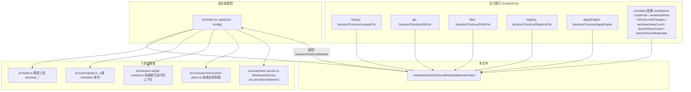
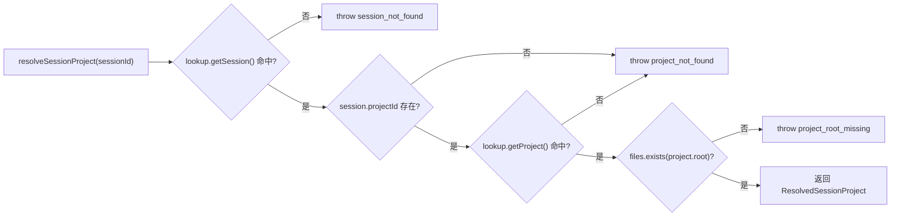
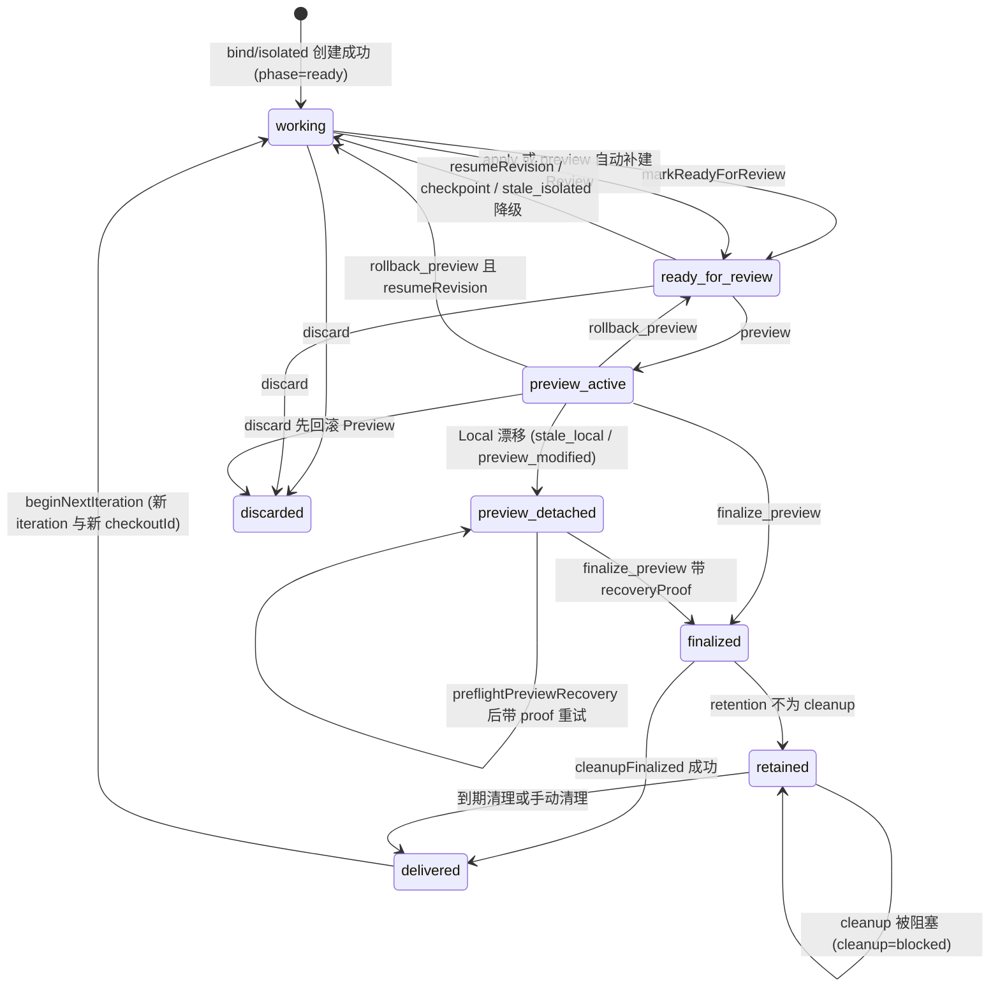
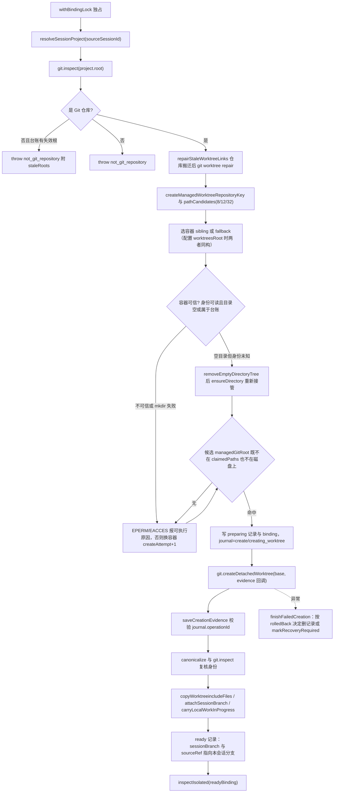
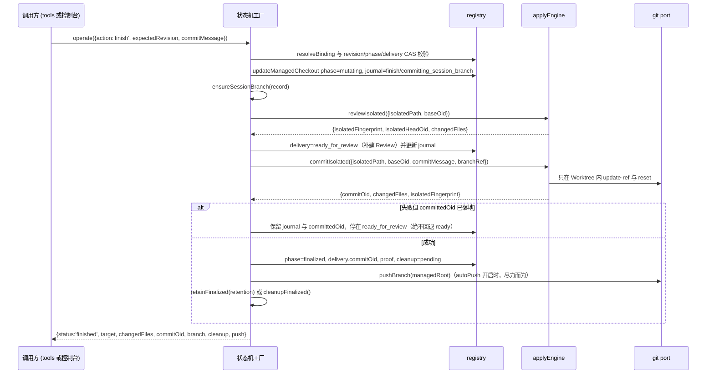
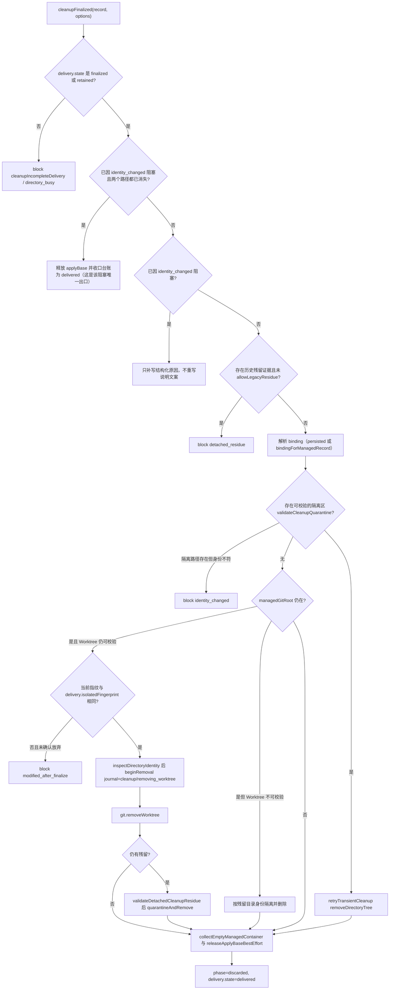
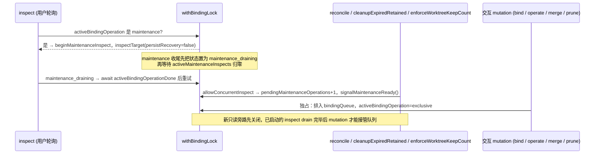
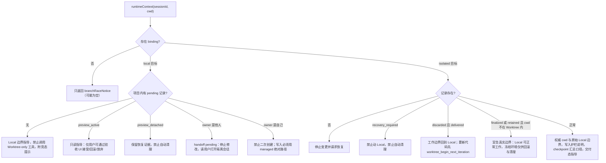

# `src/session-checkout-module.ts` —— 会话检出状态机工厂

!!! info "Generated documentation"
    This page was written by CodeWiki from the source code at commit [`55374a27`](https://github.com/wloops/dsh-git-worktree/commit/55374a27f4099ec8dcd0d6163f5544d60b4f3874) on 2026-11-06 with `doubao-seed-2.1-lite`. Check the code before relying on details.

本文件是 `dsh-git-worktree` 插件的**核心状态机**：`createSessionCheckoutModule(dependencies)` 用一个纯函数式工厂闭包，实例化出宿主可见的唯一业务对象 `SessionCheckoutModule`。它把从 Domi 移植来的 session-checkout 域（receipt-first 的 Local Preview、回滚/定稿、项目验收槽、崩溃恢复、指纹 CAS）适配到 Harness 的「源 Local 会话 + 目标 owner 会话」双会话模型上，并叠加了大量本地适配（会话分支交付、自动推送、keep-count LRU、分支竞态守卫等）。

- 文件位置：`src/session-checkout-module.ts`
- 唯一对外导出：`createSessionCheckoutModule`（工厂函数）
- 契约：入参 `SessionCheckoutDependencies`（定义于 `src/ports.ts`），返回 `SessionCheckoutModule`（定义于 `src/index.ts`）

> 本页面只描述这一个文件。工厂返回的接口契约见 [运行时入口 src/index.ts](src_index.ts.md)，端口与视图类型定义见 [会话检出域契约](../../session_checkout_domain_contracts.md)，实际的合并与写盘算法见 [Apply 引擎](../../session_checkout_apply_engine.md)。

---

## 1. 在系统中的位置



工厂产出的单例被 `apply()` 同时交给工具层、命令层、上下文层、验收台控制面与宿主 Worktrees 服务（见 `src/index.ts` 中的 `registerTools(ctx, module)`、`registerWorktreeCommand(ctx, module)`、`registerSessionTargetContext(ctx, module)`、`createWorktreeConsoleControlPlane({ module, ... })`、`mountWorktreesService(ctx, module)` 与 `mountWorktreesInIsolatedScopes(ctx, module)`——后两者仅在官方 Worktree 工具接管开启时才调用）。相关下游文档：[Worktree 核心操作](../../../worktree_core_operations.md)、[验收台宿主服务](../../../../worktree_console_protocol_and_host_service/worktree_console_host.md)、[客户端界面层](../../../../worktree_client_interface_layer.md)。

---

## 2. 文件内部结构

文件分成两层：**工厂之外**的模块级工具（跨实例共享，要么无状态、要么只有一份全局收敛状态），与**工厂之内**的闭包（每个实例各自持有队列与缓存）。

| 区域 | 关键成员 | 职责 |
| --- | --- | --- |
| 模块级常量 | `UNVERSIONED_OID` / `UNVERSIONED_REF` / `RETENTION_24H_MS` / `RETENTION_3D_MS` / `CLEANUP_IDENTITY_CHANGED_MESSAGE` / `CLEANUP_RESIDUE_MESSAGE` / `TRANSIENT_CLEANUP_RETRY_DELAYS_MS` / `CHECKOUT_CLEANUP_TIMEOUT_MS` | 非 Git 项目占位、保留期换算、清理重试节奏与收敛超时 |
| 全局清理收敛 | `cleanupInFlight: Map<string, Promise<unknown>>`、`withCleanupTimeout()` | 同一 checkout 的在跑清理复用同一个 Promise；超时只放弃等待，绝不新开一次操作 |
| 清理归因 | `cleanupReasonForMessage()`、`persistedCleanupReason()` | 优先读结构化 `delivery.cleanupReason`，历史记录回落到中英文关键词成对匹配 |
| 瞬时错误重试 | `isTransientCleanupError()`、`retryTransientCleanup()` | `EBUSY/EPERM/EACCES/ENOTEMPTY` 等 Windows 占用错误按 100/300/800ms 退避 |
| 路径身份 | `pathForIdentity()`、`pathsEqual()`、`resolvedPathsEqual()`、`pathIsWithin()`、`branchNameOf()` | 区分「realpath 后比较」与「registry 原样路径比较」，避免 Junction 冒充原目录 |
| 交付副作用 | `pushLocalBranchBestEffort()` | 尽力而为推送会话分支，失败降级为结果备注 |
| 视图投影 | `ResolvedSessionProject`、`projectPreviousReview`、`projectCheckpoint`、`projectDelivery`、`recoveryView`、`committedFollowupView`、`bindingForManagedRecord` | 把台账记录投影成 `SessionTargetView` |
| 身份校验 | `validateManagedCheckoutDetailed`、`validateManagedCheckout`、`checkpointHeadInvariantHolds`、`validateCommittedLocalCheckout`、`validateCleanupLocalIdentity`、`validateDetachedCleanupResidue`、`validateCleanupQuarantine` | 三值判定：valid / invalid / unavailable |
| 读路径 | `inspectLocal`、`inspectIsolated`、`inspectAvailable`、`inspectDuringMaintenance`、`runtimeContext`、`branchRaceNotice`、`refreshBranchRaceGuards` | 状态检查与模型指导 |
| 写路径 | `bindTarget`、`attachSessionBranch`、`ensureSessionBranch`、`markReadyForReviewTarget`、`operateTarget`（分派到 `operateApply` / `operateFinish` / `operatePreview` / `operateCheckpoint` / `operateRollbackPreview` / `operateFinalizePreview` / `operateRetryCleanup` / `operateDiscard` / `operateRecover`） | 状态机迁移 |
| 恢复与维护 | `reconcile`、`cleanupFinalized`、`retainFinalized`、`cleanupExpiredRetained`、`enforceWorktreeKeepCount`、`repairStaleWorktreeLinks`、`beginNextIterationTarget` | 崩溃收敛、到期清理、LRU 逐出、下一迭代 |
| 管理面 | `listManagedWorktrees`、`listManagedWorktreesForSession`、`summarizeManagedWorktree`、`inspectCleanupForRecord`、`bulkCleanupManagedWorktrees`、`manageManagedWorktree`、`manageManagedWorktreeForSession`、`observeManagedCheckout`、`observeManagedCheckouts`、`resolveManagedRoot`、`resolveRoots` | 侧栏、控制台、批量清理 |
| 分支运维 | `pruneMergedBranchesInRepo`、`pruneMergedBranchesForSession`、`autoPruneStaleMergedBranches`、`mergeBranchForSession` | 已合并分支安全剪枝与会话分支合并 |
| 本地适配 | `copyWorktreeincludeFiles`、`carryLocalWorkInProgress`、`collectEmptyManagedContainer`、`releaseApplyBaseBestEffort` | `.worktreeinclude` 与本地 WIP 继承、空容器回收、内部 ref 释放 |

### 2.1 `ResolvedSessionProject`

```typescript
interface ResolvedSessionProject {
  session: SessionCheckoutSessionRecord
  project: SessionCheckoutProjectRecord
}
```

它是 `resolveSessionProject(sessionId)` 的返回类型，也是所有创建/绑定路径的唯一入口产物：一次调用完成「会话存在 → 关联项目 → 项目根目录在磁盘上存在」三级校验，任一失败即抛出带稳定错误码的 `SessionCheckoutError`。



---

## 3. 数据与所有权模型

状态机的全部事实来源是持久化在 `ManagedCheckoutsRegistry`（`managed-checkouts.json`，由 [适配器层](../../../src_adapters.md) 的 `AtomicJsonCheckoutRegistry` 在跨进程文件锁内原子读写）里的两类记录加一份日志：

| 记录 | 关系 | 语义 |
| --- | --- | --- |
| `sessionBindings: Record<sessionId, SessionBindingRecord>` | 会话 → 目标 | 该会话此刻站在 Local 边界还是某个 `checkoutId`；携带 `sourceRef` / `sourceOid` / `revision` / `inheritedFromSessionId` |
| `managedCheckouts: Record<checkoutId, ManagedCheckoutRecord>` | 托管 Worktree 台账 | 双边界路径（`localRoot` / `managedRoot` / `managedGitRoot` / `gitCommonDir` / `gitDir`）、基点 `baseOid`、交付状态 `delivery`、阶段 `phase`、日志 `journal`、乐观锁 `revision`，以及本地适配新增的 `sessionBranch` / `sessionTopic` / `permanent` / `abandonedSnapshotOid` / `sidebarBadgeClearedRevision` |
| `journal`（operation ∈ create/apply/preview/checkpoint/rollback_preview/finalize_preview/finish/cleanup + step） | 崩溃可重放的收据 | `reconcile` 按 step 判定前进、回退还是进入 `recovery_required` |

> **所有权适配**：Domi 用单一会话同时充当「源」与「owner」；这里拆成 `ownerSessionId`（真正在 Worktree 内工作的会话）与 `sourceSessionId`（派生它的源 Local 会话）。视图上的 `ownership: 'owner' | 'inherited'` 由 `inheritedFromSessionId` 推导，非 owner 的继承会话对变更一律返回 `not_owner`。

### 3.1 交付生命周期



`phase`（`preparing` / `ready` / `applying`(已弃用) / `mutating` / `recovery_required` / `finalized` / `retained` / `discarded`）描述**环境健康度**，`delivery.state` 描述**交付进度**，二者正交：一个 `finalized` 记录可能因磁盘残留而显示 `needs_attention`；一个 `recovery_required` 记录也可能已经带着 commit 事实。视图层由 `projectDelivery` 按 state 分支裁剪字段，避免把内部 receipt 泄漏给客户端。

---

## 4. 关键流程

### 4.1 创建托管 Worktree（`bind` / `createIsolatedTarget` → `bindTarget`）



要点：
- **证据优先**：`createDetachedWorktree` 通过回调把 `WorktreeCreationEvidence`（目录身份、`lockReason`、隔离路径等）写进 journal；后续 `hasCreationResidue` / `creationResiduePaths` 据此判断磁盘上是否还有可被误认为 checkout 的残留。残留还在时 `recover` 与 `discard` 一律拒绝（`recovery_unsafe`）；一旦创建所声明的每条路径都从磁盘消失，就没有身份可验证也没有字节需保护，台账才被允许收口。
- **会话分支**：`attachSessionBranch` 只改 ref 与 HEAD 指向、绝不碰工作区文件，因此创建路径原有的身份校验链（read-tree/checkout-index/证据回滚）全部照旧生效。候选名由 `createSessionBranchCandidates` 生成（`feat/sess-<session>--<topic>`，重名退化为 `-2`、`-3`…）；同名分支仅在「正指当前 HEAD」或「是当前 HEAD 的祖先（可快进）」时复用，否则换下一个候选，绝不覆盖别人的提交。端口未实现 `attachWorktreeBranch` 时降级为旧的 detached HEAD 行为并 `console.warn`。
- **本地继承**：`copyWorktreeincludeFiles`（读 `.worktreeinclude` 清单，跳过符号链接与已存在目标；空清单/全注释必须跳过，否则交集会退化成「全部 gitignored」）与 `carryLocalWorkInProgress`（`captureLocalWip` 打补丁 + `listUntrackedFiles` 逐个复制）。后者仅在 `baseOid === 本地 HEAD` 且 `inheritLocalChanges !== false` 时执行，两者失败都只告警、不阻断创建。
- **in-place 升级**：`createIsolatedTarget(sourceSessionId, targetSessionId)` 在 `targetSessionId === sourceSessionId` 时把本会话直接从 local 升级为 isolated（与 Claude Code `EnterWorktree` 同构），此时不要求预先存在第二个会话。
- **终态替换**：已 delivered/finalized/retained 的 owner 再次绑定 isolated 时，会记下 `replacedDeliveredBinding`、删除旧 binding 并让 `nextIteration` 递增；创建失败时用它回滚 binding，保证历史交付记录不被抹掉。

### 4.2 交付（`operateFinish`，本地适配后的「会话分支交付」）



**关键语义**：交付不再写 Local。
- `refuseLegacyLocalWrite`：记录已有 `sessionBranch` 时，`apply` / `preview` / `finalize_preview` 一律 `operation_not_allowed`，并指向正确出口（deliver 之后由 `worktree_merge` 合并）。写进 Local 正是当初把改动混进别的会话分支的原因。
- `ensureSessionBranch`：历史记录（detached HEAD、`sourceRef` 记的是 Local 当时所在的分支，可能是**别的会话**的分支）在交付前补挂自己的会话分支；那条 `sourceRef` 从此只作为「分叉来源」展示。若记录里已有分支但 Worktree 离开了它（checkpoint 会把 HEAD 写成游离提交），先按记录值快进再重新检出；快进失败则退回另建一条，绝不覆盖。
- `operateFinish` 还会拒绝停留在 `applyBaseOid` + `working/ready_for_review` 的旧中间态记录，明确提示「该 Worktree 曾通过 apply 写入 Local」，而不是悄悄重放旧规则。
- 引擎方法通过 `this` 访问内部状态，因此 `reviewIsolated` / `commitIsolated` 必须 `bind(engine)` 后再取用。

### 4.3 身份校验（读路径的地基）

`validateManagedCheckoutDetailed` 是所有写操作的前置门槛，返回三值：

| 结果 | 触发条件 | 调用方行为 |
| --- | --- | --- |
| `valid` | 绑定与记录四元组一致；四个 realpath 并行取回；`snapshot.root/commonDir/gitDir`、`localSnapshot.commonDir`、项目相对路径同构；`requireCreateBase` 时要求 `headOid === baseOid`，否则要求 `checkpointHeadInvariantHolds` 通过 | 继续操作，并复用随行的 `localSnapshot`（省掉一次 Local 侧 `git rev-parse`） |
| `invalid` | 任一身份/路径/不变量确定不匹配 | 持久进入 `recovery_required`（`markRecoveryRequired`） |
| `unavailable` | 抛出异常（Git 子进程超时、杀毒软件占用等瞬时 I/O） | **不**污染健康 Worktree，下一次 inspect 直接重试 |

`checkpointHeadInvariantHolds` 先做结构校验（`sequence` 连续、`checkpointId`/`reviewId` 不重复），再并行取证：内部 ref `checkpoints/<id>` 与记录的 `commitOid` 一致、每个 checkpoint 的 parent 关系成立、最后一个 checkpoint 是当前 HEAD 的祖先；判定顺序仍保持原短路语义。

顶部胶囊每 5 秒走一次这条路径，因此 4 个 `canonicalize`、2 个 `inspect`、N 个 checkpoint 校验全部并行；`git.status()` 提前挂 noop `catch`，只在快照证明确实是仓库时才消费结果，避免未消费的 rejection 冒泡。

### 4.4 清理与保留（`cleanupFinalized`）



设计要点：
- **启动收敛**：`withCleanupTimeout` 给单条清理 120 秒。files/git 端口没有 `AbortSignal`，所以超时**不取消**操作，只是不再等待，后台仍会跑完并写台账。因此同一 checkout 的在跑清理必须复用同一个 Promise——若每次超时都新起一次 `cleanupFinalized`，两个读-改-写周期就会在 registry 上交错，丢更新是必然的。超时后未被 await 的 rejection 必须在 `settle` 里消费掉，否则成为 unhandled rejection。
- **归因决定重试性**：`retryableCleanupBlock` 把 `directory_busy` / `quarantine_busy` 视为可重试的瞬时占用（留在定期扫描里）；`identity_changed` / `modified_after_finalize` / `detached_residue` 需要人工判断。`cleanupReasonForMessage` 只是历史持久化记录的兜底（中英文关键词成对匹配），写点必须显式传结构化 `cleanupReason` 与 `cleanupMessageKey`。
- **数据保护优先**：交付后出现的新改动默认保留（那是用户可能还没取走的工作），只有显式 `discardPostDeliveryChanges: true` 才越过；带未提交内容放弃前先用 `snapshotAbandonedWorktree` 把 tracked 修改与未 ignore 的 untracked 文件固化成一个提交（`refs/dsh-worktree/abandoned/<checkoutId>`），快照失败则中止放弃。
- **台账不是日志**：`reconcile` 中已 `discarded` 且路径彻底空掉的记录会被删除（前提是没有 binding 或 predecessor 仍引用它），否则台账会无限增长、同 topic 的新建会持续撞上已被放弃的旧路径；宿主还可能重建已删 Worktree 的空壳 cwd，由 `removeEmptyDirectoryTree` 顺手清掉并回收空容器。
- **失败归因保守**：`quarantine_busy` / `identity_changed` / `directory_busy` 三选一。目录身份对不上（`checkout_mismatch`）不是「暂时占用」，写成 `directory_busy` 会让一条永远清不掉的记录长期占着配额。

### 4.5 崩溃恢复（`reconcile`）

`reconcile` 在宿主 `ready` 事件与周期维护中被调用，按 journal step 做确定性判定：

| journal 状态 | 判定 | 结果 |
| --- | --- | --- |
| `create` 无 creation 证据、路径全消失、predecessor 已 delivered | 迭代创建中断且无残留 | 删除新记录，binding 回指 predecessor |
| `finish` + `committing_session_branch` | 提交可能已写进会话分支 | 退回 `ready` 清空 journal；提交是否落地由下次交付按 tree 比较得出，既不会重复提交也不会永久卡在恢复态 |
| `finalize_preview` 或 `finish` + `updating_ref` 或 `replacing_index` | 无法证明相邻 index 替换与工作区保留完成 | `recovery_required`，保留交付/receipt/产物/journal |
| `checkpoint` + `planning` | 尚未提交 | `ready` |
| `checkpoint` + `updating_ref`（字段齐全） | 调用 `recoverCheckpoint` | `checkpoint_recovered` 收编 checkpoint 并回 `working`；`checkpoint_aborted` 释放内部 ref 并回 `ready`；其余 `recovery_required` |
| `preview` + `planning` 或 `writing_local`（仍是 ready_for_review） | receipt 未保留、apply patch 未执行，可证明 Local 未被触碰 | `ready` |
| `finalize_preview` 或 `finish` + `planning` | branch/index 写入发生在更晚的 step | `ready` |
| `preview` 或 `finish` + `artifacts_retained` 且 `preview_active` | preview refs 已写进 Local 仓库 | 回 `ready` **并释放** refs（否则它们永远留在仓库里） |
| 其余 `preparing` / `mutating` | 不可判定 | `recovery_required` |
| `finalized` 记录 | 旧版本曾把清理残余误判为 recovery_required | Commit 事实优先，交由 `cleanupFinalized` 收口资源 |

汇总返回 `SessionCheckoutReconcileSummary { recoveryRequiredCheckoutIds, orphanedCheckoutIds, dirtyOrphanedCheckoutIds, staleRootCheckoutIds, retainedCheckoutCount }`；`staleRootCheckoutIds` 由宿主 `apply()` 打警告（仓库很可能被搬迁）。

### 4.6 下一迭代（`beginNextIteration`）

已交付并清理完成的会话要开始新一轮时，**不能**调 `worktree_create`（会撞上已被放弃的旧路径、并得到第二个 checkoutId 与断裂的迭代链）。`beginNextIterationTarget` 复用同一 `managedRoot`/`managedGitRoot` 路径与 `predecessorCheckoutId`，并把起点设为**上一轮会话分支的 tip**（`resolveLocalBranchTip`），解析不到才退回 Local HEAD——因为交付只写会话分支、Local 永远不动，用 Local HEAD 会让迭代链在交付处断开。前置校验覆盖：owner 一致、revision CAS、前态必须是 `discarded` + `delivered`、会话不可变 cwd 落在 managed 或 local 边界之一（in-place 会话在清理后 cwd 就在 Local）、路径未神秘重现、容器身份未漂移。

---

## 5. 并发控制

写路径共享一把**进程内**串行队列，同时为只读旁路开了维护通道：



- 三种模式：`'exclusive'`（交互变更，独占）、`'maintenance'`（后台维护，允许只读旁路并发）、`'maintenance_draining'`（关闭新旁路并等待已启动 inspect 结束）。
- `inspectAvailable` 是 `while(true)` 收敛循环：`maintenance_draining` 时等当前操作完成；有排队的 maintenance 时先 `await maintenanceReady` 让它真正拿锁再走旁路，避免 inspect 被预先排到 maintenance 后面，也避免与当前交互 mutation 并发。
- 旁路 inspect 一律 `persistRecovery = false`——后台 reconcile/retention 清理在 Windows 上可能因文件占用持续数十秒，此时只读快照不得写 registry，否则一个历史 Worktree 会阻塞所有会话。
- 跨进程一致性交给 `registry.update()`（同一把文件锁内完成读-改-写）与记录级 `revision` 乐观 CAS；`updateManagedCheckout` 是所有单记录更新的唯一入口。
- 只读的 `listManagedWorktrees` 与 `listAbandonedWorktreeSnapshots` **不**走全局锁，慢速目录诊断与用户操作互不阻塞。
- 项目验收槽 `findProjectAcceptanceHolder` 是跨记录的第二个互斥来源，见 §7。

---

## 6. 模型运行时上下文（`runtimeContext`）

`runtimeContext(sessionId, cwd?)` 是**同步**函数——系统提示契约禁止 await，因此它只读 registry 快照，产出给模型的英文指导（提示词刻意保持英文以保证回放稳定）。



三个易被忽略的细节：
1. **包含关系而非相等**：`pathIsWithin` 判定 cwd 是否落在 Worktree 内（会话常 `cd` 到子目录，仍在 Worktree 里工作），只有不在时才追加绝对路径规则——这样注入的指导与真实 cwd 切换永不相同步的矛盾就不会出现。
2. **终态不撒谎**：已交付并清理、或已交付但仍保留时，明确宣告「工作边界回到 Local」。若仍声称 Isolated Checkout 而写护栏又禁止写 Local，会话会被锁死在所有写入之外，用户无法收尾。
3. **`autoDeliver` 实时取值**：`working` 态的指导文案由 `liveConfigValue(dependencies.autoDeliver) ?? true` 每次生成时决定，指向 `worktree_deliver`（提交+推送+清理一步完成）还是 `worktree_ready_for_review`（等人工验收）。
4. 官方实验性 `create_worktree` 工具会创建不受管的 `.agents/worktrees` 副本；指导明确要求所有交付/评审/清理只走 `worktree_*`，不得用它的产物交付或合并。

### 6.1 并发分支竞态守卫

`refreshBranchRaceGuards()`（宿主周期 fire-and-forget）用 `git.branchCreationTimes` 为每个已知 Local 根采集分支创建时间，写入 `branchRaceCache`；`branchRaceNotice()` 同步读该缓存并调用 `detectLocalBranchRace`（见 [并发会话守卫](../../session_checkout_apply_engine.md)）。采集时特意包含**尚无 binding** 的活跃会话所属项目——它们正是守卫要保护的对象。探活失败保留上一次快照（宁可就静默，也不让噪声阻塞工作）。守卫在以下情况静默：配置关闭、端口不支持、活跃会话少于 2、会话已隔离、无可比较时间戳。命中时指导模型「不要在 Local 建分支，先 `worktree_create` 隔离；工具不可用则询问用户谁拥有 Local」。

---

## 7. 预览、验收槽与恢复凭证

- **项目验收槽**：`holdsProjectAcceptanceSlot(record)` 为真（`delivery.state === 'preview_active'`，或 journal 处于 `preview` / `rollback_preview` / `finalize_preview` / `finish`）即占用同一 `localRoot` 的 Local 验收位。`findProjectAcceptanceHolder` 是 `apply` / `preview` / `checkpoint` / `preflight` / `mergeBranchForSession`（非 dryRun）共用的**唯一**互斥来源，冲突时返回 `project_acceptance_busy` 并携带 blocker 信息。`inspectIsolated` 对 `ready_for_review` 记录给出 `reviewSlot: 'available' | 'waiting'` 与 `reviewSlotOwnerSessionId`，供客户端排队展示。
- **内部 ref 生命周期**：`retainPreviewArtifacts` 写入 `previews/<previewId>/{local-working,local-index,preview-working,isolated-snapshot}`；`releasePreviewArtifactsBestEffort` 在回滚成功、回滚中断恢复、清理时释放；`releaseApplyBaseBestEffort` 在 discard/cleanup 时释放 `applyBase` 与该 checkout 的全部内部产物。
- **恢复凭证（proof）**：`preflightPreviewRecoveryTarget` 严格只读，产出 `WorktreePreviewRecoveryProof`。`generation` 由本文件内的 `canonicalJson`（排序键、丢弃 undefined）→ `sha256Facts` → `recoveryGeneration(facts)` 得出；校验链包含 `previewArtifactsMatch` 逐一比对四条 refs、检查前后的两次 CAS 复核。`recoveryProofMatches` 先自证 proof 未被篡改（`leftGeneration === recoveryGeneration(leftFacts)`）再比对 generation。阻塞原因分层：`not_owner` / `checkout_unavailable` / `stale_target` / `not_preview_detached` / `artifacts_missing` / `git_error`。
- **三类续作（continuation）**：`prepareReviewRegeneration`（只读重生成评审授权）、`preparePreviewRecoveryAnalysis`（只读分析授权）、`createPreviewRecoveryHandoff`（为新预分配会话创建全新 Worktree 并保留旧证据，要求 origin 源会话仍存活）。它们都以 `recoveryContinuation` 落盘，供 [客户端 review-console](../../../../worktree_client_interface_layer/client_review_console.md) 的一次性续作消费；任一身份漂移都抛 `stale_target`。
- **冲突解释**：`explainApplyConflict` 把同一份冲突路径列表翻译成三种可动作原因——`untracked_conflict`（未跟踪文件重叠）、`local_dirty`（Local 本来就脏）、`content_conflict`（两侧确实改了同一段内容），并各自附带一条 `resolveHint`，免去调用方试错区分。

---

## 8. 分支运维（本地适配新增）

| API | 规则 |
| --- | --- |
| `pruneMergedBranchesInRepo` | 只按 `git branch -d` 语义删「完全合并」分支，绝不 force。合并基准优先主干（`defaultBranch()` 从 `origin/HEAD` / `init.defaultBranch` 推断，绝不假设 main/master），主干未知时退回当前 HEAD；当前分支与主干永不进候选；**台账中未 discarded 记录的 `sessionBranch` 一律跳过**（删掉它，那个会话的下一次交付会写到不存在的地方）；年龄过滤需要 `branchTipTimes`，端口缺失时宁可跳过全部候选也不放宽为不过滤 |
| `pruneMergedBranchesForSession` | 会话作用域解析项目 Local 根（binding → session.projectId → 台账 `localRoot` 兜底）后复用上述核心 |
| `autoPruneStaleMergedBranches(olderThanDays)` | 维护扫描：逐项目容错，单个仓库失败记为 skipped 条目而不抛出，一个坏仓库不能阻塞其他仓库 |
| `mergeBranchForSession` | 门控 `sourceBranch` 必须是本会话某个托管 Worktree 的分支（`sessionBranch` 或该 Worktree 当前分支），Local 自身分支不可作来源；命中他人分支时给出「属于另一会话（附 owner）」的归因而非泛泛的「不属于本会话」；非 dryRun 合并受验收槽互斥约束（否则会绕过 preview 收据直接改写 Local）；`direction:'reverse'` 把 Local HEAD 合进任务分支，冲突现场留在任务 Worktree；dryRun 在一次性游离 worktree 里试合 |
| `listAbandonedWorktreeSnapshots` / `restoreAbandonedWorktreeSnapshot` | 按项目与会话作用域列出放弃快照；恢复时用 `restoreAbandonedSnapshot` 在 Local 重建分支并清除记录上的快照标记 |

`manageManagedWorktree` 提供 `cleanup_retained` / `retry_cleanup` / `set_retention` / `set_permanent` / `clear_sidebar_badge` / `discard` 六种运维动作。`set_permanent` 豁免到期清理与 keep-count LRU 逐出（手动清理不受限）；`clear_sidebar_badge` **故意不 bump revision**（后续任何真实变更自然使其失效）。带会话作用域的包装 `manageManagedWorktreeForSession` 才做调用方授权——持久化的 owner id 从不被当作授权证据，保留的 owner 会话可能尚不存在，因此也不重新解析它。

`enforceWorktreeKeepCount` 统计磁盘上真实存在的托管 Worktree（进行中的会话同样占地方），只从已交付（`finalized`/`retained`）里按 `managedUpdatedAt` 升序逐出，并**必须走 `cleanupFinalized`**——`operateDiscard` 只接受 `ready`/`recovery_required`，对 `finalized`/`retained` 一律 `operation_not_allowed`，复用它会静默全失败。

---

## 9. 错误语义

工厂内部一律抛 `SessionCheckoutError`（定义见 [src/index.ts](src_index.ts.md)），并在 `operateTarget` 边界统一转成 `{ status:'error', code, message, target? }`（`operationError`），使工具层拿到稳定错误码而非异常。本文件使用的码：

| 类别 | 码 |
| --- | --- |
| 定位 | `session_not_found` / `project_not_found` / `project_root_missing` / `not_git_repository` / `checkout_missing` / `checkout_mismatch` |
| 授权 | `not_owner` / `target_unselected` / `target_already_bound` / `project_mismatch` |
| 状态 | `operation_not_allowed` / `recovery_required` / `recovery_unsafe` / `preview_not_active` / `dirty_confirmation_required` / `project_acceptance_busy` |
| 并发与输入 | `stale_target` / `stale_local` / `stale_isolated` / `preview_modified` / `invalid_input` / `apply_conflict` |
| 底层 | `git_operation_failed`，以及引擎透传的 `git_error` / `invalid_plan` / `commit_isolation_conflict` |

用户可见文案全部经 `hostMessage(key, params)` 生成，历史持久化的清理说明再经 `hostPersistedCleanupMessage` 回译为当前宿主语言，见 [i18n 层](../../../../project_foundation_and_localization/src_i18n.md)。

---

## 10. 配置如何影响本模块

配置以 `LiveValue` 引用注入，每次使用都通过 `liveConfigValue()` 取实时值（`package.json` 的 `dsh.bundle.patch` 指向 `cordis.patch.yml`；`src/index.ts` 中这些字段用 `volatile()` 标记，可在设置页改后无需重挂载即生效；设置卡见 [settings-card](../../../../worktree_client_interface_layer/client_settings_card.md)）：

| 依赖字段 | 影响点 |
| --- | --- |
| `autoDeliver` | `working` 态运行时指导的措辞分支；`isAutoDeliverEnabled()` 供工具层拒绝模型自行交付 |
| `autoPush` | `operateFinish` 后是否调用 `pushLocalBranchBestEffort`（推的是会话分支而非 Local 当前分支） |
| `worktreesRoot` | 容器选择（`<worktreesRoot>/<project>/<topic>-<YYYYMMDD>`）、候选路径 identityLength 分支，以及 `collectEmptyManagedContainer` 的空容器回收判定 |
| `inheritLocalChanges` | 是否执行 `carryLocalWorkInProgress` |
| `worktreeKeepCount` | `enforceWorktreeKeepCount()` 的 LRU 阈值（0 关闭；`permanent` 豁免） |
| `branchRaceGuard` / `branchRaceWindowMs` | `refreshBranchRaceGuards` 与 `branchRaceNotice` 的开关与检测窗口（默认 30 分钟） |

装配位置见 `src/index.ts` 中的 `Config` 对象与 `createSessionCheckoutModule({ ... })` 调用，以及 `apply()` 末尾的三个定时器（`ready` 事件触发 `reconcile` + `enforceWorktreeKeepCount`；每 15 分钟 `cleanupExpiredRetained` + `enforceWorktreeKeepCount`；启动 60 秒后及每 24 小时的 `autoPruneStaleMergedBranches(7)`）。构建与测试约定见 [构建/CI/打包](../../../../project_foundation_and_localization/build_ci_and_packaging.md)——`vitest.config.ts` 在 Windows 上关闭文件并行，正是因为重型 Git fixture 会争用进程与文件句柄并锁住临时目录。

---

## 11. 设计约束清单

实现或修改本文件时必须遵守：

1. **同步的 `runtimeContext` 不得触发任何 Git/磁盘 I/O**；需要的新鲜数据由 `refreshBranchRaceGuards` 这类异步预热提供。
2. **单记录更新只走 `updateManagedCheckout`**（内部为 `registry.update`）；禁止 `read()` 后 `write()` 的裸两连——跨进程会丢更新。
3. **动手前必须重读记录**：固定模式是「CAS 校验 → `inspectIsolated` → 再读 registry 复核 revision/phase/reviewId → 才执行」，因为校验期间可能有别的持锁操作插队。
4. **瞬时故障不得升级为恢复态**：`unavailable` 与 `valid`/`invalid` 是三值而非两值，只有确定的身份/路径不匹配才持久进入 `recovery_required`。
5. **commit 事实优先于环境异常**：`committedFollowupView` 在残留环境失败时只降级清理，不降级整个会话视图；提交已落分支后绝不改写用户刚拿到的历史。
6. **journal 的每一步都必须在 `reconcile` 里有归宿**：新增 step 若忘记处理，记录会永久卡在 `mutating`。
7. **数据保护高于台账整洁**：任何「目录还有内容」的路径都不是删除授权；`removeEmptyDirectoryTree` 遇到任何条目即返回 false。
8. **错误结果必须携带最新 `target`**：客户端才能重放 CAS 而不必额外一次 inspect。
9. **清理必须复用 in-flight Promise**：超时不取消，只放弃等待（见 `withCleanupTimeout` 注释所述丢更新风险）。

---

## 12. 相关文档

- [会话检出运行时（父级模块）](../../session_checkout_runtime.md)
- [运行时入口 `src/index.ts`](src_index.ts.md)
- [Workspace Provider 生命周期](../workspace_provider_lifecycle.md)
- [Apply 引擎（plan/apply/preview/checkpoint/finalize 的 Git 实现）](../../session_checkout_apply_engine.md)
- [会话检出域契约（`src/ports.ts` 与 `src/types.ts`）](../../session_checkout_domain_contracts.md)
- [适配器层（git / files / registry / lookup / safe-file）](../../../src_adapters.md)
- [Worktree 核心操作（tools、commands、checkpoint、managed-worktree-path）](../../../worktree_core_operations.md)
- [验收台宿主服务与控制面](../../../../worktree_console_protocol_and_host_service/worktree_console_host.md)

??? abstract "Documented components (1)"
    - [`ResolvedSessionProject`](https://github.com/wloops/dsh-git-worktree/blob/55374a27f4099ec8dcd0d6163f5544d60b4f3874/src%5Csession-checkout-module.ts) — `src\session-checkout-module.ts`

