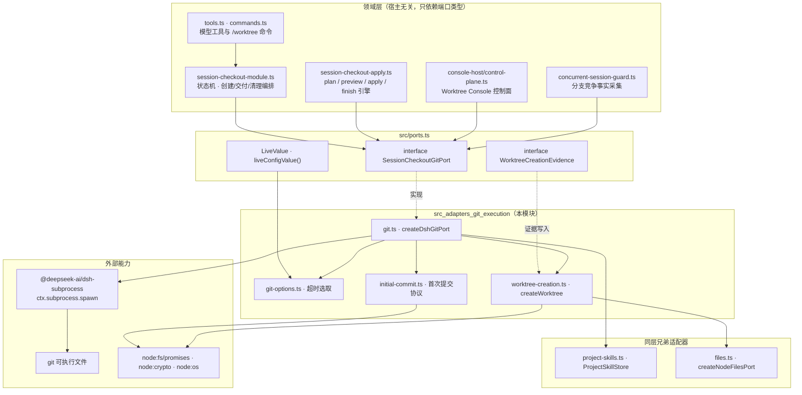
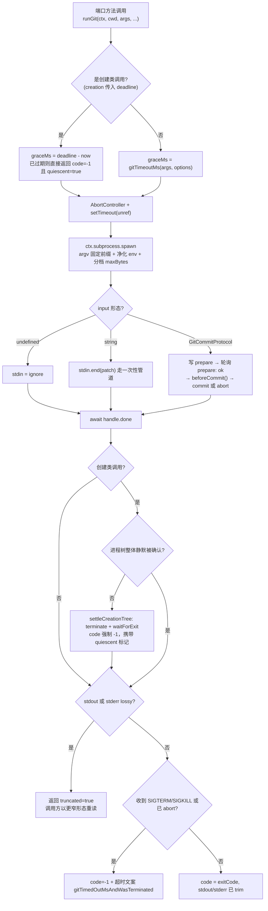
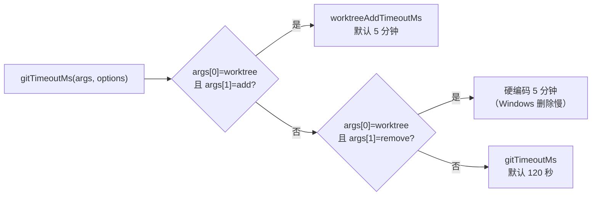
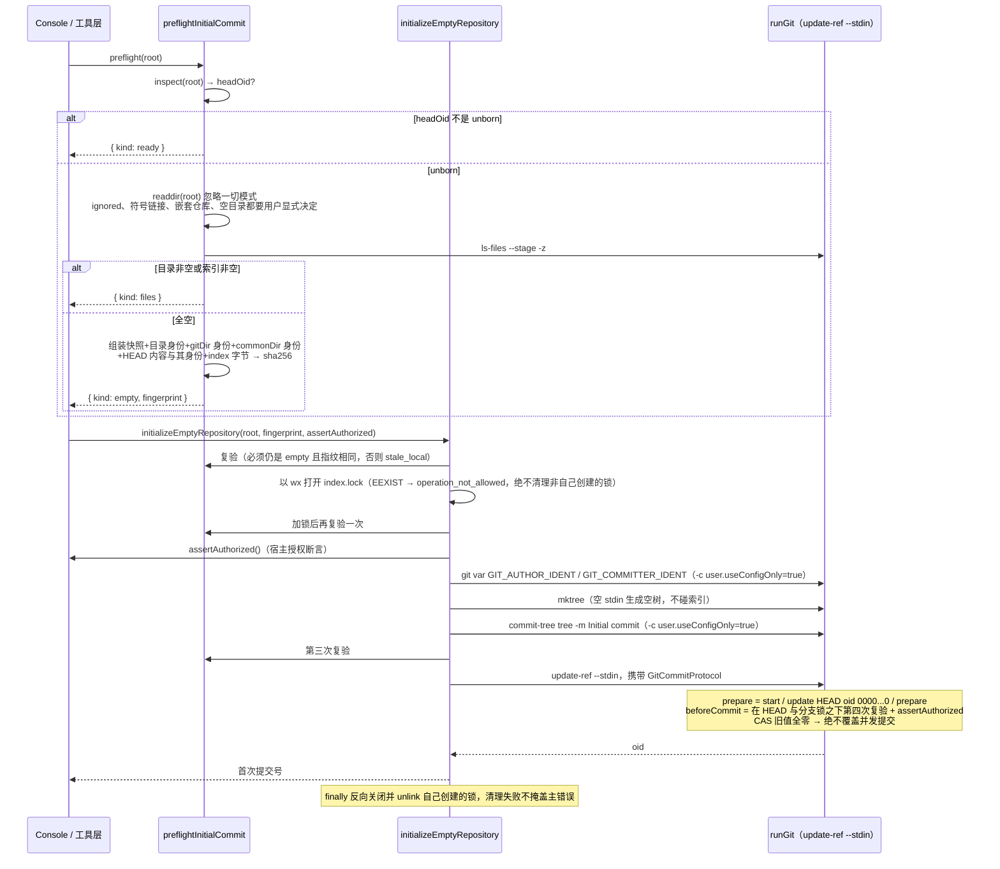
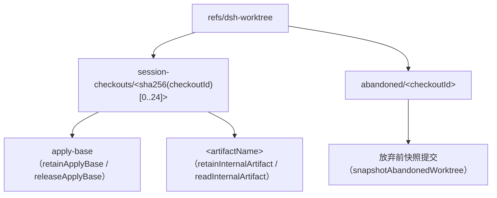
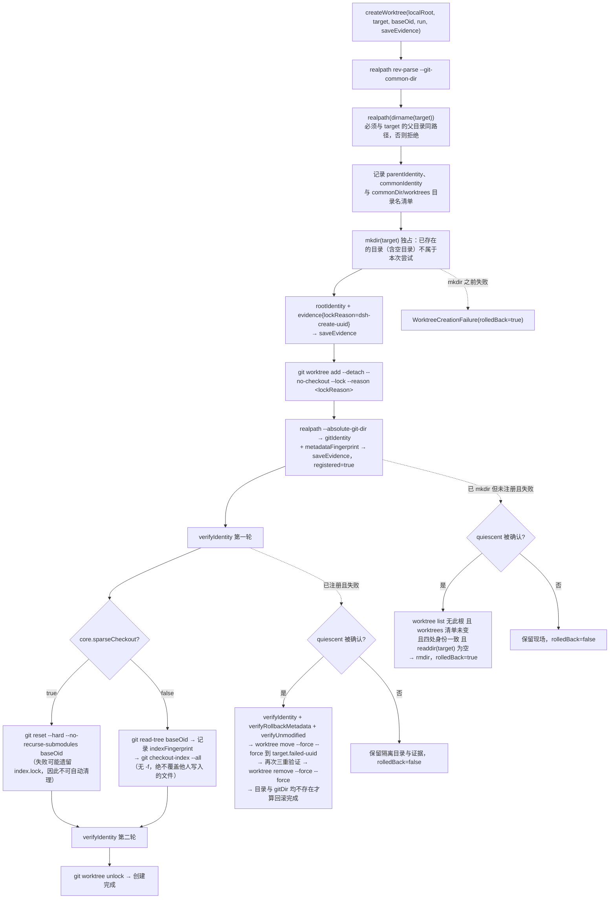

# Git 执行适配器：唯一出口 runGit、可证明的 Worktree 创建与首次提交协议

!!! info "Generated documentation"
    This page was written by CodeWiki from the source code at commit [`bccd87a6`](https://github.com/wloops/dsh-git-worktree/commit/bccd87a6d5270c62ed752e21426f9b3062418333) on 2026-11-06 with `doubao-seed-2.1-lite`. Check the code before relying on details.

`src_adapters_git_execution` 是 [src_adapters：会话检出（Session Checkout）的宿主适配层](../src_adapters.md) 四个子模块中风险最高的一片：**插件对 Git 仓库的每一处读写，最终都汇聚到这一个执行栈上**。它把领域端口 `SessionCheckoutGitPort`（契约见 [会话检出领域契约（session_checkout_domain_contracts）](../session_checkout_domain/session_checkout_domain_contracts.md)）实现为经 `ctx.subprocess`（`@deepseek-ai/dsh-subprocess`）驱动的 Git 命令执行器。四个文件的分工如下：

| 文件 | 核心导出 | 职责 |
| --- | --- | --- |
| `src/adapters/git-options.ts` | `GitTimeoutOptions`、`gitTimeoutMs()`、`validateGitTimeouts()`、`DEFAULT_GIT_TIMEOUT_MS` / `DEFAULT_WORKTREE_ADD_TIMEOUT_MS` / `MAX_GIT_TIMEOUT_MS` | 逐命令的超时选取与启动期参数校验；支持 volatile 活配置（`LiveValue`） |
| `src/adapters/git.ts` | `GitPortOptions`、`GitCommandResult`、`createDshGitPort()` | 唯一的进程出口 `runGit()` / `runGitChecked()`、内部 ref 命名空间、约 40 个端口方法的实现 |
| `src/adapters/initial-commit.ts` | `GitCommitProtocol`、`initialCommitActions()` | 未出生（unborn）仓库的首次提交预检、锁内指纹复验与 `update-ref --stdin` 事务发布 |
| `src/adapters/worktree-creation.ts` | `Result`（`{ code, stdout, stderr, quiescent? }`）、`createWorktree()` | 带「创建证据」（`WorktreeCreationEvidence`）的托管 Worktree 建立、字节级回滚授权判定与隔离区搬迁 |

一句话概括本模块的设计信条：**任何「看起来是空的」都不构成删除许可，任何「大概是成功的」都不构成推进许可**。只有当进程树被证明静默、目录身份未被替换、索引与文件字节被逐条哈希证明等于授权基点时，创建失败才允许回收；否则一律保留现场并把失败上抛。

---

## 1. 在系统中的位置



上游领域层决定「该做什么」，本模块决定「怎样在一台真实的 Windows/Linux 机器上安全地做」。本模块不认识会话、评审、交付这些概念，只认识 argv、cwd、退出码、字节上限与 ref 命名空间。

装配发生在插件挂载函数 `apply()`（`src/index.ts:370-408`）：

```text
stateDir   = $DSH_HOME | ~/.dsh / plugins / dsh-git-worktree
hooksPath  = <stateDir>/disabled-git-hooks          ← 空目录，用于把 core.hooksPath 指向它
git        = createDshGitPort(ctx, { hooksPath, projectSkills, gitTimeoutMs, worktreeAddTimeoutMs })
```

`createDshGitPort()` 的第一行就是 `validateGitTimeouts(options)`——超时参数不合法时插件直接拒绝挂载（抛 `RangeError`），而不是等到某条命令跑到一半才失败。构造出的 `git` 端口实例随后同时注入状态机、Apply 引擎与 Console 控制面（`src/index.ts:393-417`），因此**全插件只有一条 Git 执行通道**。

---

## 2. 执行内核：`runGit()`

`runGit(ctx, cwd, args, options, input?, creation?, collectBytes?)` 是唯一的进程出口。它返回一个结果对象而不是抛异常——**非零退出是否为错误由调用方决定**（`GitCommandResult`：`code` / `stdout` / `stderr` / `quiescent?` / `truncated?`）。



### 2.1 每条命令都带上的硬约束

`spawn` 的 argv 前缀固定为（`src/adapters/git.ts:122-133`）：

```text
git --no-pager --no-optional-locks
    [-c core.longpaths=true]         ← 仅 win32：Worktree 前缀可能超过 MAX_PATH
    -c core.quotePath=false          ← 非 ASCII 路径不被转义，解析结果可直接使用
    -c core.fsmonitor=false          ← 避免守护进程让进程树无法判定静默
    -c core.hooksPath=<stateDir>/disabled-git-hooks   ← 空目录，等效禁用全部 hooks
    <caller args...>
```

- **argv 直传，绝不经过 shell**。参数数组原样交给 subprocess 服务，命令注入在结构上不可能发生。
- **仓库位置只由已授权的 `cwd` 决定**。环境变量里凡是能改变仓库路由的键（`GIT_DIR`、`GIT_WORK_TREE`、`GIT_COMMON_DIR`、`GIT_INDEX_FILE`、`GIT_OBJECT_DIRECTORY`、`GIT_ALTERNATE_OBJECT_DIRECTORIES`、`GIT_NAMESPACE`、`GIT_CEILING_DIRECTORIES`、`GIT_DISCOVERY_ACROSS_FILESYSTEM`、`GIT_CONFIG_PARAMETERS`、`GIT_CONFIG_COUNT`、`GIT_CONFIG_KEY_*`、`GIT_CONFIG_VALUE_*`）全部置为 `undefined`；同时强制 `GIT_OPTIONAL_LOCKS=0`、`GIT_TERMINAL_PROMPT=0`（绝不弹凭据提示挂住进程）、`LC_ALL=C` / `LANG=C`（输出解析与 locale 无关）。**身份变量（`GIT_AUTHOR_IDENT` 等）与常规用户配置被刻意保留**——首次提交协议要用 `git var` 探测用户身份，见 §4。
- **`graceMs`（终止宽限）与命令 deadline 是两件事**：`GIT_TERMINATION_GRACE_MS = 1000`，超时先 abort，再给进程树 1 秒自行退出，之后才是服务侧的强杀。

### 2.2 输出有界与「截断不等于失败」

Git 输出通常很小，但少数读的尺寸由仓库决定而非由 Git 决定。本模块按语义分档：

| 常量 | 大小 | 适用 |
| --- | --- | --- |
| `GIT_COLLECT_BYTES` | 1 MiB | 默认值（stdout 与 stderr 各自上限） |
| `STATUS_COLLECT_BYTES` | 16 MiB | `git status --porcelain=v1 -z`：一个未被 ignore 的依赖树就能产出数百万条 untracked 记录 |
| `WIP_PATCH_COLLECT_BYTES` | 16 MiB | `captureLocalWip` 的 `diff --binary`（base85 膨胀） |

当采集流超过上限（`lossy`）时，`runGit` **不**报告「仓库读不了」，而是返回 `truncated: true`。`runStatus()`（`src/adapters/git.ts:287-293`）据此做逐级放宽：先 `--untracked-files=all`（唯一精确模式），失败则 `--untracked-files=normal`（把一个未 ignore 的依赖树从数 MB 压回数字节，且不会隐藏 tracked 改动/重命名/删除），两种模式都溢出才返回 `null`。

同理，`branchOverview()` 在状态读失败时把 `dirtyCount` 记为 `-1` 而不是 `0`——「读不出来」绝不能被渲染成「什么都没改」，因为分支菜单的脏标记直接来自这个数字。

### 2.3 `runGitChecked()` 与刻意保留退出码的读

`runGitChecked()` 是便捷包装：非零即抛 `SessionCheckoutError('git_operation_failed', hostMessage('gitOperationFailedGit', ...))`。

但**语义退出码**（0/1 分别代表真/假、存在/不存在）被刻意保留，不抛异常：`isAncestor`（`merge-base --is-ancestor`）、`resolveLocalBranchTip` / `readInternalArtifact`（`rev-parse --verify --quiet`，code 1 → `null`）、`status` 的 unborn 判定、`pushBranch` / `pushTag` / `deleteRemoteTag` / `deleteLocalBranch` / `repairWorktreeLinks`（返回 `{ ok, message }` 或布尔，让调用方软降级而非中断）。

### 2.4 刻意不做沙箱包裹

官方实验性 worktree 服务会逐次解析 `sandboxPolicy` 并用 `sandbox.confine` 包裹 git（`packages/experimental/worktree/src/process.ts:52-54`）。本插件**不做**：托管检出位于 Session 工作区之外的兄弟目录树（`worktreesRoot`），工作区写限制会直接拒绝插件被要求创建的那个目录。会话文件策略的执行权仍在宿主自己的文件/Shell 工具手上。理由链见 `src/adapters/git.ts:6-24` 的模块注释与 CHANGELOG。

---

## 3. `git-options.ts`：超时的选取与活配置



- `GitTimeoutOptions` 的两个字段都是 `number | LiveValue<number | undefined>`。`liveConfigValue()`（`src/ports.ts:574-579`）在 plain 值与活引用之间取当前值，**逐命令读取**，因此设置页改一次值，下一条命令即生效，无需重挂载插件。配置声明见 `src/index.ts:276-277`（两个字段均标记 `volatile`）。
- `validateGitTimeouts()` 要求每个已提供的值是 `Number.isSafeInteger`、`>= 1000`、`<= MAX_GIT_TIMEOUT_MS`（1 小时），否则抛 `RangeError`；`createDshGitPort()` 与 `apply()` 都调用它。
- `gitTimeoutMs` 的三档判断是**位置敏感**的：只有 `['worktree','add']` 与 `['worktree','remove']` 走特例，其余命令一律通用超时。`createDetachedWorktree` 用同一个函数算出创建 deadline，保证「端口方法看到的预算」与「执行器实际用的预算」一致。

---

## 4. `initial-commit.ts`：未出生仓库的首次提交协议

`GitCommitProtocol` 只有两个成员：`prepare: string`（预先写入 stdin 的事务脚本）与 `beforeCommit(): Promise<void>`（在 Git 已持有 HEAD 与目标分支锁之后、`commit` 命令发出之前的回调）。`runGit` 的 stdin 分支（§2.1 图中的 J 路径）负责：写入 `prepare` → 5ms 轮询直到 stdout 出现 `prepare: ok` → 执行 `beforeCommit()` → 发 `commit`；回调抛错则发 `abort` 并等待进程结束再原样上抛。**这样做的意义是：把「最后一次复验」塞进 Git 自己的锁窗口里**，而不是在锁外做完检查就假定它仍成立。

`initialCommitActions(inspect, run)` 返回三个方法，由 `createDshGitPort()` 通过 `Object.assign(port, initialCommitActions(port.inspect, runSessionGit))` 挂到端口上（`src/adapters/git.ts:829`）。**只有 Console 上经用户确认的宿主动作才会调用它们；常规 Git 检视保持只读。**



`initializeProject(root)`（`src/adapters/git.ts` 注释里的「本地适配」）是另一条更粗的路径：已有提交的仓库直接拒绝（`operation_not_allowed`）；非 Git 目录用 `init -b main`（`-b` 不写配置，需 Git ≥ 2.28）；随后校验 `GIT_AUTHOR_IDENT`、`add -A`（遵循 `.gitignore`）、`commit -m "Initial commit"`。**提交失败原样报错，不回滚任何字节**——与 `initializeEmptyRepository` 的事务化路径刻意不同，因为这条路径的产物对用户完全可见且可手工修复。

---

## 5. 内部 ref 命名空间与产物保留



- `checkoutRefRoot()` 用 checkoutId 的 sha256 前 24 位做键，避免用户可见的 id 直接进 ref 名，也避免路径长度问题。
- `assertArtifactName()` 逐段校验 `^[A-Za-z0-9][A-Za-z0-9._-]*$`，不合法即抛 `invalid_input`——ref 名不允许夹带 `..`、控制字符或 `/` 结构歧义。
- **放弃快照刻意放在 `checkoutRefRoot` 之外**：discard 流程会整体释放该 checkout 的产物命名空间（`releaseInternalArtifacts` 不带 prefix 时删除 `<root>/` 下全部 ref），刚写入的安全快照不能被一起带走。
- `releaseInternalArtifacts` 先用一次 `for-each-ref --format=%(refname)` 列出目标，再用**单次 `update-ref --stdin` 事务**（`start` / 多条 `delete` / `commit`）删除全部 ref——早期实现是逐个 `update-ref -d`，即 1+N 次串行 spawn。

---

## 6. `worktree-creation.ts`：以证据换取回收许可

`createWorktree(localRoot, target, baseOid, run, saveEvidence)` 是托管 Worktree 唯一的建立路径（被端口方法 `createDetachedWorktree` 调用）。它的 `run` 参数就是 `runGit` 的适配器 `(cwd, args, creating) => ...`，因此创建过程中的每条命令同样享有 §2 的全部约束，并且**创建类命令共用一个 deadline**（`worktree add` / `move` / `remove` 各自换算剩余预算）。

设计前提写在注释里：**注册（registration）要短，昂贵的检出只在所有权证明落盘之后才开始**。`saveEvidence` 回调由领域层传入，把每一步的身份与指纹写进 journal（`ManagedCheckoutCreateJournal.creation`），使进程崩溃后仍能判定「这个目录是不是我们创建的、有没有被换过」。



### 6.1 四个验证器

| 函数 | 证明的内容 | 拒绝回收的典型信号 |
| --- | --- | --- |
| `verifyIdentity(e, baseOid)` | `root` / 父目录 / `commonDir` / `gitDir` 四处目录身份全等；`gitDir` 必须是 `commonDir/worktrees` 的直接子项（无 `..`、无绝对路径、无嵌套）；`.git ↔ gitdir` 双向指针互指；`commondir` 指回 `commonDir`；`HEAD` 文本等于 `baseOid`；`locked` 内容等于本次 `lockReason`；目录内**不存在任何 `*.lock`** | 任何一项不符 → `Failed creation identity changed; residue preserved`。任何文件若是符号链接或不是普通文件也直接失败 |
| `metadataFingerprint(gitDir)` | 递归枚举 `gitDir`，除 `index` / `gitdir` / `ORIG_HEAD`（检出或单目标 move 期间会被 Git 改写，另有语义校验）外，只允许白名单条目：`HEAD`、`commondir`、`locked`、`config.worktree`、`logs/HEAD`、`info/sparse-checkout` 及 `refs`/`logs`/`info` 目录；按排序路径逐段入哈希（≤1 MiB 的文件取内容） | 出现未知条目、符号链接或特殊文件 → `Unknown creation metadata` |
| `verifyRollbackMetadata(e, baseOid)` | 元数据指纹与 `index` 字节哈希仍等于注册时的值；`index` 与 `ORIG_HEAD` 若存在则必须是普通文件且非链接，`ORIG_HEAD` 内容等于 `baseOid` | `Creation metadata changed` / `Creation index bytes changed` / `Creation ORIG_HEAD changed` |
| `verifyUnmodified(root, baseOid, run)` | 逐条比对授权基点：`ls-files --stage` 中不得含 160000（子模块）；递归枚举磁盘，目录必须是索引派生目录、文件必须被 tracked；`check-attr filter / working-tree-encoding` 必须全为 unspecified/unset（存在转换则语义比对不可信）；对每个条目按 blob 头**流式重算 sha1/sha256** 并与索引 OID 相等（写入期间体积变化也失败）；`diff-index --cached` 为空；`ls-files -v` 全为 `H`（无 skip-worktree / assume-unchanged 捷径）；`ls-files --others`（含 ignored）为空；`diff --no-ext-diff --no-textconv --name-status` 只允许 `D` | 任意一项不符 → 「… preserved」，现场一律保留 |

`verifyUnmodified` 的最后一句是关键：`unknown` 查询刻意**不排除 ignored 文件**，因为「被 ignore」不等于「属于本次创建」。

### 6.2 `WorktreeCreationFailure(rolledBack)` 的语义

`WorktreeCreationFailure`（`src/creation-failure.ts`，纯函数层，见 [Worktree 核心操作与纯函数工具层（worktree_core_operations）](../worktree_core_operations.md)）只携带一个布尔：**`rolledBack=true` 表示没有任何字节需要用户负责，调用方可直接重试创建；`rolledBack=false` 表示现场仍在（通常已带 `.failed-<uuid>` 隔离目录名，附在错误消息里），调用方必须转入恢复而非重试**。注册阶段超时、进程树观察丢失、缺少可落盘身份，都**不是**删除授权。

---

## 7. `SessionCheckoutGitPort` 方法总览

`createDshGitPort()` 返回的对象把端口方法映射到具体 Git 命令。下表按用途分组，并说明每次调用的命令形态与失败语义（标注为本地适配的方法是端口上的**可选成员**，第三方端口不实现即可，状态机会走降级路径）。

### 7.1 检视与状态

| 方法 | Git 命令 | 说明 |
| --- | --- | --- |
| `inspect` | `symbolic-ref --quiet HEAD`（并行）+ `rev-parse --show-toplevel --path-format=absolute --git-common-dir --absolute-git-dir HEAD^{commit}` | 单次 `rev-parse` 取全部位置事实（输出恰为 4 行才接受），`symbolic-ref` 并行补分支；行数为歧义（POSIX 路径含换行）或 unborn/broken HEAD 时回退到逐项读取。**跨操作不缓存**：worktree/common-dir 身份是安全边界。`code=128` 且 `fatal: not a git repository` 且向上走 `hasGitMetadata()` 找不到 `.git` 才返回 `null`；unborn 需同时满足「符号 HEAD 指向 `refs/heads/` + `show-ref` 退出 1 且无输出无 stderr」，否则视为 Git 错误。全部路径经 `realpath` |
| `findContainingWorktreeRoot` | `rev-parse --show-toplevel` | 不要求存在 HEAD |
| `status` | `status --porcelain=v1 -z --untracked-files=all`，退化时 `--untracked-files=normal` | 与 `ProjectSkillStore.scope(root)` 的辅助清单求交后交给 `hasDeliverableStatus`（只有 `??` 记录可被视作辅助），返回 `{ dirty }`；两级模式都溢出才抛 `git_operation_failed` |

### 7.2 Worktree 生命周期

| 方法 | Git 命令 | 说明 |
| --- | --- | --- |
| `createDetachedWorktree` | `diff --name-only -z` ×2（tracked 与 `--cached`，限 `PROJECT_SKILL_ROOTS`）→ `createWorktree(...)` | 创建前若本地有未提交的 tracked Skill 改动则直接拒绝（先提交或解决）；创建后 `projectSkills.carry()` 把 Skill 随会话带入 |
| `removeWorktree` | `ls-files --stage -z`、`ls-tree -r --name-only -z HEAD`、`worktree remove --force` | 携带 Skill 时先 `assertRemovable`（被改过或有新资源即拒绝删除）；调用方已验证过检出身份与完整指纹，Git 把「已评审未提交」视为改动，故必须 `--force` |
| `pruneWorktrees`（本地适配） | `worktree prune --expire now` | 仅清理工作树已从磁盘消失的管理项；卫生操作，调用方容忍缺失 |
| `listWorktrees`（本地适配） | `worktree list --porcelain` | 返回 Git 知道的全部 Worktree（含本插件之外创建的）：逐块解析 `worktree <path>` / `HEAD <oid>` / `branch <ref>`（或 detached），缺 `path`/`HEAD` 或 `HEAD` 不匹配 40–64 位 hex 的块**跳过而非猜测**，因为纳管会写入持久台账；路径经 `resolve()` 归一。Git 非零退出抛 `git_operation_failed`（带 stderr 或 `hostMessage('gitOperationFailedGit', …)`），**不**属于 §2.3 刻意保留语义退出码的读。供官方工具 Worktree 纳管使用，条目形态为 `WorktreeListingEntry`（见 [会话检出领域契约（session_checkout_domain_contracts）](../session_checkout_domain/session_checkout_domain_contracts.md)） |
| `repairWorktreeLinks`（本地适配） | `worktree repair <managedRoot>` | 仓库整体搬家后由 Git 自己改写 `.git` 反向指针；返回布尔，不抛异常 |
| `attachWorktreeBranch`（本地适配） | `update-ref <branchRef> <headOid> <expectedOldOid ?? 000…>` + `symbolic-ref HEAD <branchRef>` | **只动 ref 与 HEAD，绝不碰工作区**——检出内容与分支树必须完全一致，否则 `git status` 会凭空多出改动。`expectedOldOid=null` 时以全零为旧值，只在分支不存在时创建，否则只允许从该提交推进，并发会话不会丢提交 |

### 7.3 内部产物与祖先证明

`retainApplyBase` / `releaseApplyBase` / `retainInternalArtifact` / `readInternalArtifact` / `releaseInternalArtifacts` / `isAncestor`，全部限定在 §5 的命名空间内；`isAncestor` 只接受宿主验证过的根与 OID。

### 7.4 分支 / 标签 / 图 / 远端（均为本地适配，服务 Console 与 `worktree_*` 工具）

| 方法 | 关键命令 | 说明 |
| --- | --- | --- |
| `listLocalBranches` / `resolveLocalBranchTip` / `createLocalBranch` / `switchLocalBranch` / `deleteLocalBranch` | `for-each-ref refs/heads`、`rev-parse --verify --quiet`、`check-ref-format --branch`、`branch`、`switch` | `switchLocalBranch` 会把 Git 的 `already used by worktree at` / `already checked out at` 正则翻译成带路径的宿主文案；`deleteLocalBranch` 用 `-d`，绝不 `-D` |
| `branchOverview` / `defaultBranch` / `branchTipTimes` / `branchCreationTimes` | `for-each-ref`（`%00` 分隔字段）、`symbolic-ref refs/remotes/origin/HEAD` → `config init.defaultBranch`、`reflog show --all --date=unix` | `branchCreationTimes` 一次 spawn 扫全部分支 reflog，取 `branch: Created from` 里最旧的一条作为出生时间，供 [会话检出领域模块（session_checkout_domain）](../session_checkout_domain.md) 里的分支竞争检测（`src/concurrent-session-guard.ts`）消费；`defaultBranch` 两个来源都落空时返回 `null`，**绝不猜 `main`** |
| `mergeLocalBranch`（正向/反向合并） | `rev-parse HEAD` → `rev-parse --verify --quiet <source>^{commit}` → `merge-base` →（可选）`worktree add --detach <tmpdir 探针>` + `merge --no-commit --no-ff` → `diff --name-only` / `diff --name-only --diff-filter=U -z` + 逐文件 `diff --` | `dryRun` 在临时目录（`dsh-merge-probe-*`）建一个 detached 探针 worktree 试合并，`finally` 里必定 `worktree remove --force` 回收，**零改动触碰真实检出**；正式合并冲突时**不 abort**，把冲突状态留在 Local 并回传 `conflictingFiles`（受 `CONFLICT_DETAIL_FILE_LIMIT` 限制）与截断到 `CONFLICT_DETAIL_DIFF_LIMIT` 的 diff 供调用方解决。`headOid === tipOid` 或 `merge-base === tip` 直接判 `up_to_date` |
| `listTags` / `createTag` / `deleteLocalTag` / `pushTag` / `deleteRemoteTag` | `for-each-ref refs/tags`（`*objectname` / `*subject` 展开附注标签）、`ls-remote --tags origin`、`check-ref-format refs/tags/<name>`、`tag [-a -m]`、`push origin refs/tags/x:refs/tags/x` | `pushed` 初始为 `null`：离线或没有 `origin` 时**不能被报告成「未推送」**；轻量标签没有消息体，故 `contents:subject` 只在附注标签上保留。`pushTag` 永不 `--force` |
| `graphLog`（配合 `parseDecoration`） | `log --branches --tags --remotes --topo-order --parents --max-count=<1..1000> --format=%H%x00%P%x00%an%x00%at%x00%D%x00%s%x1e` | `\x1e` 分记录、`\x00` 分字段；`%D` 装饰串由 `parseDecoration()` 转成 ref 名：标签保留 `tag:` 前缀供客户端区分样式，`HEAD -> ` 前缀被剥离，裸 `HEAD`（detached）不算 ref；lane 布局由客户端计算 |
| `pushBranch` | `symbolic-ref --quiet HEAD` → `rev-parse --abbrev-ref --symbolic-full-name <b>@{upstream}` → `push -- <b>` | 只在设置了 upstream 时推送；detached、无 upstream、被拒都返回 `{ ok: false, message }`，**从不改写远端历史**（Finish 后的 autoPush 走这里，见 `src/index.ts` 的 `autoPush`） |

### 7.5 未提交内容的携带与放弃快照

| 方法 | 命令 | 说明 |
| --- | --- | --- |
| `captureLocalWip` / `applyWorktreePatch` | `diff --binary --full-index HEAD`（16 MiB 档）/ `apply --binary --whitespace=nowarn -`（patch 走 stdin） | `git apply` 默认原子：整包应用或整体失败，不会留半套修改。空输出 → `null`（干净工作树无需携带）。这是 `inheritLocalChanges` 的实现底座 |
| `listUntrackedFiles` | `ls-files --others --exclude-standard -z` | 只取非 ignore 的 untracked；ignored 文件走 `.worktreeinclude` 通道 |
| `listWorktreeincludeFiles` | 并行两次 `ls-files --others --ignored`：一次 `--exclude-standard`，一次 `--exclude-from=<includeFile>` | **两次结果的交集恰好是「被 include 命中 ∧ 被 gitignore」**——取反、锚定、目录模式全部交给 Git，本模块不实现本地匹配器。刻意不用 `--exclude-standard + -c core.excludesFile`，因为 `--exclude-standard` 会并入仓库 `.gitignore` 从而放过「被 ignore 但未列入 include」的文件；`-s` 不为 `--others` 项打印 mode，因此符号链接判定改由 files 端口在复制时做（见 [持久化适配器：文件系统端口、原子注册表与崩溃安全 JSON IO](src_adapters_persistence.md)）。另自动带入被 ignore 的 `AGENTS.override.md` |
| `snapshotAbandonedWorktree` | `add -A` → `write-tree` → `rev-parse --verify --quiet HEAD^{commit}` → `commit-tree`（`-c user.name=dsh-git-worktree -c user.email=@localhost`）→ `update-ref refs/dsh-worktree/abandoned/<checkoutId>` | 删除带未提交内容的受管 Worktree 前，把全部可丢失内容固化为一个提交；显式身份**不依赖用户的 git 身份配置**；`ignored` 文件源头在 Local，不属可丢失内容 |
| `restoreAbandonedSnapshot` | `branch worktree-restore-<oid[0..8]> <snapshotOid>` → `update-ref -d` 快照 ref | 恢复为 Local 仓库中的分支并释放快照 ref，返回分支名 |

---

## 8. 关键不变量清单

1. **单出口**：所有 Git 进程只从 `runGit()` 产生。要审计「插件能做什么」只需读这一个函数。
2. **argv 不被解释**：无 shell，参数数组原样传递。
3. **仓库路由不可被环境劫持**：`GIT_DIR` 系列变量被清空，位置只来自授权 `cwd`。
4. **非交互**：`GIT_TERMINAL_PROMPT=0`、`--no-optional-locks` + `GIT_OPTIONAL_LOCKS=0`、`GIT_TERMINATION_GRACE_MS` 独立于命令 deadline。
5. **可判定静默**：创建类调用必须等到进程树整体静默（`quiescent`）才被接受；`-1` 退出码是「无法证明」而非「Git 报错」。
6. **输出有界且可放宽**：分档 maxBytes；`truncated` 触发更窄的重读，而不是硬失败。
7. **命名空间隔离**：插件产物只在 `refs/dsh-worktree/**`；`apply-base` 与快照 ref 的释放边界刻意不同。
8. **CAS 优先**：`attachWorktreeBranch` 与 `update-ref --stdin` 事务都以「预期旧值」为条件；不满足就失败，绝不覆盖并发提交。
9. **删除需字节证明**：`verifyIdentity` + `verifyRollbackMetadata` + `verifyUnmodified` 三重全等，才允许 `worktree move` → `worktree remove`；任一不符则隔离保留现场并 `rolledBack=false`。
10. **只读检视不产生副作用**：`preflightInitialCommit`、`branchOverview`、`graphLog`、`status` 等只读方法不写 ref、不改索引、不动工作区。
11. **不猜**：`defaultBranch` 猜不到就 `null`；`pushed` 查不到就 `null`；`dirtyCount` 读不到就 `-1`；「未推」「已合并」「干净」都不会被编造出来。
12. **文案本地化**：全部用户可见错误经 `hostMessage(key, params)`（`src/i18n/host.js`，键位与语言解析见 [src_i18n 国际化与消息目录模块](../../project_foundation_and_localization/src_i18n.md)）；键名稳定，持久化的 cleanup 消息只存 key。

---

## 9. 与其他模块的关系

- **端口契约与视图类型**：方法签名、`GitCheckoutSnapshot`、`WorktreeCreationEvidence`、`LiveValue` 由 [会话检出领域契约（session_checkout_domain_contracts）](../session_checkout_domain/session_checkout_domain_contracts.md) 定义；本模块只实现，不重新定义。
- **调用者**：状态机与编排在 [会话检出运行时模块（session_checkout_runtime）概述](../session_checkout_domain/session_checkout_runtime.md)；Apply / Preview / Checkpoint / Finish 的事务（含 `EffectiveApplyBase`、`StoredPlan`）在 [会话检出交付引擎（session_checkout_apply_engine）](../session_checkout_domain/session_checkout_apply_engine.md)，它同时自带一个只用于规划期比对的 `spawn` 通道。Console 侧的 Git 消费（分支总览、标签、提交图、合并预演）经 [Worktree Console 宿主服务（`src/console-host/`）](../../worktree_console_protocol_and_host_service/worktree_console_host.md) 的控制面复用同一个端口实例；评审 diff 读取器 `src/console-host/review-diff.ts` 是**另一条独立的最小权限通道**（自带 maxBytes 与 `core.quotePath=false`，只读），不经过本模块。
- **协作适配器**：`createDetachedWorktree` / `removeWorktree` / `status` 与 `ProjectSkillStore` 深度耦合（快照、携带、辅助排除、可删性断言），细节见 [Project Skills 适配器：随会话携带的项目级 Skill 资源](src_adapters_project_skills.md)；`worktree-creation.ts` 的目录身份来自 `createNodeFilesPort()`，见 [持久化适配器：文件系统端口、原子注册表与崩溃安全 JSON IO](src_adapters_persistence.md)。
- **纯函数层**：`WorktreeCreationFailure`（回滚语义）、`deliveryExcludePathspecs`（交付排除 pathspec）、`isValidCommitMessage` 等来自 [Worktree 核心操作与纯函数工具层（worktree_core_operations）](../worktree_core_operations.md)。
- **宿主绑定**：授权 `cwd` 与项目根由 [主机绑定适配层（src/adapters/lookup.ts、src/adapters/working-directory.ts 与 src/official-worktree-takeover.ts）](src_adapters_host_binding.md) 提供；本模块从不自行猜测路径归属。
- **配置与打包**：`gitTimeoutMs` / `worktreeAddTimeoutMs` 经 Cordis 配置以 `volatile` 字段注入（`src/index.ts:276-277`），可写进 `cordis.patch.yml`；构建、类型检查与测试链路见 [构建、CI 与打包（build_ci_and_packaging）](../../project_foundation_and_localization/build_ci_and_packaging.md)。

---

## 10. 测试与构建注意点

- 本模块是 Git fixture 测试的主要被测对象。`vitest.config.ts` 显式在 Windows 上关闭文件并行（`fileParallelism: process.platform !== 'win32'`），注释给出的原因正是「重型 Git fixture 套件会争抢进程与文件句柄，超时后仍存活并锁住临时目录」；`testTimeout` / `hookTimeout` 均为 60 秒。这意味着**涉及真实 `git worktree` 的创建/回滚用例在 CI 之外才可能暴露句柄与锁定问题**，本地在 Windows 上跑 `pnpm test` 时超时应当被当作信号而非噪声。
- `.github/workflows/ci.yml` 的 `check` 作业在 ubuntu-latest（Node 22 / pnpm 10）上顺序执行 `typecheck` → `build` → `check:publish:release` → `test`，因此本模块的类型面（`GitPortOptions extends GitTimeoutOptions`、可选端口成员）与超时校验（`RangeError`）在任何合入前都会被静态检查覆盖。
- **Node 引擎**要求 `^22.19.0 || >=24.0.0`（`package.json`），本模块依赖其中的 `FileHandle`、`readdir(withFileTypes)` 与大整数 `lstat`（`birthtimeNs`）语义。

---

## 11. 建议阅读顺序

1. `src/adapters/git.ts:114-212` 的 `runGit()` —— 先建立「唯一出口 + 结果对象 + 静默证明」的心智模型。
2. `src/adapters/git-options.ts` —— 理解逐命令超时的三档选取与活配置读取。
3. `src/adapters/worktree-creation.ts` —— 理解 `createWorktree` 的证据链，以及三个 `verify*` 如何把「失败」区分成可重试与需恢复。
4. `src/adapters/initial-commit.ts` —— 理解 `GitCommitProtocol` 如何把最后一次复验放进 Git 自己的锁窗口。
5. 最后回到 §7 的方法表，把每个端口方法映射回它实际发出的 argv。

??? abstract "Documented components (5)"
    - [`GitTimeoutOptions`](https://github.com/wloops/dsh-git-worktree/blob/bccd87a6d5270c62ed752e21426f9b3062418333/src%5Cadapters%5Cgit-options.ts) — `src\adapters\git-options.ts`
    - [`GitCommandResult`](https://github.com/wloops/dsh-git-worktree/blob/bccd87a6d5270c62ed752e21426f9b3062418333/src%5Cadapters%5Cgit.ts) — `src\adapters\git.ts`
    - [`GitPortOptions`](https://github.com/wloops/dsh-git-worktree/blob/bccd87a6d5270c62ed752e21426f9b3062418333/src%5Cadapters%5Cgit.ts) — `src\adapters\git.ts`
    - [`GitCommitProtocol`](https://github.com/wloops/dsh-git-worktree/blob/bccd87a6d5270c62ed752e21426f9b3062418333/src%5Cadapters%5Cinitial-commit.ts) — `src\adapters\initial-commit.ts`
    - [`Result`](https://github.com/wloops/dsh-git-worktree/blob/bccd87a6d5270c62ed752e21426f9b3062418333/src%5Cadapters%5Cworktree-creation.ts) — `src\adapters\worktree-creation.ts`

