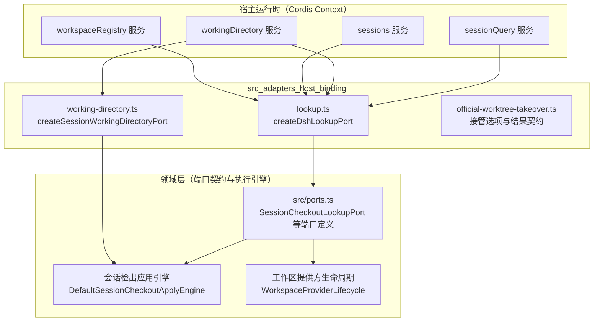
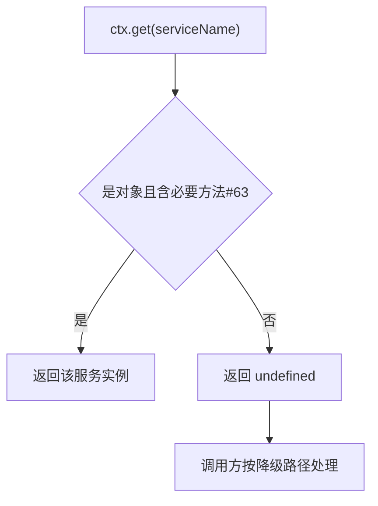
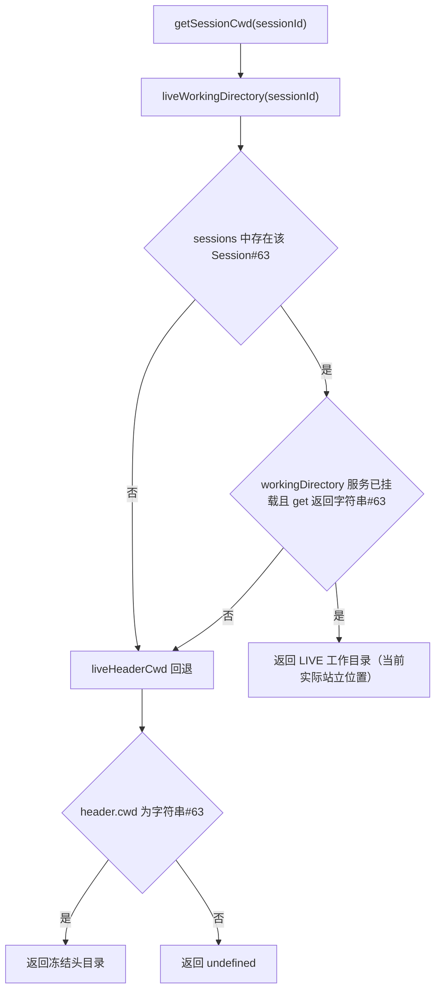
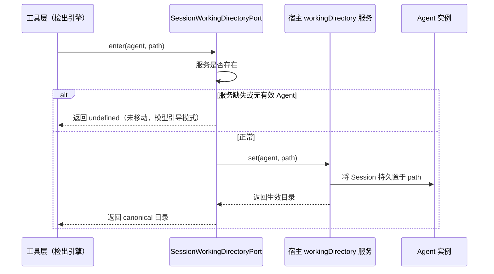
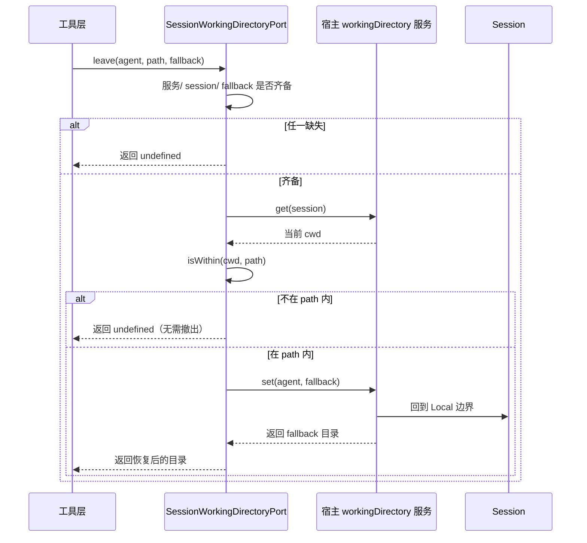
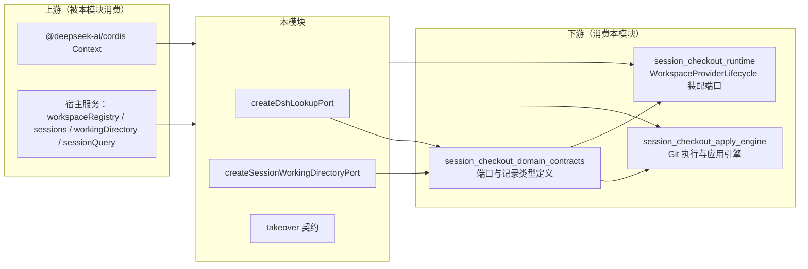

# 宿主绑定适配器（src_adapters_host_binding）

!!! info "Generated documentation"
    This page was written by CodeWiki from the source code at commit [`e50f4121`](https://github.com/wloops/dsh-git-worktree/commit/e50f4121be2569531679e4f64bfc288bc20f70a3) on 2026-11-06 with `doubao-seed-2.1-lite`. Check the code before relying on details.

## 简介

`src_adapters_host_binding` 是核心工作树领域与基础设施层中**面向宿主运行时（Harness / Cordis 宿主服务）的适配模块**。它负责把插件内部的端口契约（`SessionCheckoutLookupPort`、`SessionWorkingDirectoryPort`）绑定到宿主实际提供的服务之上——包括 `workspaceRegistry`（工作区注册表）、`sessions`（会话存储）、`sessionQuery`（会话查询）以及 `workingDirectory`（会话工作目录服务）。

该模块的存在价值在于：插件以 npm 包形式发布，其版本可能滞后于宿主 rc.6 运行时，因此**所有宿主服务都必须动态解析（`ctx.get`）并通过结构守卫（structural guard）做可用性校验**。任何缺失的服务或记录都不会导致硬失败，而是退化为 `undefined` 或空集合，由领域状态机将其解释为「恢复事实」或「孤儿事实」，而非致命错误。

本模块包含三个文件：

| 文件 | 角色 |
| --- | --- |
| `src/adapters/lookup.ts` | 会话/项目到宿主工作区注册表的查找适配器，产出 `SessionCheckoutLookupPort` |
| `src/adapters/working-directory.ts` | 会话工作目录适配器，负责把 Session **移入/移出** Managed Worktree 检出目录 |
| `src/official-worktree-takeover.ts` | 官方实验性 worktree 包的接管契约（`OfficialWorktreeTakeoverOptions` / `OfficialWorktreeTakeoverResult`） |

---

## 模块定位与架构

**架构要点：**

1. **依赖方向单向向内**：本模块只读取宿主服务、产出领域端口，不反向依赖宿主内部类型——所有宿主服务都以「最小结构视图接口」（`*Like`）描述。
2. **端口实现归本模块，端口定义归领域层**：`SessionCheckoutLookupPort` 的契约定义在 [会话检出领域契约（session_checkout_domain_contracts）](../session_checkout_domain/session_checkout_domain_contracts.md)（`src/ports.ts`），本模块仅提供其 DSH 实现。
3. **兄弟适配器并列**：持久化、Git 执行、项目技能三类适配器见 [持久化适配器：文件系统端口、原子注册表与崩溃安全 JSON IO](src_adapters_persistence.md)、[Git 执行适配器：唯一出口 runGit、可证明的 Worktree 创建与首次提交协议](src_adapters_git_execution.md)、[Project Skills 适配器：随会话携带的项目级 Skill 资源](src_adapters_project_skills.md)（均位于父模块 [src_adapters：会话检出（Session Checkout）的宿主适配层](../src_adapters.md) 之下）。

---

## 核心组件详解

### 1. `src/adapters/lookup.ts` — 查找适配器

该文件把宿主的会话与工作区投影映射为领域端口 `SessionCheckoutLookupPort`。

#### 导出的结构视图接口

| 导出 | 说明 |
| --- | --- |
| `WorkspaceLike` | 宿主工作区的最小视图：`id` / `path` / `title` / `sessionIds` |
| `WorkspaceRegistryLike` | 宿主 `workspaceRegistry` 服务：`list()` / `get(id)` / `resolveByPath()` / `create()` / `delete()` |
| `LiveSessionLike` | 存活 Session 的 header 视图，仅暴露 `header.cwd` |
| `SessionStoreLike` | 宿主 `sessions` 服务：`get(sessionId)`，可选 `list()` |
| `WorkingDirectoryLike` | 宿主 `workingDirectory` 服务的只读视图：`get(session)`（与 `working-directory.ts` 中可写视图区分） |
| `createDshLookupPort(ctx)` | 工厂函数，返回完整的 `SessionCheckoutLookupPort` 实现 |

#### 端口方法与行为

| 端口方法 | 行为 | 降级表现 |
| --- | --- | --- |
| `getSidebarMemberships(managedRoots)` | 为每个 Managed Worktree 根目录汇总「归属的 workspace id 集合」与「归属的 session id 集合」。Workspace 匹配基于 `path` 精确解析比较；session 集合同时取 `workspace.sessionIds` 与 `sessionQuery.listSessions()` 返回的 header `cwd` 匹配结果（并集去重） | 无注册表时 workspace 列表为空；无 `sessionQuery` 时仅依赖 workspace 投影，历史导航身份不会因目录缺失被擦除 |
| `listLiveSessions()` | 按创建顺序列出 Session 的 header 字段（`id` / `createdAt` / `cwd`），为存活会话提供快照 | 无 `store.list` 或结构未知时返回 `[]`——投影为空，不做猜测 |
| `getSession(sessionId)` | 先在 `workspace.sessionIds` 中查找归属项目；若被 Harness 过滤（不可变 cwd 不再可解析），则用**该 Session 的冻结 header.cwd** 反查唯一匹配的 workspace 作为「已认证存活恢复路径」 | 两者都落空时返回 `undefined`（由领域层解释为孤儿/待恢复事实） |
| `getSessionCwd(sessionId)` | 返回 Session **当前实际站立的目录**：优先 `workingDirectory.get(session)`（实时目录），回退冻结的 `header.cwd` | 两者皆无时返回 `undefined` |
| `getProject(projectId)` / `listProjects()` | workspace 记录映射为 `SessionCheckoutProjectRecord`（`id` / `name` / `root`） | 无注册表时分别返回 `undefined` / `[]` |

#### 为什么需要两套 cwd 来源

这是本文件最核心的设计动机：

- **`header.cwd`** 在 Session 创建时被 Harness **冻结**，此后 `workingDirectory.set` 不会修改它。
- 如果直接用 header.cwd 做授权判定，那么「在既有 Session 中打开 Managed Worktree」这一动作（会把 Session 移入检出目录）之后，header 仍停留在 Local 根目录，导致分支胶囊对每一个 Managed Worktree 都误报 `project_mismatch`。
- 因此 `getSessionCwd` 必须以**实时** `workingDirectory` 服务为准；header.cwd 只服务两类场景：宿主未挂载该服务、以及刚创建的目标（其 header 本来就是 worktree 根）。

### 2. `src/adapters/working-directory.ts` — 会话工作目录适配器

把 Session **放进/移出** Managed Worktree 的机制。注释明确指出：官方实验性 worktree 包最后一步正是 `ctx.workingDirectory.set(agent, path)`——没有这一步，Managed Worktree 只改变文件位置，不改变 Session 的工作位置。

#### 导出组件

| 导出 | 类型 | 说明 |
| --- | --- | --- |
| `WorkingDirectoryServiceLike` | interface | 宿主服务最小视图：`get(session)`（同步读）、`ensure?()`（可选）、`set(agent, path, signal?)`（持久变更） |
| `SessionWorkingDirectoryPort` | interface | 工具层使用的端口：`current(agent)` / `enter(agent, path)` / `leave(agent, path, fallback)` |
| `createSessionWorkingDirectoryPort(ctx)` | 工厂 | 动态解析 `workingDirectory` 服务并返回端口 |

#### 端口方法语义

| 方法 | 正常路径 | 降级/边界 |
| --- | --- | --- |
| `current(agent)` | 返回 Session 已提交的同步目录 | 服务未挂载、无 session、`get` 抛错时均返回 `undefined` |
| `enter(agent, path)` | 调用 `service.set(agent, path)` 并返回生效目录 | **服务缺失或调用方无有效 Agent 时返回 `undefined` 且不做任何移动**——严禁谎称已选中 cwd（此时模型面向引导文案继续工作） |
| `leave(agent, path, fallback)` | 先用 `get` 判定当前目录是否落在 `path` 内（跨平台归一化的 `isWithin`），是则 `set(agent, fallback)`，返回恢复后的目录 | 不在 `path` 内、服务缺失、fallback 缺失或 cwd 不可解析时返回 `undefined` 且不动作 |

辅助函数 `isWithin(candidate, root)` 做跨平台嵌套判定：统一 `resolve`、反斜杠转正斜杠、去掉尾部斜杠，win32 平台额外小写化；命中「等于 root」或「以 `root/` 前缀开头」即视为在内部。

### 3. `src/official-worktree-takeover.ts` — 官方 worktree 接管契约

该文件定义本插件与**宿主官方实验性 worktree 包**之间的接管（takeover）边界：

| 导出 | 说明 |
| --- | --- |
| `OfficialWorktreeTakeoverOptions` | 接管流程的输入选项 |
| `OfficialWorktreeTakeoverResult` | 接管流程的结果契约 |

其与 `working-directory.ts` 的注释相互呼应：官方实验包以 `workingDirectory.set(agent, path)` 作为创建 Session 内检出的最后一步；本插件在识别、接管该类已有 worktree 时，依赖同一宿主服务与 lookup 投影完成身份对齐。配套的「采纳（adoption）」领域契约定义于 [会话检出领域契约（session_checkout_domain_contracts）](../session_checkout_domain/session_checkout_domain_contracts.md) 的 `src/official-worktree-adoption.ts`。

---

## 关键设计机制

### 动态服务解析与结构守卫

所有宿主服务都不在模块加载时静态导入，而是通过 `ctx.get('<服务名>')` 取候选值，再用类型守卫确认 `list/get/set` 等必要成员存在后才放行：

守卫实现为纯函数 `isWorkspaceRegistryLike` / `isSessionStoreLike` / `isWorkingDirectoryLike`，对「插件私有 Context（测试、最小宿主）连 `ctx.get` 都不存在」的情况同样视为服务未挂载。

### 优雅降级矩阵

| 宿主状况 | 适配器表现 | 领域层解读 |
| --- | --- | --- |
| `workspaceRegistry` 未挂载 | `registry()` 为 `undefined` | 项目列表为空；`getProject` 返回 `undefined`；侧边栏归属为空 |
| `sessions` 未挂载 | `sessions()` 为 `undefined` | `listLiveSessions` 返回 `[]`，存活会话投影为空；`getSession` 无法恢复 |
| `workingDirectory` 未挂载 | `current`/`enter`/`leave` 均返回 `undefined` | 插件退化为「纯引导模式」：工具文案携带 worktree 信息，但不移动 Session |
| Session 被过滤出 `workspace.sessionIds` | 以冻结 header.cwd 精确匹配唯一 workspace 恢复 | 仅当 header 指向存活 Session 时启用，防止把已清理目录误判为归属 |
| `list()` 调用抛错 | `listLiveSessions` 捕获后返回 `[]` | 结构未知的投影一律按空处理，绝不猜测 |

### cwd 判定优先级

### 路径比较的跨平台一致性

`sameResolvedPath`（lookup.ts）与 `isWithin`（working-directory.ts）共享同一套归一化策略：`resolve` 绝对化后，win32 下小写化比较，其余平台按原串比较——保证「Managed Worktree 根 == workspace.path == Session cwd」在所有平台上判定一致。

---

## 组件交互时序

### 将 Session 移入 Managed Worktree（enter）

### 移除 Worktree 前把 Session 撤出（leave）

---

## 依赖与被依赖关系

**参考链接：**

- 父模块总览：[src_adapters：会话检出（Session Checkout）的宿主适配层](../src_adapters.md)
- 端口契约定义（`SessionCheckoutLookupPort`、`SessionCheckoutProjectRecord`、`SessionCheckoutSessionRecord`）：[会话检出领域契约（session_checkout_domain_contracts）](../session_checkout_domain/session_checkout_domain_contracts.md)
- 存活会话投影被领域运行时消费：[会话检出交付引擎（session_checkout_apply_engine）](../session_checkout_domain/session_checkout_apply_engine.md)
- 装配这些端口的运行时入口：[会话检出运行时模块（session_checkout_runtime）概述](../session_checkout_domain/session_checkout_runtime.md)
- 同层适配器：[持久化适配器：文件系统端口、原子注册表与崩溃安全 JSON IO](src_adapters_persistence.md)、[Git 执行适配器：唯一出口 runGit、可证明的 Worktree 创建与首次提交协议](src_adapters_git_execution.md)、[Project Skills 适配器：随会话携带的项目级 Skill 资源](src_adapters_project_skills.md)

??? abstract "Documented components (9)"
    - [`LiveSessionLike`](https://github.com/wloops/dsh-git-worktree/blob/e50f4121be2569531679e4f64bfc288bc20f70a3/src%5Cadapters%5Clookup.ts) — `src\adapters\lookup.ts`
    - [`SessionStoreLike`](https://github.com/wloops/dsh-git-worktree/blob/e50f4121be2569531679e4f64bfc288bc20f70a3/src%5Cadapters%5Clookup.ts) — `src\adapters\lookup.ts`
    - [`WorkspaceLike`](https://github.com/wloops/dsh-git-worktree/blob/e50f4121be2569531679e4f64bfc288bc20f70a3/src%5Cadapters%5Clookup.ts) — `src\adapters\lookup.ts`
    - [`WorkspaceRegistryLike`](https://github.com/wloops/dsh-git-worktree/blob/e50f4121be2569531679e4f64bfc288bc20f70a3/src%5Cadapters%5Clookup.ts) — `src\adapters\lookup.ts`
    - [`SessionWorkingDirectoryPort`](https://github.com/wloops/dsh-git-worktree/blob/e50f4121be2569531679e4f64bfc288bc20f70a3/src%5Cadapters%5Cworking-directory.ts) — `src\adapters\working-directory.ts`
    - [`WorkingDirectoryServiceLike`](https://github.com/wloops/dsh-git-worktree/blob/e50f4121be2569531679e4f64bfc288bc20f70a3/src%5Cadapters%5Cworking-directory.ts) — `src\adapters\working-directory.ts`
    - [`WorkingDirectoryLike`](https://github.com/wloops/dsh-git-worktree/blob/e50f4121be2569531679e4f64bfc288bc20f70a3/src%5Cadapters%5Clookup.ts) — `src\adapters\lookup.ts`
    - [`OfficialWorktreeTakeoverOptions`](https://github.com/wloops/dsh-git-worktree/blob/e50f4121be2569531679e4f64bfc288bc20f70a3/src%5Cofficial-worktree-takeover.ts) — `src\official-worktree-takeover.ts`
    - [`OfficialWorktreeTakeoverResult`](https://github.com/wloops/dsh-git-worktree/blob/e50f4121be2569531679e4f64bfc288bc20f70a3/src%5Cofficial-worktree-takeover.ts) — `src\official-worktree-takeover.ts`

