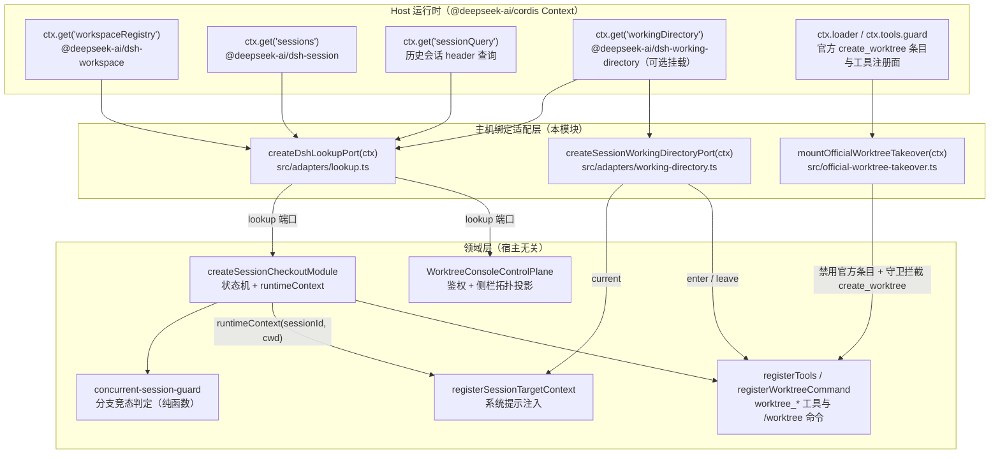
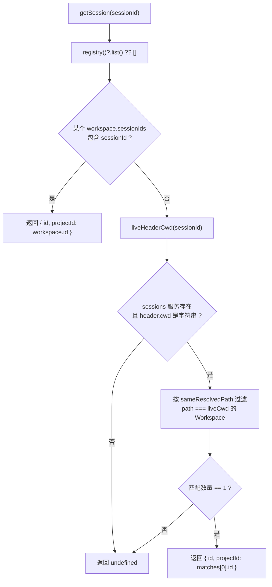
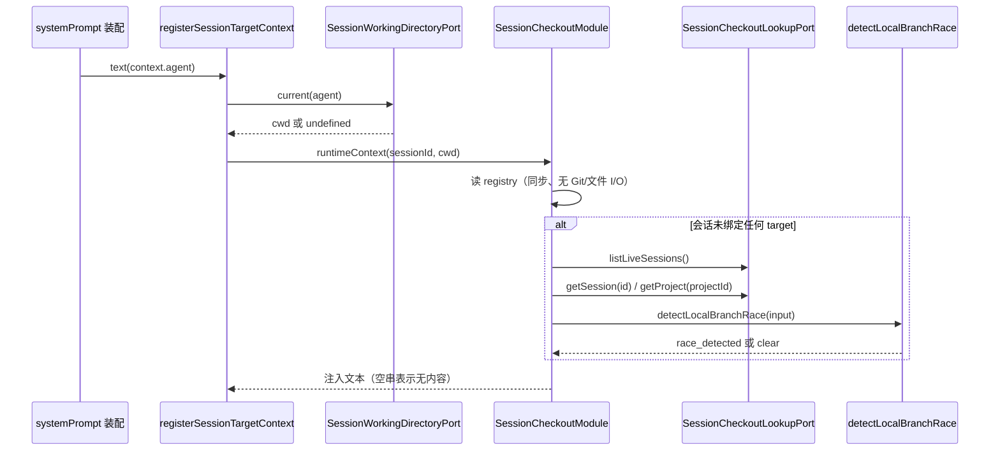
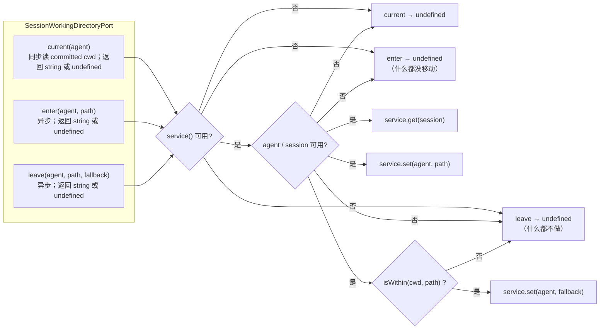
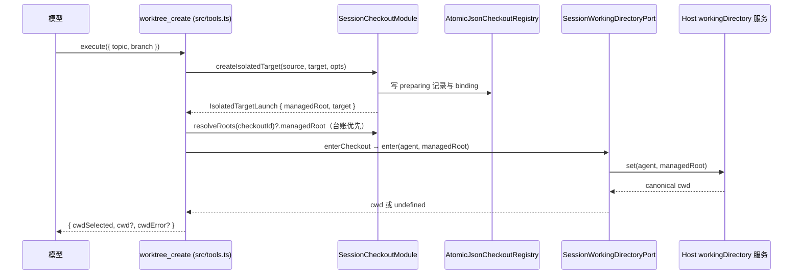
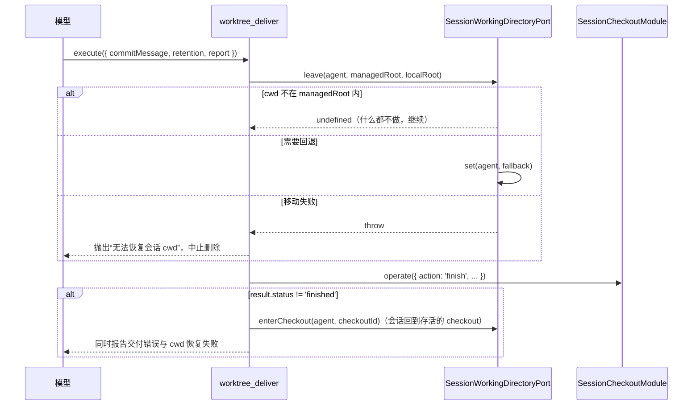
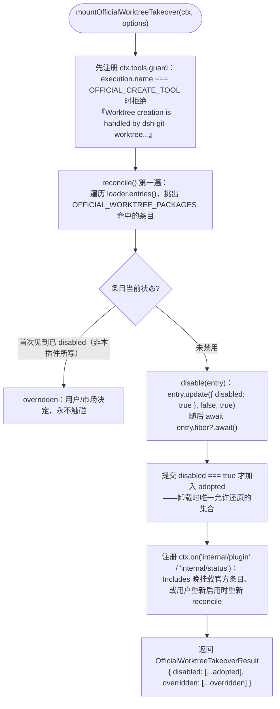

# 主机绑定适配层（src/adapters/lookup.ts、src/adapters/working-directory.ts 与 src/official-worktree-takeover.ts）

!!! info "Generated documentation"
    This page was written by CodeWiki from the source code at commit [`f93ba818`](https://github.com/wloops/dsh-git-worktree/commit/f93ba8188971886c09b4c40e12c746a23853c229) on 2026-11-06 with `doubao-seed-2.1-lite`. Check the code before relying on details.

本模块是 `dsh-git-worktree` 插件与 DeepSeek Harness（下称 **Host**）运行时之间的**绑定层**：它把 Host 提供的动态服务（`workspaceRegistry`、`sessions`、`sessionQuery`、`workingDirectory`）翻译成领域层可消费的两个端口（Port）——会话/项目查找端口 `SessionCheckoutLookupPort` 与会话工作目录端口 `SessionWorkingDirectoryPort`；并通过 Loader 接管官方 `create_worktree` 工具 bundle，保证「官方实验工具不再可达」。

它解决的唯一问题是：**领域状态机必须对 Host 一无所知**。`src/ports.ts` 只声明接口（见 [会话检出领域契约（session_checkout_domain_contracts）](../session_checkout_domain/session_checkout_domain_contracts.md)），本模块负责“在真实宿主里这些接口由谁实现、当宿主没挂载该服务时会怎样降级”。因此这里的每个函数几乎都不抛异常，而是返回 `undefined` / `[]`，让上层把它当作“恢复态/孤儿态事实”，而不是“调用失败”。

- 所属父模块：[src_adapters：会话检出（Session Checkout）的宿主适配层](../src_adapters.md)
- 上游契约定义：[会话检出领域契约（session_checkout_domain_contracts）](../session_checkout_domain/session_checkout_domain_contracts.md)
- 端口实现的整体分层参见：[核心 Worktree 领域与基础设施模块](../../core_worktree_domain_and_infrastructure.md)

---

## 1. 文件与导出清单

| 文件 | 导出 | 角色 |
|---|---|---|
| `src/adapters/lookup.ts` | `WorkspaceLike`（接口） | Host Workspace 的最小结构化视图：`id` / `path` / `title` / `sessionIds` |
| | `WorkspaceRegistryLike`（接口） | Host `workspaceRegistry` 服务的结构声明：`list` / `get` / `resolveByPath` / `create` / `delete` |
| | `LiveSessionLike`（内部） | 只关心 `header.cwd` 的活动会话形态 |
| | `SessionStoreLike`（内部） | Host `sessions` 服务的结构声明：`get`（必需）、`list`（可选） |
| | `WorkingDirectoryLike`（内部） | Host `workingDirectory` 服务的最小结构声明：只需 `get(session)`，供 lookup 端口读取会话的实时工作目录 |
| | `createDshLookupPort(ctx)` | 工厂：返回实现 `SessionCheckoutLookupPort` 的对象 |
| `src/adapters/working-directory.ts` | `WorkingDirectoryServiceLike`（接口） | Host `workingDirectory` 服务的结构声明：`get` / `set`（必需）、`ensure`（可选、未使用） |
| | `SessionWorkingDirectoryPort`（接口） | 工具层使用的 cwd 移动契约：`current` / `enter` / `leave` |
| | `createSessionWorkingDirectoryPort(ctx)` | 工厂：返回该端口的实现 |
| `src/official-worktree-takeover.ts` | `OfficialWorktreeTakeoverOptions`（接口） | 接管调优接缝：`operationTimeoutMs?`——单次 Loader disable 操作的毫秒超时上限 |
| | `OfficialWorktreeTakeoverResult`（接口） | 接管结果：`disabled`（本激活亲手禁用、卸载时可还原的 entry id）与 `overridden`（用户早已禁用、永不触碰的 entry id） |
| | `mountOfficialWorktreeTakeover(ctx, options?)` | 工厂：禁用官方 `create_worktree` 条目并注册工具守卫，卸载时还原 |

除导出外，三个文件各自持有私有守卫函数与私有路径工具：`lookup.ts` 里的 `isWorkspaceRegistryLike` / `isSessionStoreLike` / `sameResolvedPath` / `liveHeaderCwd` / `liveWorkingDirectory`（以及私有服务访问器 `workingDirectory()`），`working-directory.ts` 里的 `isWorkingDirectoryLike` / `sessionOf` / `isWithin`，以及 `official-worktree-takeover.ts` 里的 `official()` / `disable()` / `reconcile()` 与 `OFFICIAL_WORKTREE_PACKAGES` / `OFFICIAL_CREATE_TOOL` 常量。它们不会被外部导入，正是“降级语义”的实现位置。

---

## 2. 架构位置



关键点：**本模块不被领域层反向依赖具体实现**。`src/index.ts` 的 `apply()` 在插件挂载时构建两个端口对象，再把 `lookup` 作为依赖注入状态机与控制面（见 [会话检出运行时模块（session_checkout_runtime）概述](../session_checkout_domain/session_checkout_runtime.md)）；`workingDirectory` 端口则在 `src/tools.ts`、`src/commands.ts`、`src/session-target-context.ts` 三处各自 `create` 一次（工厂调用极廉价，只持有一个 `ctx`）。`mountOfficialWorktreeTakeover(ctx)` 在同一挂载流程中激活——它不向领域层暴露任何端口，只通过 `ctx.loader` 与 `ctx.tools.guard` 作用于官方 bundle 注册面。

### 2.1 为什么服务是“动态取用”而不是声明依赖

`src/index.ts:258` 声明的插件注入面是：

```ts
export const inject = { tools: {}, commands: {}, subprocess: {}, loader: { await: false } }
```

`workingDirectory` **不在** inject 列表里，`package.json`（见 [构建、CI 与打包（build_ci_and_packaging）](../../project_foundation_and_localization/build_ci_and_packaging.md)）的 `peerDependencies` 也没有 `@deepseek-ai/dsh-workspace` / `@deepseek-ai/dsh-working-directory`。原因是：

1. 官方 `workingDirectory` 是**可选挂载**服务——桌面 shell 挂了，其它宿主可能没有。若写进 `inject`，在缺失该服务的宿主上插件直接无法激活。
2. Host 已发布包版本落后于 rc.6 运行时，`ctx` 上的类型声明与真实服务不一致，只能在运行时按结构探测。
3. 因此每次调用都重新 `ctx.get(...)`（而不是在工厂里缓存一次），保证插件热重载/服务晚挂载后立刻可用。

由此产生的强制约束：`ctx.get` 本身可能不是函数（仅插件的测试 Context），`createSessionWorkingDirectoryPort` 首行就用 `typeof ctx.get !== 'function'` 兜底。

---

## 3. 查找端口 `createDshLookupPort(ctx)`

返回的 `SessionCheckoutLookupPort` 有 6 个方法，其中 4 个（`getSidebarMemberships`、`getSessionCwd`、`listLiveSessions`、`listProjects`）在契约里是**可选**方法——本实现全部提供，但消费方仍必须按可选对待。

### 3.1 方法语义

| 方法 | 数据来源 | 找不到时的返回 | 上层的解释 |
|---|---|---|---|
| `getSession(sessionId)` | `workspaceRegistry.list()`，扫描每个 Workspace 的 `sessionIds` | `undefined` → 状态机抛 `session_not_found`；控制面抛 `session_not_found` | 会话身份不可证明 |
| `getSession(sessionId)`（恢复分支） | 活动会话 `header.cwd` 与 Workspace `path` 精确匹配 | 匹配到唯一 Workspace 时返回 `{ id, projectId }` | 已交付并被清理的 owner 会话仍能解析到项目 |
| `getSessionCwd(sessionId)` | 优先 `workingDirectory.get(session)`（会话被 `workingDirectory.set` 搬过后的实时目录）；取不到时退回 `sessions.get(id).header.cwd`（Session 创建时冻结的目录） | 两者都取不到 → `undefined`（宿主无 sessions 服务，或无 workingDirectory 服务且 header 无 cwd） | 无法用“活 cwd”作为授权证据 |
| `getProject(projectId)` | `workspaceRegistry.get(id)` | `undefined` → `project_not_found` | Workspace 已被删除 |
| `listProjects()` | `workspaceRegistry.list()`，逐项映射 `{ id: workspace.id, name: workspace.title, root: workspace.path }` | 服务缺失时返回 `[]` | 把 Local 根反向解析回宿主 Workspace 项目——官方工具创建的 Worktree 可能既无台账绑定、也无会话投影覆盖 |
| `listLiveSessions()` | `sessions.list()` 的 header | `[]` | 分支竞态守卫保持沉默（不猜测） |
| `getSidebarMemberships(managedRoots)` | `workspaceRegistry.list()` + `sessionQuery.listSessions()` 的 header | 空 id 列表；服务缺失时返回 `[]` | 侧栏目录导航身份缺失，徽标不显示但不报错 |

### 3.2 `getSession` 的两段式解析

`sessionIds` 是 Host 维护的投影，而 Host 会在**不可变 cwd 已经无法解析**时把它从 Workspace 投影里过滤掉。一个已经交付、目录已被清理的 owner 会话仍然活着，且它的 `header.cwd` 里还留着那个精确路径。第二段就是为这个**已认证的特例**恢复映射：



注意 `matches.length === 1` 是**故意保守**的：多个 Workspace 指向同一路径时不做猜测，直接放弃恢复。这段逻辑让 `beginNextIteration` 与交付后的 owner 读路径能够继续解析项目（详见 `session-checkout-module.ts` 的 `beginNextIterationTarget`，它显式接受 `managedRoot` 或 `localRoot` 两种落点）。

`liveHeaderCwd` 助手被提炼出来的原因写在源码注释里：它读的是 **Session 创建时冻结**的 header cwd，服务于导航身份（`listLiveSessions`、`getSession` 恢复分支），并在宿主没有 `workingDirectory` 服务时充当 `getSessionCwd` 的兜底。非字符串与缺失值统一坍缩为 `undefined`。

授权证据不再以冻结 header 为准：`getSessionCwd` 优先走另一个私有助手 `liveWorkingDirectory(sessionId)`——它先取活动会话，再读宿主 `workingDirectory` 服务的 `get(session)` 投影。原因同样写在源码注释里：Harness 把 header 冻结在创建时刻，一个后来被 `workingDirectory.set` 搬进 Managed Worktree 的既有会话，其 header 里仍留着 Local 根路径；若授权证据还用 header，分支胶囊会对每一个在既有会话里打开的 Managed Worktree 报 `project_mismatch`。只有当宿主没有 `workingDirectory` 服务、或读不到活动会话时，才退回冻结的 header cwd（对刚创建的目标会话，其 header 本来就是它的 Worktree 根）。

### 3.3 `getSidebarMemberships`：导航身份而非授权证据

契约注释明确规定 `getSidebarMemberships` 是 *Read-only navigation evidence; never used to authorize a checkout operation*。实现里它做三件事：

1. `managedRoots` 先去重（`new Set`），每个受管根产出一条 `SidebarDirectoryMembership`。
2. `workspaceIds`：所有 `path` 与 `managedRoot` 解析后相等的 Workspace。
3. `sessionIds`：这些 Workspace 的 `sessionIds` **并上** `sessionQuery.listSessions()` 里 `header.cwd` 落在同一 `managedRoot` 的历史会话。

第 3 步读的是会话 **header** 而不是转录正文或缓存投影元数据——因为目录被清理后，宿主侧的当前投影会消失，而历史导航身份不能跟着丢。`src/console-host/control-plane.ts` 的 `sidebarTopology()` 消费这份数据，把 `workspaceIds` / `sessionIds` 聚合成 `memberships` 交给侧栏（见 [Worktree Console 宿主服务（`src/console-host/`）](../../worktree_console_protocol_and_host_service/worktree_console_host.md) 与 [工作区侧边栏（client_workspace_sidebar）](../../worktree_client_interface_layer/client_workspace_sidebar.md)）。

### 3.4 `listLiveSessions`：为竞态守卫供数据

只映射守卫需要的三个 header 字段，并对每个字段做类型检查后再条件展开（`createdAt` 必须是 `number`、`cwd` 必须是 `string`）；`id` 优先取 `header.id`，退回 `session.id`。整体包在 `try/catch` 里，任何结构性意外都降级成 `[]`。

消费链：`session-checkout-module.ts` 的 `refreshBranchRaceGuards()` 与 `branchRaceNotice()` → `detectLocalBranchRace({ sessions, ... })`（`src/concurrent-session-guard.ts`）。会话数 `< 2` 时守卫直接返回空串。分支创建时间由后台 interval（45 秒，见 `src/session-target-context.ts`）刷新进 `branchRaceCache`，因为系统提示契约要求 `runtimeContext` 保持同步。相关说明见 [会话检出运行时模块（session_checkout_runtime）概述](../session_checkout_domain/session_checkout_runtime.md)。



### 3.5 路径比较规则

`sameResolvedPath(left, right)`：`resolve()` 之后比较，`process.platform === 'win32'` 时转小写。领域层另有一套更强的 `pathsEqual`（走 `realpathSync.native`），二者**不等价**，各自服务于不同判定；本适配层刻意只做文本级 resolve，因为它是投影数据的比对，不承担安全边界判定。

---

## 4. 工作目录端口 `createSessionWorkingDirectoryPort(ctx)`

这是官方实验性 `create_worktree` bundle 用来把会话真正“搬进”新 checkout 的机制：它创建流程的最后一步就是 `ctx.workingDirectory.set(agent, path)`。没有它，Managed Worktree 只改变**文件位置**，不改变**会话工作位置**。

### 4.1 三个方法与三种降级



三条不可让步的语义（源码注释逐条写明）：

1. **`enter` 返回 `undefined` 意味着“什么都没移动”**。契约要求调用方**不得**在 `undefined` 时上报选中的 cwd。`src/tools.ts` 的 `enterCheckout()` 正是这样落地：`cwd === undefined ? {} : { cwd }`，工具输出里的 `cwdSelected` 直接由 `entered.cwd !== undefined` 推导。
2. **真实错误必须与降级区分开**。`enterCheckout()` 把异常折叠进 `failure` 字段（输出键 `cwdError`），而不是塞进同一个 `undefined`：交付失败后会话本应回到存活的 checkout 里，静默 no-op 会让每一个相对路径写入落进原始仓库。
3. **`leave` 失败必须中止删除**。`src/tools.ts` 的 `leaveCheckoutBeforeRemoval()` 返回非空原因时，`worktree_deliver` / `worktree_cleanup` 直接抛错，绝不让会话留在即将消失的目录里。

### 4.2 `sessionOf`：agent 与 session 的区别

`WorkingDirectoryServiceLike.get` 接受 **Session**，`set` 需要 **活的（或未发布的）Agent**。所以 `current` / `leave` 通过 `sessionOf(agent)` 取 `agent.session` 读取，而 `enter` 把 `agent` 原样传给 `set`。工具调用方没有活 Agent 时 `enter` 返回 `undefined`（什么都不移动）。

### 4.3 `isWithin`：跨平台包含判定

`resolve()` → 反斜杠改正斜杠 → 去掉尾部斜杠 → Windows 转小写，然后判定 `candidate === root || candidate.startsWith(root + '/')`。这里用**包含**而非相等：会话经常 `cd` 进子目录，那仍然是“在 Worktree 内工作”。`session-checkout-module.ts` 里的 `pathIsWithin()` 是同一规则的复制，注释明确要求两者不得漂移，否则注入的指引与实际 cwd 切换会对“是否在 Worktree 内”给出不同答案。

### 4.4 在创建/交付流程中的位置



`enterCheckout()` 先读台账（`resolveRoots`），只在台账答不出来时才退回 `resolveManagedRoot()`——后者会在全局锁下跑一次完整 Git 校验，一次瞬时 git 失败或 mid-recovery 记录不应让会话被丢在它正要工作的 Worktree 之外。`resolveRoots` / `resolveManagedRoot` 的语义见 [会话检出运行时入口模块](../session_checkout_domain/session_checkout_runtime/session_checkout_runtime_entry.md)。

交付/清理方向则相反：



---


## 4bis. 官方 Worktree 接管 `mountOfficialWorktreeTakeover(ctx, options?)`

这是与「会话工作目录」平行的另一条宿主绑定：不是实现端口，而是**让官方实验性 `create_worktree` 工具在本插件激活期间不可达**。它与 [工作区提供者生命周期与会话目标上下文](../session_checkout_domain/session_checkout_runtime/workspace_provider_lifecycle.md) 里的 `mountWorkspaceProviderLifecycle` 采用同一套 Loader 1.0.6 适配（disable 后必须 `fiber.await()`、restore 遇死代际必须 `entry.init()` 重建），但接管对象不同——后者选举的是官方 `uiWorkspace` 客户端条目，本函数禁用的是官方 worktree 工具 bundle 条目。

### 4bis.1 两道防线：条目禁用 + 工具守卫



关键设计：**守卫是「hidden」的真正保证**。条目禁用需要 settle（dispose fiber 是异步的），在它落定之前官方工具仍可达；因此 `ctx.tools.guard` 按工具名拦截 `OFFICIAL_CREATE_TOOL`，不依赖「是哪个插件当前在提供它」。`overridden`（用户早已禁用的条目）与 `adopted`（本插件亲手禁用）在结果里分开返回，调用方可以据此向侧栏/诊断报告「接管了多少、尊重了多少」。

### 4bis.2 重入与卸载还原

- **inFlight 账本**：`entry.update({ disabled: true })` 会同步提交 `options.disabled = true` 并 emit `internal/plugin`，若不先认领（`inFlight.add(key)`），重入的 reconcile 会把「自己尚未 settle 的禁用」误判成用户 override，卸载时永不还原。`inFlight` 在操作 settle（或超时）后才摘除。
- **超时上限**：单次 disable 以 `operationTimeoutMs`（默认 `DEFAULT_OPERATION_TIMEOUT_MS`）封顶；wedge 掉的操作只告警一次（「官方 Worktree disable 未在 N ms 内 settle；工具守卫仍会拒绝 create_worktree」），激活不阻塞，等下一次 Loader 事件重选。
- **卸载还原**：`ctx.effect` 回调里只还原 `adopted` 且「仍 disabled 且父 fiber 健康」的条目（Root/Include 拆除拥有的条目不复活），用 `entry.update({ disabled: null })`，随后按当前 fiber 死活选择 `entry.refresh()` 或 `entry.init()`。用户 override 的条目一律不碰。

### 4bis.3 与 Workspace provider 选举的边界

| 维度 | `mountWorkspaceProviderLifecycle`（见上页） | `mountOfficialWorktreeTakeover`（本页） |
|---|---|---|
| 接管对象 | 官方 `uiWorkspace` 客户端条目（`OFFICIAL_WORKSPACE`） | 官方 worktree 工具 bundle 条目（`OFFICIAL_WORKTREE_PACKAGES`） |
| 返回结果 | `officialWorkspaceActive: boolean`，编入侧栏拓扑响应 | `{ disabled, overridden }` 两组 entry id |
| 是否需要开关 | 受 `enableWorkspaceProvider` 配置与 flavor 代际闸门控制 | 激活即挂载（工具可达性是本插件「唯一 worktree 创建入口」承诺的一部分） |
| 守卫 | 无（靠 Loader 禁用 + 确定性布尔） | 额外注册 `ctx.tools.guard` 按工具名拒绝 |

---

## 5. 组件交互矩阵

| 消费者 | 使用的端口成员 | 用途 | 缺失时的行为 |
|---|---|---|---|
| `session-checkout-module.ts` `requireSession` | `lookup.getSession` | 会话身份 | 抛 `session_not_found` |
| `session-checkout-module.ts` `resolveSessionProject` | `lookup.getProject` | 项目根目录 | 抛 `project_not_found` / `project_root_missing` |
| `session-checkout-module.ts` `runtimeContext` / `branchRaceNotice` | `lookup.getSession`、`lookup.getProject`、`lookup.listLiveSessions` | 竞态告警 | 守卫沉默，返回空串 |
| `session-checkout-module.ts` `reconcile` | `lookup.getSession(ownerSessionId)` | 孤儿 Worktree 判定 | 视为孤儿（记入 `orphanedCheckoutIds`） |
| `session-checkout-module.ts` `beginNextIterationTarget` | `lookup.getProject` | 校验迭代链仍落在本 Worktree 血脉 | 抛 `project_not_found` / `project_mismatch` |
| `console-host/control-plane.ts` `unboundLocalTarget` / `projectRootFor` / `localProject` | `lookup.getSession`、`lookup.getProject`、`lookup.listProjects` | Local 边界解析、Local 根反向归属宿主 Workspace 项目 | `session_not_found` / `project_not_found` / `project_root_missing` |
| `console-host/control-plane.ts` `verifyCallerRoot` | `lookup.getSessionCwd` | **owner 会话的活 cwd 授权证据** | 退回 Workspace root 判定；可能得到 `project_mismatch` |
| `console-host/control-plane.ts` `ownerSessionAvailable` / `settledLocalBranch` | `lookup.getSession`、`lookup.getSessionCwd` | 徽标可用性、交付后分支标签 | 保守值（不可用 / `null`） |
| `console-host/control-plane.ts` `sidebarTopology` | `lookup.getSidebarMemberships` | 侧栏目录归属 | 省略 `memberships` 字段 |
| `tools.ts` / `commands.ts` / `session-target-context.ts` | `workingDirectory.enter` / `leave` / `current` | cwd 进出 Worktree、注入指引 | 仅指引模式（guidance-only） |

`verifyCallerRoot` 值得单独强调：授权证据必须是 owner 会话**此刻真正站在**的目录，而 Workspace 项目记录始终指向 Local checkout。这个目录由宿主 `workingDirectory` 服务的实时投影给出（`workingDirectory.get(session)`）——一个后来被 `workingDirectory.set` 搬进 Managed Worktree 的既有会话，其 `header.cwd` 还冻结在 Local 根，只有实时投影能正确回答。若只按 `project.root` 授权，**每一次 owner 调用都会被判 `project_mismatch`**，顶部胶囊对完全健康的受管 checkout 报失败。同时该证据只对 owner 生效——source 会话的本意就是待在 Local 边界，把活 cwd 当成 `expectedRoot` 会把 owner 的 `managedRoot` 交给任意一个同项目、停在 Local 的 source 会话。

---

## 6. 设计不变量

1. **降级不是失败。** 服务缺失、形状不符、异常抛出 → `undefined` / `[]`，绝不从绑定层抛出领域错误。`isWorkspaceRegistryLike` 只检查 `list` 与 `get` 是函数（`resolveByPath` / `create` / `delete` 为类型兼容声明，适配器不调用）；`isSessionStoreLike` 只检查 `get`；`isWorkingDirectoryLike` 检查 `get` + `set`。
2. **导航证据与授权证据分离。** `getSidebarMemberships` 永不参与鉴权；`getSessionCwd` 与 `getSession` 刻意分开，保证“导航记录里不含授权证据”（契约注释原话）。
3. **每次调用重新解析服务**，不缓存 `ctx.get` 结果，从而兼容服务晚挂载与 fiber 重启。
4. **lookup / working-directory 两条端口链不做任何写操作。** 它们只读 Host 投影；所有文件系统、Git、registry 写入都在别的适配器里（见 [持久化适配器：文件系统端口、原子注册表与崩溃安全 JSON IO](src_adapters_persistence.md) 与 [Git 执行适配器：唯一出口 runGit、可证明的 Worktree 创建与首次提交协议](src_adapters_git_execution.md)）。本模块唯一的 Loader 写操作属于官方 Worktree 接管（`official-worktree-takeover.ts` 禁用/还原官方条目），其范围被 `adopted` / `overridden` 账本严格圈定，且只作用于官方 worktree 条目。
5. **移动 cwd 是可证明的事实。** `enter` 只在真的调用成功时返回路径；`leave` 只在真的位于该目录下时才回退；两者都拿不到服务时保持沉默。

---

## 7. 常见问题排查

| 症状 | 可能根因 | 定位方法 |
|---|---|---|
| 创建成功但 `cwdSelected: false`、无 `cwd` | 宿主未挂载 `workingDirectory`，或工具调用方没有活 Agent | 检查 `ctx.get('workingDirectory')` 是否具备 `get`/`set`；guidance-only 属预期行为 |
| `cwdError` 非空 | `service.set()` 抛错（目录已消失、权限、会话被回收） | 交付失败路径会同时报告交付错误与 cwd 失败，两条都要看 |
| 顶部胶囊报 `project_mismatch` | `getSessionCwd` 拿不到活 cwd：优先是 `workingDirectory.get(session)` 取不到（宿主未挂载该服务），兜底时 `sessions.get(id).header.cwd` 又不是字符串 | 先确认 `ctx.get('workingDirectory')` 具备 `get`（lookup 侧只需 `get`）；无该服务的宿主再确认 `header.cwd` 是字符串 |
| 已清理的交付会话报 `session_not_found` | 恢复分支要求 `sameResolvedPath` 唯一匹配；路径被宿主重写或存在多匹配 | 打印 `workspaceRegistry.list()` 的 `path` 与 `header.cwd` 比对 |
| 侧栏目录上没有 Worktree 徽标 | `getSidebarMemberships` 无匹配（Workspace 已删且 `sessionQuery` 未提供 `listSessions`） | 检查 `ctx.get('sessionQuery').listSessions` 是否存在 |
| 分支竞态守卫从不提示 | `listLiveSessions` 返回 `[]`（sessions 服务无 `list`）或活跃会话不足 2 个 | 这是设计行为：证据不足时保持沉默而不是猜测 |
| 官方 `create_worktree` 工具仍可达 / 仍被模型调用 | 官方条目 disable 未 settle（超时告警），且工具守卫注册失败；或宿主未提供 Loader/guard 面 | 查日志 `official Worktree disable did not settle within ...ms`；守卫按工具名拦截，与条目是否 settle 无关 |

---

## 8. 相关文档

- 端口契约（`SessionCheckoutLookupPort`、`SidebarDirectoryMembership`、`SessionCheckoutDependencies`）：[会话检出领域契约（session_checkout_domain_contracts）](../session_checkout_domain/session_checkout_domain_contracts.md)
- 状态机与 `runtimeContext` 生成：[会话检出运行时模块（session_checkout_runtime）概述](../session_checkout_domain/session_checkout_runtime.md)、[`src/session-checkout-module.ts` —— 会话检出状态机工厂](../session_checkout_domain/session_checkout_runtime/session_checkout_runtime_entry/src_session-checkout-module.ts.md)
- 插件入口（构建端口并注入依赖）：[`src/index.ts` —— dsh-git-worktree 插件入口与装配根](../session_checkout_domain/session_checkout_runtime/session_checkout_runtime_entry/src_index.ts.md)
- Git 与文件系统、registry 适配器：[Git 执行适配器：唯一出口 runGit、可证明的 Worktree 创建与首次提交协议](src_adapters_git_execution.md)、[持久化适配器：文件系统端口、原子注册表与崩溃安全 JSON IO](src_adapters_persistence.md)
- 模型工具层对 cwd 的消费：[Worktree 核心操作与纯函数工具层（worktree_core_operations）](../worktree_core_operations.md)
- 控制面对 `lookup` 的鉴权与投影：[Worktree Console 宿主服务（`src/console-host/`）](../../worktree_console_protocol_and_host_service/worktree_console_host.md)
- 侧栏拓扑的导航身份展示：[工作区侧边栏（client_workspace_sidebar）](../../worktree_client_interface_layer/client_workspace_sidebar.md)
- 平行的 Loader 接管（官方 `uiWorkspace` 条目选举）：[工作区提供者生命周期与会话目标上下文](../session_checkout_domain/session_checkout_runtime/workspace_provider_lifecycle.md)
- 宿主版本/flavor 兼容（决定 Workspace provider 接管）：[核心 Worktree 领域与基础设施模块](../../core_worktree_domain_and_infrastructure.md)
- 打包与 peer 依赖边界（为何这些服务只能动态取用）：[构建、CI 与打包（build_ci_and_packaging）](../../project_foundation_and_localization/build_ci_and_packaging.md)

??? abstract "Documented components (9)"
    - [`LiveSessionLike`](https://github.com/wloops/dsh-git-worktree/blob/f93ba8188971886c09b4c40e12c746a23853c229/src%5Cadapters%5Clookup.ts) — `src\adapters\lookup.ts`
    - [`SessionStoreLike`](https://github.com/wloops/dsh-git-worktree/blob/f93ba8188971886c09b4c40e12c746a23853c229/src%5Cadapters%5Clookup.ts) — `src\adapters\lookup.ts`
    - [`WorkspaceLike`](https://github.com/wloops/dsh-git-worktree/blob/f93ba8188971886c09b4c40e12c746a23853c229/src%5Cadapters%5Clookup.ts) — `src\adapters\lookup.ts`
    - [`WorkspaceRegistryLike`](https://github.com/wloops/dsh-git-worktree/blob/f93ba8188971886c09b4c40e12c746a23853c229/src%5Cadapters%5Clookup.ts) — `src\adapters\lookup.ts`
    - [`SessionWorkingDirectoryPort`](https://github.com/wloops/dsh-git-worktree/blob/f93ba8188971886c09b4c40e12c746a23853c229/src%5Cadapters%5Cworking-directory.ts) — `src\adapters\working-directory.ts`
    - [`WorkingDirectoryServiceLike`](https://github.com/wloops/dsh-git-worktree/blob/f93ba8188971886c09b4c40e12c746a23853c229/src%5Cadapters%5Cworking-directory.ts) — `src\adapters\working-directory.ts`
    - [`WorkingDirectoryLike`](https://github.com/wloops/dsh-git-worktree/blob/f93ba8188971886c09b4c40e12c746a23853c229/src%5Cadapters%5Clookup.ts) — `src\adapters\lookup.ts`
    - [`OfficialWorktreeTakeoverOptions`](https://github.com/wloops/dsh-git-worktree/blob/f93ba8188971886c09b4c40e12c746a23853c229/src%5Cofficial-worktree-takeover.ts) — `src\official-worktree-takeover.ts`
    - [`OfficialWorktreeTakeoverResult`](https://github.com/wloops/dsh-git-worktree/blob/f93ba8188971886c09b4c40e12c746a23853c229/src%5Cofficial-worktree-takeover.ts) — `src\official-worktree-takeover.ts`

