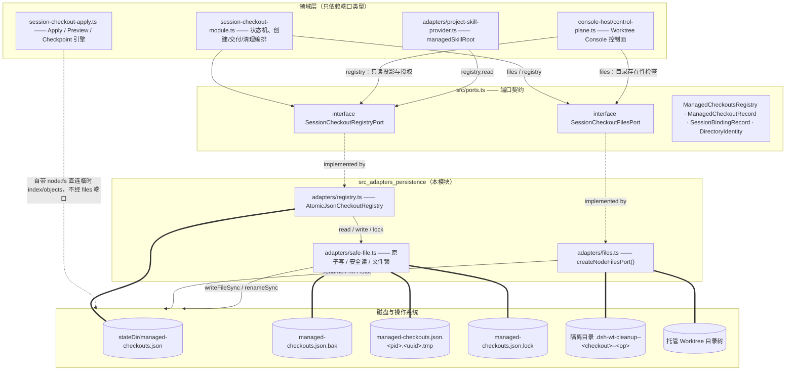
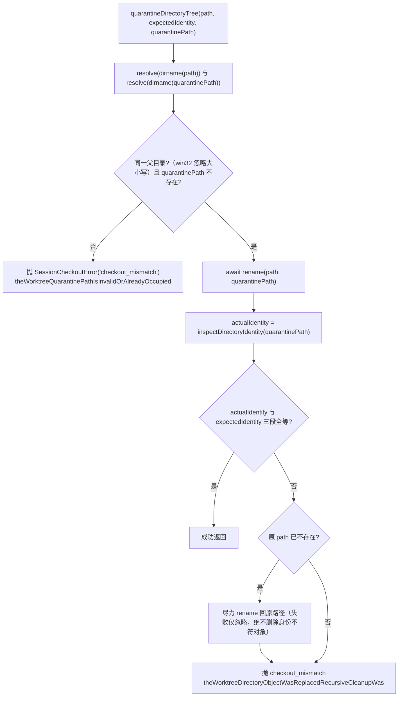
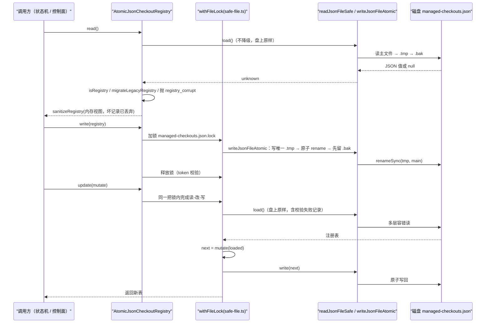
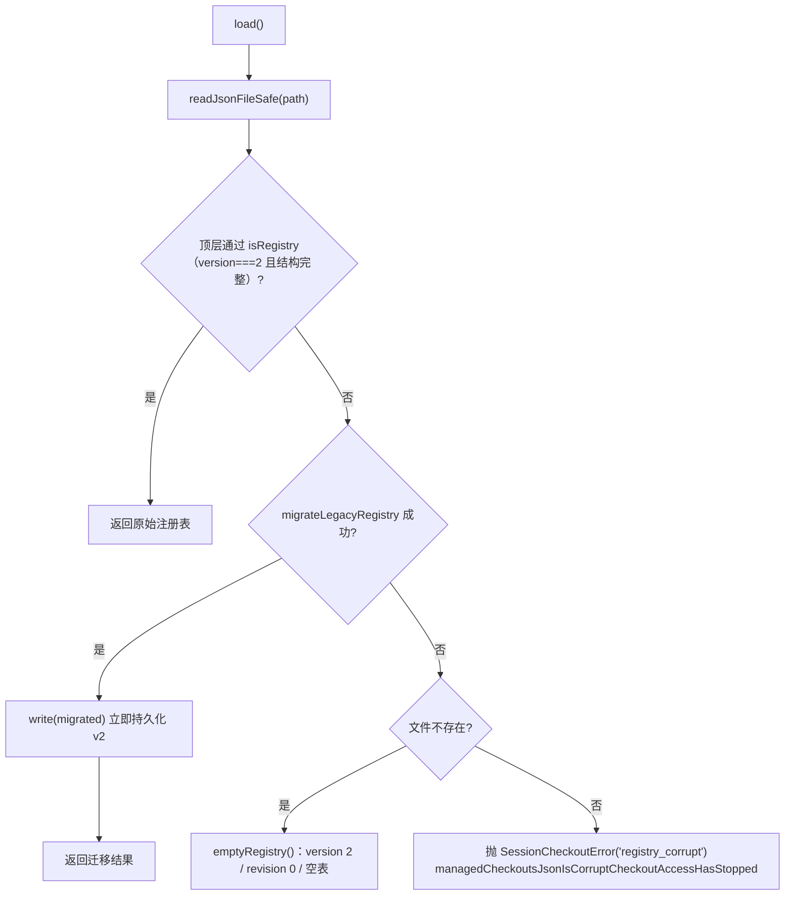
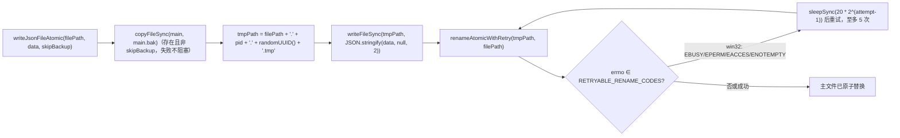
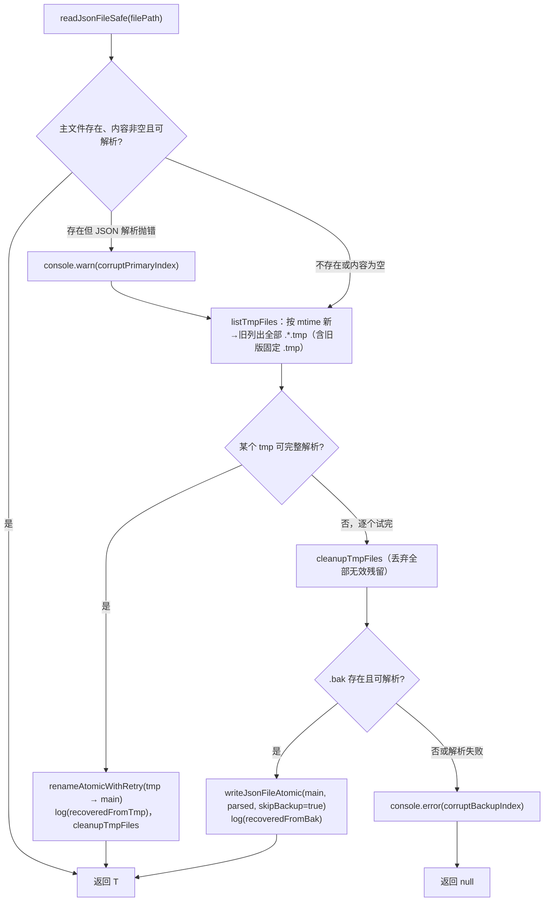
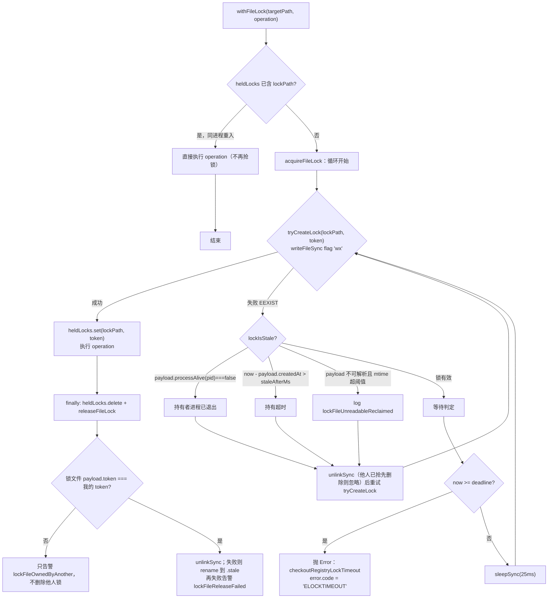
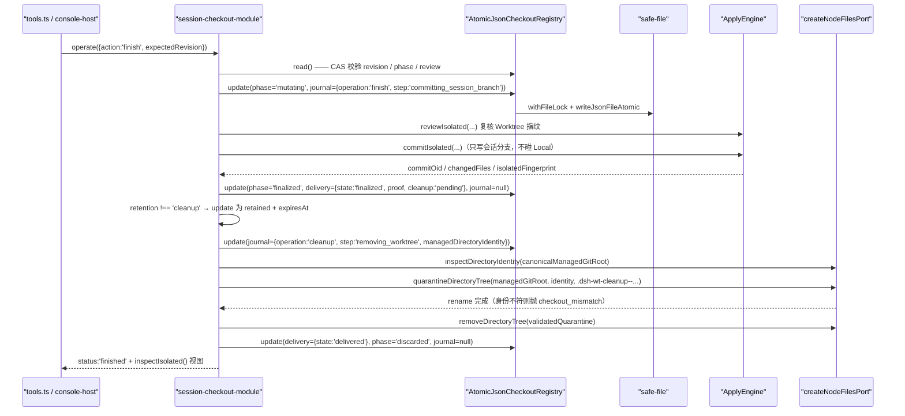
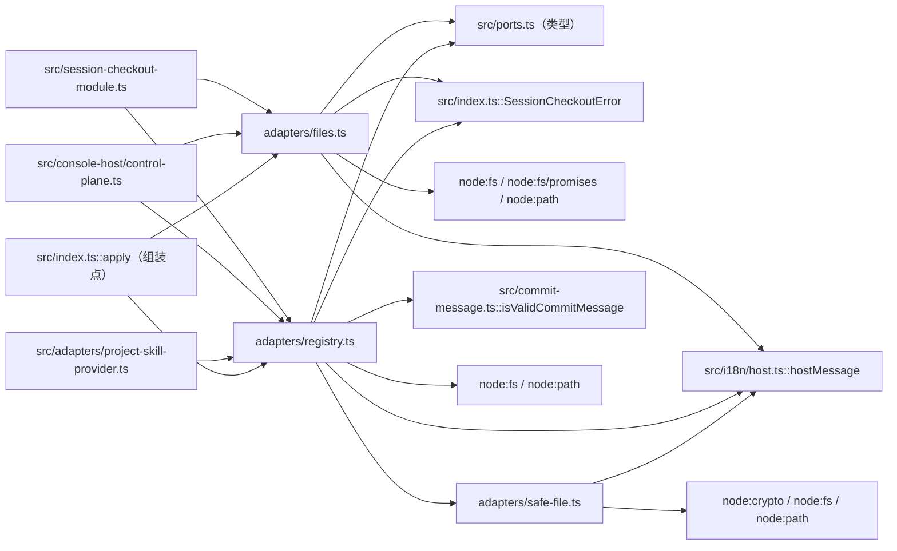

# 持久化适配器：文件系统端口、原子注册表与崩溃安全 JSON IO

!!! info "Generated documentation"
    This page was written by CodeWiki from the source code at commit [`f93ba818`](https://github.com/wloops/dsh-git-worktree/commit/f93ba8188971886c09b4c40e12c746a23853c229) on 2026-11-06 with `doubao-seed-2.1-lite`. Check the code before relying on details.

`src_adapters_persistence` 是 `src/adapters` 分层里唯一负责「落盘」的子模块。它把会话检出（session-checkout）领域的两个抽象端口——`SessionCheckoutFilesPort` 与 `SessionCheckoutRegistryPort`——实现为可直接运行的 Node.js 适配器，并额外提供一个共享底座的崩溃安全 JSON 读写工具集：

- `src/adapters/files.ts` · `createNodeFilesPort()`：基于 `node:fs` 的目录身份、隔离区（quarantine）、残留收集与安全删除实现。
- `src/adapters/registry.ts` · `AtomicJsonCheckoutRegistry`：版本 2 的托管 checkout 注册表，单个原子 JSON 文件，读时全量校验、坏记录逐条降级、v1 记录保守迁移。
- `src/adapters/safe-file.ts` · `writeJsonFileAtomic()` / `writeTextFileAtomic()` / `readJsonFileSafe()` / `withFileLock()`：唯一命名临时文件 + 原子 `rename` + `.bak` 备份 + 跨进程文件锁。

这三者共同保证一条硬性约束：**领域状态机的每一步写入都必须可证明、可回滚、崩溃后可恢复**，任何不可证明的场景一律「保留现场并失败」，绝不猜测成功。

本文是 [src_adapters：会话检出（Session Checkout）的宿主适配层](../src_adapters.md) 分层下的持久化子模块；其余三个兄弟子模块分别是 [Git 执行适配器：唯一出口 runGit、可证明的 Worktree 创建与首次提交协议](src_adapters_git_execution.md)（Git 命令执行）、[主机绑定适配层（src/adapters/lookup.ts、src/adapters/working-directory.ts 与 src/official-worktree-takeover.ts）](src_adapters_host_binding.md)（宿主会话绑定）与 [Project Skills 适配器：随会话携带的项目级 Skill 资源](src_adapters_project_skills.md)（随会话携带的 Project Skills）。

---

## 1. 在系统中的位置

本模块处于领域层与操作系统之间，是插件里唯一允许直接触碰插件状态目录（registry JSON）和托管 Worktree 物理目录的地方。领域层只依赖 `src/ports.ts` 声明的端口类型，具体实现由插件入口组装注入。



插件入口 `src/index.ts::apply` 中的组装顺序（可参考 [核心 Worktree 领域与基础设施模块](../../core_worktree_domain_and_infrastructure.md)）：

```
stateDir = resolveStateDir(config)                     // 默认 $DSH_HOME/plugins/dsh-git-worktree
files    = createNodeFilesPort()
registry = new AtomicJsonCheckoutRegistry(join(stateDir, 'managed-checkouts.json'))
module   = createSessionCheckoutModule({ files, registry, git, lookup, applyEngine, managedCheckoutsRoot: stateDir, ... })
```

`files` 与 `registry` 同时被 `WorktreeConsoleControlPlane`（见 [Worktree Console 宿主服务（`src/console-host/`）](../../worktree_console_protocol_and_host_service/worktree_console_host.md)）和 `ProjectSkillStore` / `managedSkillRoot`（见 [Project Skills 适配器：随会话携带的项目级 Skill 资源](src_adapters_project_skills.md)）复用，因此本模块是插件里唯一的持久化收敛点。

---

## 2. `createNodeFilesPort()` —— 目录身份与安全删除

`src/adapters/files.ts` 导出的工厂一次性返回 `SessionCheckoutFilesPort` 的全部方法；没有内部状态，可被任意多个领域操作并发持有。

### 2.1 方法一览

| 端口方法 | 实现 | 关键语义 |
|---|---|---|
| `exists(path)` | `existsSync` | 同步存在性判定，用于所有「路径是否还在」的门控 |
| `canonicalize(path)` | `realpath(resolve(path))` | 唯一权威路径形态；注册表比对原始路径时禁止再次 realpath，否则 Junction 会冒充原目录 |
| `inspectDirectoryIdentity(path)` | `lstat(..., { bigint: true })` | 返回 `{ device, inode, birthtimeNs }`；非目录或符号链接返回 `null` |
| `ensureDirectory(path)` | `mkdirSync(recursive)` | 创建 Worktree 容器 |
| `removeEmptyDirectoryTree(path)` | 同步递归 | **只在整棵树无文件时删除**；树内的符号链接只删链接本身、绝不跟随目标 |
| `quarantineDirectoryTree(path, expectedIdentity, quarantinePath)` | `rename` + 身份复核 | 身份匹配的残留原子移入隔离区；身份不符则保留现场并抛 `checkout_mismatch` |
| `removeDirectoryTree(path)` | `rm(recursive, force)` | 删除已完全拥有的非空目录；根若是文件或符号链接直接拒绝 |
| `measureDirectoryBytes(path)` | 异步递归求和 | 估算真实占用；符号链接贡献 0 字节 |
| `readTextFile?(path)` | `readFileSync` / `null` | 文本读取（`.worktreeinclude` 等） |
| `copyFile?(from, to)` | `mkdirSync` + `rmSync` + `copyFileSync` | 未跟踪文件携带、include 复制 |
| `isSymbolicLink?(path)` | `lstatSync().isSymbolicLink()` | 复制源若是链接则跳过 |

### 2.2 目录身份（CAS）为什么必须三段式

`DirectoryIdentity` 由 `device` + `inode` + `birthtimeNs` 三个字段构成。仅比较路径会被「删除后重建同名目录」骗过；仅比较 inode 会被 inode 复用骗过。三者合取才能证明「磁盘上这个目录对象仍是当初取证的那一个」。`registry.ts` 的 journal 校验、`session-checkout-module.ts` 的 `directoryIdentitiesEqual` 都依赖同一套字段。

### 2.3 隔离区移动的身份复核流程



`removeDirectoryTree` 在 Windows 上使用 `maxRetries: 6`、POSIX 上 `maxRetries: 2`，固定 `retryDelay: 150ms`，用于对抗杀软与残留进程的文件句柄占用。失败会向上冒泡为瞬时错误，由领域层的 `retryTransientCleanup`（`EBUSY`/`EPERM`/`EACCES`/`ENOTEMPTY`）判定是否可重试——这个归因决定了该记录日后是否会被自动清理重试。

---

## 3. `AtomicJsonCheckoutRegistry` —— 版本 2 注册表

注册表是插件的全部权威账本：`sessionBindings`（会话 → 目标）与 `managedCheckouts`（checkoutId → 记录），落盘为 `stateDir/managed-checkouts.json` 单个 JSON 文件。

### 3.1 三个端口方法与它们的锁边界



设计上有两条容易被忽略但刻意为之的规则：

1. **`read()` 走 `sanitizeRegistry`，`update()` 内的读取不走。** 分区降级只是给调用方的内存视图；任何写回必须以磁盘事实为基础，否则上一次被丢弃的记录会被这次写入悄悄抹掉。
2. **单条记录更新必须用 `update()`，而不是 `read()` 后 `write()`。** `read` 与 `write` 之间隔着两次调用，任何落在缝里的另一进程写入都会被后写者整体覆盖。`session-checkout-module.ts::updateManagedCheckout` 正是把「取记录 → 变换 → `revision + 1` → 写回」整体放进 `mutate`。

底层原语 `writeJsonFileAtomic()` 自身**不持锁**：唯一 `.tmp` 命名 + 原子 `rename` 已消除「tmp 互踩」与「半写提升」，所以单文件写入天然安全。`AtomicJsonCheckoutRegistry.write()` 仍显式套一层 `withFileLock`，目的是让这次写入与并发的读-改-写窗口互斥，而不是弥补原子写本身的缺口。

### 3.2 读取决策链



`read()` 返回前套一层 `sanitizeRegistry`：逐条 `isSessionBinding` / `isManagedCheckout` 校验，不通过的记录丢弃并 `console.warn(hostMessage('registryRecordDropped', ...))`，其余记录照常可用。一条损坏不会剥夺全部 checkout 的访问权，也不回写磁盘——用户现场保留。

### 3.3 v1 → v2 保守迁移

`migrateLegacyRegistry` 只接受 `version === 1` 且所有 sessionBinding 均合法的表；任一 managed checkout 缺必填字段则整体返回 `null`（不做部分迁移）。迁移时：

- `phase` 为 `ready` 或 `discarded` 的原样保留，**其余一律降为 `recovery_required`**；
- `delivery` 重置为 `{ state: 'working', iteration: 1 }`，`journal` 置 `null`；
- 被降级的记录 `revision + 1`（让客户端缓存自然失效），顶层 `revision + 1`，`version` 升为 `2`。

### 3.4 校验谓词矩阵

`registry.ts` 用一组纯函数谓词构成「读取即校验」的门。它们同时是格式约束和安全约束：

| 谓词 | 覆盖对象 | 关键约束 |
|---|---|---|
| `isRegistry` | 顶层 | `version === 2`、`revision: number`、两个字段均为对象 |
| `isSessionBinding` | 会话绑定 | `target` 需 `isTargetRef`（`unselected`/`local`/`isolated` + `checkoutId`）、`revision: number` |
| `isManagedCheckout` | 托管记录 | 身份五元组（`localRoot`/`managedRoot`/`managedGitRoot`/`gitCommonDir`/`gitDir`）、`phase` 七值枚举、`isDelivery`、`isJournal` |
| `isDelivery` | 交付状态机 | 按 `state` 分支：`working` / `ready_for_review` / `preview_active` / `preview_detached` / `finalized` / `retained` / `delivered`，每个状态要求与之匹配的证据对象 |
| `isJournal` | 崩溃 journal | `null` 合法；`create` 必须停在 `creating_worktree`，可选 `creation` 证据；其余操作/步骤必须落在枚举内 |
| `isCheckpoint` | 阶段记录 | `sequence` 从 1 连续；`commitOid`/`parentOid` 为 40/64 位 hex；`changedFiles` ≤ 500 且逐条 `isSafeRelativePath` |
| `isPreviewReceipt` | Local Preview 收据 | 全部 base/HEAD/fingerprint/tree OID 字段齐备，`baseStrategy` 三值枚举 |
| `isDeliveryProof` | 交付证据 | `localBranch: string \| null`、before/after HEAD、可选 `validationStatus`（向后兼容） |
| `isPreviousReview` | 上一轮评审上下文 | 有界文本 + `isValidCommitMessage` + `changedFiles` ≤ 50 |
| `isRecoveryContinuation` | Host 授权的一次性续跑凭证 | 按 `kind` 四分支：review 再生成 / preview 恢复分析 / preview 恢复 handoff / apply 冲突 |

`isManagedCheckout` 对 `checkpoints` 施加了四条集合不变量：`sequence === index + 1`、`checkpointId` 唯一、`reviewId` 唯一（一个 review 至多一个 checkpoint）、非空 `requestId` 全局唯一——幂等键重复的表会被整条丢弃而不是部分接受。

安全类谓词（`isBoundedText`、`isSafeRelativePath`、`isOid`、`isStringArray`）拒绝 NUL/控制字符、绝对路径、盘符前缀、空段与 `.`/`..` 段。校验函数与领域层的 `OID_PATTERN`、`isValidCommitMessage`（见 [Worktree 核心操作与纯函数工具层（worktree_core_operations）](../worktree_core_operations.md)）共用同一把尺子。

---

## 4. `safe-file.ts` —— 崩溃安全 IO 底座

该文件解决的具体故障是：系统强制关机 / 进程崩溃时 JSON 索引被截断，导致整份账本不可解析。

### 4.1 写入路径



要点：

- **唯一命名 tmp**：固定 `<file>.tmp` 会让并发写者互相截断，且半写的 tmp 会被读取端误提升为主文件。
- **`renameAtomicWithRetry` 保留原子语义**：只在 Windows 短暂文件句柄占用的可重试错误上退避，绝不降级为「先删再写」。
- `writeTextFileAtomic` 是同一条路径的非 JSON 版本（用于 JSONL 会话类文件），不产生 `.bak`。
- `sleepSync` 用 `Atomics.wait(SharedArrayBuffer)` 实现真正的同步等待，并在缺少 `SharedArrayBuffer` 的运行时退回忙等。

### 4.2 读取路径（多层容错）



三层（主文件 → 最新可解析的 `.tmp` → `.bak`）全部失败才返回 `null`，语义是「需要上层从其他事实源重建」。`AtomicJsonCheckoutRegistry` 在这个 `null` 之后才做二次区分：**文件从未存在** → 返回空表；**文件存在但不可恢复** → 抛 `registry_corrupt`。

### 4.3 跨进程文件锁

锁文件为 `<target>.lock`，通过 `writeFileSync(..., { flag: 'wx' })` 独占创建实现抢占。



`FileLockPayload`（`pid` / `createdAt` / `token`）与 `FileLockOptions`（`timeoutMs` / `staleAfterMs`）两个类型定义了锁的对外契约：

| 常量 | 值 | 作用 |
|---|---|---|
| `LOCK_STALE_MS` | 30 000 ms | 持有进程已退出或持有超时即视为陈旧，可回收 |
| `LOCK_RETRY_DELAY_MS` | 25 ms | 自旋间隔 |
| `LOCK_DEFAULT_TIMEOUT_MS` | 10 000 ms | 获取超时，抛出 `code = 'ELOCKTIMEOUT'` |

三处易错细节被显式处理：

1. **同进程重入**：`heldLocks: Map<string, string>` 记录本进程已持有的锁。`load()` 命中 v1 时会回调 `write()`，内层必须复用同一把锁而不是再抢一次（否则会自死锁到超时）。
2. **进程存活判定**：`process.kill(pid, 0)` 抛 `EPERM` 表示进程存在但属他人，只有 `ESRCH` 才算已退出——误判会夺走别的用户的活跃锁。
3. **只删自己持有的锁**：释放前比对 `token`；不符说明锁已被过期回收并重建，此时只告警 `lockFileOwnedByAnother`，绝不删除他人锁。Windows 上 `unlink` 失败退化为「改名到 `.stale` 再丢弃」。

---

## 5. 数据流：一次交付中的持久化协作

以 `worktree_deliver`（`operateFinish`）为例，展示两个端口如何与 journal / delivery 状态配合。引擎内部逻辑见 [会话检出交付引擎（session_checkout_apply_engine）](../session_checkout_domain/session_checkout_apply_engine.md)。



若任意一步崩溃，磁盘上留下的是带 `journal` 的中间记录；下一次启动的 `reconcile()` 按 journal 的 `operation` + `step` 判定该前进、退回 `ready` 还是停在 `recovery_required`——`isJournal` 谓词保证这份证据本身在读取时就是完整可信的。

---

## 6. 依赖关系



内部依赖是单向的：`safe-file.ts` 不引用 `registry.ts`，`files.ts` 也不引用注册表；只有注册表消费 safe-file。`registry.ts` 从 `src/index.ts` 反向导入 `SessionCheckoutError`（错误类型的单一来源），这一条与 `files.ts` 一起构成适配器对领域错误码契约的唯一耦合点。相关端口定义见 [会话检出领域契约（session_checkout_domain_contracts）](../session_checkout_domain/session_checkout_domain_contracts.md)。

---

## 7. 状态目录布局

所有落盘对象都位于 `resolveStateDir(config)` 之下——默认 `$DSH_HOME/plugins/dsh-git-worktree`，`DSH_HOME` 未设置时为 `~/.dsh/plugins/dsh-git-worktree`（`src/index.ts`）。

```
stateDir/
├── managed-checkouts.json              ← AtomicJsonCheckoutRegistry 主文件
├── managed-checkouts.json.bak          ← 上一次成功写入的备份
├── managed-checkouts.json.<pid>.<uuid>.tmp  ← 写入中间态（rename 前崩溃残留）
├── managed-checkouts.json.lock         ← 跨进程互斥锁（含 pid/createdAt/token）
├── disabled-git-hooks/                 ← Git 端口注入的 hooksPath
├── project-skills/<digest>.json        ← 见 src_adapters_project_skills.md
└── sidebar-diag.ndjson                 ← Console 侧诊断（自带轮转）
```

托管 Worktree 的物理容器则取决于 `worktreesRoot` 配置：未设置时优先使用「仓库同级容器」，其次退回状态目录容器；清理时的隔离目录 `<managedGitRoot 的父目录>/.dsh-wt-cleanup--<checkout 前 8 位字母数字>--<operationId>` **必须与残留目录同父**，否则 `quarantineDirectoryTree` 直接拒绝（跨卷 `rename` 不原子）。

---

## 8. 跨平台注意事项

| 平台差异 | 出现位置 | 处理方式 |
|---|---|---|
| Windows 文件句柄占用 | `renameAtomicWithRetry`、`removeDirectoryTree`、`releaseFileLock` | 可重试错误集合按平台分化（win32 多含 `EPERM`/`EACCES`）；退避与 `maxRetries` 分级 |
| 路径大小写不敏感 | `quarantineDirectoryTree` 同父判定、模块层的 `pathsEqual` | `process.platform === 'win32'` 时统一 `toLowerCase()` 比较 |
| Junction / 符号链接 | `removeEmptyDirectoryTree`、`inspectDirectoryIdentity` | 只删链接本身，绝不跟随；身份判定遇到符号链接直接返回 `null`/`false` |
| `SharedArrayBuffer` 缺失 | `sleepSync` | 退回忙等循环，保证同步语义（锁与 journal 推进都是同步路径） |
| 测试并发 | `vitest.config.ts` 的 `fileParallelism: process.platform !== 'win32'` | Windows 上禁用文件级并行，避免重型 Git fixture 争用进程与文件句柄、超时长到锁死临时目录 |

---

## 9. 失败模式与错误码

本模块抛出的错误全部是带稳定 code 的 `SessionCheckoutError`，用户可见文案一律走 `hostMessage()`（中英双语目录见 [src_i18n 国际化与消息目录模块](../../project_foundation_and_localization/src_i18n.md)）：

| 触发点 | code | 消息 key | 后果 |
|---|---|---|---|
| `load()` 主文件与 `.bak`/`.tmp` 均不可解析且文件存在 | `registry_corrupt` | `managedCheckoutsJsonIsCorruptCheckoutAccessHasStopped` | 整条 checkout 访问停止，不静默覆盖 |
| `sanitizeRegistry` 丢弃单条记录 | 不抛错 | `registryRecordDropped`（`console.warn`） | 内存视图缺该条，磁盘原样保留 |
| 隔离目标无效/已占用/非同父 | `checkout_mismatch` | `theWorktreeQuarantinePathIsInvalidOrAlreadyOccupied` | 拒绝移动 |
| 移动后目录身份与取证不符 | `checkout_mismatch` | `theWorktreeDirectoryObjectWasReplacedRecursiveCleanupWas` | 保留隔离区内容，不回删 |
| `removeDirectoryTree` 的根不是目录或是链接 | `checkout_mismatch` | `refusingToDeleteWorktreeResidueThatIsNotA` | 拒绝递归删除 |
| `withFileLock` 超时 | 原生 `Error`，`code = 'ELOCKTIMEOUT'` | `checkoutRegistryLockTimeout` | 由调用方（状态机）包装为操作失败 |

另有两条约定值得注意：`cleanupMessageKey` 化的清理说明（`persistedCleanupKeys` 白名单）保证历史只存文本的记录也能按当前语言投影；写回磁盘的清理文案刻意使用 `hostMessages.<key>.zh` 字面值，因为恢复判定要按这些常量字符串做判别式匹配。

---

## 10. 二次开发检查清单

改动这三个文件时，以下不变量必须逐条保持：

| # | 不变量 | 破坏后果 |
|---|---|---|
| 1 | 写回磁盘的注册表必须来自 `load()`（盘上原样），不能来自 `read()`（已降级） | 上一次被 `sanitizeRegistry` 丢弃的记录被这次写入永久抹掉 |
| 2 | 单条记录变更一律走 `update()`，禁止 `read()` + 手工改 + `write()` | 跨进程读-改-写竞态，后写者覆盖先写者的整表 |
| 3 | 新增持久化字段必须同步扩写对应的 `isXxx` 谓词，并区分「必填」与「历史记录可缺省（`undefined` 分支）」 | 老用户升级后所有记录校验失败，被逐条丢弃 |
| 4 | 新格式的 journal / delivery 只增字段、不改已有字段语义；v1 迁移保持「非 ready/discarded 一律 `recovery_required`」 | 崩溃恢复判定错位，可能把未完成操作误判为成功 |
| 5 | 目录删除前必须取得并复核 `DirectoryIdentity`；身份不符一律抛错保留现场 | 跟随 Junction / 被替换目录造成不可逆的用户数据丢失 |
| 6 | 隔离目录必须与残留目录同父；tmp 文件必须唯一命名 | 跨卷 `rename` 非原子；并发写者互相截断 |
| 7 | 锁释放前必须比对 `token`；`heldLocks` 重入路径不可省略 | 删除他人活跃锁导致并发写互相覆盖；同进程重入自死锁到超时 |
| 8 | 用户可见文案全部走 `hostMessage(key, params)`，用户数据只作插值参数 | 违反 i18n 契约（见 [src_i18n 国际化与消息目录模块](../../project_foundation_and_localization/src_i18n.md)）并引入注入风险 |

---

## 11. 使用本模块的相邻文档

- 上层端口契约与全部记录类型：[会话检出领域契约（session_checkout_domain_contracts）](../session_checkout_domain/session_checkout_domain_contracts.md)
- 消费方状态机（journal 恢复、清理链、reconcile）：[会话检出运行时模块（session_checkout_runtime）概述](../session_checkout_domain/session_checkout_runtime.md)
- Apply/Preview/Checkpoint 引擎与 fingerprint CAS：[会话检出交付引擎（session_checkout_apply_engine）](../session_checkout_domain/session_checkout_apply_engine.md)
- Git 命令端口（Worktree 创建证据、分支挂载）：[Git 执行适配器：唯一出口 runGit、可证明的 Worktree 创建与首次提交协议](src_adapters_git_execution.md)
- Project Skills 携带与 provenance 校验（复用同一状态目录）：[Project Skills 适配器：随会话携带的项目级 Skill 资源](src_adapters_project_skills.md)
- 宿主会话/工作目录绑定：[主机绑定适配层（src/adapters/lookup.ts、src/adapters/working-directory.ts 与 src/official-worktree-takeover.ts）](src_adapters_host_binding.md)
- Console 侧对 registry 的只读投影：[Worktree Console 宿主服务（`src/console-host/`）](../../worktree_console_protocol_and_host_service/worktree_console_host.md)
- 构建、打包与测试（`stateDir` 默认值、`vitest` 平台并发策略）：[构建、CI 与打包（build_ci_and_packaging）](../../project_foundation_and_localization/build_ci_and_packaging.md)

??? abstract "Documented components (4)"
    - [`createNodeFilesPort`](https://github.com/wloops/dsh-git-worktree/blob/f93ba8188971886c09b4c40e12c746a23853c229/src%5Cadapters%5Cfiles.ts) — `src\adapters\files.ts`
    - [`AtomicJsonCheckoutRegistry`](https://github.com/wloops/dsh-git-worktree/blob/f93ba8188971886c09b4c40e12c746a23853c229/src%5Cadapters%5Cregistry.ts) — `src\adapters\registry.ts`
    - [`FileLockOptions`](https://github.com/wloops/dsh-git-worktree/blob/f93ba8188971886c09b4c40e12c746a23853c229/src%5Cadapters%5Csafe-file.ts) — `src\adapters\safe-file.ts`
    - [`FileLockPayload`](https://github.com/wloops/dsh-git-worktree/blob/f93ba8188971886c09b4c40e12c746a23853c229/src%5Cadapters%5Csafe-file.ts) — `src\adapters\safe-file.ts`

