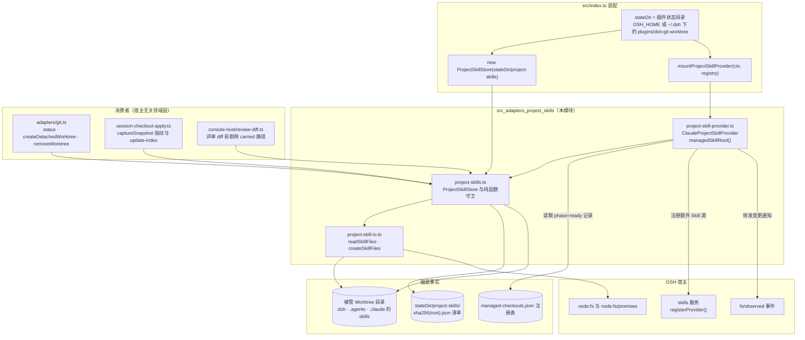
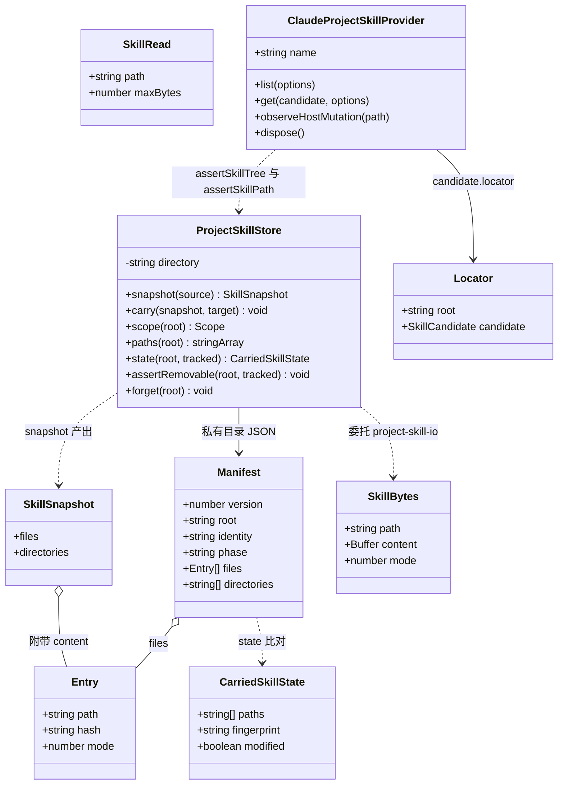
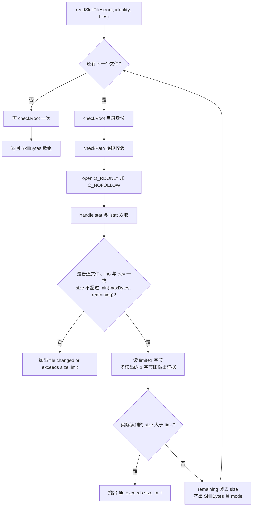
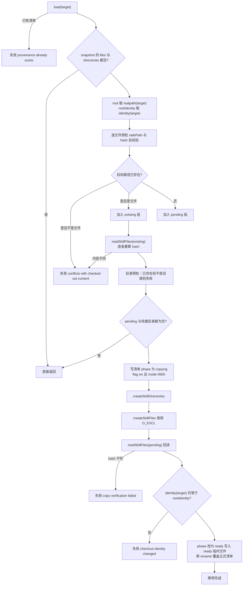
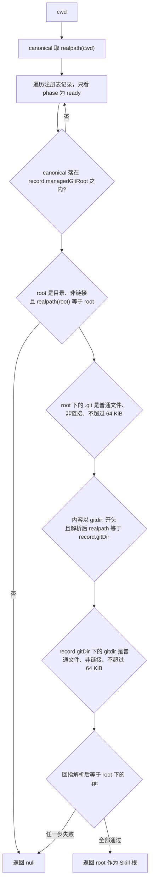
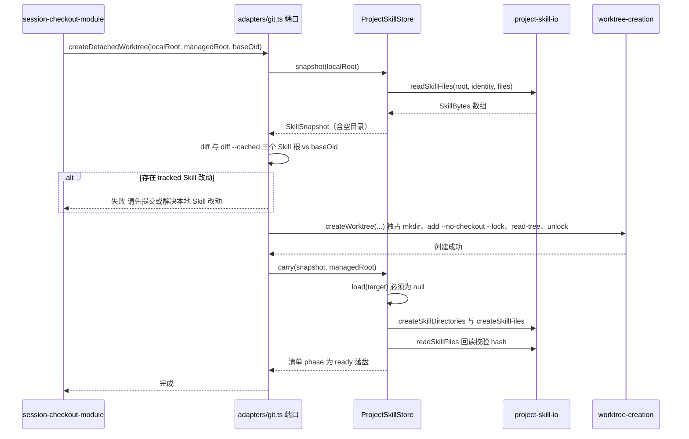
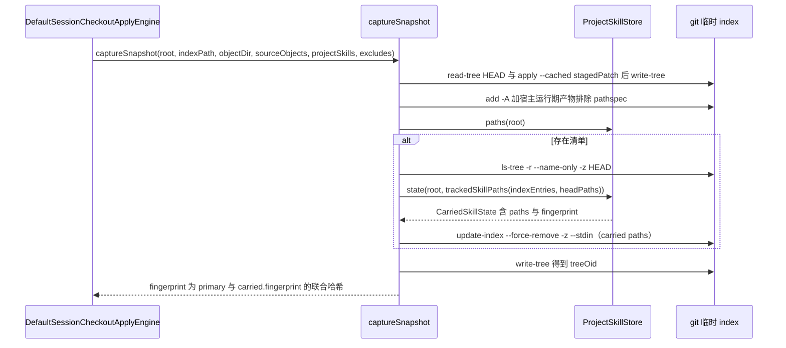

# Project Skills 适配器：随会话携带的项目级 Skill 资源

!!! info "Generated documentation"
    This page was written by CodeWiki from the source code at commit [`f93ba818`](https://github.com/wloops/dsh-git-worktree/commit/f93ba8188971886c09b4c40e12c746a23853c229) on 2026-11-06 with `doubao-seed-2.1-lite`. Check the code before relying on details.

`src_adapters_project_skills` 是 [src_adapters：会话检出（Session Checkout）的宿主适配层](../src_adapters.md) 四个子模块中最「专职」的一片：它不负责执行 Git 命令，也不负责注册表落盘，只解决一个具体问题 —— **当会话从 Local 检出被搬进托管 Worktree 时，那些不属于版本库、但项目运行离不开的本地 Skill 资源（`.dsh/skills`、`.agents/skills`、`.claude/skills`）必须一起过去，并且在整个生命周期内既不被误当作「可交付改动」，也不被悄悄删除。**

为此它承担三件事：

1. **携带（carry）**：在创建托管 Worktree 的前后，把三个 Skill 根里的文件与空目录复制到新检出，并在宿主私有目录里留下一份**溯源清单（manifest）**。
2. **遮蔽（mask）**：让 `git status`、Apply 评审快照、Console 评审 diff 三处读取都能把这些「宿主辅助文件」从「有没有可交付改动」的判断里剔除，同时**绝不遮蔽** tracked 文件的修改、暂存、重命名与删除。
3. **发现（discover）**：通过宿主 skills 服务把托管 Worktree 里的 `.claude/skills` 注册为一个额外的项目级 Skill 源（原生 `.dsh` / `.agents` 发现链路完全不变），使 Agent 在隔离检出里仍能看见随它带过去的 Skill。

| 文件 | 核心导出 | 职责 |
| --- | --- | --- |
| `src/adapters/project-skill-io.ts` | `SkillRead`、`SkillBytes`、`readSkillFiles()`、`createSkillDirectories()`、`createSkillFiles()` | 最底层的受限 IO：逐段 `lstat`、`O_NOFOLLOW`、`O_EXCL`、字节预算、目录身份复验 |
| `src/adapters/project-skills.ts` | `ProjectSkillStore`、`SkillSnapshot`、`CarriedSkillState`、`Entry`、`Manifest`、`PROJECT_SKILL_ROOTS`、`trackedSkillPaths()`、`hasDeliverableStatus()`、`assertSkillTree()`、`assertSkillPath()` | 领域侧门面：清单读写、快照、携带、状态指纹、可删除性守卫、Git 状态过滤 |
| `src/adapters/project-skill-provider.ts` | `ClaudeProjectSkillProvider`、`Locator`、`managedSkillRoot()`、`mountProjectSkillProvider()` | 宿主 skills 服务适配：把托管根目录下的 `.claude/skills` 变成合法 Skill 源 |

> 本模块的三条设计信条：**溯源清单只存放在宿主私有目录，永不接受来自被管检出内部的排除清单**；**「大概是复制完了」不算复制完成，必须逐文件哈希回读**；**复制出去的资源一旦被人改动，就宁可保住整个 Worktree，也不删**。

---

## 1. 在系统中的位置

本模块在插件入口 `apply()`（`src/index.ts:370-408`）里一次性装配，随后被三条链路消费：

要点：

- 领域层通过**可选注入**使用本模块：`SessionCheckoutApplyEngineOptions.projectSkills`（`src/session-checkout-apply.ts:324`）与 `GitPortOptions.projectSkills`（`src/adapters/git.ts:59-63`）。不注入时 Git 端口会自建一个 store（`src/adapters/git.ts:275`：`options.projectSkills ?? new ProjectSkillStore(join(dirname(options.hooksPath), 'project-skills'))`），因此不存在「忘记装配就静默降级」的缝隙 —— 顶多是清单目录换了一个位置。
- `ClaudeProjectSkillProvider` 是**纯附加**的项目源：`rank: 250` 排在原生项目源之后，不改变 `.dsh` / `.agents` 的优先级；它也绝不接受 Skill 文件自己声称的根目录。
- 兄弟子模块的职责边界：Git 命令执行与 Worktree 创建协议见 [Git 执行适配器：唯一出口 runGit、可证明的 Worktree 创建与首次提交协议](src_adapters_git_execution.md)；注册表与文件锁见 [持久化适配器：文件系统端口、原子注册表与崩溃安全 JSON IO](src_adapters_persistence.md)；宿主 Session / Workspace / cwd 服务探测与官方 `create_worktree` 接管见 [主机绑定适配层（src/adapters/lookup.ts、src/adapters/working-directory.ts 与 src/official-worktree-takeover.ts）](src_adapters_host_binding.md)。

## 2. 数据模型

字段语义与不变量：

| 字段 | 语义 | 校验点 |
| --- | --- | --- |
| `Entry.path` | 相对被管根的 POSIX 风格路径 | `safePath()`：必须以 `PROJECT_SKILL_ROOTS` 之一开头（或恰等于该根），分段非空、无 `.` / `..`、不含反斜杠、冒号与控制字符 |
| `Entry.hash` | 内容 SHA-256（`digest()`） | 清单加载时要求 `/^[0-9a-f]{64}$/`；回读与携带时逐条重算比对 |
| `Entry.mode` | `stat.mode & 0o777` | 清单加载时要求为整数且落在 `0..0o777`；状态比对时模式变化即 `modified` |
| `Manifest.root` | `await realpath(root)` 的结果 | 必须等于当前 realpath |
| `Manifest.identity` | `dev:ino:birthtimeNs` | 必须等于当前目录身份，**防止目录被整体替换后清单被复用** |
| `Manifest.phase` | `copying` / `ready` | `load()` 只接受 `ready`；`copying` 一律抛出「Skill copy is incomplete ...」 |
| `Manifest.directories` | 快照里的空目录 | 段数校验复用 `safePath` 加哨兵段 `.directory-check` |
| `SkillSnapshot.directories` | 需要在目标新建的空目录 | 由 `inventory()` 遍历时收集「无子项」目录 |
| `CarriedSkillState.fingerprint` | 现值与清单差异的聚合哈希 | 参与 `captureSnapshot()` 的整体指纹，使「Skill 被动过」足以让 Apply 判定 stale |

清单文件名是 `join(<stateDir>/project-skills, digest(resolve(root)) + '.json')`：以被管根的**解析路径哈希**为键，写在宿主私有目录里。因此被管检出内部既看不到、也改不掉自己的「豁免名单」—— 这是整个遮蔽机制的信任根基（源码注释：*Host-private provenance: never accept an exclusion list from the managed checkout*）。

## 3. 底层 IO：`project-skill-io.ts`

该文件是唯一直接碰被管检出文件系统的地方，三个导出函数共用两条守卫：

- `checkRoot(root, expected)`：`lstat(root, { bigint: true })`，必须是目录、不能是符号链接，且 `dev:ino:birthtimeNs` 必须等于调用方一开始记录的 `identity`。每一次文件操作**前后**都会调用它，于是「操作间隙里目录被人换掉」必然变成一个失败，而不是一次静默的错位读写。
- `checkPath(root, path, createParents)`：首段必须落在 `.dsh` / `.agents` / `.claude`，第二段必须是 `skills`，任一为空段、`.`、`..` 或含非法字符即拒绝；随后逐段 `lstat`，拒绝符号链接与特殊文件，中间层要求是目录、末段允许文件或目录；`createParents` 时逐层 `mkdir`（`EEXIST` 吞掉），末段 `ENOENT` 视为「待创建」而返回。

三处刻意为之的细节：

- **总预算**：`readSkillFiles` 维护 `remaining = 64 * 1024 * 1024`，逐文件递减；单个文件的实际上限是 `Math.min(file.maxBytes, remaining)`。因此「读满一堆文件把内存打爆」在 IO 层就被封死，不依赖调用方自觉。
- **写入只创建不覆盖**：`createSkillFiles` 用 `O_WRONLY | O_CREAT | O_EXCL | O_NOFOLLOW` + 指定 `mode`，写完在非 Windows 平台补一次 `chmod(file.mode)`，再 `handle.sync()` 落盘，最后 `checkRoot` + `checkPath` 复核。
- **目录创建走哨兵**：`createSkillDirectories` 借用路径 `${directory}/.directory-check` 调用 `checkPath(..., true)`，被真正创建的是各级父目录，哨兵文件本身不落地；这样可以「逐段创建而不让递归 mkdir 跟随链接」。

> 文件顶部注释明确划出边界：这些检查服务于「本地可信创建」，**不是**对「另一进程在两次文件系统调用之间恶意替换祖先目录」的原子包含性保证。

## 4. 领域门面：`ProjectSkillStore`

### 4.1 快照与清单加载

`snapshot(source)` 就是 `inventory(source, PROJECT_SKILL_ROOTS, new Set(), directories)`：递归遍历三个根，每目录 `readdir().sort()` 以保证跨平台稳定；遇到空目录记入 `directories`；边遍历边累计字节与条目数，超过 `MAX_BYTES`（64 MiB）或 `MAX_FILES`（5000）、或遍历条目超过 10000 / 深度超过 64 即失败；遍历完成后一次性交给 `readSkillFiles()` 取字节并当场算出 `hash`。`inventory()` 在开始时取一次 `identity(root)`、遍历前再取一次，把「枚举期间的目录替换」变成失败。

`load(root)`（私有）是**唯一**读取清单的入口，校验序列为：

1. `lstat` 必须是普通文件、非符号链接、大小 ≤ 2 MiB；
2. `boundedRead()` —— 打开时 `O_NOFOLLOW`，读前记 `stat`，读满 `size + 1` 字节，读后再取 `handle.stat()` 与命名路径 `lstat`，逐条比较 `size`/`mtimeMs`/`ino`/`dev`，证明「读取期间文件没被改、也没被换成链接」；
3. 结构校验：`version === 1`、`root === realpath(root)`、`identity === identity(root)`、`phase === 'ready'`、每条文件记录的 `path`/`hash`/`mode` 合法且路径集合无重复、`directories` 数组长度与形态合法；
4. 任一不满足即**抛错**（而不是当作没有清单），只有 `ENOENT` 才返回 `null`。

第 4 步是安全关键：清单存在但不匹配 = 状态不可知 = 必须失败；把它读成「没有辅助文件」就会让被管检出里一堆未登记的 Skill 文件被判成「干净」进而可被删除。

### 4.2 携带：`carry(snapshot, target)`

三个容易忽略但很关键的语义：

1. **冲突优先于写入**：所有「与检出已有内容相撞」的判断都发生在写下任何辅助文件之前。已有同名文件**只有内容逐字节相同**才被容忍，且这类文件**不会进入清单** —— 它是版本库自己的内容，本模块不认领它，也就不能把它当作后续交付的豁免项。
2. **排他发布**：清单首写用 `flag: 'wx'`（源码注释：*Exclusive publication prevents an earlier uncertain attempt from being overwritten*），就绪态用 `<manifest>.ready` + `rename`。若这一步失败（例如同名 `.ready` 被占位），复制出去的副本会**保留**而清单停在 `copying` —— 于是 `load()` / `paths()` / `assertRemovable()` 一律抛「incomplete」：工作树不会被判成干净，不会被允许删除，也不会被第二次 `carry` 覆盖。该行为由 `tests/project-skills.test.ts` 的 *retains a completed copy when final provenance publication fails* 固定。
3. **空目录也要带**：`directories` 让「只有空目录」的 Skill 资源位在被管检出里同样存在；一旦它消失，`state()` 直接把 `modified` 置真。测试 *carries empty resource directories and preserves later content instead of discarding it* 进一步要求：携带之后往该空目录里写的新文件也必须被保住。

### 4.3 状态与指纹：`state(root, tracked)`

`state()` 是每次需要判断「工作树到底改没改」时被调用的核心。流程：

1. `load(root)` 取清单，没有清单则返回 `null`（此时 Git 自己说了算）。
2. 过滤掉 `tracked` —— 版本库里本来就有的路径交给 Git 判断，本模块不越权。
3. 对清单里的每个目录做 `inspectPath` + `isDirectory()`，缺失即 `modified`，并把 `"<directory> directory|missing"` 计入哈希序列。
4. 以 `ownedSkillDirectories()` 推导的「前三段」目录（外加路径本身不超过三段的 Skill 根文件）为根重新 `inventory()`，逐条比对 `hash` 与 `mode`；缺席记为 `'missing'`。序列项形如 `path\0hash\0mode`。
5. 把「清单里没有、但本次扫到且非 tracked」的新资源也追加进 `paths` 并置 `modified = true`。

返回的 `CarriedSkillState`：

- `paths`：全部被认领的辅助路径（清单文件 + 新出现的非 tracked 文件）—— 后续 `update-index --force-remove` 与 `hasDeliverableStatus` 的输入。
- `fingerprint`：上述序列以 `\0` 连接后的 SHA-256 —— **改权限、加文件、目录消失都会改变它**，不只是改内容。
- `modified`：内容 / 模式 / 目录缺失 / 新增资源任一发生即为真。

### 4.4 守卫与 Git 状态过滤（纯函数）

| 导出 | 作用 |
| --- | --- |
| `trackedSkillPaths(indexEntries, headPaths)` | 解析 `ls-files --stage -z`（取制表符之后的路径）与 `ls-tree -r --name-only -z`，得到「版本库里已有的 Skill 路径」。这是区分「Skill 归 Git 管」与「Skill 归宿主辅助」的唯一依据。 |
| `hasDeliverableStatus(output, auxiliary, directories)` | 只把 `?? <path>` 记录视为候选辅助项：路径在 `auxiliary` 集合内、或落在某个 carried 目录下 → 不算可交付；**任何其它状态**一律返回 `true`（源码注释：*Only ?? records are auxiliary; tracked edits, renames and deletions stay visible*）。 |
| `assertSkillTree(root, skillRoot)` | 递归预扫描整棵 Skill 树（上限 10000 条目 / 64 层），逐段拒绝链接与特殊文件；供 provider 在**发现之前**先把「指向项目外的链接」挡掉。 |
| `assertSkillPath(root, path)` | `safePath` 加 `inspectPath` 的组合，供 provider 校验单个候选文件的相对路径；缺失或不安全即抛错。 |
| `PROJECT_SKILL_ROOTS` | 三个合法根的常量，`git.ts` 的 `createDetachedWorktree` 用它做 `diff` pathspec。 |

`ProjectSkillStore` 自身的两个出口方法：

- `assertRemovable(root, tracked)`：删除 Worktree 前的许可证明。`state.modified` → 「carried Skills were modified; retain this Worktree to preserve them」；随后用**全根** `inventory(root)` 检查是否出现「既不在 `state.paths` 也不在 `tracked`」的路径 → 「new Skill resource must be preserved」。注意第二步即使 Git 已 ignore 该文件也照样拦（测试 *refuses new unknown resources even when they would be ignored by Git*）。
- `forget(root)`：清理完成后删除清单本身，`rm(..., { force: true })` 幂等。

## 5. 宿主集成：`ClaudeProjectSkillProvider`

### 5.1 Skill 根只能由宿主记录反查

`managedSkillRoot(registry)` 返回一个 `(cwd) => Promise<string | null>` 解析器。它遍历 `registry.read().managedCheckouts` 中 `phase === 'ready'` 的记录（契约见 [会话检出领域契约（session_checkout_domain_contracts）](../session_checkout_domain/session_checkout_domain_contracts.md)）：

`.git → gitDir` 与 `gitDir/gitdir → .git` 的双向指针校验，加上大小上限与拒绝链接，等于要求「这个目录确实是注册表授权的那个 Worktree 的顶层」，才允许它被当作 Skill 根。源码注释写得很直白：*Resolve against host-owned records, never a root claimed by a Skill file.*

### 5.2 提供者的并发与生命周期

- `run()` 把所有 `list` / `get` 串成一条 Promise 链（`this.operations`），**与 `dispose()` 互斥**：`dispose()` 先置 `disposed`、`await this.operations`，再清空并并行释放内部 provider。测试 *serializes pending lookups with disposal and rejects later lookups* 固定了「dispose 必须等在跑的查找之后」与「dispose 之后查找返回空」。
- 每个 root 复用一个 `FileSystemSkillProvider`：`includeDefaultRoots: false`、`customSkillDirs: [join(root, '.claude', 'skills')]`、`watch: true`、`watchFollowSymlinks: false`。缓存上限 32，超出时淘汰最早插入的一个并 `dispose()`（Map 的插入序即 LRU 序）。
- `listNow()`：`resolveRoot()` → `assertSkillTree(root, '.claude/skills')` → 内部 provider 枚举 → 逐条把候选文件换算成相对 POSIX 路径并 `assertSkillPath` → 重写为 `{ provider: 'worktree-project-claude', source: 'project-claude', rank: 250, locator: { root, candidate } }`。原始 observation 是数组还是带 `candidates` 的对象会被原样保持其形态。
- `getNow()`：额外要求 `locator.root === resolveRoot(cwd)` —— **换会话、换 cwd 就取不到**，这是 cwd 隔离的落点（测试 *loads Claude project Skills with real upstream parsing, resource bases and cwd isolation*）；候选路径再次过 `assertSkillTree` + `assertSkillPath` 才交给内部 provider 读取。
- 提前退出的四道门：`disposed`、缺 `options.cwd`、`control.signal.aborted`、`options.signal?.aborted`。
- `candidatePath()` 处理宿主版本差异：DSH 0.1 把路径放在 `candidate.path`，0.2 放在 `candidate.locator.path`。
- `observeHostMutation(path)` 把宿主 `fs/observed` 事件转发给每个内部 provider，使其文件监听缓存与宿主视图一致（仅当存在 `actor` 时）。

`mountProjectSkillProvider(ctx, registry)` 是装配函数：在 `ctx.inject(['skills'], scoped => ...)` 内注册 provider 工厂、订阅 `fs/observed`、并用 `scoped.effect(function* () { yield () => provider.dispose() }, 'worktree project Skill compatibility')` 保证卸载时释放。

## 6. 关键流程：一次创建如何把 Skill 带过去

创建前的那道 `diff` 守卫值得单独强调（`src/adapters/git.ts:391-394`）：**tracked Skill 文件带未提交修改时直接拒绝创建**。因为该文件会同时是「Git 内容」与「待复制内容」，两者一旦在目标里分叉，本模块就无法再证明「哪个是宿主辅助、哪个是版本库真相」，交付排除也随之失去依据。完整的创建回滚协议见 [Git 执行适配器：唯一出口 runGit、可证明的 Worktree 创建与首次提交协议](src_adapters_git_execution.md)。

## 7. 关键流程：交付判定如何排除辅助文件

- 排除只发生在**临时 index**（`GIT_INDEX_FILE` 指向临时文件）上，被管检出的真实 index 与工作树完全不动；因此提交的树里不含宿主辅助文件，而用户的暂存状态也不被污染。
- `excludes` 默认来自 `deliveryExcludePathspecs()`，该函数属于 [Worktree 核心操作与纯函数工具层（worktree_core_operations）](../worktree_core_operations.md)；本模块负责的是「Skill 辅助文件」这一条独立通道，两者叠加使用。
- 当存在 carried 路径时，整体指纹 = `sha256(primaryFingerprint + carried.fingerprint)`。这意味着「只改了一个 Skill 文件的权限」也会让 Local / Isolated 快照与已评审 plan 不匹配，从而触发 `stale_local` / `stale_isolated`，而不是被当成无事发生。
- 同样的排除逻辑出现在三处：`status`（`src/adapters/git.ts:371-388`，经 `scope()` + `hasDeliverableStatus()`）、`removeWorktree`（先 `assertRemovable` 再 `worktree remove --force` 再 `forget`）、Console 评审 diff 读取器（`src/console-host/review-diff.ts:147-161`：把 carried 路径按单批不超过 4000 字符分组 `update-index --force-remove`，再对临时 index 做 `diff --cached`；`ls-files` 或 `ls-tree` 被截断时直接失败而不是少报）。后两条链路的完整描述见 [会话检出交付引擎（session_checkout_apply_engine）](../session_checkout_domain/session_checkout_apply_engine.md) 与 [Worktree Console 宿主服务（`src/console-host/`）](../../worktree_console_protocol_and_host_service/worktree_console_host.md)。

## 8. 限制与已知边界

| 主题 | 具体数值 / 行为 | 出处 |
| --- | --- | --- |
| Skill 根 | 仅 `.dsh/skills`、`.agents/skills`、`.claude/skills`；Skill 根本身也可以是「被跟踪的文件」（Windows 把已提交的符号链接检出为纯文本占位符时），此时该路径原样接受 | `project-skills.ts` 的 `PROJECT_SKILL_ROOTS` 与 `safePath()` |
| 单次快照规模 | 不超过 5000 文件、64 MiB 字节；遍历条目不超过 10000、深度不超过 64 | `MAX_FILES`、`MAX_BYTES`、`inventory()`、`assertSkillTree()` |
| 清单文件 | 单个 JSON 不超过 2 MiB；`directories` 不超过 10000 项；写入 mode `0600` | `load()`、`carry()` |
| `.git` / `gitdir` 指针 | 必须是普通文件、非链接、不超过 64 KiB | `managedSkillRoot()` |
| provider 缓存 | 最多同时持有 32 个 root 的 `FileSystemSkillProvider`，LRU 淘汰并 dispose | `ClaudeProjectSkillProvider.provider()` |
| 符号链接与 junction | 一律拒绝（逐段 `lstat` 判定，Windows junction 同样表现为链接），且绝不修改链接目标 | `inspectPath()`、`checkPath()`、测试 *rejects source and later resource directory junctions* |
| Windows 权限 | 创建时以 `mode` 传参、不额外 `chmod`；POSIX 下权限差异会被 `state()` 记为 `modified` | `createSkillFiles()`、测试 *preserves executable resources* |
| 安全边界自述 | 检查用于「可信本地创建」，不承诺对抗「他进程在两次 fs 调用之间替换祖先目录」的原子包含性 | `project-skill-io.ts` 顶部注释 |
| 文案本地化 | 本模块错误串是宿主自有英文常量，统一前缀 `Project Skills:`，未走 `hostMessage()`；领域层文案机制见 [src_i18n 国际化与消息目录模块](../../project_foundation_and_localization/src_i18n.md) | `project-skills.ts` 的 `failure()` |

## 9. 构建与测试

- **依赖形态**：`@deepseek-ai/dsh-skill`、`@deepseek-ai/dsh-skill-filesystem`、`@deepseek-ai/dsh-fs`、`@deepseek-ai/cordis` 在 `package.json` 中均为 **peerDependencies**（版本区间同时覆盖 DSH `0.1.2-rc.1`、`0.2.0-rc.1`、`0.2.1-rc.1`），因此 provider 侧必须同时容忍 `candidate.path` 与 `candidate.locator.path` 两代形状 —— 这正是 `candidatePath()` 存在的原因。构建与打包细节见 [构建、CI 与打包（build_ci_and_packaging）](../../project_foundation_and_localization/build_ci_and_packaging.md)。
- **用例分布**：
  - `tests/project-skills.test.ts`：清单跨重启有效并检测编辑与删除、目标已有内容时既不静默覆盖也不生成豁免、最终发布失败时保留副本且一切读取报 incomplete、目录被替换后清单不可复用、Git ignore 也无法豁免新资源、链接与 junction 被拒且不动链接目标、读取前先按大小设限、可执行位与后续权限变更、空目录携带、Skill 根本身是文件。
  - `tests/project-skill-provider.test.ts`：真实上游解析与 `resourceBase`、cwd 隔离（换 cwd 取不到、无 cwd 返回空）、原生 `project-dsh` / `project-agents` 优先于 `project-claude`、指向项目外的链接在发现之前即被拒、查找与 dispose 串行化。
- **运行方式**：`pnpm test`（`vitest run`）。注意 `vitest.config.ts:25` —— Windows 上 `fileParallelism` 被关闭，原因是重型 Git fixture 并发会争用进程与文件句柄、可能超出超时并锁住临时目录；这与本模块「逐段 `lstat` + 身份比对」对文件句柄状态高度敏感的特性直接相关。超时统一为 60 秒。

## 10. 相关文档

- 父模块装配总览：[src_adapters：会话检出（Session Checkout）的宿主适配层](../src_adapters.md)
- Git 端口如何调用本模块（`status` / `createDetachedWorktree` / `removeWorktree`）：[Git 执行适配器：唯一出口 runGit、可证明的 Worktree 创建与首次提交协议](src_adapters_git_execution.md)
- 注册表（`managedSkillRoot` 的数据来源）与原子写、文件锁：[持久化适配器：文件系统端口、原子注册表与崩溃安全 JSON IO](src_adapters_persistence.md)
- 宿主 Session / Working Directory 绑定：[主机绑定适配层（src/adapters/lookup.ts、src/adapters/working-directory.ts 与 src/official-worktree-takeover.ts）](src_adapters_host_binding.md)
- 端口契约（`SessionCheckoutRegistryPort`、`SessionCheckoutApplyEngineOptions`、`ManagedCheckoutRecord.phase`）：[会话检出领域契约（session_checkout_domain_contracts）](../session_checkout_domain/session_checkout_domain_contracts.md)
- Apply 引擎中的快照指纹与交付事务：[会话检出交付引擎（session_checkout_apply_engine）](../session_checkout_domain/session_checkout_apply_engine.md)
- 插件入口与运行期装配：[会话检出运行时模块（session_checkout_runtime）概述](../session_checkout_domain/session_checkout_runtime.md)
- 排除 pathspec 等纯函数：[Worktree 核心操作与纯函数工具层（worktree_core_operations）](../worktree_core_operations.md)
- Console 评审 diff 与交付证明：[Worktree Console 宿主服务（`src/console-host/`）](../../worktree_console_protocol_and_host_service/worktree_console_host.md)
- 评审面板展示层：[client_review_console：受管 Worktree 验收控制台（浏览器端）](../../worktree_client_interface_layer/client_review_console.md)

## 11. 阅读顺序建议

1. 先读 `project-skills.ts` 顶部的四个私有守卫 `safePath` / `identity` / `inspectPath` / `boundedRead` —— 本模块所有安全性质都建立在这不到 40 行的代码上。
2. 再读 `ProjectSkillStore.carry()` 与 `load()` —— 理解「复制完成」为什么必须靠回读哈希与身份复验来证明，以及 `phase` 为什么只有 `ready` 一个合法终态、不匹配为什么不返回 `null`。
3. 然后读 `project-skill-io.ts` —— 理解 `O_NOFOLLOW` / `O_EXCL` / 总字节预算如何兜住最底层 IO。
4. 接着读第 7 节的三个消费点（`status`、`captureSnapshot`、评审 diff） —— 辅助文件如何在「不污染交付」的前提下存活下来。
5. 最后读 `project-skill-provider.ts` —— 理解 Skill 根为何只能从注册表加 `.git` 双向指针推出，以及发现之前的 `assertSkillTree` 预扫描为什么不可省略。

??? abstract "Documented components (9)"
    - [`SkillBytes`](https://github.com/wloops/dsh-git-worktree/blob/f93ba8188971886c09b4c40e12c746a23853c229/src%5Cadapters%5Cproject-skill-io.ts) — `src\adapters\project-skill-io.ts`
    - [`SkillRead`](https://github.com/wloops/dsh-git-worktree/blob/f93ba8188971886c09b4c40e12c746a23853c229/src%5Cadapters%5Cproject-skill-io.ts) — `src\adapters\project-skill-io.ts`
    - [`ClaudeProjectSkillProvider`](https://github.com/wloops/dsh-git-worktree/blob/f93ba8188971886c09b4c40e12c746a23853c229/src%5Cadapters%5Cproject-skill-provider.ts) — `src\adapters\project-skill-provider.ts`
    - [`Locator`](https://github.com/wloops/dsh-git-worktree/blob/f93ba8188971886c09b4c40e12c746a23853c229/src%5Cadapters%5Cproject-skill-provider.ts) — `src\adapters\project-skill-provider.ts`
    - [`CarriedSkillState`](https://github.com/wloops/dsh-git-worktree/blob/f93ba8188971886c09b4c40e12c746a23853c229/src%5Cadapters%5Cproject-skills.ts) — `src\adapters\project-skills.ts`
    - [`Entry`](https://github.com/wloops/dsh-git-worktree/blob/f93ba8188971886c09b4c40e12c746a23853c229/src%5Cadapters%5Cproject-skills.ts) — `src\adapters\project-skills.ts`
    - [`Manifest`](https://github.com/wloops/dsh-git-worktree/blob/f93ba8188971886c09b4c40e12c746a23853c229/src%5Cadapters%5Cproject-skills.ts) — `src\adapters\project-skills.ts`
    - [`ProjectSkillStore`](https://github.com/wloops/dsh-git-worktree/blob/f93ba8188971886c09b4c40e12c746a23853c229/src%5Cadapters%5Cproject-skills.ts) — `src\adapters\project-skills.ts`
    - [`SkillSnapshot`](https://github.com/wloops/dsh-git-worktree/blob/f93ba8188971886c09b4c40e12c746a23853c229/src%5Cadapters%5Cproject-skills.ts) — `src\adapters\project-skills.ts`

