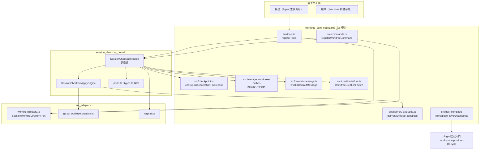
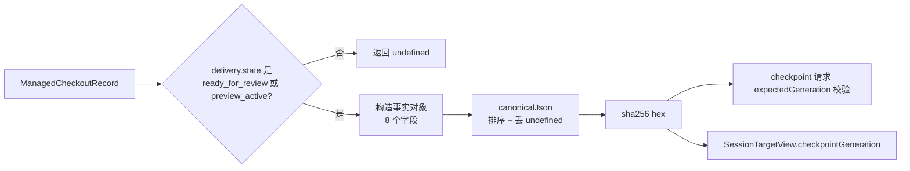
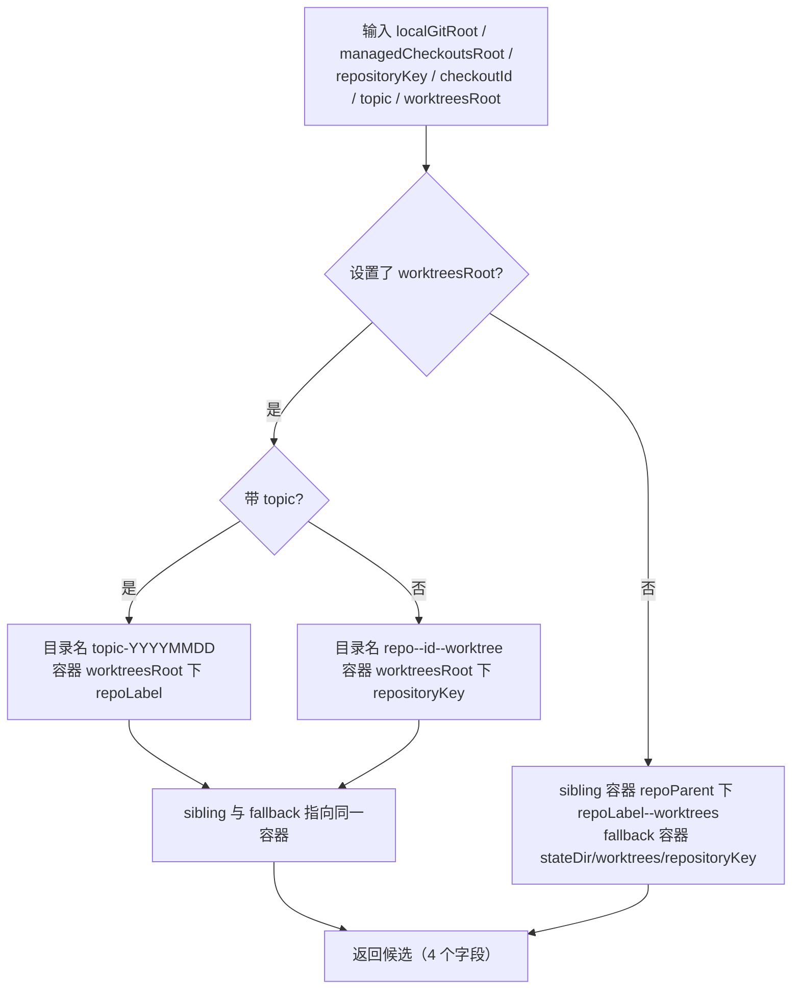
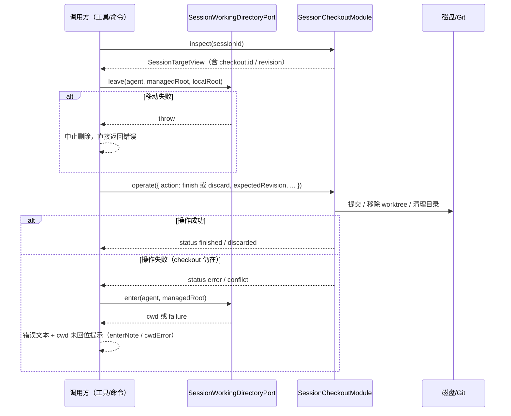
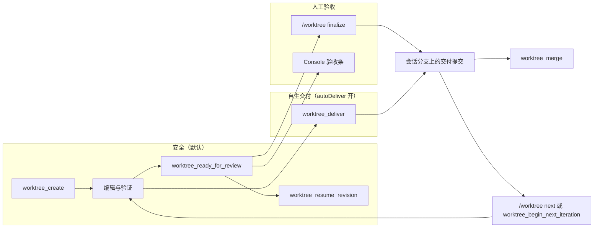
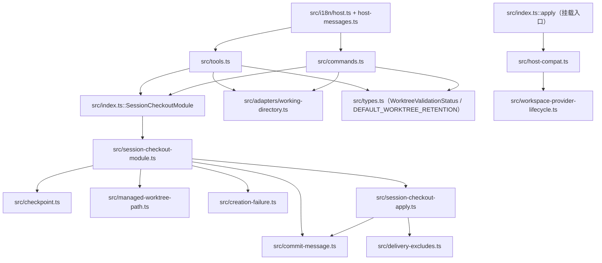

# Worktree 核心操作与纯函数工具层（worktree_core_operations）

!!! info "Generated documentation"
    This page was written by CodeWiki from the source code at commit [`55374a27`](https://github.com/wloops/dsh-git-worktree/commit/55374a27f4099ec8dcd0d6163f5544d60b4f3874) on 2026-11-06 with `doubao-seed-2.1-lite`. Check the code before relying on details.

`worktree_core_operations` 是 [核心 Worktree 领域与基础设施模块](../core_worktree_domain_and_infrastructure.md) 下最薄、也最独立的一层。它不包含状态机，也不直接调用 Git，只做两类事情：

1. **纯函数规则层**：把「交付生成指纹（CAS generation）」、「受管 Worktree 目录/分支命名」、「交付排除项（宿主运行期产物）」、「提交信息校验」、「创建失败的回滚语义」、「宿主 Workspace 客户端世代判定」这些必须可预测、可单测、无副作用的规则收敛成独立文件，供上层状态机与适配器复用。
2. **宿主注册面（registration surface）**：`src/tools.ts` 与 `src/commands.ts` 是插件面向**模型**与面向**人类**的两张面孔。它们把 [会话检出领域模块（session_checkout_domain）](session_checkout_domain.md) 暴露的 `SessionCheckoutModule` 接口翻译成模型工具（`worktree_*`）与 `/worktree` 斜杠命令，并负责在操作前后正确迁移会话的工作目录（cwd）。

这一层的共同设计原则是：**破坏性动作必须由人发起，模型工具止步于 Ready for Review**（`autoDeliver` 打开时才允许 `worktree_deliver` 自主交付）；**任何可能删除 Worktree 的操作，必须先把会话 cwd 移出去，移不出去就不删**。

---

## 1. 在系统中的位置



* 状态机本体的生命周期（`bind` / `operate` / `reconcile` / 保留期 / LRU 逐出）见 [会话检出领域模块（session_checkout_domain）](session_checkout_domain.md) 与其子页 [会话检出运行时模块（session_checkout_runtime）概述](session_checkout_domain/session_checkout_runtime.md)。
* Apply 引擎的快照/合并/写入细节见 [会话检出交付引擎（session_checkout_apply_engine）](session_checkout_domain/session_checkout_apply_engine.md)。
* Git / 文件系统 / 注册表 / 工作目录等端口的 Node 实现见 [src_adapters：会话检出（Session Checkout）的宿主适配层](src_adapters.md)。
* 宿主侧协议与 Console 服务见 [Worktree Console 协议与宿主服务总览](../worktree_console_protocol_and_host_service.md)，浏览器侧消费方见 [worktree_client_interface_layer：Worktree 浏览器端客户端界面层总览](../worktree_client_interface_layer.md)。

---

## 2. 纯函数规则层

### 2.1 `src/checkpoint.ts` — 评审与 checkpoint 链的 CAS 代次

`canonicalJson(value)` 是本文件与状态机内部共用的**规范化 JSON** 实现：数组递归保序，对象按 key 的 `localeCompare` 排序、丢弃值为 `undefined` 的字段，标量走 `JSON.stringify`。它的意义在于：**同一逻辑事实无论字段插入顺序如何，序列化结果字节相同**，因此哈希才可作为比较交换（CAS）凭据。

`checkpointGenerationForRecord(record)` 只对处于 `ready_for_review` 与 `preview_active` 两个状态的记录返回哈希，其余状态返回 `undefined`（没有「当前有效评审」就没有可比较的代次）。参与哈希的事实集合是刻意选小的：

| 字段 | 来源 | 变了意味着什么 |
| --- | --- | --- |
| `checkoutId` / `revision` | 台账记录 | 目标或乐观锁版本已漂移 |
| `reviewId` | `delivery.review` | 评审卡已过期，不是当前那张 |
| `isolatedHeadOid` / `isolatedFingerprint` | 评审快照 | Worktree 在评审之后又被改动 |
| `checkpointCount` | `record.checkpoints` | 已存阶段数量变化（链已前进） |
| `previewId`（无 Preview 时为 `null`） | `delivery.preview` | 本地预览身份变化 |
| `phase` | 记录阶段 | 状态机已推进 |

调用方是 `operateCheckpoint`：客户端提交 checkpoint 时必须带回 `expectedGeneration`，服务端在**加锁前后各校验一次**，不匹配即返回 `stale_target`。同时 `checkpointGenerationForRecord` 的结果也被投影进 `SessionTargetView.checkpointGeneration`，供 Console 契约与客户端恢复续作使用（见 [会话检出领域契约（session_checkout_domain_contracts）](session_checkout_domain/session_checkout_domain_contracts.md)）。



### 2.2 `src/managed-worktree-path.ts` — 目录名与分支名

该文件回答两个问题：**Worktree 目录叫什么、放在哪**，以及**会话分支叫什么**。

* `sanitizeManagedWorktreeLabel(rawName)`：把仓库 basename（或 agent 给的 topic）压成单个安全可读的路径段——NFC 规范化、Windows 非法字符替换为 `-`、空白折叠、连续短横合并、去首尾点/空白/短横、按**码点**截断到 40、空结果回退 `repository`、命中 `CON/PRN/AUX/NUL/COM1-9/LPT1-9` 保留名时前置 `_`。
* `checkoutIdentity(value, length)`：只保留字母数字并小写，取前 `max(8, length)` 位，空值回退 `checkout`。
* `createManagedWorktreeRepositoryKey(canonicalGitRoot)`：`sha256(canonicalGitRoot)` 前 12 位十六进制，作为「同 basename 不同仓库」的稳定分区键。
* `sanitizeBranchSegment(raw)` 与 `createSessionBranchCandidates({sessionId, topic, limit})`：生成会话分支候选名 `feat/sess-<会话>[--<主题>]`，重名时按 `-2`、`-3` … 递增（默认 5 个），最后统一用 `BRANCH_SEGMENT_FORBIDDEN` 扫掉 `..`、`@{`、`//`、`.lock`、尾随 `/` 等 git 非法形态。**调用方逐个尝试创建**，绝不覆盖已有分支（复用判定在状态机 `attachSessionBranch` 里）。
* `createManagedWorktreeDirectoryName` → `<repoLabel>--<identity>--worktree`；本地适配的 `createTopicManagedWorktreeDirectoryName` → `<topic>-<YYYYMMDD>`，identity 长度超过 8 时追加 `--<id>` 形式的后缀以消解同日同题冲突；`createTopicDateStamp(now)` 生成本地 `YYYYMMDD`。
* `createManagedWorktreePathCandidates(...)` 返回 `ManagedWorktreePathCandidates { siblingContainer, siblingRoot, fallbackContainer, fallbackRoot }`，**只算路径、不碰文件系统**：



状态机侧的使用方式是：对 `identityLength ∈ {8, 12, 32}` 各生成一组候选，先筛掉「已被别的台账记录声明」和「磁盘上已存在」的路径，取第一个可用者；`sibling` 优先（避免 Local 把受管 Worktree 当未跟踪文件），当外层目录还有别的仓库容器时降级到 `fallback`；设置了 `worktreesRoot` 时两种容器合一，重试不再有区分意义。

### 2.3 `src/delivery-excludes.ts` — 让「评审看到的」等于「交付出去的」

会话 cwd 就在受管 Worktree 里，因此宿主/面板会往工作区里写运行期产物：`HOST_RUNTIME_ARTIFACTS = ['.dsh-ops', 'desktop-runtime.json', '.dsh-runtime.json']`。它们不是会话的交付物。`deliveryExcludePathspecs(paths)` 把每个路径规范成 4 条 git pathspec 排除项：

```
:(exclude)<path>            # 目录本身
:(exclude)<path>/**         # 整棵子树
:(exclude,glob)**/<path>    # 嵌套出现（子目录再挂一份工作区）
:(exclude,glob)**/<path>/** # 嵌套子树
```

这些排除项被 Apply 引擎的 `captureSnapshot(...)` / `reviewIsolated(...)` / `commitIsolated(...)` 用于 `git add -A -- . <excludes>`。效果有两层：**评审变更集与交付提交树都不含宿主噪声**；**面板多写几行日志不会把一次合法交付判成 `stale_isolated`**。规则刻意只覆盖插件确知由宿主写出的路径，不猜测业务目录（`build/`、`dist/` 由用户 `.gitignore` 决定）。

### 2.4 `src/commit-message.ts` — 提交信息守卫

`isValidCommitMessage(value)`：必须是字符串、`trim()` 后非空、且不含 `\0`。注释点明关键：**提交正文是通过 stdin 传给 git 的**，`'\0'` 会截断底层字节流，而「500 字符」这类限制并非 Git 的限制，因此不做长度判断。它在三处被复用：`operateCheckpoint`、`operateFinish` / `operateFinalizePreview`，以及 Apply 引擎的 `checkpoint()` 与 `finalize()` / `finish()`——引擎层同样先校验再动 ref，避免把非法正文交给 git。

### 2.5 `src/creation-failure.ts` — 创建失败 ≠ 授权删除

`WorktreeCreationFailure extends Error`，携带一个 `rolledBack: boolean`。这是整条创建/回滚链的**安全语义载体**：

* `rolledBack === true`：适配器已经用完整证据链（目录身份、metadata 指纹、index 指纹、工作树逐字节比对）证明残余可安全清除。状态机 `finishFailedCreation` 才允许删除台账记录、回滚会话 binding，并抛出 `git_operation_failed`。
* `rolledBack === false`：任何一环证明不了（超时、进程树观测丢失、metadata 变化、隔离移动失败），错误消息会带上隔离路径，状态机把记录标为 `recovery_required` 并抛出 `recovery_required`，**磁盘残余一律保留**。

抛出方是 [src_adapters：会话检出（Session Checkout）的宿主适配层](src_adapters.md) 中的 `adapters/worktree-creation.ts`（`mkdir` 独占声明、`worktree add --detach --no-checkout --lock`、`read-tree` + `checkout-index --all`、以及 `worktree move --force` 隔离再 `worktree remove --force` 的删除链），消费方是 `session-checkout-module.ts`。

### 2.6 `src/host-compat.ts` — 宿主 Workspace 客户端世代判定

插件的侧栏接管（Workspace provider election）依赖宿主 `@deepseek-ai/dsh-agent` 的实际世代，而不是插件构建期的 devDependency。

* `WorkspaceClientFlavor = 'legacy' | 'alpha' | 'next' | 'modern-rc5' | 'modern-rc1' | 'unsupported'`。
* `workspaceClientFlavorForAgentVersion(version)`：精确匹配 `0.1.2-rc.1 → legacy`、`0.1.6-alpha.2 → alpha`、`0.1.7-rc.2 → next`、`0.2.0-rc.2 → modern-rc5`；其余 `0.2.x`（modern 世代）按 `patchVersion(version) >= 2 ? 'modern-rc1' : 'modern-rc5'`（即取补丁号而非次版本号）拆成两个 shard。之所以刻意分成两代，是因为构建里冻结的装饰只对**一个**锁定的官方 Client 生效，无法同时横跨两代：`modern-rc1` 派生自 `0.2.2-rc.1` 源线（它引入了 `contextMenus` 服务、把内置 Session 动作迁到 `ctx.contextMenus.register`、`apply` 改为把 `ctx.remoteAccess` 当属性读取而非经 `ctx.get`、Session 节点与其 hover 卡新增 `cwd` 字段；官方 Workspace Client 从 232824 字节变为 284999 字节），`modern-rc5` 派生自没有这些接缝的 `0.2.1` 源线（Client 232824 字节），其 shard 由该线自身字节派生并服务所有 0.2.1 Host。`0.1.x` 的其它版本与 `0.3+`（未核验）保持 `unsupported`。这与 `package.json` 中 `@deepseek-ai/dsh-agent` 的 peerDependency 范围 `^0.1.2-rc.1 || ^0.2.0-rc.1 || ^0.2.1-rc.1` 一致（见 [构建、CI 与打包（build_ci_and_packaging）](../project_foundation_and_localization/build_ci_and_packaging.md)）。
* `agentVersionFromAnchor(anchor)`：用 `createRequire` 从给定锚点解析 `@deepseek-ai/dsh-agent/package.json`，只有 `name` 匹配才认版本；解析失败静默跳到下一个锚点。
* `workspaceFlavorDiagnostics(anchors = [process.argv[1], process.cwd(), import.meta.url])`：按「最像宿主」的顺序探测，第一个解析成功的锚点决定 flavor，并把**每一次探测**记录为 `WorkspaceFlavorAnchorDiagnostic { kind: 'entry'|'cwd'|'plugin'|'extra', anchor, ok, version? }`，汇总成 `WorkspaceFlavorDiagnostics { flavor, anchors }`。原因写在注释里：`link:` 安装下插件自己的 `node_modules` 会遮蔽宿主树，因此运行入口脚本与它的 cwd 优先，插件路径只是最后手段。
* `hostWorkspaceClientFlavor()`：只要结果的便捷封装，由 `src/index.ts` 的挂载入口传给 `mountWorkspaceProviderLifecycle(ctx, flavor, ...)`（见 [工作区提供者生命周期与会话目标上下文](session_checkout_domain/session_checkout_runtime/workspace_provider_lifecycle.md)）。

---

## 3. 宿主注册面

### 3.1 cwd 安全契约（`tools.ts` 与 `commands.ts` 共用）

自从 `worktree_create` 真的会把会话搬进新 checkout（对齐官方 `ctx.workingDirectory.set`），任何可能删掉该目录的操作都必须先把会话搬出来。两端各自实现了同一契约。与此同时，[主机绑定适配层（src/adapters/lookup.ts、src/adapters/working-directory.ts 与 src/official-worktree-takeover.ts）](src_adapters/src_adapters_host_binding.md) 里的 `mountOfficialWorktreeTakeover` 会禁用官方实验性 `create_worktree` 条目并注册按工具名拦截的 `ctx.tools.guard`——本插件的 `worktree_create` 是会话 worktree 创建的唯一入口，官方工具在本插件激活期间不可达。

| 函数 | 语义 | 失败处理 |
| --- | --- | --- |
| `leaveCheckoutBeforeRemoval(port, module, agent, checkoutId)`（tools.ts）/ `leaveCheckout(agent, checkoutId)`（commands.ts） | 从台账 `module.resolveRoots(checkoutId)` 取 `managedRoot` 与 `localRoot`，仅当会话当前确实站在 `managedRoot` 内时把它退回 Local 边界 | 返回错误消息；**调用方必须中止删除**，否则会话 cwd 指向一个即将消失的目录 |
| `enterCheckout(port, module, agent, checkoutId)`（tools.ts 同名自由函数 / commands.ts 闭包） | 优先读 `resolveRoots` 的台账值，取不到才退回 `resolveManagedRoot`（后者会在全局锁下跑完整 Git 校验，恢复中的 checkout 或瞬时 git 失败不该把会话挡在 Worktree 之外） | `cwd === undefined` 表示宿主没挂 `workingDirectory` 服务（合法降级，不谎报）；真实异常放进 `failure` 字段随结果一起回传 |



两端都有注释强调同一个不变量：**交付失败后会话必须回到幸存的 checkout 里**，否则它正站在 Local 边界上，之后所有相对路径写入都会落进用户的原始仓库。

### 3.2 `src/tools.ts` — 模型可见工具

`registerTools(ctx, module)` 通过 `defineTool`（`@deepseek-ai/dsh-tools`）注册 9 个工具。每个工具都：用 `sessionIdOf(exec.agent)` 取会话 id（没有就抛「只能在 DSH Agent 中调用」）；用 `withHostLanguage(languageForInvocation(exec.agent, ctx), ...)` 包住整个执行体，使错误消息按调用方语言渲染（见 [src_i18n 国际化与消息目录模块](../project_foundation_and_localization/src_i18n.md)）；输出用 `renderJson(value)` 生成**规范化的 JSON 载荷**，同时被模型与客户端 ToolView（[client_core：Worktree 浏览器端入口与会话编排核心](../worktree_client_interface_layer/client_core.md) 的 `WorktreeCreateRow` / `WorktreeReviewRow`）消费；`presentCall` 提供 generic 卡片标题。

| 工具 | 关键入参 | 主要模块调用 | 破坏性 | 说明 |
| --- | --- | --- | --- | --- |
| `worktree_create` | `topic?`、`branch?` | `createIsolatedTarget(source, target, opts)` | 否 | in-place 创建：`targetSessionId === sourceSessionId`，worktree 所有权直接绑当前会话；必须传 `createOptions`（空对象也行）以触发 `bindTarget` 的 local→isolated 升级分支。创建即挂会话分支，因此返回里带 `branch`；随后 `enterCheckout`，用 `cwdSelected`/`cwd`/`cwdError` 三态如实报告 |
| `worktree_list` | — | `listManagedWorktreesForSession` | 否 | 返回本会话可见的 checkoutId、项目名、owner、iteration、revision、state、phase、dirty、commitOid；`commitOid` 为空时**整键省略**（宿主对「非无损 JSON」的 `undefined` 会拒绝） |
| `worktree_resume_revision` | — | `inspect` + `resumeRevision` | 否 | 仅当 `delivery.state === 'ready_for_review'`；撤销未同步的评审回到 `working`，Local 完全不动 |
| `worktree_begin_next_iteration` | — | `beginNextIteration(sessionId, revision)` | 否 | 上一轮已交付并清理后重建同一会话的不可变 cwd；随后 `enterCheckout` 重新进入 |
| `worktree_ready_for_review` | `summary`、`details?`、`validationStatus`、`validationSummary?`、`tests[]`、`suggestedCommitMessage` | `markReadyForReview` | 否 | 模型侧的终点站：产出 Review 卡，交付由人决定 |
| `worktree_deliver` | `commitMessage?`、`retention?`、`report?` | `inspect` + `operate({action:'finish'})` | 是（可能删目录） | 先查 `module.isAutoDeliverEnabled()`，关掉就抛错拒绝；只在 `working`/`ready_for_review` 允许；`ready_for_review` 时带上 `expectedReviewId` 做乐观校验，缺省提交信息时取评审的 `suggestedCommitMessage`；先 `leaveCheckoutBeforeRemoval`，失败即抛；结果非 `finished` 时先 `enterCheckout` 再把「交付失败 + cwd 未回位」两条事实合成一条错误 |
| `worktree_cleanup` | `checkoutId`、`expectedRevision` | `manageManagedWorktreeForSession({action:'cleanup_retained'})` | 是 | 收口已完成保留的冻结环境；同样先 leave |
| `worktree_prune_branches` | `dryRun?`、`olderThanDays?` | `pruneMergedBranchesForSession` | 是（删分支） | 只走 `git branch -d` 语义，永不 force；返回 `pruned[]` / `skipped[{name,oid,reason}]` |
| `worktree_merge` | `sourceBranch`、`dryRun?`、`direction?` | `mergeBranchForSession` | 是（写 Local） | `direction: 'reverse'` 把 Local HEAD 合进会话分支，冲突现场留在 Worktree；`type === 'failed'` 抛错，其余如实回传 `mergedFiles` / `conflictingFiles` / `conflictDetails` |

`retention` 由 `parseWorktreeRetention` 收敛：`undefined` 取 `DEFAULT_WORKTREE_RETENTION`（`retain_24h`），非法值直接抛错而不是悄悄降级。



### 3.3 `src/commands.ts` — `/worktree` 人类命令

`registerWorktreeCommand(ctx, module)` 通过 `ctx.commands.register` 注册 `/worktree`，处理器同样包在 `withHostLanguage(languageForInvocation(invocation.agent, ctx), ...)` 中；输入按空白切词，`verb` 缺省为 `status`，非法动词返回 `unknownVerb` + usage 文本。

| 动词 | 行为 | 前置校验 | cwd 处理 |
| --- | --- | --- | --- |
| `status` | `targetText(inspect(sessionId))`：阶段/类型、dirty、当前分支与短 OID、交付状态 | — | 只读 |
| `list` | 逐行打印 `checkoutId  project.name  i<iteration>  state/phase  dirty` | — | 只读 |
| `continue` | `resumeRevision` 撤销未同步评审继续编辑 | 必须 `ready_for_review` | 只读 |
| `next` | `beginNextIteration` 开启新一轮 | — | 成功后 `enterCheckout`，失败附 `worktreeCwdCouldNotBeEntered` |
| `finalize [reviewId revision] [retention]` | 用评审的 `suggestedCommitMessage` 执行 `finish` | 必须 `ready_for_review`；若解析出评审身份则校验 `reviewId`+`revision` 匹配，否则报「评审卡已过期」 | 先 `leaveCheckout`（失败即中止），失败则 `enterCheckout` 并附注 |
| `finish <message>` | 自定义提交信息执行 `finish` | 提交信息非空 | 同上 |
| `discard` | 丢弃当前目标；`preview_active` 时带 `rollbackPreview: true` | dirty 需显式 `confirmDirty: true` | 先 leave，失败则回到 checkout |
| `remove <checkoutId>` | 按 checkoutId 丢弃指定 Worktree（`manageManagedWorktreeForSession`） | 该 checkout 必须对本会话可见 | 先 leave 指定 checkout |

`finishedText(result)` 是把 `SessionCheckoutModule['operate']` 的 `finished` 结果渲染成人话的纯函数：先给出「提交 N 个文件 / 短 OID 或 no-op / 清理结果」，再按 `result.push` 追加自动推送结论——`pushed` 报「已推送」，`skipped` 直接透出 `message`，其它状态报「推送失败：message」；没有 `push` 字段则不追加。它存在的原因是自动推送是**尽力而为、永不阻断**的：推送失败不能被渲染成交付失败。

---

## 4. 数据与依赖关系



要点：

* 本模块的**每个文件都只依赖类型或纯函数**，除 `tools.ts` / `commands.ts` 外没有任何 `ctx` 交互；因此 `host-compat.ts`、`managed-worktree-path.ts`、`delivery-excludes.ts`、`commit-message.ts`、`checkpoint.ts` 可以完全脱离宿主做单元测试（测试装配见 [构建、CI 与打包（build_ci_and_packaging）](../project_foundation_and_localization/build_ci_and_packaging.md) 的 `vitest.config.ts` 与 `.github/workflows/ci.yml`）。
* `tools.ts` / `commands.ts` 是 `src/index.ts::apply(ctx, config)` 中最后一步挂载的（`registerTools` → `registerWorktreeCommand` → `registerSessionTargetContext`），三者共享同一个 `module` 实例，因此模型面、人类面与系统提示上下文看到的是同一份台账真相。
* 国际化文案（含 `hostMessage` / `hostRegistrationMessage`）统一来自 [src_i18n 国际化与消息目录模块](../project_foundation_and_localization/src_i18n.md)，本模块不内联任何用户可见字符串。

---

## 5. 关键行为约定速查

1. **评审代次不可猜测**：checkpoint / 恢复续作必须携带 `checkpointGenerationForRecord` 产出的 64 位十六进制代次，任何字段漂移都会得到 `stale_target`，客户端据此刷新（见 [client_review_console：受管 Worktree 验收控制台（浏览器端）](../worktree_client_interface_layer/client_review_console.md) 的 recovery-continuation）。
2. **命名只由可信输入构成**：目录名 = 仓库标签 + 受信 checkout 身份；分支名 = 会话 id + 主题；二者都拒绝用户/模型自由文本直接成为路径（`sanitize*` 系列是唯一的入口）。
3. **宿主运行期产物永不进入交付**：新增宿主写入会话 cwd 的文件时，只需把它加进 `HOST_RUNTIME_ARTIFACTS`，评审变更集、交付提交树与清理指纹三处自动一致。
4. **提交正文的唯一校验是「非空且无 `\0`」**：长度限制属于上层字段级校验（如评审 summary ≤ 240、details ≤ 12000），不由此函数承担。
5. **创建失败默认保留残余**：只有 `WorktreeCreationFailure.rolledBack === true` 才代表「证明过可以删」。新增创建路径的失败分支必须显式给出这个判定，不能靠「目录看起来是空的」推断安全。
6. **世代判定必须记录每一次探测**：`workspaceFlavorDiagnostics` 的 `anchors` 数组是排障凭据；诊断侧栏与接管选举都依赖它，不要吞掉失败项。
7. **leave 失败即中止删除；enter 失败必须回传**：这是 tools.ts 与 commands.ts 共同的第一红线。`cwd: undefined`（宿主无服务）与 `failure`（真实异常）在输出 schema 里是两个不同字段，绝不能合并。

??? abstract "Documented components (9)"
    - [`canonicalJson`](https://github.com/wloops/dsh-git-worktree/blob/55374a27f4099ec8dcd0d6163f5544d60b4f3874/src%5Ccheckpoint.ts) — `src\checkpoint.ts`
    - [`finishedText`](https://github.com/wloops/dsh-git-worktree/blob/55374a27f4099ec8dcd0d6163f5544d60b4f3874/src%5Ccommands.ts) — `src\commands.ts`
    - [`isValidCommitMessage`](https://github.com/wloops/dsh-git-worktree/blob/55374a27f4099ec8dcd0d6163f5544d60b4f3874/src%5Ccommit-message.ts) — `src\commit-message.ts`
    - [`WorktreeCreationFailure`](https://github.com/wloops/dsh-git-worktree/blob/55374a27f4099ec8dcd0d6163f5544d60b4f3874/src%5Ccreation-failure.ts) — `src\creation-failure.ts`
    - [`deliveryExcludePathspecs`](https://github.com/wloops/dsh-git-worktree/blob/55374a27f4099ec8dcd0d6163f5544d60b4f3874/src%5Cdelivery-excludes.ts) — `src\delivery-excludes.ts`
    - [`WorkspaceFlavorAnchorDiagnostic`](https://github.com/wloops/dsh-git-worktree/blob/55374a27f4099ec8dcd0d6163f5544d60b4f3874/src%5Chost-compat.ts) — `src\host-compat.ts`
    - [`WorkspaceFlavorDiagnostics`](https://github.com/wloops/dsh-git-worktree/blob/55374a27f4099ec8dcd0d6163f5544d60b4f3874/src%5Chost-compat.ts) — `src\host-compat.ts`
    - [`ManagedWorktreePathCandidates`](https://github.com/wloops/dsh-git-worktree/blob/55374a27f4099ec8dcd0d6163f5544d60b4f3874/src%5Cmanaged-worktree-path.ts) — `src\managed-worktree-path.ts`
    - [`enterCheckout`](https://github.com/wloops/dsh-git-worktree/blob/55374a27f4099ec8dcd0d6163f5544d60b4f3874/src%5Ctools.ts) — `src\tools.ts`

