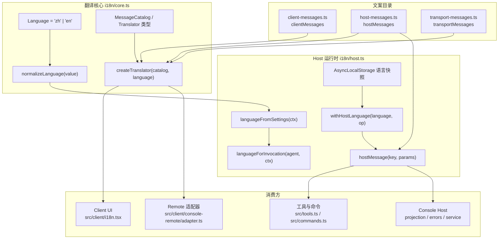
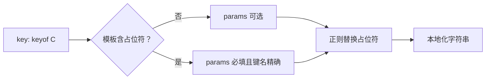
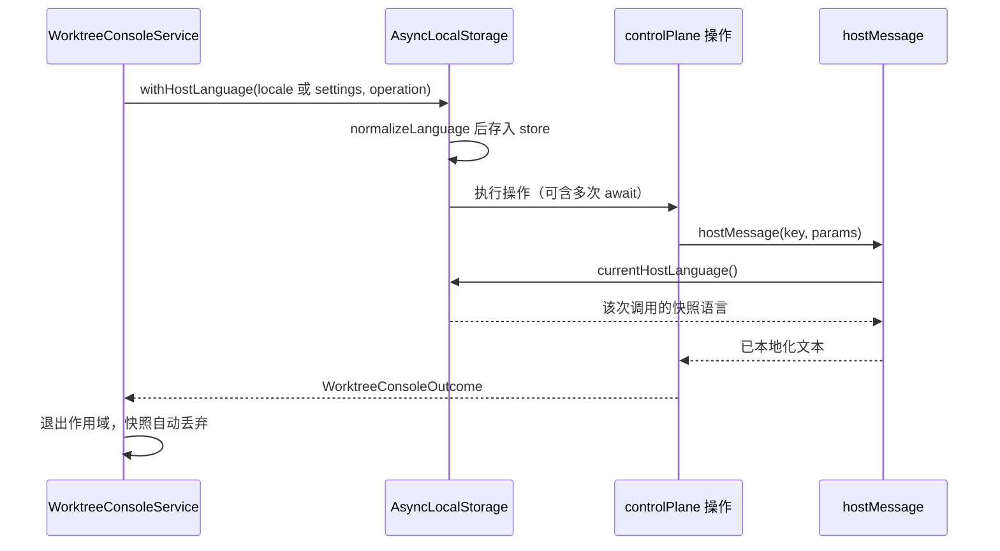
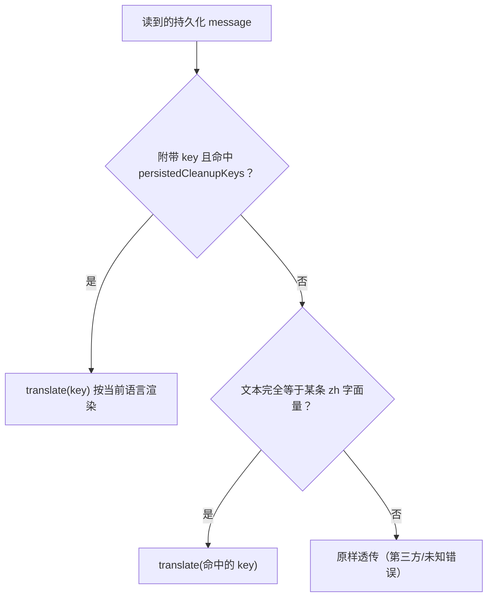
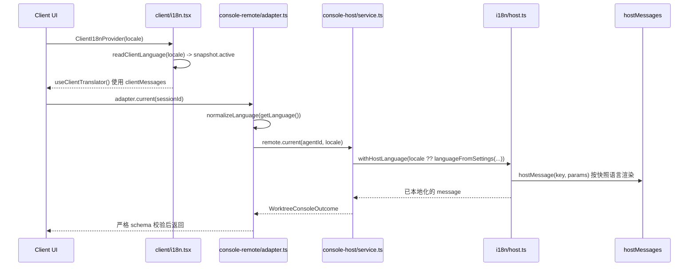

# i18n：中英双语文案与语言解析基础设施

!!! info "Generated documentation"
    This page was written by CodeWiki from the source code at commit [`86940812`](https://github.com/wloops/dsh-git-worktree/commit/86940812edd275bbd24a7092f9c7fcf922388614) on 2026-11-09 with `deepseek-v4.1-flash`. Check the code before relying on details.

`src/i18n/` 是插件的横切（cross-cutting）国际化层：它既提供「一份 key 两种语言」的**文案目录（catalog）**，也提供**语言来源解析**与**调用级语言作用域**。整个插件的中英文支持不引入独立的语言开关，而是跟随 DeepSeek Harness（DSH）自身的语言选择。

该模块被三条完全不同的调用路径复用：

| 路径 | 语言来源 | 缺省回退 |
| --- | --- | --- |
| Client UI（React 组件、ToolView、侧栏、设置卡） | DSH Client locale runtime（`@deepseek-ai/dsh-client-locale`） | 中文 |
| Client → Worktree Console Remote（RPC） | 当前 Client 语言，快照进每次调用的尾部可选 `locale` 参数 | Host settings，再回退中文 |
| Host 侧工具、`/worktree` 命令、错误与投影文案 | Host 公共 settings 服务的 `get('locale').preference`，按每次调用快照 | 中文 |

设计上的核心约束是：**文案是源侧翻译的，数据永不翻译**。路径、分支名、Session/Git 标识、用户书写的标题与提交信息、错误码、持久化 schema、原始 Git/文件系统错误文本都保持原样透传；只有插件自有文案在产生处就被翻译成调用语言。

## 架构总览



三层职责分明：

- **`core.ts` 不认识任何运行环境**——不 import 浏览器 API，也不 import Host-only 模块，因此可以被 Client bundle、Host 进程、以及测试同时使用。
- **三个目录文件只声明数据**：`as const satisfies MessageCatalog` 让 TypeScript 在编译期检查每个条目是否同时具备 `zh` 与 `en`。
- **`host.ts` 是唯一的 Host 侧运行时**：它把「当前调用应该用哪种语言」变成 `AsyncLocalStorage` 里的不可变快照。

## 组件清单

| 文件 | 核心导出 | 职责 |
| --- | --- | --- |
| `src/i18n/core.ts` | `Language`、`normalizeLanguage`、`MessageCatalog`、`Translator`、`createTranslator` | 语言类型、归一化、类型级占位符推导与插值实现 |
| `src/i18n/host.ts` | `currentHostLanguage`、`withHostLanguage`、`languageFromSettings`、`languageForInvocation`、`hostMessage` | Host 侧语言来源解析与调用级语言作用域 |
| `src/i18n/client-messages.ts` | `clientMessages` | 插件自有的 Client 文案目录 |
| `src/i18n/host-messages.ts` | `hostMessages`、`hostRegistrationMessage`、`persistedCleanupKeys`、`PersistedCleanupKey`、`hostPersistedCleanupMessage` | Host 文案目录、双语共享注册元数据、持久化清理文案白名单 |
| `src/i18n/transport-messages.ts` | `transportMessages` | Client 传输层诊断文案（严格契约失败、超时、挂载失败） |

## 翻译核心：`core.ts`

### 语言与归一化

```ts
export type Language = 'zh' | 'en'

export function normalizeLanguage(value: unknown): Language {
  return typeof value === 'string' && /^en(?:-|$)/i.test(value) ? 'en' : 'zh'
}
```

只有一条规则：字符串且匹配 `/^en(?:-|$)/i` 时返回 `'en'`，**其余一切输入都返回 `'zh'`**。

- `'en'`、`'en-US'`、`'EN-gb'` → `'en'`
- `'zh-CN'`、`'ja'`、`undefined`、`null`、数字、对象 → `'zh'`

把中文作为兜底而非英文，是因为中文是插件文案的**源语言**：目录里的 `zh` 值即原始撰写内容，`en` 是派生翻译。任何无法识别的语言环境退回到源语言，比退回到可能缺失的翻译更安全。

`normalizeLanguage` 是整条链路上唯一的「字符串 → `Language`」收口点：Client 的 `readClientLanguage`、Host 的 `languageFromSettings`、Remote 适配器的每次调用都经过它，因此脏输入不会以别的形式渗入。

### 类型级占位符契约

`core.ts` 用模板字面量类型把**占位符**提升为编译期契约：

```ts
type Placeholders<S extends string> =
  S extends `${string}{${infer P}}${infer Rest}` ? P | Placeholders<Rest> : never
```

由此得到的 `Translator<C>` 会强制调用方：

- 只能传入目录中真实存在的 key（拼错的 key 是类型错误，而非运行时回退）；
- 当该条目的模板含 `{p0}`、`{count}` 等占位符时，**必须**提供参数对象，且键名与模板完全一致；
- 当模板不含占位符时，参数对象可省略。



插值实现刻意采用「**缺失即原样保留**」策略：若 `params` 中不存在同名键，占位符原样留在输出里，而不是渲染成 `undefined`。这让「目录里漏配参数」在测试与真实 UI 中都可见，而不是静默产生误导文案。

### 插值实现

```ts
export function createTranslator<const C extends MessageCatalog>(catalog: C, language: Language): Translator<C> {
  return ((key: keyof C & string, params?: Record<string, string | number>) => {
    const template = catalog[key]![language]
    return template.replace(/\{([^{}]+)\}/g, (match, name: string) =>
      params && Object.prototype.hasOwnProperty.call(params, name) ? String(params[name]) : match)
  }) as Translator<C>
}
```

三个刻意的实现细节：

1. **`const C` 泛型参数**：保留字面量类型，否则 `catalog` 会被放宽成 `MessageCatalog`，key 与占位符推导全部失效。
2. **`hasOwnProperty` 判定**：只有 `params` 自身拥有的键才参与替换，避免 `toString`、`constructor` 之类的原型属性被误当成插值值。
3. **缺失即原样保留**：见上一节——漏配参数时占位符不被吞掉。

正则 `/\{([^{}]+)\}/g` 不允许占位符名内部再含花括号，因此 `{p0}` 里的嵌套花括号不会被跨段匹配。

## Host 运行时：`host.ts`

### 调用级语言快照

```ts
const languages = new AsyncLocalStorage<Language>()

export function currentHostLanguage(): Language {
  return languages.getStore() ?? 'zh'
}

export function withHostLanguage<T>(language: unknown, operation: () => T): T {
  return languages.run(normalizeLanguage(language), operation)
}
```

使用 `AsyncLocalStorage` 而非进程级可变变量是这套设计的关键：并发请求各自持有自己的语言，即使在 `await` 之后、即使设置在调用期间被改写，也不会串味。`withHostLanguage` 接受 `unknown` 并内部归一化，因此调用方可以直接把 wire 上来的原始值传进来。



`currentHostLanguage()` 在作用域外返回 `'zh'`，因此任何未显式包裹的 Host 代码（启动期、后台任务、开发者日志）都安全地落在源语言上，而不会读到别人的语言。

### 设置读取

```ts
export function languageFromSettings(ctx: unknown): Language {
  const context = ctx as { get?: (name: string) => unknown } | undefined
  try {
    const settings = context?.get?.('settings') as { get?: (namespace: string) => unknown } | undefined
    const locale = settings?.get?.('locale') as { preference?: unknown } | undefined
    return normalizeLanguage(locale?.preference)
  } catch {
    return 'zh'
  }
}
```

- 只读**公共、上下文拥有**的 DSH settings seam：`settings` 服务 → `locale` 命名空间 → `preference` 字段。插件**从不**持久化浏览器偏好，也不写入偏好。
- 全程可选链 + `try/catch`：`settings` 服务或 `locale` 命名空间在组合期（composition）或拆除期（teardown）可能不存在，任何异常都收敛为 `'zh'`，绝不因为读不到语言而让业务失败。
- 参数类型写成 `unknown` 并就地窄化，使本函数不依赖任何具体 Context 类型，可在 Host、测试与边界场景复用。

### 调用归属解析

```ts
export function languageForInvocation(agent: unknown, fallbackContext: unknown): Language {
  const context = (agent as { ctx?: unknown } | undefined)?.ctx ?? fallbackContext
  return languageFromSettings(context)
}
```

优先取**本次调用所属 Agent 的上下文**（`agent.ctx`），再退回插件的宿主 Context。这解决了「作用域化设置不应在用户之间泄漏」的问题：同一个 Host 进程可能服务多个用户的 Session，每个 Agent 的 `ctx` 才携带它自己那套 settings。

工具与命令统一使用这个函数：

```ts
async execute(args, exec) {
  return withHostLanguage(languageForInvocation(exec.agent, ctx), async () => { /* ... */ })
}
```

### 便捷翻译器

```ts
export const hostMessage: Translator<typeof hostMessages> = ((key, ...args: unknown[]) => {
  const translate = createTranslator(hostMessages, currentHostLanguage()) as
    (key: keyof typeof hostMessages, params?: unknown) => string
  return translate(key, args[0])
}) as Translator<typeof hostMessages>
```

`hostMessage` 是 Host 侧的「一行式」调用入口：key 与占位符仍由 `Translator<typeof hostMessages>` 做编译期校验，但语言在**调用时刻**从 `AsyncLocalStorage` 读取，而不是在模块加载时绑定。这正是 `host.ts` 注释所强调的「imperative services resolve language at invocation time, not at module load」。

## Client 文案目录：`client-messages.ts`

`clientMessages` 是体量最大的目录（约 380 条），覆盖插件在浏览器侧的全部可见文案与无障碍标签。它按功能域成组，命名以点分前缀区分：

| 前缀组 | 覆盖内容 |
| --- | --- |
| `manager.*`、`detail.*` | Worktree 管理台的任务行、验收详情面板（验证状态、轮次、文件列表、版本信息、展开/收起） |
| `dock.*`、`review.actions`、`more.delivery.actions` | 交付状态胶囊、验收操作条、更多交付操作 |
| 状态词（`creating`、`editing`、`ready.for.review`、`reviewing.in.local`、`preview.awaiting.recovery`、`retained`、`cleanup.pending`、`recovery.required`、`delivered`、`discarded`） | 与 Host 领域状态一一对应的 UI 标签 |
| `branch.*`、`worktree.*`、`tag.*`、`commit.graph.*` | 分支列表/搜索/新建/切换/清理、建树、标签管理、提交图 |
| `settings.*` | Worktree 设置卡（自动交付、自动推送、根目录、Git 超时、保存/还原/覆盖态） |
| `error.category.*`、`error.recovery.*`、`error.detail` | 错误分类与恢复动作的可读标签 |
| `time.*` | 相对时间（刚刚 / N 分钟前 / N 小时前 / N 天前） |
| 恢复流程（`recovery.*`、`detached.*`、`preview.recovery.*`、`handoff.*`） | Detached Preview Recovery、冲突恢复、只读验收再生成、handoff 到新 Worktree |
| 模型指令类长文案（如 `the.current.managed.worktree.review.snapshot.is.stale`、`the.user.approved.worktree.sync.encountered.real.conflicts`） | 通过 Harness prompt API 发送给 Agent 的结构化中文/英文指令 |

关于最后一行：这类条目**不是**给终端用户看的 UI 文案，而是插件作为 prompt 注入给模型的操作说明（例如「保持严格 Read Only」「不要调用 ApplyWorktree」）。把它们放进同一个目录，是为了让「注入给模型的中文/英文」与 UI 共用一套语言判定，避免出现界面英文而 prompt 中文的割裂。

该文件的三条写作约定（与仓库 `docs/i18n.md` 一致）：

1. 每个条目必须同时有 `zh` 与 `en`，`as const satisfies MessageCatalog` 会在编译期强制。
2. 两个语言必须使用**同名占位符**（如都写 `{p0}` 或都写 `{count}`）；`en` 值不得包含中日韩字符（测试会断言）。
3. 动态值通过参数插入，**绝不**用拼接方式构造 key，也绝不把用户内容拼进模板。

条目里还能看到为保持向后兼容而出现的同名后缀（`detail.preview` 与 `preview.changes`、`local` 与 `local.state`、`files.2`/`files.3`/`files.4`/`files.5`）。这些并非冗余：它们对应不同组件中语境不同、中文语序也不同的片段（例如 `files` 是「个文件 ·」这样的**后缀**，而 `files.4` 是「个文件」这样的**完整片段**）。修改时必须逐个确认调用点的语境，不能因为中文相近就合并。

## Host 文案目录：`host-messages.ts`

`hostMessages`（约 364 条）覆盖 Host 进程产生的全部用户可见文本：Session Checkout 领域错误、Apply/Preview/Finish/Rollback 引擎的失败原因、Console 控制面与投影、Git/文件/注册表适配器错误、工具与 `/worktree` 命令输出，以及工具注册元数据。

### 双语共享注册元数据

```ts
export function hostRegistrationMessage(key: keyof typeof hostMessages): string {
  return hostMessages[key].zh + ' / ' + hostMessages[key].en
}
```

工具与命令的**注册元数据**（`description`、参数说明、`presentCall` 标题）不属于任何一次 Agent 调用：它们是被 Harness 记录、可回放的共享描述，没有可用的 Agent 上下文。若把这些字符串绑定到某个用户的偏好语言，回放时会显示错误的语言。

因此 `hostRegistrationMessage` 直接返回 `zh / en` 的拼接形式，让共享注册**与语言无关**且始终双语：

```ts
ctx.tools.register(defineTool({
  name: 'worktree_create',
  description: hostRegistrationMessage('reserveAUniqueManagedGitWorktreeAndADistinct'),
  parameters: {
    topic: { type: 'string', description: hostRegistrationMessage('optionalTopicForHumanReadableWorktreeNaming') },
    branch: { type: 'string', description: hostRegistrationMessage('optionalLocalBranchWhoseCurrentTipBecomesThe') },
  },
  presentCall: () => ({ card: 'generic', title: hostRegistrationMessage('createIsolatedSessionTarget'), /* ... */ }),
  // ...
}))
```

真正随语言变化的执行结果（`execute` 返回值中的文本、命令输出）才走 `hostMessage` + `withHostLanguage`。

### 持久化清理文案白名单

清理恢复相关的历史文案（如 `cleanupNewChanges`、`cleanupResidue`、`cleanupDirectoryBusy`）曾以**固定中文串**持久化在台账里。若直接改写成按语言渲染，会破坏已存数据的可识别性。

```ts
export const persistedCleanupKeys = [
  "cleanupIdentityChanged","cleanupResidue","cleanupIncompleteDelivery","cleanupIncompleteReceipt",
  "cleanupMissingBeforeQuarantine","cleanupQuarantineIdentity","cleanupNewChanges",
  "cleanupMissingBeforeRemoval","cleanupQuarantineBusy","cleanupDirectoryBusy",
] as const

export type PersistedCleanupKey = typeof persistedCleanupKeys[number]

export function hostPersistedCleanupMessage(
  message: string,
  translate: Translator<typeof hostMessages>,
  key?: string,
): string {
  const named = persistedCleanupKeys.find(candidate => candidate === key)
  if (named) return translate(named)
  const legacy = persistedCleanupKeys.find(candidate => hostMessages[candidate].zh === message)
  return legacy ? translate(legacy) : message
}
```



四条不可动摇的性质：

- **新记录连同 key 一起存**，读取时按当前语言翻译——这是首选路径。
- **只有历史记录**才只有一段定死文本，用 `zh` 字面量**精确全等**反查兜底（`prefix: <stored>` 这类拼接串不命中，因此不会被误翻译）。
- **白名单之外的内容逐字透传**：第三方 Git 错误、用户文本、未知持久化文本都原样返回，插件绝不解释或重写它们。
- `PersistedCleanupKey` 由元组推导，使调用方无法传入白名单外的键；`persistedCleanupKeys` 的顺序与内容即存储兼容性契约，**改动它会破坏历史记录识别**。

这份白名单在 `src/console-host/projection.ts` 的投影边界被使用，把 `record` 里存的清理说明投影成当前调用语言的文本。

### 错误文案与错误码分离

Host 错误采用「**码不变、文案随语言**」的模式。以 `src/console-host/errors.ts` 的 `consoleFailure` 为例：

- 已知的 `SESSION_CHECKOUT_ERROR_CODES` 会保留 `code` 与 `continuation`，只把 `message` 用调用语言渲染；
- 未知/第三方错误归入 `git_error` 并**逐字透传**原始 `error.message`（该行为由 `tests/host-i18n.test.ts` 中的「passes through third-party error messages verbatim」用例守护）；
- 兜底时才用 `hostMessage('worktreeConsoleOperationFailed')`。

这条边界很重要：错误码、结果形状、Git 操作语义、验收确认流程与持久化 schema **都不受翻译影响**，翻译只作用于 `message` 字段。

## 传输层诊断目录：`transport-messages.ts`

`transportMessages` 只有 4 条，专供 Client 的 Remote 适配器（`src/client/console-remote/adapter.ts`）在**不依赖任何 React 上下文**的位置生成错误文本：

| key | 触发场景 |
| --- | --- |
| `malformed` | Remote 返回的 payload 未通过 strict contract 校验，或 codec 拒绝 |
| `mountFailed` | `ctx.remote.$mount(contribution)` 后拿不到 `remote.gitWorktree` 代理 |
| `workspaceGenerationUnknown` | 无法识别已安装的 Host Workspace Client 形态 |
| `invokeTimeout` | 调用超过快/慢超时阈值仍无响应，本次调用被中止 |

适配器在每次调用开始时只归一化一次语言，然后把它同时用于**发送**与**生成诊断文本**：

```ts
async function invoke<T>(method: string, call: (locale: Language) => Promise<RemoteResult<WorktreeConsoleOutcome<T>>>) {
  const locale = normalizeLanguage(getLanguage())
  // Promise.race 与超时、malformed、transport 三类失败分支均用 locale 渲染
}
```

`invokeTimeout` 是这里最有信息量的一条：它明确告诉用户「服务端操作可能仍在进行，可稍后重试或重启 dsh web」，而不是让 UI 永久停在 pending 态。这与适配器的 `FAST_TIMEOUT_MS = 30_000` / `SLOW_TIMEOUT_MS = 180_000` 分档配套。

注意 `isCodecRejection` 里保留了**中文字面量片段** `'返回了不符合 strict contract'` 作为兼容识别器——这是识别旧版 codec 拒绝消息的判别式，不是未本地化的 UI 输出。

## 语言如何抵达每个表面



关键点：Client 侧把语言作为**尾部可选参数**随每次 RPC 发送（`optionalLanguageSchema = z.enum(['zh','en']).optional()`，定义在 `src/console-remote/schemas.ts`，由 `src/console-remote/descriptors.ts` 的 `descriptor()` 统一追加到每个方法的参数列表末尾），Host 侧则在**处理该次调用的整个异步续体**里使用同一份快照。显式请求的 `locale` 优先于 Host 设置；旧版 wire 调用方可以省略该参数而不破坏兼容。

`WorktreeConsoleService` 的每个 `@Remote` 方法都是同一形状：

```ts
@Remote
async current(agent: Agent, locale?: Language) {
  const outcome = await withHostLanguage(
    locale ?? languageFromSettings(agent.ctx ?? this.hostContext),
    () => this.controlPlane.current(agent.id),
  )
  // ...
  return outcome
}
```

即「**显式 locale → Agent 自己的 settings → 宿主 settings → 中文**」的四级回退，且整个过程被 `withHostLanguage` 收敛成一次快照。

Client 侧的桥接（`src/client/i18n.tsx`）则由 `src/client/index.tsx` 通过 `Proxy` 包裹 `ctx.slots`，为**每个插件注册的组件**套上 `ClientI18nProvider`：

```ts
const localizedSlots = new Proxy(ctx.slots, {
  get(target, key, receiver) {
    if (key === 'register') return (descriptor, Component) =>
      target.register(descriptor, (props) =>
        createElement(ClientI18nProvider, { locale, children: createElement(Component, props) }))
    return Reflect.get(target, key, receiver)
  },
})
```

这样组件内部就能用 `useClientTranslator()` 拿到随 locale 变化而自动重渲染的翻译器，而 `translatorForServices()` 则为非 React 的命令式服务在**调用时刻**解析语言。

## 与其他模块的关系

- **Client 表现层**（[Client_Presentation_and_Interaction 模块概览](Client_Presentation_and_Interaction.md)）：所有 React 组件通过 `useClientTranslator()` 消费 `clientMessages`；`src/client/i18n.tsx` 是本模块在浏览器侧的桥接实现。详见 [client_core 模块](client_core.md)。
- **Console API 与 Host 集成**（[Console_API_and_Host_Integration：控制台 API 与 Host 集成](Console_API_and_Host_Integration.md)）：`WorktreeConsoleService` 的每个 `@Remote` 方法用 `withHostLanguage` 包裹，投影层用 `hostMessage`/`hostPersistedCleanupMessage` 渲染清理说明与能力文案。详见 [console_host：Worktree 控制平面与 Host RPC 服务](console_host.md) 与 [console_remote：控制台远程契约层（Typert Remote）](console_remote.md)。
- **Console 契约**（[console_contract 模块（Worktree Console 共享契约）](console_contract.md)）：`WorktreeConsoleError.message` 是本地化字段，而 `code` 是稳定标识符；契约本身不感知语言。
- **Worktree 与会话检出领域**（[Worktree 与会话检出领域（Worktree_and_Session_Checkout_Domain）](Worktree_and_Session_Checkout_Domain.md)）：领域层通过 `hostMessage` 产生错误与命令输出文本，但领域状态机、Git 操作与持久化记录不受语言影响。
- **公共 API**（[public_api 模块：插件公共入口与契约面](public_api.md)）：导出的 `SessionCheckoutError` 携带的是已本地化的 `message` 与稳定的 `code`。
- **构建与发布**（[build_deployment_configuration：构建、打包与发布部署配置](build_deployment_configuration.md)）：`tsconfig.json` 的类型严格度、`package.json` 的 `files` 白名单与 CI 关卡共同保证目录结构正确。

## 与构建、发布的关系

- `tsconfig.json` 开启 `strict` 与 `noUncheckedIndexedAccess`；`createTranslator` 中的 `catalog[key]!` 与 `Object.prototype.hasOwnProperty.call(params, name)` 写法正是为满足该检查而存在。
- `package.json` 的 `files` 字段显式包含 `docs/i18n.md`，即本模块的**语言契约文档随包发布**，供使用方确认各表面的语言来源与已知限制。
- `.github/workflows/ci.yml` 依次执行 `pnpm install --frozen-lockfile`、`pnpm run typecheck`、`pnpm run build`、`pnpm run check:publish:release`、`pnpm run test`。目录结构错误（缺 `en`、占位符不一致、`en` 值含中文字符）会在 `typecheck` 或测试阶段失败，而不会流入发布产物。
- 目录按 `MessageCatalog` 类型收敛，因此新增文案的唯一正确方式是**在目录文件里加一条同时含 `zh` 与 `en` 的条目**，而不是在组件里内联字符串。
- `vitest.config.ts` 用别名把 `@deepseek-ai/dsh-client-ui-primitives` 与四代 `virtual:dsh-official-workspace-client*` 指向测试替身，使依赖 `useClientTranslator` 的 Client 组件可以在 jsdom 下渲染并被断言。

## 测试守护的性质

`tests/host-i18n.test.ts` 断言了本模块最关键的几条不变量：

| 断言 | 保护的性质 |
| --- | --- |
| 每个条目 `zh`/`en` 均非空 | 没有半成品翻译流入发布 |
| 两语言占位符集合相等（`placeholders(zh) === placeholders(en)`） | 不会出现英文模板丢参数导致占位符泄漏 |
| `en` 值不匹配 `/[\u3400-\u9fff]/u` | 英文条目里不残留中文 |
| 同一错误在不同语言下 `code` 相同、`message` 不同 | 错误码与文案解耦 |
| 插值数据（含中文的路径、含 `{name}` 的用户标题）原样出现在输出中 | 用户数据不被当作模板二次插值 |
| 仅白名单内的旧清理文案被本地化，`prefix: <stored>` 与第三方文本透传 | 可逆本地化不会误伤未知文本 |
| `hostRegistrationMessage` 在两种语言下返回同一字符串 | 共享注册元数据与用户偏好解耦 |

## 已知边界

- **自动浏览器英文 + 未保存 DSH 语言偏好**时，UI 与 Console 请求可能是英文，而工具与命令回退到中文。因为工具/命令调用接口不暴露浏览器已解析的 locale，插件不会从用户文本、机器 locale 或上次请求去猜测，也不会替用户写入偏好。显式在 DSH 中选择英文才能让所有表面一致。
- 目录条目的**数量是信息性的，不是稳定标识符**：文案会随功能增删，不要在任何地方依赖条目总数。
- 本层只负责「把插件自有文案翻译成调用语言」；它**不改变**错误码、结果形状、Git 操作语义、验收确认流程或持久化 schema。
- 历史用户书写的验收摘要与建议提交信息属于**存储内容**，不会被重新翻译；只有插件自有的系统文案才在投影边界本地化。
- 代码注释、维护脚本与原始进程诊断（如 `appendDiag` 写入的 ndjson 面包屑）不属于终端用户 UI，不做翻译。

??? abstract "Documented components (5)"
    - [`__file__`](https://github.com/wloops/dsh-git-worktree/blob/86940812edd275bbd24a7092f9c7fcf922388614/src%5Ci18n%5Cclient-messages.ts) — `src\i18n\client-messages.ts`
    - [`Language`](https://github.com/wloops/dsh-git-worktree/blob/86940812edd275bbd24a7092f9c7fcf922388614/src%5Ci18n%5Ccore.ts) — `src\i18n\core.ts`
    - [`PersistedCleanupKey`](https://github.com/wloops/dsh-git-worktree/blob/86940812edd275bbd24a7092f9c7fcf922388614/src%5Ci18n%5Chost-messages.ts) — `src\i18n\host-messages.ts`
    - [`currentHostLanguage`](https://github.com/wloops/dsh-git-worktree/blob/86940812edd275bbd24a7092f9c7fcf922388614/src%5Ci18n%5Chost.ts) — `src\i18n\host.ts`
    - [`__file__`](https://github.com/wloops/dsh-git-worktree/blob/86940812edd275bbd24a7092f9c7fcf922388614/src%5Ci18n%5Ctransport-messages.ts) — `src\i18n\transport-messages.ts`

