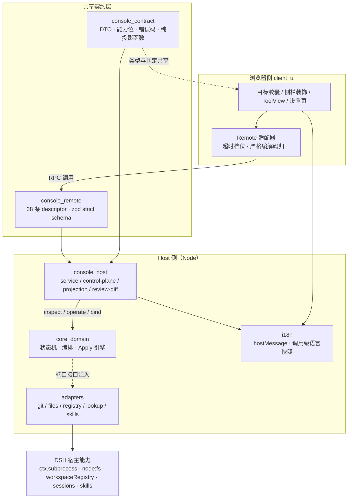
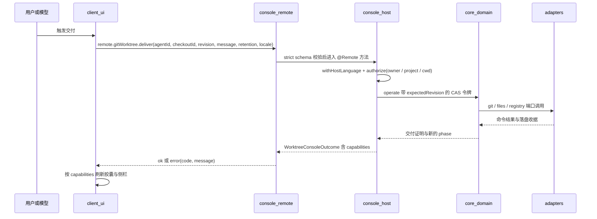
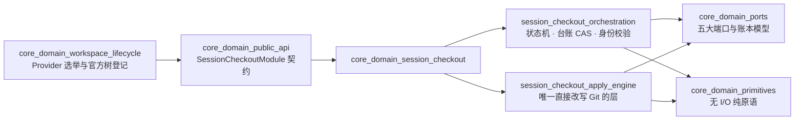

# dsh-git-worktree 仓库概览

!!! info "Generated documentation"
    This page was written by CodeWiki from the source code at commit [`e01d7c5f`](https://github.com/wloops/dsh-git-worktree/commit/e01d7c5f2f3a0d2f734a5a3415598ae6d7d6f387) on 2026-11-07 with `deepseek-v4.1-flash`. Check the code before relying on details.

`dsh-git-worktree` 是一个面向 DeepSeek Harness（DSH）的插件：它让**单个会话在隔离的 Git Worktree 中工作**，并在「创建 → 编辑 → 评审 → 交付 → 清理」的完整生命周期里保证 **Local checkout 的工作区、索引与 HEAD 不被污染**。插件以 Cordis 插件形式挂载到 Host 条目树，同时向 Web 端提供一套 Harness 原生的界面元素（会话目标胶囊、Workspace 侧栏装饰、工具卡片与设置页）。

## 仓库要解决的问题

| 问题 | 本仓库的答案 |
| --- | --- |
| 多个会话在同一仓库上并行编辑会互相踩踏 | 每个会话对应一棵受管 Worktree，`managedRoot` 与不可变 cwd 绑定 |
| 模型的改动直接落进 Local，人类失去审阅机会 | 模型只推进到 `ready_for_review`；`discard` / `remove` 等破坏性动作保留给人类 |
| 交付过程崩溃后无法判断「做到了哪一步」 | 先写 journal / receipt，再动作；`reconcile()` 依据台账判定恢复路径 |
| 删除目录可能误伤用户数据 | 删除前必须通过路径、`device`/`inode`/`birthtimeNs`、Git common dir 等身份证据 |
| 同一份 UI 要适配多代官方 Workspace Client | 构建期按版本 + SHA-256 校验派生 4 个虚拟模块，运行期按 `workspaceClientFlavor` 选择接管或装饰 |

## 端到端架构

整个仓库可以按「浏览器侧 → 共享契约 → Host 侧 → 宿主能力」四段理解。依赖方向严格单向：契约层不引用任何实现，领域层不引用任何适配器，适配器是唯一接触 `ctx.subprocess`、`node:fs` 与宿主服务的地方。

### 一次「交付」的协作路径

所有界面动作共享同一条链路：组件调用 `WorktreeConsoleAdapter`，适配层附加超时与 schema 校验，经 Typert Remote 进入 Host，Host 先证明身份再证明状态，最后才产生副作用。

### 核心域的纵向分层

`core_domain` 是整个插件的心脏，内部再分五层，每层可独立阅读与单测：

## 核心模块文档

| 模块 | 文档 | 概要 |
| --- | --- | --- |
| 核心域总览 | [core_domain 核心域概览](core_domain.md) | 宿主无关领域层：原语、端口、生命周期、状态机与对外 API |
| 纯原语 | [core_domain_primitives 核心域基础原语](core_domain/core_domain_primitives.md) | 提交信息守卫、受管路径与分支命名、交付排除 pathspec、指纹与结果渲染 |
| 端口契约 | [core_domain_ports 端口契约与持久化数据模型](core_domain/core_domain_ports.md) | lookup / git / files / registry / officialWorktrees 五大端口与账本数据模型 |
| Workspace 生命周期 | [工作区与官方工作树生命周期（core_domain_workspace_lifecycle）](core_domain/core_domain_workspace_lifecycle.md) | 宿主版本识别、`uiWorkspace` Provider 选举、官方 `.agents/worktrees/` 树接管 |
| 会话检出 | [core_domain_session_checkout：会话检出领域核心](core_domain/core_domain_session_checkout.md) | 编排状态机与 Git 应用引擎的总览入口 |
| 编排核心 | [session_checkout_orchestration_core：会话检出编排核心](core_domain/core_domain_session_checkout/session_checkout_orchestration/session_checkout_orchestration_core.md) | 状态机与台账 CAS 实现 |
| 工具边界 | [会话结账工具层（session_checkout_tools）](core_domain/core_domain_session_checkout/session_checkout_orchestration/session_checkout_tools.md) | 面向模型的工具边界（`worktree_*`） |
| Apply 引擎 | [session_checkout_apply_engine：Git 级应用引擎](core_domain/core_domain_session_checkout/session_checkout_apply_engine.md) | 唯一直接改写 Git 的层：WIP 补丁、交付、回滚 |
| 对外 API | [core_domain_public_api — 会话检出领域的公共 API 面](core_domain/core_domain_public_api.md) | `SessionCheckoutModule` 契约、操作联合、错误码、插件入口 `apply` 与配置面 |
| 宿主适配层 | [adapters 模块：DSH 宿主适配层](adapters.md) | 把端口落到 `ctx.subprocess`、`node:fs`、注册表与 Skill 服务；原子写与跨平台细节 |
| 共享契约 | [console_contract：Worktree Console 共享契约层](console_contract.md) | JSON-only DTO、16 个能力位、`consoleStateFromDomain` 等纯投影函数 |
| Host 服务层 | [console_host：Worktree 控制台的 Host 侧服务层](console_host.md) | 授权、编排、投影与错误归一；37 个控制平面方法 |
| Remote 契约 | [console_remote —— Worktree Console 的严格 Remote 契约层](console_remote.md) | 38 条 descriptor、zod strict schema、Typert 类型面与 Host 贡献 |
| 浏览器 UI | [client_ui — 浏览器端 UI 层](client_ui.md) | 跨 Host 代数装配、胶囊、侧栏、工具卡片、设置页 |
| 多语言 | [i18n：多语言文案目录与本地化解析层](i18n.md) | 双语目录、类型安全插值、调用级语言快照与持久化文案投影 |

### client_ui 的子模块

[client_ui_bootstrap：浏览器端启动与 Remote 适配引导](client_ui/client_ui_bootstrap.md)（装配与远程适配）、[client_ui_tool_views_and_actions — ToolView 卡片与 Session 导航动作](client_ui/client_ui_tool_views_and_actions.md)（工具视图与 Session 导航）、[client_ui_target_console —— 会话目标胶囊与工作树管理控制台](client_ui/client_ui_target_console.md)（目标胶囊与控制台）、[client_ui_git_views：Git 视图（提交图、标签管理、分支概览缓存）](client_ui/client_ui_git_views.md)（提交图与标签）、[client_ui_workspace_sidebar —— Workspace 侧栏投影与装饰](client_ui/client_ui_workspace_sidebar.md)（侧栏投影与装饰）、[client_ui_settings_card：Worktree 插件设置卡片](client_ui/client_ui_settings_card.md)（设置页）、[client_ui_i18n_presentation：国际化桥接与呈现基础层](client_ui/client_ui_i18n_presentation.md)（i18n 与呈现基础）。

## 贯穿全局的设计原则

- **Host 是唯一权威**：界面上的状态、能力位与文案全部来自 Host 投影；Client 只读不推断，写操作一律带 `expectedRevision` 等 CAS 令牌。
- **先收据、后动作**：任何改盘操作先把 journal / receipt 写入台账，崩溃后由 `reconcile()` 判定实际进度。
- **授权看活的 cwd**：托管 owner 的运行期 cwd 就是不可变 Worktree 根，因此 `verifyCallerRoot` 优先用 `lookup.getSessionCwd()`，且该证据只对 owner 生效。
- **能力位而非布尔散列**：`capabilities` 的推导集中在一个函数里，避免 Host 与 Client 两处规则漂移。
- **构建期 fail-closed**：上游 Workspace Client 的版本与字节摘要不匹配时直接中断构建，不生成语义错误的派生客户端。
- **错误不抛给传输层**：方法体统一包在 `outcome(...)` 中，异常被归一成带稳定 `code` 的 `WorktreeConsoleError`。

## 构建与运行

工程侧遵循一条串行流水线：`pnpm run build` 依次执行 `scripts/clean-lib.mjs`（清空 `lib/`，因为 `tsc` 不会删除已移除源文件的旧产物）、`tsc`（类型检查 + Host 侧 ESM 与 `.d.ts` 产出）、`tsdown`（把浏览器入口打成 `window.__ModuleLoader__.load({ id, factory })` 载荷，并在构建期物化 4 个官方 Workspace Client 的派生代码）。

发布前由 `check:publish` / `check:publish:release` 机械校验不变量（每个 `exports` 目标被 `files` 覆盖、`dsh.bundle.patch` 存在、`./typert` 与 `./remote` 导出同一个 descriptor 数组实例、无 stale 产物），`check:sidebar-version` 复验派生客户端与上游版本的兼容性，测试由 `vitest run` 执行（Windows 上关闭文件并行以避免 Git fixture 争抢句柄）。本地集成验证使用 `dev:dsh` 系列脚本在真实 Harness 上安装、冒烟与卸载；CI 的 `check` 作业按 `install → typecheck → build → check:publish:release → test` 复现同一套流程。

上述内容（含 `package.json` 字段语义、`cordis.patch.yml` 的挂载补丁与历史教训、`tsdown.config.ts` 的虚拟模块机制）详见 [build_and_config 构建与配置](build_and_config.md)。
