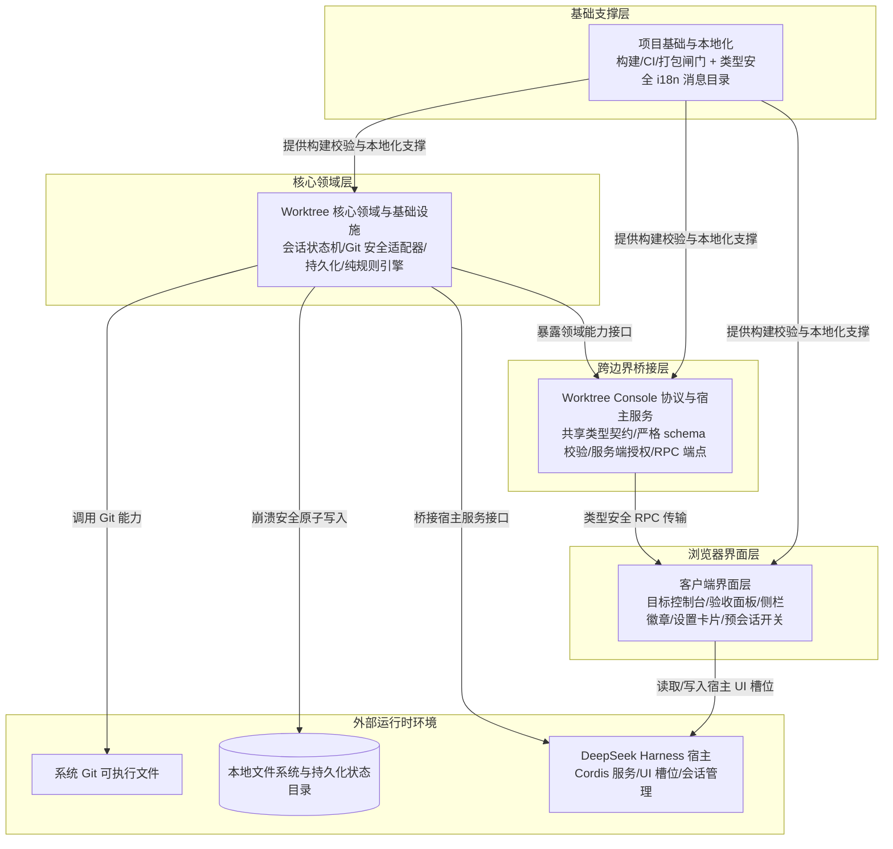

# dsh-git-worktree 仓库总览

!!! info "Generated documentation"
    This page was written by CodeWiki from the source code at commit [`e50f4121`](https://github.com/wloops/dsh-git-worktree/commit/e50f4121be2569531679e4f64bfc288bc20f70a3) on 2026-11-06 with `doubao-seed-2.1-lite`. Check the code before relying on details.

## 仓库定位与核心价值
dsh-git-worktree 是 DeepSeek Harness (DSH) 平台的官方插件，核心定位是为 AI 辅助开发会话提供全生命周期的 Git Worktree 隔离能力。它通过为每个独立会话创建专属的隔离 Git 工作区，彻底消除多会话并行开发过程中的分支冲突、未提交代码污染、跨会话资源串扰问题，覆盖工作区创建、分支检出、变更评审、交付合并、检查点保存、崩溃恢复与过期资源清理的完整流程。

项目严格遵循「服务端持有业务权威、客户端仅负责状态渲染」的设计原则，内置多重生产级安全机制：Git 命令直传不经 Shell 解析、原子文件写入、跨进程文件锁、目录身份校验、Worktree 误删防护；同时为 Host 与 Client 两侧提供统一的类型安全通信契约，从结构上消除跨进程的状态漂移与越权操作风险。

## 端到端架构总览
仓库整体采用分层单向依赖架构，从底层基础支撑到顶层用户界面共分为四个内聚模块层，各层通过稳定契约解耦，严格禁止反向依赖。整体架构与数据流向如下图所示：

## 核心模块文档导航
仓库按领域职责拆分为四个独立文档化的核心模块，各模块的详细设计与实现说明可通过以下链接查看：
- **[项目基础与本地化模块](project_foundation_and_localization.md)**：全仓库的基础支撑层，负责构建、CI、打包与发布校验，同时维护类型安全的中英文消息目录与统一的语言回落规则，保证业务文案在 Host 与 Client 两侧可确定解析渲染。
- **[核心 Worktree 领域与基础设施模块](core_worktree_domain_and_infrastructure.md)**：插件的业务核心，实现宿主无关的会话检出状态机、Git 安全执行适配器、崩溃安全持久化层、纯函数规则引擎，通过契约层分离领域逻辑与外部基础设施，保证核心规则可独立测试、适配器可按需替换。
- **[Worktree Console 协议与宿主服务模块](worktree_console_protocol_and_host_service.md)**：连接核心领域与浏览器客户端的跨边界桥接层，维护 Host 与 Client 共享的纯类型契约、严格的线格式 schema、服务端授权控制面与 RPC 端点实现，是所有跨边界操作的唯一权威入口。
- **[Worktree 客户端界面层模块](worktree_client_interface_layer.md)**：薄适配层负责所有浏览器端用户界面渲染，包括目标控制台、验收评审面板、工作区侧栏徽章、设置卡片、预会话创建开关等，本身不持有任何业务权威状态，仅消费 Host 侧计算好的投影 DTO 完成渲染。

## 构建、测试与部署
项目基于 pnpm 工作区与 TypeScript 构建，通过 GitHub Actions 运行持续集成校验，使用 Vitest 作为测试运行器，并针对 Cordis 插件框架提供定制化补丁集成。核心构建入口覆盖类型检查、单元测试、发布完整性校验、本地开发插件安装/卸载/冒烟测试等全流程。

详细的构建配置、CI 流水线规则、打包流程与部署操作说明可参考 [构建、CI 与打包子模块文档](project_foundation_and_localization/build_ci_and_packaging.md)，该模块定义了所有发布闸门与本地开发操作的具体规范。
