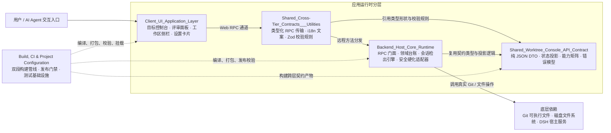

# dsh-git-worktree 仓库总览

!!! info "Generated documentation"
    This page was written by CodeWiki from the source code at commit [`3e52684b`](https://github.com/wloops/dsh-git-worktree/commit/3e52684b7fe9828f1095e076b810db542fa5dfbb) on 2026-11-07 with `doubao-seed-2.1-lite`. Check the code before relying on details.

## 仓库定位
`dsh-git-worktree` 是面向 DeepSeek Harness（DSH）平台的 Cordis 插件，核心目标是为 AI 编码 Agent 提供隔离、事务化、安全硬化的托管 Git Worktree 运行环境，解决传统 AI 编码过程中的状态污染问题：
- **工作边界隔离**：所有 AI Agent 触发的代码变更都在独立 Worktree 中完成，全程不干扰用户本地工作区的未提交改动，避免跨任务的状态污染。
- **可靠状态管理**：通过持久化台账与原子文件锁实现崩溃可恢复、并发安全的全生命周期状态管理，任意操作中断后可通过启动期对账收敛到一致状态，不留孤立残留文件。
- **安全规则收敛**：统一收拢 Git 命令净化、超时控制、原子文件写入、目录身份校验、符号链接防护等安全逻辑，从底层杜绝命令注入、仓库劫持、误删文件等风险。
- **统一服务接口**：对外提供经过鉴权与视图投影的类型化 RPC 接口，支撑客户端目标状态展示、评审工作流、工作区拓扑投影等交互功能。

## 端到端架构
本项目遵循严格的分层依赖原则，核心领域逻辑不依赖具体底层实现（六边形/端口-适配器架构），所有与宿主打交道的细节都被隔离在适配器层。整体分层架构如下图所示：

## 核心模块文档索引
仓库按职责拆分为五个独立的顶层模块，各模块的详细设计、接口定义与实现细节可通过以下文档入口查阅：

| 模块 | 核心职责 | 详细文档 |
| --- | --- | --- |
| 客户端 UI 应用层 | 浏览器端交互组装，负责状态只读投影、用户动作编排、写前预检、客户端缓存与恢复队列，遵循「Host 权威、客户端投影」原则，不实现 Git 与 Worktree 领域规则 | [客户端 UI 应用层文档](Client_UI_Application_Layer.md) |
| 后端宿主核心运行时 | 服务端核心承载，实现六边形架构的领域台账、会话检出事务引擎、安全硬化的适配器实现、面向客户端的鉴权 RPC 服务，提供崩溃可恢复的全生命周期 Worktree 管理 | [后端宿主核心运行时文档](Backend_Host_Core_Runtime.md) |
| 共享跨层契约与工具层 | Client 与 Host 之间的纯共享层，提供类型化 RPC 描述符、Zod 运行时校验、中英双语 i18n 机制，作为跨进程调用形状的单一事实来源 | [共享跨层契约与工具层文档](Shared_Cross-Tier_Contracts___Utilities.md) |
| 共享 Worktree 控制台 API 契约 | 单一文件定义的跨层纯契约，包含 JSON 可序列化 DTO、11 态 UI 状态投影规则、15 项操作能力矩阵、统一错误码与恢复元数据 | [共享 Worktree 控制台 API 契约文档](Shared_Worktree_Console_API_Contract.md) |
| 构建、CI 与项目配置层 | 工程化支撑，覆盖双段 TypeScript 构建管线、七重发布完整性门禁、Vitest 测试基础设施、GitHub Actions CI 流水线、DSH 宿主挂载补丁、本地开发联调脚本 | [构建、CI 与项目配置层文档](Build,_CI___Project_Configuration.md) |

## 构建与运行
项目采用「源码 → 双段编译 → 多层校验 → 宿主挂载」的标准化发布链路：Host 侧 Node 源码经 `tsc` 编译为 NodeNext ESM 产物，Client 侧浏览器源码经 `tsdown` 打包为 DSH ModuleLoader 可消费的 CJS 闭包；发布流程内置类型检查、上游 UI 产物版本校验、七重发布完整性门禁、全量单元测试，通过 GitHub Actions CI 流水线完成自动校验；最终产物通过 `cordis.patch.yml` 补丁自动注册到 DSH 宿主插件清单。项目同时提供本地开发脚本族，支持无公开发布的快照安装、DSH 进程启动与冒烟校验，实现快速本地联调。

完整的构建命令、测试配置、发布规则与 CI 流程说明，请参考 [构建、CI 与项目配置层文档](Build,_CI___Project_Configuration.md)。
