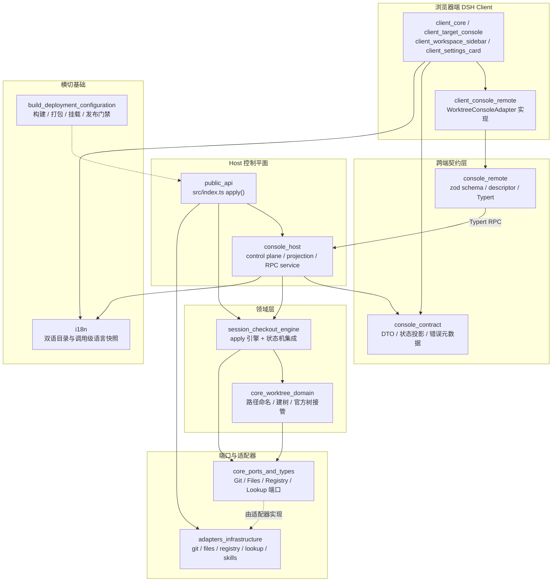
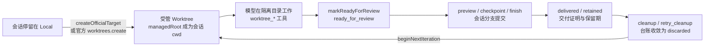

# dsh-git-worktree 仓库概览

!!! info "Generated documentation"
    This page was written by CodeWiki from the source code at commit [`a31b152e`](https://github.com/wloops/dsh-git-worktree/commit/a31b152eb2d94b07c91dc0c4efe18370375de1af) on 2026-11-12 with `mimo-v2.6-flash`. Check the code before relying on details.

`dsh-git-worktree` 是运行在 DeepSeek Harness（DSH）之上的 Git Worktree 插件。它的目标是把「会话、项目与受管 Worktree」之间的绑定关系，实现为一套可持久化、可并发、可崩溃恢复的**隔离交付机制**：模型在受管 Worktree 中写代码，结果以可复核、可回滚、可恢复的 Git 事务形式整合回目标分支，而不直接污染用户的本地仓库（Local）。

插件同时覆盖两个部署面：Host 侧（Node 进程，负责状态机、Git 事务、台账、Typert Remote 服务）与 Client 侧（浏览器 bundle，负责会话目标胶囊、工作树控制台、官方 Workspace 侧栏投影与设置卡片）。两端通过一份刻意保持 JSON-only 的共享契约 `console_contract` 交换数据。

## 端到端架构

整体呈现典型的六边形分层：Client 只经 `WorktreeConsoleAdapter` 读写；Host 控制平面负责授权与投影；领域层承载状态机与纯 Git 事务；所有外部能力经端口注入，由适配器落地到 `ctx.subprocess`、`node:fs`、宿主服务等真实运行时。

三条贯穿全局的依赖规则：

1. **依赖单向朝内**：领域层只认识 `ports.ts` / `types.ts` 的接口，从不直接 `spawn` Git 或写台账文件；因此状态机与 apply 引擎可以在 vitest 中用 fake 端口完整驱动。
2. **Host 权威**：Client 传入的 `sessionId` 与 `revision` 不被信任，Host 每次调用都重新解析真实 Session，并校验项目、owner/source 归属、cwd 与 `revision`。
3. **契约只承载数据**：`console_contract` 不含 Cordis、React 或文件系统实现，也不承载授权结论与文件路径（除 `TargetDetails`），从而能被 Host 与 Client 两条独立打包产物共享。

## 一次完整生命周期

关键的架构取舍在于**纯 Git 事务引擎与宿主集成状态机的彻底分离**：`session_checkout_apply_engine` 只依赖 Git 子进程与临时目录，以「计划即一次性能力令牌」的方式执行（`plan` → 逐字段比对 → 执行 → 立即删除计划）；`session_checkout_engine_integration` 才持有 `revision` CAS、全局互斥锁、journal、receipt 持久化与授权判断。宿主重启后必须重新 `plan`，因此不存在可重放的过期凭据。

## 核心模块文档

| 模块 | 职责 | 文档 |
| --- | --- | --- |
| 客户端表现与交互 | 启动编排、Remote 适配器、会话目标胶囊、工作树控制台、官方侧栏投影、设置卡片 | [Client_Presentation_and_Interaction 模块概览](Client_Presentation_and_Interaction.md) |
| 控制台 API 与 Host 集成 | Host 控制平面、DTO 投影与能力位、`@Remote` 服务、zod 契约与 Typert 贡献 | [Console_API_and_Host_Integration：控制台 API 与 Host 集成](Console_API_and_Host_Integration.md) |
| Worktree 与会话检出领域 | 路径与命名候选、即时建树、官方树登记与接管、Apply 计划、状态机与模型工具 | [Worktree 与会话检出领域（Worktree_and_Session_Checkout_Domain）](Worktree_and_Session_Checkout_Domain.md) |
| 端口、适配器与基础设施 | Git / Files / Registry / Lookup 端口契约及其 Node 与宿主实现 | [端口、适配器与基础设施（Ports, Adapters, and Infrastructure）](Ports,_Adapters,_and_Infrastructure.md) |
| 横切基础与公共交付面 | 构建打包与发布门禁、国际化基础设施 | [横切基础与公共交付面模块总览](Cross-Cutting_Foundation_and_Public_Surface.md) |
| 共享契约 | 全部请求/响应 DTO、`consoleStateFromDomain`、`worktreeReachedDelivery`、错误码与恢复元数据 | [console_contract 模块（Worktree Console 共享契约）](console_contract.md) |
| 插件公共入口 | `inject` / `Config` / `apply()` 装配顺序、`SessionCheckoutModule` 接口与输入 DTO | [public_api 模块：插件公共入口与契约面](public_api.md) |

建议的阅读路径：先读 [public_api 模块：插件公共入口与契约面](public_api.md) 了解插件如何被挂载与对外暴露什么，再进入 [Worktree 与会话检出领域（Worktree_and_Session_Checkout_Domain）](Worktree_and_Session_Checkout_Domain.md) 理解领域语义，随后看 [Console_API_and_Host_Integration：控制台 API 与 Host 集成](Console_API_and_Host_Integration.md) 与 [console_contract 模块（Worktree Console 共享契约）](console_contract.md) 掌握跨端边界，最后按需阅读 [Client_Presentation_and_Interaction 模块概览](Client_Presentation_and_Interaction.md) 与 [端口、适配器与基础设施（Ports, Adapters, and Infrastructure）](Ports,_Adapters,_and_Infrastructure.md)。

## 构建与运行

项目使用 pnpm 工作区，源码为 ESM TypeScript（`module: NodeNext`，相对导入带 `.js` 后缀）。构建链路固定为 `clean-lib` → `tsc` → `tsdown`：先清空 `lib/` 避免陈旧产物被打包，再由 `tsc` 产出 Host 侧 ESM 与 `.d.ts`，最后由 `tsdown` 生成浏览器端 `lib/client.js`（CJS + ModuleLoader 包装）。发布物形态由 `package.json` 的 `exports`、`files`、`dsh.bundle.patch` 与 `dsh.client.inject` 共同定义，安装后的 Host 挂载由 `cordis.patch.yml` 承担。

质量门禁与 CI 一致，依次执行 `typecheck` → `build` → `check:publish:release` → `test`（vitest）。发布检查是 fail-closed 的：它会实际执行 `lib/client.js`、校验导出目标存在性、Host 单例依赖分层与挂载补丁形态。本地部署可通过 `dev:dsh` 系列脚本完成安装、冒烟与卸载。

上述流程的完整细节（脚本清单、包形态、挂载契约、CI 作业与依赖解析策略）见 [build_deployment_configuration：构建、打包与发布部署配置](build_deployment_configuration.md)；插件自有文案的双语目录、语言解析与 Host 调用级语言快照见 [i18n：中英双语文案与语言解析基础设施](i18n.md)。
