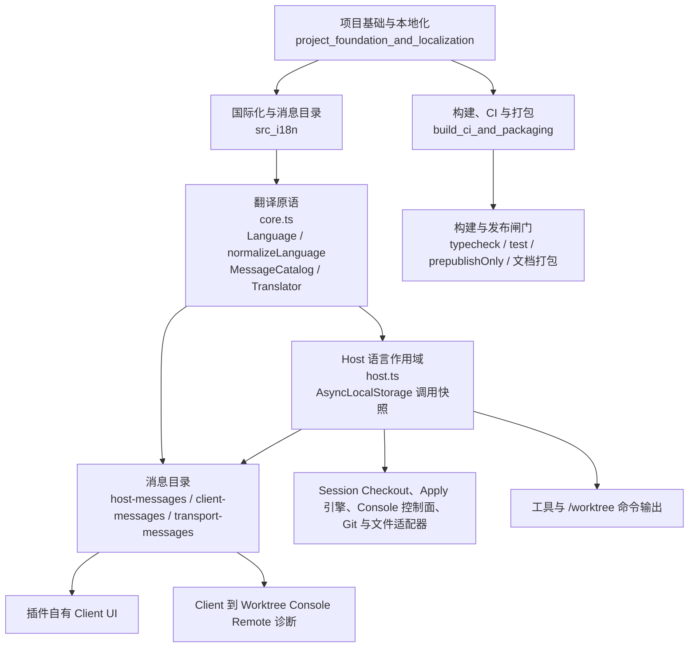
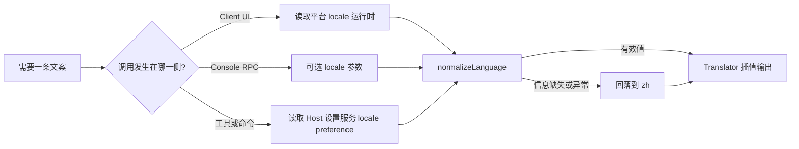

# 项目基础与本地化模块概览

!!! info "Generated documentation"
    This page was written by CodeWiki from the source code at commit [`f93ba818`](https://github.com/wloops/dsh-git-worktree/commit/f93ba8188971886c09b4c40e12c746a23853c229) on 2026-11-06 with `doubao-seed-2.1-lite`. Check the code before relying on details.

`project_foundation_and_localization` 是插件的基础工程与本地化支撑层。它把“构建、CI、打包与发布校验”和“用户文案、语言选择、翻译作用域”集中到同一模块族中，使业务协议层不依赖译文，同时保证中英文文案可以在 Client 与 Host 两侧确定地解析和渲染。

## 模块目的

该模块承担两类职责：

- **基础工程职责**：通过 `build_ci_and_packaging` 提供构建、类型检查、测试、发布完整性与打包相关校验入口，保证 `docs/i18n.md` 等语言契约文档与插件代码、测试和发布闸门保持一致。
- **本地化职责**：通过 `src_i18n` 提供类型安全的消息目录和语言作用域。所有面向用户与面向模型的文案必须同时提供 `zh` 与 `en`；当语言信息缺失、设置不可用或处于拆卸期时，统一回落到 `zh`。

`src_i18n` 的设计重点是把“说什么”和“怎么说”从业务逻辑中分离：错误码、Git 操作、验收确认、清理判定、持久化 schema 与模型可见协议不依赖译文；翻译只发生在文案源头。路径、分支名、Session/Review 标识、用户输入、原始 Git 或文件系统报错等动态数据只作为插值参数注入，不成为翻译 key，也不参与控制流判断。

## 模块架构

下面这张图展示了 `project_foundation_and_localization` 与其子模块、核心翻译原语以及主要消费方之间的关系。

## 语言解析概览

该模块的语言解析遵循一条统一规则：只有能够明确识别为英文的值才使用 `en`，其余情况回落到 `zh`。Client UI、Console RPC、工具与 `/worktree` 命令分别有各自的语言来源，但最终都通过翻译原语输出确定文案。

需要注意的是，语言切换不会改变执行约束的语义。工具描述、`/worktree` 命令提示等共享且可重放的注册元数据可能采用双语拼接形式，而执行期的动态结果与命令输出才使用当前调用语言。

## 核心组件文档引用

- [国际化与消息目录](project_foundation_and_localization/src_i18n.md)
- [构建、CI 与打包](project_foundation_and_localization/build_ci_and_packaging.md)

??? abstract "Documented components (26)"
    - [`check`](https://github.com/wloops/dsh-git-worktree/blob/f93ba8188971886c09b4c40e12c746a23853c229/.github/workflows/ci.yml) — `.github/workflows/ci.yml`
    - [`ci.yml`](https://github.com/wloops/dsh-git-worktree/blob/f93ba8188971886c09b4c40e12c746a23853c229/.github/workflows/ci.yml) — `.github/workflows/ci.yml`
    - [`cordis.patch.yml`](https://github.com/wloops/dsh-git-worktree/blob/f93ba8188971886c09b4c40e12c746a23853c229/cordis.patch.yml) — `cordis.patch.yml`
    - [`build`](https://github.com/wloops/dsh-git-worktree/blob/f93ba8188971886c09b4c40e12c746a23853c229/package.json) — `package.json`
    - [`check:publish`](https://github.com/wloops/dsh-git-worktree/blob/f93ba8188971886c09b4c40e12c746a23853c229/package.json) — `package.json`
    - [`check:publish:release`](https://github.com/wloops/dsh-git-worktree/blob/f93ba8188971886c09b4c40e12c746a23853c229/package.json) — `package.json`
    - [`check:sidebar-version`](https://github.com/wloops/dsh-git-worktree/blob/f93ba8188971886c09b4c40e12c746a23853c229/package.json) — `package.json`
    - [`dev:dsh`](https://github.com/wloops/dsh-git-worktree/blob/f93ba8188971886c09b4c40e12c746a23853c229/package.json) — `package.json`
    - [`dev:dsh:install`](https://github.com/wloops/dsh-git-worktree/blob/f93ba8188971886c09b4c40e12c746a23853c229/package.json) — `package.json`
    - [`dev:dsh:remove`](https://github.com/wloops/dsh-git-worktree/blob/f93ba8188971886c09b4c40e12c746a23853c229/package.json) — `package.json`
    - [`dev:dsh:smoke`](https://github.com/wloops/dsh-git-worktree/blob/f93ba8188971886c09b4c40e12c746a23853c229/package.json) — `package.json`
    - [`package.json`](https://github.com/wloops/dsh-git-worktree/blob/f93ba8188971886c09b4c40e12c746a23853c229/package.json) — `package.json`
    - [`prepare`](https://github.com/wloops/dsh-git-worktree/blob/f93ba8188971886c09b4c40e12c746a23853c229/package.json) — `package.json`
    - [`prepublishOnly`](https://github.com/wloops/dsh-git-worktree/blob/f93ba8188971886c09b4c40e12c746a23853c229/package.json) — `package.json`
    - [`test`](https://github.com/wloops/dsh-git-worktree/blob/f93ba8188971886c09b4c40e12c746a23853c229/package.json) — `package.json`
    - [`typecheck`](https://github.com/wloops/dsh-git-worktree/blob/f93ba8188971886c09b4c40e12c746a23853c229/package.json) — `package.json`
    - [`pnpm-workspace.yaml`](https://github.com/wloops/dsh-git-worktree/blob/f93ba8188971886c09b4c40e12c746a23853c229/pnpm-workspace.yaml) — `pnpm-workspace.yaml`
    - [`screenshots.json`](https://github.com/wloops/dsh-git-worktree/blob/f93ba8188971886c09b4c40e12c746a23853c229/screenshots.json) — `screenshots.json`
    - [`tsconfig.json`](https://github.com/wloops/dsh-git-worktree/blob/f93ba8188971886c09b4c40e12c746a23853c229/tsconfig.json) — `tsconfig.json`
    - [`defineConfig`](https://github.com/wloops/dsh-git-worktree/blob/f93ba8188971886c09b4c40e12c746a23853c229/tsdown.config.ts) — `tsdown.config.ts`
    - [`vitest.config.ts`](https://github.com/wloops/dsh-git-worktree/blob/f93ba8188971886c09b4c40e12c746a23853c229/vitest.config.ts) — `vitest.config.ts`
    - [`__file__`](https://github.com/wloops/dsh-git-worktree/blob/f93ba8188971886c09b4c40e12c746a23853c229/src%5Ci18n%5Cclient-messages.ts) — `src\i18n\client-messages.ts`
    - [`Language`](https://github.com/wloops/dsh-git-worktree/blob/f93ba8188971886c09b4c40e12c746a23853c229/src%5Ci18n%5Ccore.ts) — `src\i18n\core.ts`
    - [`PersistedCleanupKey`](https://github.com/wloops/dsh-git-worktree/blob/f93ba8188971886c09b4c40e12c746a23853c229/src%5Ci18n%5Chost-messages.ts) — `src\i18n\host-messages.ts`
    - [`currentHostLanguage`](https://github.com/wloops/dsh-git-worktree/blob/f93ba8188971886c09b4c40e12c746a23853c229/src%5Ci18n%5Chost.ts) — `src\i18n\host.ts`
    - [`__file__`](https://github.com/wloops/dsh-git-worktree/blob/f93ba8188971886c09b4c40e12c746a23853c229/src%5Ci18n%5Ctransport-messages.ts) — `src\i18n\transport-messages.ts`

