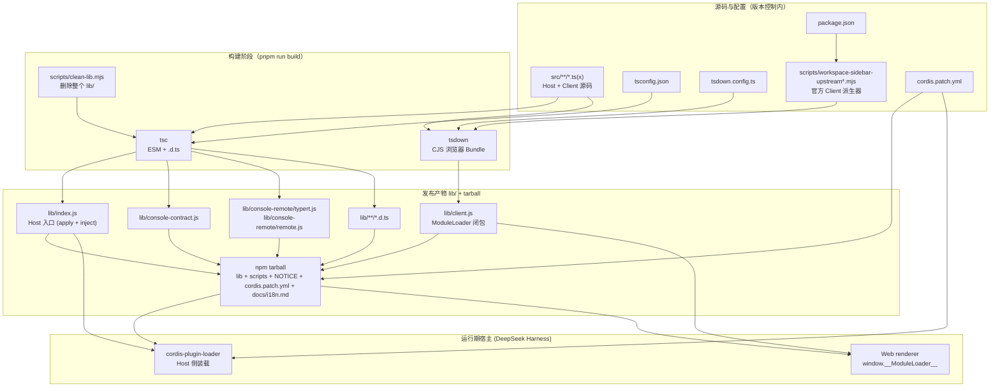
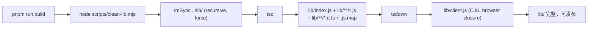
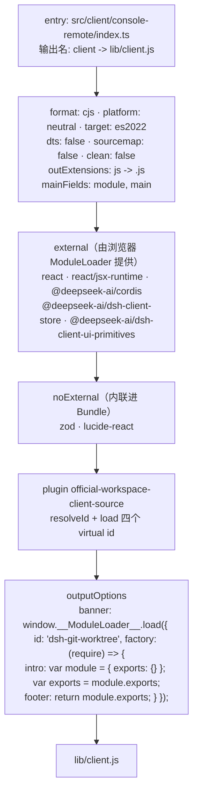
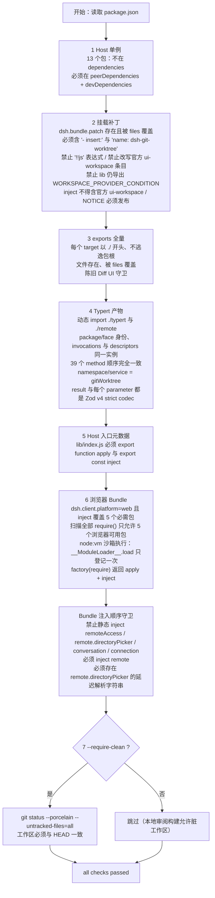
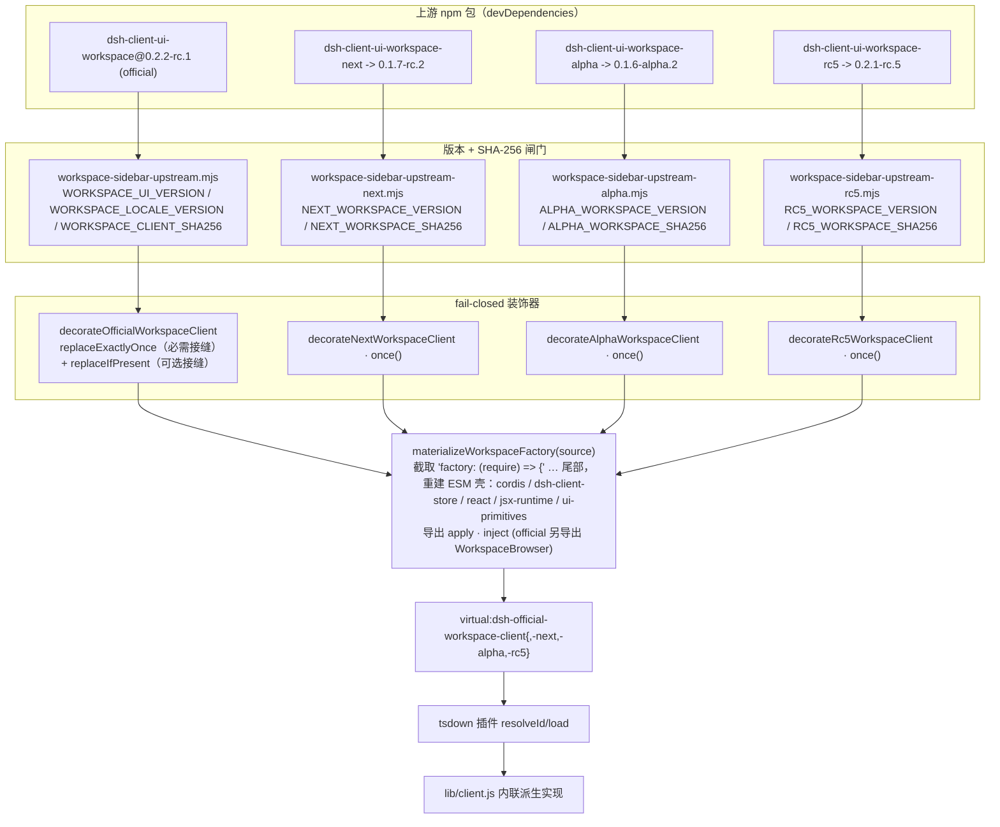
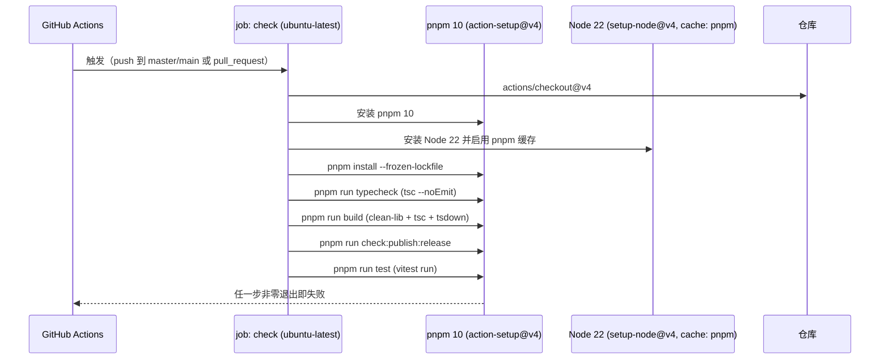
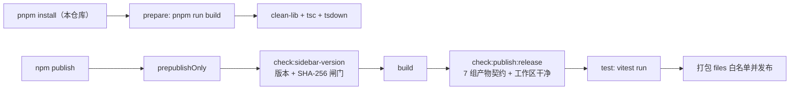

# 构建、CI 与打包（build_ci_and_packaging）

!!! info "Generated documentation"
    This page was written by CodeWiki from the source code at commit [`55374a27`](https://github.com/wloops/dsh-git-worktree/commit/55374a27f4099ec8dcd0d6163f5544d60b4f3874) on 2026-11-06 with `doubao-seed-2.1-lite`. Check the code before relying on details.

本模块描述 `dsh-git-worktree` 插件的**工程底座**：包清单与导出契约、TypeScript 编译与浏览器 Bundle 打包、上游官方 Workspace Client 的派生与版本闸门、测试基础设施、CI 流水线、发布前完整性校验，以及本地一键开发（dev:dsh）工作流。

它不包含任何业务运行时逻辑，但它决定了运行期能够看到什么：`lib/` 的产物形状、`window.__ModuleLoader__` 的注册契约、Host 装载补丁 `cordis.patch.yml`、以及 `package.json` 中 `dsh` 字段声明的挂载与注入方式。所有关于 Worktree 领域、Console 协议、客户端 UI 的行为，请参见对应模块文档，此处仅说明它们如何被构建与分发。

---

## 1. 组件总览

| 文件 | 角色 | 关键内容 |
| --- | --- | --- |
| `package.json` | 包清单与脚本入口 | `name`/`version`、`exports` 子路径映射、`files` 白名单、`dsh.bundle.patch`、`dsh.client`、`engines`、`build` / `typecheck` / `test` / `prepare` / `prepublishOnly` / `check:*` / `dev:dsh*` |
| `tsconfig.json` | Host 侧（ESM）编译配置 | `NodeNext`、`strict`、`declaration`、`outDir: lib`、`rootDir: src`、`jsx: react-jsx` |
| `tsdown.config.ts` | 浏览器 Client Bundle 打包（`defineConfig`） | 单入口 `client`、CJS + `platform: neutral`、`external`/`noExternal`、virtual module 插件、`banner`/`intro`/`footer` ModuleLoader 闭包 |
| `vitest.config.ts` | 测试基础设施 | `resolve.alias`（ui-primitives 与四个 `virtual:dsh-official-workspace-client*` mock）、`test.include`、`fileParallelism`、60s 超时 |
| `cordis.patch.yml` | Host 装载补丁（随包发布） | 仅向 bundle 插入一行 `dsh-git-worktree` 插件；**不再**包含任何 client 侧 `!!js` 条件表达式 |
| `pnpm-workspace.yaml` | pnpm 行为配置 | `allowBuilds.esbuild`、超长的 `minimumReleaseAgeExclude` 白名单（放行 rc/alpha 版本） |
| `screenshots.json` | README 截图清单 | 三张文档截图的路径数组 |
| `.github/workflows/ci.yml` | CI 流水线 | 单一 `check` job：`pnpm install --frozen-lockfile` → `typecheck` → `build` → `check:publish:release` → `test` |

相关脚本（`files` 白名单中被打包发布，见 §5、§6）：`scripts/clean-lib.mjs`、`scripts/check-publish.mjs`、`scripts/check-workspace-sidebar-version.mjs`、`scripts/workspace-sidebar-upstream{,-next,-alpha,-rc5}.mjs`、`scripts/dev-dsh.mjs`、`scripts/dev-dsh-lib.mjs`、`scripts/dsh-source-runner.mjs`。

---

## 2. 架构总览



数据流上有两条严格分离的编译通道：**tsc 通道**产出 Host 侧的原生 ESM + 类型声明（Node 24 直接运行，由 Cordis Loader 装载）；**tsdown 通道**只产出单个 `lib/client.js`，它是为浏览器 `window.__ModuleLoader__` 定制的 CJS 闭包，外部依赖被压到最小集合。

---

## 3. 包清单与导出契约（package.json）

### 3.1 身份与引擎约束

- `name`: `dsh-git-worktree`，`version`: `0.14.0`，`type`: `module`，`license`: `MIT`。
- `engines.node`: `>=24.9.0`。CI 固定使用 Node 22，见 [§7 CI 流水线](#7-ci-流水线-githubworkflowsciyml)。

### 3.2 `exports` 子路径映射

每个导出都成对声明 `types` + `default`，且全部指向 `lib/`（构建产物）。`scripts/check-publish.mjs` 会遍历这张表，逐项校验"目标存在 + 未逃逸包根 + 被 `files` 覆盖"。

| 子路径 | 运行时目标 | 类型目标 | 消费方 |
| --- | --- | --- | --- |
| `.` | `lib/index.js` | `lib/index.d.ts` | Host 插件入口（必须导出 `apply` 与 `inject`） |
| `./client` | `lib/client.js` | `lib/client/console-remote/index.d.ts` | 浏览器 ModuleLoader Bundle |
| `./typert` | `lib/console-remote/typert.js` | 同名 `.d.ts` | 官方 Typert Loader 发现的 Host 贡献（`face: 'host'`） |
| `./remote` | `lib/console-remote/remote.js` | 同名 `.d.ts` | Client 侧 Remote 描述符 |
| `./console-contract` | `lib/console-contract.js` | 同名 `.d.ts` | 协议类型与 Zod schema |
| `./package.json` | `package.json` | — | 运行期读取版本/元信息 |
| `./cordis.patch.yml` | `cordis.patch.yml` | — | Host 装载补丁，见 §8 |

`./typert` 与 `./remote` **必须共享同一个 descriptor 数组实例**（`check-publish.mjs` 第 4 组断言 `hostContribution.invocations === remoteContribution.descriptors`），以保证 Host 端与 Client 端的 Remote 身份一致。协议本身的语义见 [Worktree Console 协议与 Host 服务](../worktree_console_protocol_and_host_service.md)；描述符结构见 [Worktree Console Remote 协议层（`src/console-remote/`）](../worktree_console_protocol_and_host_service/worktree_console_remote.md)。

### 3.3 `files` 白名单

发布内容被显式收窄为：`lib`、`scripts`、`CHANGELOG.md`、`docs/i18n.md`、`NOTICE`、`cordis.patch.yml`。

- `scripts` 被打包，是因为 `package.json.scripts` 中的 `check:publish` / `check:sidebar-version` / `dev:dsh*` 都指向 `node scripts/*.mjs`，安装方（含 npm `prepublishOnly`）需要在磁盘上找到它们。
- `NOTICE` 是强制项：浏览器 Bundle 内联了官方 Workspace Client 的派生代码，`check-publish.mjs` 要求 `files` 含 `NOTICE` 且文件存在，否则发布失败。`NOTICE` 中列出五个被派生/封装的上游版本（`0.1.2-rc.1`、`0.1.6-alpha.2`、`0.1.7-rc.2`、`0.2.1-rc.5` 及版权与 MIT 许可信息）。

### 3.4 `dsh` 字段：Host 挂载与 Client 注入声明

```json
"dsh": {
  "bundle": { "patch": "./cordis.patch.yml" },
  "client": {
    "inject": [ ...8 个 @deepseek-ai/dsh-* Client 包... ],
    "platform": "web"
  }
}
```

- `bundle.patch`：缺失即视为"dsh plugin add 只会装一个普通依赖而不会挂载"，`check-publish.mjs` 直接 FAIL。
- `client.platform: "web"` + `client.inject`：`check-publish.mjs` 要求其中必须包含 `dsh-api-remote-access`、`dsh-api-session-controller`、`dsh-api-workspace-controller`、`dsh-client-ui-conversation`、`dsh-api-gateway`；同时**禁止**出现 `@deepseek-ai/dsh-client-ui-workspace`（该官方模块由本插件的派生实现接管，见 §6 与 §8）。

### 3.5 依赖分层规则（Host 单例）

`dependencies` 只允许三个纯计算/视图库：`@deepseek-ai/schemastery`、`lucide-react`、`zod`。

`peerDependencies`（`cordis`、`cordis-plugin-loader`、`dsh-agent`、`dsh-commands`、`dsh-fs`、`dsh-session`、`dsh-skill`、`dsh-skill-filesystem`、`dsh-subprocess`、`dsh-system-prompt`、`dsh-tools`、`dsh-typert-protocol`、`dsh-typert-registry`、`dsh-client-locale`、`react`）承载所有 **Host 单例包**。`check-publish.mjs` 第 1 组检查对 13 个 Host 单例包做三向断言：

1. 不得出现在 `dependencies`（否则插件私有副本会破坏 Host 服务身份）；
2. 必须出现在 `peerDependencies`；
3. 必须出现在 `devDependencies`（保证本地可测）。

`devDependencies` 中还通过 npm alias 固定了三份"非当前"的官方 Workspace Client，用于多版本派生：`@deepseek-ai/dsh-client-ui-workspace-alpha` → `npm:@deepseek-ai/dsh-client-ui-workspace@0.1.6-alpha.2`，`@deepseek-ai/dsh-client-ui-workspace-next` → `npm:@deepseek-ai/dsh-client-ui-workspace@0.1.7-rc.2`，`@deepseek-ai/dsh-client-ui-workspace-rc5` → `npm:@deepseek-ai/dsh-client-ui-workspace@0.2.1-rc.5`。

### 3.6 `pnpm-workspace.yaml`

本仓库是单包项目，该文件不承担多包 `packages:` 声明，而是 pnpm 的行为配置：

- `allowBuilds.esbuild: true` —— 允许 esbuild（`tsdown`/`vitest` 的原生依赖）执行构建脚本。
- `minimumReleaseAgeExclude` —— 一份按 `包名@精确版本` 列举的白名单（覆盖 `@deepseek-ai/*` 的 `0.1.2-rc.1`、`0.2.1-rc.2 … rc.5`、`0.2.2-rc.1`、`0.1.6-alpha.2`、`0.1.7-rc.2`、`cordis@4.1.0`、`cordis-plugin-include@1.1.0`、`cordis-plugin-loader@1.1.0` 以及 `@deepseek-ai/schemastery@3.19.0`），用于绕过 pnpm 的最小发布时长限制，使插件能与尚未"足够老"的 rc/alpha Host 版本共同安装。新增 Host 版本时必须同步追加条目，否则 CI 的 `pnpm install --frozen-lockfile` 会被拦截。

---

## 4. 两阶段构建流水线（pnpm run build）

`build` 脚本为：`node scripts/clean-lib.mjs && tsc && tsdown`。



**为什么必须先清空 `lib/`**：TypeScript 不会为已删除的源文件清理输出。若不做全量删除，被移除的旧 UI 模块（如 `lib/client/review-console/DiffViewer.js`、`lib/client/review-console/useReviewDiff.js`）会以陈旧产物形式存活并进入 tarball —— `check-publish.mjs` 第 3 组检查专门对这两个路径做了"陈旧产物守卫"。

### 4.1 tsc 通道：tsconfig.json

| 选项 | 值 | 影响 |
| --- | --- | --- |
| `target` / `lib` | `ES2022` / `ES2022` + `DOM` | Host 侧 Node 与浏览器 API 类型同时可用 |
| `module` / `moduleResolution` | `NodeNext` | 与 `type: module` 匹配，源码内必须写带 `.js` 后缀的相对导入（产物为真正的 ESM） |
| `jsx` | `react-jsx` | 客户端 `.tsx` 使用自动 JSX 运行时（`react/jsx-runtime`） |
| `strict` / `noImplicitAny` / `noUncheckedIndexedAccess` | `true` | `noUncheckedIndexedAccess` 让所有下标访问返回 `T \| undefined`，是本仓库类型守卫密集写法（如 ports/types 中的可选字段）的根源约束 |
| `declaration` / `sourceMap` | `true` | `exports.types` 全部依赖 `lib/**/*.d.ts`；`pnpm run typecheck` 即 `tsc --noEmit` |
| `outDir` / `rootDir` | `lib` / `src` | 源码目录结构一一映射到 `lib/`，因此 `exports` 中的 `lib/console-remote/typert.js` 等路径直接可推导 |
| `esModuleInterop` / `skipLibCheck` / `forceConsistentCasingInFileNames` | `true` | 跨大小写不敏感文件系统（Windows）下的文件名一致性保护 |
| `include` | `["src"]` | `scripts/*.mjs`、`tests/**` 不参与 tsc 编译 |

### 4.2 tsdown 通道：tsdown.config.ts



要点说明：

- **`format: cjs` + `platform: neutral`**：浏览器 ModuleLoader 的 `factory(require)` 契约是 CJS 风格；`neutral` 避免注入任何 Node 或浏览器专有 polyfill/条件。
- **`external` 集合与 `check-publish.mjs` 第 6 组的 `allowedBrowserRequires` 集合必须一致**：Bundle 内出现的每个 `require("...")` 只允许是 `react`、`react/jsx-runtime`、`@deepseek-ai/dsh-client-ui-primitives`、`@deepseek-ai/cordis`、`@deepseek-ai/dsh-client-store`。任何新依赖若不内联（`noExternal`）也不在此白名单内，发布检查会失败。
- **`noExternal: ['zod', 'lucide-react']`**：这两个包浏览器侧不可得，必须被打进 Bundle。
- **`dts: false`**：Client 的类型声明由 tsc 通道产出（`lib/client/console-remote/index.d.ts`），避免两条通道重复生成。
- **virtual module 插件**：把四个官方 Workspace Client 源（official / next / alpha / rc5）以 `virtual:dsh-official-workspace-client{,-next,-alpha,-rc5}` 的形式在打包期内联进 Bundle。四个 virtual id 与它们的 `materialize*WorkspaceClientModule()` 来自 `scripts/workspace-sidebar-upstream*.mjs`，详见 §6。`vitest.config.ts` 用同名 alias 把这四个 id 指向 mock，从而让单测无需真实上游包即可运行。
- **banner/intro/footer**：最终 `lib/client.js` 是一个自注册的浏览器闭包脚本，其 `id` 常量 `CLIENT_PLUGIN_ID = 'dsh-git-worktree'` 必须等于 `package.json.name`，否则 `check-publish.mjs` 的沙箱执行（见 §5 第 6 组）会报"client bundle registered more than one ModuleLoader handoff"或 id 不匹配。

---

## 5. 发布闸门：scripts/check-publish.mjs

`check:publish` 执行该脚本；`check:publish:release` 追加 `--require-clean`（等价于环境变量 `CHECK_PUBLISH_REQUIRE_CLEAN=1`）。它是**产物级**校验而非源码级 lint：所有断言都针对已经构建好的 `lib/`，因此必须排在 `build` 之后。



第 6 组检查中的沙箱是该校验最有价值的部分：它在 Node 里用 `vm.runInNewContext` 真实执行 `lib/client.js`，用一个假的 `window.__ModuleLoader__` 捕获 `load()` 传入的 `{ id, factory }`，再用受限 `require`（`@deepseek-ai/dsh-client-ui-primitives` 被替换成 `{ Modal, Menu }` 桩）调用 factory，确认返回的对象同时具备 `apply` 函数与 `inject` 数组。这等于在发布前复刻了浏览器的装载过程。

那些"禁止注入"的断言记录的是真实事故（0.2.0-rc.2 Host 无 `remoteAccess` 服务、`remote.directoryPicker` 的提供者优先等待 `uiWorkspace`、`uiConversation` 依赖本插件恢复的 `uiWorkspace`），违反即会造成 web boot 永久 pending。Boot 顺序的服务语义见 [会话检出运行时模块（session_checkout_runtime）概述](../core_worktree_domain_and_infrastructure/session_checkout_domain/session_checkout_runtime.md) 与 [客户端控制台 Remote 适配层（client_console_remote）](../worktree_client_interface_layer/client_console_remote.md)。

`expectedRemoteMethods` 中的 39 个方法名（`sidebarTopology` … `restoreAbandoned`）与 `src/console-remote/descriptors.ts` 中的 `WORKTREE_CONSOLE_DESCRIPTORS` 一一对应；新增/删除 Remote 方法时必须同步修改该列表，否则 CI 的 `check:publish:release` 会失败。方法语义见 [Worktree Console Remote 协议层（`src/console-remote/`）](../worktree_console_protocol_and_host_service/worktree_console_remote.md)。

---

## 6. 官方 Workspace Client 派生与版本闸门

本插件需要在官方侧边栏（Workspace Browser）中渲染 Worktree 图标/徽标并屏蔽"会改变所有权"的行操作。做法不是 fork 整个上游包，而是**在构建期内联上游生成产物 + 精确字符串替换**。



- **闸门语义**：`readOfficialWorkspaceClient()` 先 `require.resolve('@deepseek-ai/dsh-client-ui-workspace/package.json')` 比对版本号，再读取其 `client` 入口并计算 SHA-256 与常量比对；不一致即抛错。next / alpha / rc5 三个文件同样先校验 `packageJson.name === '@deepseek-ai/dsh-client-ui-workspace'` 与版本，再校验哈希。这使得"上游悄悄改版"在构建期就变成硬失败，而不是运行期的静默行为漂移。
- **装饰语义（fail-closed）**：每个替换要求 needle 在源中**恰好出现一次**（`replaceExactlyOnce` / `once`），找不到或出现多次立即抛错。官方路径还区分了 `replaceIfPresent`（DSH 0.2 已移除的旧搜索/菜单接缝等可选装饰，未命中则跳过，可用环境变量 `WT_DEBUG_SEAMS` 打印 HIT/SKIP）。装饰内容包括：实例级 `__dshGitWorktreeManagedGuard` 注入（拦截 fork Session / 新建 Session）、`__dshGitWorktree` 与 `__dshGitWorktreeProtected` 元数据透传、`ManagedWorktreeIdentity` 分支图标与状态徽标、托管行禁用拖拽/菜单/新建、中英文 locale 字典追加等。装饰后的工厂体重建为 ESM 模块，只导出 `apply` / `inject`（官方版本另导出派生 `WorkspaceBrowser`，供 shadow 注册使用），并且**不**重新登记上游的 ModuleLoader 行。
- **检查入口**：`pnpm run check:sidebar-version` → `scripts/check-workspace-sidebar-version.mjs`，它额外比对已安装的 `@deepseek-ai/dsh-client-locale` 版本是否等于 `WORKSPACE_LOCALE_VERSION`，然后依次读取四份官方源（触发哈希校验），成功打印形如 `✓ Workspace Sidebar compatibility gate: ui-workspace 0.2.2-rc.1 + 0.1.6-alpha.2 + 0.1.7-rc.2 + 0.2.1-rc.5 SHA-256, locale 0.2.2-rc.1`。该脚本挂在 `prepublishOnly` 上，作为发布前第一道闸门。
- **测试侧替身**：`vitest.config.ts` 把四个 virtual id alias 到 `tests/official-workspace-client*.mock.ts`，其中 `derivedBrowserCalls` 等导出用于断言 shadow 注册确实把投影元数据传给了**派生** Browser 而不是官方 Browser。UI 侧边栏行为见 [工作区侧边栏（client_workspace_sidebar）](../worktree_client_interface_layer/client_workspace_sidebar.md)。

### 6.1 接管选举：为什么补丁里没有条件表达式

`cordis.patch.yml` 的文件头注释记录了一次真实崩溃（2026-10-17 18:11 / 20:25，17 个下游条目 pending）：旧的 `disabled: !!js` 表达式引用插件子 fiber 提供的 `worktreeWorkspaceProvider` 服务，而 Cordis strict get 要求提供者 fiber 已 `ACTIVE`。插件在 Host 侧 apply 期间自身仍是 `LOADING`（求值为 false → 选举恒败、回退到装饰路径），renderer 审计时插件已 `ACTIVE`（求值为 true → 官方条目被跳过），两处求值相反导致 `uiWorkspace` 无人提供。

现在补丁只做一件事：插入插件行。选举改由 Host 侧生命周期用 Loader 操作直接写确定性布尔并在 dispose 时还原 —— 详见 [工作区提供者生命周期与会话目标上下文](../core_worktree_domain_and_infrastructure/session_checkout_domain/session_checkout_runtime/workspace_provider_lifecycle.md)（`mountWorkspaceProviderLifecycle`、`worktreeWorkspaceProvider` 上下文声明、跨代 `ownedDisables` WeakSet 与操作超时上限）。`check-publish.mjs` 用三条断言锁死这一决定：补丁不得含 `!!js`、不得 patch 官方 `ui-workspace` 条目、`lib/workspace-provider-lifecycle.js` 不得再导出已废弃的 `WORKSPACE_PROVIDER_CONDITION`。

---

## 7. CI 流水线（.github/workflows/ci.yml）



- 触发条件：`push` 到 `master` / `main`，以及任意 `pull_request`。
- 步骤顺序是刻意设计的：`typecheck`（源码级）→ `build`（产物生成）→ `check:publish:release`（产物级契约校验，且要求工作区干净）→ `test`（行为回归）。`check:publish` 依赖 `lib/` 已存在，故必须位于 `build` 之后。
- `--require-clean` 只在 CI 与 `prepublishOnly` 生效：本地审阅构建允许在脏的托管 Worktree 上运行，这也是插件自身 Worktree 工作流的常见场景。
- CI 未使用 `pnpm run check:sidebar-version` 作为独立步骤；该闸门通过 `check:publish:release` 与 npm 的 `prepublishOnly` 覆盖。上游版本一旦漂移，最先在 `pnpm run build`（tsdown 加载 virtual module）时失败。

---

## 8. 测试基础设施（vitest.config.ts）

| 配置 | 值 | 原因 |
| --- | --- | --- |
| `resolve.alias['@deepseek-ai/dsh-client-ui-primitives']` | `tests/support/ui-primitives.tsx` | 提供受控的 `Menu`/`Modal` 等测试替身（含 `MenuEntry` 类型），避免真实设计系统的 DOM/焦点行为干扰断言 |
| `resolve.alias['virtual:dsh-official-workspace-client']` | `tests/official-workspace-client.mock.ts` | 让 shadow 注册路径在测试中可断言（`derivedBrowserCalls`） |
| `resolve.alias['virtual:dsh-official-workspace-client-alpha' / '-next' / '-rc5']` | 对应 `.mock.ts` | 同上，覆盖三个 legacy Host flavor |
| `test.include` | `tests/**/*.test.{ts,tsx}` | `src/` 内不内联测试文件 |
| `test.fileParallelism` | `process.platform !== 'win32'` | Windows 上重量级 Git fixture 套件并发争用进程与文件句柄，可能超出超时并锁死临时目录 |
| `testTimeout` / `hookTimeout` | `60_000` | 真实 `git` 子进程 fixture 的耗时余量 |

`test` 脚本为 `vitest run`（单次运行、非 watch），与 CI 语义一致。测试覆盖的领域行为见 [核心 Worktree 领域与基础设施模块](../core_worktree_domain_and_infrastructure.md) 与其子模块。

---

## 9. 生命周期脚本一览



| 脚本 | 命令 | 何时执行 |
| --- | --- | --- |
| `build` | `node scripts/clean-lib.mjs && tsc && tsdown` | 手动、`prepare`、CI、`dev:dsh` |
| `typecheck` | `tsc --noEmit` | CI、`dev:dsh` 安装前 |
| `test` | `vitest run` | CI、`prepublishOnly` |
| `prepare` | `pnpm run build` | 安装本包为依赖时自动触发（含 git 依赖场景） |
| `check:sidebar-version` | `node scripts/check-workspace-sidebar-version.mjs` | 发布前闸门 |
| `check:publish` | `node scripts/check-publish.mjs` | 本地：不要求工作区干净 |
| `check:publish:release` | `node scripts/check-publish.mjs --require-clean` | CI 与发布 |
| `prepublishOnly` | `check:sidebar-version && build && check:publish:release && test` | `npm publish` |
| `dev:dsh` | `node scripts/dev-dsh.mjs run` | 本地一键预览 |
| `dev:dsh:install` / `dev:dsh:smoke` / `dev:dsh:remove` | 同脚本的 `install` / `smoke` / `remove` 模式 | 快照安装、组合校验、卸载 |

---

## 10. 本地开发工作流 dev:dsh

`scripts/dev-dsh.mjs`（薄 CLI）+ `scripts/dev-dsh-lib.mjs`（全部实现）提供四个模式，全部遵循同一条硬约束：**不向 npm 发布、不向 Git 推送**。

```mermaid
flowchart TD
  START["pnpm run dev:dsh -- [--profile web] [--repo <git-root>] [--port 3081] [--harness <path>]"]
  START --> OPTS["parseDevDshArgs：mode/profile/port/repo/harness<br/>profile 仅允许字母数字 . _ -"]
  OPTS --> RT["discoverHarnessRoot：DSH_HARNESS_ROOT 或<br/>从 git common-dir 附近扫描 deepseek-harness 检出"]
  RT --> CHK["assertDshRuntimeAvailable：源码检出需已 pnpm install<br/>否则要求 PATH 上有 dsh --version"]
  CHK --> TYPE["pnpm run typecheck && pnpm run build<br/>（node_modules 缺失时先 install --frozen-lockfile）"]
  TYPE --> PACK["staging 目录改写 manifest：<br/>version += '-dev.<timestamp>'、scripts = {}<br/>复制 lib / cordis.patch.yml / README(.en) / docs/i18n.md / LICENSE / NOTICE<br/>符号链接一律拒绝<br/>pnpm pack --out dsh-git-worktree-<ts>.tgz"]
  PACK --> PROF{"profile manifest 存在？"}
  PROF -->|"否"| DUMP["dsh --profile <p> --dump-config<br/>让 Host 自己初始化 Profile（不代写其文件）"]
  PROF -->|"是"| REPAIR
  DUMP --> REPAIR["repairMissingCurrentProfileArchive<br/>仅修复自家托管缓存里缺失的旧快照路径"]
  REPAIR --> ADD["dsh plugin --profile <p> add <archive>"]
  ADD --> VERIFY["校验 Profile 依赖指向新归档<br/>+ --dump-config 输出含 dsh-git-worktree"]
  VERIFY --> CLEAN["cleanSupersededArchives<br/>保留所有 Profile 仍引用的归档"]
  CLEAN --> FIX{"mode == run ?"}
  FIX -->|"是"| FIXTURE["ensureDevFixture：无 --repo 时创建带标记文件的一次性 Git 仓库<br/>有 --repo 时只读校验（必须是 Git 根、非嵌套、非符号链接）"]
  FIXTURE --> LAUNCH["createDshLaunch：dsh --profile p [--patch iso] --port N [--no-open]<br/>源码模式经 scripts/dsh-source-runner.mjs + tsx 启动 apps/cli/src/bin.ts"]
  FIX -->|"否"| DONE["install / smoke / remove 完成"]
  LAUNCH --> DONE
```



关键安全设计：

- **一次性 fixture 的所有权标记**：默认仓库路径写入 `.dsh-git-worktree-fixture.json`（`owner: dsh-git-worktree`、`schemaVersion: 1`）。目录非空且无标记、或标记身份不符 → 直接抛错并保证"已有字节绝不被动"；标记存在但工作区不干净或仍残留 linked Worktree → 抛错要求人工处理，脚本永不 reset/删除用户数据。
- **隔离的 DSH_HOME**：设置 `DSH_HOME` 时缓存根迁到 `$DSH_HOME/dev-dsh-cache`（否则系统临时目录下的 `dsh-git-worktree-dev`），并通过 `prepareIsolatedWorkspacePatch` 生成 `workspace-isolation.patch.yml`，把 Host 首次使用的 `documentsDirectory` 也钉在该 home 下；此时还会追加 `--no-open`。
- **归档清理不越界**：`cleanSupersededArchives` 先收集**所有** Profile 的 `file:` 依赖引用，只删除自家缓存目录中形如 `dsh-git-worktree-<digits>.tgz` 且未被引用的文件；`removeLocalSnapshot` 同样只按该模式清理。
- **不伪造 Profile 文件**：Profile manifest 属 Host 所有，脚本只通过 `--dump-config` 让 Host 自行初始化。
- **Windows 命令安全**：`assertWindowsCommandSafe` 拒绝包含空字节、换行与 `" & | < > ^ % !` 的参数，随后统一经 `cmd.exe /d /v:off /c` 执行。
- **smoke 模式**只做 `--dump-config` 并断言输出含 `dsh-git-worktree`，用于快速确认 Profile 组合而不安装快照。

---

## 11. 配置类工件补充

- **`screenshots.json`**：一个纯字符串数组，声明 README 使用的三张文档截图（`docs/screenshots/00-project-sidebar.png`、`01-create-worktree.png`、`02-ready-for-review.png`）。它是文档资产的清单，不参与构建，但对应着"创建 Worktree → 待验收"这条主流程的可视证据。
- **`docs/i18n.md`** 被列入 `files` 白名单，因此本地化说明会随包发布；语言解析与消息字典的实现见 [src_i18n 国际化与消息目录模块](src_i18n.md)（`currentHostLanguage` 在无 store 时回退 `'zh'`）。
- **`CHANGELOG.md` / `LICENSE`** 同样在发布物中（后者被 `dev-dsh` 的打包白名单引用），保证 npm 与本地快照两条分发路径的法律与版本信息一致。

---

## 12. 修改此模块时的检查清单

| 变更 | 必须同步的位置 |
| --- | --- |
| 新增/删除 Remote 方法 | `src/console-remote/descriptors.ts` 与 `scripts/check-publish.mjs` 的 `expectedRemoteMethods`（顺序敏感） |
| 新增浏览器侧依赖 | `tsdown.config.ts` 的 `external` 或 `noExternal`，以及 `check-publish.mjs` 的 `allowedBrowserRequires` |
| 新增 Host 侧运行时依赖 | 判断是否为 Host 单例：是则进 `peerDependencies` + `devDependencies`（且**不得**进 `dependencies`），并补进 `hostSingletonPackages` |
| 升级官方 Workspace Client | 四个 `workspace-sidebar-upstream*.mjs` 的版本与 SHA-256 常量、接缝字符串、`NOTICE` 版本列表、`devDependencies` alias、`pnpm-workspace.yaml` 的 `minimumReleaseAgeExclude` |
| 新增 `exports` 子路径 | 确认目标在 `lib/`（`files` 覆盖），且 Host/Client 通道都会产出该文件 |
| 新增脚本或文档到发布物 | `package.json.files`（`check-publish.mjs` 的 `includedByFiles` 会拒绝未覆盖的导出目标） |
| 调整挂载策略 | 只能改 `cordis.patch.yml` 的插件行；条件禁用逻辑必须留在 Host 侧生命周期，不得写入 `!!js` |

---

## 13. 相关模块

- [项目基础与本地化模块概览](../project_foundation_and_localization.md) —— 本模块的父页面，含本地化子模块。
- [src_i18n 国际化与消息目录模块](src_i18n.md) —— 语言解析与消息字典；其发布面（`docs/i18n.md`）由本模块的 `files` 白名单决定。
- [核心 Worktree 领域与基础设施模块](../core_worktree_domain_and_infrastructure.md) —— 被 `lib/index.js` 装载的领域与基础设施层。
- [Worktree Console 协议与宿主服务总览](../worktree_console_protocol_and_host_service.md) —— `./console-contract`、`./typert`、`./remote` 三个导出背后的协议与服务。
- [worktree_client_interface_layer：Worktree 浏览器端客户端界面层总览](../worktree_client_interface_layer.md) —— `lib/client.js` Bundle 的全部内容来源。
- [工作区提供者生命周期与会话目标上下文](../core_worktree_domain_and_infrastructure/session_checkout_domain/session_checkout_runtime/workspace_provider_lifecycle.md) —— Host 侧接管选举，取代 `cordis.patch.yml` 的条件表达式。
- [工作区侧边栏（client_workspace_sidebar）](../worktree_client_interface_layer/client_workspace_sidebar.md) —— 官方 Workspace Client 派生装饰所服务的侧边栏投影。

??? abstract "Documented components (21)"
    - [`check`](https://github.com/wloops/dsh-git-worktree/blob/55374a27f4099ec8dcd0d6163f5544d60b4f3874/.github/workflows/ci.yml) — `.github/workflows/ci.yml`
    - [`ci.yml`](https://github.com/wloops/dsh-git-worktree/blob/55374a27f4099ec8dcd0d6163f5544d60b4f3874/.github/workflows/ci.yml) — `.github/workflows/ci.yml`
    - [`cordis.patch.yml`](https://github.com/wloops/dsh-git-worktree/blob/55374a27f4099ec8dcd0d6163f5544d60b4f3874/cordis.patch.yml) — `cordis.patch.yml`
    - [`build`](https://github.com/wloops/dsh-git-worktree/blob/55374a27f4099ec8dcd0d6163f5544d60b4f3874/package.json) — `package.json`
    - [`check:publish`](https://github.com/wloops/dsh-git-worktree/blob/55374a27f4099ec8dcd0d6163f5544d60b4f3874/package.json) — `package.json`
    - [`check:publish:release`](https://github.com/wloops/dsh-git-worktree/blob/55374a27f4099ec8dcd0d6163f5544d60b4f3874/package.json) — `package.json`
    - [`check:sidebar-version`](https://github.com/wloops/dsh-git-worktree/blob/55374a27f4099ec8dcd0d6163f5544d60b4f3874/package.json) — `package.json`
    - [`dev:dsh`](https://github.com/wloops/dsh-git-worktree/blob/55374a27f4099ec8dcd0d6163f5544d60b4f3874/package.json) — `package.json`
    - [`dev:dsh:install`](https://github.com/wloops/dsh-git-worktree/blob/55374a27f4099ec8dcd0d6163f5544d60b4f3874/package.json) — `package.json`
    - [`dev:dsh:remove`](https://github.com/wloops/dsh-git-worktree/blob/55374a27f4099ec8dcd0d6163f5544d60b4f3874/package.json) — `package.json`
    - [`dev:dsh:smoke`](https://github.com/wloops/dsh-git-worktree/blob/55374a27f4099ec8dcd0d6163f5544d60b4f3874/package.json) — `package.json`
    - [`package.json`](https://github.com/wloops/dsh-git-worktree/blob/55374a27f4099ec8dcd0d6163f5544d60b4f3874/package.json) — `package.json`
    - [`prepare`](https://github.com/wloops/dsh-git-worktree/blob/55374a27f4099ec8dcd0d6163f5544d60b4f3874/package.json) — `package.json`
    - [`prepublishOnly`](https://github.com/wloops/dsh-git-worktree/blob/55374a27f4099ec8dcd0d6163f5544d60b4f3874/package.json) — `package.json`
    - [`test`](https://github.com/wloops/dsh-git-worktree/blob/55374a27f4099ec8dcd0d6163f5544d60b4f3874/package.json) — `package.json`
    - [`typecheck`](https://github.com/wloops/dsh-git-worktree/blob/55374a27f4099ec8dcd0d6163f5544d60b4f3874/package.json) — `package.json`
    - [`pnpm-workspace.yaml`](https://github.com/wloops/dsh-git-worktree/blob/55374a27f4099ec8dcd0d6163f5544d60b4f3874/pnpm-workspace.yaml) — `pnpm-workspace.yaml`
    - [`screenshots.json`](https://github.com/wloops/dsh-git-worktree/blob/55374a27f4099ec8dcd0d6163f5544d60b4f3874/screenshots.json) — `screenshots.json`
    - [`tsconfig.json`](https://github.com/wloops/dsh-git-worktree/blob/55374a27f4099ec8dcd0d6163f5544d60b4f3874/tsconfig.json) — `tsconfig.json`
    - [`defineConfig`](https://github.com/wloops/dsh-git-worktree/blob/55374a27f4099ec8dcd0d6163f5544d60b4f3874/tsdown.config.ts) — `tsdown.config.ts`
    - [`vitest.config.ts`](https://github.com/wloops/dsh-git-worktree/blob/55374a27f4099ec8dcd0d6163f5544d60b4f3874/vitest.config.ts) — `vitest.config.ts`

