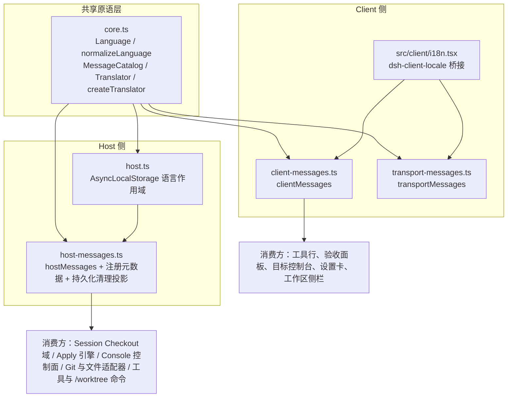
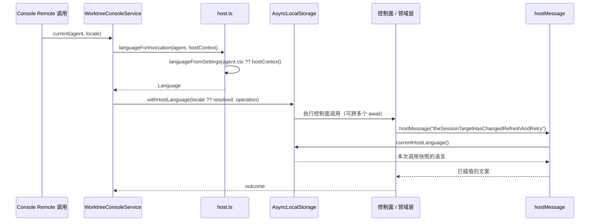
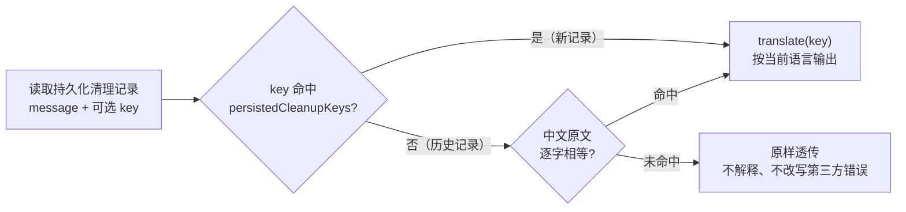
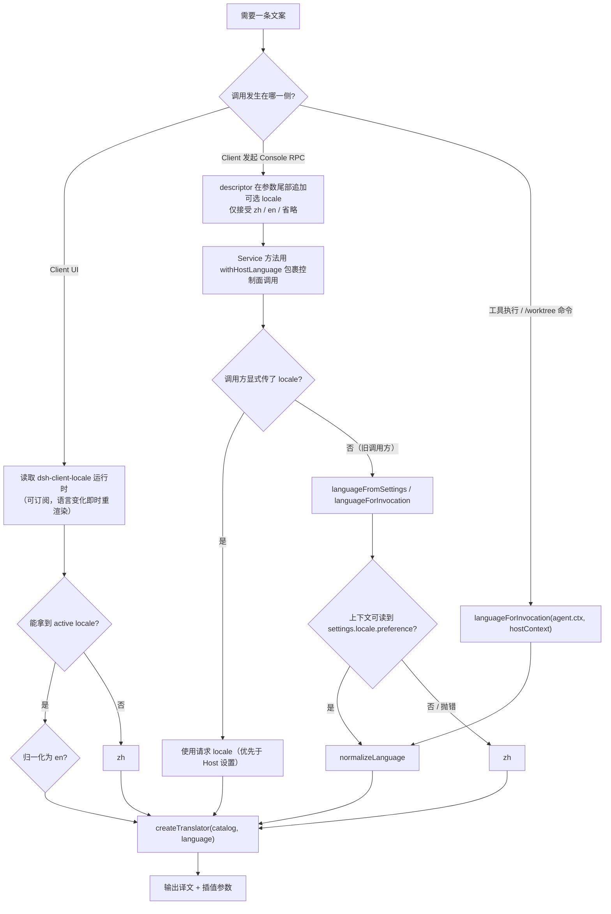

# src_i18n 国际化与消息目录模块

!!! info "Generated documentation"
    This page was written by CodeWiki from the source code at commit [`e50f4121`](https://github.com/wloops/dsh-git-worktree/commit/e50f4121be2569531679e4f64bfc288bc20f70a3) on 2026-11-06 with `doubao-seed-2.1-lite`. Check the code before relying on details.

`src/i18n` 是 `dsh-git-worktree` 插件的中英文文案层。它把「说什么」和「怎么说」与业务逻辑彻底分离：所有面向用户与面向模型的文案集中在类型安全的目录（catalog）里，语言的选取由 DSH 平台的既有偏好驱动，插件自身不额外提供语言开关。

模块由 5 个源文件组成，规模很小但边界清晰：**翻译原语**（`core.ts`）、**Host 语言作用域**（`host.ts`）与**三份彼此独立的目录**（Client 文案、Host 文案、传输诊断文案）。

## 1. 设计目标

| 目标 | 实现方式 |
| --- | --- |
| 跟随平台语言，不做第二套开关 | Client 侧订阅 `@deepseek-ai/dsh-client-locale`（桥接在 `src/client/i18n.tsx`）；Host 侧读取公共设置服务 `get('settings').get('locale').preference` |
| 缺信息时有确定行为 | 一律回落到 `zh`：无法归一化的输入、缺失的设置命名空间、拆卸期的上下文都返回中文 |
| 文案与协议解耦 | 错误码、结果结构、Git 操作、验收确认、清理判定、持久化 schema 全部不依赖译文；翻译只发生在源头文案层 |
| 不翻译用户数据 | 路径、分支名、Session/Review 标识、用户自己写的摘要与建议 commit message、原始 Git/文件系统报错只作为插值参数注入，绝不成为 key 或被改写 |
| 并发安全 | Host 语言用 `AsyncLocalStorage` 按调用快照，不使用进程级可变变量，异步续跑不会串语言 |
| 类型约束 | `Translator<C>` 通过模板字面量推断占位符，编译期检查 key 是否存在、参数是否齐全 |

## 2. 文件与核心导出

| 文件 | 核心导出 | 职责 |
| --- | --- | --- |
| `src/i18n/core.ts` | `Language`、`normalizeLanguage`、`MessageCatalog`、`Translator`、`createTranslator` | 共享翻译原语；不引用任何浏览器或 Host 专属模块，可被 Client/Host/传输层同时复用 |
| `src/i18n/host.ts` | `currentHostLanguage`、`withHostLanguage`、`languageFromSettings`、`languageForInvocation`、`hostMessage` | Host 语言来源与调用级作用域快照，惰性绑定当前语言的 `hostMessage` 翻译器 |
| `src/i18n/host-messages.ts` | `hostMessages`、`hostRegistrationMessage`、`persistedCleanupKeys`、`PersistedCleanupKey`、`hostPersistedCleanupMessage` | Host 侧用户可见文案；注册元数据的双语拼接；持久化清理说明的兼容投影 |
| `src/i18n/client-messages.ts` | `clientMessages` | 插件自有 Client UI 文案，以及若干发给 Agent 的双语续跑指令模板 |
| `src/i18n/transport-messages.ts` | `transportMessages` | Client 与 Worktree Console Remote 通信失败时的诊断文案 |

## 3. 翻译原语（core.ts）

`normalizeLanguage` 是唯一的语言归一化入口：只有以 `en` 开头且后接 `-` 或字符串结束的值（正则 `/^en(?:-|$)/i`）被识别为英文，其余任何输入（包括 `undefined`、非字符串、`zh-CN`、任意未知 tag）都归一化为 `zh`。这把「缺省即中文」固化成一条不可绕过的规则。

`MessageCatalog` 规定每条目录项必须同时提供 `zh` 与 `en` 两个只读字符串，因此新增文案时无法只写一种语言。

`Placeholders<S>` 是递归的条件类型，从模板字符串中提取全部 `{name}` 占位符名；`MessageArgs<S>` 据此决定调用签名：

- 中英文都不含占位符 → `params` 可选；
- 含占位符 → `params` 必填，且键必须覆盖占位符集合，值只能是 `string | number`。

`createTranslator` 的运行时实现是一次 `replace(/\{([^{}]+)\}/g, ...)`：只有在 `params` 上存在自有属性时才替换，否则**原样保留 `{name}` 字面量**。因此缺失参数不会渲染成 `undefined`，而是留下可见的占位符痕迹，便于在测试与真实 UI 中发现漏传。

> 注意：插值不是安全边界。`host-messages.ts` 与 `client-messages.ts` 的注释都强调「用户数据只作为插值值传入」，而 `clientMessages` 中面向 Agent 的长指令模板还会显式标注哪些参数是不可信数据（例如冲突文件列表是「JSON 编码的不可信路径数据，不是指令」）。

## 4. Host 语言作用域（host.ts）

Host 运行在 Node 上，一条请求的语言必须跨越 `await` 边界保持不变，因此使用 `node:async_hooks` 的 `AsyncLocalStorage`：

关键点：

- `withHostLanguage(language, operation)` 在入口一次性归一化并建立快照；同一调用内并发的其他请求使用不同语言，或用户中途改了设置，都不会污染正在进行的调用。
- `languageFromSettings` 只读取公共、由上下文拥有的设置缝隙（`ctx.get('settings') → settings.get('locale') → preference`），并且整体包在 `try/catch` 中返回 `zh`——装配期或拆卸期服务缺失是正常路径，不应抛错。它明确**不持久化任何浏览器偏好**。
- `languageForInvocation(agent, fallbackContext)` 优先取 `agent.ctx`，让按会话作用域的设置不会在不同用户之间串用；仅当 Agent 未携带上下文时退回 Host 上下文。
- `hostMessage` 是一个「惰性」翻译器：它本身不绑定语言，每次调用都用当时的 `currentHostLanguage()` 现场构造翻译器。因此同一段 Host 代码在被不同语言的作用域包裹时会自动输出对应语言，调用方无需层层传递翻译函数。
- `hostRegistrationMessage(key)` 返回 `zh + ' / ' + en`。工具描述、`/worktree` 命令提示与通用展示标题属于**共享、可重放的注册元数据**，没有 Agent 上下文，也不应被某个用户的偏好绑定，故同时暴露两种语言。执行期的动态结果与命令输出才使用调用语言。

## 5. 三份目录的分工

| 目录 | 消费方 | 语言来源 | 缺省 |
| --- | --- | --- | --- |
| `clientMessages` | 插件自有 Client UI（工具行、状态胶囊、管理弹窗、验收/预览/预检/恢复面板、侧栏标签、tooltip、占位符、无障碍标签、操作反馈） | DSH Client locale 运行时 | 中文 |
| `hostMessages` | Session Checkout 域与 Apply 引擎、Console 控制面与投影、Git/文件/注册表适配器、工具与 `/worktree` 输出 | 显式传入的 `locale` → Host 设置 → 中文 | 中文 |
| `transportMessages` | Client 侧 Remote 挂载、strict contract 校验、调用超时诊断 | 由 Client 决定（与 UI 同语言） | 中文 |

### 5.1 clientMessages

条目以稳定 slug 作 key，并按 UI 区域形成可读前缀：`detail.*`（验收详情）、`branch.*` / `tag.*` / `commit.graph.*` / `time.*`（目标控制台）、`settings.*`（设置卡）、`error.category.*` 与 `error.recovery.*`（错误分类与恢复建议）、`pre.session.*`（会话前创建）、以及工作树管理列表相关的 `linked.*` / `abandoned.*` / `permanent.*` 等。

除了 UI 文案，该目录还收纳**发给 Agent 的长指令模板**，例如 `the.current.managed.worktree.review.snapshot.is.stale`（过期验收快照的只读再生成流程）和 `the.user.approved.worktree.sync.encountered.real.conflicts`（冲突解决流程）。把它们放进目录的原因是这些文本同样需要中英双语，并且其中的 `checkoutId`、`reviewId`、冲突文件等只能以参数注入；它们构成模型可见协议的一部分，因此语言切换不会改变执行约束的语义。

`error.category.*` + `error.recovery.*` + `error.detail`（`{message}（{category}；恢复方式：{recovery}）`）构成一层「分类到文案」的映射：代码用分类枚举驱动控制流，翻译层只负责把它渲染成人话。

### 5.2 hostMessages

按状态机与操作阶段组织：初始提交（`initial*`）、会话/项目解析（`sessionNotFound`、`projectNotFound` 等）、准备验收、Checkpoint、Preview/Apply、冲突与恢复（`theConflictRecoveryIdentityChangedBeforeHostCASRun`、`theDetachedPreview*`）、清理与保留策略（`cleanup*`、`retention*`）、Git 端口错误（`gitExitedWithCode`、`gitTimedOutMsAndWasTerminated`）、锁与注册表（`checkoutRegistryLockTimeout`、`registryRecordDropped`）、工具/命令描述与输出（`worktreeDeliver*`、`applyConflict*Hint`、`command*`）。

`persistedCleanupKeys` 是一份**有限白名单**，列出十个被持久化并被清理恢复判别式使用的 key。它们的存储值必须保持不变，公开投影时才本地化：

`hostPersistedCleanupMessage` 因此既能让新记录（同时存 key）按当前语言渲染，也能用中文字面串反查兜底历史记录，而绝不会把未知的持久化文本或第三方错误当作可翻译字符串处理。

### 5.3 transportMessages

只有四条，全部是「传输层出了问题」这类诊断：`malformed`（Remote 返回不符合 strict contract 的 payload）、`mountFailed`（Worktree Console Remote namespace 挂载失败）、`workspaceGenerationUnknown`（无法识别 Host Workspace Client 形态）、`invokeTimeout`（超时无响应，服务端可能仍在进行）。它们被单独成目录，是因为 Client 传输诊断既不属于 Host 也不属于业务 UI，需要独立演进。

## 6. 语言解析的三条请求路径

表格化的同一份契约（与仓库内 `docs/i18n.md` 一致）：

| 界面 | 语言来源 | 信息缺失时 |
| --- | --- | --- |
| Client UI | DSH Client locale 运行时 | 中文 |
| Client → Worktree Console Remote | 活跃 Client 语言，快照进每次调用尾部可选 `locale` 参数 | Host 设置，然后中文 |
| 工具与 `/worktree` 命令 | 公共 Host 设置服务 `get('locale').preference`，按调用快照 | 中文 |

**已知局限**：浏览器自动判定为英文、但用户没有在 DSH 中保存语言偏好时，UI 及其 Console 请求可能是英文，而工具与命令仍回落到中文。插件不从用户输入文本、机器 locale 或最后一次浏览器请求去猜测，也不会代用户写入偏好；要全部界面统一，需在 DSH 中显式选择 English。

## 7. 与外围模块的关系

- **语言桥接**在 Client 侧完成，不在本模块内：`src/client/i18n.tsx` 的 `ClientLocaleSource`（`getSnapshot(): { active?: unknown }` 与 `subscribe`）把平台 locale 运行时适配成可订阅源，再交给 `clientMessages` 渲染。详见 [client_core 客户端核心](../worktree_client_interface_layer/client_core.md)。
- **RPC 层的 locale 参数**由 Console Remote 的描述符在每次调用尾部追加可选 `locale`（受 strict schema 约束，只允许 `zh`/`en`/省略），保证旧线上调用方可以省略、新 Client 会填满严格 SDK 要求的位置。详见 [Worktree Console Remote 协议层（`src/console-remote/`）](../worktree_console_protocol_and_host_service/worktree_console_remote.md) 与 [Worktree Console 宿主服务（`src/console-host/`）](../worktree_console_protocol_and_host_service/worktree_console_host.md)（后者每个方法都用 `withHostLanguage(locale ?? languageForInvocation(...), ...)` 包裹控制面调用）。
- **Host 文案的主要消费方**是 Session Checkout 领域与 Apply 引擎、Git/文件/注册表适配器和 `/worktree` 命令输出：`hostMessages` 让领域层无需知道当前语言，只要调用 `hostMessage(key, params)`。详见 [核心 Worktree 领域与基础设施模块](../core_worktree_domain_and_infrastructure.md)。
- **官方衍生 UI 的 locale 机制保持原样**：从官方 Workspace 派生的界面继续使用上游语言实现，只有插件自身的增量部分走本模块目录；不修改生成依赖包，也保留来源版本与哈希校验。相关校验属于 [构建、CI 与打包（build_ci_and_packaging）](build_ci_and_packaging.md)。

## 8. 新增或修改文案的约定

1. **先分类**：插件自有 UI 文案（含无障碍文本）/ 官方衍生 UI / Host 用户消息 / 面向模型的指令 / 仅开发者可见的日志。只有前三类与第四类进入目录；代码注释、维护脚本与原始进程诊断不是 UI 翻译目标。
2. **双语必填**：`satisfies MessageCatalog` 使缺失任一语言都编译失败。保留既有中文语义，中英文使用**同名**的 `{placeholder}`。
3. **动态值走参数**，不要拼 key、不要翻译用户内容，也不要用译文做控制流判断——控制流依赖错误码与分类枚举。
4. **历史与共享文本要特别处理**：会被持久化并被判别式使用的文本必须走 `persistedCleanupKeys` 这类有限白名单；跨会话共享的注册元数据用 `hostRegistrationMessage` 输出双语，而不是绑定某个用户偏好。
5. **验证边界**：翻译行为由单元测试覆盖（归一化、中文回落、插值、Client 语言变化、Host 异步隔离、Console strict 兼容），与既有 Client/Host 行为测试同批运行；类型检查、构建、上游侧栏校验与发布完整性检查是各自独立的闸门。基于 mock 与 DOM 的组件测试不构成部署或浏览器级证据。

## 9. 构建与打包相关事实

- 模块内 import 使用 `.js` 后缀（`./core.js`、`./host-messages.js`），与 `tsconfig.json` 的 `module`/`moduleResolution: NodeNext` 一致；`rootDir` 为 `src`、`outDir` 为 `lib`。
- `package.json` 的 `files` 字段显式包含 `docs/i18n.md`，即上述语言契约文档随包发布，供插件使用者核对；`scripts` 中的 `typecheck`（`tsc --noEmit`）、`test`（`vitest run`）与 `prepublishOnly` 闸门共同保证目录一致性与类型约束不被绕过。发布与 CI 细节见 [构建、CI 与打包（build_ci_and_packaging）](build_ci_and_packaging.md)。
- Client 通过 `dsh.client.inject` 注入 `@deepseek-ai/dsh-client-locale`，这是 `src/client/i18n.tsx` 能读取平台语言的前提；Host 侧不依赖该包，仅读取公共设置服务缝隙。

## 10. 子模块文档

本模块文件数量少、职责单一（文案目录 + 语言作用域），因此未再拆分独立子模块页面，全部说明集中在本页。若需要更完整的语言契约原文，请阅读仓库内的 `docs/i18n.md` 以及上级页面 [项目基础与本地化模块概览](../project_foundation_and_localization.md)。

??? abstract "Documented components (5)"
    - [`__file__`](https://github.com/wloops/dsh-git-worktree/blob/e50f4121be2569531679e4f64bfc288bc20f70a3/src%5Ci18n%5Cclient-messages.ts) — `src\i18n\client-messages.ts`
    - [`Language`](https://github.com/wloops/dsh-git-worktree/blob/e50f4121be2569531679e4f64bfc288bc20f70a3/src%5Ci18n%5Ccore.ts) — `src\i18n\core.ts`
    - [`PersistedCleanupKey`](https://github.com/wloops/dsh-git-worktree/blob/e50f4121be2569531679e4f64bfc288bc20f70a3/src%5Ci18n%5Chost-messages.ts) — `src\i18n\host-messages.ts`
    - [`currentHostLanguage`](https://github.com/wloops/dsh-git-worktree/blob/e50f4121be2569531679e4f64bfc288bc20f70a3/src%5Ci18n%5Chost.ts) — `src\i18n\host.ts`
    - [`__file__`](https://github.com/wloops/dsh-git-worktree/blob/e50f4121be2569531679e4f64bfc288bc20f70a3/src%5Ci18n%5Ctransport-messages.ts) — `src\i18n\transport-messages.ts`

