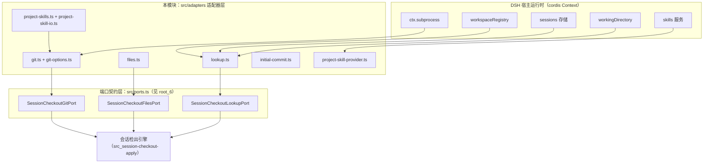
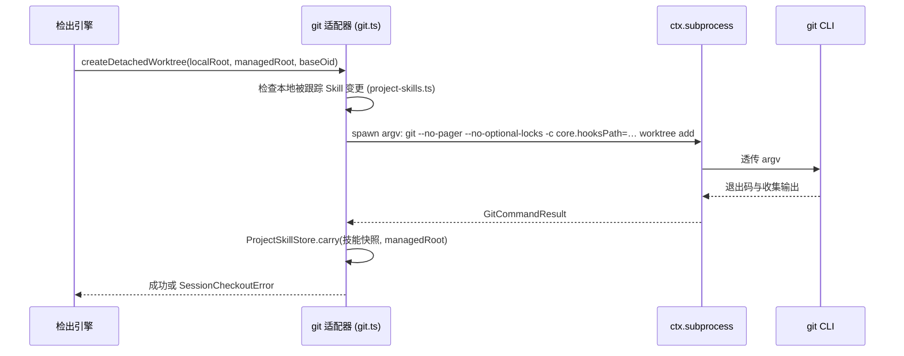

# dsh-git-worktree 根模块总览

!!! info "Generated documentation"
    This page was written by CodeWiki from the source code at commit [`46e0c382`](https://github.com/wloops/dsh-git-worktree/commit/46e0c382490ad42db423bf5c77b7b61d01910892) on 2026-11-07 with `doubao-seed-2.1-lite`. Check the code before relying on details.

## 模块定位

本页是 **dsh-git-worktree**（DeepSeek Harness 的 Git worktree 会话目标插件）的根模块文档，覆盖两类内容：

1. **仓库工程与打包配置**：`package.json`、CI 工作流 `.github/workflows/ci.yml`、插件补丁 `cordis.patch.yml`、`pnpm-workspace.yaml` 与文档截图清单 `screenshots.json`。
2. **适配器层 `src/adapters/`**：把端口契约（`SessionCheckoutGitPort` / `SessionCheckoutFilesPort` / `SessionCheckoutLookupPort`，定义见 [组合根、领域端口与国际化（root_6）](root_6.md) 的 `src/ports.ts`）落实到 Node.js 与 DSH 宿主运行时，供会话检出引擎（见 [session-checkout-apply 应用引擎](src_session-checkout-apply.ts.md)）调用。

包身份：`dsh-git-worktree@0.14.0`（MIT 许可证），Node.js 引擎要求 `>=24.9.0`；描述为“为 DeepSeek Harness 提供实验性 Git worktree 会话目标：隔离会话、评审检查点、人工确认交付与安全恢复”。

## 架构总览

适配器层位于“DSH 宿主运行时服务”与“端口契约 → 检出引擎”之间：宿主服务（subprocess、workspaceRegistry、sessions、workingDirectory、skills）只被适配器以结构化鸭子类型读取，引擎只面向端口编程，二者因此可以独立演化与测试。

典型的 git 命令执行路径（以创建隔离 worktree 为例）：

## 工程与打包配置

### package.json

- **入口导出**：主入口 `lib/index.js`（类型 `lib/index.d.ts`）；子路径导出 `./client`（类型指向 `lib/client/console-remote/index.d.ts`）、`./typert`、`./remote`、`./console-contract`、`./cordis.patch.yml`，把控制台契约与远程协议单独暴露给宿主客户端。
- **DSH 平台集成**：`dsh.bundle.patch` 指向 `cordis.patch.yml`；`dsh.client.inject` 声明 8 个注入 web 平台的宿主客户端包（session-controller、workspace-controller、client-connection、client-locale、client-ui-conversation、client-ui-tool、api-gateway、api-remote-access），`platform: "web"`。
- **脚本**：
  - `build`：`scripts/clean-lib.mjs && tsc && tsdown`（先清理再类型编译，最后 tsdown 打包客户端）。
  - `typecheck`：`tsc --noEmit`；`test`：`vitest run`。
  - `prepare`：安装依赖后自动 `build`。
  - `check:sidebar-version` / `check:publish` / `check:publish:release`：发布前脚本校验，`--require-clean` 额外要求工作区干净。
  - `dev:dsh` 系列（run / install / smoke / remove）：通过 `scripts/dev-dsh.mjs` 执行本地插件开发循环。
  - `prepublishOnly`：`check:sidebar-version` → `build` → `check:publish:release` → `test`，保证发布产物经过完整验证。

### CI：.github/workflows/ci.yml

push 到 `master` / `main` 以及任意 PR 触发单任务 `check`：ubuntu-latest 上安装 pnpm 10 与 Node.js 22（带 pnpm store 缓存），依次执行 `pnpm install --frozen-lockfile`、`typecheck`、`build`、`check:publish:release`、`test`。

### cordis.patch.yml

插件 bundle 补丁，同时也是一份事故修复记录（2026-10-17）：彻底移除 client 侧 `ui-workspace` 的条件禁用表达式块，改由 host 侧 Loader 操作（workspace-provider-lifecycle 直接写确定性布尔并还原）接管选举。原因是原表达式在 host apply 期（插件仍 LOADING，选举恒败）与 renderer 审计期（插件已 ACTIVE，求值为 true）两处求值结果相反，导致 uiWorkspace 无人提供、17 个下游条目 pending、web boot 崩溃。补丁动作为插入插件 id `dsh-git-worktree`。

### pnpm-workspace.yaml

允许 esbuild 构建（`allowBuilds.esbuild=true`）；`minimumReleaseAgeExclude` 列出大量 `@deepseek-ai/*` 包版本，作为供应链发布时效策略的豁免清单（保证 rc 依赖可以及时安装）。

### screenshots.json

文档截图清单（`docs/screenshots/` 下 3 张：项目侧边栏、创建 worktree、就绪待评审）。

## 适配器层概览

适配器层按职责分为两个子系统，详细文档见各自子模块页：

| 适配器文件 | 实现的端口 / 服务 | 核心职责 |
|---|---|---|
| `files.ts` | `SessionCheckoutFilesPort` | 目录身份（device / inode / birthtimeNs）隔离 CAS、空树残留清理、符号链接守护的递归删除、目录字节计量 |
| `git.ts` + `git-options.ts` | `SessionCheckoutGitPort` | 经 `ctx.subprocess` 运行 git；禁用 hooks 与 optional-locks、擦洗环境变量、C locale、分级超时、输出截断降级 |
| `initial-commit.ts` | 挂载到 git port 的初始化动作 | unborn / 空仓库的带指纹校验原子首次提交 |
| `lookup.ts` | `SessionCheckoutLookupPort` | 会话 ↔ 项目 ↔ 工作目录映射，服务缺失时优雅降级 |
| `project-skills.ts` + `project-skill-io.ts` | 配合 git port 的技能携带 | 本地 `.dsh/.agents/.claude/skills` 树快照携带进 managed worktree，provenance manifest 校验 |
| `project-skill-provider.ts` | DSH `skills` 服务 | 让 managed worktree 的 `.claude/skills` 对 Agent 可见 |

## 适配器层详解

### git.ts：`createDshGitPort` 与 `GitCommandResult`

git 适配器是端口层最庞大的实现，核心设计：

- **执行通道**：所有 git 命令经 `ctx.subprocess.spawn` 运行，argv 原样透传、绝不 shell 解释；`GitCommandResult` 返回 `{ code, stdout, stderr, quiescent?, truncated? }` —— `quiescent` 仅在 subprocess 服务确认整树静止时为真（用于创建路径），`truncated` 表示收集输出超上限、调用方应收窄重试而非误报仓库不可用。
- **硬化参数**：`--no-pager --no-optional-locks -c core.hooksPath=<空目录> -c core.fsmonitor=false -c core.quotePath=false`（Windows 另加 `core.longpaths=true`）；环境侧把所有 `GIT_*` 路由变量置 undefined（仓库定位只信授权 cwd），设置 `GIT_OPTIONAL_LOCKS=0`、`GIT_TERMINAL_PROMPT=0`、`LC_ALL=C`。
- **分级超时**（`git-options.ts`）：普通命令默认 120s，`worktree add` 5 分钟，`worktree remove` 固定 5 分钟，上限 1 小时；超时配置走 `LiveValue`，设置页改值对下一次命令即时生效而无需重装插件。
- **输出截断降级**：普通流 1 MiB、status 16 MiB（仓库未忽略依赖树可达数 MB）；`status` 先试 `--untracked-files=all`，截断则降级为 `normal`（把未跟踪目录折叠成一条记录），仍失败才抛错。
- **内部 ref 命名空间**：`refs/dsh-worktree/session-checkouts/<sha256-24>/<artifact>` 存放 apply-base 等制品；被遗弃快照刻意放在 `refs/dsh-worktree/abandoned/<checkoutId>`，使 discard 释放整个检出命名空间时不带走安全快照。删除走单次 `update-ref --stdin` 事务。
- **代表性能力**：隔离 worktree 创建（创建前校验本地被跟踪 Skill 无改动）、worktree 清单解析（`worktree list --porcelain`，只认合法 HEAD oid）、分支/标签/图日志查询、merge 干跑（临时 detached 探测 worktree 试合并后强制回收）、WIP 二进制补丁捕获与原子应用、遗弃快照（`add -A` + `write-tree` + 显式身份 `commit-tree`）与恢复分支。

### files.ts：`createNodeFilesPort`

Node fs 实现的文件端口：

- **目录身份隔离（CAS）**：`inspectDirectoryIdentity` 返回 `{ device, inode, birthtimeNs }` 三元组；`quarantineDirectoryTree` 在同目录下把残留树 rename 到隔离区，随后复核身份一致才完成，不一致则回滚——绝不删除身份不符的对象（防符号链接/嫁接攻击）。
- **安全清理**：`removeEmptyDirectoryTree` 遇到符号链接只删链接本身、绝不跟随；`removeDirectoryTree` 拒绝删除非目录残留，Windows 下重试 6 次。
- **计量与复制**：`measureDirectoryBytes` 递归统计（符号链接计 0），`copyFile` 目标已存在先强制删除。

### initial-commit.ts：`GitCommitProtocol`

挂载在 git port 上的初始化动作（仅控制台确认的 host 动作调用，普通检视只读）：

- `preflightInitialCommit` 区分 `ready`（已有提交）/ `files`（未出生但有文件，需用户显式决定）/ `empty`（生成指纹）。
- `initializeEmptyRepository`：对空仓库走加锁（`index.lock` 排他打开）+ 三次指纹复核 + `mktree` 空树 + `update-ref --stdin` 事务 CAS 更新未出生分支的完整原子序列；`EEXIST` 报“初始化繁忙”。
- `GitCommitProtocol`：`{ prepare, beforeCommit() }` 配合 git update-ref 的 `start/prepare/commit` 交互协议，在 `prepare` 与 commit 之间插入授权回调与最终复核。

### lookup.ts：会话 ↔ 项目映射

`createDshLookupPort` 以结构化鸭子类型动态读取宿主服务（`workspaceRegistry`、`sessions`、`workingDirectory`、`sessionQuery`），避免对滞后的发布包版本强耦合：

- **双重 cwd 证据**：授权证据取 Session **当前**工作目录（`workingDirectory.get`），因为插件会把 Session 移动进 managed worktree，而 header.cwd 在创建时冻结；header 仅作为无该服务宿主的回退。
- **降级语义**：服务或记录缺失一律返回 `undefined`，状态机把它当作“恢复/孤儿事实”而非失败；投影异常的 `listLiveSessions` 空列表，让分支竞争守卫保持静默而非猜测。

### project-skills.ts / project-skill-io.ts：Skill 携带

- **携带**：创建 worktree 前把本地 `.dsh/skills`、`.agents/skills`、`.claude/skills` 树（最多 5000 文件 / 64 MiB）快照，创建后复制进 managed worktree，并以 provenance `Manifest`（版本 1、根身份、文件清单 sha256/mode）排他写入；复制后回读校验，phase 原子切换为 `ready`。
- **作用域剔除**：`hasDeliverableStatus` 把携带的 Skill 路径从 git status 的“脏”判定中剔除——`??` 且属于 Skill 作用域的条目不视为交付物。
- **删除保护**：`assertRemovable` 在 worktree 删除前校验 Skill 未被修改、无新增，否则拒绝删除以保护成果。
- **IO 安全**（`project-skill-io.ts`）：所有路径校验必须位于三个 Skill 根下、逐段拒绝符号链接与特殊文件、`O_NOFOLLOW` 打开、读写双次身份复核。

### project-skill-provider.ts：`ClaudeProjectSkillProvider`

把 managed worktree 的 `.claude/skills` 注册为 DSH `skills` 服务的额外来源（provider 名 `worktree-project-claude`，rank 250）：`managedSkillRoot` 只信注册表中 phase=ready 的检出记录，并通过 `.git` 文件指针与 gitDir backlink 双向校验根身份；内置至多 32 个 `FileSystemSkillProvider` 的 LRU 缓存，写操作串行化，dispose 时全部回收。

## 与其他模块的关系

- [root_2：持久化适配器与浏览器客户端桥接层](root_2.md)：检出注册表（AtomicJsonCheckoutRegistry）、文件锁、工作目录服务、worktree 创建、检查点序列化，以及客户端控制台行组件与 console-remote 宿主适配器。
- [root_3：Worktree 客户端控制台 UI（评审、设置与目标胶囊）](root_3.md)：评审控制台（review-console）UI、预检查/恢复缓存与请求缓存。
- [root_4：Worktree 控制台客户端与宿主命令面](root_4.md)：目标控制台（target-console）、分支图/标签管理弹窗与工作区侧边栏投影。
- [Worktree Console 宿主与远程协议层（root_5）](root_5.md)：`console-contract.ts` 控制台请求/响应/错误契约类型全集，以及 typert 远程协议描述符。
- [组合根、领域端口与国际化（root_6）](root_6.md)：console-host 控制面与服务、评审 diff 读取、i18n 消息、`src/ports.ts` 端口定义、`src/index.ts` 公共 API 与官方 worktree 注册。
- [root_7：dsh-git-worktree 插件出口层](root_7.md)：视图类型（`types.ts`）、workspace-provider-lifecycle、Agent 工具入口、worktree 请求记录与构建配置（tsconfig / tsdown / vitest）。
- [session-checkout-apply 应用引擎](src_session-checkout-apply.ts.md)：会话检出应用引擎（apply / preview / checkpoint / commit / review / rollback 状态机）。
- [会话检出状态机模块（session-checkout-module）](src_session-checkout-module.ts.md)：`SessionCheckoutModule` 插件引导与项目解析。

??? abstract "Documented components (37)"
    - [`check`](https://github.com/wloops/dsh-git-worktree/blob/46e0c382490ad42db423bf5c77b7b61d01910892/.github/workflows/ci.yml) — `.github/workflows/ci.yml`
    - [`ci.yml`](https://github.com/wloops/dsh-git-worktree/blob/46e0c382490ad42db423bf5c77b7b61d01910892/.github/workflows/ci.yml) — `.github/workflows/ci.yml`
    - [`cordis.patch.yml`](https://github.com/wloops/dsh-git-worktree/blob/46e0c382490ad42db423bf5c77b7b61d01910892/cordis.patch.yml) — `cordis.patch.yml`
    - [`build`](https://github.com/wloops/dsh-git-worktree/blob/46e0c382490ad42db423bf5c77b7b61d01910892/package.json) — `package.json`
    - [`check:publish`](https://github.com/wloops/dsh-git-worktree/blob/46e0c382490ad42db423bf5c77b7b61d01910892/package.json) — `package.json`
    - [`check:publish:release`](https://github.com/wloops/dsh-git-worktree/blob/46e0c382490ad42db423bf5c77b7b61d01910892/package.json) — `package.json`
    - [`check:sidebar-version`](https://github.com/wloops/dsh-git-worktree/blob/46e0c382490ad42db423bf5c77b7b61d01910892/package.json) — `package.json`
    - [`dev:dsh`](https://github.com/wloops/dsh-git-worktree/blob/46e0c382490ad42db423bf5c77b7b61d01910892/package.json) — `package.json`
    - [`dev:dsh:install`](https://github.com/wloops/dsh-git-worktree/blob/46e0c382490ad42db423bf5c77b7b61d01910892/package.json) — `package.json`
    - [`dev:dsh:remove`](https://github.com/wloops/dsh-git-worktree/blob/46e0c382490ad42db423bf5c77b7b61d01910892/package.json) — `package.json`
    - [`dev:dsh:smoke`](https://github.com/wloops/dsh-git-worktree/blob/46e0c382490ad42db423bf5c77b7b61d01910892/package.json) — `package.json`
    - [`package.json`](https://github.com/wloops/dsh-git-worktree/blob/46e0c382490ad42db423bf5c77b7b61d01910892/package.json) — `package.json`
    - [`prepare`](https://github.com/wloops/dsh-git-worktree/blob/46e0c382490ad42db423bf5c77b7b61d01910892/package.json) — `package.json`
    - [`prepublishOnly`](https://github.com/wloops/dsh-git-worktree/blob/46e0c382490ad42db423bf5c77b7b61d01910892/package.json) — `package.json`
    - [`test`](https://github.com/wloops/dsh-git-worktree/blob/46e0c382490ad42db423bf5c77b7b61d01910892/package.json) — `package.json`
    - [`typecheck`](https://github.com/wloops/dsh-git-worktree/blob/46e0c382490ad42db423bf5c77b7b61d01910892/package.json) — `package.json`
    - [`pnpm-workspace.yaml`](https://github.com/wloops/dsh-git-worktree/blob/46e0c382490ad42db423bf5c77b7b61d01910892/pnpm-workspace.yaml) — `pnpm-workspace.yaml`
    - [`screenshots.json`](https://github.com/wloops/dsh-git-worktree/blob/46e0c382490ad42db423bf5c77b7b61d01910892/screenshots.json) — `screenshots.json`
    - [`createNodeFilesPort`](https://github.com/wloops/dsh-git-worktree/blob/46e0c382490ad42db423bf5c77b7b61d01910892/src%5Cadapters%5Cfiles.ts) — `src\adapters\files.ts`
    - [`GitTimeoutOptions`](https://github.com/wloops/dsh-git-worktree/blob/46e0c382490ad42db423bf5c77b7b61d01910892/src%5Cadapters%5Cgit-options.ts) — `src\adapters\git-options.ts`
    - [`GitCommandResult`](https://github.com/wloops/dsh-git-worktree/blob/46e0c382490ad42db423bf5c77b7b61d01910892/src%5Cadapters%5Cgit.ts) — `src\adapters\git.ts`
    - [`GitPortOptions`](https://github.com/wloops/dsh-git-worktree/blob/46e0c382490ad42db423bf5c77b7b61d01910892/src%5Cadapters%5Cgit.ts) — `src\adapters\git.ts`
    - [`GitCommitProtocol`](https://github.com/wloops/dsh-git-worktree/blob/46e0c382490ad42db423bf5c77b7b61d01910892/src%5Cadapters%5Cinitial-commit.ts) — `src\adapters\initial-commit.ts`
    - [`LiveSessionLike`](https://github.com/wloops/dsh-git-worktree/blob/46e0c382490ad42db423bf5c77b7b61d01910892/src%5Cadapters%5Clookup.ts) — `src\adapters\lookup.ts`
    - [`SessionStoreLike`](https://github.com/wloops/dsh-git-worktree/blob/46e0c382490ad42db423bf5c77b7b61d01910892/src%5Cadapters%5Clookup.ts) — `src\adapters\lookup.ts`
    - [`WorkingDirectoryLike`](https://github.com/wloops/dsh-git-worktree/blob/46e0c382490ad42db423bf5c77b7b61d01910892/src%5Cadapters%5Clookup.ts) — `src\adapters\lookup.ts`
    - [`WorkspaceLike`](https://github.com/wloops/dsh-git-worktree/blob/46e0c382490ad42db423bf5c77b7b61d01910892/src%5Cadapters%5Clookup.ts) — `src\adapters\lookup.ts`
    - [`WorkspaceRegistryLike`](https://github.com/wloops/dsh-git-worktree/blob/46e0c382490ad42db423bf5c77b7b61d01910892/src%5Cadapters%5Clookup.ts) — `src\adapters\lookup.ts`
    - [`SkillBytes`](https://github.com/wloops/dsh-git-worktree/blob/46e0c382490ad42db423bf5c77b7b61d01910892/src%5Cadapters%5Cproject-skill-io.ts) — `src\adapters\project-skill-io.ts`
    - [`SkillRead`](https://github.com/wloops/dsh-git-worktree/blob/46e0c382490ad42db423bf5c77b7b61d01910892/src%5Cadapters%5Cproject-skill-io.ts) — `src\adapters\project-skill-io.ts`
    - [`ClaudeProjectSkillProvider`](https://github.com/wloops/dsh-git-worktree/blob/46e0c382490ad42db423bf5c77b7b61d01910892/src%5Cadapters%5Cproject-skill-provider.ts) — `src\adapters\project-skill-provider.ts`
    - [`Locator`](https://github.com/wloops/dsh-git-worktree/blob/46e0c382490ad42db423bf5c77b7b61d01910892/src%5Cadapters%5Cproject-skill-provider.ts) — `src\adapters\project-skill-provider.ts`
    - [`CarriedSkillState`](https://github.com/wloops/dsh-git-worktree/blob/46e0c382490ad42db423bf5c77b7b61d01910892/src%5Cadapters%5Cproject-skills.ts) — `src\adapters\project-skills.ts`
    - [`Entry`](https://github.com/wloops/dsh-git-worktree/blob/46e0c382490ad42db423bf5c77b7b61d01910892/src%5Cadapters%5Cproject-skills.ts) — `src\adapters\project-skills.ts`
    - [`Manifest`](https://github.com/wloops/dsh-git-worktree/blob/46e0c382490ad42db423bf5c77b7b61d01910892/src%5Cadapters%5Cproject-skills.ts) — `src\adapters\project-skills.ts`
    - [`ProjectSkillStore`](https://github.com/wloops/dsh-git-worktree/blob/46e0c382490ad42db423bf5c77b7b61d01910892/src%5Cadapters%5Cproject-skills.ts) — `src\adapters\project-skills.ts`
    - [`SkillSnapshot`](https://github.com/wloops/dsh-git-worktree/blob/46e0c382490ad42db423bf5c77b7b61d01910892/src%5Cadapters%5Cproject-skills.ts) — `src\adapters\project-skills.ts`

