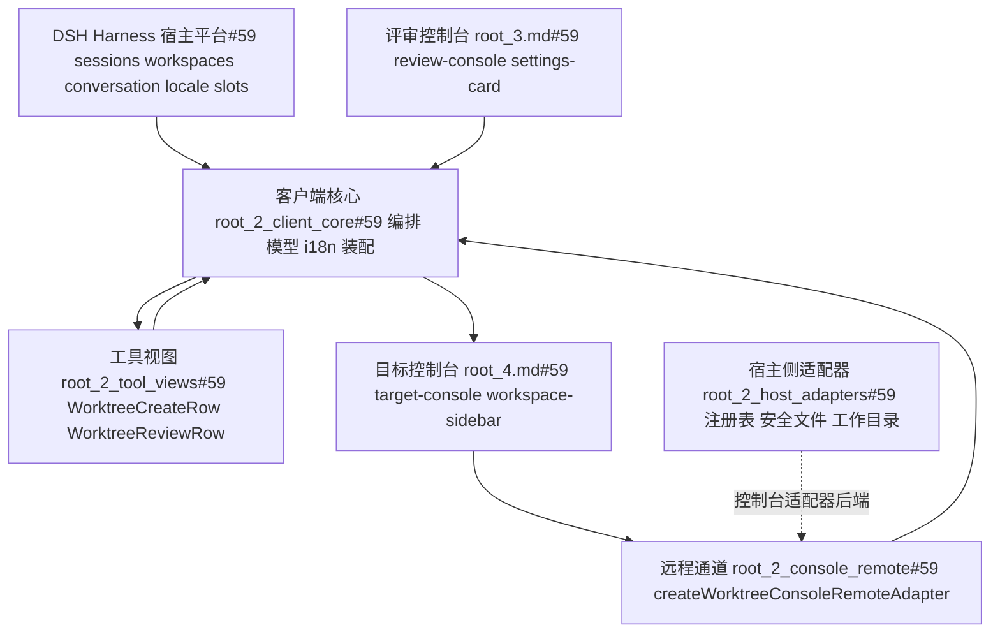
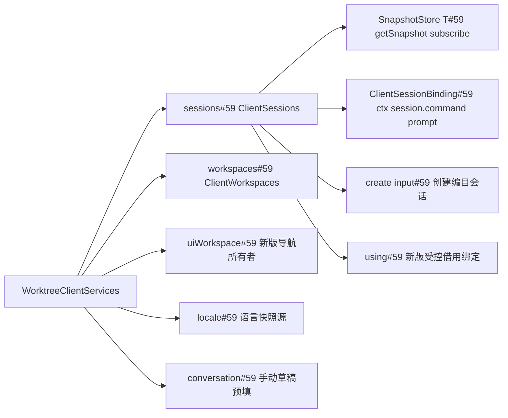
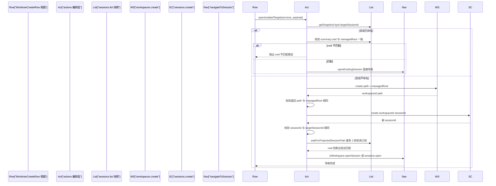
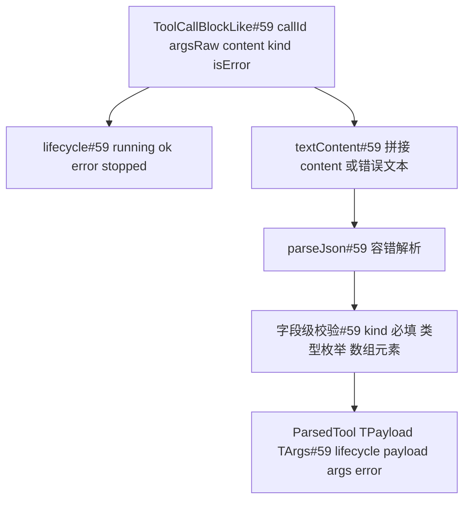
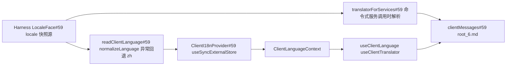
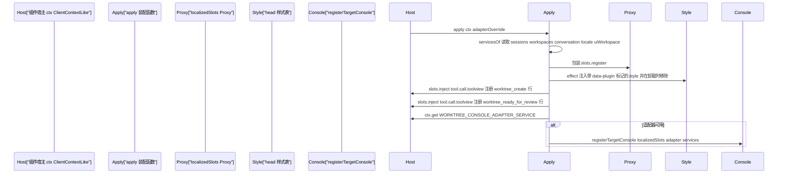

# 客户端核心（root_2_client_core）

!!! info "Generated documentation"
    This page was written by CodeWiki from the source code at commit [`6d81039c`](https://github.com/wloops/dsh-git-worktree/commit/6d81039ce01ef5706de5ddb6c447f0fa156535cb) on 2026-11-07 with `doubao-seed-2.1-lite`. Check the code before relying on details.

## 模块概述

`root_2_client_core` 是 dsh-git-worktree 插件运行在浏览器侧（DSH Client / Harness）的**核心装配层**。它本身不提供复杂界面，而是把宿主平台暴露的 Workspace / Session 运行时面孔、ToolView 插槽与控制台适配器组装成稳定可用的客户端能力，并为上层视图与远程通道提供纯函数式模型与语言环境。

该模块由五个文件构成，职责清晰分层：

| 文件 | 职责 | 核心导出 |
| --- | --- | --- |
| `src/client/actions.ts` | 会话编排：打开隔离工作树会话、导航、草稿预填、finalize 命令提交 | `WorktreeClientServices`、`openIsolatedTarget`、`openAuthorizedWorktree`、`navigateToSession`、`selectedSessionId`、`openExistingSession`、`prefillSessionDraft`、`finalizeCurrentSession` |
| `src/client/model.ts` | 从会话日志中纯函数式解析工具调用块，得到可回放的稳定模型 | `parseCreateTool`、`parseReviewTool`、`ParsedTool`、`WorktreeCreatePayload`、`WorktreeReviewPayload`、`ReviewArgs` |
| `src/client/i18n.tsx` | 客户端语言环境解析与 React 上下文 | `ClientI18nProvider`、`useClientTranslator`、`useClientLanguage`、`translatorForServices`、`ClientLocaleSource`、`readClientLanguage` |
| `src/client/index.tsx` | 浏览器入口：注册 ToolView 行、注入样式表、装配控制台 | `apply`、`ClientContextLike`、`WORKTREE_CONSOLE_ADAPTER_SERVICE`、`inject` |
| `src/client/harness-platform.d.ts` | 虚拟平台模块与 UI 原语的 ambient 类型声明 | `MenuEntry`、`WorkspaceBrowser`、各 `virtual:dsh-official-workspace-client*` 模块 |

## 平台面孔抽象

`WorktreeClientServices` 是整个客户端核心的依赖入口，它把 Harness 平台的运行时能力抽象为一组可选面孔：

关键设计要点：

- **`SnapshotStore<T>`**：统一的外部状态订阅接口（`getSnapshot` + `subscribe`），被会话列表、语言源共同复用，保证 React 外部存储与命令式服务读取到一致的快照。
- **`ClientSessions`**：既支持新版「先 `create` 编目、再经 `using` 受控持有」的会话控制器契约，也兼容旧版直接 `open(sessionId)` 的导航方式；`binding(sessionId)` 返回带 `ctx` 与 `session.command` 的绑定。
- **`ClientWorkspaces`**：按磁盘路径创建/打开工作区。
- **导航优先级**：Harness 0.1.6 起由 `uiWorkspace.openSession` 拥有导航，`sessions.open` 仅作回退；两者皆无则抛出带翻译文案的错误，**拒绝静默丢失目标选中**。

## 会话编排服务（actions.ts）

### 打开隔离工作树会话

`openIsolatedTarget(services, { managedRoot, targetSessionId }, isActive?)` 是客户端的核心编排函数，幂等执行「登记托管根目录 → 创建预分配会话 → 等待可信 cwd 投影 → 导航」四步：

过程中任何一步不满足身份校验（路径不一致、会话 id 不符、cwd 无法投影、宿主提前退场）都会抛出带 i18n 文案的错误；`isActive` 回调在每次 await 之后被检查，避免宿主已卸载后依然推进副作用。路径比较由内部 `samePath` 统一处理——Windows 盘符不区分大小写、正反斜杠归一化。

### 授权工作树目标打开

`openAuthorizedWorktree(adapter, services, callerSessionId, expected, isActive?)` 在打开前先调用 `WorktreeConsoleAdapter.inspect` 做一次**无路径的宿主授权校验**：

1. 校验宿主返回的 `target.checkoutId`、`ownerSessionId`、`targetSessionId` 与预期完全一致；
2. 校验 `capabilities.inspect` 与 `capabilities.open` 仍为真（宿主状态可能已变化）；
3. 校验 `managedRoot` 非空；
4. 通过后复用 `openIsolatedTarget` 的 cwd 校验导航路径。

该适配器契约由 [root_4：Worktree 控制台客户端与宿主命令面](../root_4.md) 的 `WorktreeConsoleAdapter` 定义，其远程实现见 [控制台远程客户端（console-remote Client 侧）](root_2_console_remote.md)。

### 其余辅助函数

| 函数 | 作用 |
| --- | --- |
| `navigateToSession(services, sessionId)` | 按新版/旧版导航面孔优先序跳转，两者皆不可用时抛出 `harness.session.navigation.unavailable` |
| `selectedSessionId(snapshot)` | 从快照中解析唯一可见主会话：同时存在多个 `retainedBy.mainView` 或新旧选中冲突时返回 `undefined`，避免猜错 |
| `openExistingSession(services, sessionId, expectedCwd)` | 仅当会话列表同时证明身份与 cwd 时才导航，返回是否成功 |
| `prefillSessionDraft(services, sessionId, text)` | 通过 `conversation.input.for(binding.ctx).setDraft` 预填恢复请求草稿，**绝不**调用 command/send/followup |
| `finalizeCurrentSession(services, reviewId, revision, retention)` | 向当前选中会话提交 `/worktree finalize <reviewId> <revision> <retention>` 显式命令，并校验 `matched` |

`ComposerInput` 联合类型同时兼容「仅图片附件」与「通用附件」两代 Harness API。

## 回放模型（model.ts）

ToolView 必须在会话回放（replay）时仅依据**已落盘的 call/result 切片**重建界面，不能触碰实时服务。`model.ts` 提供两个纯函数解析器：

- **`parseCreateTool`**：解析 `worktree_target_created` 结果，产出 `WorktreeCreatePayload`（`checkoutId`、`targetSessionId`、`managedRoot`、`phase`、`currentOid`、`sourceSessionId`、可选 `cwd`/`cwdSelected`）。运行中直接返回空 payload；非 ok 状态把原始文本作为错误透出；字段缺失则报「malformed.worktree.create.result」。
- **`parseReviewTool`**：同时解析结果 payload（`WorktreeReviewPayload`：`reviewId`、`revision`、`iteration`、`changedFiles`）与调用参数（`ReviewArgs`：summary、validationStatus 枚举、tests 数组、suggestedCommitMessage、可选 details/validationSummary）。结果与参数分别校验，任一畸形都会给出对应错误文案。
- **`ToolCallViewPropsLike`**：视图组件的 props 抽象——`callId`、`sessionId`、`toolName`、`block`、`cwd`、`openFile`。

这套模型被 [工具调用视图（Tool Views）](root_2_tool_views.md) 的两个行组件直接消费（`WorktreeCreateRow` 调 `parseCreateTool`，`WorktreeReviewRow` 调 `parseReviewTool`）。

## 客户端国际化（i18n.tsx）

- `ClientLocaleSource` 是对平台 locale 面孔的结构化要求（`getSnapshot`/`subscribe`），`localeSource` 做鸭子类型兼容判断。
- `ClientI18nProvider` 用 `useSyncExternalStore` 订阅语言变化，并允许显式 `language` 属性覆盖平台偏好。
- 命令式路径（如 `actions.ts` 抛错前取翻译器）不走 React 上下文，而用 `translatorForServices(services)` 在**调用时刻**解析语言，避免模块加载期固化。
- 消息字典与语言枚举来自 [组合根、领域端口与国际化（root_6）](../root_6.md) 的 `src/i18n/core.ts` 与 `src/i18n/client-messages.ts`。

## 浏览器入口（index.tsx）

`apply(ctx, adapterOverride?)` 是宿主插件系统调用的装配函数，流程如下：

要点：

- **服务读取**：`servicesOf(ctx)` 从 `ctx.get('sessions' | 'workspaces' | 'conversation' | 'locale' | 'uiWorkspace')` 组装 `WorktreeClientServices`；`inject` 常量声明了插件声明的必需服务列表。
- **i18n 隔离**：`localizedSlots` 代理把每个注册组件包进 `ClientI18nProvider`，只包裹本插件的注册项，保证多个 DSH Client 实例互不影响。
- **样式表归属**：head 中手动注入 `<style>` 并打 `data-plugin=dsh-git-worktree` 标记——宿主模块系统会「认领」无主样式并在失效时删除它，自标记确保样式表始终归属本插件。
- **适配器双通道**：优先使用显式传入的 `adapterOverride`（同插件 fiber 内刚创建的服务在 `ctx.get` 中尚不可见），回退到 `ctx.get(WORKTREE_CONSOLE_ADAPTER_SERVICE)`；仅当适配器存在时才装配 [root_4：Worktree 控制台客户端与宿主命令面](../root_4.md) 的 target-console。

## 平台类型声明（harness-platform.d.ts）

该 ambient 声明文件为构建期虚拟模块与第三方 UI 包提供类型：

- `virtual:dsh-official-workspace-client`、`-rc5`、`-alpha`、`-next`：各版本官方工作区客户端插件入口，导出 `inject`、`apply(ctx)` 及（rc 版的）装饰版 `WorkspaceBrowser`。装饰路径会遮蔽官方 `sidebar.workspaces` 注册，因此必须渲染带行装饰的派生组件以保留工作树图标/徽标。
- `@deepseek-ai/dsh-client-ui-primitives`：`MenuEntry`（普通项 / `separator` / `label` 三种形态）、`Menu`、`Modal`、`MenuItemButton` 及图标组件的 props 类型，供 [root_3：Worktree 客户端控制台 UI（评审、设置与目标胶囊）](../root_3.md)、[root_4：Worktree 控制台客户端与宿主命令面](../root_4.md) 的弹窗与菜单界面复用。

## 与其他模块的关系

- 上层视图：[工具调用视图（Tool Views）](root_2_tool_views.md) 的 `WorktreeCreateRow` / `WorktreeReviewRow` 消费本模块的 `model.ts` 解析器与 `actions.ts` 编排函数。
- 远程通道：[控制台远程客户端（console-remote Client 侧）](root_2_console_remote.md) 的 `createWorktreeConsoleRemoteAdapter` 产出 `WorktreeConsoleAdapter`，经 `WORKTREE_CONSOLE_ADAPTER_SERVICE` 或 `adapterOverride` 注入 `apply`。
- 控制台装配：[root_4：Worktree 控制台客户端与宿主命令面](../root_4.md) 的 target-console 与 workspace-sidebar、[root_3：Worktree 客户端控制台 UI（评审、设置与目标胶囊）](../root_3.md) 的 review-console / settings-card 是 `apply` 注册的下游界面。
- 宿主侧后端：[主机适配层（Host Adapters）](root_2_host_adapters.md) 提供注册表、安全文件锁与工作目录服务，构成适配器的服务端实现。
- 语言资源：[组合根、领域端口与国际化（root_6）](../root_6.md) 的 i18n 核心（`Language`、`createTranslator`、`clientMessages`）是本模块 i18n.tsx 的依赖。
- 宿主契约：`WorktreeConsoleAdapter` 等全部请求/响应类型定义在 [root_4：Worktree 控制台客户端与宿主命令面](../root_4.md) 的 `src/console-contract.ts`。

## 构建与运行备注

- 本插件以 `dsh-git-worktree` 为模块 id 注入样式表（见 `apply` 中的 `dataset.plugin`），开发期通过仓库根 `package.json` 的 `dev:dsh` / `dev:dsm:install` / `dev:dsh:smoke` 脚本与本地 DSH 宿主联调，CI 由 `.github/workflows/ci.yml` 的 `check` 作业统一执行 `typecheck` 与 `test`。
- 所有对平台面孔的访问（`ctx.get`、`locale`、`sessions`）均为鸭子类型/可选链防御，宿主版本差异（旧版 `sessions.open` vs 新版 `uiWorkspace.openSession`、图片附件 vs 通用附件）在本模块内收敛，不向视图层扩散。

??? abstract "Documented components (17)"
    - [`ClientSessionBinding`](https://github.com/wloops/dsh-git-worktree/blob/6d81039ce01ef5706de5ddb6c447f0fa156535cb/src%5Cclient%5Cactions.ts) — `src\client\actions.ts`
    - [`ClientSessionSnapshot`](https://github.com/wloops/dsh-git-worktree/blob/6d81039ce01ef5706de5ddb6c447f0fa156535cb/src%5Cclient%5Cactions.ts) — `src\client\actions.ts`
    - [`ClientSessions`](https://github.com/wloops/dsh-git-worktree/blob/6d81039ce01ef5706de5ddb6c447f0fa156535cb/src%5Cclient%5Cactions.ts) — `src\client\actions.ts`
    - [`ClientWorkspaces`](https://github.com/wloops/dsh-git-worktree/blob/6d81039ce01ef5706de5ddb6c447f0fa156535cb/src%5Cclient%5Cactions.ts) — `src\client\actions.ts`
    - [`IsolatedTargetLocation`](https://github.com/wloops/dsh-git-worktree/blob/6d81039ce01ef5706de5ddb6c447f0fa156535cb/src%5Cclient%5Cactions.ts) — `src\client\actions.ts`
    - [`SnapshotStore`](https://github.com/wloops/dsh-git-worktree/blob/6d81039ce01ef5706de5ddb6c447f0fa156535cb/src%5Cclient%5Cactions.ts) — `src\client\actions.ts`
    - [`WorktreeClientServices`](https://github.com/wloops/dsh-git-worktree/blob/6d81039ce01ef5706de5ddb6c447f0fa156535cb/src%5Cclient%5Cactions.ts) — `src\client\actions.ts`
    - [`MenuEntry`](https://github.com/wloops/dsh-git-worktree/blob/6d81039ce01ef5706de5ddb6c447f0fa156535cb/src%5Cclient%5Charness-platform.d.ts) — `src\client\harness-platform.d.ts`
    - [`ClientLocaleSource`](https://github.com/wloops/dsh-git-worktree/blob/6d81039ce01ef5706de5ddb6c447f0fa156535cb/src%5Cclient%5Ci18n.tsx) — `src\client\i18n.tsx`
    - [`ClientContextLike`](https://github.com/wloops/dsh-git-worktree/blob/6d81039ce01ef5706de5ddb6c447f0fa156535cb/src%5Cclient%5Cindex.tsx) — `src\client\index.tsx`
    - [`ParsedTool`](https://github.com/wloops/dsh-git-worktree/blob/6d81039ce01ef5706de5ddb6c447f0fa156535cb/src%5Cclient%5Cmodel.ts) — `src\client\model.ts`
    - [`ReviewArgs`](https://github.com/wloops/dsh-git-worktree/blob/6d81039ce01ef5706de5ddb6c447f0fa156535cb/src%5Cclient%5Cmodel.ts) — `src\client\model.ts`
    - [`ToolCallBlockLike`](https://github.com/wloops/dsh-git-worktree/blob/6d81039ce01ef5706de5ddb6c447f0fa156535cb/src%5Cclient%5Cmodel.ts) — `src\client\model.ts`
    - [`ToolCallViewPropsLike`](https://github.com/wloops/dsh-git-worktree/blob/6d81039ce01ef5706de5ddb6c447f0fa156535cb/src%5Cclient%5Cmodel.ts) — `src\client\model.ts`
    - [`ToolContentBlock`](https://github.com/wloops/dsh-git-worktree/blob/6d81039ce01ef5706de5ddb6c447f0fa156535cb/src%5Cclient%5Cmodel.ts) — `src\client\model.ts`
    - [`WorktreeCreatePayload`](https://github.com/wloops/dsh-git-worktree/blob/6d81039ce01ef5706de5ddb6c447f0fa156535cb/src%5Cclient%5Cmodel.ts) — `src\client\model.ts`
    - [`WorktreeReviewPayload`](https://github.com/wloops/dsh-git-worktree/blob/6d81039ce01ef5706de5ddb6c447f0fa156535cb/src%5Cclient%5Cmodel.ts) — `src\client\model.ts`

