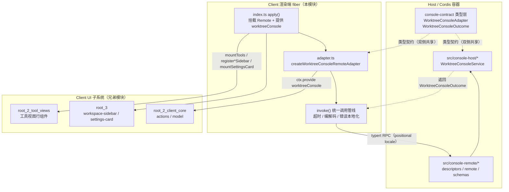
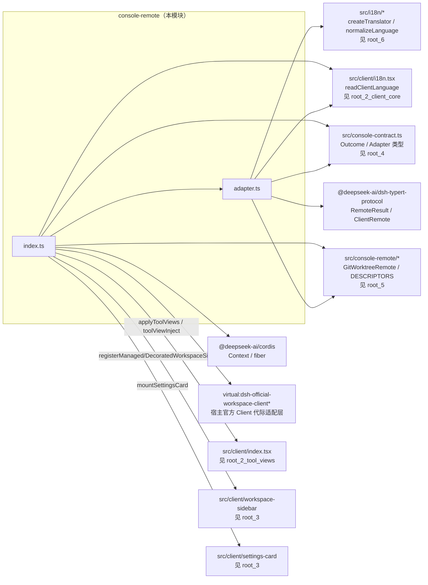
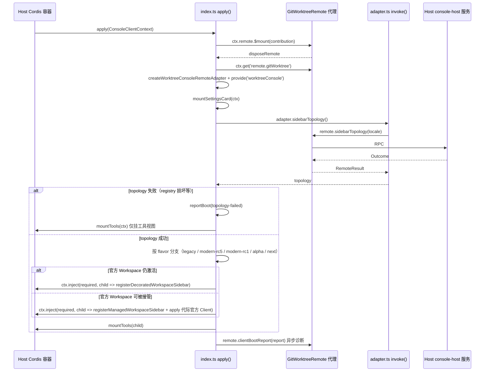
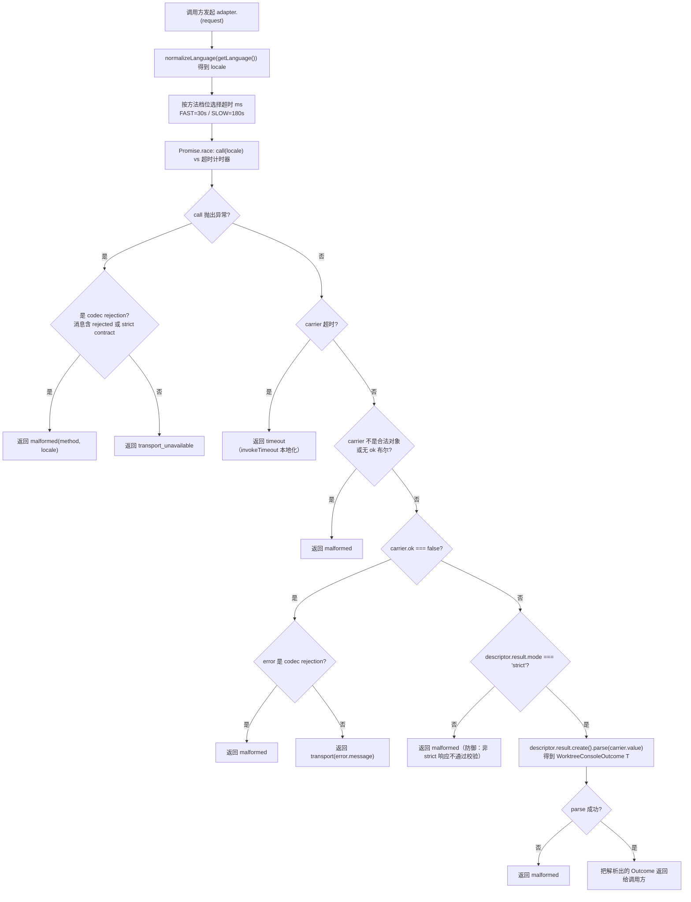

# 控制台远程客户端（console-remote Client 侧）

!!! info "Generated documentation"
    This page was written by CodeWiki from the source code at commit [`35c16281`](https://github.com/wloops/dsh-git-worktree/commit/35c16281d5695247926eca63b278150f7983e291) on 2026-11-07 with `doubao-seed-2.1-lite`. Check the code before relying on details.

本模块是 dsh-git-worktree 插件 **Client（渲染端）fiber 上的装配入口**，位于 `src/client/console-remote/`，由两个文件组成：

| 文件 | 核心导出 | 职责 |
| --- | --- | --- |
| `src/client/console-remote/index.ts` | `apply`（cordis 模块入口）、`inject`、`ConsoleClientContext` | 在 Client fiber 中挂载 Remote 贡献、创建适配器、按宿主 Workspace 代际装配侧栏 / 工具视图 / 设置卡片 |
| `src/client/console-remote/adapter.ts` | `createWorktreeConsoleRemoteAdapter` | 把底层 typert `GitWorktreeRemote` 代理包装为 [console-contract](../root_4.md) 定义的 `WorktreeConsoleAdapter` 接口，统一处理超时、传输错误、响应编解码校验与错误消息本地化 |

它处于「宿主 Cordis 容器 ↔ Client UI 子系统 ↔ Server 端控制台服务」三方之间：向上对接 [客户端核心（root_2_client_core）](root_2_client_core.md) 的动作/模型层，向下经由 typert Remote 契约调用 host 侧控制台服务（见 [Worktree Console 宿主与远程协议层（root_5）](../root_5.md) 的 `src/console-remote/*` 与 `src/console-host/*`）。

## 在整体架构中的位置



## 依赖关系



## 启动（apply）装配流程

`apply(ctx)` 是整个插件 Client 侧的总装函数。其编排顺序为：

1. **挂载 Remote 贡献**：`ctx.remote.$mount(contribution)`，拿到 `remote.gitWorktree` 代理；`ctx.effect` 注册拆卸函数。
2. **构造适配器**：`createWorktreeConsoleRemoteAdapter(remote, getLanguage)`，并 `ctx.provide('worktreeConsole', adapter)` 注入 Cordis Context（模块通过 `declare module '@deepseek-ai/cordis'` 扩展了 `Context.worktreeConsole` 类型）。
3. **挂载设置卡片**：`mountSettingsCard(ctx)`（宿主设置页中的插件配置 UI）。
4. **读取侧栏拓扑**：`adapter.sidebarTopology()` 返回宿主 Workspace 代际（`workspaceClientFlavor`）与官方 Workspace 是否处于激活状态（`officialWorkspaceActive`）。
5. **按代际分支出装配策略**（见下表）。
6. **上报启动诊断**：`remote.clientBootReport(...)` 为尽力而为的远程诊断，任何异常都不会打断启动路径。



### 宿主代际适配分支

`topology.value.workspaceClientFlavor` 决定侧栏装配方式：

| flavor | 官方 Workspace 状态 | 装配策略 | 特殊要求 |
| --- | --- | --- | --- |
| `legacy` | — | `registerManagedWorkspaceSidebar(ctx, adapter)` | 要求 `ctx.get('sessions').open` 为函数，否则启动报错 |
| `modern-rc5` | `true`（装饰） | `ctx.inject(inject, child => registerDecoratedWorkspaceSidebar)` | 注入集为基础 `inject` |
| `modern-rc5` | 否则（接管） | `registerManagedWorkspaceSidebar(child, adapter, applyRc5Workspace)` | 同上行 |
| `modern-rc1` | `true` | 装饰分支，注入集为 `MODERN_RC1_INJECT` | 额外注入 `contextMenus`（0.2.2-rc.1 才存在） |
| `modern-rc1` | 否则 | 接管分支 + `applyOfficialWorkspace` | 同上 |
| `alpha` / `next` | `true` | 装饰分支 + 各自 `alphaWorkspaceInject` / `nextWorkspaceInject` | 用代际固定的 inject 列表 |
| `alpha` / `next` | 否则 | 接管分支 + `applyAlphaWorkspace` / `applyNextWorkspace` | 同上 |
| 其他（不支持） | — | 仅 `mountTools(ctx)`，`reportBoot('unsupported')` | — |

### inject 服务集的裁剪逻辑（避免启动死锁）

`inject` 常量 = 官方 Workspace Client 声明的服务集合，**剔除**以下三项后再并入 `slots` 与 `configForms`：

- `remote.directoryPicker`：现代官方 Browser 的 provider 入口会等待 `uiWorkspace`，而本 fiber 正是 `uiWorkspace` 的提供者——静态声明会在 web 启动时死锁。picker 改在调用时经 managed context proxy 惰性解析。
- `remoteAccess`（host 0.2.1 新增）：静态声明会让 0.2.0-rc.2 宿主的 web 启动永久挂起（"waiting for service: remoteAccess"）。
- `contextMenus`：仅在 0.2.2-rc.1 及以后存在，仅加入 `MODERN_RC1_INJECT`。

显式声明 `slots` 与 `configForms` 是因为 cordis 只读当前 fiber 声明过的服务——缺声明会让 Plugins 页的设置卡片静默不挂载。

> 备注：插件对 `uiWorkspace` 接管的整体选举机制在 host 侧 Loader 完成（见仓库根目录 `cordis.patch.yml` 与 [root_7：dsh-git-worktree 插件出口层](../root_7.md) 的 `workspace-provider-lifecycle.ts`），本 Client 侧只负责「官方还活着就装饰、死了就接管」的两种落地形态。

## 适配器（adapter.ts）内部机制

### invoke 统一调用管线

`createWorktreeConsoleRemoteAdapter(remote, getLanguage)` 内部用 `descriptors` 索引（`method → descriptor`）生成单一 `invoke<T>(method, call)`，再为每个 RPC 方法返回一个 `WorktreeConsoleAdapter` 实现成员。管线依次处理：



设计要点（来自源码注释）：**Web RPC carrier 本身没有超时**——服务端处理器阻塞（绑定锁排队、git 挂起）会让请求无限期挂起，UI 永远停在 pending 态。因此在客户端主动失败；服务端工作仍会继续执行，且所有变更类（mutation）调用在语义上都是安全可重试的。

### 错误 Outcome 编码

| Outcome error.code | 触发条件 | 消息来源 |
| --- | --- | --- |
| `transport_unavailable` | carrier 抛出非 codec 异常，或 `carrier.ok === false` | 原始 `error.message` |
| `malformed_response` | 响应未通过 strict 编解码、codec rejection 检测、carrier 结构非法 | `transportMessages.malformed`（含 `method` 占位符） |
| `timeout` | 超过档位超时阈值 | `transportMessages.invokeTimeout`（含 `method`、`seconds`） |

错误消息均经 `createTranslator(transportMessages, locale)` 本地化（默认 `zh`），语言目录见 [组合根、领域端口与国际化（root_6）](../root_6.md) 的 `src/i18n/transport-messages.ts`。

### 方法清单与超时档位

`FAST_METHODS`（30s）为读路径；其余方法落入 `SLOW_TIMEOUT_MS = 180_000`（180s）——源码注释说明 `list` / `preflight` 全量重算（多记录时 20+ 次 git spawn）可能逼近 30s，因此放行到慢档。

| 档位 | 方法 |
| --- | --- |
| FAST（30s） | `sidebarTopology`、`current`、`inspect`、`previewRecoveryPreflight`、`gitOverview`、`gitGraph`、`listAbandoned` |
| SLOW（180s，其余全部） | `list`、`initializeProject`、`reviewDiff`、`preflight`、`preparePreviewRecoveryAnalysis`、`createPreviewRecoveryHandoff`、`preview`、`checkpoint`、`resumeRevision`、`prepareReviewRegeneration`、`rollbackPreview`、`discard`、`finalize`、`finalizePreview`、`setRetention`、`setPermanent`、`retryCleanup`、`beginNextIteration`、`returnToLocal`、`setWorktreeRequest`、`clearSidebarBadge`、`gitCreateBranch`、`gitSwitchBranch`、`gitPruneMergedBranches`、`gitListTags`、`gitCreateTag`、`gitDeleteTag`、`gitPushTag`、`restoreAbandoned` |

适配器完整暴露 `WorktreeConsoleAdapter` 的全部约 35 个方法，与底层 `GitWorktreeRemote`（`TypertRemoteNamespace<'gitWorktree'>`）的方法一一对应；契约签名（含末尾位置参数 `locale`）由 [Worktree Console 宿主与远程协议层（root_5）](../root_5.md) 的 `src/console-remote/remote.ts` 通过模块声明合并固定，适配器只是把请求 DTO 字段解包成位置参数转发。

## 上下文类型

```mermaid
classDiagram
    class ConsoleClientContext {
        <<interface>>
        +ClientRemote & { gitWorktree: GitWorktreeRemote } remote
    }
    class Context {
        <<@deepseek-ai/cordis>>
    }
    class WorktreeConsoleAdapter {
        <<console-contract>>
        +sidebarTopology() Outcome~Topology~
        +current(request) Outcome~Current~
        ...
    }
    class CordisContextExtension {
        <<module augmentation>>
        +WorktreeConsoleAdapter worktreeConsole
    }

    Context <|-- ConsoleClientContext
    CordisContextExtension ..> Context : 为其增加 worktreeConsole
    ConsoleClientContext ..> WorktreeConsoleAdapter : provide() 注入
```

- `ConsoleClientContext extends Context`：限定 `remote` 字段已挂载 `gitWorktree` 命名空间的 Client fiber 上下文。
- 通过 `declare module '@deepseek-ai/cordis'` 全局给 `Context` 增加只读 `worktreeConsole`，使下游任意 fiber 可 `ctx.get('worktreeConsole')` 拿到适配器。

## 与其他模块的关系

- **[客户端核心（root_2_client_core）](root_2_client_core.md)**：`WorktreeClientServices` / `SnapshotStore` 等动作层消费 `worktreeConsole` 适配器；本模块的 `getLanguage` 基于其 `readClientLanguage` / `ClientLocaleSource`。
- **[工具调用视图（Tool Views）](root_2_tool_views.md)**：`applyToolViews(child, adapter)` 把适配器注入工具视图 fiber，用于渲染 `WorktreeCreateRow` / `WorktreeReviewRow` 等行组件。
- **[root_3：Worktree 客户端控制台 UI（评审、设置与目标胶囊）](../root_3.md)**：侧栏装配（`workspace-sidebar/index.tsx`）与设置卡片（`settings-card/index.ts`，经 `slots` / `configForms`）由本模块按宿主代际触发。
- **[root_4：Worktree 控制台客户端与宿主命令面](../root_4.md)**：`WorktreeConsoleAdapter` / `WorktreeConsoleOutcome` 及全部 Request/Response 类型定义，是本模块与 host 侧共享的契约层。
- **[Worktree Console 宿主与远程协议层（root_5）](../root_5.md)**：server 侧 typert `descriptors` / `schemas` / `remote.ts`（`GitWorktreeRemote` 类型与 `RemoteResult` 封装）；适配器的 strict 结果校验直接复用其 descriptor 的 `result.mode`。
- **[组合根、领域端口与国际化（root_6）](../root_6.md)**：`i18n/core.ts` 的 `createTranslator` / `normalizeLanguage` / `Language`，以及 `transport-messages.ts` 的错误消息目录。
- **[root_7：dsh-git-worktree 插件出口层](../root_7.md)**：host 侧 `workspace-provider-lifecycle.ts` 决定 uiWorkspace 接管选举（配合仓库 `cordis.patch.yml`）；`types.ts` 提供 `WorktreePreviewRecoveryProof`、`WorktreeRetentionMode` 等请求字段类型。

## 关键设计约束速查

1. **永不因诊断失败中断启动**：`topology` 失败退化为「只挂工具视图不挂侧栏」，`clientBootReport` 全程 `try/catch + void`。
2. **超时是客户端兜底**：不要把 `timeout` Outcome 理解为服务端未执行——变更方法可安全重试。
3. **locale 总是位置参数**：Remote 代理按位置强制要求尾参，即使为 `undefined` 也必须传（`clientBootReport` 调用注释明确说明）。
4. **新宿主服务必须进 inject 白名单**：新增依赖宿主的服务时，先确认其最低宿主版本，避免重蹈 `remoteAccess` 导致老版本 web boot 挂起的覆辙。

??? abstract "Documented components (3)"
    - [`createWorktreeConsoleRemoteAdapter`](https://github.com/wloops/dsh-git-worktree/blob/35c16281d5695247926eca63b278150f7983e291/src%5Cclient%5Cconsole-remote%5Cadapter.ts) — `src\client\console-remote\adapter.ts`
    - [`ConsoleClientContext`](https://github.com/wloops/dsh-git-worktree/blob/35c16281d5695247926eca63b278150f7983e291/src%5Cclient%5Cconsole-remote%5Cindex.ts) — `src\client\console-remote\index.ts`
    - [`Context`](https://github.com/wloops/dsh-git-worktree/blob/35c16281d5695247926eca63b278150f7983e291/src%5Cclient%5Cconsole-remote%5Cindex.ts) — `src\client\console-remote\index.ts`

