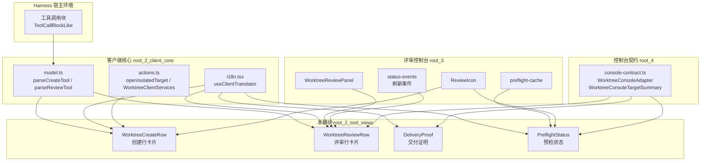
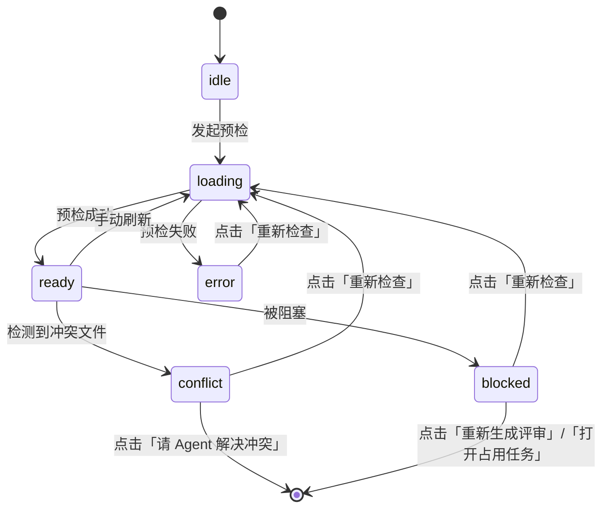
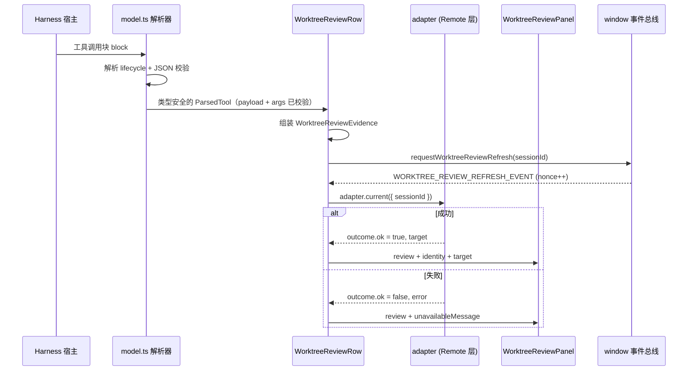
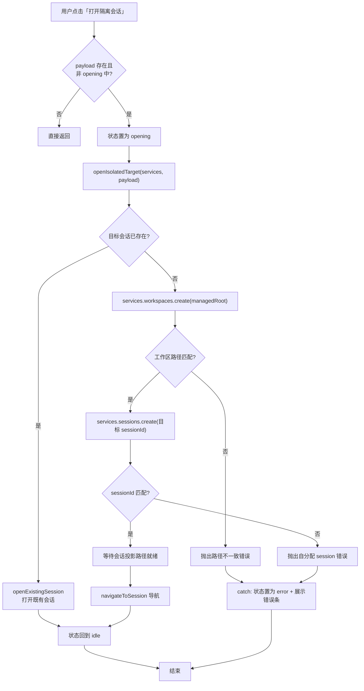

# 工具调用视图（Tool Views）

!!! info "Generated documentation"
    This page was written by CodeWiki from the source code at commit [`36d78408`](https://github.com/wloops/dsh-git-worktree/commit/36d784083cde39e99b6017025ce0d6c21dd439fe) on 2026-11-07 with `doubao-seed-2.1-lite`. Check the code before relying on details.

## 模块概述

本模块负责将 Agent 工具调用（Tool Call）的原始输出渲染为用户可读的交互式 UI 卡片。它是 Harness 会话界面中「工具调用行」的可视化层，专注于两类核心工具的展示：

1. **`worktree_create`** —— 展示隔离工作区创建结果，并提供「打开隔离会话」的入口按钮
2. **`worktree_ready_for_review`** —— 展示评审快照信息，并挂载可实时刷新的评审面板

此外，本模块还提供两个评审控制台（Review Console）的复用展示组件：**交付证明（DeliveryProof）** 与 **预检状态（PreflightStatus）**。

本模块处于纯展示层：不直接操作 Git 或文件系统，所有副作用（打开会话、创建工作区、刷新评审）均委托给 [客户端核心](root_2_client_core.md) 与 [控制台远程层](root_2_console_remote.md) 提供的服务。

---

## 架构定位



---

## 核心组件

### 1. `WorktreeCreateRow` —— 工作区创建行

**文件**: `src/client/WorktreeCreateRow.tsx`

将 `worktree_create` 工具调用渲染为一张信息卡片，展示：

| 字段 | 说明 |
|------|------|
| `checkoutId` | 检出实例标识 |
| `currentOid` | 基线提交的短 SHA（前 12 位） |
| `managedRoot` | 受管工作区路径（可点击，调用 `services.workspaces.openPath`） |

**打开隔离会话按钮**：
- 当 `payload.cwdSelected === true` 时隐藏按钮（宿主已将会话切到工作区内，无需再交接）
- 点击调用 [openIsolatedTarget](root_2_client_core.md)，内部处理「已存在会话 → 直接打开」「无会话 → 创建工作区与会话 → 导航」三种情况
- 按钮存在 `idle → opening → error` 三态机，打开失败时展示 `role="alert"` 的错误条

**挂载守卫**：组件通过 `mounted` ref 跟踪卸载状态，异步打开完成后若组件已卸载则不再写状态，避免 React 警告。

### 2. `WorktreeReviewRow` —— 评审就绪行

**文件**: `src/client/WorktreeReviewRow.tsx`

将 `worktree_ready_for_review` 工具调用渲染为评审卡片，内部组合 `WorktreeReviewPanel`。

**证据组装**：从 `parseReviewTool` 的结果中提取 `WorktreeReviewEvidence`：

```
reviewId / revision / iteration        ← payload
summary / validationStatus / tests     ← 工具调用参数 args
changedFiles / suggestedCommitMessage  ← payload + args
detailsMarkdown                        ← args.details（可选）
```

**实时目标同步**：组件持有可选的 `adapter: WorktreeConsoleAdapter`，通过 `adapter.current({ sessionId })` 拉取最新目标摘要 `liveTarget`：
- 若返回新的 revision 比 payload 更新，则保留旧值（避免评审面板在旧快照上闪烁）
- 拉取失败时将 `${code}: ${message}` 存入 `liveError`，透传给面板的 `unavailableMessage`

**刷新事件协议**：
- 挂载时调用 `requestWorktreeReviewRefresh(sessionId)` 广播「本会话评审已就绪」
- 监听 `window` 上的 `WORKTREE_REVIEW_REFRESH_EVENT`，收到匹配 `sessionId` 的事件时递增 `refreshNonce`，触发重新拉取

**静默过滤**：当工具以 `target_unselected` 报错（即尚未选定会话目标）时，组件返回 `null` 不渲染，避免在空白状态下展示无意义的错误卡片。

### 3. `DeliveryProof` —— 交付证明展示

**文件**: `src/client/review-console/DeliveryProof.tsx`

消费 `WorktreeConsoleTargetSummary.deliveryProof`，以 `<dl>` 描述列表展示交付证据：

- **commit**：交付提交 OID（无新提交时显示占位文案）
- **local**：本地分支名（detached HEAD 时显示 `detached head`）+ 头部变迁 `localHeadBefore → localHeadAfter`
- **files**：变更文件计数
- **validation**：验证状态标签（passed / failed / partial / not_run / 无摘要）
- **local history**：提交是否仍在本地历史中（三态：是 / 否 / 无法确认）

**生命周期文案**：根据目标 `state` 推导环境处置状态：
- `delivered` → 「环境已清理」
- `retained` → 「环境已保留，直到 <过期时间>」
- `cleanup_pending` → 「提交已创建，环境清理待处理」
- 其他 → 「已记录交付证据」

**紧凑模式**：`compact` 属性输出单行摘要（commit · 分支@短SHA · 文件数 · 生命周期），用于侧边栏等空间受限位置。

### 4. `PreflightStatus` —— 预检状态展示

**文件**: `src/client/review-console/PreflightStatus.tsx`

消费 `PreflightSnapshot`（来自请求缓存）与可选 `target`，渲染「只读同步预检」的结果：

**快照状态分支**：



**预检结果类型与对应 UI**：

| 预检 `status` | 展示 | 可用动作 |
|---------------|------|----------|
| `ready` | 「同步条件已确认」+ 本地/工作区/有效基线/变更数事实表 | （由父级提供应用按钮） |
| `local_advanced` | 「本地已领先，可安全合并」 | 同上 |
| `already_in_local` | 「本次迭代已在本地」 | 同上 |
| `conflict` | 冲突警告块 + 冲突文件计数 | 重新检查、请 Agent 解决冲突 |
| `blocked` | 阻塞原因文案 | 重新检查；按原因附加「重新生成评审」（stale_isolated）或「打开占用任务」（project_acceptance_busy） |

**占用者信息**：当阻塞原因为 `project_acceptance_busy` 时，从 `preflight.blocker` 或 `target.reviewSlotHolder` 取出占用任务（checkoutId、ownerSessionId、状态），翻译为可读状态标签展示。

**能力门禁**：「请 Agent 解决冲突」按钮在 `target.capabilities.resumeRevision` 为假时禁用。

---

## 数据流



---

## 打开隔离会话流程（WorktreeCreateRow）



---

## 依赖关系

### 上游依赖（被本模块引用）

| 依赖 | 提供能力 | 文档 |
|------|----------|------|
| `model.ts` | `parseCreateTool` / `parseReviewTool` 解析、`ToolCallViewPropsLike` 契约 | [客户端核心](root_2_client_core.md) |
| `actions.ts` | `openIsolatedTarget`、`WorktreeClientServices` 服务接口 | [客户端核心](root_2_client_core.md) |
| `i18n.tsx` | `useClientTranslator` / `useClientLanguage` 国际化 | [客户端核心](root_2_client_core.md) |
| `WorktreeReviewPanel` | 评审面板本体（证据 + 身份 + 实时目标） | root_3 模块 |
| `status-events.ts` | 评审刷新事件广播与监听 | root_3 模块 |
| `preflight-cache.ts` | `PreflightSnapshot` 类型 | root_3 模块 |
| `ReviewIcon` | 图标渲染 | root_3 模块 |
| `console-contract.ts` | `WorktreeConsoleAdapter` / `WorktreeConsoleTargetSummary` 远程契约 | root_4 模块 |
| `types.ts` | `WorktreeApplyPreflightView` 预检视图类型 | root_7 模块 |

### 下游消费（谁使用本模块）

本模块的两个 Row 组件由 Harness 的 ToolView 注册器按 `toolName` 分发挂载：
- `worktree_create` → `WorktreeCreateRow`
- `worktree_ready_for_review` → `WorktreeReviewRow`

`DeliveryProof` 与 `PreflightStatus` 是被 [评审控制台面板](../root_3.md) 与目标控制台（root_4）复用的展示积木。

---

## 关键设计决策

1. **解析与渲染分离**：原始工具输出的 JSON 校验全部收敛在 `model.ts` 的解析函数中，Row 组件只消费类型安全的 `ParsedTool`，自身不做字符串解析。
2. **可降级的实时性**：`adapter` 是可选注入。无 adapter 时（如纯日志回放场景），评审证据仍来自工具调用 payload，面板仅缺少实时目标同步能力。
3. **事件解耦的刷新**：评审就绪通过 `window` CustomEvent 跨组件广播，避免 Row 与面板之间硬耦合；nonce 递增驱动 effect 重跑，保证刷新幂等。
4. **卸载守卫**：所有异步回调（打开会话、adapter 拉取）都通过 `mounted`/`active` 标志防护，防止组件卸载后 setState。
5. **静默错误过滤**：`target_unselected` 这类「前置条件未满足」的错误不渲染卡片，减少界面噪音。

??? abstract "Documented components (4)"
    - [`__file__`](https://github.com/wloops/dsh-git-worktree/blob/36d784083cde39e99b6017025ce0d6c21dd439fe/src%5Cclient%5CWorktreeCreateRow.tsx) — `src\client\WorktreeCreateRow.tsx`
    - [`__file__`](https://github.com/wloops/dsh-git-worktree/blob/36d784083cde39e99b6017025ce0d6c21dd439fe/src%5Cclient%5CWorktreeReviewRow.tsx) — `src\client\WorktreeReviewRow.tsx`
    - [`__file__`](https://github.com/wloops/dsh-git-worktree/blob/36d784083cde39e99b6017025ce0d6c21dd439fe/src%5Cclient%5Creview-console%5CDeliveryProof.tsx) — `src\client\review-console\DeliveryProof.tsx`
    - [`PreflightStatus`](https://github.com/wloops/dsh-git-worktree/blob/36d784083cde39e99b6017025ce0d6c21dd439fe/src%5Cclient%5Creview-console%5CPreflightStatus.tsx) — `src\client\review-console\PreflightStatus.tsx`

