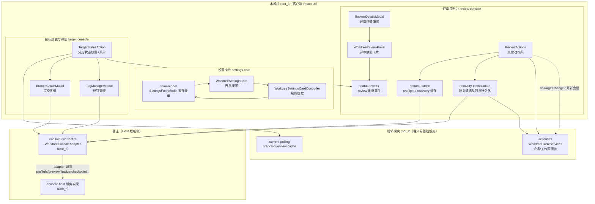
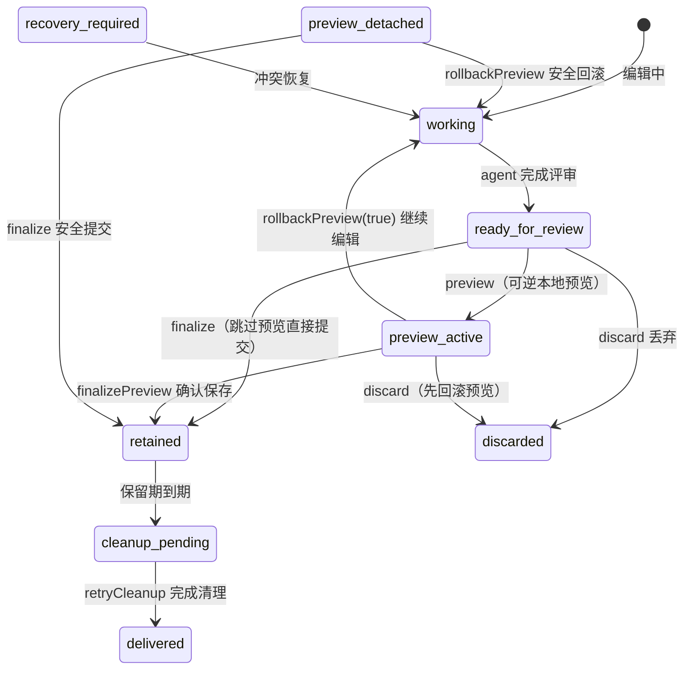

# root_3：Worktree 客户端控制台 UI（评审、设置与目标胶囊）

!!! info "Generated documentation"
    This page was written by CodeWiki from the source code at commit [`46e0c382`](https://github.com/wloops/dsh-git-worktree/commit/46e0c382490ad42db423bf5c77b7b61d01910892) on 2026-11-07 with `doubao-seed-2.1-lite`. Check the code before relying on details.

本模块是 Worktree 插件在 **客户端浏览器侧** 的 React UI 层，围绕托管工作树（managed worktree）的「评审—交付—恢复」闭环提供三块界面：

1. **评审控制台（review-console）**：展示某一次迭代的评审摘要、校验结果与交付动作条，驱动预览、保存、提交、回滚、冲突恢复等全部写操作。
2. **设置卡片（settings-card）**：把插件配置页挂进宿主的 Plugins 页面，以「暂存—保存」表单模型编辑交付/推送开关、工作树根目录与 Git 超时。
3. **目标控制台弹窗（target-console 客户端弹窗部分）**：会话旁的分支胶囊、提交图谱弹窗、标签管理器弹窗。

本模块的所有写操作都以 **Host 权威身份（CAS 身份：sessionId/checkoutId/revision/reviewId）** 为围栏，绝不信任浏览器本地状态；网络通信经 `WorktreeConsoleAdapter`（见 [组合根、领域端口与国际化（root_6）](root_6.md) 的 `console-contract.ts`）完成，宿主侧服务实现见 [Worktree Console 宿主与远程协议层（root_5）](root_5.md) 的 `console-host`。

## 架构总览

### 关键设计

- **身份围栏（CAS identity）**：每次写操作（预览、提交、回滚、丢弃等）都携带 `sessionId + checkoutId + expectedRevision + expectedReviewId`，Host 侧校验失败即返回 `stale_target`/`stale_local`/`stale_isolated`，客户端据此刷新并停止操作，杜绝过期状态下的误写。
- **单一请求缓存形状**：`createRequestCache` 是所有「身份键控只读读」的统一骨架——单飞（single-flight）合并并发请求、按 adapter 分桶（WeakMap）、代次（generation）防旧响应回写过期快照。预飞行（preflight）与 detached 预览恢复评估各建一个实例。
- **持久化恢复队列**：冲突解决与只读重生成两类「需要 agent 下一轮 turn 处理」的请求，入队后经 `localStorage` 持久化（尽力而为），发送前重新校验 Host + Harness 身份；浏览器状态从不作为权威。
- **状态广播**：任何 mutation 成功后 `requestWorktreeReviewRefresh` 派发全局 CustomEvent，让评审卡片、dock、侧边栏徽章等所有挂载面重新读取 Host 权威 target。
- **设置页自我包含**：因插件随附的 `client-ui-primitives` 版本早于共享 SettingsForm，设置卡片用内联样式与自实现的暂存表单模型绘制，不依赖外部样式表。

## 子模块

### 评审控制台 — [root_3/root_3_review_console.md](root_3/root_3_review_console.md)

评审摘要卡片（`WorktreeReviewPanel`）、交付动作条（`ReviewActions`）、评审详情弹窗（`ReviewDetailsModal`）、图标库（`ReviewIcon`），以及支撑它们的只读缓存（`preflight-cache`、`preview-recovery-cache` 基于 `request-cache`）、恢复请求队列（`recovery-continuation`）和刷新事件（`status-events`）。动作条按目标状态机（`ready_for_review` → `preview_active` → `preview_detached`/`recovery_required` → `retained`/`delivered`）渲染不同的主按钮与更多菜单。

### 设置卡片 — [root_3/root_3_settings_card.md](root_3/root_3_settings_card.md)

暂存式设置表单模型（`SettingsFormModel`）、卡片视图（`WorktreeSettingsCard`）、控制器（`WorktreeSettingsCardController`）以及挂载入口（`mountSettingsCard`）。编辑 `autoDeliver`、`autoPush`、`worktreesRoot`、`gitTimeoutMs`、`worktreeAddTimeoutMs` 五个字段，经宿主 `configForms` 与 `slots` 服务以 fail-soft 方式接入。

### 目标胶囊与弹窗 — [root_3/root_3_target_console.md](root_3/root_3_target_console.md)

会话旁的分支状态胶囊（`TargetStatusAction`）：轮询当前 target、弹出分支切换/创建/清理、标签管理、提交图谱、工作树请求排队、清理丢弃等菜单；以及 `BranchGraphModal`（GitHub 风格 SVG lane 渲染的仓库提交图谱）与 `TagManagerModal`（本地标签的创建/删除/推送）。

## 模块关系

| 方向 | 关系 |
| --- | --- |
| 依赖 [root_2：持久化适配器与浏览器客户端桥接层](root_2.md) | 复用 `actions.ts` 的 `WorktreeClientServices`（会话绑定、打开会话/隔离目标、草稿预填）、`current-polling`、`branch-overview-cache`、`PreflightStatus`/`DeliveryProof` 展示组件 |
| 依赖 [组合根、领域端口与国际化（root_6）](root_6.md) | 类型来源：`console-contract.ts` 的 `WorktreeConsoleAdapter` 及全部请求/响应/错误类型；`types.ts` 的 `WorktreeApplyPreflightView`、`WorktreePreviewRecoveryProof`、`WorktreeRetentionMode` |
| 关联 [Worktree Console 宿主与远程协议层（root_5）](root_5.md) | `WorktreeConsoleAdapter` 的宿主实现（`console-host/service.ts`）在服务端处理本模块发起的全部 RPC |
| 关联 [root_4：Worktree 控制台客户端与宿主命令面](root_4.md) | 目标控制台的其余部分（`WorktreeConsoleView`、`WorktreeManagerModal`、`WorktreeReviewStatus`、样式与上下文）由 root_4 承载，本模块只提供被其装配的胶囊与弹窗 |

## 状态机视图（交付动作条的状态分支）

每种状态下 `ReviewActions` 只暴露该状态 capabilities 允许的按钮组合，且写前强制 `force` 刷新预飞行，确保界面动作始终建立在 Host 最新事实上。

??? abstract "Documented components (41)"
    - [`__file__`](https://github.com/wloops/dsh-git-worktree/blob/46e0c382490ad42db423bf5c77b7b61d01910892/src%5Cclient%5Creview-console%5CReviewActions.tsx) — `src\client\review-console\ReviewActions.tsx`
    - [`validationIcon`](https://github.com/wloops/dsh-git-worktree/blob/46e0c382490ad42db423bf5c77b7b61d01910892/src%5Cclient%5Creview-console%5CReviewDetailsModal.tsx) — `src\client\review-console\ReviewDetailsModal.tsx`
    - [`ReviewIcon`](https://github.com/wloops/dsh-git-worktree/blob/46e0c382490ad42db423bf5c77b7b61d01910892/src%5Cclient%5Creview-console%5CReviewIcon.tsx) — `src\client\review-console\ReviewIcon.tsx`
    - [`WorktreeReviewEvidence`](https://github.com/wloops/dsh-git-worktree/blob/46e0c382490ad42db423bf5c77b7b61d01910892/src%5Cclient%5Creview-console%5CWorktreeReviewPanel.tsx) — `src\client\review-console\WorktreeReviewPanel.tsx`
    - [`WorktreeReviewIdentity`](https://github.com/wloops/dsh-git-worktree/blob/46e0c382490ad42db423bf5c77b7b61d01910892/src%5Cclient%5Creview-console%5CWorktreeReviewPanel.tsx) — `src\client\review-console\WorktreeReviewPanel.tsx`
    - [`WorktreeReviewPanelProps`](https://github.com/wloops/dsh-git-worktree/blob/46e0c382490ad42db423bf5c77b7b61d01910892/src%5Cclient%5Creview-console%5CWorktreeReviewPanel.tsx) — `src\client\review-console\WorktreeReviewPanel.tsx`
    - [`reviewEvidenceFromTarget`](https://github.com/wloops/dsh-git-worktree/blob/46e0c382490ad42db423bf5c77b7b61d01910892/src%5Cclient%5Creview-console%5Cindex.ts) — `src\client\review-console\index.ts`
    - [`PreflightSnapshot`](https://github.com/wloops/dsh-git-worktree/blob/46e0c382490ad42db423bf5c77b7b61d01910892/src%5Cclient%5Creview-console%5Cpreflight-cache.ts) — `src\client\review-console\preflight-cache.ts`
    - [`PreviewRecoverySnapshot`](https://github.com/wloops/dsh-git-worktree/blob/46e0c382490ad42db423bf5c77b7b61d01910892/src%5Cclient%5Creview-console%5Cpreview-recovery-cache.ts) — `src\client\review-console\preview-recovery-cache.ts`
    - [`PersistedRecovery`](https://github.com/wloops/dsh-git-worktree/blob/46e0c382490ad42db423bf5c77b7b61d01910892/src%5Cclient%5Creview-console%5Crecovery-continuation.ts) — `src\client\review-console\recovery-continuation.ts`
    - [`RecoveryEntry`](https://github.com/wloops/dsh-git-worktree/blob/46e0c382490ad42db423bf5c77b7b61d01910892/src%5Cclient%5Creview-console%5Crecovery-continuation.ts) — `src\client\review-console\recovery-continuation.ts`
    - [`WorktreeApplyConflictRecoveryRequest`](https://github.com/wloops/dsh-git-worktree/blob/46e0c382490ad42db423bf5c77b7b61d01910892/src%5Cclient%5Creview-console%5Crecovery-continuation.ts) — `src\client\review-console\recovery-continuation.ts`
    - [`WorktreeRecoverySnapshot`](https://github.com/wloops/dsh-git-worktree/blob/46e0c382490ad42db423bf5c77b7b61d01910892/src%5Cclient%5Creview-console%5Crecovery-continuation.ts) — `src\client\review-console\recovery-continuation.ts`
    - [`WorktreeReviewRegenerationRequest`](https://github.com/wloops/dsh-git-worktree/blob/46e0c382490ad42db423bf5c77b7b61d01910892/src%5Cclient%5Creview-console%5Crecovery-continuation.ts) — `src\client\review-console\recovery-continuation.ts`
    - [`Entry`](https://github.com/wloops/dsh-git-worktree/blob/46e0c382490ad42db423bf5c77b7b61d01910892/src%5Cclient%5Creview-console%5Crequest-cache.ts) — `src\client\review-console\request-cache.ts`
    - [`RequestCache`](https://github.com/wloops/dsh-git-worktree/blob/46e0c382490ad42db423bf5c77b7b61d01910892/src%5Cclient%5Creview-console%5Crequest-cache.ts) — `src\client\review-console\request-cache.ts`
    - [`__file__`](https://github.com/wloops/dsh-git-worktree/blob/46e0c382490ad42db423bf5c77b7b61d01910892/src%5Cclient%5Creview-console%5Creview-console.styles.ts) — `src\client\review-console\review-console.styles.ts`
    - [`requestWorktreeReviewRefresh`](https://github.com/wloops/dsh-git-worktree/blob/46e0c382490ad42db423bf5c77b7b61d01910892/src%5Cclient%5Creview-console%5Cstatus-events.ts) — `src\client\review-console\status-events.ts`
    - [`WorktreeSettingsCardProps`](https://github.com/wloops/dsh-git-worktree/blob/46e0c382490ad42db423bf5c77b7b61d01910892/src%5Cclient%5Csettings-card%5CWorktreeSettingsCard.tsx) — `src\client\settings-card\WorktreeSettingsCard.tsx`
    - [`PlannedWrite`](https://github.com/wloops/dsh-git-worktree/blob/46e0c382490ad42db423bf5c77b7b61d01910892/src%5Cclient%5Csettings-card%5Cform-model.ts) — `src\client\settings-card\form-model.ts`
    - [`SettingsFieldSpec`](https://github.com/wloops/dsh-git-worktree/blob/46e0c382490ad42db423bf5c77b7b61d01910892/src%5Cclient%5Csettings-card%5Cform-model.ts) — `src\client\settings-card\form-model.ts`
    - [`SettingsFieldState`](https://github.com/wloops/dsh-git-worktree/blob/46e0c382490ad42db423bf5c77b7b61d01910892/src%5Cclient%5Csettings-card%5Cform-model.ts) — `src\client\settings-card\form-model.ts`
    - [`SettingsFormActions`](https://github.com/wloops/dsh-git-worktree/blob/46e0c382490ad42db423bf5c77b7b61d01910892/src%5Cclient%5Csettings-card%5Cform-model.ts) — `src\client\settings-card\form-model.ts`
    - [`SettingsFormModel`](https://github.com/wloops/dsh-git-worktree/blob/46e0c382490ad42db423bf5c77b7b61d01910892/src%5Cclient%5Csettings-card%5Cform-model.ts) — `src\client\settings-card\form-model.ts`
    - [`SettingsFormScope`](https://github.com/wloops/dsh-git-worktree/blob/46e0c382490ad42db423bf5c77b7b61d01910892/src%5Cclient%5Csettings-card%5Cform-model.ts) — `src\client\settings-card\form-model.ts`
    - [`SettingsFormScopeSnapshot`](https://github.com/wloops/dsh-git-worktree/blob/46e0c382490ad42db423bf5c77b7b61d01910892/src%5Cclient%5Csettings-card%5Cform-model.ts) — `src\client\settings-card\form-model.ts`
    - [`SettingsFormShell`](https://github.com/wloops/dsh-git-worktree/blob/46e0c382490ad42db423bf5c77b7b61d01910892/src%5Cclient%5Csettings-card%5Cform-model.ts) — `src\client\settings-card\form-model.ts`
    - [`StagedEdit`](https://github.com/wloops/dsh-git-worktree/blob/46e0c382490ad42db423bf5c77b7b61d01910892/src%5Cclient%5Csettings-card%5Cform-model.ts) — `src\client\settings-card\form-model.ts`
    - [`ConfigFormsService`](https://github.com/wloops/dsh-git-worktree/blob/46e0c382490ad42db423bf5c77b7b61d01910892/src%5Cclient%5Csettings-card%5Cindex.ts) — `src\client\settings-card\index.ts`
    - [`SlotsService`](https://github.com/wloops/dsh-git-worktree/blob/46e0c382490ad42db423bf5c77b7b61d01910892/src%5Cclient%5Csettings-card%5Cindex.ts) — `src\client\settings-card\index.ts`
    - [`WorktreeSettings`](https://github.com/wloops/dsh-git-worktree/blob/46e0c382490ad42db423bf5c77b7b61d01910892/src%5Cclient%5Csettings-card%5Cworktree-settings-card.ts) — `src\client\settings-card\worktree-settings-card.ts`
    - [`WorktreeSettingsCardController`](https://github.com/wloops/dsh-git-worktree/blob/46e0c382490ad42db423bf5c77b7b61d01910892/src%5Cclient%5Csettings-card%5Cworktree-settings-card.ts) — `src\client\settings-card\worktree-settings-card.ts`
    - [`WorktreeSettingsCardFace`](https://github.com/wloops/dsh-git-worktree/blob/46e0c382490ad42db423bf5c77b7b61d01910892/src%5Cclient%5Csettings-card%5Cworktree-settings-card.ts) — `src\client\settings-card\worktree-settings-card.ts`
    - [`WorktreeSettingsCardState`](https://github.com/wloops/dsh-git-worktree/blob/46e0c382490ad42db423bf5c77b7b61d01910892/src%5Cclient%5Csettings-card%5Cworktree-settings-card.ts) — `src\client\settings-card\worktree-settings-card.ts`
    - [`__file__`](https://github.com/wloops/dsh-git-worktree/blob/46e0c382490ad42db423bf5c77b7b61d01910892/src%5Cclient%5Cstyles.ts) — `src\client\styles.ts`
    - [`BranchGraphModalProps`](https://github.com/wloops/dsh-git-worktree/blob/46e0c382490ad42db423bf5c77b7b61d01910892/src%5Cclient%5Ctarget-console%5CBranchGraphModal.tsx) — `src\client\target-console\BranchGraphModal.tsx`
    - [`GraphEdge`](https://github.com/wloops/dsh-git-worktree/blob/46e0c382490ad42db423bf5c77b7b61d01910892/src%5Cclient%5Ctarget-console%5CBranchGraphModal.tsx) — `src\client\target-console\BranchGraphModal.tsx`
    - [`GraphRefBadge`](https://github.com/wloops/dsh-git-worktree/blob/46e0c382490ad42db423bf5c77b7b61d01910892/src%5Cclient%5Ctarget-console%5CBranchGraphModal.tsx) — `src\client\target-console\BranchGraphModal.tsx`
    - [`GraphRowLanes`](https://github.com/wloops/dsh-git-worktree/blob/46e0c382490ad42db423bf5c77b7b61d01910892/src%5Cclient%5Ctarget-console%5CBranchGraphModal.tsx) — `src\client\target-console\BranchGraphModal.tsx`
    - [`TagManagerModalProps`](https://github.com/wloops/dsh-git-worktree/blob/46e0c382490ad42db423bf5c77b7b61d01910892/src%5Cclient%5Ctarget-console%5CTagManagerModal.tsx) — `src\client\target-console\TagManagerModal.tsx`
    - [`TargetStatusActionProps`](https://github.com/wloops/dsh-git-worktree/blob/46e0c382490ad42db423bf5c77b7b61d01910892/src%5Cclient%5Ctarget-console%5CTargetStatusAction.tsx) — `src\client\target-console\TargetStatusAction.tsx`

